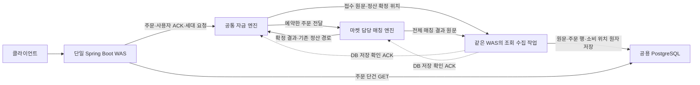

# Exchange Core

[](https://github.com/0Chord/coin-exchange/actions/workflows/build-and-test.yml?query=event%3Apull_request)

Kotlin으로 구현한 현물 거래 백엔드입니다. **HTTP 요청을 받는 WAS는 하나**이며, 주문은 공통 자금 엔진에 보내고 주문 조회는 공용 PostgreSQL을 읽습니다. 같은 WAS의 수집 작업이 실제 접수·매칭 결과·자금 확정 위치를 RDB에 자동 반영합니다. 주문·조회 API를 실행 프로필로 나누지 않습니다.

사용 기술: Kotlin 2.3.21 · Java 25 · Spring Boot 4.1.0 · Aeron Cluster 1.53.3 · PostgreSQL 16 · Flyway · JUnit Jupiter · Testcontainers

## 현재 실행 구조



- 시작점은 [ExchangeCoreApplication](app-api/src/main/kotlin/com/exchange/core/ExchangeCoreApplication.kt) 하나입니다. 기본 컴포넌트 탐색으로 주문·조회 Controller와 설정을 등록합니다.
- 주문·취소·사용자 ACK·세대 요청은 자금 엔진 한 곳으로 보냅니다. 조회 수집 작업의 내부 연결은 자금 원본과 각 매칭 담당을 읽으며, 한 담당이 여러 마켓을 맡거나 두 담당이 나누어 맡는 고정 배치를 지원합니다.
- 자금·매칭 소유자가 확정한 불변 원문을 각 역할의 유한한 복제 상태로 보관합니다. WAS는 금융 계산을 다시 실행하거나 메모리 주문장을 직접 읽지 않습니다.
- [조회 수집 작업](app-api/src/main/kotlin/com/exchange/core/api/trading/infrastructure/aeron/OrderQueryFeedWorker.kt)은 DB 커밋을 확인한 소비 위치만 소스에 ACK합니다. 소스의 복제 callback에서 ACK가 확정돼야 해당 원문을 회수합니다. 기존 주문 전달·정산 ACK는 별도 수명입니다.
- 수집 설정이 없거나 최초 수집·원본 재검증을 마치지 못한 WAS는 `503 QUERY_NOT_READY`입니다. 준비된 범위만 실제 RDB 주문을 반환합니다.

Spring Boot의 공용 DataSource·JDBC·트랜잭션·Flyway를 사용합니다. `order_query`는 같은 RDB 안의 테이블 이름 공간입니다. 별도 조회 WAS·DB 서버·실행 프로필은 추가하지 않습니다.

## 주문 한 건의 흐름

1. WAS가 요청 토큰과 주문 내용을 검증해 자금 엔진에 보냅니다. 자금 엔진은 조회 보관 여유를 확인한 뒤 예약·접수를 확정하고 실제 전역 접수 순번의 원문을 함께 보존합니다.
2. 기존 전달 작업이 담당 매칭 엔진에 주문을 보냅니다. 매칭은 주문장을 바꾸기 전에 업무 결과 보관과 조회 보관 양쪽의 여유를 검사하고 전체 결과를 마켓별 순번으로 확정합니다.
3. 확정 결과는 기존 경로로 자금 엔진에 돌아와 정산됩니다. 조회 수집이 늦어져도 이미 확정된 결과의 정산·반환과 업무 ACK는 계속합니다.
4. 같은 WAS의 수집 작업이 접수 원문, maker/taker를 모두 포함한 매칭 원문, 같은 결과 stream의 정산 완료 위치를 읽습니다. 원문·주문 행·최초 처리 결과·revision·소스별 소비 위치를 한 DB 트랜잭션에 저장합니다.
5. GET은 저장된 주문과 진행도를 함께 읽습니다. 같은 원문을 다시 받으면 최초 DB 결과를 재사용합니다. DB 커밋 응답이나 소스 ACK 응답을 잃어도 저장된 소비 위치부터 재확인합니다.

[실제 HTTP 검증](app-api/src/test/kotlin/com/exchange/core/api/trading/infrastructure/aeron/SplitFundsTradingHttpTest.kt)은 매도 3 → 매수 1 → 잔량 2 취소를 실행합니다. GET은 매도 주문의 `체결 1·대기 2`를 반환하고, 취소 후 `체결 1·대기 0·취소 2`를 유지합니다. 정산을 잠시 막으면 `PENDING(SETTLEMENT)`, 반환을 막으면 `PENDING(RELEASE)`, 실제 자금 확정 뒤에는 `APPLIED`입니다.

[두 마켓 검증](app-api/src/test/kotlin/com/exchange/core/api/trading/infrastructure/aeron/MultiMarketOrderQueryHttpTest.kt)은 실제 자금 노드 하나와 BTC·ETH 매칭 담당 둘을 사용합니다. 같은 WAS에서 접수 1~4, 각 마켓 결과 1~2, 네 주문의 `FILLED/APPLIED`, 전역 접수 ACK 4와 마켓별 조회 ACK 2를 대조합니다. 이 연결 검사의 수수료는 0이며 일반 수수료 계산은 도메인 테스트가 확인합니다.

## API와 조회 기준

| 요청 | 역할 |
| --- | --- |
| `POST /api/trading/v3/channels/{channel}/epoch` | 요청 세대 발급·전환 |
| `POST /api/trading/v3/markets/{marketId}/orders` | 자금 엔진에 주문 접수 |
| `POST /api/trading/v3/markets/{marketId}/orders/{orderId}/cancel` | 자금 엔진에 잔량 취소 요청 접수 |
| `POST /api/trading/v3/channels/{channel}/ack` | 확인한 접수 결과의 연속 순번 알림 |
| `GET /api/trading/v3/markets/{marketId}/orders/{orderId}` | RDB 주문 상태·수량·금융 처리 상태 조회 |

주문 응답이 끊기거나 `504 OUTCOME_UNKNOWN`을 받으면 결과를 확인 중으로 둡니다. 주문을 계속 진행하려면 처음과 같은 요청 번호(`userId`, `channel`, `epoch`, `sequence`)와 같은 마켓·주문 내용으로 POST를 다시 보냅니다. 이미 접수됐으면 자금 엔진이 최초 접수 정보를 돌려주고, 첫 요청이 도착하지 않았다면 이 재전송이 첫 접수가 될 수 있습니다. `ACCEPTED` 응답의 `orderId`로 GET을 호출하고, `minAdmissionSequence`에는 응답의 `admissionSequence`를 넣습니다.

확인한 응답의 연속 순번만 ACK로 정리합니다. 응답이 정리됐거나 요청 세대가 바뀌면 새 번호로 자동 재주문하지 않습니다. 이미 보관한 `orderId`가 있으면 기존 GET으로 조회합니다. [응답 유실과 재시작 검증](engineering/order-timeout-recovery-spec.md)

취소 POST의 본문은 `userId`, `channel`, `epoch`, `sequence`, `expectedConfigurationVersion`입니다. 취소에는 주문과 다른 요청 순번을 쓰고, 응답을 잃어 재전송할 때는 같은 취소 요청 순번과 내용을 씁니다. `202 ACCEPTED`는 취소 요청 접수이며, 기존 GET에서 `CANCELLED / PENDING(RELEASE)` 또는 `CANCELLED / APPLIED`로 잔량 취소와 반환 진행을 확인합니다. [취소 흐름과 HTTP 계약](engineering/split-cancel-http-spec.md)

조회의 `minAdmissionSequence`가 아직 반영되지 않았으면 `202 QUERY_CATCHING_UP`입니다. 준비된 범위라도 관찰한 원본보다 DB가 뒤처진 동안 부재는 202이며, 관찰 기준까지 반영한 뒤에만 `404 ORDER_NOT_FOUND_AS_OF`를 반환합니다. 원본 연결 실패·재검증 중, DB 오류, 원본 공백·정체성 모순은 503입니다. `CAUGHT_UP`은 마지막으로 검증한 원본 기준까지 반영됐다는 뜻입니다.

조회 원본의 건수·bytes 한도가 차면 새 접수는 예약 전에 `RETRYABLE_CAPACITY`, 새 매칭 변경은 `BUSY`로 제한합니다. 원문을 버리거나 BUSY를 취소·예약 반환으로 바꾸지 않습니다. 사용자 인증·인가, 체결 상세 API, 원장 대사와 오래된 기록의 자동 이행은 이번 범위 밖입니다.

## 설정과 실행

Java 25와 PostgreSQL, 초기화된 자금·매칭 노드가 필요합니다. WAS는 엔진 노드나 개발 잔고를 자동 생성하지 않습니다. **현행 WAS의 주문 전송과 조회 수집은 input contract 2를 사용**하므로 연결할 소스는 `SPLIT_INPUT_CONTRACT_VERSION=2`, `SPLIT_MODE=RESULT_SETTLEMENT_DEV`로 구성합니다. 조회 Describe에서도 입력 계약을 확인해 미지원 소스를 READY로 열지 않습니다.

| 설정 | 의미 |
| --- | --- |
| `SPRING_DATASOURCE_URL`, `SPRING_DATASOURCE_USERNAME`, `SPRING_DATASOURCE_PASSWORD` | 공용 PostgreSQL 접속 정보 |
| `exchange.order-query.funds-lineage-high/low` | 연결할 자금 엔진의 계보 |
| `exchange.order-query.supported-markets` | 조회 지원 마켓, 쉼표 구분 |
| 소스의 `EXCHANGE_ORDER_QUERY_CONSUMER_ID` | 조회 원본 보관 활성화. 모든 소스 멤버에서 같은 고정 값 사용 |
| WAS의 `exchange.order-query.consumer-id` | 같은 소비자로 조회 수집 작업 활성화 |
| `exchange.order-query.matching-ingress` | 전체 원본 마켓별 담당 주소. `MARKET@ingress`를 세미콜론으로 구분 |
| 기존 `TRADING_GATEWAY_*` | 자금 ingress, WAS egress·전송 한도·새 프로세스의 실행 폴더 |

소스의 기존 manifest·역할·멤버·담당 배치 설정과 함께 다음을 공급합니다. 실행 프로필은 선택하지 않습니다.

```sh
export SPLIT_MODE=RESULT_SETTLEMENT_DEV
export SPLIT_INPUT_CONTRACT_VERSION=2
export EXCHANGE_ORDER_QUERY_CONSUMER_ID=order-query-dev
```

조회 보관의 기본 건수는 전체 4,096/마켓 2,048입니다. 기본 bytes는 기존 자금·정산 receipt를 포함한 128MiB snapshot 예산의 남은 공간에서 전체 최대 4MiB/마켓 최대 2MiB로 정합니다. `EXCHANGE_ORDER_QUERY_MAX_ENTRIES`, `EXCHANGE_ORDER_QUERY_MAX_BYTES`, `EXCHANGE_ORDER_QUERY_MAX_MARKET_ENTRIES`, `EXCHANGE_ORDER_QUERY_MAX_MARKET_BYTES`로 명시할 수 있으며 모든 멤버가 같은 값을 써야 합니다. 최대 원문 하나나 전체 snapshot을 담지 못하면 시작을 거절합니다.

WAS의 예시입니다. 주소·lineage는 실제 소스 구성과 맞추고 DB 접속 정보는 위 환경 변수로 공급합니다. `TRADING_GATEWAY_RUN_ROOT`는 프로세스마다 새 경로를 사용하며, WAS 재시작 때 DB나 엔진 기록을 삭제하지 않습니다.

```sh
cd /Users/0chord/Desktop/exchange-core
JAVA_HOME=/Users/0chord/Library/Java/JavaVirtualMachines/corretto-25.0.2/Contents/Home ./gradlew :app-api:bootRun --args="\
--exchange.order-query.funds-lineage-high=41 \
--exchange.order-query.funds-lineage-low=42 \
--exchange.order-query.supported-markets=BTC-USDT,ETH-USDT \
--exchange.order-query.consumer-id=order-query-dev \
--exchange.order-query.matching-ingress=BTC-USDT@0=127.0.0.1:20700;ETH-USDT@0=127.0.0.1:21700 \
--TRADING_GATEWAY_INGRESS_ENDPOINTS=0=127.0.0.1:19700 \
--TRADING_GATEWAY_EGRESS_ENDPOINT=127.0.0.1:22700 \
--TRADING_GATEWAY_RUN_ROOT=/tmp/exchange-was-query-new"
```

IntelliJ에서는 이 저장소의 Gradle `:app-api:bootRun`을 실행합니다. main을 직접 실행하는 `ExchangeCoreApplicationKt` 설정에는 Aeron용 Java 25 VM options를 넣습니다. `bootRun`에는 이미 적용돼 있습니다.

```text
--add-opens=java.base/jdk.internal.misc=ALL-UNNAMED --add-opens=java.base/java.util.zip=ALL-UNNAMED
```

공용 Flyway의 V10은 조회 기반, `V11__create_order_query_source_feed.sql`은 원본 영수증·소비 위치를 추가합니다. 원본이 없는 예전 snapshot이나 이미 회수한 원본을 빈 DB의 전체 이력으로 취급하지 않습니다. 최초 활성화에는 처음부터 조회 원본을 보존한 계보·기록 root 또는 별도 이행 증거가 필요합니다. 자동 과거 이행은 제공하지 않습니다.

## 코드와 검증 읽는 순서

1. [WAS 조립](app-api/src/main/kotlin/com/exchange/core/ExchangeCoreApplication.kt), [조회 설정](app-api/src/main/kotlin/com/exchange/core/api/config/OrderQueryConfig.kt) — 기본 탐색과 공용 DB, 수집 활성화 조건.
2. [접수 보관](domain-trading/src/main/kotlin/com/exchange/core/trading/BoundedFundingState.kt), [매칭 보관](domain-trading/src/main/kotlin/com/exchange/core/trading/ReservedMatchingState.kt) — 확정 사실·한도·독립 ACK.
3. [수집 작업](app-api/src/main/kotlin/com/exchange/core/api/trading/infrastructure/aeron/OrderQueryFeedWorker.kt), [원자 반영](app-api/src/main/kotlin/com/exchange/core/api/trading/infrastructure/persistence/PostgresOrderQueryFeedStore.kt) — 원격 읽기부터 DB 커밋·소스 ACK까지.
4. [조회 판단](app-api/src/main/kotlin/com/exchange/core/api/trading/application/OrderQueryUseCase.kt), [기존 저장소](app-api/src/main/kotlin/com/exchange/core/api/trading/infrastructure/persistence/PostgresOrderQueryStore.kt) — 200/202/404/503과 저장 불변식.
5. [변경·테스트 기록](engineering/order-query-foundation-review.md) — 실제 assertion, 실행 결과와 독립 리뷰의 수정 근거.

2026-11-17 로컬 검증에서 코어 454개·조회 관련 102개·구조 386개가 실패·오류·skip 0이었습니다. 필수 P01~P09와 전체 스타일 검사를 통과했고 독립 리뷰의 확인된 지적을 해소했습니다. 일반 앱 회귀는 1,274개 통과·기존 조건부 시험 3개 skip이었으며, 원격 CI·PR·병합은 별도입니다.

이전 RDB 주문 실행과 통합형 프로토콜의 설정·Controller·오류 처리는 `src/test`에서 명시적으로 조립합니다. `@TestConfiguration`·`@TestComponent`를 사용해 제품의 기본 탐색에서 제외합니다. 과거 구성과 검증은 Git 이력 및 위 기록에 구분해 남깁니다.
