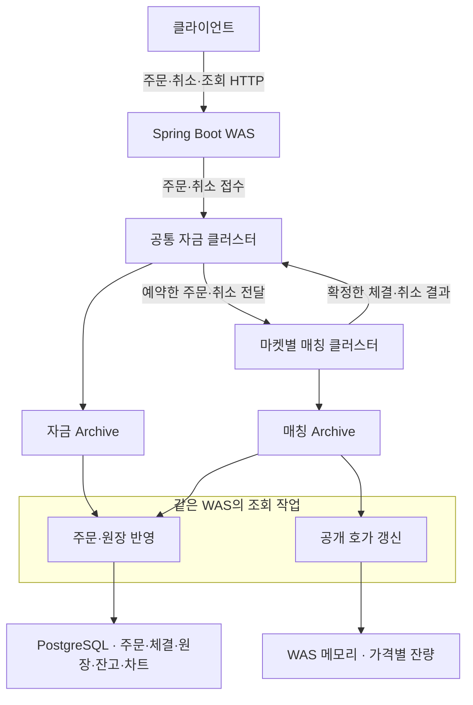

# Exchange Core

**주문 접수부터 체결·정산·조회까지 구현한 현물 거래 백엔드**

여러 마켓에서 같은 사용자 잔고를 쓰는 동안 초과 예약을 막고, 한 마켓의 매칭 장애가 다른 마켓으로 번지는 범위를 줄이기 위해 **공통 자금과 마켓별 매칭을 분리**했습니다. 조회는 확정된 거래 로그를 따라 PostgreSQL과 WAS 메모리에 반영할 수 있습니다.

> **5분 평균 51,349.61 정산 TPS** · 자금 3노드 + 매칭 3노드 · `sync=2`
>
> 로컬 고정 빌드에서 단일 마켓에 Aeron으로 직접 입력한 결과입니다. 접수 15,406,387건은 종료 후 대기분까지 전량 정산했습니다. [측정 조건·분별 결과·Archive 대조](engineering/results/split-3x3-aeron-20261123/README.md)

**현재 단계** 지정가 주문의 부분 체결·후속 체결·잔량 취소와 주문·잔고 조회를 HTTP로 확인할 수 있습니다. 시장 조회는 최근 정산 체결가, 8개 주기 차트, 공개 호가를 제공하며 사용자별 주문 목록도 조회할 수 있습니다.

Kotlin · Java 25 · Spring Boot · Aeron Cluster · Protobuf · PostgreSQL · Flyway

[아키텍처](#아키텍처) · [주문 한 건의 흐름](#주문-한-건의-흐름) · [공개 성능 기록](#공개-성능-기록) · [테스트 실행](#설정과-실행) · [CI 실행 기록](https://github.com/0Chord/coin-exchange/actions/workflows/build-and-test.yml?query=event%3Apull_request)

## 아키텍처

아래는 `exchange.order-query.source=archive`를 사용하는 **Archive 조회 모드** 구성입니다.



| 설계 결정 | 이유와 영향 |
| --- | --- |
| **공통 자금이 예약과 정산을 소유** | 두 마켓의 주문이 같은 잔고를 동시에 써도 한 클러스터가 순서대로 예약을 판단합니다. 전체 거래가 공유하는 클러스터이므로 과반을 잃으면 새 예약은 확정되지 않습니다. [공유 자금 설계](engineering/multi-matching-shared-funds-spec.md) · [과반 상실 검증](engineering/funds-quorum-failure-verification.md) |
| **매칭은 마켓별 주문장을 소유** | 각 마켓에서 가격·시간 우선으로 체결을 확정합니다. 한 담당이 여러 마켓을 맡을 수 있고, 필요에 따라 담당을 나눌 수 있습니다. 자금·매칭 사이에 비동기 전달이 생기므로 접수, 체결, 정산 완료를 구분합니다. 배치 전송을 켜면 연속해서 적용한 순번까지 확인하고 그 다음부터 이어 보냅니다. [마켓 배치](https://github.com/0Chord/coin-exchange/pull/184) · [양방향 전송 배치](https://github.com/0Chord/coin-exchange/pull/204) |
| **WAS가 Archive를 재생해 조회를 반영** | 과반 확정·서비스 적용·기록이 모두 확인된 위치까지 읽습니다. 조회 데이터와 소비 위치를 PostgreSQL에 같은 트랜잭션으로 커밋해 중단 뒤 이어서 반영합니다. 공개 호가는 매칭 로그를 별도로 따라가며, 조회의 최신성은 각 작업의 반영 위치에 따라 달라집니다. [Archive 조회 반영](https://github.com/0Chord/coin-exchange/pull/205) · [호가 재생](engineering/public-order-book-archive-spec.md) |

## 주문 한 건의 흐름

매도 3개를 접수하고, 1개가 체결된 뒤 남은 2개를 취소하는 실제 HTTP 시험입니다. 이 사례의 가격은 개당 100이고 수수료는 0입니다. [시험 코드](app-api/src/test/kotlin/com/exchange/core/api/trading/infrastructure/aeron/SplitFundsTradingHttpTest.kt#L951)

| 시점 | 엔진이 한 일 | 조회 결과와 매도 자산의 사용 가능 / 예약 |
| --- | --- | --- |
| 매도 3개 접수 | 자금이 매도 자산 3개를 예약하고 매칭이 주문장에 올립니다. | `RESTING` · 잔량 3 · **0 / 3** |
| 1개 체결·정산 | 매칭이 1개를 체결하고 자금이 대금 100을 반영합니다. | `PARTIALLY_FILLED` · 체결 1, 잔량 2 · **0 / 2** |
| 잔량 2개 취소 확정 | 매칭이 주문장에서 잔량을 제거합니다. 자금 적용을 기다리는 동안 예약은 유지됩니다. | `CANCELLED / PENDING(RELEASE)` · 체결 1, 취소 2 · **0 / 2** |
| 반환 완료 | 자금이 앞선 체결을 유지한 채 남은 예약 2개를 반환합니다. | `CANCELLED / APPLIED` · 취소 2 · **2 / 0** |

시험에서는 같은 취소 요청을 다시 보내도 최초 취소 ID가 돌아오고, 자금 결과 순번은 반환 시 한 번만 전진했습니다. 같은 PostgreSQL을 사용해 WAS를 다시 시작한 뒤에도 최종 조회 결과가 일치했습니다. [취소·반환 검증 기록](engineering/split-cancel-http-spec.md)

## API와 조회 기준

API 경로의 공통 접두사는 `/api/trading/v3`입니다.

| 기능 | API | 확인할 수 있는 동작 |
| --- | --- | --- |
| 요청 세대·응답 확인 | `POST /channels/{channel}/epoch`<br>`POST /channels/{channel}/ack` | 요청에 쓸 세대를 발급하고, 확인한 연속 요청 순번까지 접수 결과를 정리합니다. [요청 번호 계약](engineering/order-admission-protocol.md) |
| 주문·잔량 취소 | `POST /markets/{marketId}/orders`<br>`POST /markets/{marketId}/orders/{orderId}/cancel` | 지정가 GTC 접수, 부분·후속 체결, 잔량 취소와 예약금 반환. [주문 시험](engineering/gtc-follow-up-fill-spec.md) · [취소 계약](engineering/split-cancel-http-spec.md) |
| 주문·체결·수수료 | `GET /markets/{marketId}/orders/{orderId}`<br>`GET /markets/{marketId}/orders/{orderId}/fills` | 주문 상태, 체결별 ID, 정산 대기·완료, 실제 청구 수수료. [체결 조회](engineering/order-fill-query-spec-61.md) · [수수료](engineering/order-fill-fee-query-spec-62.md) |
| 자산 잔고 | `GET /users/{userId}/balances/{assetId}` | Archive 조회 모드에서 PostgreSQL에 반영한 사용 가능액과 예약액. [잔고 조회](https://github.com/0Chord/coin-exchange/pull/206) |
| 최근 체결가·차트 | `GET /markets/{marketId}/trades/latest`<br>`GET /markets/{marketId}/candles` | 최근 정산 체결가와 1분·5분·15분·1시간·일·주·월·연봉. 차트는 정산 적용 시각 기준입니다. [체결가](https://github.com/0Chord/coin-exchange/pull/208) · [차트](engineering/settled-candle-query-spec-209.md) |
| 공개 주문장 | `GET /markets/{marketId}/order-book` | 매수·매도 상위 10호가와 가격별 미체결 잔량. [공개 주문장](engineering/public-order-book-archive-spec.md) |
| 사용자 주문 목록 | `GET /orders` | 사용자별 최신순 조회, 접수 순번 커서 페이지네이션. [주문 목록](engineering/user-order-list-query-spec-213.md) |

주문·취소 POST의 `202 ACCEPTED`는 자금 엔진의 접수 확인입니다. 응답이 끊기면 같은 요청 토큰과 내용으로 재시도합니다. 첫 요청이 이미 접수됐고 결과가 보관 중이면 기존 주문·취소 ID를 받습니다. 첫 요청이 도착하지 않았다면 재시도가 최초 접수가 될 수 있습니다. [응답 유실과 재시도](engineering/order-timeout-recovery-spec.md)

주문 GET에 접수 응답의 `admissionSequence`를 `minAdmissionSequence`로 넘길 수 있습니다. 조회가 그 위치까지 반영 중이면 `202 QUERY_CATCHING_UP`, 확인한 원본 범위에서 주문이 없으면 `404 ORDER_NOT_FOUND_AS_OF`를 반환합니다. 조회 원본을 검증 중이거나 DB가 응답하지 않으면 `503`으로 알려줍니다. [조회 준비 상태](engineering/order-query-foundation-review.md)

## 정합성과 장애 검증

| 시험 | 확인한 결과 |
| --- | --- |
| 두 마켓에서 같은 잔고를 동시에 사용 | 가용액 1,000에 대해 600과 500을 동시에 예약 요청했을 때 한 건만 승인됐습니다. 자금 3노드와 매칭 클러스터 두 개를 각각 3노드로 구성했습니다. [공유 자금 검증](https://github.com/0Chord/coin-exchange/pull/185) |
| 매칭·자금 리더 교체와 자금 과반 상실 | 한 매칭 리더가 중단돼도 공통 자금이 정상인 동안 다른 마켓은 거래를 이어갔습니다. 자금 리더 교체 후 같은 요청에 최초 접수 결과를 반환했고, 자금 과반을 잃은 구간에는 새 예약 확정이 차단됐습니다. [매칭 리더](https://github.com/0Chord/coin-exchange/pull/186) · [자금 리더](https://github.com/0Chord/coin-exchange/pull/187) · [과반 상실](https://github.com/0Chord/coin-exchange/pull/188) |
| WAS 기동 후 PostgreSQL 중단 | 자금 3노드·매칭 3노드와 `sync=2`에서 DB가 멈춘 동안에도 거래를 처리하고 매칭 리더를 교체했습니다. DB 복구 후 Archive를 재생해 체결 8건과 원장 19묶음이 반영됐는지 대조했습니다. [복구 시험](https://github.com/0Chord/coin-exchange/pull/205) |

## 공개 성능 기록

| 측정 조건 | 관측 결과 |
| --- | --- |
| 자금 3노드·매칭 3노드 · 모든 노드 `sync=2` · 단일 마켓 Aeron 직접 입력 5분 | 로컬 고정 Gradle 실행물에서 평균 **51,349.61 정산 TPS**, 정산 p95 **36.7ms**·p99 **51.3ms** 관측 상한. 한 Mac의 Docker에서 15초 예열 뒤 300초를 측정했습니다. 종료 후 접수 **15,406,387건** 전량 정산과 자금 Archive 재생을 대조했습니다. [측정 조건·분별 집계·정합성 근거](engineering/results/split-3x3-aeron-20261123/README.md) |
| 이전 통합형 거래 클러스터 3노드 · `sync=2` · Aeron 직접 입력 10분 | 평균 **35,487.4건/s**. 세 복제본의 매칭·정산 완료 관측 p99 **87.29ms**. 한 Mac의 Docker에서 실행했고 HTTP Gateway와 PostgreSQL 조회 반영은 측정 경로에서 제외했습니다. [측정 방법·원시 집계](engineering/trading-performance-summary-142.md) |
| 분리형 자금 3노드·매칭 3노드 · `sync=2` · 주문 입력 200건/s | 공개 호가 HTTP GET p99 **4.65ms**, 매칭 적용부터 WAS 메모리 갱신까지 p99 **224.14ms**. [호가 측정](engineering/public-order-book-archive-spec.md#동일-입출력을-확인한-200건s-비교) |

5분 결과는 접수·정산 배치 최적화를 포함한 당시 로컬 실행물에서 관측했습니다. 현재 기본 브랜치와 HTTP·PostgreSQL을 포함하는 경로의 처리량은 별도 측정 범위입니다.

## 설정과 실행

Java 25와 실행 중인 Docker가 필요합니다. 아래 명령은 **첫 1개 체결 후 남은 2개 체결**과 **부분 체결 후 잔량 취소·반환**을 각각 재현합니다. 테스트가 실제 WAS, 자금·매칭 노드, Testcontainers PostgreSQL을 기동합니다. [후속 체결 검증](engineering/gtc-follow-up-fill-spec.md) · [잔량 취소 검증](engineering/split-cancel-http-spec.md)

```sh
git clone https://github.com/0Chord/coin-exchange.git
cd coin-exchange
./gradlew --no-daemon --max-workers=2 :app-api:test \
  --tests '*SplitFundsTradingHttpTest.같은 지정가 매수 주문이 첫 체결 뒤 남은 수량까지 실제 HTTP로 체결된다' \
  --tests '*SplitFundsTradingHttpTest.실제 부분 체결과 잔량 취소를 같은 WAS에서 조회하고 DB 원본과 ACK 뒤 WAS 재시작에도 유지한다'
```

### 코드 읽는 순서

1. [주문 HTTP Controller](app-api/src/main/kotlin/com/exchange/core/api/trading/api/BoundedTradingOrderController.kt)에서 접수·취소 요청이 들어오는 지점을 확인합니다.
2. [자금 상태](domain-trading/src/main/kotlin/com/exchange/core/trading/BoundedFundingState.kt)와 [주문장](domain-matching/src/main/kotlin/com/exchange/core/matching/OrderBook.kt)에서 예약과 체결을 각각 따라갑니다.
3. [조회 반영 작업](app-api/src/main/kotlin/com/exchange/core/api/trading/infrastructure/aeron/ArchiveOrderQueryFeedWorker.kt)에서 확정 로그가 PostgreSQL에 저장되는 위치를 확인합니다. [설계·시험 기록](engineering)

### CI 실패 이유와 보고서 읽기

PR의 Checks에서 실패한 작업 이름과 로그를 확인합니다. 구조 검사 실패는 `architecture-test-reports`의 HTML·XML에서 규칙과 대상 코드를 확인합니다. 제품 테스트는 해당 작업의 테스트 로그와 결과 파일에서 실패한 시나리오와 기대값을 확인합니다. [검증 워크플로](.github/workflows/build-and-test.yml)

## 남은 범위

- 사용자별 주문·잔고 조회는 개발용입니다. 인증·인가와 공개 호가 WebSocket·다중 WAS 배포는 후속 범위입니다.
- Archive 조회와 공개 호가 복구는 전체 로그가 남아 있는 동일 호스트의 단일 마켓 구성에서 검증했습니다. 별도 호스트의 저장소 전체 유실 복구는 후속 설계 범위입니다. [외부 보존](https://github.com/0Chord/coin-exchange/issues/139)
- Archive 조회 모드에 원장 대사 결과를 HTTP 주문·취소 접수 조건으로 연결하는 작업이 남아 있습니다. [복구 후 접수 재개](https://github.com/0Chord/coin-exchange/issues/59)
- 잔고 API는 통합됐고, 양쪽 주문의 부분 체결·잔량 취소·재시작을 하나의 잔고 HTTP 흐름으로 대조하는 시험이 남아 있습니다. [잔고 후속 검증](https://github.com/0Chord/coin-exchange/issues/63)
