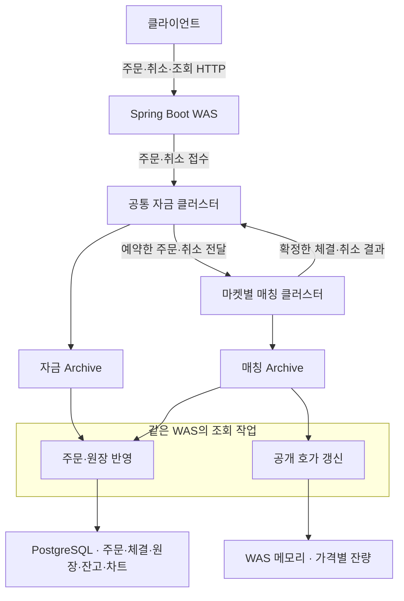

# Exchange Core

[](https://github.com/0Chord/coin-exchange/actions/workflows/build-and-test.yml?query=event%3Apull_request)

지정가 주문을 접수하고, 가격·시간 우선으로 체결한 뒤 잔고와 수수료를 정산하는 현물 거래 백엔드입니다. 여러 마켓이 같은 자금을 사용하므로 **자금 예약과 정산은 공통 자금 클러스터가**, **주문장과 체결은 마켓별 매칭 클러스터가** 맡습니다.

**현재 단계** 지정가 GTC 주문의 부분 체결·후속 체결·잔량 취소와 주문·잔고·시장 조회 API를 통합했습니다. 차트, 공개 주문장, 사용자별 주문 목록까지 GET으로 조회할 수 있습니다.

Kotlin · Java 25 · Spring Boot · Aeron Cluster · Protobuf · PostgreSQL · Flyway

## 아키텍처

아래는 `exchange.order-query.source=archive`를 사용하는 **Archive 조회 모드** 구성입니다.



1. **접수** — 자금 엔진이 주문 금액을 예약합니다. HTTP `202`는 요청이 접수됐다는 뜻입니다. 응답을 잃으면 같은 토큰과 내용으로 재시도해 접수 결과를 확인합니다. [재시도 계약](engineering/order-timeout-recovery-spec.md)
2. **체결·정산** — 매칭 엔진이 주문장에 체결이나 잔량 취소를 확정합니다. 자금 엔진은 확정된 체결을 정산하고 취소된 잔량의 예약만 반환합니다. 배치 전송을 켜면 처리한 연속 순번까지 확인하고 다음 순번부터 전달을 이어갑니다. [마켓 배치](https://github.com/0Chord/coin-exchange/pull/184) · [양방향 전송 배치](https://github.com/0Chord/coin-exchange/pull/204)
3. **조회** — WAS가 각 Archive에서 과반 확정·서비스 적용·기록이 확인된 범위를 재생합니다. PostgreSQL에 조회 데이터와 반영 위치를 함께 커밋해 재시작 뒤 이어서 처리합니다. 공개 호가를 켜면 같은 WAS의 별도 작업이 매칭 로그를 재생해 메모리에서 갱신합니다. WAS는 GET 요청에 두 조회 저장소의 데이터를 반환합니다. [Archive 조회 반영](https://github.com/0Chord/coin-exchange/pull/205) · [호가 재생](engineering/public-order-book-archive-spec.md)

## 구현 범위

API 경로의 공통 접두사는 `/api/trading/v3`입니다.

| 기능 | API | 확인할 수 있는 동작 |
| --- | --- | --- |
| 주문·잔량 취소 | `POST /markets/{marketId}/orders`<br>`POST /markets/{marketId}/orders/{orderId}/cancel` | 지정가 GTC 접수, 부분·후속 체결, 잔량 취소와 예약금 반환. [주문 시험](engineering/gtc-follow-up-fill-spec.md) · [취소 계약](engineering/split-cancel-http-spec.md) |
| 주문·체결·수수료 | `GET /markets/{marketId}/orders/{orderId}`<br>`GET /markets/{marketId}/orders/{orderId}/fills` | 주문 상태, 체결별 ID, 정산 대기·완료, 실제 청구 수수료. [체결 조회](engineering/order-fill-query-spec-61.md) · [수수료](engineering/order-fill-fee-query-spec-62.md) |
| 자산 잔고 | `GET /users/{userId}/balances/{assetId}` | Archive 조회 모드에서 PostgreSQL에 반영한 사용 가능액과 예약액. [잔고 조회](https://github.com/0Chord/coin-exchange/pull/206) |
| 최근 체결가·차트 | `GET /markets/{marketId}/trades/latest`<br>`GET /markets/{marketId}/candles` | 최근 정산 체결가와 1분·5분·15분·1시간·일·주·월·연봉. 차트는 정산 적용 시각 기준입니다. [체결가](https://github.com/0Chord/coin-exchange/pull/208) · [차트](engineering/settled-candle-query-spec-209.md) |
| 공개 주문장 | `GET /markets/{marketId}/order-book` | 매수·매도 상위 10호가와 가격별 미체결 잔량. [공개 주문장](engineering/public-order-book-archive-spec.md) |
| 사용자 주문 목록 | `GET /orders` | 사용자별 최신순 조회, 접수 순번 커서 페이지네이션. [주문 목록](engineering/user-order-list-query-spec-213.md) |

## 정합성과 장애 검증

| 시험 | 확인한 결과 |
| --- | --- |
| 두 마켓에서 같은 잔고를 동시에 사용 | 가용액 1,000에 대해 600과 500을 동시에 예약 요청했을 때 한 건만 승인됐습니다. 자금 3노드와 매칭 클러스터 두 개를 각각 3노드로 구성했습니다. [공유 자금 검증](https://github.com/0Chord/coin-exchange/pull/185) |
| 매칭·자금 리더 교체와 자금 과반 상실 | 한 매칭 리더가 중단돼도 공통 자금이 정상인 동안 다른 마켓은 거래를 이어갔습니다. 자금 리더 교체 후 같은 요청에 최초 접수 결과를 반환했고, 자금 과반을 잃은 구간에는 새 예약 확정이 차단됐습니다. [매칭 리더](https://github.com/0Chord/coin-exchange/pull/186) · [자금 리더](https://github.com/0Chord/coin-exchange/pull/187) · [과반 상실](https://github.com/0Chord/coin-exchange/pull/188) |
| WAS 기동 후 PostgreSQL 중단 | 자금 3노드·매칭 3노드와 `sync=2`에서 DB가 멈춘 동안에도 거래를 처리하고 매칭 리더를 교체했습니다. DB 복구 후 Archive를 재생해 체결 8건과 원장 19묶음이 반영됐는지 대조했습니다. [복구 시험](https://github.com/0Chord/coin-exchange/pull/205) |

## 공개 성능 기록

| 측정 조건 | 관측 결과 |
| --- | --- |
| 자금 3노드·매칭 3노드 · 모든 노드 `sync=2` · 단일 마켓 Aeron 직접 입력 5분 | 로컬 고정 Gradle 실행물에서 평균 **51,349.61 정산 TPS**, 정산 p95 **36.7ms**·p99 **51.3ms** 관측 상한. 한 Mac의 Docker에서 15초 예열 뒤 300초를 측정했습니다. 종료 후 접수 **15,406,387건** 전량 정산과 자금 Archive 재생을 대조했습니다. [측정 조건·분별 집계·정합성 근거](engineering/results/split-3x3-aeron-20261123/README.md) |
| 이전 통합형 거래 클러스터 3노드 · `sync=2` · Aeron 직접 입력 10분 | 평균 **35,487.4건/s**. 세 복제본의 매칭·정산 완료 관측 p99 **87.29ms**. 한 Mac의 Docker에서 실행했고 HTTP Gateway와 PostgreSQL 조회 반영은 측정 경로에서 제외했습니다. [측정 방법·원시 집계](engineering/trading-performance-summary-142.md) |
| 분리형 자금 3노드·매칭 3노드 · `sync=2` · 주문 입력 200건/s | 공개 호가 HTTP GET p99 **4.65ms**, 매칭 적용부터 WAS 메모리 갱신까지 p99 **224.14ms**. [호가 측정](engineering/public-order-book-archive-spec.md#동일-입출력을-확인한-200건s-비교) |

5분 결과는 접수·정산 배치 최적화를 포함한 당시 로컬 실행물에서 관측했습니다. 현재 기본 브랜치와 HTTP·PostgreSQL을 포함하는 경로의 처리량은 별도 측정 범위입니다.

## 통합 테스트로 시작하기

Java 25와 실행 중인 Docker가 필요합니다. 저장소를 복제한 뒤 아래 시험 한 건으로 **첫 1개 체결 → 남은 2개 체결 → 잔고·예약·수수료 확인**을 실행할 수 있습니다. 테스트가 실제 WAS, 자금·매칭 노드, Testcontainers PostgreSQL을 기동합니다. [시험 코드](app-api/src/test/kotlin/com/exchange/core/api/trading/infrastructure/aeron/SplitFundsTradingHttpTest.kt)

```sh
git clone https://github.com/0Chord/coin-exchange.git
cd coin-exchange
./gradlew --no-daemon --max-workers=2 :app-api:test \
  --tests '*SplitFundsTradingHttpTest.같은 지정가 매수 주문이 첫 체결 뒤 남은 수량까지 실제 HTTP로 체결된다'
```

구성은 [Spring WAS와 통합 시험](app-api), [자금·정산 상태](domain-trading), [주문장과 매칭](domain-matching), [복식 원장](domain-ledger)에서 읽을 수 있습니다. 설계와 실험은 [engineering](engineering)에 기록합니다.

### CI 실패 이유와 보고서 읽기

PR의 Checks에서 실패한 작업 이름과 로그를 확인합니다. 구조 검사 실패는 `architecture-test-reports`의 HTML·XML에서 규칙과 대상 코드를 확인합니다. 제품 테스트는 해당 작업의 테스트 로그와 결과 파일에서 실패한 시나리오와 기대값을 확인합니다. [검증 워크플로](.github/workflows/build-and-test.yml)

## 남은 범위

- 사용자별 주문·잔고 조회는 개발용입니다. 인증·인가와 공개 호가 WebSocket·다중 WAS 배포는 후속 범위입니다.
- Archive 조회와 공개 호가 복구는 전체 로그가 남아 있는 동일 호스트의 단일 마켓 구성에서 검증했습니다. 별도 호스트의 저장소 전체 유실 복구는 후속 설계 범위입니다. [외부 보존](https://github.com/0Chord/coin-exchange/issues/139)
- Archive 조회 모드에 원장 대사 결과를 HTTP 주문·취소 접수 조건으로 연결하는 작업이 남아 있습니다. [복구 후 접수 재개](https://github.com/0Chord/coin-exchange/issues/59)
- 잔고 API는 통합됐고, 양쪽 주문의 부분 체결·잔량 취소·재시작을 하나의 잔고 HTTP 흐름으로 대조하는 시험이 남아 있습니다. [잔고 후속 검증](https://github.com/0Chord/coin-exchange/issues/63)
