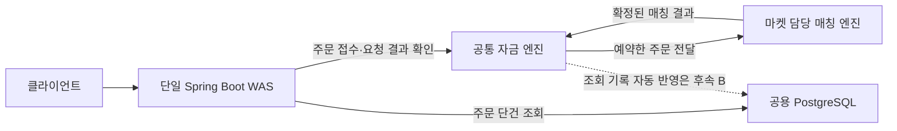

# Exchange Core

[](https://github.com/0Chord/coin-exchange/actions/workflows/build-and-test.yml?query=event%3Apull_request)

Kotlin으로 구현한 현물 거래 백엔드입니다. **HTTP 요청을 받는 WAS는 하나**이며, 주문은 공통 자금 엔진에 보내고 주문 조회는 공용 PostgreSQL을 읽습니다. WAS 안의 주문·조회 API를 실행 프로필로 나누지 않습니다.

사용 기술: Kotlin 2.3.21 · Java 25 · Spring Boot 4.1.0 · Aeron Cluster 1.53.3 · PostgreSQL 16 · Flyway · JUnit Jupiter · Testcontainers

## 현재 실행 구조



- WAS의 시작점은 [ExchangeCoreApplication](app-api/src/main/kotlin/com/exchange/core/ExchangeCoreApplication.kt) 하나입니다. 주문·조회 Controller와 필요한 설정을 함께 조립합니다.
- WAS는 자금 엔진 한 곳에 연결합니다. 자금 엔진이 예약·순서·중복을 관리하고 기존 전달 작업으로 매칭 담당에 주문을 보냅니다. 매칭 담당별 확장과 복제 구성은 엔진 측의 책임입니다.
- 금융·매칭 상태의 판단은 도메인 모듈이 담당합니다. WAS가 잔고를 계산하거나 메모리 주문장을 직접 변경하지 않습니다.
- 조회는 같은 WAS에서 같은 PostgreSQL 접속 설정을 사용합니다. `order_query`는 RDB 안의 조회 테이블 이름 공간이며 별도 서버가 아닙니다.
- **실제 거래 기록의 RDB 자동 반영은 아직 없습니다.** 현재 조회 저장·GET 기반을 검증했고 후속 B에서 기록 연결을 붙입니다. 새 조회 범위는 준비 전이므로 GET에 `503 QUERY_NOT_READY`를 반환합니다.

프로필별 WAS, 별도 조회 WAS, 조회용 DB 연결 풀·Flyway를 따로 만들지 않습니다. Spring Boot의 공용 DataSource·JDBC·트랜잭션·Flyway를 사용하며 SQL은 `app-api/src/main/resources/db/migration`에서 관리합니다.

## 주문 한 건의 흐름

1. WAS가 사용자·요청 세대·순번과 주문 내용을 검증해 자금 엔진에 보냅니다.
2. 자금 엔진이 같은 요청의 중복 여부와 사용 가능한 자금을 확인합니다. 예약이 확정되면 접수 결과를 반환합니다.
3. 자금 리더의 전달 작업이 매칭 담당에 주문을 보냅니다. 매칭 엔진은 가격·시간 순서에 따라 체결·대기·최종 거절을 확정합니다.
4. 매칭 결과가 자금 엔진에 돌아오면 잔고·예약·수수료를 정산합니다. 접수 응답과 정산 완료는 서로 다른 시점입니다.
5. 같은 요청을 재전송하면 기존 접수 결과를 재사용합니다. 응답을 받지 못했다고 새 요청 번호로 바꿔 재접수하지 않습니다.

[실제 HTTP 검증](app-api/src/test/kotlin/com/exchange/core/api/trading/infrastructure/aeron/SplitFundsTradingHttpTest.kt)은 판매 자산 3개와 구매 대금 1,000을 준비하고, 매도 3·매수 3을 HTTP로 접수합니다. 실제 자금·매칭 엔진을 거친 뒤 구매자의 대금 700/자산 3, 판매자의 대금 300/자산 0, 종료된 예약과 hold 0을 대조합니다. 이 사례의 수수료는 0으로 고정하며 수수료 계산의 일반 검증은 별도 도메인 테스트에 있습니다.

## API와 조회 기준

| 요청 | 역할 |
| --- | --- |
| `POST /api/trading/v3/channels/{channel}/epoch` | 요청 세대 발급·전환 |
| `POST /api/trading/v3/markets/{marketId}/orders` | 자금 엔진에 주문 접수 |
| `POST /api/trading/v3/channels/{channel}/ack` | 확인한 접수 결과의 연속 순번 알림 |
| `GET /api/trading/v3/markets/{marketId}/orders/{orderId}` | RDB에 반영된 주문 상태·수량·금융 처리 상태 조회 |

조회에는 `minAdmissionSequence`를 0 이상의 값으로 전달할 수 있습니다. 해당 접수 위치가 아직 반영되지 않았으면 `202 QUERY_CATCHING_UP`으로 응답합니다. 준비된 관찰 기준까지 반영했는데 주문이 없을 때만 `404 ORDER_NOT_FOUND_AS_OF`를 반환합니다. DB 오류·손상은 `503`이며 주문 부재로 바꾸지 않습니다. `CAUGHT_UP`은 마지막 관찰 기준까지 반영됐다는 의미입니다.

사용자 인증·인가는 아직 구현하지 않았습니다. 조회 기록 수집·사용자 화면·새 취소 HTTP API는 이 WAS 정리의 범위에 추가하지 않습니다.

## 설정과 실행

Java 25를 사용합니다. 실행 전에 PostgreSQL과 초기화된 자금·매칭 엔진이 준비돼야 합니다. WAS가 거래 엔진 노드나 개발 잔고를 자동 생성하지 않습니다.

| 설정 | 의미 |
| --- | --- |
| `SPRING_DATASOURCE_URL`, `SPRING_DATASOURCE_USERNAME`, `SPRING_DATASOURCE_PASSWORD` | 기존 공용 PostgreSQL 접속 정보 |
| `exchange.order-query.funds-lineage-high/low` | 연결할 자금 엔진의 계보. 임의 기본값을 만들지 않습니다 |
| `exchange.order-query.supported-markets` | 해당 조회 범위의 지원 마켓, 쉼표 구분 |
| 기존 `TRADING_GATEWAY_*` 연결 설정 | 자금 클러스터의 ingress와 WAS의 egress·전송 한도 |

IntelliJ에서는 `/Users/0chord/Desktop/exchange-core`를 열고 Gradle의 `:app-api:bootRun`을 실행합니다. 프로필을 선택하지 않습니다. main을 직접 실행하려면 `ExchangeCoreApplicationKt` 실행 설정의 VM options에 다음 두 옵션을 넣습니다. Aeron이 Java 25의 내부 메모리 기능을 사용하는 데 필요하며 `bootRun`에는 이미 적용돼 있습니다.

```text
--add-opens=java.base/jdk.internal.misc=ALL-UNNAMED --add-opens=java.base/java.util.zip=ALL-UNNAMED
```

```sh
cd /Users/0chord/Desktop/exchange-core
JAVA_HOME=/Users/0chord/Library/Java/JavaVirtualMachines/corretto-25.0.2/Contents/Home ./gradlew :app-api:bootRun
```

공용 Flyway는 기존 V1~V9 뒤에 `V10__create_order_query.sql`을 적용합니다. 실제 배포 DB에 예전 실험용 별도 query V1을 이미 적용했다면 그대로 업그레이드할 수 있는 것으로 가정하지 말고 이력을 확인해야 합니다. 이 작업은 테스트 DB에서만 migration을 실행합니다.

## 코드와 검증 읽는 순서

1. [WAS 조립](app-api/src/main/kotlin/com/exchange/core/ExchangeCoreApplication.kt) — 한 서버에 어떤 API가 올라오는지 확인합니다.
2. [주문 HTTP](app-api/src/main/kotlin/com/exchange/core/api/trading/api/BoundedTradingOrderController.kt)와 [자금 연결](app-api/src/main/kotlin/com/exchange/core/api/trading/infrastructure/aeron/SplitFundsGatewayTransport.kt) — 요청을 어떤 엔진에 보내는지 확인합니다.
3. `domain-trading`·`domain-matching`·`domain-ledger`·`domain-fee` — 자금·매칭·정산 판단과 불변식을 확인합니다.
4. [조회 판단](app-api/src/main/kotlin/com/exchange/core/api/trading/application/OrderQueryUseCase.kt)과 [조회 저장소](app-api/src/main/kotlin/com/exchange/core/api/trading/infrastructure/persistence/PostgresOrderQueryStore.kt) — 지연·부재·오류와 DB 원자성을 확인합니다.
5. [변경·테스트 기록](engineering/order-query-foundation-review.md) — 실제 실행 결과와 남은 자동 반영 범위를 확인합니다.

```sh
cd /Users/0chord/Desktop/exchange-core
JAVA_HOME=/Users/0chord/Library/Java/JavaVirtualMachines/corretto-25.0.2/Contents/Home ./gradlew --no-daemon --max-workers=1 :app-api:test --tests '*SplitFundsTradingHttpTest' --tests '*ExchangeCoreApplicationTests' --tests '*OrderQuery*Test'
JAVA_HOME=/Users/0chord/Library/Java/JavaVirtualMachines/corretto-25.0.2/Contents/Home ./gradlew --no-daemon --max-workers=1 ktlintCheck :architecture-tests:verifyArchitectureReport
```

이전 RDB 주문 실행과 이전 통합형 프로토콜은 회귀 테스트의 명시적 조립으로 보존합니다. 이 테스트용 시작점은 제품 WAS의 추가 실행 모드가 아닙니다. 과거 설명은 Git 이력과 각 engineering 검증 기록에 있으며 현재 실행 구조는 이 문서를 기준으로 읽습니다.
