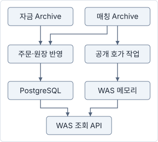
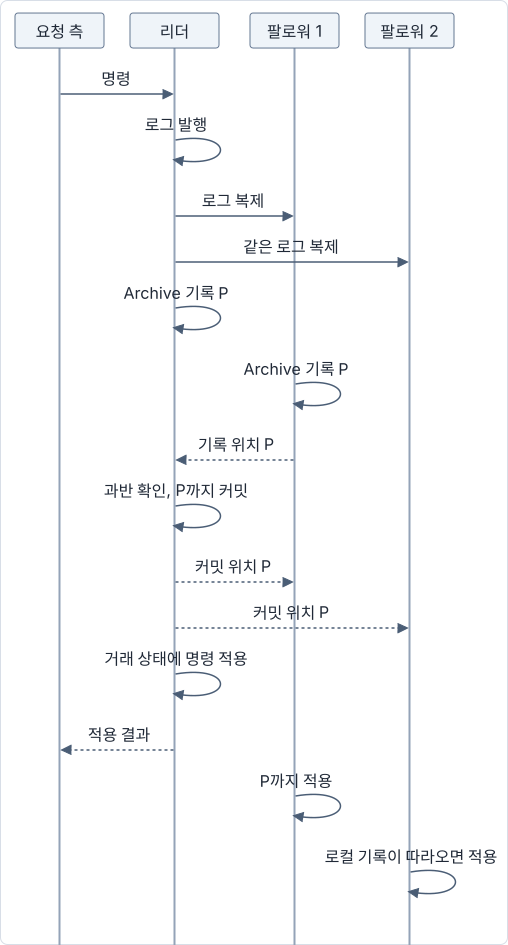
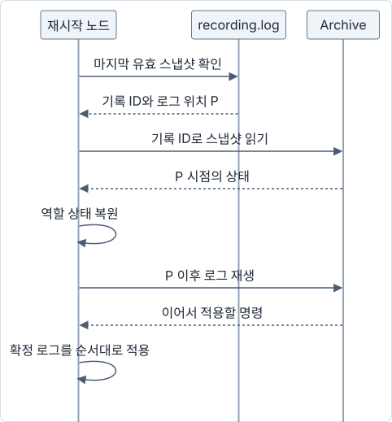
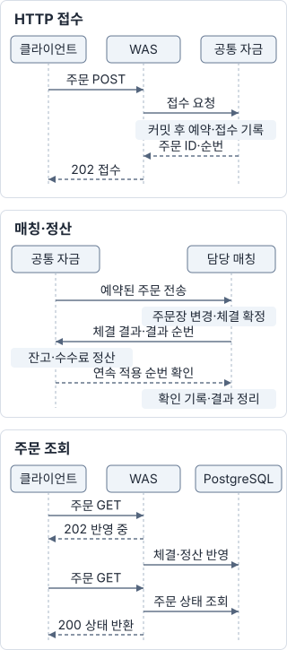
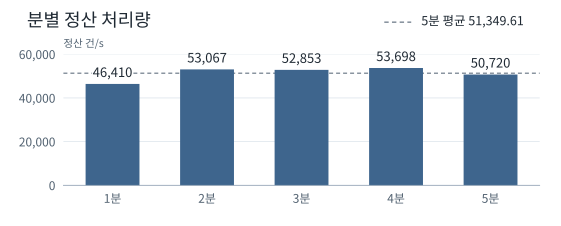

# Exchange Core

Kotlin으로 구현한 가상자산 거래 백엔드입니다. 현재 현물 거래를 지원합니다. 공통 자금 클러스터가 여러 마켓의 예약과 정산을 맡고, 매칭 클러스터는 마켓별 주문장의 체결 순서를 관리합니다.

| 5분 평균 정산 | 정산 p99 관측 상한 | 최종 전량 정산 |
| :---: | :---: | :---: |
| **51,349.61 TPS** | **51.3 ms** | **15,406,387건** |

자금 3노드 + 매칭 3노드 · `sync=2` · 현물 단일 마켓 Aeron 직접 입력 · 당시 로컬 고정 빌드. [측정 조건·분별 결과·Archive 대조](engineering/results/split-3x3-aeron-20261123/README.md)

[기술 스택](#기술-스택) · [전체 설계 (HLD)](#전체-설계-hld) · [주문 한 건의 흐름](#주문-한-건의-흐름) · [상세 설계 (LLD)](#상세-설계-lld) · [성능 기록](#공개-성능-기록) · [테스트 실행](#설정과-실행)

## 기술 스택

| 역할 | 기술 |
| --- | --- |
| 애플리케이션 | **Kotlin** · **Java 25** · **Spring Boot** |
| 거래 클러스터·메시지 | **Aeron Cluster** · **Protobuf** |
| 조회 저장소·스키마 관리 | **PostgreSQL** · **Flyway** |

## 구현 현황

- **주문·거래** — 지정가 GTC, 가격·시간 우선 매칭, 부분·후속 체결, 잔량 취소·반환.
- **사용자 조회** — 주문 상세·목록, 체결별 수수료, 사용 가능·예약 잔고.
- **공개 시장 조회** — 최근 정산 체결가, 8개 주기 차트, 매수·매도 상위 10호가.

## 아키텍처

### 전체 설계 (HLD)

WAS는 주문·취소와 조회의 진입점입니다. 거래 상태는 자금·매칭 클러스터가 소유하고, 조회 작업은 확정 로그를 따라 별도로 갱신합니다.

#### 거래 경로

한 개의 자금 클러스터가 여러 마켓의 가용 잔고·예약·정산을 관리합니다. 매칭 담당은 배치 설정으로 정하며, 한 담당이 여러 마켓의 주문장을 운영할 수 있습니다. 아래는 매칭 담당을 두 클러스터로 나눈 9노드 검증 구성입니다. [마켓 배치](https://github.com/0Chord/coin-exchange/pull/184) · [9노드 검증](https://github.com/0Chord/coin-exchange/pull/185)

[](.github/assets/trading-topology.svg)

- **WAS**는 HTTP를 받아 자금 접수 결과를 반환하고, 별도 반영 작업이 만든 조회 데이터를 제공합니다.
- **공통 자금**은 가용·예약 잔고와 요청별 최초 접수 결과를 보존합니다. 거래 대금·수수료를 정산하고 취소 잔량의 예약을 반환합니다. [공유 자금 설계](engineering/multi-matching-shared-funds-spec.md)
- **마켓 담당 매칭**은 배치된 마켓별 주문장과 결과 순번을 보존합니다. 가격·시간 우선으로 체결하고, 취소가 적용되면 그 시점의 잔량을 주문장에서 제거합니다. [매칭·정산 계약](engineering/funds-result-settlement-spec.md)

공통 자금이 예약을 모으므로 여러 마켓이 같은 잔고를 사용해도 초과 예약을 막을 수 있습니다. 마켓마다 주문장이 분리돼 한 담당의 장애 중에도 다른 담당은 공통 자금이 정상일 때 거래를 이어갑니다. 자금 리더가 주문·취소를 보내고 매칭 리더가 확정 결과를 돌려보냅니다. [주문 전달](engineering/funds-order-delivery-review.md) · [전송 배치](https://github.com/0Chord/coin-exchange/pull/204)

#### 조회 경로

아래는 `exchange.order-query.source=archive`를 사용하는 **단일 마켓 Archive 조회 모드**입니다. WAS가 같은 호스트에서 자금·매칭 로그를 재생해 접수·체결·분개·정산 상태를 재구성합니다. [Archive 조회 반영](https://github.com/0Chord/coin-exchange/pull/205)

[](.github/assets/archive-query-flow.svg)

Archive 모드의 PostgreSQL은 주문·체결·분개·잔고·차트의 조회에 사용합니다. 공개 호가는 매칭 로그를 따로 따라가는 작업이 WAS 메모리에 공개합니다. 조회의 최신성은 각 작업의 반영 위치에 따라 달라집니다. 이 구성을 검증한 3+3노드 시험은 단일 마켓에서 실행했습니다. [Archive 모드 통합 시험](app-api/src/test/kotlin/com/exchange/core/api/trading/infrastructure/aeron/SplitFundsTradingHttpTest.kt#L406) · [조회 반영의 상세 설계](engineering/exchange-architecture-lld.md#조회-반영과-응답)

#### 클러스터 내부

자금·매칭 클러스터는 각각 **리더 1대와 팔로워 2대**로 구성합니다. 같은 클러스터에 속한 노드마다 **Media Driver · Consensus Module · 거래 서비스 · Archive**를 실행합니다. JVM마다 자기 거래 상태와 기록을 유지합니다.

1. **복제·적용** — 리더가 명령 순서를 정하고, 자신을 포함한 과반이 기록한 위치를 커밋합니다. 각 거래 서비스가 자기 로그의 커밋 범위를 순서대로 적용하므로 같은 위치에서 상태가 일치합니다. 자금이 과반을 잃으면 새 예약 확정이 멈춥니다.
2. **저장** — 노드마다 `archive/`에 명령 로그·스냅샷 본문을 두고, `cluster/recording.log`에 기록 ID와 로그 위치를 남깁니다. 검증 구성의 `sync=2`는 기록 데이터와 파일 메타데이터를 동기화합니다.
3. **복구** — 최신 유효 스냅샷을 읽고 그 위치 이후의 로그를 다시 적용합니다. 리더가 바뀌면 새 리더의 전달 작업은 복원한 미확인 주문·결과부터 이어서 보냅니다.

<details>
<summary>과반 커밋과 스냅샷 복구 시퀀스</summary>

**리더와 팔로워 한 대가 위치 P까지 기록한 경우**

[](.github/assets/cluster-quorum.svg)

**노드 재시작 시 저장 위치를 찾고 상태를 복원하는 순서**

[](.github/assets/cluster-snapshot-recovery.svg)

</details>

[노드별 파일·동기화·복구 코드](engineering/exchange-architecture-lld.md#노드별-저장과-스냅샷-복구)

### 주문 한 건의 흐름

#### 주문 접수부터 정산 조회까지

바로 체결될 수 있는 지정가 주문 한 건의 예입니다. 접수 응답 전달과 내부 주문 전달은 각각 진행됩니다. 연결한 HTTP 시험은 기본 조회 수집 모드에서 정산 반영 뒤의 주문 상태를 확인합니다. [실제 HTTP 후속 체결 시험](app-api/src/test/kotlin/com/exchange/core/api/trading/infrastructure/aeron/SplitFundsTradingHttpTest.kt#L1204)

[](.github/assets/order-lifecycle.svg)

조회가 준비됐지만 접수 순번까지 아직 반영하지 못한 요청은 `202 QUERY_CATCHING_UP`을 받습니다. 그림의 마지막 GET은 정산까지 반영된 상태를 조회하는 예입니다.

매칭의 **주문 적용 확인**은 자금이 보관한 발송용 주문을 정리하는 기준입니다. 자금의 **정산 적용 확인**은 매칭 로그에 기록된 뒤 매칭이 보관한 체결·취소 결과를 정리하는 기준입니다. 체결 결과가 주문 적용 확인보다 먼저 도착하면, 자금은 검증을 통과한 결과를 주문이 적용됐다는 증거로 함께 사용합니다. 조회 작업은 각 클러스터에 확정된 입력을 따라갑니다. [적용 확인과 정산 확인](engineering/funds-result-settlement-spec.md)

#### 부분 체결 후 잔량 취소

매도 3개를 접수하고, 1개가 체결된 뒤 남은 2개를 취소하는 실제 HTTP 시험입니다. 이 사례의 가격은 개당 100이고 수수료는 0입니다. [시험 코드](app-api/src/test/kotlin/com/exchange/core/api/trading/infrastructure/aeron/SplitFundsTradingHttpTest.kt#L951)

매도 자산의 **사용 가능 / 예약** 잔액은 다음과 같이 바뀝니다.

1. **매도 3개 접수** — 자금이 3개를 예약하고 매칭이 주문장에 올립니다. `RESTING` · 잔량 3 · **0 / 3**.
2. **1개 체결·정산** — 매칭이 1개를 체결하고 자금이 대금 100을 반영합니다. `PARTIALLY_FILLED` · 잔량 2 · **0 / 2**.
3. **잔량 2개 취소 확정** — 매칭이 주문장에서 잔량을 제거합니다. 자금에 적용될 때까지 예약을 유지합니다. `CANCELLED / PENDING(RELEASE)` · **0 / 2**.
4. **반환 완료** — 자금이 남은 예약 2개를 반환합니다. `CANCELLED / APPLIED` · **2 / 0**.

시험에서는 같은 취소 요청을 다시 보내도 최초 취소 ID가 돌아오고, 자금 결과 순번은 반환 시 한 번만 전진했습니다. 같은 PostgreSQL을 사용해 WAS를 다시 시작한 뒤에도 최종 조회 결과가 일치했습니다. [취소·반환 검증 기록](engineering/split-cancel-http-spec.md)

[상세 취소·재전송 시퀀스](engineering/exchange-architecture-lld.md#부분-체결-후-잔량-취소)

### 상세 설계 (LLD)

[패키지 구조](#패키지-구조) · [모듈 의존성](#모듈-의존성) · [주문과 조회의 추상화](#주문과-조회의-추상화) · [상태와 재시도](#상태와-재시도)

#### 패키지 구조

Spring Boot WAS와 자금·매칭 노드의 기동 코드는 **같은 `app-api` 모듈**에 있습니다. WAS는 Spring Boot 진입점으로, 거래 노드는 역할과 배치 설정으로 기동합니다. [WAS 진입점](app-api/src/main/kotlin/com/exchange/core/ExchangeCoreApplication.kt) · [거래 노드 진입점](app-api/src/main/kotlin/com/exchange/core/api/trading/infrastructure/aeron/DevelopmentSplitTradingMain.kt)

`app-api`의 `com.exchange.core.api.trading` 아래는 현물 거래 코드의 예입니다.

- [`api`](app-api/src/main/kotlin/com/exchange/core/api/trading/api) — HTTP Controller와 요청·응답 타입. 요청 형식을 검사하고 접수·조회 결과를 HTTP 상태로 바꿉니다.
- [`application`](app-api/src/main/kotlin/com/exchange/core/api/trading/application) — 주문·조회 UseCase와 결과 모델. 조회에 필요한 저장소 계약은 [`application.port`](app-api/src/main/kotlin/com/exchange/core/api/trading/application/port)에 둡니다.
- [`infrastructure`](app-api/src/main/kotlin/com/exchange/core/api/trading/infrastructure) — `aeron`에서 전송·거래 노드·Archive 재생을, `codec`에서 전송 메시지 변환을, `persistence`에서 PostgreSQL 저장·조회를 구현합니다.
- [`com.exchange.core.api.config`](app-api/src/main/kotlin/com/exchange/core/api/config) — Spring 설정에서 UseCase에 Gateway와 저장소 구현체를 연결합니다.

거래 상태와 계산은 `domain-*` 모듈에 둡니다. 각 모듈은 `com.exchange.core` 아래의 `trading`, `matching`, `order`, `fee`, `ledger`, `common` 패키지에 대응합니다. 예를 들어 `domain-trading`의 [역할 조립](domain-trading/src/main/kotlin/com/exchange/core/trading/TradingRoleAssembly.kt#L98)이 자금 상태와 매칭 상태를 구성하고, 각 상태가 필요한 계산을 하위 모듈로 넘깁니다.

#### 모듈 의존성

아래는 **Gradle이 직접 선언한 운영 모듈 의존성**입니다. 화살표는 사용하는 모듈에서 가져오는 모듈을 가리킵니다.

- [`app-api`](app-api/build.gradle.kts#L47) → `domain-trading`, `domain-matching`, `domain-order`, `domain-ledger`, `domain-common`. HTTP·Aeron·PostgreSQL을 여기서 연결합니다.
- [`domain-trading`](domain-trading/build.gradle.kts#L18) → `domain-matching`, `domain-order`, `domain-fee`, `domain-ledger`, `domain-common`. 접수와 예약, 체결과 정산, 취소와 반환을 순서대로 연결합니다.
- [`domain-matching`](domain-matching/build.gradle.kts#L18) → `domain-order`, `domain-common`. [`domain-order`](domain-order/build.gradle.kts#L18) → `domain-fee`, `domain-common`. 매칭이 주문 모델을 쓰고, 주문의 예약 계산이 수수료 규칙을 씁니다.
- [`domain-fee`](domain-fee/build.gradle.kts#L18)와 [`domain-ledger`](domain-ledger/build.gradle.kts#L18) → `domain-common`. 수수료 계산과 복식 분개가 공통 금액·자산 타입을 공유합니다. `domain-common`은 다른 프로젝트 모듈을 참조하지 않습니다.

`architecture-tests`는 Gradle의 직접 선언과 컴파일된 코드의 타입 참조를 함께 검사합니다. CI에서 모듈 의존 방향, 도메인의 외부 기술 독립성, HTTP 진입점과 Bean 조립을 검증합니다. `benchmark-jmh`는 거래 규칙의 성능을 측정합니다. [아키텍처 검사](architecture-tests/src/test/kotlin/com/exchange/architecture/ProductionArchitectureTest.kt#L101) · [CI](.github/workflows/build-and-test.yml#L42) · [벤치마크](benchmark-jmh/README.md)

#### 주문과 조회의 추상화

**주문·취소 POST**

1. [`BoundedTradingOrderController`](app-api/src/main/kotlin/com/exchange/core/api/trading/api/BoundedTradingOrderController.kt#L21)가 HTTP 입력과 응답을 맡습니다. [`BoundedTradingOrderUseCase`](app-api/src/main/kotlin/com/exchange/core/api/trading/application/BoundedTradingOrderUseCase.kt#L71)는 현재 `BoundedTradingOrderGateway`에 위임합니다.
2. [Spring 설정](app-api/src/main/kotlin/com/exchange/core/api/config/BoundedTradingGatewayConfig.kt#L54)이 Gateway 계약에 `BoundedAeronGateway`를 연결합니다. Gateway는 대기열과 미응답 요청 한도를 관리하고 응답을 원래 요청에 연결합니다. `SplitFundsGatewayTransport`가 Aeron 세션과 전송 형식을 맡습니다. [Gateway 구현](app-api/src/main/kotlin/com/exchange/core/api/trading/infrastructure/aeron/BoundedAeronGateway.kt#L104) · [Transport](app-api/src/main/kotlin/com/exchange/core/api/trading/infrastructure/aeron/SplitFundsGatewayTransport.kt#L200)
3. 거래 노드의 [`SplitTradingClusterAdapter`](app-api/src/main/kotlin/com/exchange/core/api/trading/infrastructure/aeron/SplitTradingClusterAdapter.kt#L189)가 커밋된 명령을 역할별 상태에 전달합니다. 금액을 예약하거나 주문장을 변경하는 판단은 [`BoundedFundingState`](domain-trading/src/main/kotlin/com/exchange/core/trading/BoundedFundingState.kt#L140)와 [`ReservedMatchingState`](domain-trading/src/main/kotlin/com/exchange/core/trading/ReservedMatchingState.kt#L74)가 맡습니다.

**주문·체결 GET과 조회 반영**

- [`OrderQueryUseCase`](app-api/src/main/kotlin/com/exchange/core/api/trading/application/OrderQueryUseCase.kt#L40)는 [`OrderQueryStore`](app-api/src/main/kotlin/com/exchange/core/api/trading/application/port/OrderQueryStore.kt#L13)를 통해 주문을 읽고 조회 준비 상태와 반영 순번을 판정합니다. [`PostgresOrderQueryStore`](app-api/src/main/kotlin/com/exchange/core/api/trading/infrastructure/persistence/PostgresOrderQueryStore.kt#L34)가 SQL을 맡습니다. 체결 목록의 조회 상태·체결·정산 반영은 UseCase의 읽기 전용 `REPEATABLE_READ` 트랜잭션에서 함께 읽습니다. [트랜잭션 선언](app-api/src/main/kotlin/com/exchange/core/api/trading/application/OrderQueryUseCase.kt#L93)
- Archive 모드의 WAS는 재생 전용 상태를 만들어 거래 노드와 **같은 명령 적용 코드**로 접수·체결·정산 정보를 다시 계산합니다. 조회 반영 작업은 그 결과를 PostgreSQL에 저장하고, 공개 호가 작업은 별도로 WAS 메모리를 갱신합니다. [Archive 명령 재생](app-api/src/main/kotlin/com/exchange/core/api/trading/infrastructure/aeron/SplitArchiveProjection.kt#L57) · [조회 반영과 DB 복구](engineering/exchange-architecture-lld.md#조회-반영과-응답)

#### 상태와 재시도

- **접수** — 사용자·채널·세대·순번이 요청의 식별자입니다. 같은 토큰과 내용이면 보관 중인 최초 결과를 돌려주고, 이미 정리한 순번이나 이전 세대의 토큰은 다시 실행하지 않습니다. [요청 토큰 규칙](engineering/exchange-architecture-lld.md#주문-접수와-요청-토큰)
- **매칭** — `OrderBook`은 매수 고가순·매도 저가순으로 가격대를 탐색하고, 같은 가격대는 삽입 순서로 체결합니다. [가격 선택](domain-matching/src/main/kotlin/com/exchange/core/matching/OrderBook.kt#L15) · [같은 가격의 주문 순서](domain-matching/src/main/kotlin/com/exchange/core/matching/PriceLevel.kt#L29)
- **전달** — 마켓별 주문 전달 순번과 결과 순번이 각각 어디까지 적용됐는지 나타냅니다. 적용한 연속 순번까지만 확인하며, 확인을 잃거나 리더가 바뀌면 미확인 구간부터 이어서 보냅니다. [정산·전달 순번과 리더 교체](engineering/exchange-architecture-lld.md#마켓별-매칭과-정산)

[상세 설계 문서](engineering/exchange-architecture-lld.md)에서 각 단계의 코드 위치, 복제·복구 파일 구조와 검증 사례를 더 볼 수 있습니다.

## 정합성과 장애 검증

| 시험 | 확인한 결과 |
| --- | --- |
| 두 마켓에서 같은 잔고를 동시에 사용 | 가용액 1,000에 대해 600과 500을 동시에 예약 요청했을 때 한 건만 승인됐습니다. 자금 3노드와 매칭 클러스터 두 개를 각각 3노드로 구성했습니다. [공유 자금 검증](https://github.com/0Chord/coin-exchange/pull/185) |
| 매칭·자금 리더 교체와 자금 과반 상실 | 한 매칭 리더가 중단돼도 공통 자금이 정상인 동안 다른 마켓은 거래를 이어갔습니다. 자금 리더 교체 후 같은 요청에 최초 접수 결과를 반환했고, 자금 과반을 잃은 구간에는 새 예약 확정이 차단됐습니다. [매칭 리더](https://github.com/0Chord/coin-exchange/pull/186) · [자금 리더](https://github.com/0Chord/coin-exchange/pull/187) · [과반 상실](https://github.com/0Chord/coin-exchange/pull/188) |
| WAS 기동 후 PostgreSQL 중단 | 자금 3노드·매칭 3노드와 `sync=2`에서 DB가 멈춘 동안에도 HTTP 접수·정산과 공개 호가 갱신을 확인했습니다. 매칭 리더 교체와 DB 복구 뒤 고유 정산 ID 9개, 연속 원장 24묶음을 대조했고, 두 클러스터와 WAS를 재시작한 뒤에도 DB 반영 결과가 같았습니다. [복구 통합 시험](app-api/src/test/kotlin/com/exchange/core/api/trading/infrastructure/aeron/SplitFundsTradingHttpTest.kt#L583) |
| 자금·매칭 재시작 | 양쪽 역할의 스냅샷을 남기고 이후 명령까지 처리한 뒤, 같은 기록으로 재시작해 상태와 처리 위치를 대조했습니다. [스냅샷 복원 시험](app-api/src/test/kotlin/com/exchange/core/api/trading/infrastructure/aeron/SplitFundsTradingHttpTest.kt#L2095) |

[DB 중단부터 조회 재개까지 시퀀스](engineering/exchange-architecture-lld.md#장애에서-이어가는-흐름)

## 공개 성능 기록



15초 예열 뒤 300초 동안 **정산 15,404,883건**을 관측했습니다. 종료 후 대기분까지 정산해 최종 접수 건수와 일치했습니다. 자금 리더의 Archive를 재생해 잔고·원장·수수료·스냅샷과 자금 복제본 3개의 적용 위치를 대조했습니다. [분별 집계와 Archive 검증 기록](engineering/results/split-3x3-aeron-20261123/README.md)

| 측정 조건 | 관측 결과 |
| --- | --- |
| 분리형 자금 3노드·매칭 3노드 · `sync=2` · Aeron 직접 입력 5분 | 로컬 고정 빌드에서 평균 **51,349.61 정산 TPS**. 정산 p95 **36.7ms**·p99 **51.3ms** 관측 상한. [접수·정산 지표](engineering/results/split-3x3-aeron-20261123/README.md#처리량과-지연) |
| 이전 통합형 거래 클러스터 3노드 · `sync=2` · Aeron 직접 입력 10분 | 평균 **35,487.4건/s**. 세 복제본의 매칭·정산 완료 관측 p99 **87.29ms**. 한 Mac의 Docker에서 실행했고 HTTP Gateway와 PostgreSQL 조회 반영은 측정 경로에서 제외했습니다. [측정 방법·원시 집계](engineering/trading-performance-summary-142.md) |
| 분리형 자금 3노드·매칭 3노드 · `sync=2` · 주문 입력 200건/s | 공개 호가 HTTP GET p99 **4.65ms**, 매칭 적용부터 WAS 메모리 갱신까지 p99 **224.14ms**. [호가 측정](engineering/public-order-book-archive-spec.md#동일-입출력을-확인한-200건s-비교) |

5분 결과는 Mac Docker의 로컬 고정 빌드에서 Aeron 입력부터 정산까지를 측정한 값입니다. 현재 기본 브랜치와 HTTP·PostgreSQL을 포함하는 경로의 처리량은 별도 측정 범위입니다.

## API와 조회 기준

API 경로의 공통 접두사는 `/api/trading/v3`입니다.

| 기능 | API | 확인할 수 있는 동작 |
| --- | --- | --- |
| 요청 세대·응답 확인 | `POST /channels/{channel}/epoch`<br>`POST /channels/{channel}/ack` | 요청에 쓸 세대를 발급하고, 확인한 연속 요청 순번까지 접수 결과를 정리합니다. [요청 번호 계약](engineering/order-admission-protocol.md) |
| 주문·잔량 취소 | `POST /markets/{marketId}/orders`<br>`POST /markets/{marketId}/orders/{orderId}/cancel` | 지정가 GTC 접수, 부분·후속 체결, 잔량 취소와 예약금 반환. [주문 시험](engineering/gtc-follow-up-fill-spec.md) · [취소 계약](engineering/split-cancel-http-spec.md) |
| 주문·체결·수수료 | `GET /markets/{marketId}/orders/{orderId}`<br>`GET /markets/{marketId}/orders/{orderId}/fills` | 주문 상태, 체결별 ID, 정산 대기·완료, 실제 청구 수수료. [체결 조회](engineering/order-fill-query-spec-61.md) · [수수료](engineering/order-fill-fee-query-spec-62.md) |
| 자산 잔고 | `GET /users/{userId}/balances/{assetId}` | Archive 조회 모드에서 PostgreSQL에 반영한 사용 가능액과 예약액. [잔고 조회](https://github.com/0Chord/coin-exchange/pull/206) |
| 최근 체결가·차트 | `GET /markets/{marketId}/trades/latest`<br>`GET /markets/{marketId}/candles` | 최근 정산 체결가와 1분·5분·15분·1시간·일·주·월·연봉. 차트는 정산 적용 시각 기준입니다. [체결가](https://github.com/0Chord/coin-exchange/pull/208) · [차트](engineering/settled-candle-query-spec-209.md) |
| 공개 주문장 | `GET /markets/{marketId}/order-book` | 매수·매도 상위 10호가와 가격별 미체결 잔량. [공개 주문장](engineering/public-order-book-archive-spec.md) |
| 사용자 주문 목록 | `GET /orders` | 사용자별 최신순 조회, 접수 순번 커서 페이지네이션. [주문 목록](engineering/user-order-list-query-spec-213.md) |

주문·취소 POST의 `202 ACCEPTED`는 자금 엔진의 접수 확인입니다. 응답이 끊기면 같은 요청 토큰과 내용으로 재시도합니다. 첫 요청이 이미 접수됐고 결과가 보관 중이면 기존 주문·취소 ID를 받습니다. 첫 요청이 도착하지 않았다면 재시도가 최초 접수가 될 수 있습니다. [응답 유실과 재시도](engineering/order-timeout-recovery-spec.md)

주문 GET에 접수 응답의 `admissionSequence`를 `minAdmissionSequence`로 넘길 수 있습니다. 조회가 그 위치까지 반영 중이면 `202 QUERY_CATCHING_UP`, 확인한 원본 범위에서 주문이 없으면 `404 ORDER_NOT_FOUND_AS_OF`를 반환합니다. 조회 원본을 검증 중이거나 DB가 응답하지 않으면 `503`으로 알려줍니다. [조회 준비 상태](engineering/order-query-foundation-review.md)

## 설정과 실행

Java 25와 실행 중인 Docker가 필요합니다. 아래 명령은 **첫 1개 체결 후 남은 2개 체결**과 **부분 체결 후 잔량 취소·반환**을 각각 재현합니다. 테스트가 실제 WAS, 자금·매칭 노드, Testcontainers PostgreSQL을 기동합니다. [후속 체결 검증](engineering/gtc-follow-up-fill-spec.md) · [잔량 취소 검증](engineering/split-cancel-http-spec.md)

```sh
git clone https://github.com/0Chord/coin-exchange.git
cd coin-exchange
./gradlew --no-daemon --max-workers=2 :app-api:test \
  --tests '*SplitFundsTradingHttpTest.같은 지정가 매수 주문이 첫 체결 뒤 남은 수량까지 실제 HTTP로 체결된다' \
  --tests '*SplitFundsTradingHttpTest.실제 부분 체결과 잔량 취소를 같은 WAS에서 조회하고 DB 원본과 ACK 뒤 WAS 재시작에도 유지한다'
```

### CI 실패 이유와 보고서 읽기

PR의 Checks에서 실패한 작업 이름과 로그를 확인합니다. 구조 검사 실패는 `architecture-test-reports`의 HTML·XML에서 규칙과 대상 코드를 확인합니다. 제품 테스트는 해당 작업의 테스트 로그와 결과 파일에서 실패한 시나리오와 기대값을 확인합니다. [검증 워크플로](.github/workflows/build-and-test.yml) · [CI 실행 기록](https://github.com/0Chord/coin-exchange/actions/workflows/build-and-test.yml?query=event%3Apull_request)

## 남은 범위

- 선물 거래 지원을 후속 기능으로 계획하고 있습니다.
- 사용자별 주문·잔고 조회는 개발용입니다. 인증·인가와 공개 호가 WebSocket·다중 WAS 배포는 후속 범위입니다.
- Archive 조회와 공개 호가 복구는 전체 로그가 남아 있는 동일 호스트의 단일 마켓 구성에서 검증했습니다. 별도 호스트의 저장소 전체 유실 복구는 후속 설계 범위입니다. [외부 보존](https://github.com/0Chord/coin-exchange/issues/139)
- Archive 조회 모드에 원장 대사 결과를 HTTP 주문·취소 접수 조건으로 연결하는 작업이 남아 있습니다. [복구 후 접수 재개](https://github.com/0Chord/coin-exchange/issues/59)
- 잔고 API는 통합됐고, 양쪽 주문의 부분 체결·잔량 취소·재시작을 하나의 잔고 HTTP 흐름으로 대조하는 시험이 남아 있습니다. [잔고 후속 검증](https://github.com/0Chord/coin-exchange/issues/63)
