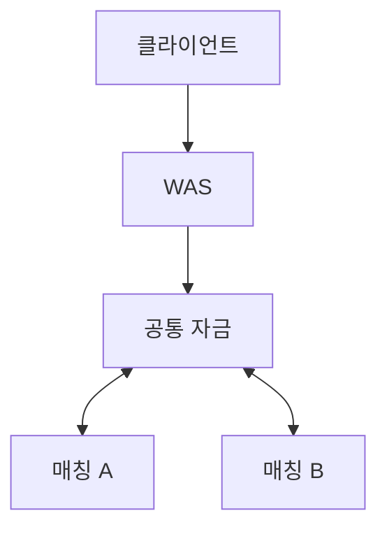
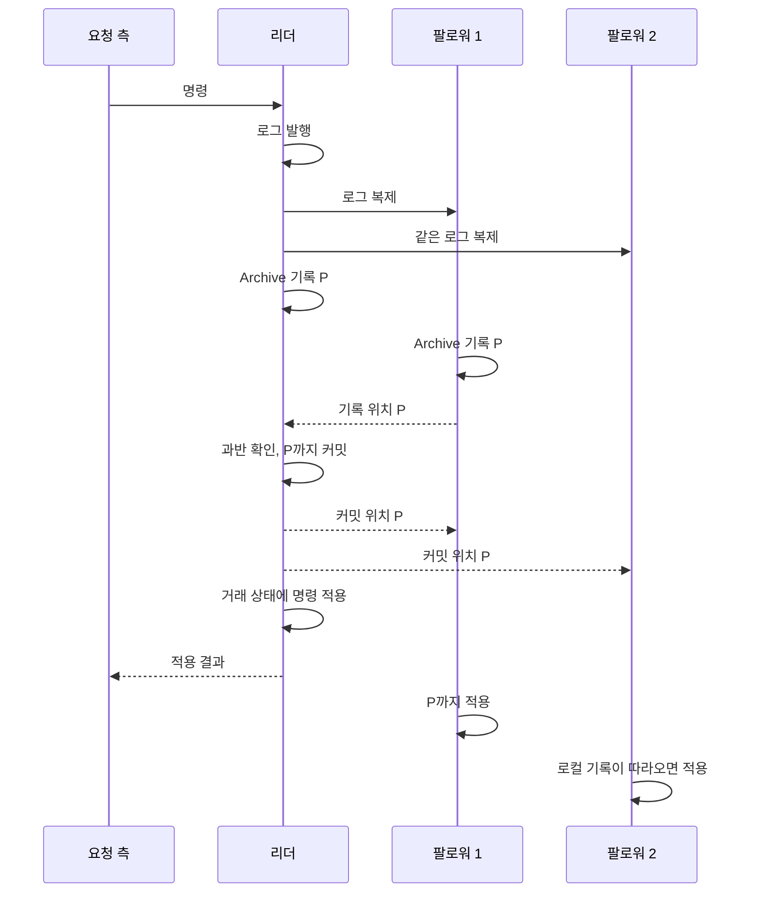
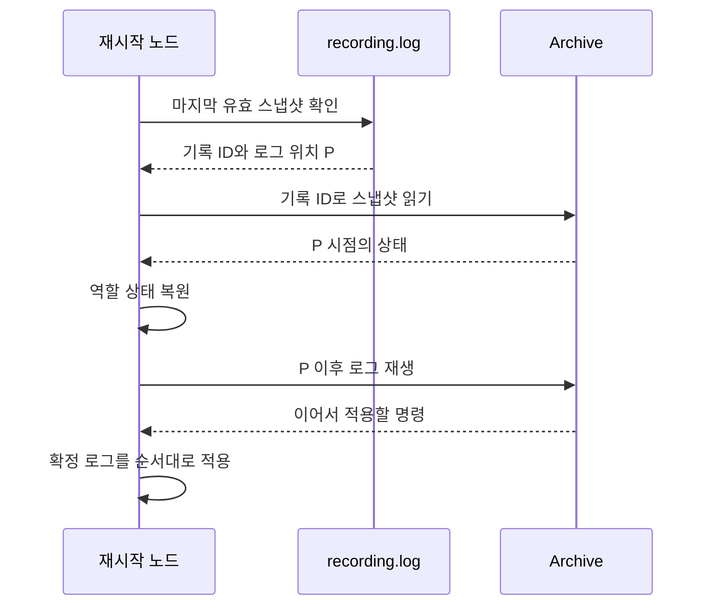
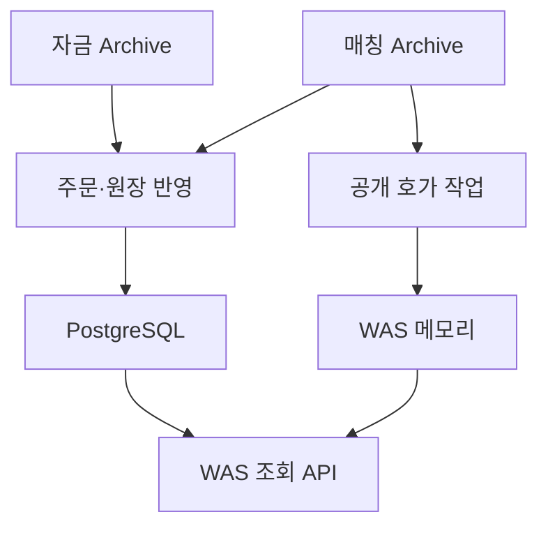
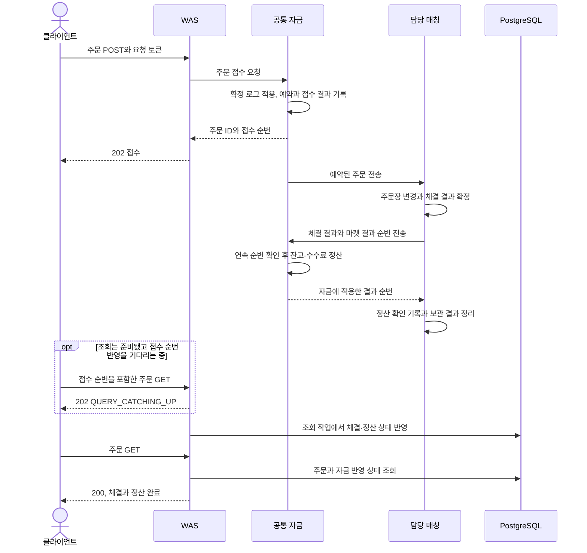
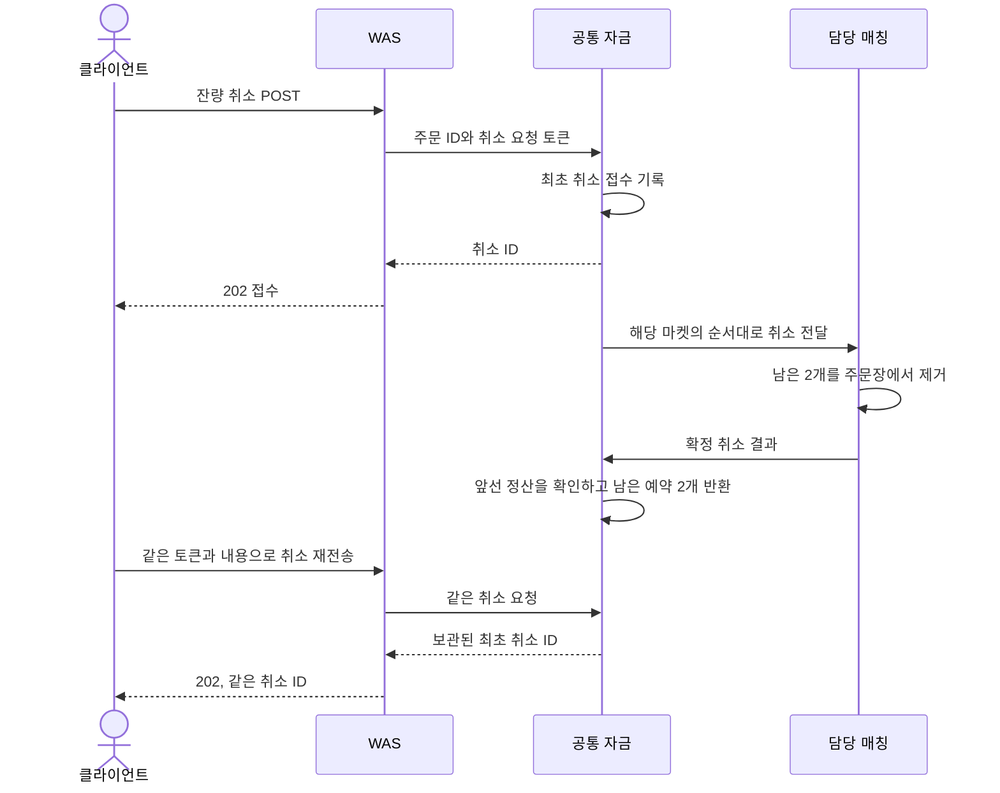
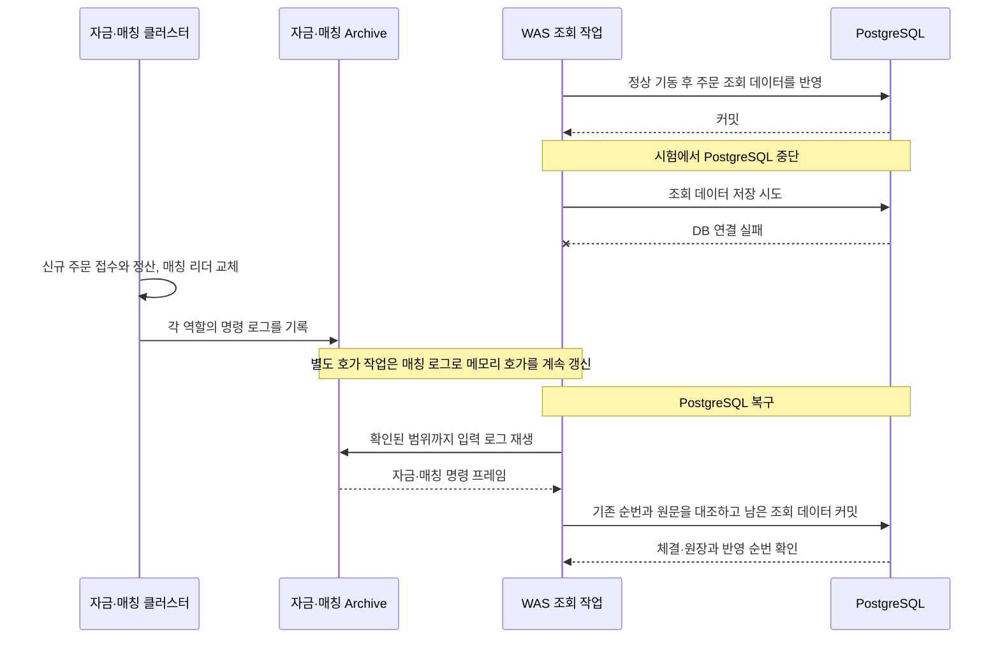

# Exchange Core

Kotlin으로 구현한 가상자산 거래 백엔드입니다. 현재 현물 거래를 지원합니다. 공통 자금 클러스터가 여러 마켓의 예약과 정산을 맡고, 매칭 클러스터는 마켓별 주문장의 체결 순서를 관리합니다.

| 5분 평균 정산 | 정산 p99 관측 상한 | 최종 전량 정산 |
| :---: | :---: | :---: |
| **51,349.61 TPS** | **51.3 ms** | **15,406,387건** |

자금 3노드 + 매칭 3노드 · `sync=2` · 현물 단일 마켓 Aeron 직접 입력 · 당시 로컬 고정 빌드. [측정 조건·분별 결과·Archive 대조](engineering/results/split-3x3-aeron-20261123/README.md)

[**기술 스택**](#기술-스택) · [**아키텍처**](#아키텍처) · [**주문 한 건의 흐름**](#주문-한-건의-흐름) · [**성능 기록**](#공개-성능-기록) · [**테스트 실행**](#설정과-실행) · [CI 실행 기록](https://github.com/0Chord/coin-exchange/actions/workflows/build-and-test.yml?query=event%3Apull_request)

## 기술 스택

| 역할 | 기술 |
| --- | --- |
| 애플리케이션 | **Kotlin** · **Java 25** · **Spring Boot** |
| 거래 클러스터·메시지 | **Aeron Cluster** · **Protobuf** |
| 조회 저장소·스키마 관리 | **PostgreSQL** · **Flyway** |

## 구현 현황

| 주문·거래 | 사용자 조회 | 공개 시장 조회 |
| --- | --- | --- |
| 지정가 GTC, 가격·시간 우선 매칭, 부분·후속 체결, 잔량 취소·반환 | 주문 상세·목록, 체결별 수수료, 사용 가능·예약 잔고 | 최근 정산 체결가, 8개 주기 차트, 매수·매도 상위 10호가 |

## 아키텍처

### 거래 경로

한 개의 자금 클러스터가 여러 마켓의 가용 잔고·예약·정산을 관리합니다. 매칭 담당은 배치 설정으로 정하며, 한 담당이 여러 마켓의 주문장을 운영할 수 있습니다. 아래는 매칭 담당을 두 클러스터로 나눈 9노드 검증 구성입니다. [마켓 배치](https://github.com/0Chord/coin-exchange/pull/184) · [9노드 검증](https://github.com/0Chord/coin-exchange/pull/185)



| 구성요소 | 소유하는 상태와 판단 |
| --- | --- |
| **WAS** | HTTP 요청을 검증하고 Aeron으로 자금 클러스터에 전달합니다. 주문·취소 응답은 자금의 접수 결과를 반환합니다. |
| **공통 자금** | 가용·예약 잔고와 요청별 최초 접수 결과를 보존합니다. 공유 잔고에서 예약을 순서대로 판단하고 체결 대금·수수료를 정산하거나 취소 잔량의 예약을 반환합니다. [공유 자금 설계](engineering/multi-matching-shared-funds-spec.md) |
| **마켓 담당 매칭** | 마켓별 주문장과 결과 순번을 보존합니다. 가격·시간 우선으로 체결을 확정하고, 취소 명령이 적용되면 그 시점의 잔량을 주문장에서 제거합니다. [매칭·정산 계약](engineering/funds-result-settlement-spec.md) |

자금 리더 JVM의 전달 작업이 예약된 주문·취소를 담당 매칭으로 보냅니다. 매칭 리더 JVM의 별도 작업은 확정 결과를 자금으로 돌려보냅니다. 배치를 켜면 상대가 연속 적용한 순번까지 확인하고 남은 명령이나 결과를 이어 보냅니다. [주문 전달](engineering/funds-order-delivery-review.md) · [전송 배치](https://github.com/0Chord/coin-exchange/pull/204)

### 클러스터 내부

위 그림의 공통 자금, 매칭 A, 매칭 B는 각각 **리더 1대와 팔로워 2대**로 구성합니다. 클러스터마다 자기 명령 로그를 복제하며, 각 노드 JVM은 같은 역할의 거래 상태를 자기 메모리와 기록 경로에 유지합니다. [노드 조립](app-api/src/main/kotlin/com/exchange/core/api/trading/infrastructure/aeron/DevelopmentSplitTradingNode.kt#L334)

| 노드 JVM 안의 구성요소 | 하는 일 |
| --- | --- |
| **Media Driver** | 노드 사이의 UDP 전송과 같은 노드 안의 IPC를 처리합니다. |
| **Consensus Module** | 리더 선출, 명령 로그 복제, 과반이 기록한 커밋 위치를 관리합니다. |
| **Clustered Service Container** | 커밋된 명령을 순서대로 읽어, 그 노드의 자금 상태나 주문장에 적용합니다. |
| **Archive** | 각 노드에 도착한 명령 로그와 스냅샷 본문을 파일로 기록하고 재생합니다. |

<details>
<summary>명령 복제와 과반 커밋 순서</summary>

팔로워 2의 기록이 늦고, 리더와 팔로워 1의 Archive가 먼저 위치 `P`까지 기록한 예입니다.



- 팔로워는 자기 Archive에 기록한 위치를 `AppendPosition`으로 알립니다. 리더는 **자신을 포함한 과반이 기록한 위치**를 계산하고 `CommitPosition`을 보냅니다. 공통 자금이 과반을 잃으면 새 예약은 확정되지 않습니다. [Aeron 과반 커밋](https://github.com/aeron-io/aeron/blob/1.53.3/aeron-cluster/src/main/java/io/aeron/cluster/ConsensusModuleAgent.java#L2886-L2949) · [과반 상실 검증](engineering/funds-quorum-failure-verification.md)
- 각 거래 서비스는 **자기 노드의 커밋 위치까지** 적용합니다. 늦은 팔로워는 알림을 받아도 자기 기록이 도달한 범위까지 진행합니다. 같은 위치까지 적용하면 같은 거래 상태에 도달합니다. [팔로워 커밋 처리](https://github.com/aeron-io/aeron/blob/1.53.3/aeron-cluster/src/main/java/io/aeron/cluster/ConsensusModuleAgent.java#L2518-L2528) · [서비스 적용](https://github.com/aeron-io/aeron/blob/1.53.3/aeron-cluster/src/main/java/io/aeron/cluster/service/ClusteredServiceAgent.java#L262-L265)
- 클러스터 복제는 **로그 바이트 위치**를 확인합니다. 자금과 매칭 사이의 적용 확인은 **주문·결과 순번**을 확인합니다. 새 리더의 전달 작업은 복원한 미확인 구간부터 이어 보냅니다. [자금 리더 전환 시험](engineering/funds-leader-failover-verification.md) · [주문 전달 계약](engineering/funds-order-delivery-spec.md)

</details>

<details>
<summary>노드별 저장 파일, sync=2와 스냅샷 복구</summary>

기록은 **노드별 실행 디렉터리**에 남습니다. 같은 역할의 세 노드도 각자 자기 파일을 사용합니다. 재시작할 때는 기존 기록 경로와 노드 설정이 일치하는지 확인한 뒤 `archive/`와 `cluster/`를 다시 엽니다. [노드별 경로 설정](app-api/src/main/kotlin/com/exchange/core/api/trading/infrastructure/aeron/DevelopmentFundingNode.kt#L92) · [재시작 검사](app-api/src/main/kotlin/com/exchange/core/api/trading/infrastructure/aeron/DevelopmentSplitTradingNode.kt#L548)

| 파일 또는 경로 | 보관하는 내용 |
| --- | --- |
| `archive/*.rec` | 클러스터 명령 로그와 스냅샷의 실제 데이터. 각 기록은 `recordingId`로 식별합니다. |
| `archive/archive.catalog` | 각 기록의 시작·종료 위치 등 Archive가 기록을 찾아 읽는 데 쓰는 메타데이터. |
| `cluster/recording.log` | 임기별 로그 기록 ID, 유효한 스냅샷의 기록 ID와 해당 로그 위치. 클러스터가 복구할 스냅샷과 이후 로그를 찾는 데 사용합니다. |
| `driver/` | 기본 Media Driver 경로. 전송용 버퍼와 운영 카운터가 있으며 별도 경로로 지정할 수 있습니다. |

`recordingId`는 해당 노드에서 스냅샷 데이터를 찾는 키입니다. 스냅샷의 `logPosition`은 그 상태에 반영된 명령 로그의 위치이며, 이후 로그를 이어 읽는 기준입니다. [Aeron 기록 구조](https://aeron.io/docs/aeron-cluster/operating-aeron-cluster/)

분리형 거래 노드는 **Archive 데이터·카탈로그·Consensus 파일 동기화를 각각 `2`**로 설정합니다. Aeron의 수준 `2`는 데이터와 파일 메타데이터 동기화를 요청합니다. Archive는 블록 기록과 `force(true)`가 끝난 뒤 기록 위치를 올립니다. 복제에 필요한 기록 위치가 늦게 전진하면 커밋도 그만큼 기다립니다. [우리 노드의 설정](app-api/src/main/kotlin/com/exchange/core/api/trading/infrastructure/aeron/DevelopmentSplitTradingNode.kt#L375) · [Aeron 파일 기록](https://github.com/aeron-io/aeron/blob/1.53.3/aeron-archive/src/main/java/io/aeron/archive/RecordingWriter.java#L130-L147) · [기록 위치 갱신](https://github.com/aeron-io/aeron/blob/1.53.3/aeron-archive/src/main/java/io/aeron/archive/RecordingSession.java#L233-L241)

통합 시험은 리더에 `SNAPSHOT`을 명시적으로 요청합니다. 각 노드는 그 로그 위치에서 역할 상태를 Archive에 저장합니다. 자금 스냅샷에는 **잔고·예약·수수료·접수 결과와 전달 진행 상태**, 매칭 스냅샷에는 **주문장·잔량·결과 순번과 아직 정산 확인을 받지 않은 결과**가 들어갑니다. 기록이 완료되면 합의 모듈은 서비스와 합의 스냅샷의 ID 및 로그 위치를 `recording.log`에 등록합니다. [스냅샷 요청](app-api/src/main/kotlin/com/exchange/core/api/trading/infrastructure/aeron/DevelopmentSplitTradingNode.kt#L318) · [역할 상태 저장](app-api/src/main/kotlin/com/exchange/core/api/trading/infrastructure/aeron/SplitTradingClusterAdapter.kt#L1059) · [스냅샷 등록](https://github.com/aeron-io/aeron/blob/1.53.3/aeron-cluster/src/main/java/io/aeron/cluster/ConsensusModuleAgent.java#L3154-L3189)



유효한 스냅샷이 없고 처음부터의 로그가 남아 있으면 로그부터 재생합니다. 기존 통합 시험에서는 자금·매칭 양쪽에 스냅샷을 남기고 추가 명령을 처리한 뒤, 같은 기록으로 두 역할을 재시작해 상태와 처리 위치를 대조합니다. [Aeron 복구 계획](https://github.com/aeron-io/aeron/blob/1.53.3/aeron-cluster/src/main/java/io/aeron/cluster/RecordingLog.java#L1731-L1765) · [우리 복원 코드](app-api/src/main/kotlin/com/exchange/core/api/trading/infrastructure/aeron/SplitTradingClusterAdapter.kt#L141) · [양쪽 역할 복원 시험](app-api/src/test/kotlin/com/exchange/core/api/trading/infrastructure/aeron/SplitFundsTradingHttpTest.kt#L2095)

</details>

### 조회 경로

아래는 `exchange.order-query.source=archive`를 사용하는 **단일 마켓 Archive 조회 모드**입니다. WAS가 같은 호스트에서 자금·매칭 로그를 재생해 접수·체결·분개·정산 상태를 재구성합니다. [Archive 조회 반영](https://github.com/0Chord/coin-exchange/pull/205)



- **재생 범위**는 각 리더의 과반 확정 위치, 서비스 적용 위치, Archive 기록 위치가 모두 도달한 구간입니다. 리더가 바뀌면 새 리더의 로그가 기존 재생 구간과 이어지는지 확인합니다. [재생 위치 확인](app-api/src/main/kotlin/com/exchange/core/api/trading/infrastructure/aeron/SplitArchiveSource.kt#L160)
- **DB 반영**은 접수·원장부터 저장합니다. 체결에 관련된 주문의 접수가 저장된 뒤 매칭을 반영하고, 정산 분개가 커밋된 뒤 자금 적용 완료를 표시합니다. 재생을 반복하면 PostgreSQL에 저장한 순번과 원문을 대조합니다. 차트는 커밋된 정산 기록을 별도 작업이 집계합니다. [조회 반영 순서](app-api/src/main/kotlin/com/exchange/core/api/trading/infrastructure/aeron/ArchiveOrderQueryFeedWorker.kt#L205) · [차트 집계](engineering/settled-candle-query-spec-209.md)
- **공개 호가**는 매칭 Archive만 별도로 재생합니다. 매칭 결과에 따라 가격별 잔량을 갱신하고, WAS 메모리에서 상위 10호가를 GET으로 읽습니다. [호가 갱신](engineering/public-order-book-archive-spec.md)

## 주문 한 건의 흐름

### 주문 접수부터 정산 조회까지

바로 체결될 수 있는 지정가 주문 한 건의 예입니다. 접수 응답 전달과 내부 주문 전달은 각각 진행됩니다. 연결한 HTTP 시험은 기본 조회 수집 모드에서 정산 반영 뒤의 주문 상태를 확인합니다. [실제 HTTP 후속 체결 시험](app-api/src/test/kotlin/com/exchange/core/api/trading/infrastructure/aeron/SplitFundsTradingHttpTest.kt#L1204)



매칭의 **주문 적용 확인**은 자금이 보관한 발송용 주문을 정리하는 기준입니다. 자금의 **정산 적용 확인**은 매칭 로그에 기록된 뒤 매칭이 보관한 체결·취소 결과를 정리하는 기준입니다. 체결 결과가 주문 적용 확인보다 먼저 도착하면, 자금은 검증을 통과한 결과를 주문이 적용됐다는 증거로 함께 사용합니다. 조회 작업은 각 클러스터에 확정된 입력을 따라갑니다. [적용 확인과 정산 확인](engineering/funds-result-settlement-spec.md)

### 부분 체결 후 잔량 취소

매도 3개를 접수하고, 1개가 체결된 뒤 남은 2개를 취소하는 실제 HTTP 시험입니다. 이 사례의 가격은 개당 100이고 수수료는 0입니다. [시험 코드](app-api/src/test/kotlin/com/exchange/core/api/trading/infrastructure/aeron/SplitFundsTradingHttpTest.kt#L951)

<details>
<summary>잔량 취소와 같은 요청 재전송 시퀀스</summary>



</details>

| 시점 | 엔진이 한 일 | 조회 결과와 매도 자산의 사용 가능 / 예약 |
| --- | --- | --- |
| 매도 3개 접수 | 자금이 매도 자산 3개를 예약하고 매칭이 주문장에 올립니다. | `RESTING` · 잔량 3 · **0 / 3** |
| 1개 체결·정산 | 매칭이 1개를 체결하고 자금이 대금 100을 반영합니다. | `PARTIALLY_FILLED` · 체결 1, 잔량 2 · **0 / 2** |
| 잔량 2개 취소 확정 | 매칭이 주문장에서 잔량을 제거합니다. 자금 적용을 기다리는 동안 예약은 유지됩니다. | `CANCELLED / PENDING(RELEASE)` · 체결 1, 취소 2 · **0 / 2** |
| 반환 완료 | 자금이 앞선 체결을 유지한 채 남은 예약 2개를 반환합니다. | `CANCELLED / APPLIED` · 취소 2 · **2 / 0** |

시험에서는 같은 취소 요청을 다시 보내도 최초 취소 ID가 돌아오고, 자금 결과 순번은 반환 시 한 번만 전진했습니다. 같은 PostgreSQL을 사용해 WAS를 다시 시작한 뒤에도 최종 조회 결과가 일치했습니다. [취소·반환 검증 기록](engineering/split-cancel-http-spec.md)

## API와 조회 기준

API 경로의 공통 접두사는 `/api/trading/v3`입니다.

| 기능 | API | 확인할 수 있는 동작 |
| --- | --- | --- |
| 요청 세대·응답 확인 | `POST /channels/{channel}/epoch`<br>`POST /channels/{channel}/ack` | 요청에 쓸 세대를 발급하고, 확인한 연속 요청 순번까지 접수 결과를 정리합니다. [요청 번호 계약](engineering/order-admission-protocol.md) |
| 주문·잔량 취소 | `POST /markets/{marketId}/orders`<br>`POST /markets/{marketId}/orders/{orderId}/cancel` | 지정가 GTC 접수, 부분·후속 체결, 잔량 취소와 예약금 반환. [주문 시험](engineering/gtc-follow-up-fill-spec.md) · [취소 계약](engineering/split-cancel-http-spec.md) |
| 주문·체결·수수료 | `GET /markets/{marketId}/orders/{orderId}`<br>`GET /markets/{marketId}/orders/{orderId}/fills` | 주문 상태, 체결별 ID, 정산 대기·완료, 실제 청구 수수료. [체결 조회](engineering/order-fill-query-spec-61.md) · [수수료](engineering/order-fill-fee-query-spec-62.md) |
| 자산 잔고 | `GET /users/{userId}/balances/{assetId}` | Archive 조회 모드에서 PostgreSQL에 반영한 사용 가능액과 예약액. [잔고 조회](https://github.com/0Chord/coin-exchange/pull/206) |
| 최근 체결가·차트 | `GET /markets/{marketId}/trades/latest`<br>`GET /markets/{marketId}/candles` | 최근 정산 체결가와 1분·5분·15분·1시간·일·주·월·연봉. 차트는 정산 적용 시각 기준입니다. [체결가](https://github.com/0Chord/coin-exchange/pull/208) · [차트](engineering/settled-candle-query-spec-209.md) |
| 공개 주문장 | `GET /markets/{marketId}/order-book` | 매수·매도 상위 10호가와 가격별 미체결 잔량. [공개 주문장](engineering/public-order-book-archive-spec.md) |
| 사용자 주문 목록 | `GET /orders` | 사용자별 최신순 조회, 접수 순번 커서 페이지네이션. [주문 목록](engineering/user-order-list-query-spec-213.md) |

주문·취소 POST의 `202 ACCEPTED`는 자금 엔진의 접수 확인입니다. 응답이 끊기면 같은 요청 토큰과 내용으로 재시도합니다. 첫 요청이 이미 접수됐고 결과가 보관 중이면 기존 주문·취소 ID를 받습니다. 첫 요청이 도착하지 않았다면 재시도가 최초 접수가 될 수 있습니다. [응답 유실과 재시도](engineering/order-timeout-recovery-spec.md)

주문 GET에 접수 응답의 `admissionSequence`를 `minAdmissionSequence`로 넘길 수 있습니다. 조회가 그 위치까지 반영 중이면 `202 QUERY_CATCHING_UP`, 확인한 원본 범위에서 주문이 없으면 `404 ORDER_NOT_FOUND_AS_OF`를 반환합니다. 조회 원본을 검증 중이거나 DB가 응답하지 않으면 `503`으로 알려줍니다. [조회 준비 상태](engineering/order-query-foundation-review.md)

## 정합성과 장애 검증

| 시험 | 확인한 결과 |
| --- | --- |
| 두 마켓에서 같은 잔고를 동시에 사용 | 가용액 1,000에 대해 600과 500을 동시에 예약 요청했을 때 한 건만 승인됐습니다. 자금 3노드와 매칭 클러스터 두 개를 각각 3노드로 구성했습니다. [공유 자금 검증](https://github.com/0Chord/coin-exchange/pull/185) |
| 매칭·자금 리더 교체와 자금 과반 상실 | 한 매칭 리더가 중단돼도 공통 자금이 정상인 동안 다른 마켓은 거래를 이어갔습니다. 자금 리더 교체 후 같은 요청에 최초 접수 결과를 반환했고, 자금 과반을 잃은 구간에는 새 예약 확정이 차단됐습니다. [매칭 리더](https://github.com/0Chord/coin-exchange/pull/186) · [자금 리더](https://github.com/0Chord/coin-exchange/pull/187) · [과반 상실](https://github.com/0Chord/coin-exchange/pull/188) |
| WAS 기동 후 PostgreSQL 중단 | 자금 3노드·매칭 3노드와 `sync=2`에서 DB가 멈춘 동안에도 HTTP 접수·정산과 공개 호가 갱신을 확인했습니다. 매칭 리더 교체와 DB 복구 뒤 고유 정산 ID 9개, 연속 원장 24묶음을 대조했고, 두 클러스터와 WAS를 재시작한 뒤에도 DB 반영 결과가 같았습니다. [복구 통합 시험](app-api/src/test/kotlin/com/exchange/core/api/trading/infrastructure/aeron/SplitFundsTradingHttpTest.kt#L583) |

<details>
<summary>PostgreSQL 중단과 매칭 리더 교체 후 조회 복구 시퀀스</summary>



</details>

## 공개 성능 기록


15초 예열 뒤 300초 동안 **정산 15,404,883건**을 관측했습니다. 종료 후 대기분까지 정산해 최종 접수 건수와 일치했습니다. 자금 리더의 Archive를 재생해 잔고·원장·수수료·스냅샷과 자금 복제본 3개의 적용 위치를 대조했습니다. [분별 집계와 Archive 검증 기록](engineering/results/split-3x3-aeron-20261123/README.md)

| 측정 조건 | 관측 결과 |
| --- | --- |
| 분리형 자금 3노드·매칭 3노드 · `sync=2` · Aeron 직접 입력 5분 | 로컬 고정 빌드에서 평균 **51,349.61 정산 TPS**. 정산 p95 **36.7ms**·p99 **51.3ms** 관측 상한. [접수·정산 지표](engineering/results/split-3x3-aeron-20261123/README.md#처리량과-지연) |
| 이전 통합형 거래 클러스터 3노드 · `sync=2` · Aeron 직접 입력 10분 | 평균 **35,487.4건/s**. 세 복제본의 매칭·정산 완료 관측 p99 **87.29ms**. 한 Mac의 Docker에서 실행했고 HTTP Gateway와 PostgreSQL 조회 반영은 측정 경로에서 제외했습니다. [측정 방법·원시 집계](engineering/trading-performance-summary-142.md) |
| 분리형 자금 3노드·매칭 3노드 · `sync=2` · 주문 입력 200건/s | 공개 호가 HTTP GET p99 **4.65ms**, 매칭 적용부터 WAS 메모리 갱신까지 p99 **224.14ms**. [호가 측정](engineering/public-order-book-archive-spec.md#동일-입출력을-확인한-200건s-비교) |

5분 결과는 Mac Docker의 로컬 고정 빌드에서 Aeron 입력부터 정산까지를 측정한 값입니다. 현재 기본 브랜치와 HTTP·PostgreSQL을 포함하는 경로의 처리량은 별도 측정 범위입니다.

## 설정과 실행

Java 25와 실행 중인 Docker가 필요합니다. 아래 명령은 **첫 1개 체결 후 남은 2개 체결**과 **부분 체결 후 잔량 취소·반환**을 각각 재현합니다. 테스트가 실제 WAS, 자금·매칭 노드, Testcontainers PostgreSQL을 기동합니다. [후속 체결 검증](engineering/gtc-follow-up-fill-spec.md) · [잔량 취소 검증](engineering/split-cancel-http-spec.md)

```sh
git clone https://github.com/0Chord/coin-exchange.git
cd coin-exchange
./gradlew --no-daemon --max-workers=2 :app-api:test \
  --tests '*SplitFundsTradingHttpTest.같은 지정가 매수 주문이 첫 체결 뒤 남은 수량까지 실제 HTTP로 체결된다' \
  --tests '*SplitFundsTradingHttpTest.실제 부분 체결과 잔량 취소를 같은 WAS에서 조회하고 DB 원본과 ACK 뒤 WAS 재시작에도 유지한다'
```

### 코드 읽는 순서

1. [주문 HTTP Controller](app-api/src/main/kotlin/com/exchange/core/api/trading/api/BoundedTradingOrderController.kt)에서 접수·취소 요청이 들어오는 지점을 확인합니다.
2. [자금 상태](domain-trading/src/main/kotlin/com/exchange/core/trading/BoundedFundingState.kt)와 [주문장](domain-matching/src/main/kotlin/com/exchange/core/matching/OrderBook.kt)에서 예약과 체결을 각각 따라갑니다.
3. [조회 반영 작업](app-api/src/main/kotlin/com/exchange/core/api/trading/infrastructure/aeron/ArchiveOrderQueryFeedWorker.kt)에서 확정 로그가 PostgreSQL에 저장되는 위치를 확인합니다. [설계·시험 기록](engineering)

### CI 실패 이유와 보고서 읽기

PR의 Checks에서 실패한 작업 이름과 로그를 확인합니다. 구조 검사 실패는 `architecture-test-reports`의 HTML·XML에서 규칙과 대상 코드를 확인합니다. 제품 테스트는 해당 작업의 테스트 로그와 결과 파일에서 실패한 시나리오와 기대값을 확인합니다. [검증 워크플로](.github/workflows/build-and-test.yml)

## 남은 범위

- 선물 거래 지원을 후속 기능으로 계획하고 있습니다.
- 사용자별 주문·잔고 조회는 개발용입니다. 인증·인가와 공개 호가 WebSocket·다중 WAS 배포는 후속 범위입니다.
- Archive 조회와 공개 호가 복구는 전체 로그가 남아 있는 동일 호스트의 단일 마켓 구성에서 검증했습니다. 별도 호스트의 저장소 전체 유실 복구는 후속 설계 범위입니다. [외부 보존](https://github.com/0Chord/coin-exchange/issues/139)
- Archive 조회 모드에 원장 대사 결과를 HTTP 주문·취소 접수 조건으로 연결하는 작업이 남아 있습니다. [복구 후 접수 재개](https://github.com/0Chord/coin-exchange/issues/59)
- 잔고 API는 통합됐고, 양쪽 주문의 부분 체결·잔량 취소·재시작을 하나의 잔고 HTTP 흐름으로 대조하는 시험이 남아 있습니다. [잔고 후속 검증](https://github.com/0Chord/coin-exchange/issues/63)
