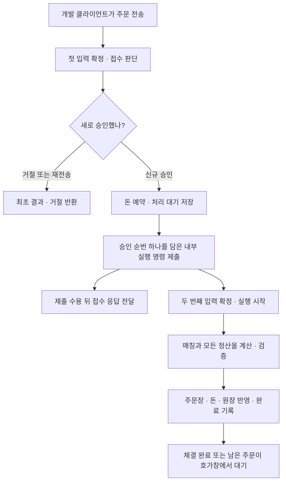

# #129 · 접수한 주문이 매칭·정산까지 이어지는 흐름

**이번에 연결한 기능:** 주문을 접수하면 돈을 예약하고, 같은 Aeron Cluster 안에서 자동으로 매칭·정산한다. 새 서버는 추가하지 않는다. 개발용 전송 프로그램이 주문을 보내며, 사용자 HTTP API 연결은 후속이다.

지금 집중해서 볼 것은 **접수와 실행을 왜 나누는가**다. 접수 성공은 돈을 예약했다는 뜻이다. 상대 주문이 있어 체결됐다는 뜻은 아니다.



**두 번 확정해도 돈을 두 번 예약하지 않는다.** 첫 입력이 예약을 만들고, 두 번째 입력은 그 예약을 사용해 거래를 처리한다. 같은 실행이 다시 와도 최초 완료를 반환한다.

<details markdown="1">
<summary>1. 접수와 실행을 두 번 확정하는 이유</summary>

판매자가 BTC 1개를 100 USDT에 팔겠다고 보냈다고 하자.

| 시점 | 엔진이 기억하는 것 | 클라이언트가 아는 것 |
| --- | --- | --- |
| 주문 입력 확정 전 | 아직 접수하지 않음 | 전송했어도 접수 성공은 모름 |
| 주문 입력 확정 · 승인 | BTC 1개 예약, 승인 순번 1, 처리 대기 주문 | 아직 응답을 기다릴 수 있음 |
| 내부 실행 명령 제출 수용 | 순번 1을 실행하라는 의도를 Aeron에 제출 | 이 뒤 접수 응답을 전달할 수 있음 |
| 내부 실행 명령 확정 | 세 사본이 순번 1의 실행을 같은 순서로 시작 | 접수 응답 수신과 선후는 다를 수 있음 |
| 상대 없는 매도 실행 완료 | 처리 대기 0, 호가창 SELL 1, BTC 예약 1, 완료 1 | 매칭을 했지만 아직 체결된 것은 아님 |

첫 입력과 실행을 같은 콜백 안에서 끝내는 설계도 가능하다. 이번에는 앞서 합의한 ‘예약 확정 후 접수 응답, 매칭·정산은 후속 처리’ 계약을 유지한다. 그래서 두 번째 확정 입력이 실행 시점과 순서를 세 사본에 공통으로 전달한다. 두 번의 합의가 비용 없이 더 빠르다는 주장은 하지 않는다. 실제 지연·처리량은 별도 측정 대상이다.

내부 제출보다 먼저 응답을 보내면, 응답 전송에서 예외가 난 노드가 실행 명령을 빠뜨릴 수 있다. 따라서 **내부 제출 수용 → 접수 응답 전달** 순서를 지킨다. 제출 수용은 내부 명령이 최종 확정됐다는 뜻이 아니다. 실제 매칭은 두 번째 확정 콜백에서만 호출한다.

모든 사본이 같은 승인에서 같은 메시지를 생성한다. ‘리더만 생성’하는 별도 분기는 없다. Aeron의 서비스 메시지 추적이 같은 생성 순서를 관리하며, 우리 코어의 완료 기록이 중복 업무 효과를 막는다. 재전송마다 새로운 실행 번호를 만들지 않는다.

</details>

<details markdown="1">
<summary>2. 실제 코드는 어디서 이어지나</summary>

| 순서 | 코드 | 이 코드가 하는 일 |
| --- | --- | --- |
| 노드 준비 | [DevelopmentFundingNode](../app-api/src/main/kotlin/com/exchange/core/api/trading/infrastructure/aeron/DevelopmentFundingNode.kt) | 기존 접수 상태 대신 `TradingState` 하나를 조립한다. 자금 준비·접수·매칭·정산이 같은 잔고를 쓴다. 합의 모듈의 clock을 밀리초로 고정한다. |
| 확정 입력 수신 | [DevelopmentFundingAdapter.onSessionMessage](../app-api/src/main/kotlin/com/exchange/core/api/trading/infrastructure/aeron/DevelopmentFundingAdapter.kt) | 입력의 출처·바이트 종류를 구분하고 자금 준비, 접수, 내부 실행을 각각 호출한다. |
| 신규 승인 연결 | 같은 파일의 `admit` → `submitExecution` | 최초 결과가 없고 새로 승인한 때만 내부 메시지를 제출한다. 최초 결과 재전송·거절에는 제출하지 않는다. |
| 내부 바이트 | [ExecuteAdmissionCodec](../app-api/src/main/kotlin/com/exchange/core/api/trading/infrastructure/codec/ExecuteAdmissionCodec.kt) | 기존 8바이트 외부 헤더의 kind 7과 Protobuf 승인 순번 한 개를 쓴다. 주문·돈·정책을 다시 복사하지 않는다. |
| 확정 실행 | 같은 어댑터의 `Command.Execution` 분기 | `state.executePending(sequence, Instant.ofEpochMilli(timestamp))`를 호출한다. 현재 시각·난수를 새로 만들지 않는다. |
| 실제 돈과 주문장 | [TradingState.executePending](../domain-trading/src/main/kotlin/com/exchange/core/trading/TradingState.kt) | 기존 매칭·정산 계산, 전체 검증, 실제 반영, 완료 기록을 재사용한다. 이번에 계산기를 다시 만들지 않는다. |

어댑터의 핵심 연결은 다음과 같다. 전체 소스가 아니라 읽을 순서를 보여주는 짧은 발췌다.

```kotlin
val result =
    state.admit(
        command.requestId,
        command.order,
        command.market,
        command.feePolicySnapshot,
        command.ledgerTransactionId,
        command.occurredAt,
    )
if (!knownRequest && result is OrderAdmissionState.Result.Accepted) {
    submitExecution(result.record.sequence)
}
// submitExecution이 수용된 뒤 기존 작은 접수 결과를 응답한다.
```

내부 명령이 확정되어 다시 들어오는 분기는 다음이다.

```kotlin
executionSequence = command.value.admissionSequence
state.executePending(executionSequence, Instant.ofEpochMilli(timestamp))
```

두 번째 호출은 사용자에게서 주문 원본이나 최신 수수료를 다시 받지 않는다. 최초 승인 원본과 현재 잔고·예약을 공통 상태에서 읽는다. 내부 메시지의 순번은 이 상태 안에서 승인된 주문을 가리킨다.

</details>

<details markdown="1">
<summary>3. 외부 주문이 내부 실행인 척하면 어떻게 하나</summary>

외부 클라이언트가 kind 7 바이트를 보내도 실행하지 않는다. `session == null`만으로 내부라고 판단하지도 않는다. 외부 세션이 이미 없어도 확정된 외부 명령은 적용해야 하기 때문이다.

[ClusterMessageOrigin](../app-api/src/main/kotlin/com/exchange/core/api/trading/infrastructure/aeron/ClusterMessageOrigin.kt)은 **Aeron 1.53.3의 실제 콜백 직전 세션 헤더**를 읽는다. 음수가 아닌 클러스터 세션은 외부다. 음수 서비스 세션은 기대 서비스 ID까지 일치해야 내부다. 조각이 합쳐진 메시지도 같은 경계를 시험한다. transport `Header.sessionId()`와 클러스터 세션 ID는 다르다.

새 클러스터의 `onStart`에서는 Aeron의 시간 단위가 아직 null이다. 실제 leadership term을 받은 때와 매 업무 입력 전에 MILLISECONDS인지 검사한다. 내부 실행 시각은 해당 콜백의 timestamp에서만 만든다. 실제 통신 시험이 이 생명주기 차이를 드러내 시작 검사를 바로잡았다.

이 코드는 Aeron의 버전 고정 구현에 의존한다. 라이브러리를 올릴 때 실제 통신 계약 시험을 함께 확인해야 한다. 헤더가 손상되면 내부라고 추측해 계속하지 않고 노드를 실패시킨다.

| 입력 | 처리 |
| --- | --- |
| 외부의 정상 자금 준비·주문 | 기존 규칙대로 처리 |
| 외부의 kind 7·잘못된 본문 | 엔진에 보내지 않고 다음 정상 입력 계속 |
| 신뢰한 내부 출처의 정상 kind 7 | 존재하는 승인 순번을 실행 |
| 신뢰한 내부 출처의 잘못된 형식·없는 승인·잘못된 실행 순서 | 해당 노드 실패 |

</details>

<details markdown="1">
<summary>4. 재전송과 실패 뒤 돈은 어떻게 되나</summary>

| 상황 | 남는 결과 |
| --- | --- |
| 체결 뒤 같은 외부 요청 재전송 | 최초 접수 결과를 반환. 새 실행·추가 예약·체결 없음 |
| 같은 내부 실행 순번 재전달 | 최초 완료와 완료 시각 유지. 새 원장·사건 순번 없음 |
| 내부 제출이 잠깐 막힘 | 같은 바이트를 callback 안에서 제한 재시도. 수용 전에는 다음 업무로 넘어가지 않음 |
| 내부 제출 한도 초과·종단 상태·예외 | 그 노드를 실패시킴. 자동 취소·환불·빈 상태 재시작 없음 |
| 응답을 받지 못함 | 이미 실행됐을 수 있음. 같은 요청으로 최초 결과 확인. timeout을 취소로 해석하지 않음 |
| 매칭·정산 계산 오류 | 실제 업무 값은 실행 직전 그대로, 해당 공통 상태 차단·노드 실패 |
| 실제 반영 도중 오류 | 일부 값이 바뀌었을 수 있음. 같은 차단·실패. SQL rollback처럼 복구됐다고 말하지 않음 |

기본 내부 제출 한도는 1,000회 또는 1,000ms 중 먼저 닿는 값이다. `System.nanoTime()`은 이 로컬 대기 시간에만 쓴다. 돈·순번·업무 시각의 기준이 아니다.

한 노드 실패와 전체 거래 차단은 다르다. 이번에는 건강한 두 노드를 무조건 함께 종료하는 코드를 넣지 않는다. 공유 자금 불신의 전역 차단·복구 후 재개, 정상 장애 승계·과반 상실은 후속 검증이다.

</details>

<details markdown="1">
<summary>5. 테스트가 실제로 무엇을 확인하나</summary>

최종 로컬 검사는 **BUILD SUCCESSFUL**이다. 모듈별 XML의 합계는 **1,457개, 실패·오류·건너뜀0**이다.

| 검사 | 결과 |
| --- | --- |
| 앱·실제 DB/UDP/CLI/Docker | 619개 통과 |
| 수수료·원장·주문·매칭·공통 거래 상태 | 457개 통과 |
| 구조 | 381개 통과 |
| Kotlin 형식·필수 구조 보고서 | 통과 |

마지막 전체 명령은 앱·구조 검사를 재실행했다. 변경 없는 도메인457개는 직전 전체 검사 결과를 UP-TO-DATE로 재사용했다. 모든 모듈을 마지막 명령에서 새로 실행했다고 합산하지 않는다.

```bash
# 저장소 루트에서 실행
./gradlew -p . build test ktlintCheck :architecture-tests:verifyArchitectureReport --continue --console=plain
```

실제 Docker 실행12개도 각 보고서의 `issues=[]`를 확인했다. 자금 준비, 자동 전량·여러 체결/잔량, 기존 접수·재전송·충돌·여러 마켓·동시 요청을 포함한다. 보고서는 `app-api/build/reports/aeron-funding/<runId>/result.json`, 시험별 검증문은 아래 원문에 있다. Docker 실행 수를 별도 테스트 정의 수처럼 더하지 않는다.

아래 표는 실제 시험이 확인하는 입력과 결과의 지도다.

| 준비 → 실행 | 실제 검사할 것 |
| --- | --- |
| 빈 잔고 → 개발 자금 준비 → 상대 없는 SELL | 내부 제출만으로 주문장이 바뀌지 않음. 실제 확정 실행 뒤 대기0·호가1·완료1 |
| 구매자1,000·판매자BTC1 → SELL100×1 → BUY100×1 | 구매자900·BTC1, 판매자100·BTC0, 예약0, OPENING2·RESERVE2·SETTLEMENT1 |
| SELL90×1·SELL95×1 → BUY100×3 | 구매자715·예약100·BTC2, 판매자185, BUY잔량1·완료3·SETTLEMENT2 |
| 1,000ppm 수수료의 10,000 거래 | 구매자89,990, 판매자9,990, 수수료20 |
| 같은 외부/내부 입력 반복 | 최초 응답·완료 유지, 돈·주문장·원장·실행 의도 중복 없음 |
| 실제 UDP 메시지와 Archive | 출처·조각 재조립·확정 입력 순서와 승인 순번 대조. 읽을 때 엔진 실행 없음 |
| 세 Docker JVM의 같은 확정 위치 | 잔고·현재 예약·호가창·실제 원장·최초 결과·전체 완료를 직접 비교 |

통신을 흉내 낸 단위 시험은 제출/응답 순서와 오류 경계를 통제한다. 실제 UDP 시험은 Aeron 계약을 확인한다. Docker 시험은 독립 JVM 세 사본의 같은 위치 결과를 확인한다. 어느 하나로 재해 복구·운영 지연·처리량을 보장하지 않는다.

### 대표 시험: 예약은 했지만 매칭은 아직 하지 않았다

[새 SELL의 두 확정 시험](../app-api/src/test/kotlin/com/exchange/core/api/trading/infrastructure/aeron/AutomaticOrderExecutionTest.kt#L62)을 먼저 읽으면 된다.

- **준비:** 실제 `TradingState`에 판매자의 BTC 1개를 준비한다. 마켓은 scale0·tick1·step1·수수료0이다. 돈 계산기는 실제 코드이며, 전송 반환값과 콜백 시점만 대역으로 통제한다. DB·네트워크를 띄우는 시험은 아니다.
- **실행 1:** SELL100×1을 외부 입력으로 접수한다.
- **확인 1:** 승인 순번1, 호출 순서 `INTERNAL → REPLY`, 내부 메시지의 승인 순번1을 대조한다. 처리 대기1·완료0·호가0, BTC 사용 가능0·예약1이다. 제출 성공을 실행 완료로 취급하면 이 검증에서 틀어진다.
- **실행 2:** 그 내부 메시지를 신뢰한 출처의 확정 콜백으로 전달하고 timestamp2,000을 준다.
- **확인 2:** 처리 대기0·완료1, 완료 시각은 epoch2,000ms, 호가 주문은 S1 한 건이다. 원장은 OPENING·RESERVE뿐이고 체결 원장은 없다. 같은 파일의 70행은 제출/응답 순서, 87행 이후는 실행 후 결과를 검사한다.

### 실제 UDP에서 응답을 놓친 뒤 재전송한다

[체결 후 응답 손실 시험](../app-api/src/test/kotlin/com/exchange/core/api/trading/infrastructure/aeron/DevelopmentOrderNodeTest.kt#L455)은 실제 노드·클라이언트·UDP를 쓰며 HTTP API 시험은 아니다.

- **준비:** 이 실제 UDP 사례는 기존 기본 마켓의 원시 단위를 쓴다. 구매자USDT 금액1,000,000,000·판매자BTC 수량100,000,000(1BTC)을 준비하고, 가격100,000,000·수량100,000,000의 SELL을 먼저 처리한다. USDT의 표시 소수점을 이 테스트가 정하는 것은 아니다.
- **실행 1:** 같은 가격·수량의 BUY를 보내되 클라이언트가 받은 접수 응답을 버리도록 한다. UDP 패킷 손실을 직접 주입하는 대신 수신 결과 전달을 폐기한다.
- **확인 1:** 클라이언트는 ‘결과 미확인’이다. 노드 완료2를 기다린 뒤 구매자USDT 금액900,000,000·BTC 수량100,000,000, 판매자USDT 금액100,000,000·BTC0, 예약0·원장5, 빈 주문장을 확인한다. 이 금액은 원시 단위다.
- **실행 2:** 같은 BUY의 응답을 받도록 바꿔 다시 보낸다.
- **확인 2:** 최초 승인을 반환하고 전체 잔고·원장·현재 예약·호가·완료가 유지된다. 새로운 콜백의 관찰 시각은 달라도 최초 완료와 정산 시각은 같아야 한다. 529행의 전체 완료 비교가 이 부분을 검사한다. 테스트가 수집한 새 관찰 안에 추가 EXECUTION이 없는지도 검사한다.

위 두 사례는 상세히 설명했다. 나머지는 아래 파일별 동작 지도와 원문을 제공하며, 모든 테스트의 각 검증문을 줄마다 해설한 것은 아니다. 역압력·치명 실패·계산 전/쓰기 후 오류의 전체 원문은 `AutomaticOrderExecutionTest`, 실제 세 사본의 숫자·누락·오염 대조는 Docker·비교기 시험에 있다.

바뀐 파일은 다음 흐름에 속한다. 테스트를 위한 관찰은 test 소스에만 둔다.

| 파일 묶음 | 책임 |
| --- | --- |
| `DevelopmentFundingNode`·`DevelopmentFundingAdapter`·`ClusterMessageOrigin` | 같은 거래 상태 조립, 확정 입력의 출처·분기, 실행 제출과 실패 처리 |
| `order_admission.proto`·`AdmissionMessageFormat`·`ExecuteAdmissionPayload`·`ExecuteAdmissionCodec` | 기존 전송 형식에 승인 순번 하나의 내부 메시지 추가 |
| `DevelopmentFundingEvents` | 처리 대기에서 사라진 주문도 실제 원장에서 계속 관찰 |
| `ExecuteAdmissionCodecTest`·`ClusterMessageOriginTest`·`ClusterMessageOriginNodeTest` | 바이트 검증과 실제 Aeron 헤더·조각 계약 |
| `AutomaticOrderExecutionTest`·`DevelopmentOrderNodeTest` | 통제한 실패와 실제 UDP 체결·응답 손실·재전송 |
| 기존 Adapter·Events·Collector·Node·Client·MultiMarket·MarketMain 테스트 | 자동 실행 뒤 완료 상태로 기존 자금·정책·CLI 계약 이행 |
| `FundingVerificationNode`·`TradingVerificationEvidence`·`ObservedTradingNode`·`TradingAdapterFixtures` | 테스트 callback의 전체 값 수집과 공통 준비 |
| `AutomaticTradingScenario`·`OrderReplicationScenario` | 실제 입력과 손으로 정한 숫자·정산 정답 |
| `AutomaticExecutionComparison`·해당 Test·기존 OrderReplicationComparison | 같은 확정 위치의 세 사본 대조, 누락·중복·같은 오염 탐지 |
| `DockerFundingReplicationTest`·`DockerConcurrentCoverageTest` | 기존 세 컨테이너 실행·정리·보고서에 자동 체결 사례 연결 |
| `AeronRecordedInputTest`·`RecordedInputComparison` | 실제 Archive의 내부 실행 종류·순번·위치 대조, 읽기 전후 값 보존 |

제품에 테스트용 gate·전체 관찰 큐·수동 실행 명령을 추가하지 않는다. 테스트에서 기존 callback decorator와 별도 관찰 도구를 사용한다. 원장 관찰은 현재 처리 대기에서 재조립하지 않고 실제 `TradingState` 원장을 읽으므로 완료 뒤에도 RESERVE가 사라지지 않는다.

</details>

<details markdown="1">
<summary>6. 검토와 후속 범위</summary>

별도 컨텍스트의 사전 코드 검토에서 내부 제출·재전송·시각·계산/반영 실패와 실제 UDP 경계를 대조했다. 확인된 지적은 수정하고 영향받는 시험으로 재검증했으며, 검토 범위의 미해결 지적은 없다. 사전 검토의 선택 시험과 위 전체 빌드·Docker 결과는 별도 근거다.

이번에는 기존 개발 전송 프로그램에서 시작한다. 사용자 HTTP 전환, 체결 조회 API, Kafka 전달, Snapshot·재시작 복구, 재해 유실0, 운영 전체 차단, 성능 보장, 마켓별 클러스터 분리는 포함하지 않는다. 특히 한 노드의 실패를 건강한 사본 전체의 중단으로 연결하지 않으며, 자금 불신의 전역 차단과 복구 후 재개는 별도 설계가 필요하다.

Aeron은 1.53.3으로 고정한다. 새 kind7을 쓰므로 모든 노드·클라이언트를 같은 수정 빌드로 실행한다. 구·신 버전 혼합 실행은 이번 검증 범위가 아니다.

</details>
