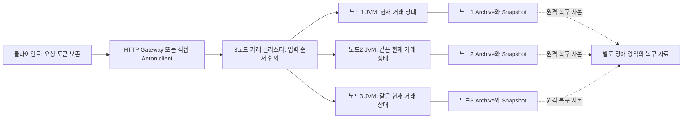
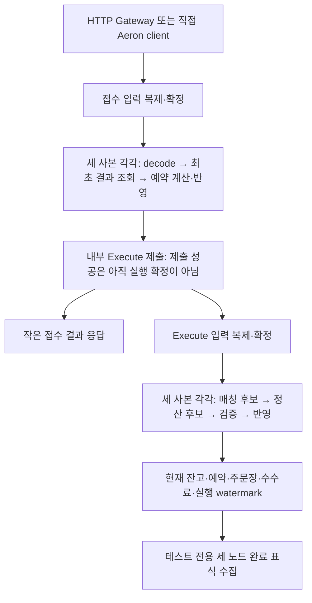

# Aeron 거래 상태의 유한 보관과 복구 — 코드 설계

작성일: 2026-10-30. 기준 코드: `a39b0d8c9176aefac676f62312a3f51fdcb79dbd`.

**상태: 구현·검증 진행 중(2026-10-30). 아래 17절의 실제 실행 근거로 상태를 구분한다. 전체 장애·원격 복구·성능 수용 기준은 아직 완료하지 않았다.** 사용자 요청에 따라 Kafka, 외부 결과 전달 워커, 조회 DB 구축을 이번 범위에서 제외한다. 이전의 결과 재생 워커 A안/결과 로그 B안 선택도 이번 구현의 선행 조건으로 두지 않는다.

## 1. 이번에 해결할 문제

현재 정상 거래 callback은 완료 이력을 RocksDB에 넘기고, 이력 버퍼가 차면 저장을 기다린다. 이를 없애되 과거 요청을 새 주문으로 오인하거나 리더 장애 뒤 돈을 두 번 예약하지 않아야 한다.

새 거래 경로가 소유할 것은 **현재 잔고·수수료 잔고, 활성 주문·예약, 미완료 실행, 유한한 최초 응답, 순번**이다. 이미 종료한 주문의 전체 후보·체결·원장 객체는 계속 붙잡지 않는다. 원래 입력·당시 코드·정책은 Archive와 복구 자료로 보존한다. 기록을 버리거나 `sync=0`으로 바꿔 얻는 성능 개선은 이번 설계의 성공 기준이 아니다.

| 구분 | 이번 설계 |
|---|---|
| 유지 | Aeron 1.53.3, 거래 3노드, Archive/catalog/Consensus 파일 sync=2, 접수와 Execute의 두 확정 단계, 같은 사용자 자금을 공유하는 BTC/SOL/SUI |
| 변경 | 영구 임의 요청 ID 조회 → 세대·순번 Inbox, full Completion → 최소 활성 주문 상태, 이력 의존 Snapshot → 현재 상태 Snapshot v2 |
| 측정 | 엔진 단독과 거래 3노드 직접 요청을 구분. 접수 응답과 실제 매칭·정산 완료도 구분 |
| 제외 | Kafka, 결과 Outbox, 별도 결과 재생 서비스, 조회 RDB, 마켓별 클러스터 분리, off-heap 전면 변경 |
| 자동으로 주장하지 않음 | 50k TPS 달성, 전체 저장소 유실 RPO0, 운영 배포 준비 완료 |

세대·증가 순번과 과거 조회 분리는 이미 사용자가 선택했다. 구체적인 클래스·한도·코드 이행 순서는 이번 설계의 제안이다. Kafka가 없는 현재 단계에서는 오래된 최초 결과를 제공할 조회 API도 없다는 사실을 응답에 명시한다.

## 2. 구조와 쓰기 소유권



- 하나의 거래 클러스터에서 자금 예약·매칭·정산을 유지한다. 마켓별 별도 클러스터로 분리한 설계라고 설명하지 않는다.
- 각 JVM의 서비스 스레드 한 개가 해당 사본의 `TradingState`를 쓴다. Gateway 스레드·Snapshot 운영 도구·메트릭 worker가 이 객체를 직접 변경하지 않는다.
- `onSessionMessage()`는 확정 입력을 도메인 함수로 전달한다. 현재 시각·난수·DB 조회·디스크 여유에 따라 서로 다른 금융 결정을 하지 않는다.
- `onTakeSnapshot()`은 같은 서비스의 lifecycle 경계에서 현재 상태를 쓴다. 정상 주문 callback에는 별도 이력 저장 I/O를 넣지 않는다.
- 원격 사본은 별도 금융 엔진이 아니다. 전체 primary 저장소 유실까지 보호할 때 필요한 복구 자료 보관이며, 12절의 응답 gate와 함께 검증해야 한다.

## 3. 유지할 불변식

1. 같은 요청 토큰으로 예약·원장·새 실행 의도를 두 번 만들지 않는다. 모든 사본의 최초 승인 callback이 같은 서비스 메시지를 생성하는 Aeron 동작과, 재전송이 새로운 실행 의도를 만드는 것은 구분한다.
2. 같은 토큰의 다른 주문 내용은 충돌이며 최초 결과를 바꾸지 않는다.
3. 이미 퇴역한 토큰은 최초 결과를 제공할 수 없어도 다시 실행하지 않는다.
4. 사용자·자산별 `hold`는 살아 있는 모든 예약의 `remainingAmount` 합계다.
5. 주문장의 주문과 `RESTING` live order는 일대일이며, 소유자·방향·가격·원수량·잔량이 일치한다.
6. `PENDING` 주문은 아직 주문장에 없다. 같은 마켓의 승인 순서대로 처음 실행한다.
7. 수수료 정책과 소수 나머지는 주문별로 유지한다. 서로 다른 주문의 나머지를 합치지 않는다.
8. 한 Execute의 모든 체결을 계산·검증한 뒤 같은 callback에서 함께 반영한다. 후보와 적용 사이 다른 입력을 처리하지 않는다.
9. 반영 도중 오류가 난 객체는 다시 사용하지 않는다. SQL rollback을 제공한다고 설명하지 않는다.
10. 같은 확정 입력 위치의 새 실행·로그 재생·Snapshot+tail 복구는 같은 현재 상태를 만든다.

금융 검증을 없애서 비용을 줄이지 않는다. 제거 대상은 **과거 전체 결과의 상시 보관·중복 ID 디스크 조회·별도 이력 저장 대기**다.

## 4. 상태 모델: 후보의 수명과 현재 상태를 분리

### 4.1 요청과 작은 최초 결과

아래 선언은 구현할 계약을 설명하는 Kotlin 설계이며 현재 컴파일되는 제품 코드가 아니다.

```kotlin
data class RequestToken(
    val userId: UserId,
    val channel: Int,
    val epoch: Long,
    val sequence: Long,
)

data class OrderIntent(
    val marketId: MarketId,
    val expectedConfigurationVersion: Long,
    val side: Side,
    val orderType: OrderType,
    val timeInForce: TimeInForce,
    val price: Price,
    val quantity: Quantity,
)

data class AdmissionReceipt(
    val code: AdmissionCode,
    val orderId: OrderId?,
    val admissionSequence: Long?,
    val marketAdmissionSequence: Long?,
    val insufficientBalance: InsufficientBalanceValues?,
)
```

`OrderIntent`는 의미가 있는 요청 필드 전체를 포함한 불변 값이다. 재전송은 이를 정확히 비교한다. JSON 공백·필드 순서나 Protobuf 직렬화 바이트의 우연한 순서로 동일성을 정하지 않는다. 반면 사용자 의도에 포함한 설정 버전은 비교에서 빼지 않는다. Inbox byte 예산은 형식 버전이 고정된 결정론적 size 함수로 계산한다. 예산을 세려고 매 요청을 JSON으로 재직렬화하거나 SHA/임시 ByteArray를 만들지 않는다.

`AdmissionReceipt`에 `Accepted(Record)`나 `OrderAdmissionCandidate`를 넣지 않는다. 현재 Record는 후보·최초 예약·RESERVE 원장을 연결하고, Completion은 매칭/정산 그래프를 연결한다. 작은 영수증이라는 이름만 붙이고 이 참조를 유지하면 목적을 달성하지 못한다. 현재 후보의 과거 잔고는 이미 스칼라이므로 과거 Balance 객체를 보유한다고 잘못 설명하지 않는다.

### 4.2 활성 주문과 실행 순서

```kotlin
enum class LiveOrderPhase { PENDING, RESTING }

internal class LiveOrder(
    val admissionSequence: Long,
    val marketAdmissionSequence: Long,
    val order: OrderAdmissionInput,  // 서버가 발급한 orderId 포함
    val market: MarketDefinition,   // 당시 고정 정의
    var reservation: OrderReservation,
    var phase: LiveOrderPhase,
)

internal class MarketExecutionProgress(
    var lastAssigned: Long,
    var executedThrough: Long,
    val pending: ArrayDeque<LiveOrder>,
)
```

`OrderReservation`의 최초/잔여 수량·예약액·수수료 예약액·정책·`feeRemainder`는 보존한다. 잔고는 사용자·자산 키로 공유하지만 예약과 수수료 나머지는 주문별이다.

`LiveOrder`는 `admissionSequence → LiveOrder`와 `(marketId, orderId) → LiveOrder`로 찾는다. 현재의 1,024칸 segment 배열을 그대로 가져오지 않는다. 오래 살아 있는 maker 하나 때문에 빈 참조 칸 1,023개를 계속 보유할 이유가 없다. 두 인덱스는 같은 최소 객체를 참조하며 종료 때 함께 제거한다.

### 4.3 자금 준비와 시스템 수수료

- 기존 개발 자금 준비의 정확한 최초 결과 재사용 계약은 유지한다. 성공한 `PreparationRecord`와 `usedBalances` 사실을 계정·자산별 한 번의 준비 범위 안에서 보관한다.
- 신규 계정·잔고 키·preparation 개수와 원문 byte에 복제된 한도를 적용한다. 실패한 준비 요청은 새 preparation을 남기지 않는다. 같은 preparation ID의 다른 원문은 충돌이다.
- 잔고가 다시 0이 돼도 사용했던 키의 사실을 없애 새 지급을 허용하지 않는다. 이는 거래 건수가 아니라 유한한 계정·자산 수에 비례하는 상태다.
- `SettlementLedgerTransactions`가 만드는 `SYSTEM:<asset>:FEE_REVENUE`를 잃지 않도록 `feeRevenueByAsset: Map<AssetId, BigInteger>`를 현재 금융 상태에 포함한다. 개별 사용자의 금액은 기존 Long을 유지하지만 여러 사용자의 합계가 Long을 넘을 수 있으므로 수수료 누계는 비음수 BigInteger로 둔다. 최대 bit 수는 `maxBalanceKeys × Long.MAX_VALUE`의 bit length로 제한한다. 직렬화도 이 한도를 적용한다.
- fee delta는 각 체결의 maker/taker `actualFeeAmount`를 feeAssetId별로 정확히 한 번 합한 값이다. 생성한 원장의 `SYSTEM:<asset>:FEE_REVENUE` CREDIT 합계와 대조한 뒤, 기존 누계+delta를 사용자 잔고/예약과 같은 반영 구간에서 갱신한다. 사용자 잔고에서 수수료를 다시 빼지 않는다. 예비 수수료·미사용 예약 반환·`feeRemainder`는 수익에 더하지 않는다. Snapshot에도 이 누계를 보존한다.
- 현재 범위에 외부 입출금은 없다. 따라서 복구 대조는 자산별 `사용자 available+hold 합계 + 수수료 누계 = 개시 자금 합계`다. 합계 계산은 검사 과정에서 넓은 정수형으로 수행해 합산 overflow를 숨기지 않는다. 매 체결의 복식 원장 균형 검증도 그대로 유지한다.

## 5. `TradingRequestInbox`: 유한한 요청 중복 방지

계정별 channel은 고정된 유한 슬롯이며 epoch는 클러스터 제어 입력으로 발급한다. Aeron 세션 ID·Gateway 프로세스 ID를 업무 identity로 사용하지 않는다. 클라이언트는 미확인 요청의 토큰과 본문을 재기동 후에도 복원할 수 있어야 한다.

```kotlin
internal class TradingRequestInbox {
    fun lookup(token: RequestToken, intent: OrderIntent): InboxLookup
    fun remember(token: RequestToken, intent: OrderIntent, receipt: AdmissionReceipt)
    fun acknowledge(userId: UserId, channel: Int, epoch: Long, through: Long): AckReceipt
    fun rotateEpoch(userId: UserId, channel: Int, expectedEpoch: Long): EpochReceipt
}
```

모든 변경은 서비스 스레드의 확정 입력 처리에서만 호출한다. `lookup` 뒤 반영까지 비동기 분기를 두지 않는다. `remember`는 독립적으로 외부 호출자가 실행할 공개 금융 입구가 아니다.

| 상태 | 응답·효과 |
|---|---|
| 현 epoch, 미처리 sequence, 창 내부 | 처음 판단할 수 있음 |
| 이미 처리, 같은 intent | 작은 최초 receipt 재사용. 재예약·원장·Execute 제출 없음 |
| 이미 처리, 다른 intent | 내용 충돌. 최초 결과 유지 |
| `sequence <= retiredThrough` | `RETIRED_UNAVAILABLE`. 최초 결과 제공 불가이며 절대 재실행하지 않음 |
| 창 밖·logical capacity 부족 | `RETRYABLE_CAPACITY`. 돈·receipt·sequence를 소비하지 않음 |
| 낮은 epoch / 미발급 높은 epoch | fenced / 미발급. 데이터 요청으로 새 epoch를 자동 생성하지 않음 |

창은 `retiredThrough < sequence <= retiredThrough + W`이며 overflow를 검사한다. `processedThrough`는 최초 결과를 만든 **연속 prefix**다. 10·12만 처리했다면 11을 건너뛰어 12까지 지우지 않는다.

ACK는 ‘최초 접수 결과를 클라이언트가 보존했으며 이 경로에서의 재조회 보관을 해제해도 됨’이라는 뜻이다. 체결 완료·주문 취소의 뜻이 아니다. 적용 시점의 `processedThrough`를 넘는 ACK는 거절하며 미래 삭제 허가를 저장하지 않는다. ACK 재전송은 floor의 단조 증가로 멱등 처리한다. ACK가 와도 활성 주문·예약·pending은 지우지 않는다.

`rotateEpoch(expectedEpoch)`는 현재 epoch가 일치할 때만 1 증가한다. 같은 expectedEpoch의 재전송이 계속 세대를 증가시키지 않는다. 이미 다음 세대이면 기존 발급 세대를 알려주고, 더 진전됐으면 superseded/fenced 상태를 알린다. 이전 epoch의 이미 승인된 pending은 계속 실행한다. 계정/channel을 삭제했다 다시 만들며 epoch를 초기화하는 기능은 이번에 제공하지 않는다.

Kafka/과거 조회가 없는 현재 `RETIRED_UNAVAILABLE`은 금융 거절이 아니다. Gateway가 이를 새 토큰으로 자동 재주문해서는 안 된다. epoch 교체로 미확인 주문이 해결됐다고 간주하지도 않는다. 조회 경로가 생기기 전에는 운영상 원래 토큰·확정 로그를 대조해야 한다.

## 6. 접수 함수와 ID 계약

```kotlin
class TradingState {
    fun admit(token: RequestToken, intent: OrderIntent, at: Instant): AdmissionReply
    fun executePending(command: ExecuteAdmission, at: Instant): ExecutionReply
    fun acknowledgeReceipts(command: AcknowledgeReceipts): AckReceipt
    fun rotateEpoch(command: RotateEpoch): EpochReceipt
    fun recoveryState(): TradingRecoveryState
    fun restoreRecoveryState(candidate: TradingRecoveryState)
}
```

`at`은 callback의 기록된 timestamp다. 마켓·정책·한도는 검증된 고정 registry에서 찾는다. 도메인은 Aeron·RDB·파일 타입을 알지 않는다.

### 접수 순서

1. 금융 상태가 격리됐는지 확인한다. 격리 중에는 재전송과 정상 조회도 금융 확정 결과로 내보내지 않는다.
2. 토큰·계정/channel/epoch, retired 여부와 기존 receipt를 확인한다. **기존 결과 재사용이 현재 설정·용량 검사보다 먼저다.**
3. 새 요청이면 창·고정 설정 문맥·논리 용량을 검사한다. 설정 불일치는 기존처럼 최초 업무 결과를 만들지 않는다.
4. 주문이 필요로 할 base/quote 잔고 키 둘의 공간과 pending/active 슬롯을 확보할 수 있는지 검사한다. 실제 수취 잔고를 정산 중 처음 만들다가 cap에 걸리게 하지 않는다. 승인 시 필요한 0 잔고 키 또는 동등한 capacity 예약을 같이 반영한다.
5. 다음 global admission sequence와 해당 마켓의 연속 market admission sequence를 후보 값으로 산출한다. 기존 계산기로 예약 후보·RESERVE 원장을 만들고 검증한다.
6. 잔고 부족 같은 정상 거절이면 작은 최초 receipt만 반영한다. 요청 sequence는 처리되지만 승인 counter·잔고·예약은 바뀌지 않는다.
7. 승인이면 잔고·예약·LiveOrder·pending·ID counter·작은 receipt를 같은 반영 구간에서 갱신한다. 후보 객체와 RESERVE 원장은 이후 보관하지 않는다.
8. Adapter는 **최초 신규 승인**에만 내부 Execute를 제출한다. 단순 재전송은 제출하지 않는다. 제출 성공을 Execute 확정으로 오인하지 않는다.

### ID

외부 CreateOrder는 임의 `orderId`나 원장 ID를 공급하지 못한다. 고정 길이 필드의 injective encoding을 사용한다. 해시만으로 과거 ID와의 동일성을 보장하지 않는다.

```text
Order ID        = O2 + encode(lineage128, globalAdmissionSequence64)
RESERVE ID      = R2 + encode(lineage128, globalAdmissionSequence64)
SETTLEMENT ID   = S2 + encode(lineage128, stableMarketOrdinal32, engineSequence64)
OPENING ID      = B2 + encode(lineage128, preparationCounter64)
```

counter는 양수 Long이며 `addExact`로 증가한다. lineage는 리더·프로세스 재기동·동일 이력 DR에서 유지한다. market ordinal은 immutable manifest에서 고정한다. namespace와 생성식이 서로 다른 업무의 ID 충돌을 막고, 실행 watermark가 같은 업무의 재반영을 막는다. batch 내부 중복·posting·금액 검증은 유지한다.

기존 임의 문자열 요청을 Gateway마다 새로운 sequence로 자동 매핑하지 않는다. 기존 프레임은 이미 `schema=87, VERSION=2`이므로 새 bounded 요청은 **동일 schema의 header VERSION=3과 새 Protobuf 메시지/descriptor**로 구분한다. Snapshot format=2와 wire VERSION=3은 별개의 번호다. 새 Protobuf 메시지에서 기존 필드 번호를 다른 의미로 재사용하지 않는다. 동시에 한 상태에 기존/새 생성 요청을 섞지 않는다. Spring 입구는 별도 DTO·`@RequestBody`·Bean Validation을 사용하며, HTTP 본문 검증이 도메인 정합성 검증을 대체하지 않는다.

새 프레임도 8-byte header와 전체 4,096-byte 상한을 유지한다. kind 1~7은 기존 메시지 영역으로 보존하고, 새 메시지는 별도 kind로 배정한다. 최초 세 마켓의 Init manifest는 canonical body 3,072 byte 이하로 제한해 같은 프레임에 넣는다. 한도를 넘는 registry 분할·동적 변경은 별도 설계이며 자동 chunk를 추가하지 않는다. decoder는 `(schema, version, kind)`와 Protobuf descriptor를 함께 검사한다.

## 7. 실행 함수: 같은 callback에서 계산하고 반영

```kotlin
data class ExecuteAdmission(
    val lineage: ClusterLineage,
    val marketId: MarketId,
    val marketAdmissionSequence: Long,
    val admissionSequence: Long,
)

sealed interface ExecutionReply {
    data class Applied(val receipt: ExecutionReceipt) : ExecutionReply
    data object AlreadyPassed : ExecutionReply
}
```

`ExecutionReceipt`에는 순번·완료 상태·마지막 매칭 event 순번 등 작은 값만 넣는다. 전체 Completion을 재반환하지 않는다. `AlreadyPassed`는 오래된 market 순번을 다시 실행하지 않는다는 뜻이며, 이미 버린 과거 global/market 대응이나 원문을 다시 검증했다는 뜻은 아니다. 다음 pending의 대상 불일치·미래 순번·lineage 불일치는 정상 완료로 바꾸지 않는다. 내부 명령의 발신 진위는 Adapter의 service-origin 검사로 별도 확인한다.

```text
blocked/lineage 확인
 → marketSeq <= executedThrough: AlreadyPassed, 변경 없음
 → marketSeq == executedThrough+1 및 firstPending의 두 순번 확인
 → MatchingEngine.prepareSubmit()
 → PENDING taker / RESTING maker / 원본·예약·정책 관계 검증
 → 여러 체결의 잔고·예약·수수료 후보를 순서대로 계산
 → 전체 매칭 결과·복식 원장·hold·최종 잔량 검증
 → 실제 쓰기 시작
 → 주문장·잔고·예약·수수료 누계 반영
 → 남은 주문 RESTING, 종료 주문·예약·엔진 terminal identity 제거
 → pending 제거 + executedThrough 진전
 → 작은 receipt 반환, 큰 지역 객체 수명 종료
```

global 순번은 마켓 사이에 구멍이 생기므로 watermark로 사용하지 않는다. 승인에만 발급하는 **연속 market admission sequence**를 별도로 둔다. 이 단계에서 `pending marketSeq`는 `executedThrough+1 .. lastAssigned`와 정확히 대응한다. 취소를 이 순서에 편입하는 작업은 후속이며 현재 거래 경로에 새 취소 기능을 열지 않는다.

`validateParticipants()`의 `completions[makerSeq].admission === makerRecord`는 `maker.phase == RESTING`과 book/live reservation 관계 검사로 대체한다. `LiveOrder` 생성 시 원본 관계를 검증하고, 체결 시 현재 reservation의 정책·잔량·수수료 나머지를 검증한다.

`MatchingEngine`의 후보 계산·적용과 독립 호출자의 중복 방지 계약은 유지한다. 새 공통 소유자 경로에서만 terminal 주문에 `releaseTerminalOrderIdentity()`를 호출한다. `MatchingResultState`가 하던 결과 전체 검증은 순수 검증 함수로 공유하고, 새 경로에서 `records/submittedOrders`에 결과 전체를 다시 적재하지 않는다. 검증 삭제로 바꾸지 않는다.

`submitExecution()`은 모든 사본에서 같은 확정 승인에 따라 호출하는 현재 Aeron 계약을 유지한다. `tryClaim` 양수나 `BufferClaim.commit()`은 내부 IPC 제출이며 합의 완료가 아니다. app `onStart`가 pending을 순회하며 임의로 Execute를 재전송하지 않는다. pending service message의 복구는 Aeron ConsensusModule의 tracker/Snapshot 계약과 함께 검증한다.

## 8. 메모리·자원 한도

`TradingResourceLimits`와 사용 카운터는 같은 manifest/입력/Snapshot에 포함한다. 노드별 heap 사용률·GC·디스크 여유를 읽어 서로 다른 승인 결정을 하지 않는다.

| 자원 | 증가 시점 | 감소/보존 |
|---|---|---|
| 계정·잔고 키·used 사실 | 신규 계정/자산을 실제 확보할 때 | 이번에는 자동 삭제하지 않음. 명시 cap |
| channel | 고정 슬롯 발급 | 수신자 재기동마다 새 슬롯을 만들지 않음 |
| Inbox entry·canonical byte | 최초 승인/정상 거절 | 유효 ACK 또는 epoch 교체. 활성 주문과 독립 |
| active order | 접수 승인 | pending→resting 전환은 증가 없음. 최종 체결 시 해제 |
| pending | 접수 승인 | 최초 Execute 완료 |
| preparation | 최초 성공 지급만 | 계정·자산당 한 번. 별도 ID/원문 byte cap |
| 주문장 identity·가격 level | 활성 maker 추가 | terminal 제거 시 함께 정리 |
| 관측 queue·응답 대기 | 비금융 경계의 제출 | 고정 크기. 객체 수명이 전체 거래 수에 비례하지 않음 |

W·전체 entry/byte·active/pending·계정/잔고 키의 수치는 manifest에서 명시하고 새 lineage의 측정 기록에 남긴다. 기본값만으로 실제 heap 상한을 증명했다고 하지 않는다. snapshot/복원 임시 공간과 한 주문의 최대 maker 수에 비례하는 후보 공간도 예산에 포함한다. deep-book worst case를 한 번의 전량 계산·검증으로 처리할 수 있는 active cap을 정해야 한다. 임의 체결 개수만 처리하고 교차 주문을 남기는 성능 우회는 사용하지 않는다.

최초 구현·비교에 사용할 **개발 profile r1 제안값**은 아래로 고정한다. 배포 권장치나 실측 heap 상한이 아니며, 모든 숫자는 실제 manifest/시험 결과에 남긴다. 이 한도를 바꾼 실행은 별도 비교 조건이다.

| 항목 | 제안값 |
|---|---|
| 마켓/자산 | BTC/SOL/SUI-USDT 3개, 자산4개 |
| 계정/잔고 key | 최대1,024계정 / 4,096 key |
| channel | 계정당2, 전체2,048 이하, 필요할 때만 생성 |
| 요청 창 W / 전체 receipt | 채널당4,096 / 전체32,768 entry 이하 |
| 전체 receipt canonical byte | 16 MiB 이하. entry 객체를 창 전체에 미리 할당하지 않음 |
| active / pending | 전체8,192 / 4,096 이하. 마켓당 active4,096 / pending2,048 이하 |
| 성공 preparation | 4,096개 및 canonical byte1 MiB 이하, ID/계정/자산 UTF-8 길이 cap |
| node heap | JVM당 `-Xmx1g`를 초기 비교 조건으로 기록. direct/native/mapped 사용량은 별도 기록 |
| 측정 입력 | 최초 비교 cohort 최대100,000개 신규 주문, 초기 warmup과 분리. ACK는 채널별256개 receipt를 durable 수신한 prefix마다 전송 |
| 디스크 guard | 시작 시 여유12 GiB 이상, 실행 중 여유8 GiB 미만이면 중지. 시험 root 전체2 GiB 예산, 초과 전 추가 입력 중지·자료 보존 |

Snapshot 복원·deep-book 한 주문·지속적인 receipt retirement에서 실제 heap 여유가 부족하면 cap을 낮춰 같은 조건으로 다시 검증한다. cap으로 발생기를 제한했다면 그 수치를 엔진 최대 TPS로 주장하지 않는다. 장기 실행을 먼저 시작하거나 더 큰 로그를 쌓아 상한을 확인하지 않는다.

**메모리 한도를 지켰다는 주장과 디스크가 유한하다는 주장은 다르다.** 이 설계는 종료 주문 heap/별도 인덱스 누적을 제거한다. 감사 원문인 Archive는 거래량만큼 증가한다.

## 9. Snapshot v2와 복구

기존 `TradingStateSnapshotPersistence`·`AeronSnapshotStreams` lifecycle을 재사용한다. 별도 자동 Snapshot 프레임워크나 DB 저장소를 추가하지 않는다. codec은 명시적 `formatVersion=2`로 분리한다.

```kotlin
data class TradingRecoveryIdentity(
    val lineage: ClusterLineage,
    val algorithmId: String,
    val executionArtifactSha256: String,
    val commandSchemaSha256: String,
    val marketConfigurationSha256: String,
    val resourceLimitsSha256: String,
)

// 실제 선언에는 각 section의 명시적 타입을 사용한다.
class TradingRecoveryState internal constructor(/* 아래 section들 */)

class TradingSnapshotCodec {
    fun write(state: TradingRecoveryState, position: Long, out: OutputStream)
    fun read(input: InputStream, identity: TradingRecoveryIdentity,
             expectedPosition: Long): TradingRecoveryState
}
```

Snapshot section은 다음과 같다.

1. magic/version, 논리 identity와 전체 frozen registry/limits, snapshot log position.
2. 현재 balances, feeRevenueByAsset, usedBalances와 유한 preparation 최초 결과.
3. 계정/channel의 epoch·floor·processed prefix·window 안의 intent/receipt.
4. PENDING/RESTING LiveOrder와 현재 reservation/fee remainder.
5. 마켓별 pending 순서, active book 가격/FIFO/잔량, engine sequence.
6. global/market/preparation counter, execution watermark, 복제된 거래 격리 상태.
7. section count/길이, checksum, END marker. EOF까지 검증.

포함하지 않는 것은 full Completion·전체 매칭 결과·전체 원장·영구 과거 ID set·RocksDB row/ordinal이다. 현재 `history.exportSnapshot()`과 `flushHistory()`에 의존하는 checkpoint는 새 복구 경로에서 호출하지 않는다.

복원은 비공개 candidate에 읽고 3절 불변식·배열/byte cap·ID namespace/상한·window hole·pending 연속성·book 일대일 대응·수수료와 자산 합계를 모두 확인한 뒤 채택한다. 특히 `RESTING.marketSeq<=executedThrough`, PENDING 순번의 정확한 연속 집합, global 승인 순번 유일성/상한, 서버 orderId 생성식과의 일치, 같은 가격 FIFO의 marketSeq 오름차순을 검사한다. footer 검증 전에 정상 조회나 접수를 열지 않는다. app header의 log position은 Aeron이 `onStart`에 제공하는 복구 위치와 대조한다.

원래 업무 lineage/코드/schema/설정 identity와 member ID·호스트·포트·디렉터리의 로컬 배포 binding을 분리한다. 노드 교체 때문에 lineage가 바뀌어서는 안 되며, topology 변경을 빌미로 다른 알고리즘을 허용해서도 안 된다.

### 초기 설정과 알고리즘 보존

복구 때 현재 RDB 설정을 다시 읽어 과거 입력에 적용하지 않는다. 다음 초기화는 필수 계약이다.

```kotlin
enum class TradingLifecycle { UNINITIALIZED, RUNNING, QUARANTINED }
data class InitializeTradingCluster(val canonicalManifest: ByteArray)
fun initialize(command: InitializeTradingCluster): InitializationReceipt
```

- 단일 bootstrap 도구가 RDB의 선택한 버전을 한 번 읽어 full canonical manifest를 만든다. 세 replica가 각각 현재 RDB를 조회해 초기 금융 registry를 만드는 경로는 새 실행에서 사용하지 않는다.
- manifest는 lineage128·전체 시장/수수료 설정·고정 market ordinal·ResourceLimits·algorithmId·실제 execution artifact 집합 digest·schema digest를 포함한다. market/asset 정렬과 숫자/UTF-8 길이 표현을 고정하고 중복·비정규 순서·상한 초과를 거절한다. digest는 bootstrap 때만 계산하며 매 주문에 다시 계산하지 않는다.
- `UNINITIALIZED`에는 Init·진단만 허용한다. 자금 준비·주문·epoch·ACK·Execute는 `NOT_READY`이며 금융 상태·요청 sequence를 바꾸지 않는다.
- Init이 확정되면 기록된 manifest로 초기화한다. 동일 Init은 no-op, 다른 Init은 충돌이며 덮어쓰지 않는다. genesis replay는 이 입력, Snapshot 복구는 Snapshot에 내장된 full manifest만 금융 설정의 권위로 삼는다.
- 로컬 설정은 주소/경로 binding과 기대 lineage·artifact 검증에만 사용한다. 적용할 manifest가 로컬의 기대 artifact/lineage와 다르면 해당 노드는 설정 불일치로 중단하며, 로컬 registry를 대신 적용하지 않는다.
- Adapter의 `started`와 `tradingReady`를 분리한다. 유효한 Init/복원, framework catchup/선출 완료 전에는 ready를 열지 않는다. `onStart`에 들어왔다는 사실만으로 주문 가능으로 표시하지 않는다.

`algorithmId` 문자열만 같다고 같은 코드로 취급하지 않는다. `executionArtifactSha256`은 실제 배포한 금융 코드와 필요한 의존성 artifact 집합의 canonical digest이며 시작 시 실제 artifact manifest와 대조한다. 첫 버전은 명시된 동일 artifact·정책으로만 재생한다. 알고리즘 변경과 Snapshot migration은 명시적인 별도 작업이다.

### 명령 origin과 공개 경계

- Execute는 기존 `ClusterMessageOrigin`의 Aeron service-origin 검사와 기대 serviceId를 통과한 내부 메시지만 허용한다. 외부 client session이 payload kind만 바꿔 Execute를 실행할 수 없다.
- Init·Quarantine는 관리 principal에 허용한 단일 외부 제어 입력이다. body의 `isAdmin` 같은 자가 신고 값이나 `session==null`만으로 신뢰하지 않는다. 각 replica가 로컬 운영 판단을 서비스 메시지로 재발행하지 않는다.
- 현재 관리자 인증은 미구현이다. 이번 개발 검증에서는 공개 HTTP에 제어 API를 추가하지 않고 격리된 개발 실행 도구/네트워크의 명시적 trusted-control 모드만 사용한다. 이를 운영 인증 구현이라고 부르지 않는다. 실제 외부 노출은 인증된 control principal/origin 연결을 완료한 뒤에만 허용한다.
- Adapter는 도메인 receipt를 `AppliedReply(lineage, requiredLogPosition=cluster.logPosition(), value)`로 감싼다. 원격 보호 profile의 공개 gate는 이 위치를 사용한다. 과거 receipt 재사용도 현재 재전송 callback 위치까지 보호하는 보수적인 기준을 사용할 수 있다. `tryClaim` 반환 위치는 사용하지 않는다.

### 복구 순서

```text
기존 root 잠금 + 논리 manifest/배포 binding 확인
 → Aeron의 완전한 consensus/service Snapshot set 선택
 → snapshot v2 identity/position/전체 불변식 검증
 → Snapshot 뒤 확정 로그를 framework 순서대로 재생
 → pending service message 복구와 같은 도메인 함수 적용
 → 복구 중 외부 접수 차단, 상태 일치 확인
 → 정상 사본으로 합류
```

부분 Snapshot을 복구 성공으로 채택하지 않는다. Snapshot publication에 넣은 것과 recording 완료·완전한 Snapshot set 등록은 구분한다. 최신 자료 손상 시 빈 상태로 시작하거나 이벤트를 건너뛰지 않는다. 이전 Snapshot 사용은 완전한 tail이 있는 명시적 복구 계획으로만 허용한다.

개발 복구 시험은 지정한 입력 barrier에서 Snapshot을 명시적으로 요청한다. 운영 주기 제안은 외부 실행/운영 도구가 60초 또는 확정 입력100만 건 중 먼저 도달할 때 Aeron의 복제된 Snapshot action을 요청하고, 이전 요청이 진행 중이면 겹치지 않는 것이다. 로컬 wall clock은 이 운영 트리거에만 사용하며 금융 판정에는 쓰지 않는다. 성능 결과에는 실제 Snapshot 횟수·기간을 남긴다. 주기 작업 구현은 복구 correctness 검증 뒤에 연결한다.

완료 payload는 현재 상태·pending 제거·watermark·작은 최초 응답 반영 뒤 지역 참조를 해제할 수 있다. 다음 Snapshot이나 외부 전달을 기다릴 필요는 없다. 그 전 장애는 이전 Snapshot+로그로 복구한다. **이 결론은 필요한 Archive·실행 artifact 보존을 전제로 한다.**

## 10. 실패 분류: 한 노드 장애와 금융 격리

| 실패 | 동작 |
|---|---|
| 잔고 부족 | 최초 거절 receipt 보관, 다음 주문 계속 |
| window/논리 capacity/설정 불일치 | 재시도 가능 또는 문맥 오류. 새 금융 결과·예약 없음 |
| 응답 timeout | 결과 미확인. 같은 토큰으로 재시도. 예약 자동 해제 금지 |
| 한 노드의 프로세스·OOM·로컬 디스크 장애 | 해당 노드 중단. 건강한 quorum은 승계 가능. 실패한 heap 재사용 금지 |
| 확정 주문의 금융 계산·관계 불변식 위반 | 임의 성공/정상 거절로 변환하지 않음. 해당 입력 위치를 격리 근거로 보존하고 금융 처리 중단 |
| 실제 쓰기 도중 예외 | 부분 값일 수 있으므로 정상 조회·Snapshot 금지, 해당 객체 폐기·노드 중단 |
| 동일 prefix에서 사본별 금융 상태 불일치 | lineage 격리 사건. 정상 복구 완료로 표시하지 않으며 거래 입구 차단·운영 확인 필요 |
| 로그/Snapshot/알고리즘 해석 오류 | 시작 실패. 새 빈 상태·임의 보정·문제 입력 skip 금지 |

공유 상태 오류와 한 노드 장애를 `isBlocked=true` 하나로 전부 해결했다고 말하지 않는다. **단일 노드의 `fail()`은 전체 클러스터 차단이 아니다.**

구체적인 분류는 다음과 같다.

- 반영 전에 발생한 **명시적인** `TradingInvariantViolation(reason enum, stage)`만 동일 확정 입력에 대한 금융 격리 상태(`incident position`, 안정된 reason code)를 남기고 이후 금융 입구를 닫는다. 이 오류는 후보 준비가 금융 상태를 바꾸지 않았다는 계약이 있어야 한다. `catch(Throwable)` 뒤 계속 실행하는 구현은 금지한다. OOM/Error·알 수 없는 예외·실제 쓰기 시작 뒤 오류는 노드 중단이다. raw exception message·로컬 시각을 복제 격리 데이터로 사용하지 않는다. 동등한 코드/상태의 사본은 같은 격리 결정을 해야 하며 정상 금융 상태에서만 이 사실을 Snapshot할 수 있다.
- 반영 중의 OOM/인프라 오류는 부분 heap에 격리 상태를 덧써 복구 자료로 만들지 않는다. 노드를 중단하고 검증된 Snapshot+로그로 새 객체를 만든다. 같은 금융 오류가 재현되면 차단을 유지한다.
- 사본 간 불일치처럼 결정론 가정 자체를 의심하는 사건은 trusted 운영 제어가 `QuarantineTrading(incidentId, position, reason)`를 확정해 건강한 사본의 금융 입구도 닫고 Gateway를 fence해야 한다. 자동 재개 명령은 제공하지 않는다. 이 제어와 장애 탐지는 별도 작은 구현 단위이며 객체 차단만으로 구현됐다고 표시하지 않는다.
- 설계의 HA 모델은 crash fault와 결정론적 상태 머신이다. Byzantine 오동작이나 탐지 전 임의 상태 손상까지 Raft가 알아서 해결한다고 주장하지 않는다.

## 11. Archive 보관·디스크와 관측

이번 기본값은 `archivePruningEnabled=false`다. Snapshot은 현재 상태 복구 자료이며 전체 거래 감사 이력의 대체가 아니다. Kafka/영구 결과 보관 경로가 없는 동안 Snapshot 성공만으로 옛 로그를 지우지 않는다.

디스크 여유를 외부 운영 도구가 감시한다. 필요한 recovery set·pending 실행·중지 제어·Snapshot을 쓸 reserve가 소진되기 전에 **복제된 새 접수 gate**를 닫는다. 한 follower의 디스크 부족을 모든 거래의 필수 동기 조건으로 만들어 건강한 quorum 승계를 막지 않는다. 필요한 사본 수와 각 fault domain의 headroom을 운영 정책으로 고정한다.

성능 시험은 실행별 폴더·최대 입력량·예상 로그 크기·최저 여유 공간을 먼저 고정한다. 종료 뒤 요약·정합성 근거·필요 최소 장애 재현 자료만 보관하며, 삭제는 해당 시험의 disposable root 안에서만 한다. 살아 있는 cluster root·사용자 데이터·미전달/감사 원문을 자동 정리 대상으로 삼지 않는다.

현재 `FundingObservation`·관측 queue·측정기가 full Completion을 누적하지 않게 작은 식별자/순번/시각 값으로 분리한다. 정상 서비스 callback의 메트릭 queue가 찼다고 `awaitRecorded()`로 저장 worker를 기다리지 않도록 한다. queue 한도·샘플 손실 counter를 기록하며 관측 유실을 금융 성공으로 오인하지 않는다. 성능 측정 상세 수집과 제품 금융 상태를 섞지 않는다.

## 12. 전체 primary 저장소 유실: Kafka 없이도 별도 사본 필요

사용자가 선택한 ‘이미 확정 응답한 결과의 전체 primary 저장소 유실 RPO0’ 목표는 유지한다. 로컬 3노드·sync2만으로 이 목표를 달성했다고 하지 않는다.

```kotlin
data class RemoteRecoveryCertificate(
    val lineage: ClusterLineage,
    val authorityEpoch: Long,
    val recoverableThrough: Long,
    val recoveryManifestSha256: String,
)

interface RecoveryDurabilityGate {
    fun awaitProtected(lineage: ClusterLineage, position: Long): CompletionStage<Unit>
}
```

별도 장애 영역의 Archive/backup을 sync2로 운영하고 **완전한 Snapshot set·연속 확정 로그·term chain·manifest·실행 artifact**가 내구화된 연속 위치만 X로 인증한다. backup RecordingPos 하나를 곧바로 X라고 부르지 않는다. 인증 주체의 단일 소유권·승격 세대도 검증해야 한다.

Gateway 또는 외부 공개 경계가 결과 근거 위치 P에 대해 `P<=X`를 확인한 뒤 최초 승인·정상 거절·epoch 발급/교체·퇴역 결정·매칭 완료/확정 잔고를 공개한다. Aeron 서비스 스레드에서 원격 I/O를 기다리지 않는다. 결과별 대기는 유한한 async 대기열로 pipeline 처리한다. 직접 Aeron 측정도 이 gate를 통과하지 않으면 원격 보호 응답 성능으로 부르지 않는다.

원격 단절 때 timeout은 ‘실패·미접수’가 아니라 미확인이다. 예약은 유지하고 대기열·디스크 reserve 한도 전에 새 접수를 제한한다. 재해 승격은 기존 primary와 certificate writer를 fence한 뒤 같은 lineage의 X 이하 복구 자료로 수행한다. 원격 보호를 이유로 존재하지 않는 코드·Snapshot·term을 추정 보완하지 않는다.

ClusterBackup이 이 certificate와 성공 응답 gate를 자동 제공하지는 않는다. 원격 전송·내구화의 지연은 최종 응답에 포함되며 비용을 없다고 가정하지 않는다. 구현 전에는 단순 포트 선언을 원격 RPO0 달성 근거로 삼지 않는다.

## 13. 바꿀 코드와 작은 PR 경계

새로운 독립 개념은 `TradingRequestInbox`, `LiveOrder`, `MarketExecutionProgress`, `TradingRecoveryState`다. 기존 계산기·Aeron lifecycle을 재사용한다. 이름만 다른 TradingState/MatchingEngine 두 벌을 운영하거나 포괄적인 history 전략 프레임워크를 만들지 않는다.

| 순서 | 변경과 완료 기준 | 다음 단계 전 유지할 것 |
|---|---|---|
| 1 | Inbox 값/토큰/ACK/epoch 상태 전이와 논리 한도를 독립 코어로 추가. 아래 I01~I07 검증 | 기존 요청 계약·RocksDB 경로 유지. 아직 bounded 실행이라고 부르지 않음 |
| 2 | 기존 TradingState에 최소 LiveOrder/PENDING/RESTING 관계를 추가해 maker 검증 의존 전환. 기존 checkpoint도 pending/book에서 같은 phase 재구성 | 기존 Record/Candidate·정확한 이력·정확한 응답 계약은 유지. 중복 보관 중간 상태의 성능 성공 주장 금지 |
| 3 | wire VERSION3 요청·서버 ID·마켓 연속 순번·small receipt·필수 Init을 Adapter/개발 client에 연결. 새 lineage에 새 요청만 허용 | 명시적 opt-in 과도기. 이력은 계속 유지. 기존 요청 자동 변환 금지. Snapshot 연결 전 재시작 보장 완료로 표시하지 않음 |
| 4a | 현재 fee 누계·최소 복구 타입·Snapshot format2 codec과 동일 prefix 복구 검증 추가 | 기존 이력 기록은 유지. 새 codec 검증만으로 정상 assembly가 이력 없이 복구한다고 주장하지 않음 |
| 4b | 새 프로토콜 assembly에서 history 읽기/쓰기/대기와 RocksDB 생성 의존 제거, 최소 Snapshot lifecycle 연결 | `historyStore=null` 재사용 금지. old full-history 조회 API는 새 경로에서 열지 않음 |
| 4c | 불필요한 완료 payload·terminal 인덱스·관측 참조 제거, 거래 건수 증가에도 보관량이 고정되는 반복 검증 | 로그 보존. 여기까지 완료한 뒤 처음 bounded 경로로 판단 |
| 5 | 리더 강제 종료·전체 프로세스 재시작·Snapshot 중간 종료·격리 제어를 실제 3노드에서 검증 | 정합성 근거 전 성능 개선 채택 금지 |
| 6 | 같은 조건의 짧은 엔진/3노드 전후 비교. ACK·제어 명령 비용 포함 | 최대·지속·유한 burst 구분, 분자/분모 고정 |
| 7 | 원격 사본 certificate·응답 gate·DR fencing을 연결하고 전체 primary 유실 검증 | 완료 전에는 원격 RPO0 구현·성능으로 홍보하지 않음 |

순서 1~6은 로컬 quorum HA 성능을 회복하는 작업이며, 순서 7은 기존 전체 저장소 유실 목표의 필수 후속이다. Kafka는 어느 단계에도 선행 조건이 아니다. 아직 새 이슈를 등록하지 않았고 순서 번호는 GitHub issue 번호가 아니다.

현재 파일의 변경 책임은 다음과 같다.

| 파일/개념 | 변경 |
|---|---|
| `OrderAdmissionState` | 후보의 금융 검증 유지. live order/소규모 receipt 분리, 새 프로토콜의 cold ID 조회·전체 원장 list/set 제거 |
| `TradingState` | full Completion 기반 실행/복구 검증을 live phase·watermark로 대체. fee 누계와 논리 capacity 공동 반영 |
| `MatchingResultState` | 전체 결과의 순수 검증을 공유. 독립 결과 등록기의 기존 영구 중복 계약은 유지 |
| `MatchingEngine` | prepare/apply 재사용. 공통 소유자만 terminal identity 해제 |
| `DevelopmentFundingAdapter` | wire VERSION3 command 분기와 small observation, 모든 사본의 동일 Execute 생성, lifecycle 복구 유지 |
| `DevelopmentFundingNode/Run` | 새 프로토콜 assembly에서 RocksDB 생성 제거, immutable identity와 local binding 분리, 실패 후 fresh fallback 금지 |
| `TradingStateSnapshotPersistence/TradingSnapshotCodec` | 최소 현재 상태 format v2, 전체 history export 제거, 검증 후 채택 |
| DTO/Protobuf/Codec/Gateway | 새 토큰·서버 orderId·ACK/epoch 제어·실행 식별자를 끝까지 보존, 자동 ID 재발급 금지 |

기존 요청 계약의 Archive·Snapshot format1은 보존한다. 새 프로토콜 테스트는 별도 새 lineage/root에서 시작한다. 기존 자료는 원래 artifact로 복구하며, 필요한 경우 ingress 차단·명시 migration·전후 상태 대조를 거치는 별도 전환 도구를 설계한다. 필드 삭제 후 기존 Snapshot을 format2라고 부르지 않는다. 중간 PR에서 artifact/schema/복구 형식이 달라지면 직전 실험 lineage도 자동 resume하지 않는다. 새 disposable lineage 또는 명시 migration만 허용한다.

## 14. 정합성·장애·성능 수용 기준

### 코어 사례

| ID | 입력/중단 | 기대 결과 |
|---|---|---|
| I01 | 같은 토큰 같은 주문 반복 | 최초 receipt 동일, 예약·원장 효과 한 번. 각 사본의 최초 승인 외에는 새 내부 실행 의도 생성 없음 |
| I02 | 같은 토큰 다른 수량/마켓/설정 버전 | 충돌. 최초 결과/돈 불변 |
| I03 | 잔고 부족 거절 뒤 자금 준비, 같은 토큰 | 최초 거절. 새 토큰만 새 판단 |
| I04 | 10·12 처리, 11 누락, ACK12 | ACK 거절, floor가 hole을 건너뛰지 않음 |
| I05 | 미래 ACK 뒤 미래 주문 도착 | 예전 ACK로 새 receipt 자동 삭제 없음 |
| I06 | receipt ACK/epoch 교체 뒤 기존 maker가 늦게 체결 | 활성 예약·정책·수수료 나머지 유지, 정상 정산 |
| I07 | retired/old epoch 토큰 재송신 | 최초 결과 없음은 명시, 새 주문 생성 없음 |
| I08 | BTC 600 예약 뒤 SUI 500 요구, 개시 USDT1000 | 하나만 승인, 공유 사용 가능/예약400/600. 다른 순서면500/500 |
| I09 | 두 마켓의 global 순번이 교차, 낮은 global 실행 지연 | 다른 마켓 watermark 때문에 미실행 주문을 건너뛰지 않음 |
| I10 | 지난 marketSeq Execute / 미래 Execute / 다음 pending의 두 순번 불일치 | 각각 AlreadyPassed·금융 no-op / 내부 순서 오류 / 내부 대상 오류. 과거 본문 재검증·Completion 조회를 주장하지 않음 |
| I11 | cap 직전 BUY/SELL의 수취 자산 key 필요 | 승인 전 base/quote 공간 확보 또는 재시도 거절. 승인 후 정산이 capacity로 막히지 않음 |
| I12 | 같은 preparation 반복, 다른 원문/ID, 사용 후 잔고0 | 최초 결과 재사용/충돌/재준비 금지. 실패 기록 누적 없음 |
| I13 | 동일 maker를 여러 번 부분 체결 | 현재 reservation·fee remainder만 전진. 완료/taker 그래프 상시 누적 없음 |
| I14 | 수수료·가격 개선·여러 maker 체결 | 기존 원장 DEBIT=CREDIT, hold/잔량·수수료 누계·자산 보존 일치 |
| I15 | 논리 capacity가 찬 뒤 동일 기존 요청 재전송 | 저장 공간을 새로 요구하지 않고 최초 receipt 재사용 |
| I16 | Init 전 금융 요청 / 같은 Init / 다른 Init / 외부 Execute 위조 | NOT_READY·금융무변경 / no-op / 충돌 / origin 거절. 초기 registry를 현재 RDB로 대신하지 않음 |
| I17 | 누적 수수료가 Long을 넘는 여러 계정 상태 / 같은 Execute 재전송 | BigInteger 누계·원장 수익 합 일치. 개별 금액 범위/자산 보존 유지, 중복 수익 증가 없음 |

### 실제 복구 사례

동일 prefix P의 상태 fingerprint는 전체 Completion 목록이 아니라 balances·fee revenue·used/preparation facts·Inbox·LiveOrder/reservation·book/FIFO·pending·watermark·counter·manifest/격리 상태로 계산한다. digest는 테스트/대조 경계에서 만들며 매 주문마다 전체 상태를 해시하지 않는다.

| ID | 장애 | 요구하는 실행 증거 |
|---|---|---|
| H01 | 예약 확정 후 Execute 확정 전 리더 강제 종료 | 새 리더에서 같은 토큰 추가 예약 없음, pending 실행 이어짐 |
| H02 | Execute 확정 뒤/응답 전 종료 | 복구 후 정산 한 번. 복제된 현재 상태 동일 |
| H03 | 세 JVM 종료 후 같은 볼륨으로 재기동 | genesis replay 및 Snapshot+tail이 P의 동일 fingerprint·수수료/hold 불변식 만족 |
| H04 | 활성 maker+pending을 가진 Snapshot | maker 원래 정책/FIFO/fee remainder 복원, pending 순서 유지 |
| H05 | Snapshot body/등록 경계의 강제 종료 | 부분 Snapshot 채택 없음. 완전한 recovery set+tail만 사용 |
| H06 | snapshot checksum/identity/position 또는 log tail 손상 | 빈 상태로 시작/skip하지 않고 접수 차단 |
| H07 | 반영 도중 강제 실패·정상 조회 시도 | 부분 상태 노출/새 Snapshot 없음. 객체 폐기 뒤 검증된 복구 |
| H08 | 결정론적 금융 poison/사본 불일치 | 금융 격리·Gateway fence. 운영 확인 없이 자동 정상 재개 없음 |
| H09 | 원격 자료 지연/단절·세 primary 볼륨 소실 | 원격 profile에서 X 이전 공개 결과만 존재, 같은 lineage로 복구. gate/승격 구현 전 미검증 |

### 성능 비교 규칙

- 기존 artifact와 새 프로토콜을 같은 workload·마켓·fee·계정/채널·CPU/heap·sync 설정·warmup·동시 in-flight로 비교한다. 새 프로토콜의 ACK/epoch 제어 트래픽과 비용을 숨기지 않는다.
- **측정 분자:** 신규 승인 주문 수, 실제 실행 완료 주문 수를 각각 집계한다. 로그 message 수·SELL+BUY 수·fill 수를 섞지 않는다. 중복 재전송과 ACK는 거래 TPS에서 제외하되 입력 message/s로 별도 기록한다.
- 접수 latency는 보내기 시작부터 최초 receipt까지, 완료 latency는 같은 시작점부터 해당 Execute 적용 관측까지다. 응답 도착 순서를 실제 처리 순서로 대신하지 않는다.
- 직접 Aeron 경로는 Gateway를 포함한 HTTP E2E라고 부르지 않는다. Local quorum과 Remote protected profile도 따로 보고한다.
- 초기 비교는 warmup 후 같은 유한 cohort의 짧은 실행 3회로 한다. 측정 창 TPS와 drain 포함 전체 cohort TPS·완료율을 함께 기록한다. 유리한 구간만 뽑지 않는다.
- producer가 충분히 입력하지 못하면 engine 최대 TPS로 판정하지 않는다. 반대로 무한히 쌓아 짧게 처리한 수치를 지속 TPS로 부르지 않는다. in-flight·입력/완료 차이·pending/receipt/heap 추세·디스크 bytes를 함께 확인한다.
- 새 설계 채택은 정합성/HA 회귀 통과와 함께 엔진/3노드 TPS·CPU·할당량·p95/p99를 같은 조건에서 비교한 뒤 결정한다. 목표 수치만 맞추려고 원장 검사·sync·응답 경계·업무 의미를 약화하지 않는다.

## 15. 코드 근거와 검토 상태

현재 기준의 실제 코드:

- [TradingState: 실행·maker 검증·checkpoint](../domain-trading/src/main/kotlin/com/exchange/core/trading/TradingState.kt)
- [OrderAdmissionState: 상태·개발 자금·이력 capacity](../domain-trading/src/main/kotlin/com/exchange/core/trading/OrderAdmissionState.kt)
- [Adapter: 최초 승인과 내부 Execute 제출](../app-api/src/main/kotlin/com/exchange/core/api/trading/infrastructure/aeron/DevelopmentFundingAdapter.kt)
- [현재 Snapshot codec: 전체 이력 export](../app-api/src/main/kotlin/com/exchange/core/api/trading/infrastructure/history/TradingSnapshotCodec.kt)
- [Node: 현재 RocksDB assembly](../app-api/src/main/kotlin/com/exchange/core/api/trading/infrastructure/aeron/DevelopmentFundingNode.kt)

Aeron 공식 근거:

- service 메시지 제출/복구/확정 callback 경계: [ClusteredServiceAgent 1.53.3](https://github.com/aeron-io/aeron/blob/1.53.3/aeron-cluster/src/main/java/io/aeron/cluster/service/ClusteredServiceAgent.java).
- pending service message 추적: [PendingServiceMessageTracker 1.53.3](https://github.com/aeron-io/aeron/blob/1.53.3/aeron-cluster/src/main/java/io/aeron/cluster/PendingServiceMessageTracker.java).
- Snapshot과 consensus 기록: [ConsensusModuleAgent 1.53.3](https://github.com/aeron-io/aeron/blob/1.53.3/aeron-cluster/src/main/java/io/aeron/cluster/ConsensusModuleAgent.java).
- 원격 backup은 로그/Snapshot 사본을 제공하며 응답 gate와 동일하지 않음: [ClusterBackup](https://aeron.io/docs/aeron-cluster/cluster-backup/), [ClusterBackupAgent 1.53.3](https://github.com/aeron-io/aeron/blob/1.53.3/aeron-cluster/src/main/java/io/aeron/cluster/ClusterBackupAgent.java).

상태·복구·정합성 반례 담당의 별도 서브 에이전트 세 개가 실제 코드와 pinned 라이브러리를 확인하고 본 문서 초안을 다시 대조했다. 필수 보완으로 다음을 반영했다.

| 검토에서 확인한 문제 | 문서 반영 |
|---|---|
| 새 wire v2라고 부르면 현재 VERSION2와 충돌 | 새 요청 wire VERSION3 / Snapshot format2를 구분 |
| Init이 권고이면 복구 때 로컬 registry가 권위가 될 수 있음 | UNINITIALIZED·필수 Init·단일 bootstrap·로그/Snapshot manifest·ready barrier 명시 |
| algorithm 이름만으로 실제 코드 동일성 입증 안 됨 | execution artifact 집합 digest와 실제 배포 대조 |
| 과거 marketSeq만으로 old global/body 대응까지 재검증 불가 | AlreadyPassed로 의미 한정, 다음 pending의 대조와 구분 |
| fee 누계의 Long overflow 및 이중 차감 가능성 | bounded BigInteger, actualFee·원장 CREDIT 대조, 사용자 재차감 금지 |
| LiveOrder 전환 중 기존 이력/복구가 깨질 수 있음 | sidecar 전환·기존 응답 유지·4a/4b/4c 분할·새 lineage 전환 |
| 광범위 예외 catch 후 격리가 정상 heap처럼 저장될 위험 | 쓰기 전 명시 불변식 오류만 상태 격리, 그 밖에는 node fail/replay |

보완 후 복구 담당과 정합성 반례 담당이 앞서 지적한 항목을 제한 재확인했으며, 해당 검토 범위의 문서상 차단 항목은 해소됐다고 보고했다. 새 미검증 영역 전체의 결함 부재를 보증한 것은 아니다.

이 절은 최초 설계 시점의 소스/API 검토 기록이다. 이후 구현·실행 결과는 17절을 우선한다. 개발 profile의 heap/deep-book 예산은 구현 후 측정해야 하며, 운영 control 인증과 원격 certificate/승격 절차도 실제 연결 검증이 필요하다.

## 16. 문답·결정 기록

- 기존 사용자 선택: 세대·증가 순번 도입, 오래된 결과는 조회 경로로 분리.
- 이번 사용자 요청(요약): Kafka는 나중에 하고, 고가용성과 정합성을 전제로 성능을 측정하던 원래 목표에 맞춰 코드 설계를 구체화.
- 반영: 결과 워커·Kafka·RDB 구축을 선행 조건에서 제거하고, 현재 거래 상태·중복 방지·Aeron 로그/Snapshot·리더 승계·자원 예산·측정 경계에 집중.
- 유지되는 목표: 전체 primary 저장소 유실까지 공개 결과 RPO0. 원격 certificate/gate가 구현되기 전에는 달성했다고 하지 않음.
- 설계 시점의 제안: 구체 클래스·API·cap 수치·초기화·격리 제어·원격 프로토콜과 PR 분할. 현재의 구현·검증 여부는 17절에 별도로 기록한다.


## 17. 구현·검증 이력 — 2026-10-30

실제 변경 폴더는 `/Users/0chord/.codex/worktrees/issue148-http-aeron/exchange-core`, 브랜치는 `test/http-trading-performance/142`이다. 기준은 `a39b0d8c9176aefac676f62312a3f51fdcb79dbd`다. 기존 임의 ID 프로토콜을 유지하고 bounded opt-in 경로를 추가한다.

### 무엇을 바꿨는가

- `TradingState`의 bounded 경로는 현재 잔고·예약·활성 주문·마켓별 pending/실행 watermark·수수료 누계·작은 최초 결과만 보관한다. 종료한 전체 체결/원장 후보 그래프나 RocksDB 역사 인덱스를 주문 callback에 보관하지 않는다. 원장 균형과 자산 보존 검증은 유지한다.
- 요청 token은 사용자·채널·epoch·증가 순번이다. 같은 token/내용은 최초 receipt를 돌려주고, 다른 내용은 충돌한다. 연속 ACK 뒤의 오래된 token은 RETIRED_UNAVAILABLE이며 새 주문으로 실행하지 않는다. ACK는 활성 maker를 삭제하지 않는다.
- Init manifest와 실행 artifact 집합의 지문을 고정한다. 필수 Init 전에는 금융 처리를 하지 않으며, 복원 때 현재 RDB 설정으로 과거 정책을 덮어쓰지 않는다.
- Snapshot format2는 현재 상태와 Inbox·pending·FIFO·주문별 fee remainder·순번·격리 상태를 복원한다. 정상 callback의 메트릭 버퍼가 차면 샘플을 버리고 계수하며 금융 스레드를 기다리게 하지 않는다.
- 별도 네 번째 ClusterBackup+Archive가 완전한 Snapshot set과 후속 로그를 검증해 복원 가능한 prefix X를 인증한다. 원격 보호 profile은 응답의 적용 위치 P가 X 이하가 될 때까지 공개 성공을 보류한다. 로컬 quorum profile에는 이 추가 보장을 붙이지 않는다.
- 승격은 원본 세 프로세스 종료와 저장소 부재, backup writer 종료/잠금, 실행 artifact·전체 manifest·Snapshot/tail의 재검증, 단일 target authority claim을 요구한다. 복사 대상은 catalog와 recording segment이며 이전 프로세스의 heartbeat/lock 파일을 복구 권위로 사용하지 않는다.

### 실제 장애 시험

최초 결과는 `engineering/results/bounded-ha-20261030/ha-original-summary.json`에 보존했다. 최신 `ha-fault-05b05453`는 H02/H03와 Driver 교체 H09까지 10개 검사 true다. `engineering/results/ha-improvement-20261030/ha-faults-final.json`과 `driver-restart-evidence.json`에 근거를 남겼다.

| 확인한 상황 | 관측·검증 |
|---|---|
| 리더 강제 종료·원래 볼륨 재합류 | 같은 token 최초 receipt 재사용, 예약/수수료 추가 적용 없음, 세 사본 금융 fingerprint 일치 |
| H01 예약 확정 후 실제 Execute offer 전 종료 | test-only offer 장벽으로 세 사본의 동일 pending/P와 응답 미수신·위임 횟수0 확인 후 kill. 새 리더에서 실행 한 번 |
| H02 실행 확정 후 공개 접수 응답 전 종료 | 실제 session offer 위임 전 장벽에서 응답 미수신·팔로워 실행 동일 상태를 확인하고 리더 종료. 최초 receipt 재사용·추가 정산 없음 |
| H03 Snapshot 없는 genesis 로그 전체 재시작 | Snapshot count0인 원본 세 JVM을 종료하고 동일 Archive 로그만으로 금융 상태·최초 결과 복원 |
| H09 이전 Driver 파일 없이 세 JVM 복구 | 매 boot의 Driver parent 삭제·새 경로와 실제 cnc.dat 확인, 영속 root fileKey/identity·Archive/recording.log 보존, 금융 SHA 일치 |
| H05 부분 Snapshot body 기록 중 종료 | 실제 Archive recording 위치까지 확인한 뒤 kill. 부분 상태 대신 완전한 Snapshot set+tail 복원 |
| 세 JVM 전체 재기동 | Snapshot 뒤 추가 로그를 포함해 현재 상태·수수료·활성 maker 복원 |
| H06 다른 lineage로 기존 볼륨 열기 | READY 이전 시작 실패, 기존 정상 사본의 금융 값 불변 |

실제 네 번째 사본만 남기는 최초 시험 `remote-9fea38fc`와 최신 `remote-811c0cf0`의 6개 검사 결과는 모두 true다. 최신 근거는 `engineering/results/ha-improvement-20261030/remote-recovery.json`이다. `remote-fourth-only-summary.json`, `remote-fourth-only-before-primary-loss.json`, `remote-fourth-only-recovered.json`에 압축 근거를 보관했다.

1. 접수 공개 성공과 완료 공개 성공이 각각 원격 prefix 인증을 기다렸다.
2. 원본 세 JVM을 종료하고 세 root를 실제 삭제했다.
3. backup의 보관 artifact·Snapshot·tail만으로 새 단일 복구 JVM을 시작했다.
4. 원래 금융 fingerprint와 수수료60을 복원했다. 같은 token을 재전송해도 돈은 다시 예약되지 않았다.
5. 활성 maker의 늦은 체결 뒤 수수료90과 최종 사용자 잔고가 일치했다.
6. 같은 target 재호출은 동일 결과이며 다른 target/다른 manifest로 authority를 다시 쓰려는 시도는 거절했다.

초기 DR 실행 두 번은 검증 Archive 시작 설정 오류로 실패했다. 이전 heartbeat 파일을 복사한 문제는 durable 파일만 복사하도록 고쳤고, UDP control 비활성화 시 내부 IPC 응답 채널을 명시해 두 번째 오류를 고쳤다. 실패 실행을 성공 근거에 합산하지 않는다.

### 같은 조건의 성능 비교

세 쌍을 기존→새 경로 순서로 교대로 실행했다. 세 Docker 노드 각각 CPU2/메모리2GiB/Xmx1g, 별도 client CPU2/메모리2GiB, Archive/catalog/Consensus sync2, BTC/SOL/SUI, maker1000ppm/taker2000ppm, SELL6000 준비·BUY1000 예열·BUY5000 측정·최대 in-flight256이다. 각 주문의 접수 응답과 실제 Execute 적용을 구분했고, 세 사본의 완료 marker가 모두 있어야 유효하다.

| 경계 | 기존 TPS 중앙값 | 새 TPS 중앙값 | 기존 p95/p99 | 새 p95/p99 |
|---|---:|---:|---:|---:|
| 접수 receipt 수신 | 4,264 | 6,269 | 118.51/132.77ms | 56.36/68.78ms |
| leader 매칭·정산 완료 관측 | 4,198 | 6,148 | 200.84/234.97ms | 89.98/99.63ms |
| 세 사본 매칭·정산 완료 관측 | 3,769 | 6,080 | 250.43/304.05ms | 110.69/126.29ms |

새 경로의 세 사본 완료 TPS 범위는 3,493~6,753으로 실행 편차가 있다. 각 실행의 최종 잔고·hold·feeRevenue와 세 사본 SHA는 모두 일치했고, bounded 경로는 live/pending/retained receipt가 모두0이었다. 금융 함수를 실행하지 않은 명령이나 quarantine을 완료 marker로 세지 않는다.

이는 **같은 Mac의 짧은 유한 cohort를 drain까지 센 직접 Aeron 결과**다. HTTP 요청 처리량·원격 보호 profile 처리량·최대 지속 TPS·다른 EC2의 처리량으로 부르지 않는다. 완료 관측에는 금융 callback 밖 테스트용 TCP 전송과 수신 대기가 들어간다. 과거 UDP 관찰 누락 실행은 무효이며 이번 TCP 전후 비교에 섞지 않았다. 상세 원본 6개와 중앙값/범위는 `three-node-before-tcp-*.json`, `three-node-after-tcp-*.json`, `three-node-comparison.json`에 있다.

엔진 단독의 통제된 3회 중앙값은 다음과 같다. 동일 workload·fresh JVM/G1/Xmx1g/ActiveProcessorCount2이며 빌드와 겹치지 않았다. ACK256건마다 수행하는 비용도 새 경로에 포함한다.

| 항목 | 기존 | 새 경로 |
|---|---:|---:|
| 완료 TPS | 39,641 | 38,740 |
| CPU/주문 | 19.28μs | 25.20μs |
| 할당량/주문 | 11,170B | 14,058B |
| p95/p99 | 23.96/37.00μs | 39.58/66.08μs |

**순수 금융 계산의 속도나 할당량이 좋아졌다는 근거는 아니다.** 약2.3%의 TPS 회귀와 CPU/할당 비용 증가가 남아 있다. 이번 변화의 이득은 유한 보관·복구 계약과 callback의 역사 인덱스 저장 대기 제거이며, 50k TPS 목표를 달성했다고 보고하지 않는다. baseline 엔진 단독은 외부 역사 DB를 제외한 경로, 세 노드 baseline은 실제 RocksDB rebuildable assembly다.

### 테스트를 읽는 기준과 실행 상태

- Inbox: 같은 token의 최초 결과 재사용·내용 충돌·hole/future ACK 거절·퇴역 token 재실행 금지. funding 후에도 옛 부족 거절을 유지하고 새 token만 재판단한다.
- 코어: BTC/SUI가 같은 USDT를 순서대로 사용하는 양방향, 수취 자산 key 용량을 예약 전에 확보, 잘못된 Execute의 금융 무변경, BigInteger 수수료 중복 증가 방지를 검사한다.
- Snapshot: 단순 codec 오류 거절과 실제 Aeron 재기동을 구분한다. 새 H04 테스트는 여러 maker FIFO·비영 수수료 나머지·pending을 함께 복원하고 후속 체결의 잔고/수수료를 수치로 비교한다.
- Gateway 단위 테스트의 transport 대역은 correlation·타임아웃·응답 보류를 검증한다. 실제 HTTP+파일 gate 시험도 transport는 대역이므로 실제 HTTP→Aeron→네 번째 저장소 전체 경로의 증거가 아니다. 실제 remote DR 시험은 별도다.
- 소유 객체의 부분 반영 오류는 조회·Snapshot도 막고 새 owner에서 복구한다. 분류된 쓰기 전 금융 불변식 오류는 quarantine으로 복제 가능한 상태를 남긴다. 순수 객체·adapter 검증이 실제 세 노드 사본 불일치 탐지와 운영 Gateway fence 전체를 대신하지 않는다.

domain-trading265건·domain-matching153건·구조385건을 실행했고, 최종 제품 코드에서 실제 구조9건을 재검사했다. 앱 전체1,373건 실행에서 참조 비교·오래된 marker 상한·공용 heap에 의존한 fixture 실패13건을 발견해 수정했다. 해당 클래스83건 및 임시 폴더 수정의 영향16건을 재실행해 모두 통과했다. 원래 전체 실행의 opt-in skip2건 중 remote는 별도 실제 실행을 완료했고, SavedArchiveThreeCopyReplay는 이번에 실행하지 않았다. 4개 변경 모듈의 ktlintCheck와 Python guard6건도 통과했다. 전체 실행·수정된 클래스 재검사의 근거를 구분하며 반복 횟수나 skip을 통과 수에 합산하지 않는다.

### 독립 리뷰

작성 대화를 상속하지 않는 domain·app·remote 세 리뷰어가 고정 source snapshot을 반복 대조했다. snapshot-5의 507파일 manifest SHA256은 `27ce141eb028ae2a90f24d39a799b1ef46c2271e1a4f4907770bb1c7dbb34813`이다. 이 버전에서 세 범위의 확인된 지적은 모두 해소됐다. 이후 Archive context·구조 규칙·수용 테스트·측정 도구 변경은 작성 대화 상속이 없는 별도 리뷰로 대조했다. 최종 snapshot-7의709파일 manifest SHA는 `52d245565d1b9ea23cc2ac0d5cbc72ac01df9758d27d6d1ce72536e180191bbf`다. 시간제 TPS 분모·Docker volume 디스크 guard 지적2건을 수정하고 재검토했으며, 이 최종 범위의 확인된 미해결 결함은 없다. 수수료 단일 합계도 별도 독립 리뷰로 다중 체결·Long 초과·원장 CREDIT 대조·복원을 검토했다. 이후에는 실행 결과 문서만 갱신했다.

주요 수정은 손상된 PENDING/receipt 복원, 승인 순번 중복, byte cap/epoch 입력 격리, Gateway 요청 하나의 인코딩 오류로 worker가 종료되는 경로, 개발 자금 준비의 정상 거절 분류, 실제 generated Java artifact 누락, 복구 authority의 두 target 승격, 인증서와 proof의 X 불일치, 전체 manifest가 다른 완료 target 재호출, 거짓 완료 marker였다. 이 검토는 앞으로 생길 모든 결함이 없다는 보장이 아니다.

### 남은 운영 검증 경계

같은 Mac의 분리된 프로세스와 경로는 실제 별도 호스트·가용영역의 저장 장애를 입증하지 않는다. 운영 인프라의 원본 fencing·단절/지연·원격 디스크 장애·권한 제어·장시간 자원 추세·실제 HTTP→Aeron→backup 전체 경로는 별도 검증이 필요하다. H05의 완성 body와 등록 사이 중단, 실제 Archive tail 손상, 실제 세 사본 불일치 탐지 역시 이번 실행으로 보장하지 않는다. Archive 보존/삭제·Kafka·조회 DB·결과 워커·마켓별 별도 클러스터는 이번에 구현하지 않았다.


최신 추가 최적화의 same-bounded 전후 결과는 `engineering/trading-capacity-analysis.md` 마지막 절에 있다. 위 legacy→bounded 비교와 새 fee·발생기 비교는 업무·조건이 다르므로 서로 섞지 않는다.

## 18. 후속 성능 개선과 SBE 전환 상세 설계 — 2026-10-30

**후속 구현 현황:** [Protobuf 회귀 수정과 재측정](trading-regression-fix-results-20261030.md). 실행 함수 분리·빈 완료 조회와 gate 시각 조회 축소를 채택했다. Map 축소 후보는 엔진 단독 이득만으로 채택하지 않고 세 노드 비교 후 제외했다. 아래 조건부 후보가 모두 구현됐다는 의미는 아니다.

**최신 결정: SBE 실험을 마치고 Protobuf로 유지한다. SBE 생성·런타임 선택 경로는 제거했으며 실험 결과·소스·실행물만 보존했다. [2026-10-30 결과와 하락 원인의 확인 범위](trading-optimization-results-20261030.md)를 먼저 확인한다.** 이 절은 실험 전 합의한 설계의 이력이며 조건부 항목까지 모두 채택했다는 뜻은 아니다. 앞 절의 구현·검증 이력과 구분한다. 이 절을 후속 개선의 원본으로 삼고 웹 설명은 여기서 생성한다. 기준은 `a39b0d8c9176aefac676f62312a3f51fdcb79dbd`에 남은 로컬 변경이며, 설계 당시 제품 고정본은 §17의 snapshot-7이고, 구현 후 고정본·실행 지문은 결과 문서에 기록했다. 커밋 하나만으로 최신 코드 전체가 보존돼 있다고 표현하지 않는다.

### 18.1 이번에 원하는 결과와 확정한 경계

정합성·복구 보장을 유지하면서 주문당 CPU·할당량을 줄이고, **같은 조건의 접수 TPS와 매칭·정산 완료 TPS**가 개선되는지 판단한다. 50k TPS는 목표이며 달성 보장이 아니다. 측정 도구를 계속 추가하거나 장시간 부하를 반복하는 일을 결과로 삼지 않는다.

| 구분 | 이번 설계 |
|---|---|
| 확인한 사실 | bounded 접수의 사용하지 않는 원장 표현 생성, 실행 내 이전 예약의 반복 검증, 중간 컬렉션 재구성, maker 반복 접근, 수신 배열 복사가 남아 있다 |
| 기존 합의 유지 | 단일 거래 클러스터·세 사본, 공유 자금 BTC/SOL/SUI, 접수/Execute 두 확정 단계, Archive/catalog/Consensus sync=2, 같은 요청 최초 결과 재사용, 유한 Inbox·ACK·현재 상태 Snapshot |
| 이번 사용자 결정 | SBE는 **새 테스트 클러스터와 새 lineage**에서 검증한다. 기존 Protobuf 로그·Snapshot·복구 실행물은 그대로 보존한다 |
| 이번 구현 대상 아님 | 기존 클러스터의 혼합 형식 로그 전환·rolling deployment, Kafka/조회 DB/외부 결과 워커, 자금/마켓 클러스터 분리, off-heap 전면 변경 |
| 설계한 대안 | 한 입력에서 예약·실행 통합, 숫자 마켓 ID, scratchpad·maker 직접 참조, egress tryClaim, CPU/스레드·전송 설정 조정. 각각 조건부 후속 작업이다 |
| 현재 허용된 행동 | 코드와 근거 확인, 상세 설계·로컬 웹 설명 작성. 제품 코드 수정·빌드·부하·이슈 발급·push는 이번 요청에서 수행하지 않는다 |

실제 문답 기록:

- 질문: “SBE 첫 전환 범위는 새 테스트 클러스터에서 성능·복구를 검증하고, 기존 Protobuf 로그는 기존 실행물과 함께 보존하는 방식으로 잡을까? … 기존 클러스터의 로그를 이어 쓰면서 전환하는 기능은 별도 호환 작업으로 상세화할 수 있어.”
- AI 추천·근거: 새 lineage에서 형식의 효과와 장애 복구를 비교하면 기존 복구 자료를 훼손하지 않고 첫 PR 범위를 제한할 수 있다.
- 사용자 답변: **“새 클러스터에서 SBE 검증, 기존 로그·실행물 보존 (추천)”**. 별도 이유는 설명하지 않았다.
- 상태·반영: 합의. §18.10–18.13은 새 SBE 클러스터 검증으로 작성하며, 기존 로그를 새 형식으로 재해석하지 않는다. SBE의 성능 우위와 최종 기본값 채택은 미검증이다.

### 18.2 현재 흐름과 비용이 생기는 위치



E와 F의 실제 도착 시각을 고정하지 않는다. 접수 응답의 의미는 예약 접수이며, 클라이언트가 응답을 받기 전에 실행이 끝날 수도 있다. 신규 승인만 Execute를 생성하고, 거절·동일 토큰 재전송은 새 Execute를 만들지 않는다. 세 마켓은 서비스 하나의 같은 순서를 사용한다. 세 노드가 서로 다른 마켓을 하나씩 나눠 맡는 구조가 아니다.

코드 경계: [bounded 접수](../domain-trading/src/main/kotlin/com/exchange/core/trading/TradingState.kt#L653), [실행](../domain-trading/src/main/kotlin/com/exchange/core/trading/TradingState.kt#L783), [내부 입력 제출](../app-api/src/main/kotlin/com/exchange/core/api/trading/infrastructure/aeron/DevelopmentFundingAdapter.kt#L431), [매칭 후보 검증](../domain-matching/src/main/kotlin/com/exchange/core/matching/MatchingEngine.kt#L184).

### 18.3 현재 기준선과 해석의 한계

동일 partial-maker·세 Docker 노드·BTC/SOL/SUI·LOCAL_QUORUM·sync2·Driver shm·접수 창256·세 사본 완료 관측 미완료 창1,024·async ACK 조건, 예열20초 뒤 제출10초, 각각3회 중앙값이다. 노드·발생기는 각각 CPU2/메모리2GiB/Heap1GiB다.

| 경계 | 수수료 집계 변경 전 TPS | 변경 후 TPS | 변경 후 p95 / p99 |
|---|---:|---:|---:|
| 접수 receipt | 30,988 | 35,147 | 11.71 / 16.37ms |
| leader 완료 관측 | 30,973 | 35,136 | 20.82 / 28.46ms |
| 세 사본 완료 관측 | 30,960 | 35,133 | 25.08 / 39.25ms |

TPS와 각 percentile은 각각의3회 중앙값이다. 행의 모든 수치가 동일한 단일 실행에서 나온 쌍이라고 해석하지 않는다. 완료에는 테스트 TCP 관측 지연이 포함되고 HTTP·원격 Backup 저장 확인은 제외한다. 단회 접수 창512 결과40,424 TPS/p99 52.83ms는 최대 지속 용량의 증명이 아니다. 과거20k, legacy finite cohort, 엔진 단독, JMH 결과를 이 기준선과 혼합하지 않는다.

- 누계 execution 약50%, admission 약21%, decode 약10%는 **서비스 callback 경과시간의 비율**이다. 예열 포함·스케줄링/GC 정지 포함이며 전체 CPU 점유율이 아니다. bounded 실행의 하위 계측0은 연결이 없다는 뜻이다.
- 접수 창256→512에서도 세 사본 완료 관측 창은1,024로 같았다. 최대 창과 p99를 Little의 법칙의 평균 재공량·평균 체류시간 대신 사용하지 않는다. 엔진·발생기·관측기 중 무엇이 포화됐는지는 아직 확정하지 않았다.
- 두 입력은 decode·callback·로그 바이트를 늘린다. 메시지2개를 `force()`2회 또는 latency2배와 동일시하지 않는다. Aeron1.53.3 Archive는 `blockPoll`의 블록을 기록·force한다.
- `sync=0`도 OS 쓰기·네트워크·복제·관측 비용이 남는다. 현재 bounded 구성은 sync2를 강제하므로 별도 진단 설정 없이는 변경할 수 없다.

원본: [시간제 비교](results/ha-improvement-20261030/duration-comparison.json), [창 비교](results/ha-improvement-20261030/window-screen.json), [기존 후보·기각 이력](trading-capacity-analysis.md).

### 18.4 작은 작업 단위와 진행 순서

아래 P번호는 **로컬 작업 초안**이다. GitHub 이슈 번호가 아니며 외부 발급하지 않았다. 각 PR은 한 가지 관측 가능한 결과만 가진다. 기존 로컬 변경을 먼저 기준 실행물·소스 해시로 고정하고, 후속 구현에서는 그 위에서 한 단위씩 비교한다.

| 단위 | 한 PR의 결과 | 선행 | 완료를 판단할 핵심 근거 |
|---|---|---|---|
| P0a | 기존 meter/CPU/할당에서 예열과 본 측정 구간 구분 | 없음 | 같은 노드 checkpoint 차분, 기존 결과·순서 유지 |
| P0b | 발생기 세 gate와 관측 경로의 대기 구분 | P0a | 중복 합산 없이 유한 counter, 전수 표식·guard 유지 |
| P1 | bounded 접수에서 사용하지 않는 원장 표현 생성 생략 | P0 | 기존 접수와 승인·거절·예약 결과 동일, CPU/할당 비교 |
| P2 | 한 실행의 이전 예약 검증을 한 번 수행 | P1과 독립, 비교는 순차 | 오류 분류·무체결·복원·부분 체결의 검증 유지 |
| P3a | 체결 이벤트를 정산 입력으로 한 번 순회해 변환 | P2와 독립 | 체결 목록 모든 값·순서·ID·시각 동일 |
| P3b | bounded 무체결 정산에서 불필요한 index 생성 생략 | P2, P3a와 독립 | 무체결도 전체 예약·두 자산 키·hold 검사 유지 |
| P3c | 정산용 잔고/예약 index를 한 번 구성, 조건부 | P3a/P3b 뒤 비용 확인 | 겹치는 사용자 키와 공개 입력 중복 거절 구분 |
| P4 | matching의 apply 호출 내부 maker 접근 재사용, 조건부 | 앞선 변경 뒤 현재 비용 확인 | 공개 후보 계약·stale/FIFO·쓰기 전 실패 유지 |
| P5 | SBE schema·생성 빌드·독립 codec 완성 | P0, 도메인 변경과 독립 | 고정 바이트·프레임·손상 입력·입출력 소유권 검사 |
| P6 | 새 lineage의 node/client/Gateway가 SBE로 같은 코어 호출 | P5 | 내부 origin·재전송·ACK·epoch·제어 응답·manifest 일치 |
| P7 | SBE Snapshot+tail·리더 장애·독립 Backup 복구 검증 | P6 | 돈·순서·Inbox·수수료·복구 자료 일치, old 자료 불변 |
| P8 | 동일 조건 Protobuf/SBE 성능 비교와 기본값 채택 판단 | P7, 채택된 P1–P4 | 형식 외 변경 없음, 세 노드 결과·TPS·CPU·할당·tail·정리 근거 |

P0는 P0a/P0b를 묶어 부르는 이름이다. P1→P2→P3a→P3b가 권고 순서이고, P3c/P4는 기여를 확인한 뒤 시작한다. 모두 필수 채택을 의미하지 않는다. 이득이 없는 변경은 되돌리고 결과만 남긴다. P5–P7은 별도 변경 집합으로 준비할 수 있지만 성능 측정은 빌드·다른 부하와 겹치지 않는다. P8의 양쪽에는 동일하게 채택된 도메인 변경을 넣는다.

### 18.5 P0 — 기존 측정 경계의 최소 보완

새 측정 플랫폼을 만들지 않는다. 기존 `HaTradingProbeClient/Node/Metrics`, `TradingNodeTelemetry`, `TradingExecutionObserver`, Python guard를 사용한다.

1. 예열20초의 제출이 끝나면 그 cohort의 응답·세 표식·ACK를 유한 기한 안에 drain한다. 기존 CAPTURE의 서비스 스레드 수집→계측 handoff의 `awaitRecorded()` 순서를 재사용해 meter/서비스 스레드 CPU·할당 누계를 checkpoint한다. 새 barrier나 운영 meter reset은 추가하지 않는다. 본 측정 제출10초와 drain 후 같은 노드에서 다시 checkpoint한다. 경계 제어비용을 양쪽에 동일하게 적용하고 새 방법의 기준선을 다시 만든다.
2. count/total/CPU/할당은 같은 노드의 차분을 사용한다. 누계 max를 빼서 구간 max라고 하지 않는다. 서로 다른 JVM의 `nanoTime()`을 빼지 않는다. 지원하지 않는 thread CPU/allocated 값은 unavailable이며0이 아니다.
3. bounded `executePending`의 matching/settlement-input/settlement/result-validation/apply 경계를 기존 observer로 연결한다. 비용 확인용 계측은 양쪽에 동일하게 적용한다. 샘플링은 비용과 누락을 공개하고 request별 금융 결과 검증을 샘플링으로 줄이지 않는다. 서비스 안에서 파일·TCP·외부 I/O를 수행하지 않는다.
4. 제출을 막는 admission/세 노드 완료 관측/ACK 창을 bitmask로 기록한다. 동시에 두 창이 막힌 시간을 두 번 합하지 않고, 제출 창 안에서 각 mask에 머문 시간·횟수·최대치를 기록한다. offer 실패/재시도·실제 송신·응답·관측·ACK를 구분한다.
5. 테스트 표식의 enqueue→write와 collector 처리 대기를 기존 테스트 코드에서 확인한다. 서비스 스레드는 현재도 작은 표식을 queue에 넣으며 socket write는 별도 sender가 한다. 표식 전송을 끈 실행이나 leader-only 응답을 기존 세 노드 완료 TPS와 같은 보장이라고 보고하지 않는다.
6. 운영 telemetry의 handoff와 표식 enqueue는 현재 callback phase 바깥일 수 있다. phase 합계에 없는 시간이 원인 없이 사라졌다고 판단하지 않는다. 필요할 때 기존 CPU/할당 프로파일로 호출 스택을 좁힌다.

수용 사례: 예열 건수는 본 측정에 혼합되지 않음 / 겹친 gate mask 시간 합계가 제출 창을 넘지 않음 / 알 수 없는 CPU 값은 unavailable / 계측 실패는 결과 무효 / 표식 누락·overflow·잘못된 sequence는 실패 / 계측 설정과 관계없이 금융 state digest와 ACK floor 동일. 기존 `HaTradingProbeFlowTest`, `HaTradingProbeMarkerTest`, `BoundedAdapterTelemetryTest`, `TradingNodeMetricHandoffTest`를 확장한다.

### 18.6 P1 — 접수에서 필요한 예약 결과만 계산

현재 `OrderAdmissionCalculator.calculate`는 reservation·nextBalance 외에 RESERVE transaction·두 posting·계정 문자열·source SHA를 만들고 `OrderAdmissionCandidate` 관계를 검사한다. bounded `TradingState.admit`는 원장 그래프를 현재 상태에 보관하지 않는다.

제안: 기존 공개 `calculate`와 bounded 내부 진입점이 **하나의 공통 예약 계산·정상 거절 로직**을 사용하게 한다. 내부 결과는 원래 잔고를 식별할 스칼라, 다음 잔고, 검증된 `OrderReservation` 또는 기존 정상 거절이다. 공개 경로만 그 결과에서 원장 표현과 기존 candidate를 조립한다. 클래스·함수명은 구현 제안이며 새 범용 factory/프레임워크를 추가하지 않는다.

최소 API 제안은 `internal calculateTransition(order, market, feePolicy, balance): AdmissionTransitionResult`다. 공통 validator로 주문/예약/이전·다음 잔고 관계를 공유하고 공개 candidate의 posting 검사는 유지한다. 공개 calculate의 **정적 주문 거절→서버 문맥·원장ID 검사→표현 가능성→잔고 부족** 순서가 바뀌면 안 된다. bounded에서 쓰지 않는 `reserveTransactionId` 생성 생략은 이 PR 뒤 별도의 작은 후속 후보로 두며 기존 order ID 바이트 계약을 보존한다.

- 유지: 식별자·시장·방향·소유자·자산·정책·단위 검사, 예약액·BUY 예비 수수료·SELL 기준자산, 정확한 부족액, overflow/표현 불가 분류, 기존 최초 결과 조회 순서.
- 생략 가능: bounded에서 사용하지 않는 원장용 계정 문자열·source hash·posting 객체. 원장의 AVAILABLE 감소/HOLD 증가 관계는 금액과 자산을 통해 여전히 검증한다. 감사 이력을 현재 Snapshot에서 새로 만들어낼 수 있다고 설명하지 않는다.
- 쓰기 경계: 정상 거절은 최초 거절 receipt만 남긴다. 성공은 기존처럼 다음 잔고·live order·pending·counter·receipt를 함께 반영한다. 예기치 않은 반영 오류는 차단·새 owner 복구이며 rollback을 가정하지 않는다.
- 금지: 예약 계산식을 별도로 복제, SHA/원장을 비동기 공유 메모리에 임시 보관, 최초 거절을 재계산, static 검사를 assertion으로 격하, 공용 ledger 유효성 검사 삭제.

수용 사례: BUY100×3/수수료0에서300 예약 / 비영 수수료와 SELL 예약 / 정확한 잔고·1단위 부족 / Long·수량단위 경계 / 같은 token 승인·거절 재사용 / 다른 intent 충돌 / source 참조 결과와 nextBalance·reservation 모든 값 동일 / Snapshot 후 재전송·늦은 maker 체결 동일. 과거 접수 식별자 검사 재사용(분석§13)과 다른 변경이므로 그때의 이득을 재사용하지 않는다.

### 18.7 P2 — 실행 안의 이전 예약을 한 번 검증

현재 outer `validateBoundedReservation`과 정산 계산기가 이전 예약의 필요 금액을 다시 검증한다. 한 실행의 동일 불변 입력에 대한 중복만 줄인다. 접수 시 검증했다는 이유로 이후 실행이나 복원 검사를 생략하지 않는다.

좁은 제안: outer 검사를 live/order/context/owner/방향/가격/원수량/정책의 **관계 검사**와 최초 예약의 **수치 검사**로 나눈다. 체결이 있으면 outer는 관계를 검사하고 calculator가 기존 validateReservation 수치 검사를 한 번 수행한다. 공개 `OrderSettlementCalculator.calculate`도 같은 kernel과 전체 검증을 계속 사용한다. 수치 검증 실패만 구별하는 internal `InitialReservationValidationFailure : IllegalArgumentException` 같은 경계를 두어 owner가 기존 reason/stage로 매핑한다. 이 이름·하위 예외는 제안이며 기존 오류 우선순위와 public 예외 계약을 먼저 수용 사례로 고정한다. 정상 경로에 proof Map·추가 검증 wrapper를 만드는 방식은 우선하지 않는다.

- 무체결에서도 참가자/예약 검증을 한 번 수행한다. 현재 일반 계산기의 무체결 조기 반환에 기대 outer 검사를 삭제하지 않는다.
- 이전 예약 입력 손상은 기존 `PARTICIPANT_RELATION_INVALID`/`SETTLEMENT_INPUT_VALIDATION` 분류를 유지한다. 계산 오류로 뒤늦게 분류해 quarantine 의미를 바꾸지 않는다.
- 생성한 **다음 예약**의 잔량·예비 수수료·remainder 검증, 다른 주문 hold 보존, 실제 반영 직전의 이전 상태 대조는 별개로 유지한다.
- 검증된 입력 접근은 해당 callback 안에서만 유효하다. 다음 호출·다른 엔진·다른 시장·Snapshot 저장·외부 반환에서 재사용하지 않는다. 전역 cache·order ID만을 키로 한 정책 cache·영구 verified flag·skipValidation boolean을 만들지 않는다.

수용 사례: 무체결의 손상 예약 / 단일·다중 maker / 같은 주문의 다음 체결 / 동일 ID의 정책·잔량 손상 / fee remainder / self-trade·다른 주문 hold / 복원 후 후속 체결 / 쓰기 전 실패 금융 무변경·정확한 quarantine. 기존 `OrderSettlementContractTest`, `BoundedTradingStateTest`, `TradingStateFeeTest`에서 독립 기대값을 사용한다.

### 18.8 P3 — 정산 입력을 한 번 구성

현재 participant list→balance-key Set→balance list→정산용 reservation/balance index와 `filterIsInstance().map()`·`executions.toList()`가 반복된다. 기존 single-fill `SingleBalanceSlots`는 이미 있으므로 새로 만들 개선으로 세지 않는다.

세 개의 PR로 나눈다. P3a는 `filterIsInstance().map()` 대신 예상 체결 수로 준비한 목록에 한 번 순회해 추가한다. 이벤트·정산 ID·시각의 바이트 의미는 유지한다. P3b는 bounded 무체결만 대상으로 full 예약 검증·base/quote 두 잔고 키·예약 자산 hold 검사를 거친 뒤 공통 empty candidate를 만든다. standalone 공개 계산은 사용 여부와 무관하게 중복 예약·잔고 키를 거절하고, 유일한 추가 입력은 기존처럼 허용한다. 둘 다 끝낸 뒤에도 기여가 확인되면 P3c에서 callback 범위 `SettlementInputIndex`를 한 번 구성해 같은 정산 kernel에 전달한다.

public List 입구의 중복 잔고 행은 오류이고, bounded 내부에서 같은 사용자의 여러 주문이 같은 잔고 키를 방문하는 것은 정상이다. 하나의 Boolean으로 두 의미를 합치지 않는다. 다중 체결은 같은 사용자·자산 키의 후보 잔고를 다음 체결이 이어받고, reservation과 fee remainder는 주문별로 유지한다. 처음부터 인스턴스 전역 scratchpad나 새 범용 collection 계층을 도입하지 않는다.

수용 사례: 무체결 / 단일 BUY·SELL / SELL 두 개가 같은 사용자라 수취액90+95=185로 누적 / self-trade 겹친 키 / 서로 다른 시장의 USDT hold 보존 / 미사용 키를 포함한 중복 입력 거절·유일한 추가 입력 허용 / 둘째 체결 계산 실패 시 원본 금융 상태 불변 / 반환 후보를 다음 호출이 바꾸지 않음. 캐시·목록 공유를 시도했다가 기각한 분석§9·§11의 의미·비용을 확인하고 기존 candidate를 장기 보유하지 않는다.

### 18.9 P4 — 매칭의 검증과 maker 접근 경계

현재 plan은 엔진 소유권·기준 sequence·전체 체결 가격/FIFO·event·수량 보존을 검사하고, apply가 검증 뒤 maker를 다시 찾는다.

조건부 제안: 공개 `SubmitOrderPlan`을 불변 값으로 유지하고 private `validatePlan(plan, makersForThisApply?)`가 기존 검증 과정에서 조회한 참조를 **apply 호출 지역 목록**에만 수집한다. 공개 validate는 수집 없이 동일 함수를 사용하고, apply는 전체 검증이 성공한 다음 그 호출 안에서만 참조를 사용한다. public plan에 mutable `BookOrder`를 넣거나 외부 applyVerified·검증 생략 Boolean·나중에 재사용할 prepared handle을 만들지 않는다. index 동일성 검사는 유지하고 head 하나로 전체 FIFO를 대체하지 않는다. 과거 영구 BookOrder 참조 index는 성능 기각됐다(분석§7). 이번에도 지역 목록 할당이 조회 절감을 상쇄하면 기각한다.

수용 사례: 다른 엔진 / 같은·다른 시장 변경 / 취소 뒤 stale plan / 같은 plan 재적용 / 같은 sequence의 잔량·head·더 유리한 maker 손상 / 여러 가격 FIFO / 모든 preflight 실패에서 주문장 무변경 / 반영 중 오류는 owner 차단. `MatchingPlanContractTest`의 반례를 유지한다. 기존 취소 동작의 후보화·새 가격 구조는 이번 PR에 넣지 않는다.

### 18.10 P5 — SBE 전송 계약과 생성 코드

전송 형식 이름은 제안값 **`bounded-sbe`**이며 최초 wire 식별은 schemaId88/schemaVersion0이다. 첫 검증은 기존 Protobuf와 동일한 업무 필드·문자열·거절 의미를 보존한다. 마켓을 ordinal로 보내는 작업과 사용자 ID 숫자화는 섞지 않는다. SBE가 항상 더 작거나 전체 무할당이라고 가정하지 않는다.

**프레임 제안 — little-endian, 전체 최대4,096바이트.**

| offset | 크기 | 값 |
|---:|---:|---|
| 0 | 2 | SBE root blockLength |
| 2 | 2 | templateId |
| 4 | 2 | schemaId=88 제안. 현재 app/domain 소스에서88 충돌은 발견하지 않음 |
| 6 | 2 | schemaVersion=0 |
| 8 | 가변 | template의 fixed block→groups→variable data |

**표준 SBE8바이트 header만 사용한다.** Aeron callback length가 메시지 경계이므로 독립 magic·전체 길이·추가 transportVersion을 중복 저장하지 않는다. 기존 Protobuf header와 schema/version 위치는 같지만 값이87/3과88/0으로 달라 각 parser에서 서로 거절된다. 프로토콜은 실행 시작에 고정하며 자동 감지/fallback하지 않는다. 첫 실험은 지정 schemaVersion/template/root blockLength와 group entry blockLength만 허용하고 알 수 없는 확장을 자동 허용하지 않는다. 최종 cursor는 고정 필드만 있는 메시지도 callback 끝과 정확히 일치해야 한다. SBE schema version, 시장 설정 버전, 거래 algorithm ID, Snapshot format은 서로 다른 개념이다. 추후 Aeron 밖의 연속 byte stream을 사용하면 그 경계에서만 별도 길이 framing을 설계한다.

메시지 계약:

| templateId 제안 | 영역 | 반드시 보존할 값·동작 |
|---|---|---|
| 1 | Admit | correlationId, userId, channel, epoch, sequence, marketId, configurationVersion, side/orderType/timeInForce, price/quantity |
| 2 | Execute | correlationId=0, lineage128, marketId, marketAdmissionSequence, admissionSequence. 외부 세션은 제출 금지 |
| 3 | Reply | correlationId·적용 로그 위치·lineage·성공/거절/Refused 구분, 승인 orderId/global·market sequence, 거절 reason와 부족 자산/available/required/shortfall, ACK/epoch/progress/funding의 현재 응답 |
| 4 / 5 | ACK / Rotate | correlationId·userId·channel·epoch·through 또는 expectedEpoch, 기존 floor/발급 세대·오류 결과 |
| 6 | Progress | correlationId. 응답은 각 시장 assigned/executedThrough·lifecycle·최종 승인 sequence |
| 7 | Funding | correlationId·amount·occurredAt epochSecond/nano; preparationId/userId/assetId/ledgerTransactionId |
| 8 | Initialize | correlationId·canonical manifest bytes 최대3,072. 신뢰된 개발 제어에서만 허용 |
| 9 | Quarantine | correlationId·incident position·reason. 기존 권한과 실패 분류 유지 |

P5에서 명령8종과 Reply의 template/enum·필드 사전을 고정한다. 모든 template의 correlationId는 공통 필수 필드이며 내부 Execute만 현재처럼0을 사용한다. 첫 실험에서 userId/marketId/orderId와 응답 code/reason/lifecycle는 **현재 문자열을 그대로** 전달한다. enum인 side/orderType/timeInForce만 명시한 wire 숫자표를 사용하고 Kotlin ordinal을 쓰지 않는다. 응답 문자열 숫자화는 후속 후보이며 첫 형식 비교에 섞지 않는다.

필드 타입은 correlation/epoch/sequence/configuration/가격/수량/금액/로그 위치에 int64, channel에 int32, enum에 고정 uint8, presence에 uint16를 제안한다. lineage high/low는 모든64비트 값을 보존한다. Funding 시각은 epochSecond int64와 nano int32로 기존 Instant를 손실 없이 복원한다. 문자열은 uint32 길이+UTF-8, progress group count는 남은 frame으로 상한을 제한한다. SBE 표준 null sentinel과 업무상0을 혼동하지 않는다.

side는 BUY=1/SELL=2, orderType은 LIMIT=1/MARKET=2, timeInForce는 GTC=1/IOC=2로 기존 proto의 명시 코드를 유지한다. 필수 enum의0·255와 미정의 값은 거절한다. Reply의 fixed block에는 공통 correlation/position, 두 presence mask, epoch/retired/lastAdmission, lineage128, receipt의 두 sequence, shortage 세 금액, funding의 amount/epochSecond/nano/alreadyPrepared를 둔다. 그 뒤 progress group의 각 entry는 lastAssigned/executedThrough와 marketId를 schema 순서대로 담는다. 마지막 varData 순서는 code→lifecycle→admissionCode→orderId→admissionReason→shortageAssetId→fundingPreparationId→fundingUserId→fundingAssetId→fundingLedgerTransactionId로 고정하는 제안이다. Init manifest만 raw bytes이며 문자열로 재직렬화하지 않는다. schema 구현 시 blockLength는 생성 코드의 값과 독립 golden 명세가 일치해야 한다.

Reply 최상위 presence bit는 admission/epoch/retiredThrough/lifecycle/lastAdmissionSequence/funding/lineage 순으로 고정하고, admission 하위 bit는 orderId/admissionSequence/marketSequence/reason/insufficientBalance 순으로 고정한다. 없는 숫자는 canonical0·없는 문자열은 길이0으로 쓰지만 해석 기준은 presence다. 미정의 bit, absence인데 비영 값·내용이 남은 조합은 거절한다. lineage 두 절반은 하나의 presence다. Funding과 insufficientBalance도 기존 하위 필수 값·금액/시간 전체를 보존한다. 기존 v3가 수용하는 일부 optional이 누락된 응답도 같은 presence로 표현할 수 있어야 한다.

거절에 존재하지 않는 승인 필드를0으로 채워 성공처럼 읽지 않는다. 필수값 누락과 유효한0을 구분한다. `quantity=0`·`channel=0`·`retiredThrough=0`·`lastAdmissionSequence=0`의 기존 의미와 알려진 MARKET/IOC 등의 업무 거절을 보존한다. unknown enum/NULL은 형식 오류지만 알려진 미지원 조건을 malformed로 바꾸지 않는다. unsigned64로 양수 Long 계약을 넓히거나 가격·금액을 float/double로 바꾸지 않는다.

빌드·배치 제안: `app-api/src/main/sbe/bounded-trading.xml`, 생성 Java는 `app-api/build/generated/sources/sbe/main/java`, package는 기존 codec 아래 `sbe.generated`. 생성기 버전을 고정하고 generateSbe→compileJava/Kotlin·검사 의존을 선언한다. 기존 사용 이력의 SBE1.40.2는 후보일 뿐 현재 Java25/Agrona 조합의 컴파일·호환 검증 전 채택 완료로 표시하지 않는다. 생성 코드를 Git에 복사하거나 domain 모듈에 SBE/Agrona 의존을 추가하지 않는다. 구조 검사는 정확한 생성 root·producer·package를 추가하고 sourceJar/class·runtime digest 포함 여부를 확인한다. 광범위한 generated 제외를 만들지 않는다.

### 18.11 SBE의 안전한 읽기·쓰기와 수명

수신은 `DirectBuffer, offset, length`를 받는 adapter 내부 API로 설계한다. 먼저 `offset/length/capacity`를 overflow 없이 검사하고, callback의 해당 slice만 읽을 수 있게 제한한다. term 전체 capacity의 bounds check만으로 잘린 메시지를 안전하다고 보지 않는다.

service-origin 검사는 **원래 buffer/offset**으로 payload 앞의 Aeron session header를 읽은 뒤 수행한다. body-only slice로 바꾼 뒤 기존 origin 검사를 호출하지 않는다. decoder/encoder 재사용은 소유 스레드에 한정하고 중첩 callback에서 아직 읽는 flyweight를 다시 wrap하지 않도록 한다.

1. frame 길이8..4096·SBE header와 template fixed block 범위를 검사한다. 길이8은 header의 하한일 뿐 필수 fixed block을 생략할 수 있다는 뜻이 아니다.
2. group count/entry block/variable length가 남은 프레임을 넘지 않는지 검사한다. 길이 덧셈 overflow·과도한 count를 읽기 전에 거절한다.
3. fixed 숫자·enum·필수 presence를 읽고 schema 순서대로 group/variable data를 소비한다. 모든 읽기 전에 frameEnd를 대조하고 정확히 `offset+length`에서 끝나야 한다. trailing bytes를 허용하지 않으며 마지막 cursor 검사만으로 중간의 범위 밖 읽기를 대신하지 않는다.
4. 현재와 같은 식별자 UTF-8 byte 한도·고립 surrogate/잘못된 UTF-8·enum·숫자 범위 검증을 유지한다. null과빈값과0의 업무 의미를 새로 합치지 않는다.
5. Inbox/pending/응답 future에 필요한 값만 **소유한 불변 도메인 값**으로 만든다. flyweight·slice·재사용 byte[]는 외부로 반환·보관하지 않는다. Protobuf 중간 객체를 없애도 이 도메인 값의 할당까지0이 되는 것은 아니다.

송신 첫 단계는 기존 offer 의미를 유지한다. 한 pending 요청이 자기 전송 버퍼/유효 길이를 소유하고 BACK_PRESSURED/ADMIN_ACTION 때 같은 바이트를 재사용한다. 버퍼를 재사용 가능한 상태로 돌리는 시점은 offer가 데이터를 복사한 뒤이며, 아직 제출하지 않은 다음 요청이 덮어쓰지 않는다. codec만의 효과를 보기 위해 최초 SBE 실험에 tryClaim·응답 batching·새 재시도 정책을 함께 넣지 않는다.

과거 SBE처럼 매번4KiB 임시 배열을 만든 뒤 짧은 배열로 다시 복사하지 않는다. 첫 송신은 strict UTF-8 길이와 template 길이를 구해 정확한 owned frame 배열 하나에 쓸 수 있게 설계한다. 길이 계산과 실제 인코딩 길이의 일치·상한을 검사한다. 전역 버퍼 하나에 모든 pending을 덮어쓰거나 zero-allocation을 선전하지 않는다. 기존 Protobuf baseline의 정확한 한 출력 배열·재offer 바이트 재사용도 그대로 비교한다.

SBE의 순차 접근 검사를 테스트에서 켜고 malformed/truncated/fuzz 사례를 사용한다. 이것이 업무 검증·origin 인증·정확한 frame bounds를 대신하지 않는다. public offer가 실패했다고 새 token을 발급하거나 금융 함수를 다시 실행하지 않는다.

수용 사례: 비영 offset·직접/heap slice / 최소·최대·초과 frame / 잘린 header·fixed block·group·문자열 / count overflow·unknown template/enum/version / UTF-8 경계 / 선택값 누락과0 구분 / callback 뒤 버퍼를 덮어써도 보관한 intent·receipt 불변 / 재시도 중 다른 요청 인코딩 / 내부 Execute 외부 위조·다른 service origin 거절. 고정 golden bytes는 생성 코드로 기대값을 재생성하지 않고 별도 바이트 명세와 대조한다.

### 18.12 P6 — 새 SBE 클러스터 연결과 실행 식별

프로토콜 선택은 실행 시작 시 고정한다. 기존 Protobuf 실행 설정과 default를 그대로 유지하고, 새 SBE profile은 새 root·새 lineage·동일 시장/정책/한도·새 schema/artifact proof를 가진다. 한 root에서 실행 중 형식을 바꾸거나 자동 fallback하지 않는다.

- Adapter·개발 client·Gateway의 동일 도메인 입구/응답으로 연결한다. HTTP DTO/URL·202의 의미를 바꾸지 않는다. SBE decoder를 Spring controller나 domain에 노출하지 않는다.
- 기존 `ClusterMessageOrigin`의 Aeron1.53.3 세션 헤더 확인은 유지한다. 새 application header의 template만 보고 Execute가 내부 입력이라고 믿지 않는다.
- 내부 Execute는 현재 Aeron pending service-message 처리와 사본별 결정론적 제출 방식을 유지한다. SBE로 바꾸면서 리더만 제출·다른 스레드 제출·업무 재실행으로 지름길을 만들지 않는다.
- `schemaSha256`는 버전이 붙은 length-prefixed schema bundle을 결정론적으로 digest한다. envelope 규칙·실제 XML과 include 의존·template/enum 사전·generator 옵션을 안정된 이름 순서로 포함한다. 더 이상 Protobuf descriptor hash를 SBE schema라고 쓰지 않는다. XML 줄바꿈 등의 byte 차이를 의미 없는 것으로 자동 무시하지 않으며 실제 배포 schema 자원을 고정한다.
- `artifactSha256`에는 실제 생성 클래스·codec·generator/runtime 선택·업무 모듈과 현재 실행물 identity를 포함한다. 의존하지 않는 생성기 실행 파일 자체보다 생성 결과와 재현 가능한 버전/설정 증거를 보존한다. 테스트 대역·누락된 generated Java만으로 actual runtime 검사를 통과시키지 않는다.
- 업무 의미가 같으면 거래 algorithm ID·configurationVersion은 그대로 비교한다. 새 wire identity는 별도다. state layout이 같으면 Snapshot format2를 유지할 수 있지만 manifest/schema/artifact가 다른 기존 Snapshot을 새 클러스터에 주입하지 않는다.
- Init에 실제 실행 identity가 맞지 않으면 READY가 되지 않는다. 3개 노드 모두 같은 schema·artifact·manifest를 사용해야 한다. 프레임을 못 읽은 외부 입력은 금융 함수 호출0이며, 손상된 내부 입력은 기존 오류 정책으로 노드를 실패시킨다.

P6 완료는 코드 조립·단일/세 노드 기능 통합이다. HTTP transport 대역 시험만으로 실제 HTTP→Aeron 전체 경로가 검증됐다고 쓰지 않는다. 실제 HTTP smoke는 별도 profile에서 수행하고 P8 직접 Aeron TPS와 별도로 기록한다.

### 18.13 P7 — 로그·Snapshot·Backup·롤백

합의된 첫 전환은 **새 SBE 이력의 시작**이다. Protobuf root를 복사한 다음 SBE parser로 이어 읽거나 과거 입력을 SBE로 재인코딩하지 않는다. 기존 Protobuf golden·Archive·Snapshot·정확한 실행물·manifest·실행 명령을 함께 보존한다. 코드 최적화로 artifact proof가 바뀐 경우도 같은 원칙을 적용한다.

SBE 클러스터는 Init→Funding→Admit→Execute→ACK/epoch의 새 입력을 자기 Archive에 남기고, 자기 manifest의 Snapshot+tail로 복구한다. 검증 항목은 다음과 같다.

| 시나리오 | 기대 결과 |
|---|---|
| 접수 확정·Execute 제출 전 리더 장애 | 예약·PENDING·최초 결과 보존, 후속 실행 한 번 |
| 실행 확정·공개 접수 응답 전 장애 | 같은 token 재전송은 최초 receipt, 돈·수수료 재반영 없음 |
| Snapshot 없는 전체 재시작 | SBE genesis 로그만으로 금융 상태·순서 재구성 |
| Snapshot+tail 전체 재시작 | pending·여러 maker FIFO·비영 fee remainder·ACK floor·watermark와 후속 체결 동일 |
| 불완전 Snapshot / 잘못된 lineage·schema·artifact | 이전 유효 자료 사용 또는 명시 실패. 불일치 상태로 READY 금지 |
| 원래 volume 팔로워 복귀·Driver 경로 재생성 | Archive/cluster identity 유지, 세 사본 state digest 일치 |
| 네 번째 Backup만 남기는 실제 복구 | gate의 durable prefix와 Snapshot+tail·승격 authority·기존 primary fencing을 확인하고 금융 상태 동일 |
| 전환 되돌리기 | SBE root는 해당 SBE 실행물로만 복구. Protobuf로 되돌릴 때는 별도의 원래 Protobuf root·실행물을 사용하며 두 클러스터의 입력을 합치지 않음 |

롤백은 새 SBE 상태를 기존 Protobuf 상태에 덮어쓰는 기능이 아니다. SBE에서 실제 성공한 요청을 옛 root로 되돌리면 그 성공 기록이 사라진다. 테스트 클러스터 폐기는 성공한 실거래 rollback으로 설명하지 않는다. 운영 데이터 이행·혼합 형식 재생·지원 capability/활성화·롤백 하한은 추후 별도 설계다.

P7은 기존 `BoundedTradingClusterHaTest`, `BoundedTradingSnapshotContinuationTest`, 실제 remote recovery 시험을 새 형식으로 실행할 계획이다. 이번 문서 작성으로 실행됐다고 표시하지 않는다. 같은 Mac의 네 번째 사본은 물리적으로 다른 장애 영역의 검증이 아니다.

### 18.14 P8 — 성능 비교와 채택 기준

비교축을 분리한다: A는 같은 Protobuf에서 도메인 변경 하나, B는 동일하게 채택된 도메인 코드에서 Protobuf↔SBE다. 새/구 codec을 비교하면서 market 문자열→ordinal, sync, 두 단계 수, 관측기, 창 크기까지 동시에 바꾸지 않는다. baseline과 candidate는 각각 자신의 manifest와 복구 실행물을 가진다.

| 수준 | 조건·수집 값 | 완료를 판단하는 범위 |
|---|---|---|
| 코덱 단독 | 동일 필드·검증·최종 소유 값. CPU/할당·평균/분포·frame bytes | 단순 필드 읽기만 하는 SBE와 객체 복원 Protobuf를 비교하지 않음 |
| 엔진 단독 | fresh JVM/같은 heap·GC·CPU·주문/fee·예열/본 cohort, TPS·CPU/주문·B/주문·p95/p99 | decode 없는 도메인 변화의 기여. codec 실험을 엔진 TPS로 부르지 않음 |
| 세 노드 직접 Aeron | 현재 partial-maker·sync2·LOCAL_QUORUM·256/1024·async ACK·20s 예열/10s 제출·cap2m·동일 자원·Driver shm | 접수·leader 완료·세 사본 완료·최종 ACK cohort 각각의 TPS/p95/p99 |
| HA/원격 보호 | 기능/장애 검사, 필요 시 별도 짧은 보호 profile | LOCAL_QUORUM 성능을 원격 durable gate 성능으로 확대하지 않음 |
| HTTP | 실제 Gateway 경로 기능 smoke, 성능은 별도 표 | 직접 Aeron35k를 HTTP 수치로 쓰지 않음 |

기존 발생기의 실제 phase 시작부터 제출 창 전체·마지막 해당 관측까지를 분모로 쓴다. ACK나 gate 때문에 쉰 시간을 빼지 않는다. 완료 뒤 drain·최종 ACK 포함 TPS도 따로 남긴다. raw-span만 골라 주 TPS로 쓰지 않는다. 엔진 단독도 같은 partial/full-maker 업무를 명시하며 이전70–80k·JMH와 섞지 않는다.

하나의 변경은 짧은3쌍 교차 비교를 기본으로 하고 전체 개별 실행값·중앙값·변동폭을 남긴다. 기존 3.5만을 새 도구의 기준선 대신 재사용하지 않는다. CPU/할당 저감만 확인됐으면 그 사실만 보고하고 TPS 개선으로 확대하지 않는다. 창 확대나 계측 축소로 얻은 값은 제품 코드 개선과 구분한다.

**채택 판단 제안:** 금융·복구 hard gate는 오류0. 목표 지표의 개선이 반복 편차 안이면 보류한다. CPU/할당이 줄어도 세 노드 TPS가 재현 가능하게 회귀하면 기본값으로 채택하지 않는다. p95/p99가 악화되면 throughput/latency 교환 관계를 명시하고 자동 기본값 전환하지 않는다. 한 차례 짧은 재확인에서도 불명확하면 장기 실험을 계속하지 않고 후보·근거를 남긴다. 이 판단 규칙은 AI 제안이며 수치 향상·통계적 유의성 보장이 아니다.

각 유효 실행은 실제 처리 수를 기준으로 available+hold+fee conservation, 활성 maker 잔량·예약 합계·주문별 remainder·pending/receipt floor·세 state digest·중복 실행0을 검사한다. 계측 drop/degraded/오류·누락·timeout·상한 도달은 별도 무효/실패다. 성공한 일부만 남긴 percentile로 전체 건수를 대표하지 않는다.

실행 시간이 같아도 실제 처리 건수는 다르므로 A/B 최종 state SHA 자체가 같아야 한다고 요구하지 않는다. 서로 다른 lineage의 생성 ID도 다르다. 각 실행 안의 세 사본 digest는 정확히 같아야 하고, A/B 사이에는 실제 수량에 따른 독립 금융 기대값과 논리 sequence로 대응한 주문/FIFO를 대조한다. 같은 lineage의 replay 전후는 정확한 상태 동일성을 요구한다.

### 18.15 디스크·측정 산출물과 중단 규칙

현재 guard의 세 primary `/records/<runId>` 실제 할당 합계2GiB cap·1.75GiB early stop·host 여유8GiB 기준을 유지한다. 이는2초 polling이며 hard quota가 아니다. guard 비용을 분모에서 빼거나 측정 중 끄지 않는다. remote 장애 시험은 네 번째 Backup을 포함한 모든 자기 root를 별도 예산으로 선언하고 관찰한다. 현재3노드 guard가 네 번째 저장소까지 보호한다고 주장하지 않는다.

현재 도구의 시작 전 host 여유12GiB 검사도 유지한다. 정리·기한·측정 무효 처리는 `test_ha_trading_probe.py`의 기존 사례에 연결한다.

- 실행은 고유 project/root로 시작하고 이전 실행 client·컨테이너·volume이 종료·회수됐는지 확인한다. timeout·예산 실패도 kill/reap/finally cleanup을 수행한다.
- 실패 실행의 작은 요약·최종 상태·설정·원인은 남기고 자기 임시 로그·volume을 회수한다. 기존 Protobuf 복구 자료와 성공 근거 원본은 자동 삭제하지 않는다.
- 매 후보마다 전체 소스 복사·새 장기 trace를 쌓지 않는다. 기준/후보 실행물의 해시·필요한 실제 JAR·설정과 압축 결과를 관리한다. 새 부하가 없으므로 이번 설계 작성은 기존 결과물을 정리·삭제하지 않는다.
- raw 수집이 필요하면 크기·보관 수·중단 한도를 먼저 고정한다. 표식 누락을 막기 위해 무한 큐나 무제한 retained map을 만들지 않는다.

### 18.16 조건부 후속과 지금 하지 않을 변경

| 후보 | 시작할 근거 | 독립적으로 검증할 계약·범위 |
|---|---|---|
| Protobuf 수신 복사 축소 | SBE를 채택하지 않거나 장기 유지할 Protobuf 경로의 비용이 확인됨 | DirectBuffer/ByteBuffer 입력 수명·정확한 slice·문자열 소유권. SBE와 같은 목표의 대안이며 둘 다 필수 아님 |
| 표식 batching·collector lock 축소 | P0에서 실제 표식 지연·CPU/lock 병목 확인 | 모든 노드·sequence·position 전수 상관, 실제 수신 시각·누락 실패·유한 큐 유지. 바꾼 관측기로 양쪽 재측정 |
| 재사용 scratchpad | P3 뒤에도 임시 컬렉션이 실제 기여 | callback 독점·중첩/오류 clear·상한·후보 참조 비탈출·Snapshot 제외. 먼저 전역 객체 pool을 추가하지 않음 |
| maker 내부 직접 참조 | P4 단순 접근 재사용보다 효과가 필요한 증거 | engine/sequence/소비·가격/FIFO/잔량·쓰기 전 실패. 공개 plan 불변성 유지 |
| 숫자 market ID | 문자열 처리 비용과 frame 이득 확인 | manifest ordinal의 결정론적 매핑·snapshot/replay·unknown ordinal 거절. SBE 형식 전환 성능과 분리 |
| egress tryClaim·송신 버퍼 재사용 | 인코딩/복사가 실제 병목 | claim commit/abort·헤더 offset·재시도·MTU 초과 fallback·buffer 수명. 과거 기각 후보를 무조건 되살리지 않음 |
| Driver/Archive threading·idle·socket/window | CPU scheduling/throttling·loss/NAK·실제 buffer·agent cycle 근거 | 같은 sync2·업무에서 한 설정씩. 공유2CPU에 busy-spin/전용 thread를 무조건 늘리지 않음. 과거 pub-wnd4m/ingress20 기각을 새 이득처럼 재포장하지 않음 |
| sync0 진단 | force 영향 확인이 필요하고 별도 시험 profile로 격리됨 | page cache 쓰기·복제·관측은 남음. sync2 HA 결과/기본값을 대체하지 않음 |
| 한 입력에서 접수→매칭→정산 | 앞 비용을 줄인 뒤 두 번째 입력의 실제 기여 확인 | A1,A2,E1,E2→A1,E1,A2,E2 순서 변화·접수 결과·pending/ACK·fault/replay·manifest를 별도 설계. latency 절반을 약속하지 않음 |
| 자금/마켓별 별도 클러스터 | 독립 확장 목표와 분산 예약→체결→정산 규칙을 정할 때 | 기존 후속 이슈의 분산 멱등성·결과 전달·복구·ordering. 이번 코드 최적화와 분리 |
| off-heap 전면화·새 저장 DB | 실제 GC/메모리 보관 병목과 자원 예산 확인 | 도메인 수명·유한 보관·복구/검증 재설계. 현재 모든 지연을 GC라고 가정하지 않음 |

### 18.17 구현 인계와 설계 검토 근거

처음 구현할 단위는 P0와 P1을 각각 분리한다. P0는 기존 도구의 누락만 보완하고, P1 첫 수용 사례는 동일 입력에서 기존 RESERVE 참조 결과와 새 bounded 예약 결과를 값으로 대조하는 것이다. 뒤 단계는 각 PR의 실제 효과와 회귀·장애 근거를 확인하고 이어간다. 아직 없는 타입·함수를 현재 코드처럼 설명하거나 계획한 검사를 통과한 것으로 표시하지 않는다.

기존 검사 진입점의 예시는 아래와 같다. 실제 수정 때 필요한 좁은 대상부터 실행하며 이번 설계 작성에서는 실행하지 않았다. `generateSbe` 등 새 task 이름은 P5에서 정할 제안이므로 현재 실행 가능한 명령처럼 추가하지 않는다.

```bash
cd /Users/0chord/.codex/worktrees/issue148-http-aeron/exchange-core
./gradlew :domain-trading:test --tests '*BoundedTradingStateTest' --tests '*OrderSettlementContractTest'
./gradlew :domain-matching:test --tests '*MatchingPlanContractTest'
./gradlew :app-api:test --tests '*BoundedTradingCodecTest' --tests '*BoundedExecutionIdentityTest'
python3 -m unittest discover -s app-api/src/test/scripts -p 'test_ha_trading_probe.py' -v
```

실행 자원·worker·heap은 기존 검증 명령의 제한을 이어받는다. 전체 앱·실제 HA·원격 장애 opt-in은 해당 단계에서 따로 실행하고 테스트 합계·skip·재실행 범위를 구분한다. 기존 직접 Aeron 재현 명령은 [현재 성능 기록](trading-capacity-analysis.md#재현-명령과-검증-범위)을 사용하되 새 SBE protocol/profile은 P6 구현 전까지 실행 가능한 것으로 설명하지 않는다.

SBE 핵심 자료: [공식 개요](https://aeron.io/docs/simple-binary-encoding/overview/), [Java 생성 코덱과 버퍼 접근](https://github.com/aeron-io/simple-binary-encoding/wiki/Java-Users-Guide), [호환 가능한 확장](https://github.com/aeron-io/simple-binary-encoding/wiki/Message-Versioning), [flyweight 접근 순서와 검사](https://github.com/aeron-io/simple-binary-encoding/wiki/Safe-Flyweight-Usage). SBE는 고정 필드·순차 버퍼 접근으로 인코딩 비용을 줄이도록 설계됐지만, 문자열/도메인 객체·검증·복제·force·업무 계산까지 제거하지 않는다. 가변 필드·group의 순서와 template 확장 규칙은 별도 계약이다.

이 절은 도메인, 전송/복구, 측정의 세 읽기 감사와 현재 소스를 대조해 작성했다. 구현 후 검토·실제 실행을 대신하지 않는다. 논리적으로 모든 미래 성능 병목을 전부 찾았다고 주장하지 않으며 현재 후보를 시작·기각·후속으로 넘길 조건까지 상세화한 것이다.

별도 작성 맥락의 설계 검토에서 공개 정산의 유일한 추가 입력 허용과 SBE 모든 template의 correlation 필수를 명확히 했다. SBE header는 초안의 중복20바이트 envelope를 제거하고 표준8바이트로 단순화했으며, 독립 전송/설계 검토에서 현재 새-lineage 범위의 구분·replay·bounds 계약과 양립함을 확인했다. 이 검토는 읽기 판정이며 구현 완료나 성능 향상 근거가 아니다.
