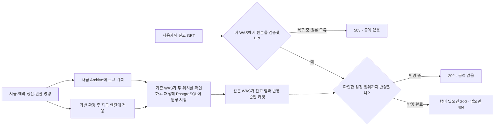

# #63 사용자·자산 단건 잔고 조회

## 사용자가 확인할 흐름

포트폴리오 MVP의 첫 범위는 같은 WAS에서 **한 사용자·한 자산의 사용 가능액과 예약액을 조회**하는 것이다. 먼저 수수료가 0인 단일 마켓에서 미체결 지정가 주문 한 건으로 확인한다. [이슈 #63](https://github.com/0Chord/coin-exchange/issues/63)

1. 사용자가 USDT 1,000을 준비하고 잔고를 조회하면 **사용 가능 1,000 / 예약 0**이다.
2. 체결 상대가 없는 상태에서 3개 × 100에 매수 주문을 낸다. 접수 후 예약 분개가 조회에 반영되면 **700 / 300**이다.
3. 취소 접수 응답을 받은 직후에는 남은 금액이 아직 예약 중일 수 있다. 매칭의 취소 확정이 자금 엔진에 도착해 예약 반환이 확정되고 조회에 반영되면 **1,000 / 0**이다.

순번을 따라잡는 중에는 반영 중으로 응답한다. 주문 접수와 반환 완료는 기존 주문 GET에서 확인하고, 잔고 GET은 확인한 분개 순번 기준의 금액을 보여준다.



## 합의와 최신 기준

- 이전 문답에서 **PostgreSQL 잔고 조회 모델부터 구성**하기로 했다. 질문에서 자금 엔진 직접 읽기와 PostgreSQL 조회 모델을 비교했고, 사용자는 후자를 선택했다. 이번 대화에서는 MVP 순서도 #63 → #49로 정했다.
- 기준 통합 커밋은 #205가 머지된 `c90a64d`다. 자금 엔진이 거래 잔고의 기준이다. 기존 WAS의 Archive 작업은 과반 확정·자금 서비스 적용·Archive 기록이 모두 확인된 범위를 재생하고, 원장 묶음을 `order_query.funds_ledger_batch`에 저장한다. `public.balance_projection`은 이전 SQL 거래 경로의 테이블이다. [#205](https://github.com/0Chord/coin-exchange/pull/205) · [Archive 읽기 범위](https://github.com/0Chord/coin-exchange/blob/c90a64d3f5d3f36b5a0af601282211443d3db32d/app-api/src/main/kotlin/com/exchange/core/api/trading/infrastructure/aeron/SplitArchiveSource.kt#L145) · [기존 원장 쓰기](https://github.com/0Chord/coin-exchange/blob/c90a64d3f5d3f36b5a0af601282211443d3db32d/app-api/src/main/kotlin/com/exchange/core/api/trading/infrastructure/aeron/ArchiveOrderQueryFeedWorker.kt#L157)
- **#205 Archive 모드의 단일 마켓**을 첫 수용 대상으로 잡는다. #59의 HTTP 주문·취소 보호는 기존 실시간 조회 모드에 연결돼 있다. 이번 잔고 GET은 #205의 조회 원본 확인을 재사용하므로 #59의 Archive 연동을 선행으로 요구하지 않는다. 복구 중 잔고 GET의 차단은 조회 판단이고, 주문·취소의 기존 접수 정책은 각 설정에서 그대로 적용된다. [#59 설정 경계](https://github.com/0Chord/coin-exchange/blob/c90a64d3f5d3f36b5a0af601282211443d3db32d/app-api/src/main/kotlin/com/exchange/core/api/config/BoundedTradingGatewayConfig.kt#L38) · [Archive 구성](https://github.com/0Chord/coin-exchange/blob/c90a64d3f5d3f36b5a0af601282211443d3db32d/app-api/src/main/kotlin/com/exchange/core/api/config/OrderQueryConfig.kt#L96)

## HTTP 응답 계약

같은 WAS에 `GET /api/trading/v3/users/{userId}/balances/{assetId}`를 추가한다. 초기 자금 지급에 적용하는 사용자·자산 식별 검증을 재사용한다. 성공 값은 자산 최소 단위의 정수 `available`, `reserved`와 사용한 원장 순번 `asOfLedgerSequence`다. `userId`와 `assetId`도 반환한다. [기존 조회 HTTP 응답 패턴](https://github.com/0Chord/coin-exchange/blob/c90a64d3f5d3f36b5a0af601282211443d3db32d/app-api/src/main/kotlin/com/exchange/core/api/trading/api/OrderQueryController.kt#L83)

| 상태 | 응답 |
| --- | --- |
| 이 WAS가 Archive 조회 원본을 확인했고, 관측 범위까지 반영한 잔고 행이 있음 | `200 BALANCE_FOUND`. 실제 0원은 `available: 0`, `reserved: 0`이다. |
| 같은 조건에서 해당 사용자·자산 행이 없음 | `404 BALANCE_NOT_FOUND`. `asOfLedgerSequence`를 주고 금액은 생략한다. |
| 조회가 열린 뒤 Archive 재생이 뒤처졌다고 관측했거나, 관측·저장된 원장 순번이 잔고 반영 순번보다 앞섬 | `202 QUERY_CATCHING_UP`. 금액은 생략한다. 잔고 반영 순번 `projectedThroughLedgerSequence`와 확인한 원장 순번 `observedLedgerSequence`를 준다. 아직 읽지 못한 순번은 추정하지 않는다. |
| 최초 재생·재시작 후 원본 확인 중, 해당 모드 미활성, 원본 관측 만료·일시 오류, DB 조회 실패 | `503 QUERY_NOT_READY` 또는 `503 QUERY_UNAVAILABLE`. 금액은 생략한다. |
| 원본 불일치, 원장 공백 또는 유효하지 않은 금액·계정 등 확인된 손상 | `503 QUERY_INCONSISTENT`. 금액은 생략한다. |
| 식별자 검증 실패 | 기존 오류 형식으로 `400`. |

**200의 기준은 확인한 Archive·DB 범위다.** 주문 접수 순번, Aeron 로그 위치, 원장 순번은 용도가 다르다. 주문 202 뒤 자금 분개를 Archive에서 아직 관측하기 전에는 앞선 순번의 200이 나올 수 있다. 취소 202도 접수를 의미하며, 반환 전까지 최신 관측 범위의 잔고가 `700/300`인 것은 정상이다. 이번 GET은 조회 순간의 엔진 실시간 잔액이나 POST 직후 읽기 보장을 제공하지 않는다.

## 상세 동작

### Archive 관측과 GET

- 기존 `SplitArchiveSource.read`가 성공하면 Archive 작업이 **읽은 원장 마지막 순번·재생 따라잡음 여부·관측 시점**을 한 값으로 노출한다. 해당 관측은 Archive 재생 범위의 정보다. `query_progress.observed_revision`은 주문 조회 진행값이므로 잔고 순번으로 사용하지 않는다. 오류·재시작·되감기 시 관측을 폐기하고, 기존 Archive 읽기 시간 한도와 같은 기준으로 오래된 관측을 만료시키는 안을 쓴다. 새 원격 조회나 GET의 Aeron 호출은 추가하지 않는다. [기존 재생 신호](https://github.com/0Chord/coin-exchange/blob/c90a64d3f5d3f36b5a0af601282211443d3db32d/app-api/src/main/kotlin/com/exchange/core/api/trading/infrastructure/aeron/SplitArchiveSource.kt#L111) · [Archive 원장 관측 위치](https://github.com/0Chord/coin-exchange/blob/c90a64d3f5d3f36b5a0af601282211443d3db32d/app-api/src/main/kotlin/com/exchange/core/api/trading/infrastructure/aeron/ArchiveOrderQueryFeedWorker.kt#L157)
- GET은 기존 WAS별 원본 확인 상태를 사용한다. 이전 WAS가 DB에 남긴 `READY`만으로 조회를 열지 않는다. PostgreSQL의 한 읽기 스냅샷에서 **잔고 행·잔고 반영 순번·저장된 원장 끝 순번·조회 상태**를 함께 읽고 응답 직전에 원본 상태가 유효한지 확인한다. 확인한 원장 순번은 WAS가 성공적으로 재생한 원장 순번과 DB에 저장된 마지막 순번 중 큰 값이다. 유효한 상태에서 이 순번이 잔고 반영 순번보다 앞서거나 재생이 밀리면 202다. 잔고 반영 순번이 DB 원장 끝보다 앞서는 모순은 503이다. 한 SQL을 우선하고 여러 SQL이 필요할 때는 서비스의 읽기 전용 `REPEATABLE_READ`를 사용한다. [기존 WAS별 조회 차단](https://github.com/0Chord/coin-exchange/blob/c90a64d3f5d3f36b5a0af601282211443d3db32d/app-api/src/main/kotlin/com/exchange/core/api/trading/infrastructure/persistence/PostgresOrderQueryStore.kt#L38) · [기존 단건 SQL 스냅샷](https://github.com/0Chord/coin-exchange/blob/c90a64d3f5d3f36b5a0af601282211443d3db32d/app-api/src/main/kotlin/com/exchange/core/api/trading/infrastructure/persistence/PostgresOrderQueryStore.kt#L204)

### PostgreSQL에 잔고를 반영하는 순서

1. Archive 작업이 기존 경로로 **연속 원장 페이지를 먼저 커밋**한다. 기존 작업의 다음 제한된 처리에서 이미 커밋된 원장을 잔고 반영 순번 다음부터 읽는다. 같은 WAS 작업을 재사용하고 잔고용 스레드나 서비스는 추가하지 않는다.
2. 기존 `order_query` 스키마에 `(namespace, user_id, asset_id)` 한 행과 `namespace`별 잔고 반영 순번을 둔다. 기존 namespace 진행 행 잠금 안에서 커밋된 순번을 읽고, `sequence` 순으로 연속 페이지를 적용한다. 묶음은 기존 건수·바이트 한도를 준용하며 다음 Archive 처리로 제어를 돌려준다. V16부터 여러 정산·반환 결과가 같은 `log_position`을 공유할 수 있다. 중복 판정과 진행은 `(namespace, sequence)`로 한다. [V15 원장](https://github.com/0Chord/coin-exchange/blob/c90a64d3f5d3f36b5a0af601282211443d3db32d/app-api/src/main/resources/db/migration/V15__create_funds_recovery_ledger.sql) · [V16 공유 로그 위치](https://github.com/0Chord/coin-exchange/blob/c90a64d3f5d3f36b5a0af601282211443d3db32d/app-api/src/main/resources/db/migration/V16__allow_shared_funds_ledger_log_position.sql) · [기존 namespace 잠금](https://github.com/0Chord/coin-exchange/blob/c90a64d3f5d3f36b5a0af601282211443d3db32d/app-api/src/main/kotlin/com/exchange/core/api/trading/infrastructure/persistence/PostgresOrderQueryFeedStore.kt#L362)
3. 사용자 `AVAILABLE`·`HOLD` 분개의 대변은 더하고 차변은 뺀다. 이미 저장한 실제 정산 순증감을 사용한다. 정해진 시스템 지급·수수료 계정은 사용자 잔고에서 건너뛰고, 해석할 수 없는 계정은 오류다. 같은 원장 묶음의 순증감을 정확히 합친 뒤 음수·`Long` 범위 초과를 검사한다. 지급·예약·정산·반환 포맷과 분개 해석을 재사용한다. [원장 묶음](https://github.com/0Chord/coin-exchange/blob/c90a64d3f5d3f36b5a0af601282211443d3db32d/domain-trading/src/main/kotlin/com/exchange/core/trading/FundsLedger.kt#L14) · [계정 해석](https://github.com/0Chord/coin-exchange/blob/c90a64d3f5d3f36b5a0af601282211443d3db32d/domain-ledger/src/main/kotlin/com/exchange/core/ledger/LedgerReconciliation.kt#L146)
4. 처음 `OPENING`은 지급 자산을 만든다. 성공한 `RESERVE`는 현재 단일 마켓의 두 자산 행을 준비한 실제 엔진 동작을 따라, 상대 자산 행이 없을 때만 `0/0`을 넣는다. 이미 있는 값은 보존한다. 지급·성공한 예약 없이 거절이나 세대 갱신만으로 잔고 행을 만들지 않는다. 반환 뒤 `0/0`이 된 행도 유지한다. [자금 엔진의 행 생성과 예약](https://github.com/0Chord/coin-exchange/blob/c90a64d3f5d3f36b5a0af601282211443d3db32d/domain-trading/src/main/kotlin/com/exchange/core/trading/BoundedFundingState.kt#L235)
5. **갱신한 잔고 행과 반영 순번을 같은 트랜잭션에서 커밋**한다. 실패하면 둘 다 되돌리고, 커밋 응답이 유실되거나 재시작하면 DB에 남은 순번 다음부터 계속한다. 같은 namespace 작업은 잠금으로 순서를 맞춘다. 처음 추가한 조회 모델은 검증 가능한 원장 처음부터 제한된 페이지로 채운다. 잔고 반영 중 일시적인 DB 오류는 GET에서 503으로 보여주고 같은 순번부터 재시도한다. 투영 단계에서만 발생한 오류는 잔고 조회에 표시하고 기존 주문 조회 차단이나 원장 쓰기 롤백으로 전파하지 않는다. 원본 자체의 불일치는 기존 #205의 공통 차단 규칙을 따른다.

이 추가 작업은 조회 WAS와 PostgreSQL에서 수행한다. 자금·매칭의 명령, 예약 판단, 정산 전달·ACK와 엔진의 저장 방식은 기존 계약대로 동작한다. PostgreSQL 쓰기량과 재생 따라잡기 성능은 이번 기능 시험의 측정 범위 밖이다.

잔고 반영 트랜잭션에서 PostgreSQL 행 잠금 대기는 2초로 제한한다. 잠금 충돌로 시간을 넘기면 잔고 조회에서 일시 오류를 알리고 다음 반복에서 재시도한다. 반영할 원장이 없는 반복은 행 잠금 없이 순번만 확인한다.

잔고 조회 Controller는 `BalanceQueryUseCase` 계약을 호출하고, `BalanceQueryUseCaseImpl`이 응답 상태를 결정한다. Archive 상태를 확인한 뒤 호출하는 PostgreSQL 읽기 진입점에서 `@Transactional(readOnly = true, propagation = REQUIRES_NEW)`를 적용한다. 읽기가 끝난 뒤 Archive 상태를 다시 확인한다. 잔고 쓰기는 기존 Archive 작업이 호출하는 반영 진입점의 `@Transactional(propagation = REQUIRES_NEW)`로 적용한다. 반영 순번과 금액은 페이지 단위로 함께 커밋한다.

## 수용 사례와 검증 순서

### 첫 HTTP 사례

기존 `SplitFundsTradingHttpTest`의 Archive WAS 설정 및 실제 노드·Testcontainers PostgreSQL을 재사용한다. 정상 거래 검사는 자금·매칭 각 1노드로 충분하다. 현재 #205의 3+3 도우미는 리더 장애 시험용이므로, 1+1은 기존 단일 노드 조립에 Archive 설정을 공급한다. 별도 서버를 수동으로 켜는 절차를 추가하지 않는다. [#205 HTTP 시험](https://github.com/0Chord/coin-exchange/blob/c90a64d3f5d3f36b5a0af601282211443d3db32d/app-api/src/test/kotlin/com/exchange/core/api/trading/infrastructure/aeron/SplitFundsTradingHttpTest.kt#L132) · [기존 단일 노드 HTTP 시험 경로](https://github.com/0Chord/coin-exchange/blob/c90a64d3f5d3f36b5a0af601282211443d3db32d/app-api/src/test/kotlin/com/exchange/core/api/trading/infrastructure/aeron/SplitFundsTradingHttpTest.kt#L569)

| 시점과 입력 | 실제 응답·DB에서 확인할 값 |
| --- | --- |
| 새 사용자에 USDT 1,000만 지급, 원장 반영 완료 | USDT 200, `1,000/0`. 거래쌍의 상대 자산 조회는 404다. |
| 매칭 상대 없이 3 × 100 매수 접수, 원장 수집은 됐으나 잔고 반영은 시험 신호로 잠시 보류 | 주문 202. 잔고 GET은 202이며 금액 없이 두 순번을 보여준다. |
| 잔고 반영 재개 | USDT 200, `700/300`. 상대 자산은 200, `0/0`. |
| 취소 HTTP 접수 후 확정 결과의 자금 전달을 잠시 보류 | 취소 202. 관측한 범위까지 반영된 잔고는 `700/300`. |
| 반환 확정·반영 후 같은 취소 재전송, 같은 잔고 반복 GET | 주문 조회 `CANCELLED / APPLIED`, 잔고 200 `1,000/0`. 한 번만 반환되고 반복 GET은 데이터와 순번을 바꾸지 않는다. |

시험은 실제 HTTP와 DB를 통해 관측하고, 예상 금액은 1,000에서 300을 예약하고 같은 300을 반환하는 계산에서 직접 정한다. 대기 경계는 시험 코드에만 있는 신호로 조절한다.

### 저장·오류 검증

- **실제 PostgreSQL 회귀** — 잔고를 쓰고 순번 커밋 전에 실패시키면 둘 다 되돌아간다. 커밋된 페이지를 다시 처리하거나 같은 DB로 WAS를 재시작해도 금액과 반영 순번이 같다. 기존 원장만 있는 DB에서는 순번 1부터 시작한다. 같은 Aeron 로그 위치의 서로 다른 원장 순번도 각각 적용한다.
- **분개 계산** — 저장 검증에 실제 `SETTLEMENT`가 들어간다. 수수료 0에서 매수 3 × 100 중 1개가 정산되면 매수자 USDT `700/200`, 매수자 체결 자산 `1/0`, 매도자의 수취 USDT `100/0`을 대조한다. 남은 2개를 반환하면 매수자 USDT는 `900/0`이다. 이미 있는 상대 자산 값을 0으로 덮어쓰지 않는지 확인한다.
- **응답 실패 경계** — 재시작 시 검증 전, DB 실패, 원본 또는 투영 불일치에서 각각 503과 금액 필드 생략을 확인한다. 잔고 투영만 실패한 경우 원장 저장 경로와 기존 주문 조회가 자체 조건에 따라 계속 동작하는지 대조한다. 검증은 읽은 원장 프리픽스와 관측한 오류를 대상으로 한다.

### 구현 인계

1. 기존 원장과 조회 저장소에 **잔고 행·반영 순번**을 연결하고 실제 PostgreSQL로 커밋·재시도 규칙을 확인한다.
2. 기존 Archive 작업과 단건 잔고 GET을 연결한다. 기존 WAS에 새 조회를 추가하고, 기존 조회 준비 상태와 HTTP 오류 처리 방식을 재사용한다.
3. 위 HTTP 한 흐름과 저장·오류 회귀를 통과하면 첫 MVP PR 범위가 완료된다. 실제 HTTP에서 BUY·SELL 양쪽의 부분체결 후 잔량 취소와 재시작 전체를 대조하는 사례는 #63 원래 수용 범위에 남겨 둔다. 목록 조회, #59의 Archive 접수 게이트, Kafka, 인증 확장, 성능·추가 클러스터 장애 시험도 여기서 다루지 않는다.

검증 명령은 구현 뒤 사용할 예시다. 실제 구현 폴더가 달라지면 해당 폴더에서 실행한다. 이번 문서는 코드와 기존 테스트를 읽고 작성했다.

```sh
cd /Users/0chord/Desktop/exchange-core
./gradlew --no-daemon --max-workers=2 :app-api:test \
  --tests '*SplitFundsTradingHttpTest' --tests '*PostgresOrderQueryFeedStoreTest' \
  --tests '*OrderQueryConfigurationTest' --tests '*OrderQueryHttpTest' \
  --tests '*BalanceQueryUseCaseTest' --tests '*SplitTradingClusterAdapterTest' \
  :app-api:verifyCiTestPartition :architecture-tests:test \
  :architecture-tests:verifyArchitectureReport :app-api:ktlintCheck --console=plain
```

## 구현 및 실행 결과

- `c90a64d`에서 시작한 `feat/balance-query/63`에 구현했다. 검토한 코드·테스트 트리는 `19eb8fc48891ee127e37de255dd8aaf79db46b50`이다. [HTTP 진입점](../app-api/src/main/kotlin/com/exchange/core/api/trading/api/BalanceQueryController.kt#L18) · [WAS 반영 작업](../app-api/src/main/kotlin/com/exchange/core/api/trading/infrastructure/aeron/ArchiveOrderQueryFeedWorker.kt#L266) · [잔고 쓰기 트랜잭션](../app-api/src/main/kotlin/com/exchange/core/api/trading/infrastructure/persistence/PostgresBalanceProjection.kt#L76)
- 실제 자금 1노드·매칭 1노드, WAS와 PostgreSQL에서 지급 → 미체결 매수 → 취소·반환을 확인했다. 이어 같은 취소 재전송, WAS 재시작 전후, 반영 지연의 202, 실제 PostgreSQL 중단과 복구를 확인했다. 잔고 테이블 쓰기만 실패하게 만든 뒤 잔고 GET은 503을 반환했고, 후속 주문 조회와 원장 순번은 진행했다. 시험용 WAS의 커넥션 획득 제한을 1.5초로 맞춰 실제 DB 중단 중 연결 실패 응답을 확인했다. [HTTP 시험](../app-api/src/test/kotlin/com/exchange/core/api/trading/infrastructure/aeron/SplitFundsTradingHttpTest.kt#L136)
- 관련 API 107건과 아키텍처 386건이 통과했다. 건너뜀은 0건이다. CI 테스트 분류 검사, 필수 운영 구조 검사와 `ktlintCheck`도 통과했다. 전체 회귀 뒤 시험용 DB 대기 설정만 변경하고 해당 HTTP 시험과 분류·스타일 검사를 다시 실행했다.
- 작성 대화를 상속하지 않은 검토에서 HTTP 경계 타입, V17 검증 기준, 기존 사용자 식별자 호환, HTTP 오류 분기, 기존 상대 자산 보존을 점검했다. 지적을 수정하고 최종 코드와 시험 변경을 재검토했다. 검토 범위에서 확인된 미해결 결함은 없다.

## UseCase 선언 확인과 트랜잭션 조정

PR 최초 커밋 `49e03a0`의 운영 소스에 있는 UseCase 9개는 모두 구체 클래스였다.

| 연결 범위 | UseCase |
| --- | --- |
| 운영 WAS 4개 | `BalanceQueryUseCase`, `BoundedTradingOrderUseCase`, `OrderQueryUseCase`, `MarketConfigurationUseCase` |
| 운영 소스에 있고 레거시·통합 시험에서 조립하는 5개 | `SubmitOrderUseCase`, `CancelOrderUseCase`, `SubmitTradingOrderUseCase`, `PrepareDevelopmentBalanceUseCase`, `ReconcileLedgerUseCase` |

이번 변경은 #63의 Controller가 `BalanceQueryUseCase` 인터페이스에 의존하도록 조립하고, 잔고를 읽고 쓰는 Spring 빈의 메서드에 선언적 트랜잭션을 적용한다. 구조 검사는 같은 모듈·패키지에서 계약을 직접 구현하는 구체 `UseCaseImpl`이 있을 때 그 인터페이스를 진입점으로 인식한다.

선언적 트랜잭션 전환 후 API 108건, 구조 검사 388건이 실패·건너뜀 없이 통과했다. CI 테스트 분류, 필수 P01~P09, ktlint 검사도 통과했다. PostgreSQL 시험에서는 바깥 읽기 트랜잭션이 이전 시점을 유지하는 동안 새 쓰기가 독립 커밋되고, 바깥 트랜잭션을 롤백한 뒤에도 확인 순번과 잔고가 유지됨을 대조했다. 별도 컨텍스트의 코드 리뷰에서 위반을 확인하지 못했다. [독립 커밋 PostgreSQL 시험](../app-api/src/test/kotlin/com/exchange/core/api/trading/infrastructure/persistence/PostgresOrderQueryFeedStoreTest.kt#L1116)

## 후속 명세 · 부분 체결과 잔량 반환의 잔고 HTTP 검증

매수자가 3개를 주문하고 1개를 체결한 뒤 나머지 2개를 취소한다. 매수자는 체결에 쓴 100 USDT를 제외한 200 USDT를 돌려받고, 매도자는 1 BTC를 넘기고 100 USDT를 받는다. 두 사용자가 조회한 잔고는 같은 PostgreSQL과 Archive를 연결한 새 WAS에서도 이어져야 한다.

### 확인한 기준과 이번 범위

- 기준은 2026-11-25의 `main` `c92c1f7`이다. GitHub 이슈와 보드는 Open·Todo이며, 잔고 API를 병합한 #206의 CI 10개가 통과했다. 기존 테스트에는 미체결 매수 예약과 전량 반환, 같은 취소 재전송, WAS 재시작, 반영 지연·DB 장애 응답이 있다. PostgreSQL 시험은 실제 정산 분개를 잔고에 적용하는 동작을 별도로 확인한다. [#63](https://github.com/0Chord/coin-exchange/issues/63) · [#206](https://github.com/0Chord/coin-exchange/pull/206) · [main의 남은 범위](https://github.com/0Chord/coin-exchange/blob/c92c1f77de55d931f62706ff7a4a8d32fe4fce48/README.md#남은-범위)
- 남은 수용 조건은 실제 저장 경로에서 BUY의 부분 체결·잔량 반환과 SELL의 기초자산 예약·정산 확인을 연결하는 것이다. API와 저장 모델은 이미 있으므로 기존 HTTP 통합 테스트 클래스에 사례 한 건을 추가하는 범위로 잡는다. 이전 논의에서 결정한 PostgreSQL 잔고 조회 모델을 그대로 사용한다.
- 재시작은 WAS를 닫고 같은 DB·Archive·조회 네임스페이스에 연결한 새 WAS를 여는 것으로 잡는다. 자금·매칭 각 1노드는 유지한다. 자금·매칭 노드 자체의 재시작은 #66, Archive 모드의 주문·취소 복구 게이트는 #59에서 다룬다. 인증, 장애 주입, 성능 측정은 이번 시험 범위 밖이다. [#66 전체 재시작](https://github.com/0Chord/coin-exchange/issues/66) · [#59 접수 재개](https://github.com/0Chord/coin-exchange/issues/59)

### 사용자 흐름과 기대값

`BTC-USDT`, LIMIT+GTC, 가격 100, 수수료 0으로 검증한다. 기존 시험 준비 과정이 매수자에게 1,000 USDT, 매도자에게 3 BTC를 한 번씩 지급한다. 표의 잔고는 **사용 가능/예약** 순서다. 금액과 수량은 기존 시험 마켓의 최소 단위다.

| 시점 | 매수자 USDT | 매수자 BTC | 매도자 BTC | 매도자 USDT | 확인할 거래 상태 |
| --- | ---: | ---: | ---: | ---: | --- |
| 초기 지급 반영 | `1,000/0` | `404` | `3/0` | `404` | 지급 두 건 반영 |
| 매수 3개가 주문장에 대기 | `700/300` | `0/0` | `3/0` | `404` | 매수 `RESTING`, 잔량 3 |
| 매도 1개 매칭, 자금 정산 전달 대기 | `700/300` | `0/0` | `2/1` | `0/0` | 매수 1개 체결·잔량 2, 매도 1개 전량 체결, 정산 대기 |
| 체결 1개 정산 반영 | `700/200` | `1/0` | `2/0` | `100/0` | 매수 `PARTIALLY_FILLED`, 매도 `FILLED`, 양쪽 `APPLIED` |
| 매수 잔량 2개 취소·반환 반영 | `900/0` | `1/0` | `2/0` | `100/0` | 매수 `CANCELLED / APPLIED`, 체결 1·취소 2·잔량 0 |
| 같은 취소 재전송, 새 WAS에서 조회 | `900/0` | `1/0` | `2/0` | `100/0` | 같은 취소 ID와 최종 원장 순번 유지 |

1. WAS에 매수 주문을 제출한다. POST `202`는 접수 결과다. 주문 GET에서 대기 상태를 확인하고, 잔고 GET이 매수 예약 순번까지 따라온 뒤 `700/300`을 검사한다.
2. 기존 시험의 정산 전달 보류를 켜고 매도 주문을 제출한다. 매칭은 1개를 확정하고 자금 엔진은 매도자의 1 BTC를 예약한 상태다. 양쪽 주문의 정산 대기와 매도자 `2/1`을 확인한 뒤 보류를 해제한다. 자금 엔진이 정산하고 WAS가 반영한 뒤 양쪽 잔고를 대조한다.
3. 매수자가 남은 2개를 취소한다. 반환을 포함한 최종 원장 순번에서 `900/0`을 확인한다. 앞선 체결의 1 BTC와 매도자의 100 USDT는 그대로다. 접수한 취소 토큰과 내용으로 재전송하면 첫 `cancelId`가 반환되고 잔고·원장에 두 번째 효과가 생기지 않는다.
4. 기존 WAS를 닫고 재접속한다. 새 WAS가 원본을 확인하고 조회 준비를 마친 뒤 네 잔고의 `200 BALANCE_FOUND`, 사용자·자산 ID, 금액, 최종 원장 순번을 다시 확인한다. 반복 GET 전후에 잔고 행과 원장 순번은 동일해야 한다.

### 테스트에서 확인할 경계

- `SplitFundsTradingHttpTest`의 `withTradingNodes(archiveQuery = true)`, `archiveBalanceWas`, `awaitQuery`, `settlementGate`를 재사용한다. 테스트 쪽 `awaitBalance`와 `getBalance`가 매수자로 고정되어 있으므로 사용자 인자만 전달할 수 있게 바꾼다. 정산 보류는 `finally`에서 해제하고 각 WAS는 기존 생명주기 도구로 닫는다. 수동 서버 기동이나 추가 시험 도구는 필요하지 않다. [기존 Archive 잔고 HTTP 사례](https://github.com/0Chord/coin-exchange/blob/c92c1f77de55d931f62706ff7a4a8d32fe4fce48/app-api/src/test/kotlin/com/exchange/core/api/trading/infrastructure/aeron/SplitFundsTradingHttpTest.kt#L134) · [기존 양쪽 주문의 정산 대기 사례](https://github.com/0Chord/coin-exchange/blob/c92c1f77de55d931f62706ff7a4a8d32fe4fce48/app-api/src/test/kotlin/com/exchange/core/api/trading/infrastructure/aeron/SplitFundsTradingHttpTest.kt#L950)
- `GET /api/trading/v3/users/{userId}/balances/{assetId}`의 `asOfLedgerSequence`를 기준으로 대기한다. 이 시험의 예상 순번은 초기 지급 2 → 매수 예약 3 → 매도 예약 4 → 단일 체결 정산 5 → 잔량 반환 6이다. GET은 관측 전의 이전 유효 값을 반환하거나 반영 중 `202`를 반환할 수 있다. 거래 상태가 먼저 바뀌어도 잔고는 해당 원장 순번이 반영된 뒤 판정한다. 기존 오류 응답 회귀는 #206 테스트가 맡는다.
- 반환 전후와 재시작 뒤 PostgreSQL의 `order_query.balance_projection` 네 행을 `namespace`·사용자·자산으로 읽고 표의 독립 기대값과 대조한다. 최종 `balance_progress.projected_through`와 네 GET 순번이 같아야 한다. 같은 `namespace`의 `funds_ledger_batch`는 지급 2건, 예약 2건, 정산 1건, 반환 1건에 해당하는 순번 1~6을 보존해야 한다. 반복 취소·조회·재시작 뒤에도 마지막 순번과 저장된 내용이 같아야 한다. [잔고 테이블](https://github.com/0Chord/coin-exchange/blob/c92c1f77de55d931f62706ff7a4a8d32fe4fce48/app-api/src/main/resources/db/migration/V17__create_order_query_balance_projection.sql) · [원장 테이블](https://github.com/0Chord/coin-exchange/blob/c92c1f77de55d931f62706ff7a4a8d32fe4fce48/app-api/src/main/resources/db/migration/V15__create_funds_recovery_ledger.sql)

### 검증과 완료 기준

이 변경이 있는 브랜치를 체크아웃한 폴더에서 실행한다. 새 메서드로 두 사용자와 두 자산의 각 시점 결과를 확인한 뒤 기존 HTTP·PostgreSQL 시험과 구조·CI 분류·스타일 검사를 돌린다.

```sh
cd "$(git rev-parse --show-toplevel)"
./gradlew --no-daemon --max-workers=2 :app-api:test \
  --tests '*SplitFundsTradingHttpTest.Archive 잔고는 부분 체결과 잔량 반환 뒤 재시작에도 유지된다' --console=plain
./gradlew --no-daemon --max-workers=2 :app-api:test \
  --tests '*SplitFundsTradingHttpTest' --tests '*PostgresOrderQueryFeedStoreTest' -PciTestGroup=general \
  :app-api:verifyCiTestPartition :app-api:ktlintCheck :architecture-tests:verifyArchitectureReport --continue --console=plain
```

반영 대기가 제한 시간을 넘기거나 두 계정의 값·원장 순번·취소 ID·재시작 결과가 다르면 실패다. 이 사례와 기존 #206 수용 근거를 합쳐 #63 완료를 판단한다.

### 실행 결과 · 2026-11-25

- `main` `c92c1f7`에서 만든 `feature/phase-3/integration`을 기준으로 `test/balance-query-lifecycle/63`의 변경을 검증했다. [새 HTTP 시험](../app-api/src/test/kotlin/com/exchange/core/api/trading/infrastructure/aeron/SplitFundsTradingHttpTest.kt#L195)
- 실제 WAS·Aeron·PostgreSQL로 새 시험 1건이 통과했다. 매수자 700/300 → 700/200 → 900/0, 매도자 BTC 2/1 → 2/0과 USDT 100/0을 확인했다. 같은 토큰으로 취소를 재전송하고 WAS를 재시작한 뒤에도 최종 잔고 네 행, 원장 6개 묶음, 잔고 반영 순번 6이 일치했다.
- 회귀는 `SplitFundsTradingHttpTest` 31건, `PostgresOrderQueryFeedStoreTest` 34건, 아키텍처 388건이 실패·오류·건너뜀 없이 통과했다. 필수 운영 검사 P01~P09와 CI 테스트 분류도 통과했다. 새 사례가 포함된 클래스는 `general` 그룹이다.
- 첫 스타일 검사에서 원장 JSON을 읽는 줄이 140자를 초과했다. JSON 값 조회와 변환을 두 줄로 분리했다. 수정 뒤 `-PciTestGroup=general`로 새 사례 1건과 `:app-api:verifyCiTestPartition`, `:app-api:ktlintCheck`를 다시 실행해 모두 통과했다.
- 작성 대화를 상속하지 않은 검토에서 원장 순번 3·4의 잔고 검사 누락과 원장 조회의 네임스페이스 조건을 지적받았다. 세 잔고 검사를 보완하고 DB 조회를 해당 네임스페이스로 제한했다. 스타일 수정까지 반영한 테스트 변경본(패치 SHA-256 `d30a2dddf64c`)을 재검토했고 확인된 미해결 지적은 없다.
