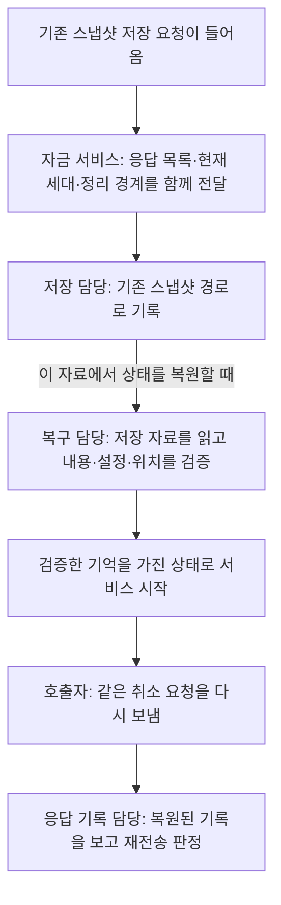

# #133 · 재시작 뒤에도 같은 취소 요청으로 알아보기

**이번에 해결하는 상황은 “취소 응답을 못 받은 사람이 다시 요청했을 때, 서버가 이전 판단을 잊지 않게 하는 것”이다.** 최초 응답·요청 세대·ACK 정리 경계를 기존 스냅샷 경로에 연결했다. 실제 주문 취소·돈 반환은 후속 단계다. 아래 구현 기록에서 검증 결과와 범위를 구분한다.

## 먼저 한 상황을 따라가 보기

사용자 U에게 주문 O1이 있다. 사용자는 O1의 취소를 요청했지만, 응답을 받지 못했다. 이때 서버가 요청을 못 받았을 수도 있고, 이미 판단했는데 응답만 유실됐을 수도 있다.

#178은 **호출자가 결정해 준 최초 취소 응답을 메모리에 보관하고 같은 요청에 돌려주는 기능**까지 만들었다. 이번에는 그 기억을 기존 스냅샷 저장·복원 경로에도 연결한다. 스냅샷은 재시작 때 상태를 되살리기 위해 특정 시점의 상태를 보관한 자료다.

설명에서는 이미 발급된 요청 세대 3을 사용하고, 주문 요청 1 뒤에 취소 요청 2가 기록돼 있다고 가정한다. 취소 요청 2의 최초 응답은 “취소 요청 접수”다. 이 예시는 현재 일반 사용자가 취소 API를 호출할 수 있다는 뜻은 아니다.

| 등장인물 | 무엇을 맡는가 |
| --- | --- |
| 요청 호출자 | 같은 요청 번호와 내용을 유지해 결과를 다시 확인한다. 최초 응답의 보관을 끝내도 된다는 ACK를 보낼 수 있다. 취소용 HTTP 연결은 후속이다 |
| 자금 서비스 안의 응답 기록 담당 | 어떤 요청에 어떤 최초 응답을 했는지, 현재 요청 세대와 어디까지 정리했는지 관리한다. 직접 매칭 취소나 반환을 실행하지 않는다 |
| 기존 스냅샷 저장 담당 | 스냅샷 저장 요청을 받으면 그 시점의 응답·세대·정리 경계를 함께 저장한다. 주문마다 별도 저장을 시작하는 기능을 추가하는 것은 아니다 |
| 재시작한 서비스의 복구 담당 | 저장 자료가 기대한 설정·위치와 맞고 손상되지 않았는지 확인한다. 검증한 상태를 서비스에 올린다 |

이 담당들은 책임을 구분한 설명이며, 각각 별도 서버나 JVM을 새로 만드는 설계가 아니다.



이 그림은 **이번에 연결한 저장·복원 흐름**이다. 구현 검증에서는 실제 저장·복원 담당의 바이트와 서비스 경로를 사용하지만 통신·저장소 일부는 대역을 사용한다. 실제 Archive에서 취소를 접수하고 프로세스를 재시작하는 시험과는 구분한다.

## 장면 1 · 응답이 아직 보관돼 있을 때 다시 요청한다

**누가 판단하나:** 응답 기록 담당이 요청 식별자와 내용을 확인한다.

**언제 판단하나:** 처음 응답을 아직 보관하는 동안, 같은 요청이 다시 들어왔을 때다.

**무엇을 보나:** “이용자 U의 같은 채널·세대 3·순번 2인가? 취소 대상 O1과 마켓·설정도 같은가?”를 본다.

같으면 **최초에 보관한 “취소 요청 접수” 응답을 반환한다.** 최초 응답이 거절이었다면 같은 거절을 반환한다. 같은 번호로 다른 주문을 취소하려 하면 내용 충돌로 거절한다.

기록은 1개 그대로이고, 실제 주문장이나 잔고에는 새 변화가 없다. 재시작 뒤에도 이 판단이 같아야 하므로 최초 응답뿐 아니라 요청의 식별자와 내용도 함께 보관해야 한다.

## 장면 2 · ACK로 응답을 지운 다음 다시 요청한다

호출자가 “2번까지의 응답은 보관을 끝내도 된다”는 ACK를 보낸다고 하자. 이것은 **주문 취소나 자금 반환이 끝났다는 확인이 아니다.** 응답 기록 담당은 처리하지 않은 번호를 건너뛰지 않았는지 확인한 뒤 상세 응답을 지운다.

| 시점 | 상세 응답 | 계속 기억해야 하는 사실 |
| --- | --- | --- |
| ACK 전 | 취소 요청 2의 최초 응답 있음 | 현재 세대 3 |
| ACK 후 | 취소 요청 2의 상세 응답 없음 | 현재 세대 3 · 2번까지 정리함 |
| 그 상태를 저장·복원한 뒤 | 상세 응답을 되살리지 않음 | 세대 3 · 정리 경계 2 유지 |

이후 요청 2가 다시 오면 **“이미 정리한 요청이므로 다시 처리하지 않으며, 최초 응답 본문은 더 이상 없다”**고 판단한다. 이 결과 이름이 `RETIRED_UNAVAILABLE`이다. 취소 업무가 실패했다는 뜻은 아니다.

여기서 지켜야 하는 원리는 **“기록이 없으니 새 요청”이라고 판단하지 않는 것**이다. 모든 과거 응답을 남기는 대신 “여기까지 정리했다”는 경계를 기억해 메모리를 회수한다. 이번 저장·복원에서 그 경계를 빠뜨리면 안 된다.

## 장면 3 · 새 요청 세대를 시작한 뒤 옛 요청이 도착한다

요청 관리에서 명시적으로 세대 4를 발급했다고 하자. 응답 기록 담당은 현재 세대를 4로 바꾸고 이전 세대의 상세 응답을 정리한다. 요청 세대가 자동으로 바뀌거나 사용자가 임의의 새 번호를 적는 것만으로 발급되는 것은 아니다.

재시작 뒤에도 **현재 세대 4**를 기억해야 한다. 그래야 늦게 도착한 세대 3의 요청을 “이전 요청 묶음이므로 처리하지 않음”으로 막는다. 이 결과가 `FENCED_EPOCH`다.

이 장치는 새 세대에서 순번을 다시 사용해도 과거 요청과 섞이지 않도록 한다. Raft의 리더 교체나 구리더의 외부 송신을 막는 기능은 아니다.

## 저장·복구가 잘못되면 어떻게 하나

| 상황 | 담당자의 판단과 남는 상태 |
| --- | --- |
| 기록이 너무 많거나 저장 자료의 한도를 넘음 | 저장·읽기가 성공한 것처럼 넘기지 않는다. 용량 제한을 없애거나 취소 응답만 빼고 저장하지 않는다 |
| 자료가 잘렸거나 손상됐거나 다른 실행 설정의 자료임 | 복구 담당이 거절한다. 빈 정상 상태로 시작해 과거 요청을 다시 처리하지 않는다. 기존 오류 종료·차단 규칙을 유지한다 |
| 응답은 정상인데 잔고·예약 등의 관계가 모순됨 | 복구 후보를 정상 상태로 올리지 않는다. 취소 응답을 근거로 임의 반환하거나 주문을 지우지 않는다 |
| 상세 응답이 모두 정리된 채널임 | 채널을 없는 것으로 버리지 않는다. 현재 세대와 정리 경계를 복원해 과거 요청을 막는다 |

예를 들어 사용 가능 700·예약 300인 상태라면, 취소 응답 기록을 저장·복원해도 **700·300 그대로**여야 한다. “취소 요청 접수”를 기억하는 일과 실제 취소·반환은 서로 다른 책임이다.

## 어디까지 만들어진 것이고, 이번에는 무엇을 준비하나

- **이미 구현됨(#178):** 메모리에서 최초 응답·같은 요청·ACK 정리·이전 요청 세대를 구분한다.
- **이번 구현:** 그 기억을 스냅샷 바이트와 기존 서비스의 저장·복원 경로에도 담는다. 재시작 뒤 같은 응답을 돌려주고, 이미 정리한 요청·이전 세대는 다시 처리하지 않는다.
- **후속 연결:** 실제 취소 접수 → 매칭 취소 확정 → 남은 예약 반환. 실제 Archive 재시작 검증도 이 경로가 준비된 뒤 연결하며, 이번 대역 시험만으로 완료했다고 말하지 않는다.

아래에는 구현 담당자가 필요한 버전·파일·수용 사례를 접어 두었다. 위 흐름을 이해하는 데 먼저 읽을 필요는 없다.

<details>
<summary>구현 담당자용 상세 — 저장 형식·호환성·수용 사례·검증 계획</summary>

## 기준과 관련 계약

2026-11-11 상세 명세. 기준은 `feature/phase-2/integration`의 `f58357698a738aa58af009a1d27014652c5afa4f`(#178 병합)다. 문서 준비 이후 사용자가 구현을 요청해 `feat/cancel-inbox-snapshot/133`에서 진행했다. **#133 전체가 아니라 취소 요청 기록의 저장·복원만 다루는 작은 PR 범위다.**

관련: [#133](https://github.com/0Chord/coin-exchange/issues/133) · [전체 책임·확정 계약 #130](https://github.com/0Chord/coin-exchange/issues/130) · [분리 계획을 보존한 #176](https://github.com/0Chord/coin-exchange/pull/176). #177의 취소 후보 계산·반영 분리와 #178의 요청 기록·메모리 복원은 재사용하며 다시 구현하지 않는다.

## 2. 포함·유지·제외와 검증 경계

- 포함: 두 금융 복구 값의 취소 목록 불변 보존, 취소가 있는 스냅샷의 명시적 새 형식, 이전 형식 읽기, 공통 요청 한도·세대·ACK 경계의 복원, 자금 역할의 기존 저장·복원 경로를 통한 바이트 보존 검증.
- 유지: #178의 응답·충돌·ACK·세대·한도 계약, #177의 매칭 동작, 기존 금융·예약·주문장·전달·정산 관계 검증, 초기화 전 빈 상태 규칙, 기존 실행물·JDK·설정·기록 위치의 복구 identity 검사.
- 제외: 실제 취소 접수 생산자, HTTP/Aeron 취소 명령, 전송·결과 프로토콜 변경, 매칭 취소 실행, 취소 전달 의무·새 업무 순번 생성, 자금 반환·분개·전체 원장 적재, 인증·인가·보안·원격 펜싱, 성능·장기 부하·리더/과반 장애 시험.
- **현재 자연 실행에는 취소 기록을 만드는 접수 경로가 없다.** 따라서 이 PR은 저장 형식과 기존 서비스 스냅샷 callback의 보존을 확인한다. 테스트 소스에서 준비한 복구 값과 기존 대역을 사용하며 제품에 시험용 취소 입구·관찰 큐·기동 gate를 추가하지 않는다.
- 실제 취소 요청으로 기록을 만든 뒤 Archive에 저장하고 프로세스를 재시작하는 종단 검증은 취소 경로 연결 이후 #133의 후속 단위에 둔다. 이번 바이트·callback 검증을 디스크 강제 반영, 실제 Archive 재시작, 실제 6노드 복구의 증거라고 보고하지 않는다. 기본 복구를 #134까지 모두 미루지는 않는다.

## 3. 호환성 계약

구현 세부 제안 중 기존 계약을 유지하는 가장 작은 이행안을 아래처럼 정한다. 새로운 제품 정책 선택이나 전체 취소 설계를 다시 결정하는 단계가 아니다.

| 구분 | 이번에 보장할 것 |
| --- | --- |
| 취소 응답이 없는 bounded 상태 기록 | **기존 v2 바이트 그대로** 기록. ACK·세대 변경으로 취소 응답이 0개가 된 상태도 포함 |
| 취소 응답이 한 개라도 있는 bounded 상태 기록 | 명시적인 **v3** 기록. v2라고 쓰면서 취소 자료를 뒤에 숨겨 붙이지 않음 |
| 새 bounded reader | v2·v3를 읽음. v2의 취소 목록은 빈 목록으로 복원. 미지원 버전은 거절 |
| 자금 역할 스냅샷 | 기존 outer v2 구조·writer를 유지하고 내부의 길이 지정 금융 blob에 bounded v2/v3를 담음. 기존 outer v1 읽기·제약도 유지 |
| 매칭 스냅샷·manifest·설정 지문 | 매칭 v1·manifest v1·configuration bytes·전달/결과 schema는 변경하지 않음 |
| 과거 실행 root·Archive | 새 reader의 옛 바이트 해독과 별개. **새 실행물로 과거 root를 자동 재사용하는 호환은 제공하지 않음** |

현재 기존 root는 실행물·JDK 등을 포함한 identity 전체가 같아야 열린다. 이 검사를 낮추거나 저장된 identity를 새 값으로 덮어쓰지 않는다. 새 구현의 실제 재시작 시험은 새 root에서 고정한 동일 실행물·JDK·설정·기록으로 준비해야 한다. 과거 실행물과 기록은 그대로 보존하며, 롤링 업그레이드·구버전 reader의 v3 읽기는 약속하지 않는다.

기존 golden은 원자료를 변경·재생성하지 않는다. 취소 없는 v2의 바이트 동일성과 기존 상태의 후속 처리 결과가 그대로라는 증거로 유지한다. 자금 outer v1 fixture는 기존처럼 읽은 뒤 outer v2로 재기록할 수 있는 계약이며 v1 writer를 새로 만들지 않는다.

## 4. 구현 전 기준 코드의 사실과 변경 책임

아래 링크는 이 명세가 확인한 코드다. 후속 구현 위치의 세부 분할은 구현자가 조정할 수 있다.

| 현재 사실 | 이번 변경·유지 책임 |
| --- | --- |
| [TradingRequestInbox](../domain-trading/src/main/kotlin/com/exchange/core/trading/TradingRequestInbox.kt)는 취소 목록·세대·retiredThrough·processedThrough를 메모리 snapshot에 보존 | 기존 의미와 복원 검증을 재사용. 같은 메모리 테스트만 추가하고 새 저장 근거라고 세지 않음 |
| [BoundedTradingValues](../domain-trading/src/main/kotlin/com/exchange/core/trading/BoundedTradingValues.kt)의 공통 복사가 취소 목록을 거절 | TradingRecoveryState·BoundedFundingRecoveryState 양쪽에서 주문/취소 목록을 각각 불변 복사. 거절만 없애고 cancelEntries를 빈 목록으로 대입하는 조용한 누락 금지 |
| [BoundedTradingStateCodec](../app-api/src/main/kotlin/com/exchange/core/api/trading/infrastructure/history/BoundedTradingStateCodec.kt)는 v2만 읽고 쓰며 주문 entries만 저장 | v2/v3 이행과 취소 항목 직렬화의 주 변경점 |
| [FundsRoleSnapshotCodec](../app-api/src/main/kotlin/com/exchange/core/api/trading/infrastructure/history/FundsRoleSnapshotCodec.kt)는 bounded 금융 blob을 포함하고 빈 자금 소유자로 관계를 검증 | 내부 blob 재사용. outer 형식·정산/전달 검증을 넓히거나 제거하지 않음 |
| [BoundedFundingState](../domain-trading/src/main/kotlin/com/exchange/core/trading/BoundedFundingState.kt)·TradingState는 금융 후보를 검증한 뒤 게시 | 계정·잔고·예약·총량·신규 승인 관계 검증 유지. 취소 응답을 실제 취소 의무로 추론하는 검사를 새로 발명하지 않음 |
| [SplitTradingClusterAdapter](../app-api/src/main/kotlin/com/exchange/core/api/trading/infrastructure/aeron/SplitTradingClusterAdapter.kt)의 onStart/onTakeSnapshot이 기존 자금 codec을 사용 | 현재 callback 경로로 새 자료가 통과하는지 검증. 취소 ingress·새 source 조회 API를 추가하지 않음 |

제품 변경의 중심은 위 복구 값과 bounded codec 두 곳이다. 자금 wrapper·서비스 callback은 현재 분석상 바이트 경로를 재사용할 수 있다. 새 복구 프레임워크·공통 범용 codec 리팩터링·매칭 결과의 취소 이벤트 지원은 이번 PR에 묶지 않는다.

## 5. v3 저장 형식과 유효성

- 기존 magic·스냅샷 위치·manifest·금융/주문장 본문·SHA-256·footer·EOF 검사를 유지한다. 버전 선택은 저장할 전체 채널에 보존 중인 cancelEntries가 하나라도 있는지로 결정한다.
- v3는 각 채널의 기존 `userId, channel, epoch, retiredThrough, processedThrough, order entries` 뒤에 취소 건수와 취소 행을 둔다. 취소가 없는 채널도 v3 안에서는 건수 0을 쓴다. v2에는 이 추가 건수조차 쓰지 않는다.
- 취소 행은 순번, 마켓, 대상 주문, 기대 설정 버전, 최초 응답 code와 nullable cancelId/targetOrderId/inputSequence/reason 전체다. 기존 text/정수 표현 관례를 쓰고 optional 값은 존재 여부를 명시해 null과 값의 차이를 보존한다. 최초 응답을 새로 계산하거나 ID·순번·시각을 만들어 대체하지 않는다.
- 기록 순서는 기존 snapshot의 정렬 계약을 따른다. 읽은 항목을 정렬·중복 제거해 정상화하지 않는다. 종류별 순번의 비정렬·중복과 주문/취소 간 같은 순번은 기존 후보 복원 검증으로 거절한다. 기존 reader/restore가 허용하는 채널 목록 순서에 새 거절 정책을 추가하지 않는다.
- 주문·취소 건수는 **전 채널을 합쳐** 같은 inbox 예산을 사용한다. 선언 건수·문자열/배열 길이를 할당 전에 제한하고, 종류별로 한도를 각각 적용해 두 배로 허용하지 않는다. 기존 requestWindow·maxIdentifierBytes·maxInboxEntries·maxInboxBytes를 유지한다.
- 논리 canonicalBytes와 실제 파일 길이는 다른 값이다. 복원 시 기존 inbox의 charge 계산으로 합산 한도를 검증한다. 기존 128MiB 입력 상한과 자금 wrapper의 구성별 상한 안에서 v3의 채널별 건수 필드·최대 취소 행이 들어가는지도 대조한다. 초과를 감추려고 고정 상한을 무작정 올리지 않는다.
- [TradingCancelRequest](../domain-trading/src/main/kotlin/com/exchange/core/trading/TradingCancelRequest.kt)의 기존 구조 조건을 그대로 적용한다. 예: ACCEPTED의 C2 접두사 ASCII 40자리 ID·대상·양수 inputSequence·reason 없음, REJECTED의 사유·금지 필드 조건. 현재 입력의 UTF-8·세부 문자열 상한도 유지한다.
- 취소 receipt는 최초 응답 캐시다. 대상 주문의 현재 생존 여부, 전달 의무의 존재, 실제 취소·반환 완료를 입증하지 않는다. 이미 끝난 대상 주문을 복원하거나 ACCEPTED만 보고 새 cancel counter·전달 순번·예약 변경을 만들지 않는다. 실제 취소 업무와의 교차 검증은 그 상태가 도입될 후속 단위에서 정한다.

## 6. 저장·복원·실패의 경계

1. 저장 대상은 기존 서비스 소유 상태의 불변 복구 값이다. 두 종류의 목록을 복사해, 호출자가 원래 목록을 바꾸어도 저장 자료가 달라지지 않게 한다.
2. 기록은 기존 snapshot stream을 사용한다. 별도 DB·파일 인덱스·sidecar journal을 만들지 않으며, snapshot 저장만으로 취소 요청을 접수 처리하지 않는다.
3. 읽기는 기존 위치·설정·한도·checksum·footer를 확인해 복구 후보를 만든다. 그다음 기존 빈 소유자 복원으로 inbox와 금융 관계를 검증한다.
4. 버전·길이·필드·checksum 등 **바이트 해독 단계 실패**는 실제 서비스의 금융 owner 복원을 호출하지 않고 금융·주문장·owner 초기화/차단 상태를 변경하지 않아야 한다. 서비스 callback 자체는 해독 실패에도 기존 오류 종료·readiness/송신 세대 무효화를 수행할 수 있으며 계속 기동 가능한 상태를 보장하지 않는다.
5. **소유자의 의미 검증 단계 실패**는 후보 금융 상태를 게시하지 않고 기존 fail-stop 계약을 유지한다. 자금 codec이 해독 후 내부 임시 owner로 수행하는 관계 검증도 이 단계다. 실제 owner는 직접 복원에서 차단될 수 있으므로 모든 복원 실패에 ‘계속 재사용 가능한 완전 무변경’을 요구하지 않는다. 순수 Inbox.restore의 임시 후보 검증과 혼동하지 않는다.
6. 초기화 전 snapshot에는 채널·취소 기록을 포함한 상태가 전혀 없어야 한다. 잘못된 초기화 전 자료를 무시하거나 빈 상태로 정상화하지 않는다.
7. 서비스 callback 시험은 test fixture의 복구 값 → 실제 자금 codec bytes → 실제 onStart → 실제 onTakeSnapshot 출력 → 두 번째 onStart를 통과시킨다. 기존 mock Image/publication·owner 관찰 harness를 재사용하고 시험 준비를 생산 경로의 취소 접수로 보고하지 않는다. 취소 판정은 callback 뒤 복구 값/출력 bytes의 inbox를 순수 TradingRequestInbox에 복원해 관측하며 제품에 취소 조회 입구를 추가하지 않는다.

## 7. 독립 수용 사례 — 앞으로 검증할 기대값

아래 번호는 테스트 실행 수가 아니다. 정상·위반·기존 회귀를 구분하고 필요한 범위를 단위/바이트/owner/callback에 배치한다. 새 코드의 출력물을 그대로 기대값으로 복사하지 않는다.

| ID | 준비·입력 | 직접 대조할 기대값·금지할 변화 |
| --- | --- | --- |
| S01 | 기존 취소 없는 bounded v2 golden을 새 reader로 읽고 재기록 | 원본 v2 bytes 동일. manifest·FIFO·수수료 이월·pending 후속 처리가 기존 기대와 같음 |
| S02 | 기존 자금 outer v1/v2와 매칭 v1 자료 | 기존 읽기·legacy PENDING 제한·정산 관계 유지. 매칭 v1 bytes 불변. 기존 fixture를 재생성해 맞추지 않음 |
| S03 | 같은 채널에 주문1·취소 ACCEPTED2·취소 REJECTED3을 두고 금융 복구 값→bytes→빈 owner | v3 선택, 두 취소의 intent/receipt 모든 값과 null 여부·세대·경계·건수/논리 bytes 보존 |
| S04 | S03 복원 뒤 같은 취소 재조회, 대상/마켓/설정 변경, 신규↔취소 종류 변경 | 최초 응답 유지·내용/종류 충돌. 새 금융 예약·취소 실행·전달 순번 생성 없음 |
| S05 | 혼합 1..3에서 ACK2 후 저장, 전부 ACK한 빈 채널도 저장 | 정리 경계2·남은 응답3 보존, 1·2는 RETIRED_UNAVAILABLE. 빈 채널도 유지. ACK 반복은 추가 회수 없음 |
| S06 | 세대3을 세대4로 바꾼 뒤, 빈 채널/새 응답이 있는 경우 각각 저장 | 이전 요청·ACK는 FENCED_EPOCH, 미래 세대는 UNISSUED_EPOCH. 세대 발급 재요청은 기존 결과 유지. v2 선택 상태도 세대 경계를 잃지 않음 |
| S07 | 주문1·취소3/4, 처리 경계1을 저장한 뒤 복원하고 ACK4·누락 신규 주문2·ACK3 순서 실행 | 최초 ACK4는 FUTURE_ACK·회수 없음. 기존 신규 주문 접수로 요청2를 기록한 뒤 연속 경계4, ACK3 뒤 4만 남음. 중단 없는 원본과 후속 상태/응답/용량 동일 |
| S08 | 주문·취소 합산 건수/논리 bytes 한도에 정확히 찬 상태 저장·복원 | 보관 응답 조회 가능, 새 요청은 RETRYABLE_CAPACITY. ACK/세대 변경 후 정확한 공간 재사용. 다른 채널로 예산 우회 불가 |
| S09 | 미지원 버전·잘린 취소 필드/checksum/footer·잘못된 enum/UTF-8·초과 길이·뒤따르는 bytes | 명확한 거절, 부분 결과 정상 공개 없음. 해독 단계 실패는 실제 서비스의 금융 owner 복원/변경 없음. callback 자체의 기존 오류 종료 계약은 유지 |
| S10 | checksum을 다시 계산한 의미 손상: 두 종류 순번 충돌·비정렬·retired 이하 항목·구멍을 넘는 processed·합산 한도 초과 | 순수 inbox 후보 또는 owner 의미 검증에서 거절. 첫 채널 정상·뒤 채널 손상도 부분 게시 없음. 의미 실패의 기존 차단 계약 유지 |
| S11 | 금융 복구 값을 만든 뒤 원래 channels/order/cancel 목록을 변경 | 복구 값·인코딩 내용 불변. 두 종류 목록을 외부에서 직접 변경할 수도 없음 |
| S12 | 잔고 1,000에서 무체결 주문300 예약 상태에 취소 응답 메타데이터만 추가해 저장·복원 | 사용 가능700·예약300 유지. 주문장/활성 주문·전달/정산 진행·수수료·기존 총량 보존. 취소 receipt 때문에 반환하거나 거래 이력을 만들지 않음 |
| S13 | 비어 있지 않은 취소 기록으로 실제 자금 서비스 onStart→onTakeSnapshot→두 번째 onStart | 실제 운영 codec/callback 바이트를 거쳐 S03~S06의 대표 판정 보존. 시험 입구를 제품에 추가하지 않음. 실제 Archive 재시작 증거로 세지 않음 |
| S14 | 초기화 전 상태에 취소 채널을 끼워 넣음, 또는 금융/예약/총량/기존 승인 관계를 훼손 | 기존 초기화 전 빈 상태·금융 검증 유지. 지원 확대를 핑계로 원래 거절할 상태를 정상화하지 않음 |
| S15 | Long 끝의 세대/순번 대표 상태를 bytes로 복원하고 ACK·세대 변경 | 기존 오버플로 방지·EXHAUSTED 의미 유지. 과거 요청이 새 요청으로 되살아나지 않음 |

S03~S08은 단순 메모리 snapshot 왕복이 아니라 금융 복구 값과 실제 저장 바이트를 통과시킨다. S07의 후속 입력은 원본과 복원본에 동일하게 적용하되 기대값은 표의 요청 순서와 기존 계약에서 독립적으로 정한다. S12의 금액은 실제 취소/반환 성공 예시가 아니라 **아무 금전 효과도 만들지 않는 예시**다.

## 8. 작은 구현 순서와 예정 검증

1. 기존 v2 golden·자금 legacy·매칭 v1 기준을 고정하고, 취소 혼합 금융 복구 값의 bytes 보존 실패를 첫 대상으로 잡는다(S01~S03).
2. 복구 값의 불변 복사와 bounded v2/v3 기록·읽기만 구현한다. 정상/손상·합산 한도를 확인한다(S03~S11).
3. 원본/복원 owner의 동일 후속 요청·ACK·세대 변경을 대조하고, 자금 wrapper와 실제 서비스 callback 시험을 연결한다(S07·S12~S15).
4. 기존 회귀·구조·형식 검사를 실행하고 실제 실행 대상·소스 기준·실패/skip·미검증을 보고한다. 새 CI job·Docker 부하 stage·범용 계측기는 만들지 않는다.

예상 제품 변경은 두 주 변경점 중심이며, 관련 fixture·테스트·문서만 더한다. 다음 전달/결과 형식이나 실제 취소 업무가 필요해지면 이 PR에 끼워 넣지 않고 다음 단위로 남긴다. 이 문서를 위한 별도 PR은 만들지 않고 후속 제품 PR에 함께 게시한다.

아래는 **JDK 25와 구현 checkout에서 실행한 회귀·구조·형식 검사 명령**이다. 명세 준비 시에는 실행하지 않았고, 구현 뒤 실행 결과를 아래에 기록했다. 폴더가 달라지면 실제 구현 폴더로 바꾸고 브랜치를 먼저 안내한다.

```bash
cd /Users/0chord/.codex/worktrees/issue148-http-aeron/exchange-core
./gradlew :domain-trading:test :app-api:test \
  --tests '*CancelInboxSnapshotTest' \
  --tests '*BoundedTradingStateCodecTest' \
  --tests '*BoundedTradingRoleGoldenTest' \
  --tests '*BoundedTradingSnapshotContinuationTest' \
  --tests '*FundsRoleSnapshotCodecTest' \
  --tests '*FundsResultSnapshotCodecTest' \
  --tests '*MatchingRoleSnapshotCodecTest' \
  --tests '*BoundedTradingSnapshotPersistenceTest' \
  --tests '*BoundedTradingUninitializedSnapshotTest' \
  --tests '*SplitTradingClusterAdapterTest' \
  :architecture-tests:test :architecture-tests:verifyArchitectureReport ktlintCheck \
  --no-daemon --max-workers=1 --console=plain
```

실행 결과는 각 모듈의 `build/test-results/test`·`build/reports/tests/test`와 실행 로그로 확인했다. 기존 결과 재사용과 재실행을 구분하고, 선택 테스트 통과를 app-api 전건이나 실제 장애 검증의 통과로 확대하지 않는다.

## 9. 완료 조건과 후속

- 완료 조건: S01~S15의 해당 byte/domain/owner/callback 근거, 기존 golden 불변, 금융 효과0, 합산 상한·손상 거절, 서비스 경로의 보관/재읽기, 미검증 경계 공개.
- 이번 검증 대상 밖: 자연스러운 취소 접수→Archive 재시작, 다른 실행물의 과거 root 인계, 리더/과반 장애, 인증·인가, 실제 취소·반환, 성능.
- 후속 #133: 취소 전달/결과 형식 → 자금의 실제 취소 접수·전달 의무 → 매칭 취소 확정·순차 반환 → 외부 연결·동일 실행물의 실제 Archive 재시작 검증. 각각 작은 PR로 범위를 확정하며 기존 #176 보존본을 최신 기준에 대조한다.
- #134는 위 기능의 기본 복원 이후 전달 단절·역순·확인 유실·포화의 조합 검증이다. 이번 명세나 작은 저장 PR만으로 #133·#134를 완료 처리하지 않는다.

## 10. 결정의 출처와 현재 확인 상태

- 사용자 요청 원문: “#133 최신 통합 기준으로 취소 요청 기록의 스냅샷 저장·복원을 작은 PR로 상세 명세해줘. #177·#178 완료분은 제외하고, 기존 복구 호환성과 수용 사례를 정리해. 실제 취소 전달·자금 반환과 구현은 아직 하지 마.”
- 유지하는 기존 합의: 제품/업무 흐름과 코드 상세를 분리하고, 각 단계의 원리·장애 상황·현재 보장을 설명한다. 요청 세대와 리더 세대, 응답 ACK와 매칭/정산 ACK를 혼동하지 않는다. 인증·인가·보안 구현은 이번 범위에 추가하지 않는다.
- 이번 기술 이행안: 취소 없는 v2 바이트 유지 + 취소 있는 v3, 기존 자금 wrapper 재사용, byte/callback 검증 범위. 기존 계약을 보존하는 구현 범위의 구체화이며 사용자가 별도 선택지에 답했다고 기록하지 않는다.
- 확인한 사실: 최신 통합과 #177·#178, 요청 기록·복구 값·두 역할 codec·서비스 lifecycle·기존 golden/continuation 테스트·CI 경로를 읽었다. 세 영역의 읽기 전용 대조와 명세 독립 검토를 수행하고, 기존 채널 순서 허용과 해독 실패/의미 검증/서비스 오류 종료의 구분을 보완했다.
- 명세 작성 시점에는 제품 수정·새 테스트·Archive·Docker 실행을 하지 않았다. 이후 승인된 구현·실행 결과는 아래 기록으로 구분한다.

## 11. 구현·검증 기록 — 2026-11-11

- 실제 구현 폴더: `/Users/0chord/.codex/worktrees/issue148-http-aeron/exchange-core`, 브랜치 `feat/cancel-inbox-snapshot/133`.
- 제품 변경은 두 파일이다. 금융 복구 값은 주문·취소 목록을 각각 불변 복사하고, bounded codec은 취소가 있을 때 v3를 쓰고 v2/v3를 읽는다. 자금 wrapper·매칭 codec·운영 callback·실행 identity·전달 프로토콜은 변경하지 않는다.
- 먼저 금융 복구 값의 취소 보존 테스트 2건이 기존 거절 조건에서 실패하는 것을 확인했다. 복사 수정 뒤에는 앱 바이트 테스트 9건 중 8건이 취소 누락·v2 기록 때문에 실패했다. 이후 codec을 수정해 해당 테스트와 실제 서비스 callback 검사를 통과시켰다. 합산 건수·초기화 전 취소 기록의 거절 사례도 추가했다.
- 취소 보관 공간은 기존 inbox의 공통 건수·논리 바이트 예산을 사용한다. 새 저장소나 영구 인덱스는 추가하지 않았다. ACK·세대 변경이 기존 방식으로 공간을 회수한다.
- 기존 자금 wrapper 상한을 올리지 않았다. 취소 행은 최대 `368 + marketBytes + targetBytes` 바이트(REJECTED의 대상·64-byte 사유 포함)이며, 기존 논리 charge `464 + userBytes + marketBytes + targetBytes`의 두 배보다 작다. v3의 채널별 추가 건수 4바이트도 기존 채널 여유 128바이트 안에 들어간다. 전체 128MiB 제한은 유지한다.
- 새 테스트는 최초 응답의 모든 필드·null 보존, ACK·요청 세대, 순번 구멍을 기존 신규 주문으로 채운 뒤의 동일 후속 처리, 공유 예산, 손상·의미 불일치 거절, Long 경계를 확인한다. 콜백 시험은 준비한 취소 기록을 운영 codec과 `onStart → onTakeSnapshot → onStart`로 통과시키며 잔고 700·예약 300 및 전달·정산 상태가 그대로인지 대조한다.
- 위 명령 실행 결과: **BUILD SUCCESSFUL, 2분 31초**. Corretto JDK 25.0.2, `--max-workers=1`. 도메인 전체 413건, 앱 관련 10개 클래스 64건, 구조 검사 386건을 실행했고 실패·오류·건너뛰기 모두 0건이다. 구조 보고의 필수 P01~P09와 `ktlintCheck`도 통과했다. 변경 없는 형식 검사 등의 `UP-TO-DATE`는 실행 테스트 수로 세지 않았다.
- S01~S02는 기존 bounded v2·자금 outer v1/v2·매칭 v1 golden/codec/continuation 회귀로 확인했다. fixture/resource를 변경하지 않았다. S03~S10·S12·S14~S15는 새 `CancelInboxSnapshotTest` 11건, S11은 기존 도메인 projection 검사 2건의 보존·불변 검증, S13은 `SplitTradingClusterAdapterTest`의 새 callback 사례로 대조했다. 기존 금융·정산·예약 오류 거절은 해당 회귀 클래스와 도메인 전체 실행으로 확인했다.
- 독립 리뷰 완료: 작성에 참여하지 않은 리뷰어가 base `f58357698a738aa58af009a1d27014652c5afa4f`에서 만든 격리 snapshot을 검토했다. 고정 패치 SHA-256은 `d0a12827932c5971da405e0d51ee8fcb7ab1e2f53e56260987e5056c731cab35`다. 별도 실행한 도메인·바이트·호환·wrapper·callback 검사 67건이 실패·오류·skip 없이 통과했다(1분 28초). 위 root 실행과 중복되는 테스트이며 고유 테스트 수에 더하지 않는다.
- 리뷰어는 snapshot 밖 작은 독립 재현으로 최대 대상·UTF-8 거절 사유·선택 대상·Long 최댓값, 기존 비정렬 채널 허용, 정상 checksum의 잘못된 inputSequence 거절, 취소가 포함된 자료의 예약/자산 총량 모순 차단도 확인했다. 범위 안의 확인된 미해결 결함은 0건이다. 이는 모든 잠재 결함 부재나 #133 전체 완료를 뜻하지 않는다.
- 검토 뒤에는 이 문서의 실행 결과만 갱신했다. 현재 제품·테스트 5개 파일은 고정 snapshot의 SHA-256과 일치한다. 새 요청 없이 PR 게시·병합이나 이슈 완료 처리를 하지 않는다.
- 실제 취소 접수·전달·자금 반환, 취소가 포함된 실제 Archive 재시작, 6노드 장애·성능 검증은 이번 완료 주장에 포함하지 않는다.

</details>
