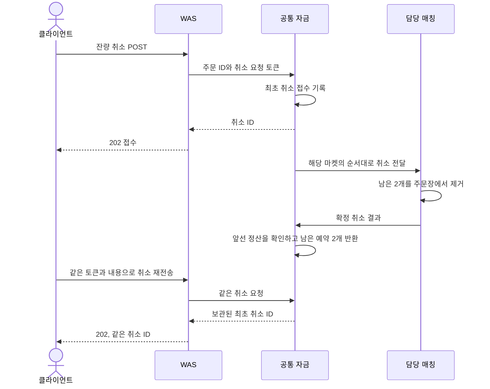
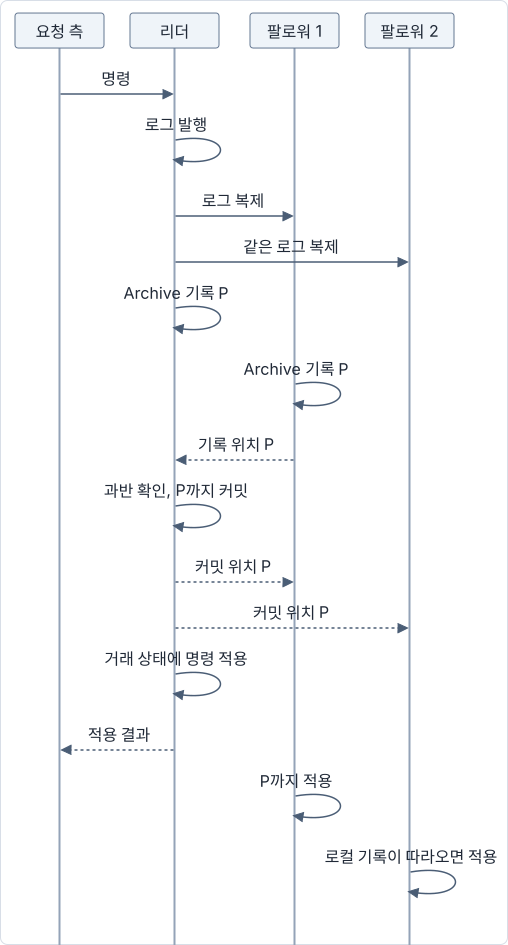
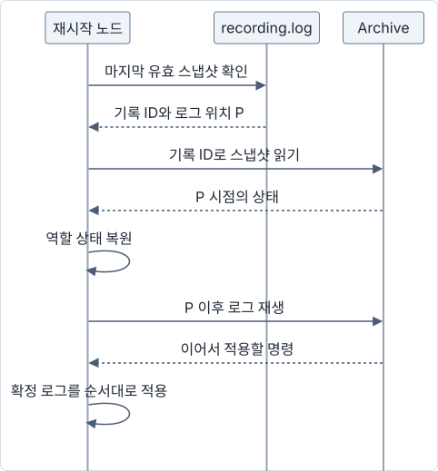
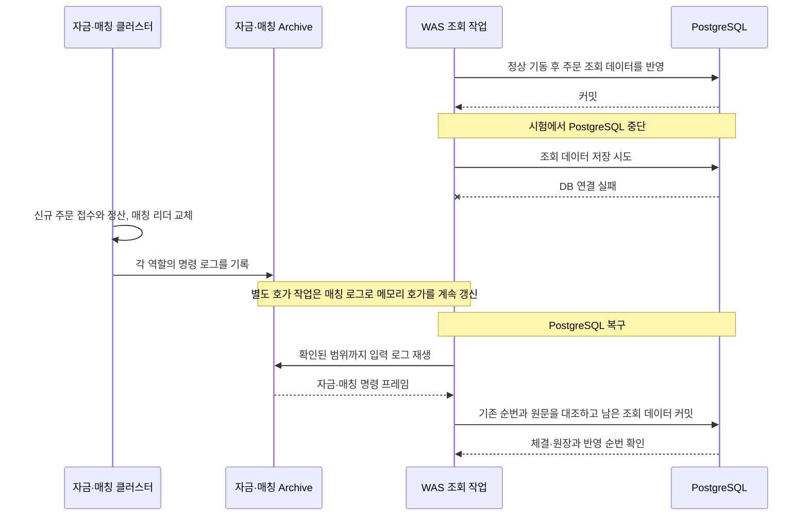

# 거래 백엔드 상세 설계 (LLD)

주문을 코드로 따라갈 때 확인할 **입력, 상태 변경, 완료 응답, 재시도 기준**을 정리합니다. README에서 실행 배치와 패키지·멀티모듈 의존성을 먼저 볼 수 있습니다. [전체 설계 (HLD)](../README.md#전체-설계-hld) · [주문 한 건의 흐름](../README.md#주문-한-건의-흐름) · [패키지와 모듈](../README.md#상세-설계-lld)

[모듈](#실행-단위와-모듈) · [접수](#주문-접수와-요청-토큰) · [매칭과 정산](#마켓별-매칭과-정산) · [클러스터 복제](#클러스터-내부) · [조회](#조회-반영과-응답) · [DB 중단 복구](#장애에서-이어가는-흐름)

## 실행 단위와 모듈

Spring Boot WAS와 자금·매칭 노드 실행 코드는 `app-api`에 있습니다. WAS는 HTTP와 조회를 맡고, 자금·매칭은 노드의 역할 설정으로 각각 기동합니다. 거래 노드는 `domain-trading`의 역할별 상태를 연결합니다. [WAS 시작점](../app-api/src/main/kotlin/com/exchange/core/ExchangeCoreApplication.kt) · [거래 노드 기동](../app-api/src/main/kotlin/com/exchange/core/api/trading/infrastructure/aeron/DevelopmentSplitTradingMain.kt) · [Gradle 의존성](../app-api/build.gradle.kts#L48)

| 모듈 | 담당하는 구현 |
| --- | --- |
| `app-api` | HTTP, Aeron 송수신, 노드 기동, Archive 재생, PostgreSQL 조회 반영 |
| `domain-trading` | 자금·매칭의 상태와 접수·전달·정산 순서. 하위 도메인의 계산을 연결 |
| `domain-matching` | 가격대와 주문장, 가격·시간 우선 체결, 잔량 취소 |
| `domain-order`, `domain-fee` | 주문·예약 계산과 수수료 규칙 |
| `domain-ledger`, `domain-common` | 복식 분개, 금액·자산·식별자 등 공통 값 |

`domain-trading`이 주문·수수료·매칭·원장의 규칙을 조합합니다. HTTP 응답 변환, 클러스터 통신, DB 트랜잭션은 `app-api`에서 확인할 수 있습니다. [거래 도메인 의존성](../domain-trading/build.gradle.kts#L19) · [전체 모듈 목록](../settings.gradle.kts)

## 주문 접수와 요청 토큰

| 순서 | 실제 코드 | 상태 또는 응답 |
| --- | --- | --- |
| HTTP 주문·취소 | [`BoundedTradingOrderController`](../app-api/src/main/kotlin/com/exchange/core/api/trading/api/BoundedTradingOrderController.kt#L24), [`BoundedTradingOrderUseCase`](../app-api/src/main/kotlin/com/exchange/core/api/trading/application/BoundedTradingOrderUseCase.kt#L71) | Controller가 요청 형식을 확인합니다. UseCase는 Gateway에 위임합니다. |
| Aeron 전송 | [`BoundedAeronGateway`](../app-api/src/main/kotlin/com/exchange/core/api/trading/infrastructure/aeron/BoundedAeronGateway.kt#L146), [`SplitFundsGatewayTransport`](../app-api/src/main/kotlin/com/exchange/core/api/trading/infrastructure/aeron/SplitFundsGatewayTransport.kt#L200) | Gateway가 대기열과 미응답 한도를 관리합니다. Transport가 분리형 클러스터 메시지로 변환해 자금으로 보내며, Gateway가 응답을 원래 HTTP 요청과 연결합니다. |
| 자금에 명령 적용 | [`SplitTradingClusterAdapter`](../app-api/src/main/kotlin/com/exchange/core/api/trading/infrastructure/aeron/SplitTradingClusterAdapter.kt#L889), [`BoundedFundingState`](../domain-trading/src/main/kotlin/com/exchange/core/trading/BoundedFundingState.kt#L140) | 요청 토큰의 기존 결과를 먼저 확인합니다. 새 주문을 승인하면 예약·접수 결과·매칭에 보낼 주문을 함께 반영합니다. |

요청은 `(userId, channel, epoch, sequence)`로 구분합니다. 같은 토큰과 내용은 보관 중인 최초 결과를 재사용합니다. 같은 토큰의 내용이 달라지면 `REQUEST_CONTENT_CONFLICT`, 이전 세대는 `FENCED_EPOCH`입니다. 응답 확인으로 정리한 순번은 `RETIRED_UNAVAILABLE`이므로 그 토큰이 새 주문으로 실행되지 않습니다. [토큰과 최초 결과 조회](../domain-trading/src/main/kotlin/com/exchange/core/trading/TradingRequestInbox.kt#L90) · [응답 확인과 정리](../domain-trading/src/main/kotlin/com/exchange/core/trading/TradingRequestInbox.kt#L214)

HTTP `202`는 자금 클러스터가 접수를 적용했다는 응답입니다. 취소 접수는 대상 주문·요청 토큰을 확인한 뒤 취소 명령을 같은 마켓 전달 순서에 넣습니다. 남은 예약금의 반환은 매칭 결과가 자금에 적용될 때 일어납니다. [취소 접수](../domain-trading/src/main/kotlin/com/exchange/core/trading/BoundedFundingState.kt#L263) · [응답 유실 시험](order-timeout-recovery-spec.md)

## 마켓별 매칭과 정산

1. 자금 리더의 [주문 전달 작업](../app-api/src/main/kotlin/com/exchange/core/api/trading/infrastructure/aeron/FundsOrderDeliveryAgent.kt#L533)이 배치표에 따라 예약된 주문·취소를 보냅니다. 매칭이 적용한 연속 주문 순번을 자금 로그에 기록하면 해당 발송 자료를 정리할 수 있습니다.
2. [`ReservedMatchingState.apply`](../domain-trading/src/main/kotlin/com/exchange/core/trading/ReservedMatchingState.kt#L74)는 출처와 다음 전달 순번을 확인합니다. 이후 순번이 먼저 오면 `GAP`을 반환합니다. 매칭 효과를 준비해 결과 보관 공간을 확인하고, 수용할 수 있으면 주문장 변경과 확정 결과를 함께 반영합니다. 보관 공간이 일시적으로 부족하면 `BUSY`입니다. [효과 준비 및 반영](../domain-trading/src/main/kotlin/com/exchange/core/trading/ReservedMatchingState.kt#L114)
3. 주문장은 매수 고가순·매도 저가순으로 가격대를 찾고, 같은 가격대의 `LinkedHashMap` 삽입 순서를 사용해 먼저 들어온 주문을 체결합니다. [가격대 정렬](../domain-matching/src/main/kotlin/com/exchange/core/matching/OrderBook.kt#L15) · [같은 가격의 주문 순서](../domain-matching/src/main/kotlin/com/exchange/core/matching/PriceLevel.kt#L29)
4. 매칭 리더의 [결과 전달 작업](../app-api/src/main/kotlin/com/exchange/core/api/trading/infrastructure/aeron/MatchingResultDeliveryAgent.kt#L532)이 체결·취소 결과를 자금으로 보냅니다. 자금은 마켓별 결과 순번을 검증하고 잔고·예약·수수료에 적용합니다. 매칭은 자금이 적용한 연속 순번을 자기 로그에 기록한 뒤 해당 결과를 정리합니다. [자금의 결과 적용](../app-api/src/main/kotlin/com/exchange/core/api/trading/infrastructure/aeron/SplitTradingClusterAdapter.kt#L458) · [매칭의 확인 기록](../app-api/src/main/kotlin/com/exchange/core/api/trading/infrastructure/aeron/MatchingResultDeliveryAgent.kt#L612)

| 확인할 위치 | 역할 |
| --- | --- |
| HTTP 요청 토큰 | 같은 주문·취소 요청의 재전송 식별 |
| 마켓별 주문 전달 순번 | 매칭이 어느 주문 명령까지 적용했는지 확인 |
| 마켓별 결과 순번 | 자금이 어느 체결·취소까지 반영했는지 확인 |
| 클러스터 로그 위치 | 클러스터 내부 복제·커밋·스냅샷 위치 확인 |
| 조회 반영 순번 | WAS가 PostgreSQL에 어느 접수·체결·원장까지 반영했는지 확인 |

두 전달 작업은 각 역할의 준비된 리더에서 송신합니다. 역할이 바뀌면 이전 전송 세대를 비활성화하고, 새 리더가 복제된 상태를 기준으로 아직 확인되지 않은 구간부터 이어 보냅니다. [리더와 전송 세대](../app-api/src/main/kotlin/com/exchange/core/api/trading/infrastructure/aeron/SplitTradingClusterAdapter.kt#L1096) · [리더 교체 시험](funds-leader-failover-verification.md)

### 부분 체결 후 잔량 취소

이 시퀀스는 매도 3개 중 1개가 체결된 시점부터 시작합니다. 조회에 나타나는 잔량과 예약액은 README에서 단계별로 볼 수 있습니다. [수량과 예약 변화](../README.md#부분-체결-후-잔량-취소) · [같은 취소의 한 번 반환을 검증한 시험](../app-api/src/test/kotlin/com/exchange/core/api/trading/infrastructure/aeron/SplitFundsTradingHttpTest.kt#L951)



## 클러스터 내부

3노드 구성에서 자금·매칭 클러스터는 각각 **리더 1대와 팔로워 2대**로 구성합니다. 클러스터마다 자기 명령 로그를 복제하며, 각 노드 JVM은 같은 역할의 거래 상태를 자기 메모리와 기록 경로에 유지합니다. [거래 배치](../README.md#거래-경로) · [노드 조립](../app-api/src/main/kotlin/com/exchange/core/api/trading/infrastructure/aeron/DevelopmentSplitTradingNode.kt#L334)

| 노드 JVM 안의 구성요소 | 하는 일 |
| --- | --- |
| **Media Driver** | 노드 사이의 UDP 전송과 같은 노드 안의 IPC를 처리합니다. |
| **Consensus Module** | 리더 선출, 명령 로그 복제, 과반이 기록한 커밋 위치를 관리합니다. |
| **Clustered Service Container** | 커밋된 명령을 순서대로 읽어, 그 노드의 자금 상태나 주문장에 적용합니다. |
| **Archive** | 각 노드에 도착한 명령 로그와 스냅샷 본문을 파일로 기록하고 재생합니다. |

### 명령 복제와 과반 커밋

팔로워 2의 기록이 늦고, 리더와 팔로워 1의 Archive가 먼저 위치 `P`까지 기록한 예입니다.

[](../.github/assets/cluster-quorum.svg)

- 팔로워는 자기 Archive에 기록한 위치를 `AppendPosition`으로 알립니다. 리더는 **자신을 포함한 과반이 기록한 위치**를 계산하고 `CommitPosition`을 보냅니다. 공통 자금이 과반을 잃으면 새 예약은 확정되지 않습니다. [Aeron 과반 커밋](https://github.com/aeron-io/aeron/blob/1.53.3/aeron-cluster/src/main/java/io/aeron/cluster/ConsensusModuleAgent.java#L2886-L2949) · [과반 상실 검증](funds-quorum-failure-verification.md)
- 각 거래 서비스는 **자기 노드의 커밋 위치까지** 적용합니다. 늦은 팔로워는 알림을 받아도 자기 기록이 도달한 범위까지 진행합니다. 같은 위치까지 적용하면 같은 거래 상태에 도달합니다. [팔로워 커밋 처리](https://github.com/aeron-io/aeron/blob/1.53.3/aeron-cluster/src/main/java/io/aeron/cluster/ConsensusModuleAgent.java#L2518-L2528) · [서비스 적용](https://github.com/aeron-io/aeron/blob/1.53.3/aeron-cluster/src/main/java/io/aeron/cluster/service/ClusteredServiceAgent.java#L262-L265)
- 클러스터 복제는 **로그 바이트 위치**를 확인합니다. 자금과 매칭 사이의 적용 확인은 **주문·결과 순번**을 확인합니다. 새 리더의 전달 작업은 복원한 미확인 구간부터 이어 보냅니다. [자금 리더 전환 시험](funds-leader-failover-verification.md) · [주문 전달 계약](funds-order-delivery-spec.md)

### 노드별 저장과 스냅샷 복구

기록은 **노드별 실행 디렉터리**에 남습니다. 같은 역할의 세 노드도 각자 자기 파일을 사용합니다. 재시작할 때는 기존 기록 경로와 노드 설정이 일치하는지 확인한 뒤 `archive/`와 `cluster/`를 다시 엽니다. [노드별 경로 설정](../app-api/src/main/kotlin/com/exchange/core/api/trading/infrastructure/aeron/DevelopmentFundingNode.kt#L92) · [재시작 검사](../app-api/src/main/kotlin/com/exchange/core/api/trading/infrastructure/aeron/DevelopmentSplitTradingNode.kt#L548)

| 파일 또는 경로 | 보관하는 내용 |
| --- | --- |
| `archive/*.rec` | 클러스터 명령 로그와 스냅샷의 실제 데이터. 각 기록은 `recordingId`로 식별합니다. |
| `archive/archive.catalog` | 각 기록의 시작·종료 위치 등 Archive가 기록을 찾아 읽는 데 쓰는 메타데이터. |
| `cluster/recording.log` | 임기별 로그 기록 ID, 유효한 스냅샷의 기록 ID와 해당 로그 위치. 클러스터가 복구할 스냅샷과 이후 로그를 찾는 데 사용합니다. |
| `driver/` | 기본 Media Driver 경로. 전송용 버퍼와 운영 카운터가 있으며 별도 경로로 지정할 수 있습니다. |

`recordingId`는 해당 노드에서 스냅샷 데이터를 찾는 키입니다. 스냅샷의 `logPosition`은 그 상태에 반영된 명령 로그의 위치이며, 이후 로그를 이어 읽는 기준입니다. [Aeron 기록 구조](https://aeron.io/docs/aeron-cluster/operating-aeron-cluster/)

분리형 거래 노드는 **Archive 데이터·카탈로그·Consensus 파일 동기화를 각각 `2`**로 설정합니다. Aeron의 수준 `2`는 데이터와 파일 메타데이터 동기화를 요청합니다. Archive는 블록 기록과 `force(true)`가 끝난 뒤 기록 위치를 올립니다. 복제에 필요한 기록 위치가 늦게 전진하면 커밋도 그만큼 기다립니다. [우리 노드의 설정](../app-api/src/main/kotlin/com/exchange/core/api/trading/infrastructure/aeron/DevelopmentSplitTradingNode.kt#L375) · [Aeron 파일 기록](https://github.com/aeron-io/aeron/blob/1.53.3/aeron-archive/src/main/java/io/aeron/archive/RecordingWriter.java#L130-L147) · [기록 위치 갱신](https://github.com/aeron-io/aeron/blob/1.53.3/aeron-archive/src/main/java/io/aeron/archive/RecordingSession.java#L233-L241)

통합 시험은 리더에 `SNAPSHOT`을 명시적으로 요청합니다. 각 노드는 그 로그 위치에서 역할 상태를 Archive에 저장합니다. 자금 스냅샷에는 **잔고·예약·수수료·접수 결과와 전달 진행 상태**, 매칭 스냅샷에는 **주문장·잔량·결과 순번과 아직 정산 확인을 받지 않은 결과**가 들어갑니다. 기록이 완료되면 합의 모듈은 서비스와 합의 스냅샷의 ID 및 로그 위치를 `recording.log`에 등록합니다. [스냅샷 요청](../app-api/src/main/kotlin/com/exchange/core/api/trading/infrastructure/aeron/DevelopmentSplitTradingNode.kt#L318) · [역할 상태 저장](../app-api/src/main/kotlin/com/exchange/core/api/trading/infrastructure/aeron/SplitTradingClusterAdapter.kt#L1059) · [스냅샷 등록](https://github.com/aeron-io/aeron/blob/1.53.3/aeron-cluster/src/main/java/io/aeron/cluster/ConsensusModuleAgent.java#L3154-L3189)

[](../.github/assets/cluster-snapshot-recovery.svg)

유효한 스냅샷이 없고 처음부터의 로그가 남아 있으면 로그부터 재생합니다. 기존 통합 시험에서는 자금·매칭 양쪽에 스냅샷을 남기고 추가 명령을 처리한 뒤, 같은 기록으로 두 역할을 재시작해 상태와 처리 위치를 대조합니다. [Aeron 복구 계획](https://github.com/aeron-io/aeron/blob/1.53.3/aeron-cluster/src/main/java/io/aeron/cluster/RecordingLog.java#L1731-L1765) · [우리 복원 코드](../app-api/src/main/kotlin/com/exchange/core/api/trading/infrastructure/aeron/SplitTradingClusterAdapter.kt#L141) · [양쪽 역할 복원 시험](../app-api/src/test/kotlin/com/exchange/core/api/trading/infrastructure/aeron/SplitFundsTradingHttpTest.kt#L2095)

<details>
<summary>거래 배치·주문·조회·클러스터 그림의 Mermaid 원본</summary>

**거래 클러스터 배치**

```text
flowchart TB
    client["클라이언트"] --> was["WAS"]
    was --> funds["공통 자금 · 3노드"]
    funds <--> matchingA["매칭 A · 3노드"]
    funds <--> matchingB["매칭 B · 3노드"]
```

**명령 복제와 과반 커밋**

```text
sequenceDiagram
    participant client as 요청 측
    participant leader as 리더
    participant followerA as 팔로워 1
    participant followerB as 팔로워 2
    client->>leader: 명령
    leader->>leader: 로그 발행
    leader->>followerA: 로그 복제
    leader->>followerB: 같은 로그 복제
    leader->>leader: Archive 기록 P
    followerA->>followerA: Archive 기록 P
    followerA-->>leader: 기록 위치 P
    leader->>leader: 과반 확인, P까지 커밋
    leader-->>followerA: 커밋 위치 P
    leader-->>followerB: 커밋 위치 P
    leader->>leader: 거래 상태에 명령 적용
    leader-->>client: 적용 결과
    followerA->>followerA: P까지 적용
    followerB->>followerB: 로컬 기록이 따라오면 적용
```

**스냅샷과 이후 로그 복원**

```text
sequenceDiagram
    participant node as 재시작 노드
    participant metadata as recording.log
    participant archive as Archive
    node->>metadata: 마지막 유효 스냅샷 확인
    metadata-->>node: 기록 ID와 로그 위치 P
    node->>archive: 기록 ID로 스냅샷 읽기
    archive-->>node: P 시점의 상태
    node->>node: 역할 상태 복원
    node->>archive: P 이후 로그 재생
    archive-->>node: 이어서 적용할 명령
    node->>node: 확정 로그를 순서대로 적용
```

**Archive 조회 경로**

```text
flowchart TB
    fundsArchive["자금 Archive"] --> projection["주문·원장 반영"]
    matchingArchive["매칭 Archive"] --> projection
    matchingArchive --> bookWorker["공개 호가 작업"]
    projection --> db["PostgreSQL"]
    bookWorker --> memory["WAS 메모리"]
    db --> query["WAS 조회 API"]
    memory --> query
```

**주문 접수부터 정산 조회까지**

```text
sequenceDiagram
    actor client as 클라이언트
    participant was as WAS
    participant funds as 공통 자금
    participant matching as 담당 매칭
    participant db as PostgreSQL
    client->>was: 주문 POST와 요청 토큰
    was->>funds: 주문 접수 요청
    funds->>funds: 확정 로그 적용, 예약과 접수 결과 기록
    funds-->>was: 주문 ID와 접수 순번
    was-->>client: 202 접수
    funds->>matching: 예약된 주문 전송
    matching->>matching: 주문장 변경과 체결 결과 확정
    matching->>funds: 체결 결과와 마켓 결과 순번 전송
    funds->>funds: 연속 순번 확인 후 잔고·수수료 정산
    funds-->>matching: 자금에 적용한 결과 순번
    matching->>matching: 정산 확인 기록과 보관 결과 정리
    opt 조회는 준비됐고 접수 순번 반영을 기다리는 중
        client->>was: 접수 순번을 포함한 주문 GET
        was-->>client: 202 QUERY_CATCHING_UP
    end
    was->>db: 조회 작업에서 체결·정산 상태 반영
    client->>was: 주문 GET
    was->>db: 주문과 자금 반영 상태 조회
    was-->>client: 200, 체결과 정산 완료
```

</details>

## 조회 반영과 응답

1. [`OrderQueryConfig`](../app-api/src/main/kotlin/com/exchange/core/api/config/OrderQueryConfig.kt#L119)가 일반 조회 수집과 Archive 모드를 구성합니다. 현재 Archive 모드는 한 마켓과 한 매칭 담당을 사용합니다. [구성 제약](../app-api/src/main/kotlin/com/exchange/core/api/trading/infrastructure/aeron/SplitTradingConfiguration.kt#L139)
2. [`SplitArchiveSource`](../app-api/src/main/kotlin/com/exchange/core/api/trading/infrastructure/aeron/SplitArchiveSource.kt#L153)는 리더의 과반 커밋·서비스 적용·Archive 기록 위치가 모두 도달한 구간을 읽습니다. 리더나 기록이 바뀌면 이전 재생 경계와 새 로그가 이어지는지 확인합니다. [`SplitArchiveProjection`](../app-api/src/main/kotlin/com/exchange/core/api/trading/infrastructure/aeron/SplitArchiveProjection.kt#L57)이 기록된 입력을 재생해 접수·체결·원장·정산 사실을 재구성합니다.
3. [`ArchiveOrderQueryFeedWorker`](../app-api/src/main/kotlin/com/exchange/core/api/trading/infrastructure/aeron/ArchiveOrderQueryFeedWorker.kt#L177)는 접수와 원장을 먼저 반영합니다. 관련 주문의 접수가 모두 저장된 매칭 결과부터 반영하고, 체결 정산 기록을 커밋한 다음 주문의 자금 상태를 `APPLIED`로 표시합니다.
4. [`PostgresOrderQueryFeedStore`](../app-api/src/main/kotlin/com/exchange/core/api/trading/infrastructure/persistence/PostgresOrderQueryFeedStore.kt#L696)는 접수·매칭 원문과 조회 행·반영 순번을 같은 트랜잭션으로 기록합니다. 이미 반영한 순번을 다시 읽으면 저장된 원문을 대조합니다. [`OrderQueryUseCase`](../app-api/src/main/kotlin/com/exchange/core/api/trading/application/OrderQueryUseCase.kt#L184)는 저장한 진행 위치와 요청의 `minAdmissionSequence`를 비교해 조회 완료, 따라잡는 중, 부재를 판단합니다. [HTTP 응답](../README.md#api와-조회-기준)

[잔고 반영](../app-api/src/main/kotlin/com/exchange/core/api/trading/infrastructure/persistence/PostgresBalanceProjection.kt)과 [차트 집계](../app-api/src/main/kotlin/com/exchange/core/api/trading/infrastructure/persistence/CandleProjectionWorker.kt)는 커밋된 원장·정산 기록을 사용합니다. [공개 호가 작업](../app-api/src/main/kotlin/com/exchange/core/api/trading/infrastructure/aeron/PublicOrderBookWorker.kt#L181)은 매칭 Archive를 별도로 따라가며, 같은 WAS 안에서 상위 10호가를 메모리에 공개합니다.

## 장애에서 이어가는 흐름

아래는 WAS를 먼저 기동한 뒤 PostgreSQL을 멈춘 3+3노드 시험입니다. 매칭 리더를 교체하는 동안 거래와 공개 호가 갱신을 확인하고, DB 복구 뒤 이미 저장된 순번과 원문을 대조해 남은 구간을 적용합니다. 재시작 전후 결과와 실제 검증 수치는 README에 있습니다. [장애 검증 결과](../README.md#정합성과-장애-검증) · [DB 중단과 리더 교체 시험](../app-api/src/test/kotlin/com/exchange/core/api/trading/infrastructure/aeron/SplitFundsTradingHttpTest.kt#L583)


