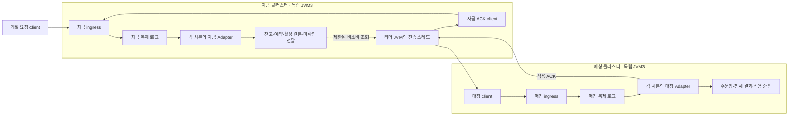

# #168 · 자금 클러스터에서 매칭 클러스터로 예약 주문 전달

2026-11-03 · 기준 통합 `8d2572bfc98748f44569f5fecbaa8a7c47e87285` · 작업 브랜치 `feat/aeron-order-delivery/168`.

[확정 명세](funds-order-delivery-spec.md)의 과거 ‘구현 전’ 기록은 보존하고 이 문서에 구현·실행 결과를 구분한다. 아래 수치는 로컬 검증 종료 시점의 기록이며, 게시 후 CI 상태는 PR에서 확인한다. 상위 #130 전체가 아닌 하위 #168의 주문 전달·적용 ACK 범위다.

## 1. 무엇을 연결했는가

**예약한 주문을 별도의 매칭 클러스터까지 실제 Aeron으로 전달하고, 매칭 적용 확인을 자금 로그에 기록한다.** 자금 JVM3개와 매칭 JVM3개가 서로 다른 두 클러스터를 이룬다. 자금 리더 JVM의 전송 스레드가 양쪽을 연결한다.

이전에는 테스트가 `pendingDispatch()` → `ReservedMatchingState.apply()` → `acknowledgeMatchingApplied()`를 직접 호출했다. 이제 각각 실제 서비스 callback·Aeron ingress·복제 로그를 거친다. 기존 도메인 계산을 다시 구현하지 않았고 일반 통합 실행과 HTTP 경로도 유지한다.

| 이번에 연결함 | 후속 범위 |
| --- | --- |
| 자금 접수·예약 → 원본 전달 → 매칭 적용 → 자금 로그에 적용 ACK → 전달 payload 회수 | #169 전체 매칭 결과의 역전달·금융 정산·정산 ACK·매칭 결과 회수 |
| 같은 원본 재전송, 제한된 pipeline, 기본 로그/스냅샷 복원 | 리더·과반 장애 전수, 서로 모순된 과거 위치 복원, 담당 이동, 여러 마켓 통합, 장기 부하/TPS |

사용자 결정대로 인증·인가·보안 기능은 추가하지 않았다. 개발 네트워크의 프로세스를 신뢰한다. 역할·lineage·설정 지문을 비교하는 것은 실수로 다른 상대에 연결되는 것을 찾기 위한 계약 검사이며 상대 인증이나 위조 방어가 아니다.

## 2. 실제 프로세스와 상태의 위치



여섯 노드 각각 자기 MediaDriver·Archive·ConsensusModule·기록 볼륨을 갖는다. 전송 작업은 자금 리더 노드의 Driver를 재사용하며 일곱 번째 운영 전달 JVM을 만들지 않는다. 시험을 조율하는 Gradle JVM과 요청을 보내는 임시 client 컨테이너는 여섯 복제 노드에 포함하지 않는다.

자금 상태와 주문장은 각 소유 JVM의 heap에 있다. worker의 한정된 조회 요청·불변 batch·cursor는 로컬 진행 자료다. 잃어도 자금이 보관한 미확인 원본부터 다시 읽는다. Archive와 snapshot은 역할별 재생 자료이며 한 클러스터가 다른 클러스터의 snapshot을 대신 읽지 않는다.

## 3. 입력부터 ACK 회수까지 실제 코드 순서

### 3.1 기동과 두 역할 조립

1. `DevelopmentSplitTradingMain.splitTradingSettings()`가 명시적 `ORDER_DELIVERY_DEV` 모드·역할·고정 manifest·상대 ingress를 읽는다. 기본값은 분리 실행이 아니다.
2. `SplitTradingConfiguration`이 기존 `TradingRoleAssembly.funds()`와 `reservedMatching()`을 조립한다. 자금에는 매칭 주문장이 없고 매칭에는 잔고 상태가 없다. 고정 정책·담당·한도 전체를 지문에 결속한다.
3. `SplitTradingNodeSettings`가 포트 충돌·역할·manifest·sync2·경로를 검증한다. `SplitTradingRun.open()`은 복구 identity와 자기 Archive/recording log를 확인한 뒤 잠금을 잡는다. 불일치하면 이전 기록을 새 상태로 덮어쓰지 않는다.
4. `DevelopmentSplitTradingNode`가 실제 네 통신/합의 구성요소와 역할 Adapter를 시작한다. 빈 실행에서는 `InitializeRole`도 각자의 로그를 거친다. 복원은 snapshot과 자기 로그 tail을 먼저 재생한다.

일반 진입점의 FUNDS/MATCHING 차단을 해제하지 않았다. 새 개발 진입은 역방향 정산이 아직 연결되지 않은 유한 검증 실행만 허용한다.

### 3.2 자금 접수는 원본까지 남긴다

`SplitTradingClusterAdapter.onSessionMessage()`가 자금 역할의 `Control(Admit)`을 받으면 기존 `BoundedFundingState.admit()`을 호출한다. 잔고를 예약하고 활성 원본·전달 순번을 함께 기록한다. 수수료0·quote1,000에서 BUY6@100이면 사용 가능400/예약600이다.

이 callback은 이미 자금 로그에서 전달된 명령을 처리한다. worker가 HTTP 요청을 직접 받아 예약하는 것이 아니다. 이 승인에는 기존 integrated `Execution` 명령을 덧붙이지 않는다.

### 3.3 worker는 서비스 소유 상태를 직접 읽지 않는다

`FundsOrderDeliveryAgent.doWork()`는 현재 활성 리더 세대를 확인하고 두 client를 poll한다. `scheduleRead()`가 `readDispatch()`에 제한 조회를 요청하면 Adapter의 `doBackgroundWork()`가 자기 스레드에서 `pendingDispatch()`를 읽어 future를 완료한다. worker가 다음 duty cycle에서 `consumeRead()`로 값을 받는다.

이 조회는 payload를 소비하거나 복제 로그에 조회 명령을 쓰지 않는다. 가변 Map·전체 recovery state를 worker로 노출하지 않는다. future의 동기 continuation에서 서비스 스레드가 네트워크 통신을 실행하는 경로도 만들지 않았다.

### 3.4 matching client → 매칭 로그 → 실제 적용

`offerBatch()`가 순번대로 `Apply(FundsOrderDispatch)`를 인코딩한다. `SplitOrderDeliveryClient`의 실제 Aeron 연결이 매칭 ingress에 offer한다. **offer 성공은 로컬 전송 수락이며 매칭 완료가 아니다.**

매칭 로그에서 `SplitTradingClusterAdapter.onSessionMessage()`가 호출되면 `ReservedMatchingState.apply()`가 원본·순번·정책·현재 주문장과 용량을 대조한다. 적용되면 주문장과 전체 결과를 함께 보관하고 `APPLIED`와 누적 적용 ACK를 돌려준다. 이미 처리한 원본은 `DUPLICATE`/유효 `PRUNED`로 기존 경계를 돌려준다.

전체 체결·대기·최종 거절 결과는 매칭 소유자에 남는다. 이번 worker는 그 전체 결과를 원격으로 받아 금융 정산하지 않는다.

### 3.5 매칭 응답 → 자금 client → 자금 로그

`receiveMatching()`은 응답 correlation·stream·context·순번을 대조해 누적 ACK를 묶는다. `flushAck()`가 **자금 client로 `RecordAck`를 보낸다.** 이 ACK도 자금 ingress·자금 로그를 거친다.

자금 Adapter가 `acknowledgeMatchingApplied()`를 실행하면 해당 구간의 전달 payload만 정리한다. `receiveSourceAck()`가 그 확정을 확인한다. timeout·단순 offer 성공·매칭 응답 수신만으로 자금 원본을 먼저 삭제하지 않는다.

| 관측 시점 | 자금 사용 가능/예약 | 전달 자료 | 매칭 주문장 | 금융 executedThrough |
| --- | --- | --- | --- | --- |
| 첫 주문 예약 | 400/600 | 1 | 0 | 0 |
| 매칭 적용, ACK 유실 중 | 400/600 | 1 | 1 | 0 |
| 두 번째 BUY2@100도 적용, ACK 보류 중 | 200/800 | 2 | 2 | 0 |
| 자금이 누적 ACK2 확정 | 200/800 | 0 | 2 | **0** |

전달 자료가0이어도 예약800·활성 원본2개는 남는다. ‘매칭이 입력을 적용했다’와 ‘돈을 정산했다’는 서로 다른 확인이다.

## 4. 유실·단절·용량·생명주기

- ACK가 사라지면 자금의 같은 stream/dispatchSequence/원본을 재전송한다. 업무 ID나 준비 자금을 새로 만들지 않는다. 매칭이 이미 적용했다면 주문장·결과를 추가하지 않는다.
- source ACK 응답만 사라지면 source의 확정 prefix를 다시 읽는다. 이미 회수한 payload를 부활시키지 않는다.
- `GAP`은 필요한 앞 순번부터 재조회하고 `BUSY`는 원본을 보존한 채 제한 backoff한다. 순번 소진·내용 충돌·잘못된 원본은 정상 성공이나 무한 정상 재시도로 바꾸지 않는다.
- 일시적인 `NOT_CONNECTED`·닫힌 연결·최대 position은 같은 업무 원본으로 재연결한다. 원격 Docker DNS가 잠시 사라지는 전송 오류와 업무 callback 오류도 구분한다. 업무 오류는 계속 노드를 차단한다.
- 매칭의 활성 상한으로 최종 `NOT_EXECUTED`가 생겨도 입력 적용 ACK는 돌아올 수 있다. 이때도 이번에는 예약을 돌려주지 않는다. 전체 결과의 순차 정산은 #169다.
- 리더 상실·snapshot·종료는 local read와 활성 세대를 무효화한다. follower와 재생 중에는 신규 송신을 시작하지 않는다. 이전에 이미 나간 메시지가 겹치더라도 도메인이 중복 효과를 막는다. 실제 리더 승계 전수 시험은 후속 범위다.

| 한도 | 현재 기본값 |
| --- | --- |
| application frame | 32,768바이트, 별도 schema88/version1·8바이트 헤더 |
| 조회 요청 큐 | 16개 |
| 조회 batch | 64개/논리 크기256KiB |
| in-flight | 64개/인코딩512KiB |
| ACK 병합 | 16개 또는2ms |
| 시도/재연결 | 3초/50ms |
| BUSY backoff | 1~20ms |

`nanoTime()`은 한 JVM의 경과 시간만 잰다. 노드 간 시각·업무 순번을 비교하지 않는다. 독립 리뷰에서 유효한 음수 원점에 시작하지 못하는0 sentinel을 발견해 nullable 대기 시각으로 고쳤다. 음수·0·Long 부호 경계와 재연결 직전/직후를 대조했다.

## 5. 변경 파일을 읽는 지도

| 파일/책임 | 읽을 입구 |
| --- | --- |
| 실행 설정과 명시 개발 main | `aeron/DevelopmentSplitTradingMain.kt`, `SplitTradingConfiguration.kt` |
| 여섯 노드의 실제 구성·기록 identity·종료 | `aeron/DevelopmentSplitTradingNode.kt` |
| 역할별 상태 소유·확정 callback·snapshot·제한 조회 | `aeron/SplitTradingClusterAdapter.kt` |
| 리더의 pipeline·ACK 환류·재연결 | `aeron/FundsOrderDeliveryAgent.kt` |
| Aeron client 연결/offer/poll/keepalive 단독 소유 | `aeron/SplitOrderDeliveryClient.kt` |
| typed wire·길이/필드 검증 | `codec/SplitOrderDeliveryCodec.kt`, `src/main/proto/split_order_delivery.proto` |
| 기존 역할 snapshot codec | `FundsRoleSnapshotCodec`, `MatchingRoleSnapshotCodec`의 구성 직렬화 가시성만 private→internal. byte 형식은 유지 |
| 실제 시험과 유실/관찰 wrapper | test 소스의 `DockerFundsOrderDeliveryTest`, `SplitTradingVerificationTool`, `test/docker/aeron-order-delivery` |

위 Kotlin 경로의 공통 앞부분은 `app-api/src/main/kotlin/com/exchange/core/api/trading/infrastructure/`다. 새 타입은 app 내부용이다. 도메인 모듈에 Aeron/Spring/스레드/파일 I/O를 넣지 않았다. 기존 `order_admission.proto`와 integrated v2/v3 bytes도 바꾸지 않았다.

## 6. 실행 결과와 수용 사례 대조

최종 관련 검사와 저장소 필수 검사는 통과했다. app-api 전체 테스트를 실행했다고 표현하지 않고 아래 실제 선택 범위를 기준으로 한다.

| 대상 | 결과 | 실행 근거 |
| --- | --- | --- |
| 새 테스트6클래스 | **55개 통과**, 실패/오류/skip0 | codec13 + Adapter8 + worker18 + client4 + startup11 + Docker1 |
| 기존 app-api 회귀 | **63개 통과** | 기존 HTTP 실제3노드, wire v2/v3, 역할 snapshot/golden/continuation, 일반 역할 진입 차단, execution identity |
| architecture | **386개 통과**, 보고서 무결성 검증 통과 | 이름·폴더·모듈/경계 규칙을 그대로 적용 |
| domain-trading / domain-matching | **402/163개 성공 결과 재사용** | 이번에 도메인 변경 없음. 두 task는 UP-TO-DATE이며 새로 실행한 것으로 세지 않음 |
| 전체 ktlintCheck | 통과 | 새 Kotlin/기존 모듈 형식 검사 |
| client 시험 기한 수정 후 재검사 | **4개 통과**, app-api ktlintCheck 통과 | 제품 변경 없이 응답미확인 시험의 준비 기한만5→250ms |

주 검증은 `build/impl168-final-verification.log`의 **BUILD SUCCESSFUL,5분2초**다. XML·명령 로그는 `build/issue168-verification/final/`에 module별로 보존했다. client 후속 검사는 `build/issue168-verification/client-final/`에 따로 보존했다. 중복 실행한4개를 전체 테스트 수에 다시 더하지 않는다. 최초 일부 단위 검사의 잘못된 fixture/도구 실패와 최종 제품 결과도 구분한다.

실제6노드 run은 **`delivery17937104755219472ced6`**이며 `app-api/build/reports/aeron-funding/order-delivery/<runId>/result.json` 및 `build/issue168-verification/final/docker-result.json`에서 각 사본을 대조할 수 있다. `success=true`, `issues=[]`, `recordVolumesDeleted=true`, `runResourcesRemoved=true`다.

- 기능 시나리오 실행130,073ms. TPS/지연 벤치마크 수치가 아니다.
- 실제 Archive/Consensus 기록 설정2/2/2. 각 노드 heap256MiB·컨테이너768MiB·CPU1·private shm256MiB다.
- 기록 high-water25,722,880바이트/예산2GiB, 진단물181,056바이트/예산16MiB. 종료 후 run 소유 컨테이너·볼륨·네트워크·이미지를 정리했다. 완전한 replay root는 보관하지 않고 제한된 진단 자료만 남겼다.
- 최초에 동결한 같은 이미지·JDK·manifest와 사본별 같은6개 볼륨/root를 재시작 내내 유지했다. 재빌드나 identity 수정으로 복구를 통과시키지 않았다.
- 실제 application frame1,784바이트와 Aeron session header32바이트는 MTU1,408을 넘는다. 이 원본이 실제 매칭3사본에1회 적용됨을 확인했다. 산정상 단편2개라는 값과 실제 packet capture를 구분하며, packet 수를 관측했다고 주장하지 않는다.

주 검증 재현 명령은 다음과 같다. 이 PR을 checkout한 저장소 안에서 실행한다. Java25를 JAVA_HOME/PATH에 설정하고 실제 Docker를 준비해야 하며 Docker 미준비를 skip으로 숨기지 않는다.

```bash
cd "$(git rev-parse --show-toplevel)"
./gradlew :domain-trading:test :domain-matching:test :app-api:test --tests '*DockerFundsOrderDeliveryTest' --tests '*SplitTradingRoleStartupTest' --tests '*SplitOrderDeliveryCodecTest' --tests '*SplitTradingClusterAdapterTest' --tests '*FundsOrderDeliveryAgentTest' --tests '*SplitOrderDeliveryClientTest' --tests '*FundsRoleSnapshotCodecTest' --tests '*FundsResultSnapshotCodecTest' --tests '*MatchingRoleSnapshotCodecTest' --tests '*BoundedTradingRoleGoldenTest' --tests '*BoundedTradingStateCodecTest' --tests '*BoundedTradingSnapshotContinuationTest' --tests '*TradingRoleStartupTest' --tests '*BoundedTradingCodecTest' --tests '*AdmissionCommandCodecTest' --tests '*AdmissionResultCodecTest' --tests '*BoundedHttpTradingClusterTest' --tests '*BoundedExecutionIdentityTest' :architecture-tests:test :architecture-tests:verifyArchitectureReport ktlintCheck --no-daemon --max-workers=1 --console=plain
```

### 실제6노드 복합 시험의 핵심 관측

| 단계 | 실제 조작 | 각 사본의 직접 기대값 |
| --- | --- | --- |
| 준비 | 두 역할을 각자의 로그로 초기화, quote1,000 준비 | 역할별3사본 RUNNING, 서로 다른 기록/Driver·같은 고정 실행물 |
| 입력1·ACK 유실 | BUY6@100, matching ACK listener 보류 | 자금400/600·dispatch1/ACK0, 매칭book/engine/result1 |
| ACK1 없이 입력2 | BUY2@100 추가, 같은 ACK 보류 | 자금200/800·dispatch2/ACK0, 매칭2. 한 건 확인을 기다리는 구현이면 통과 불가 |
| 누적 ACK2 | 유실 보류 해제 | 자금dispatch0/ACK2·active2/hold800. 실제 원본2 재전송에도 matching2 유지 |
| 전체 로그 복원 | snapshot 없는 여섯 노드 종료/재기동 | restoredSnapshot=false6개, 양쪽2건·payload0/hold800 유지 |
| snapshot2 + 입력3 tail | 양쪽 snapshot 뒤 BUY1@100, matching ACK3 수신 후 source 제출 보류 | 각자 logPosition>자기 snapshotPosition, 자금100/900·dispatch1/ACK2, 매칭3 |
| ACK 전 재시작 | 같은 snapshot/기록으로 여섯 노드 복구 | restoredSnapshot=true6개, 기존 입력3 DUPLICATE/PRUNED ACK·추가 매칭0, 보류 해제 후 자금ACK3/payload0 |
| source ACK3 tail 재시작 | 새 snapshot 없이 다시 여섯 노드 복구 | source snapshot2+ACK3 tail 복원, ACK3/payload0/active3/hold900 |
| 실제 매칭 중단 | matching3만 종료, 자금은 같은 boot/container 유지 | 입력4 예약 가능: 자금0/1000·dispatch1/ACK3. 실제 Progress 응답, 자금3사본 snapshot 증가 |
| 매칭만 복구 | 동일 이미지/볼륨/root로 matching3 새 boot | 새 입력4만 매칭4로 진행, sourceACK4/payload0. 사용자 요청4 재전송에도 상태 동일 |

모든 단계의 금융 executedThrough/resultThrough와 matching fundsSettledThrough는0이다. 무체결 대기 주문을 전달한 시험이며 #169 금융 정산을 완료한 시험으로 확대하지 않는다.

### 실패를 발견하고 고친 경계

| 발견 | 원인과 반영 |
| --- | --- |
| 음수 nanoTime에서 초기 전송 정지 | 제품의0 sentinel을 nullable retryAt으로 교체. 독립 반례 Red와 정상/음수/부호 넘김 경계로 재검증 |
| 원격 peer DNS 단절 | 전송의 UnknownHost 원인을 가진 InvalidChannel만 재연결 대상으로 분류. 일반 채널/업무 오류는 치명 오류 유지 |
| 구조 검사 실패 | Service/Request 접미사의 저장소 역할 규칙 위반. Adapter/AckSubmission/DispatchReadQuery로 이름 수정, 검사 규칙은 유지 |
| 빈 매칭의 시험 관찰 실패 | 초기 checkpoint는 markets가 비어 있을 수 있음. test-only 캡처를 빈 상태로 수정 |
| 조기 READY 관찰 | onStart 상태 파일보다 runtime 파일이 늦을 수 있음. 같은 boot/pid의 runtime 완료까지 대기 |
| worker 조회가 시험에서 진행 안 됨 | Kotlin 인터페이스 위임이 Java default background callback을 전달하지 않음. test wrapper에서 명시적으로 delegate 호출 |
| 5ms 시험 준비 기한 | 최초 클래스 로드/스케줄링으로 constructor가 When 전에 만료. 해당 시험만250ms로 수정, 완료/미확인 assertion 유지. 제품 기한 변경 없음 |

초기 fixture에서 누락된 요청 세대 발급이나 UTF-8 사용자 경계를 바로잡은 실패도 제품 Red와 구분했다. 모든 구현을 TDD로 작성했다고 주장하지 않는다. 독립 R1의 재현 실패는 별도 보고서에 보존했다.


## 7. 새 테스트55개를 준비·실행·검증문으로 읽기

아래는 새 테스트 전부의 설명이다. 테스트 이름·의도만으로 보장을 늘리지 않고 실제 assertion을 기준으로 한다. 같은 수용 흐름의 여러 입력은 메서드 안의 반복이며 추가 JUnit 건수로 세지 않는다. 별도 작성 에이전트의 읽기 보조 결과를 현재 소스·실행 기록에 맞춰 합쳤으며 독립 리뷰나 사용자 이해 확인을 대신하지 않는다.

**먼저 볼 지도**

| 위치·정의 수 | 확인하는 동작 | 실제 것과 대역 | 설명 상태 |
| --- | --- | --- | --- |
| [코덱 13개](../app-api/src/test/kotlin/com/exchange/core/api/trading/infrastructure/codec/SplitOrderDeliveryCodecTest.kt#L52) | 명령·응답의 타입/필드·길이·문자열·순번 경계 | 실제 코덱과 Protobuf 바이트. 도메인 명령·네트워크는 실행하지 않음 | C01–C13 원문과 입력 반복 확인 |
| [역할 adapter 8개](../app-api/src/test/kotlin/com/exchange/core/api/trading/infrastructure/aeron/SplitTradingClusterAdapterTest.kt#L68) | 자금 예약·매칭 적용·작은 ACK·조회 세대·snapshot | 실제 역할 owner·callback·snapshot codec. Cluster/ClientSession/Publication/Image는 mock | A01–A08 확인 |
| [전송 worker 18개](../app-api/src/test/kotlin/com/exchange/core/api/trading/infrastructure/aeron/FundsOrderDeliveryAgentTest.kt#L57) | pipeline·유실·재접속·BUSY/GAP·건수/bytes·스레드 | 실제 worker와 메모리 자금/매칭 owner. Source/연결/시각은 fake | W00–W17 원문 확인·18건 통과 |
| [개발 client 4개](../app-api/src/test/kotlin/com/exchange/core/api/trading/infrastructure/aeron/SplitOrderDeliveryClientTest.kt#L13) | correlation·미확인 응답·자원 정리 | 실제 client에 fake 연결 factory 주입 | L01–L04 확인 |
| [시작/복구 11개](../app-api/src/test/kotlin/com/exchange/core/api/trading/infrastructure/aeron/SplitTradingRoleStartupTest.kt#L36) | mode·배치·경로·지문·복구 선행조건 | 실제 설정/오류분류·temp 파일. B10/B11은 Node.start의 사전거절까지 호출 | B01–B11 원문 확인·11건 통과 |
| [Docker 1개 복합 시나리오](../app-api/src/test/kotlin/com/exchange/core/api/trading/infrastructure/aeron/DockerFundsOrderDeliveryTest.kt#L17) | 실제 3+3 복제·fragmentation·응답유실·자기기록 복구 | 독립 컨테이너/JVM·실제 Aeron client/ingress/log/Archive. 시험 wrapper만 유실 주입·관찰 | G16 포함 최종 복합 시나리오 통과 |

**공통 준비를 이렇게 읽는다**

자금의 available은 지금 쓸 수 있는 돈, hold는 주문 때문에 잡아 둔 예약이다. dispatch payload는 다른 매칭 클러스터에 보낼 승인 원본이다. ACK는 매칭이 연속해서 적용한 순번의 확인이며, 자금에서 ACK가 확정되면 전달 원본만 회수한다. ACK 수신이나 Aeron offer의 양수만으로 금융 정산까지 끝났다고 읽지 않는다. 누적 경계 through2는1·2까지의 적용 확인이다.

서비스 단위의 공통 준비는 [준비금·채널 발급 helper](../app-api/src/test/kotlin/com/exchange/core/api/trading/infrastructure/aeron/SplitTradingClusterAdapterTest.kt#L341)에서1000을 넣고, [주문 helper](../app-api/src/test/kotlin/com/exchange/core/api/trading/infrastructure/aeron/SplitTradingClusterAdapterTest.kt#L349)에서 수수료0·가격100인 BUY를 만든다. [replay helper](../app-api/src/test/kotlin/com/exchange/core/api/trading/infrastructure/aeron/SplitTradingClusterAdapterTest.kt#L413)는 위치를64씩 늘려 callback을 직접 부르는 대역이며 실제 consensus 로그를 재생하지 않는다. [snapshot helper](../app-api/src/test/kotlin/com/exchange/core/api/trading/infrastructure/aeron/SplitTradingClusterAdapterTest.kt#L441)와 [복원 image helper](../app-api/src/test/kotlin/com/exchange/core/api/trading/infrastructure/aeron/SplitTradingClusterAdapterTest.kt#L456)는 실제 codec 바이트를 mock publication/image 사이에 전달한다. 그러므로 A05/A06의 tail은 callback 순서 재현이고, 실제 Archive+snapshot+tail 증거는 D01에서 읽는다.

worker의 공통 Fixture는 준비금1000·수수료0의 실제 메모리 owner 둘을 초기화한다. [Source.readDispatch](../app-api/src/test/kotlin/com/exchange/core/api/trading/infrastructure/aeron/FundsOrderDeliveryAgentTest.kt#L626)는 즉시/보류 future를 만들고, [fake Transport.offer](../app-api/src/test/kotlin/com/exchange/core/api/trading/infrastructure/aeron/FundsOrderDeliveryAgentTest.kt#L718)는 디코딩한 Apply를 matching.apply로, RecordAck를 funds.acknowledgeMatchingApplied로 직접 보낸다. 따라서 W행의 ingress·응답 표현은 worker 경계의 명령 종류를 뜻하며 복제 로그 확정 증거는 아니다. 가짜 시각을 advance하고 doWork를 반복하는 것과 실제 스레드 latch를 기다리는 W17도 구분한다.

client의 factory는 실제 소켓을 열지 않는다. offer는1을 돌려주고 poll은 한 번에 잘못된 correlation과 올바른 correlation을 주도록 구성된다([연결 대역 offer/poll](../app-api/src/test/kotlin/com/exchange/core/api/trading/infrastructure/aeron/SplitOrderDeliveryClientTest.kt#L91)). 시작 검사에서 실제인 것은 설정 함수와 temp 파일/링크이며, 설정 예외만으로 실제 노드가 기동됐다고 설명하지 않는다. B10/B11은 복구 검사에서 빠르게 거절되므로 Driver나 클러스터를 시작한 시험도 아니다.

코덱의 기대 예약 값609/6은 고정한 수수료 정책의 BUY/SELL 입력에서 확인한다. Docker의400/600·200/800·100/900·0/1000은 준비금1000에서 총 매수 수량6·8·9·10에 가격100을 곱한 고정 기대다. 전체 결과를 만드는 운영 함수에서 예상값을 그대로 복사한 비교로 표현하지 않는다.

### 바이트가 같은 주문과 확인을 표현하는지 — SplitOrderDeliveryCodecTest (13개)

| 사례·테스트 메서드 | Given — 준비 | When — 실행 | Then — 실제 검증 | 줄 근거 |
| --- | --- | --- | --- | --- |
| **C01** [typed dispatch preserves both lineages original order full reservation and fixed context](../app-api/src/test/kotlin/com/exchange/core/api/trading/infrastructure/codec/SplitOrderDeliveryCodecTest.kt#L64) | BUY와 SELL 각각 가격100·수량6, 정책버전17·maker 7,000ppm·taker 15,000ppm, 서로 다른 양쪽 lineage를 가진 전달 원본이다. | correlation91로 인코딩한 Protobuf 필드와 디코딩한 명령을 읽는다. | 원본 전체가 동일하고 방향·형식1·정책 필드가 보존된다. 예약량은 BUY609, SELL6이다. | 준비65–68 / 확인69–75 |
| **C02** [reservation optional released amount and nonzero remainder are preserved without snapshots](../app-api/src/test/kotlin/com/exchange/core/api/trading/infrastructure/codec/SplitOrderDeliveryCodecTest.kt#L80) | 동일 주문의 최초 예약, 3개 부분체결, 그 뒤 해제, 6개 전량체결이라는 네 예약 상태를 만든다. | 각 상태를 Apply 명령으로 왕복 변환한다. | releasedAmount의 존재 여부와 예약 전체가 유지된다. 부분체결 뒤 해제량304와 수수료 나머지123456도 확인한다. | 준비81–85 / 확인88–92 |
| **C03** [peer initialization bounded development control and cumulative ack roundtrip](../app-api/src/test/kotlin/com/exchange/core/api/trading/infrastructure/codec/SplitOrderDeliveryCodecTest.kt#L96) | Describe·역할 초기화·Progress·최초/후속 Rotate(0/1)·receipt ACK0·준비금1000·Admit·적용 ACK0/MAX의 10개 입력과 3바이트 Initialize manifest를 둔다. | 각 명령을 encode/decode한다. | 10개 envelope가 원본과 같고, 별도 Initialize의 manifest 바이트도 같다. 이 검사는 wire 표현을 확인하며 서비스가 옛 Initialize를 실행한다는 뜻은 아니다. | 입력98–123 / 확인124–128 |
| **C04** [small replies preserve committed position ack gap control and uninitialized peer status](../app-api/src/test/kotlin/com/exchange/core/api/trading/infrastructure/codec/SplitOrderDeliveryCodecTest.kt#L132) | 미초기화 DESCRIBED(위치0), APPLIED+ACK1, GAP+MAX 기대순번, FUNDS ACKNOWLEDGED, control이 담긴 ACCEPTED 다섯 응답이다. | 응답을 왕복 변환하고 ACK 응답과 원본 명령의 크기를 비교한다. | 응답 전체 값이 같고 ACK 응답은 원본 Apply보다 작다. | 입력134–141 / 확인142–143 |
| **C05** [frame has separate little endian schema and accepts only the explicit offset slice](../app-api/src/test/kotlin/com/exchange/core/api/trading/infrastructure/codec/SplitOrderDeliveryCodecTest.kt#L147) | 정상 Apply와 DESCRIBED 응답을 다른 앞뒤 바이트 사이에 넣고 기존 bounded Progress도 준비한다. | 8바이트 헤더와 지정 offset 구간을 읽고 코덱·command/reply 종류를 서로 바꿔 해석한다. | little-endian 본문길이·kind1/2·schema88·version1, 구간 해석의 동일성을 확인한다. 기존 bounded와 split, command와 reply를 혼동하면 AdmissionMessageException이다. | 준비148–166 / 확인150–170 |
| **C06** [truncation concatenation incorrect headers lengths offsets and oversized frames fail before a command](../app-api/src/test/kotlin/com/exchange/core/api/trading/infrastructure/codec/SplitOrderDeliveryCodecTest.kt#L174) | 정상 frame을 길이0/7/8/끝1바이트 부족으로 자르고, 헤더 시작 위치0/2/4/6을 바꾸거나 frame 두 개를 붙인다. | 잘못된 offset(-1,1,Int.MAX_VALUE), 길이 조합, 32769바이트 command/reply도 decode한다. | 모두 AdmissionMessageException이며 명시한 최대 frame 상수는32768이다. 도메인 실행을 호출하는 테스트는 아니다. | 변형175–185 / 확인176–188 |
| **C07** [missing command body correlation and every required nested dispatch field are rejected](../app-api/src/test/kotlin/com/exchange/core/api/trading/infrastructure/codec/SplitOrderDeliveryCodecTest.kt#L192) | 정상 Apply/RecordAck Protobuf를 만든 뒤 필수 필드를 하나씩 지운다. helper는 중첩 메시지까지 재귀 순회하고 선택 필드 released_amount는 제외한다. | correlation/body를 지운 요청과 각 중첩 누락 요청을 decode한다. | 각 누락 경로가 AdmissionMessageException을 일으킨다. | 검사193–219 / 공급 helper532–545 |
| **C08** [required reply identity fields remain required even when their numeric value is zero](../app-api/src/test/kotlin/com/exchange/core/api/trading/infrastructure/codec/SplitOrderDeliveryCodecTest.kt#L224) | 정상 응답에서 ack·expected_sequence·control·lifecycle을 선택 필드로 지정하고 나머지 필수 필드를 하나씩 지운다. | 누락 응답을 decode하고 correlation0·반영위치0인 정상 응답도 왕복한다. | 필드 누락은 거절되고, 명시적으로 담은 숫자0은 허용되어 correlation0이 돌아온다. | 누락검사225–227 / 숫자0확인229–232 |
| **C09** [unknown fields and enum values are rejected at every typed nesting level](../app-api/src/test/kotlin/com/exchange/core/api/trading/infrastructure/codec/SplitOrderDeliveryCodecTest.kt#L236) | 모든 중첩 메시지에 unknown field127을 주입한다. 방향·side·feeTier·예약상태99, SIDE_UNSPECIFIED, 응답 role99/미지정도 만든다. | 각 변형 command/reply를 decode한다. | 모두 AdmissionMessageException이다. 실제 중첩 필드 순회 helper의 범위에서 확인한다. | unknown238–240 / enum241–303 / helper548–565 |
| **C10** [invalid domain constructor combinations and numeric ranges are not normalized](../app-api/src/test/kotlin/com/exchange/core/api/trading/infrastructure/codec/SplitOrderDeliveryCodecTest.kt#L307) | 아래 별도 입력 목록의 19개 잘못된 원본과 음수 correlation/ACK, 기대순번0·반영위치-1 응답을 준비한다. | wire decode와 일부 encode를 각각 실행한다. | 19개 wire 변형·음수 ACK decode·잘못된 응답은 AdmissionMessageException, 잘못된 encode 입력은 IllegalArgumentException이다. 값을 정상 값으로 보정하지 않는다. | 입력310–343 / 확인344–359 |
| **C11** [utf8 byte limit accepts exactly 256 bytes and refuses one more malformed text blank and nul](../app-api/src/test/kotlin/com/exchange/core/api/trading/infrastructure/codec/SplitOrderDeliveryCodecTest.kt#L363) | 사용자 ID를 한글85자+a(UTF-8 256바이트)로 만들고 257바이트·공백·NUL·고립 surrogate·0xFF UTF-8, 잘못된 SHA 지문을 만든다. | 정상 입력은 왕복하고 각 잘못된 텍스트와 대문자64자리/63자리 지문을 encode/decode한다. | 256바이트는 같게 돌아온다. 나머지 지정 입력은 해당 encode/decode 예외로 거절된다. | 경계365–381 / 손상UTF-8·지문383–392 |
| **C12** [maximum normal identifiers long sequences and lineages produce a fragmented but bounded frame](../app-api/src/test/kotlin/com/exchange/core/api/trading/infrastructure/codec/SplitOrderDeliveryCodecTest.kt#L396) | 마켓/자산 이름 각각256바이트, 사용자256바이트, 순번·담당세대·구성버전·correlation MAX, signed lineage 극값을 둔다. | 원본을 인코딩하고 크기·왕복 값을 확인한다. | frame은 MTU payload 예시1376보다 크면서 계산한 최대 frame 이하이고 최대값도32768 이하이며 전체 값이 보존된다. 이 단위 검사는 실제 네트워크 재조립을 실행하지 않는다. | 준비397–436 / 확인437–442 |
| **C13** [integrated execution quarantine and mismatched nested correlations cannot enter split control](../app-api/src/test/kotlin/com/exchange/core/api/trading/infrastructure/codec/SplitOrderDeliveryCodecTest.kt#L446) | 통합 Execution/Quarantine, 바깥91·안쪽92인 control, 응답 correlation 불일치, INTEGRATED 응답 역할을 만든다. | 제외 명령은 encode와 수동 nested wire decode 양쪽을 시도하고 나머지 불일치도 변환한다. | Execution/Quarantine은 양쪽에서 거절된다. nested correlation 불일치와 INTEGRATED reply도 예외다. | 제외447–468 / 다른불일치469–478 |

C10의 19개 입력은 형식버전2, dispatch순번0, admission순번-1, market순번0, 담당세대0, 구성버전-1, 양쪽 lineage 동일, 가격0, 수량0, ordinal-1, 자산 scale19, 기초/견적 자산 동일, maker수수료1000001, 정책버전0, 남은수량7, 남은금액0, 남은수수료10, 수수료나머지1000000, 해제금액1이다. [실제 목록](../app-api/src/test/kotlin/com/exchange/core/api/trading/infrastructure/codec/SplitOrderDeliveryCodecTest.kt#L310)을 순서대로 decode하며, 모든 잘못된 금융 조합 전반을 열거한 검사로 확대하지 않는다.

### 확정 callback에서 실제 역할 상태를 바꾸는지 — SplitTradingClusterAdapterTest (8개)

| 사례·테스트 메서드 | Given — 준비 | When — 실행 | Then — 실제 검증 | 줄 근거 |
| --- | --- | --- | --- | --- |
| **A01** [자금 callback은 예약과 전달만 기록하고 적용 ACK는 payload만 회수한다](../app-api/src/test/kotlin/com/exchange/core/api/trading/infrastructure/aeron/SplitTradingClusterAdapterTest.kt#L78) | 미초기화 자금 adapter와 실제 자금 소유자를 만들고, 초기화·준비금1000·채널 발급 뒤 BUY6@100을 접수한다. | 준비 전 Rotate, 주문 접수, ACK1 기록·같은 ACK 재전송·미래 ACK2를 순서대로 callback에 넣는다. | 준비 전 NOT_READY, 접수 ACCEPTED·잔고400/예약600·전달1·활성1·금융실행0이다. ACK1 후 전달0/PRUNED지만 활성1과400/600 유지, 중복 ACK는 성공, 미래 ACK는 FUTURE_ACK이며 경계1이다. matching 필드는 null이다. | 준비79–86 / 접수검증87–102 / ACK104–127 |
| **A02** [매칭 callback은 순서와 중복을 판정하고 전체 결과를 원격 응답에 넣지 않는다](../app-api/src/test/kotlin/com/exchange/core/api/trading/infrastructure/aeron/SplitTradingClusterAdapterTest.kt#L131) | 실제 자금 소유자에 BUY6과BUY2를 접수해 원본1·2를 얻고 빈 매칭 adapter를 둔다. | 초기화 전1, 초기화 후2 선도착, 원본1, 원본1 재전송, 같은 identity의 수량7 변형, 마지막으로 원본2를 넣는다. | NOT_READY, GAP/expected1/ACK없음/engine0을 확인한다. 원본1은 APPLIED·ACK1·control없음·응답1024바이트 미만, 재전송은 DUPLICATE, 변형은 CONTENT_CONFLICT이며 book/engine/result1 유지다. 원본2 뒤 결과2이고 funds 필드는 null이다. | 준비132–139 / GAP140–144 / 적용146–164 |
| **A03** [조회는 서비스 유휴 작업에서만 완료하고 큐와 리더 세대를 제한한다](../app-api/src/test/kotlin/com/exchange/core/api/trading/infrastructure/aeron/SplitTradingClusterAdapterTest.kt#L168) | 예약600·전달1인 자금 리더에게 조회16개를 넣되 background callback은 아직 돌리지 않는다. | 17번째 조회, 팔로워 전환, 재리더 전환, 낡은 세대·65건 조회, 1바이트 조회, 종료를 순서대로 시도한다. | 처음16개는 미완료이고 초과 요청·세대 만료·한도 초과·종료 대기는 예외다. 새 세대는 증가한다. background1회 뒤 BATCH_TOO_SMALL와 requiredBytes>1을 받고 전달1·400/600은 그대로다. | 큐173–184 / 조회185–196 / 종료197–200 |
| **A04** [snapshot 중에는 전송 세대와 재진입 조회를 막고 완료 뒤 새 세대를 만든다](../app-api/src/test/kotlin/com/exchange/core/api/trading/infrastructure/aeron/SplitTradingClusterAdapterTest.kt#L204) | 초기화·예약600·전달1, 미완료 조회1개가 있다. mock publication의 write 도중 검사 함수를 호출한다. | 실제 snapshot codec을 저장 callback에 연결해 저장 중 background를 재진입시킨다. | 저장 중 활성 세대는 null·background0·기존 조회는 예외다. 바이트 chunk는 생기고 끝난 뒤 더 큰 세대와 전달1을 읽는다. | 준비205–210 / 저장중211–215 / 완료216–218 |
| **A05** [자금 snapshot과 ACK tail 재생은 보유 예약과 회수 경계를 복원한다](../app-api/src/test/kotlin/com/exchange/core/api/trading/infrastructure/aeron/SplitTradingClusterAdapterTest.kt#L222) | BUY6의 ACK 전 snapshot 바이트와 같은 framework 위치의 빈 자금 소유자를 둔다. | snapshot을 읽고 팔로워 상태로 ACK1 callback을 재생한다. 리더가 된 뒤 다시 snapshot하고 그 바이트를 또 복원한다. | 첫 복원은 준비되지만 송신 세대는 없고 재생 응답도 없다. ACK tail 후 전달0·400/600·executed0·경계1이다. ACK 후 snapshot 재복원도 전달0·활성1·400/600을 유지한다. | 준비223–229 / 재생230–253 / 두번째복원254–271 |
| **A06** [매칭 snapshot과 입력 tail 재생 뒤 같은 원본은 추가 매칭하지 않는다](../app-api/src/test/kotlin/com/exchange/core/api/trading/infrastructure/aeron/SplitTradingClusterAdapterTest.kt#L275) | 자금 원본1·2 중1을 매칭에 적용해 snapshot하고 빈 매칭 소유자를 같은 위치에서 복원한다. | 팔로워 callback으로2를 재생하고 리더로 바꾼 뒤1·2를 다시 보낸다. | 재생 때 응답은 없고 재전송은 모두 DUPLICATE다. book2·engine2·결과2·appliedThrough2를 확인한다. Archive 로그 재생은 다음 Docker 검사가 맡는다. | 준비276–286 / 재생287–290 / 확인291–301 |
| **A07** [설정 충돌 잘못된 역할과 잘린 wire는 업무 효과나 성공 응답을 만들지 않는다](../app-api/src/test/kotlin/com/exchange/core/api/trading/infrastructure/aeron/SplitTradingClusterAdapterTest.kt#L306) | 미초기화 자금·매칭 adapter를 각각 둔다. | Describe, 다른 지문 Initialize, 올바른 초기화와 재초기화, 8바이트0 frame, 매칭에 자금 Progress/Rotate를 넣는다. | DESCRIBED/UNINITIALIZED, TOPOLOGY_CONFLICT/미준비, ALREADY_INITIALIZED를 확인한다. 손상 frame은 응답 수를 늘리지 않고 malformed1·접수순번0이며, 매칭 자금제어는 WRONG_ROLE/미준비다. | 자금307–318 / 역할319–322 |
| **A08** [초기화 전 snapshot과 다른 framework 위치 복원은 정상 완료하지 않는다](../app-api/src/test/kotlin/com/exchange/core/api/trading/infrastructure/aeron/SplitTradingClusterAdapterTest.kt#L326) | 미초기화 자금 adapter와 초기화 뒤 저장한 snapshot을 각각 준비한다. | 초기화 전 저장을 시도하고, 정상 snapshot은 위치를32 더한 빈 adapter에 읽힌다. | 두 경우 AgentTerminationException이다. 전자는 started=false·failure존재·fatal알림1회, 후자는 started=false·활성세대없음을 확인한다. | 미초기화327–331 / 위치332–338 |

### 재전송·상한·응답 순서를 다루는지 — FundsOrderDeliveryAgentTest (18개)

| 사례·테스트 메서드 | Given — 준비 | When — 실행 | Then — 실제 검증 | 줄 근거 |
| --- | --- | --- | --- | --- |
| **W00** [매칭 활성 상한의 최종 미실행도 전달 자료만 회수하고 두 예약을 남긴다](../app-api/src/test/kotlin/com/exchange/core/api/trading/infrastructure/aeron/FundsOrderDeliveryAgentTest.kt#L59) | 매칭 활성 주문 상한을1로 낮추고 준비금1000에서 BUY6·BUY2를 예약한다. | 30cycle로 실제 메모리 matching/funds 소유자와 fake transport를 연결한다. | 주문장1·엔진순번1·결과2·source경계2·전달원본0·자금200/800·source활성원본2·failure없음을 확인한다. 결과2의 NOT_EXECUTED enum 자체를 직접 비교하는 assertion은 없다. | 준비60–62 / 확인65–77 |
| **W01** [음수 nanoTime 원점에서도 첫 연결과 주문 전달을 시작한다](../app-api/src/test/kotlin/com/exchange/core/api/trading/infrastructure/aeron/FundsOrderDeliveryAgentTest.kt#L82) | 가짜 단조 시각을 -1000000000000으로 두고 준비금1000에서 BUY6을 예약한다. | worker duty cycle을30회 진행한다. | 확정 적용 경계1·매칭결과1·자금400/600이다. 시계가 양수라는 전제로 최초 시도를 막는 오류를 잡는다. | 준비83–85 / 실행87 / 확인88–90 |
| **W02** [고정 설정과 다른 전송 한도는 연결을 열기 전에 거절한다](../app-api/src/test/kotlin/com/exchange/core/api/trading/infrastructure/aeron/FundsOrderDeliveryAgentTest.kt#L95) | 고정 구성의 worker와 source·fake transport를 준비한다. | 별도 생성자에 maxReadEntries=1인 다른 한도를 전달한다. | IllegalArgumentException이며 fake 연결목록과 source 조회목록이 비어 있다. | 준비96 / 실행98–106 / 확인108–109 |
| **W03** [ACK1을 받기 전에 두 번째 입력을 보내고 누적 ACK2만 자금 ingress에 기록한다](../app-api/src/test/kotlin/com/exchange/core/api/trading/infrastructure/aeron/FundsOrderDeliveryAgentTest.kt#L114) | BUY6·BUY2와 매칭 ACK 보류 장치를 둔다. | 8cycle로1·2를 송신한 뒤 ACK2만 풀고10cycle 진행한다. 나중에는 옛 correlation의 ACK1도 주입한다. | ACK를 받기 전 offer순서1→2·매칭결과2·source원본2·기록ACK없음이다. ACK2 후 기록은through2 하나·원본0·200/800이다. 늦은 ACK1도 경계2와 기록목록을 낮추지 않고 failure가 없다. | 보류115–124 / ACK25 126–132 / 늦은ACK133–147 |
| **W04** [매칭 응답 유실은 같은 승인 원본 재전송으로 복구하고 예약과 결과를 반복하지 않는다](../app-api/src/test/kotlin/com/exchange/core/api/trading/infrastructure/aeron/FundsOrderDeliveryAgentTest.kt#L152) | BUY6을 실제 메모리 매칭 소유자에 적용하되 fake가 응답을 보류한다. | 시도 timeout을 가짜 시각으로 넘겨 연결을 닫고, 보류를 풀어 재연결 대기 뒤 다시 duty cycle을 돌린다. | 재전송한 FundsOrderDispatch 전체가 최초와 같다. 결과1·source경계1·400/600이며 timeout 직후 기존 연결은 모두 닫힌다. | 준비153–163 / 시간·재연결164–169 / 확인170–179 |
| **W05** [자금 ACK 응답 유실 뒤에는 확정 prefix를 다시 읽고 회수한 payload를 되살리지 않는다](../app-api/src/test/kotlin/com/exchange/core/api/trading/infrastructure/aeron/FundsOrderDeliveryAgentTest.kt#L184) | BUY6의 RecordAck는 실제 메모리 자금 소유자에 반영하지만 그 응답만 fake가 버린다. | 처음8cycle 뒤 timeout·재연결을 거치고 source 응답을 다시 허용한다. | 응답 유실 중에도 source경계1·원본0이다. 복구 후 Apply는 총1회, from1 조회는2회 이상, 결과1·400/600으로 회수한 원본을 재송신하지 않는다. | 초기185–191 / 복구192–196 / 확인197–200 |
| **W06** [backpressure 중에도 두 egress와 keepalive를 poll하고 건수 창을 넘지 않는다](../app-api/src/test/kotlin/com/exchange/core/api/trading/infrastructure/aeron/FundsOrderDeliveryAgentTest.kt#L205) | 미확인 건수 창2, 가격1·수량1 주문5개와 매칭 응답 보류다. | 처음10cycle 후 Apply를 BACK_PRESSURED로 바꾸고 ACK를 푼다. keepalive·ACK대기 시각을 넘겨 duty cycle을 돌린 뒤 역압력을 해제한다. | 처음 Apply2개뿐이다. 역압력 중 양쪽 poll/keepalive>0, Apply수2·source원본3을 확인한다. 해제 후 결과5·경계5·원본0이다. | 준비206–209 / 중간211–221 / 해제222–227 |
| **W07** [실제 encoded bytes 창이 건수 창보다 먼저 가득 차면 다음 입력을 보관한다](../app-api/src/test/kotlin/com/exchange/core/api/trading/infrastructure/aeron/FundsOrderDeliveryAgentTest.kt#L232) | 256 UTF-8 바이트 emoji 사용자, 주문64개, bytes 창32768과 ACK보류를 둔다. | 10cycle을 돌리고 실제 codec으로 Apply frame 크기를 합산한다. | Apply수는1..63, 실제 합은32768 이하이며 source원본64·경계0이다. 건수 창에 여유가 있어도 byte상한을 지킨다. | 준비233–235 / 계산237–243 / 확인244–247 |
| **W08** [NOT_CONNECTED는 연결을 다시 열고 같은 원본을 사용한다](../app-api/src/test/kotlin/com/exchange/core/api/trading/infrastructure/aeron/FundsOrderDeliveryAgentTest.kt#L252) | BUY6을 예약하고 fake Apply offer를 NOT_CONNECTED로 고정한다. | 8cycle 뒤 정상 offer로 바꾸고 reconnect 대기를 넘겨15cycle 진행한다. | 처음에는 적용목록0·연결 모두 닫힘, 이후 Apply1·source경계1·400/600이다. 재접속에서 새로운 예약을 만들지 않는 결과를 관측한다. | 준비253–255 / 단절257–259 / 복구260–265 |
| **W09** [팔로워와 재생 중에는 연결하지 않고 세대가 바뀐 뒤 늦은 조회를 버린다](../app-api/src/test/kotlin/com/exchange/core/api/trading/infrastructure/aeron/FundsOrderDeliveryAgentTest.kt#L270) | source활성세대 null, 조회 future를 미완료로 남기도록 제어한다. | 세대1에서 조회를 시작한 뒤 null로 바꾸고 옛 future를 늦게 완료한다. 이어 세대2의 새 조회를 따로 완료한다. | null세대에서는 연결이 없고 옛 future는 취소된다. 옛 결과·새 조회 미완료 때 Apply0, 새 조회 완료 뒤 Apply1·경계1이다. 실제 리더 선출은 대역이다. | 준비271–274 / 옛세대276–286 / 새세대287–293 |
| **W10** [BUSY는 뒤쪽 pipeline 응답을 버리고 자금 payload와 예약을 유지한다](../app-api/src/test/kotlin/com/exchange/core/api/trading/infrastructure/aeron/FundsOrderDeliveryAgentTest.kt#L298) | 매칭 결과보관 한도를1개로 낮추고 BUY6·BUY2를 예약한다. | 12cycle을 돌리고 BUSY backoff의 최대 대기보다 가짜 시각을 더 진행한 뒤12cycle 재시도한다. | 결과1·자금200/800·source경계1이다. 두 번째 전달 원본은 남고 through2 이상 ACK가 없으며 worker failure는 없다. | 준비299–301 / 처음303–306 / 재시도308–312 |
| **W11** [GAP 뒤 이전 pipeline의 성공 응답으로 원본을 회수하지 않는다](../app-api/src/test/kotlin/com/exchange/core/api/trading/infrastructure/aeron/FundsOrderDeliveryAgentTest.kt#L317) | BUY6·BUY2가 있고 첫 응답세대에서1에는 GAP expected1,2에는 가짜 APPLIED ACK2를 돌려준다. | 5cycle로 그 응답을 처리한 뒤 주입을 끝내고12cycle 재전송한다. | 첫 확인점에 source원본2·기록ACK없음이다. 새 시도에서 실제 메모리 매칭 적용 후 결과2·source경계2가 된다. | 응답주입321–339 / 첫확인341–343 / 새시도344–346 |
| **W12** [source에서 이미 회수한 GAP 위치는 복구 불일치로 드러내고 건너뛰지 않는다](../app-api/src/test/kotlin/com/exchange/core/api/trading/infrastructure/aeron/FundsOrderDeliveryAgentTest.kt#L351) | 원본1·2 중1을 메모리 자금 소유자에서 미리 ACK해 회수하고, 상대는 GAP expected1을 답한다. | 12cycle 진행한다. | worker failure와 durable source prefix 진단이 생기고 경계1·기록ACK없음을 확인한다. 없는 원본을 새로 만들어 건너뛰지 않는 경계를 다룬다. | 준비352–357 / 실행359 / 확인360–367 |
| **W13** [작은 조회 예산은 requiredBytes 오류로 보이고 무한 빈 batch로 재시도하지 않는다](../app-api/src/test/kotlin/com/exchange/core/api/trading/infrastructure/aeron/FundsOrderDeliveryAgentTest.kt#L372) | source 조회가 BATCH_TOO_SMALL·requiredBytes=설정상한+1을 돌려주게 한다. | BUY6 예약 뒤12cycle 진행한다. | failure·requiredBytes 진단, 조회1회·Apply없음·source원본1이다. | 제어375–382 / 확인384–393 |
| **W14** [미래 ACK와 순번 고갈은 성공 환류 없이 해당 stream을 중단한다](../app-api/src/test/kotlin/com/exchange/core/api/trading/infrastructure/aeron/FundsOrderDeliveryAgentTest.kt#L398) | 원본1 하나에 대해 APPLIED이지만through2인 응답과 SEQUENCE_EXHAUSTED 응답 두 갈래를 각각 준비한다. | 각 갈래에서12cycle을 돌린다. | 각각 failure가 생기고 source ACK기록0·source원본1·Apply1회이다. | 두입력399–409 / 확인412–416 |
| **W15** [Long 마지막 순번 뒤에는 null cursor를 유지하고 음수나 영으로 wrap하지 않는다](../app-api/src/test/kotlin/com/exchange/core/api/trading/infrastructure/aeron/FundsOrderDeliveryAgentTest.kt#L422) | fake source는 처음 PRUNED/MAX-1, 다음 원본 MAX와 nextSequence=null을 답한다. matching/source ACK도 MAX로 대체한다. | 20cycle 진행한다. | 조회 cursor 목록은 정확히[1,MAX], 기록ACK는[MAX]이고 failure가 없다. 마지막 순번의 worker 계산 검사이며 실제 자금 원장을 MAX번까지 실행한 검사는 아니다. | 제어425–464 / 확인466–469 |
| **W16** [다른 honest peer의 지문은 source 회수 전에 거절한다](../app-api/src/test/kotlin/com/exchange/core/api/trading/infrastructure/aeron/FundsOrderDeliveryAgentTest.kt#L474) | 예약된 원본1과 다른 topology 지문을 답하는 fake peer를 둔다. | 5cycle을 실행한다. | IllegalArgumentException, Apply0·기록ACK0·source원본1이며 종료 후 모든 연결이 닫힌다. 동일 모양의 악의적 위조 방어를 검증하지 않는다. | 준비475–477 / 확인479–484 |
| **W17** [연결 생성 offer poll keepalive close는 전송 스레드 하나가 소유하고 종료한다](../app-api/src/test/kotlin/com/exchange/core/api/trading/infrastructure/aeron/FundsOrderDeliveryAgentTest.kt#L488) | BUY6과 호출 스레드를 기록하는 fake transport, Apply에서 열리는 latch를 둔다. | 실제 worker 스레드를 start하고 Apply latch를3초 이내 기다린 뒤 finally에서 close한다. | 기록된 연결 호출의 ownerThreads는1개, 이름은 funds-order-delivery다. 종료 후 스레드는 살아있지 않고 모든 연결이 닫히며 failure가 없다. 각 호출 종류가 모두 발생했다는 별도 횟수 assertion은 없다. | 기동489–496 / 확인497–502 |

### 개발 요청의 응답과 자원을 구분하는지 — SplitOrderDeliveryClientTest (4개)

| 사례·테스트 메서드 | Given — 준비 | When — 실행 | Then — 실제 검증 | 줄 근거 |
| --- | --- | --- | --- | --- |
| **L01** [개발 요청은 같은 correlation 응답을 poll한 뒤 반환하고 client 자원만 닫는다](../app-api/src/test/kotlin/com/exchange/core/api/trading/infrastructure/aeron/SplitOrderDeliveryClientTest.kt#L17) | 기존 Driver 경로가 든 endpoint와 fake factory다. poll은 틀린 correlation 응답을 먼저, 맞는 응답을 다음에 준다. | DescribePeer를 request하고 use 종료로 client를 닫는다. | DESCRIBED, offer1·poll>0·요청 endpoint 동일·연결시도 자원닫힘을 확인하고 끝에 connection도 닫힘을 확인한다. | 실행19–20 / 확인21–26 / 응답대역97–114 |
| **L02** [전송 수용 뒤 응답이 없으면 완료를 꾸미지 않고 미확인으로 반환한다](../app-api/src/test/kotlin/com/exchange/core/api/trading/infrastructure/aeron/SplitOrderDeliveryClientTest.kt#L30) | fake offer는 양수지만 reply=false이며 요청기한은250ms다. | DescribePeer를 보내고 응답을 기다린다. | SplitOrderDeliveryUnconfirmedException의 transportAccepted=true, offer1, 종료 뒤 connection닫힘이다. 전송 수용을 업무 완료로 바꾸지 않는다. | 준비31–32 / 확인33–37 |
| **L03** [연결 시도 만료는 미완료 시도만 닫고 새 Driver를 만들지 않는다](../app-api/src/test/kotlin/com/exchange/core/api/trading/infrastructure/aeron/SplitOrderDeliveryClientTest.kt#L41) | connect=false인 fake factory와5ms 기한이다. | client 생성을 시도한다. | IllegalStateException, 시도닫힘·전달된 Driver 경로 동일·offer0이다. Driver 생성 횟수를 별도 계측한 검사는 아니며 factory에 기존 경로를 넘긴 것을 확인한다. | 준비42 / 확인43–46 |
| **L04** [연결 시도 자원 정리가 실패하면 이미 연 client도 닫는다](../app-api/src/test/kotlin/com/exchange/core/api/trading/infrastructure/aeron/SplitOrderDeliveryClientTest.kt#L50) | 연결은 열리지만 attempt.close가 IllegalStateException을 내도록 준비한다. | client를 생성한다. | 생성 예외가 나도 attemptClosed와 이미 열린 connection.closed가 모두 true다. | 준비51 / 확인52–54 |

### 잘못된 실행과 복구를 시작 전에 멈추는지 — SplitTradingRoleStartupTest (11개)

| 사례·테스트 메서드 | Given — 준비 | When — 실행 | Then — 실제 검증 | 줄 근거 |
| --- | --- | --- | --- | --- |
| **B01** [일시적 peer DNS 단절과 실제 채널 설정 업무 오류를 구분한다](../app-api/src/test/kotlin/com/exchange/core/api/trading/infrastructure/aeron/SplitTradingRoleStartupTest.kt#L38) | InvalidChannelException의 원인이 UnknownHost인 경우, 잘못된 포트인 경우, 일반 금융실패의 원인이 UnknownHost인 경우다. | isSplitNodeFatalError 분류 함수를 세 입력에 호출한다. | 원격 DNS 단절은 false, 잘못된 채널과 금융실패는 true다. 실제 DNS나 네트워크 단절을 실행한 테스트는 아니다. | 입력·검증39–41 |
| **B02** [명시적 개발 모드만 분리 역할 설정을 만들고 초기화나 경로 생성은 하지 않는다](../app-api/src/test/kotlin/com/exchange/core/api/trading/infrastructure/aeron/SplitTradingRoleStartupTest.kt#L52) | 존재하지 않는 temp 실행 루트와 각각FUNDS/MATCHING의 올바른 고정 배치다. | ORDER_DELIVERY_DEV 설정과 각 역할 owner를 만든다. | role·clusterId198/199, 서로 다른 peer cluster와응답endpoint, 같은 노드 Driver 경로를 확인한다. 루트는 생성되지 않고 두 owner는 UNINITIALIZED다. | 준비53–56 / 확인57–64 |
| **B03** [개발 모드 누락과 통합 역할 및 기존 설정의 분리 역할은 경로 접근 전에 거절한다](../app-api/src/test/kotlin/com/exchange/core/api/trading/infrastructure/aeron/SplitTradingRoleStartupTest.kt#L69) | mode기본값/명시DISABLED, split설정의 INTEGRATED, 옛 transport설정의FUNDS/MATCHING 총5개 잘못된 조합이다. | 각 조합으로 설정 생성만 시도한다. | 모두 IllegalArgumentException이며 각 실행 루트가 생성되지 않는다. 실제 노드 시작은 하지 않는다. | 공급72–92 / 확인93–96 |
| **B04** [동일 버전의 다른 manifest와 잘못된 선언은 실행 루트와 기존 sentinel을 변경하지 않는다](../app-api/src/test/kotlin/com/exchange/core/api/trading/infrastructure/aeron/SplitTradingRoleStartupTest.kt#L101) | 기존 디렉터리와 sentinel [3,1,4,1,5], 같은 구성버전이지만 정책버전2인 다른manifest, 잘못된 funds lineage/매칭context다. | 복구설정 또는 SplitTradingConfiguration 생성을 각각 시도한다. | 세 경우 예외이며 파일목록과 sentinel 바이트는 전후 동일하다. 단순 버전 숫자만 같다고 다른 구성을 허용하지 않는 경계다. | 준비102–108 / 예외109–119 / 무변경120–121 |
| **B05** [같은 endpoint와 중복 ingress 및 노드 포트와 겹친 상대 ingress는 시작 전에 거절한다](../app-api/src/test/kotlin/com/exchange/core/api/trading/infrastructure/aeron/SplitTradingRoleStartupTest.kt#L125) | 같은 두 주소, ID만 바꾼 같은 주소, 자기응답포트19707/19708 충돌, 중복member ID, 잘못된 endpoint문자열, 자기ingress를19701로 바꾼 총7조합이다. | 각 조합의 SplitTradingNodeSettings를 만든다. | 모두 IllegalArgumentException이고 각 실행 루트가 없다. 포트를 실제 bind한 테스트는 아니다. | 공급127–136 / 검사137–149 |
| **B06** [연속 client 포트 범위와 정규 경로를 검사하며 링크를 복구 루트로 받지 않는다](../app-api/src/test/kotlin/com/exchange/core/api/trading/infrastructure/aeron/SplitTradingRoleStartupTest.kt#L154) | basePort65528, 중간/../ 경로, 실제 빈 디렉터리를 가리키는 symbolic link를 둔다. | 각 경로/포트로 설정을 만든다. | 각각 예외다. highPort루트·중간디렉터리는 생기지 않고 링크대상 디렉터리도 비어 있다. | 포트155–160 / 정규경로161–163 / 링크164–167 |
| **B07** [정상 단일 원본도 읽을 수 없는 batch 예산은 구성 단계에서 거절한다](../app-api/src/test/kotlin/com/exchange/core/api/trading/infrastructure/aeron/SplitTradingRoleStartupTest.kt#L171) | 읽기byte상한1인 FundsOrderDeliveryLimits다. | 구성 factory를 호출한다. | IllegalArgumentException이고 지정한 undersized-read루트는 없다. 실제 조회를 무한 반복한 검사는 아니다. | 실행·검증172–174 |
| **B08** [구성 지문은 정책 담당 세대와 금융 전달 매칭 결과 및 worker 한도에 결속한다](../app-api/src/test/kotlin/com/exchange/core/api/trading/infrastructure/aeron/SplitTradingRoleStartupTest.kt#L178) | 기본 구성과 정책버전·담당세대·inbox항목한도·dispatch항목한도·matching결과한도·funds결과receipt한도·worker창·worker기한을 각각 바꾼8개 구성이다. | 각 topology SHA-256 지문을 비교한다. | 같은 구성은 같은 소문자64자리 지문이고 변경한8개는 기본과 다르며 서로도 모두 다르다. | 공급179–194 / 확인195–198 |
| **B09** [복구 identity는 역할 상대 연결과 고정 구성의 변경을 구별한다](../app-api/src/test/kotlin/com/exchange/core/api/trading/infrastructure/aeron/SplitTradingRoleStartupTest.kt#L202) | 같은 구성 두 개와 상대ingress·실행role·ACK batch한도를 각각 바꾼 설정이다. | identityBytes를 비교하고 바이트 안의 해시표식을 읽는다. | 같은 설정의 bytes는 같고 세변형은 각각 다르다. artifact/schema/topology 해시 문자열이 포함되며 실행루트는 없다. JDK를 바꿔 재시작하는 실행은 여기서 하지 않는다. | 비교203–212 / 해시·무경로213–217 |
| **B10** [다른 실행물 배치와 손상 identity의 분리 복구는 기록을 바꾸거나 빈 상태로 재개하지 않는다](../app-api/src/test/kotlin/com/exchange/core/api/trading/infrastructure/aeron/SplitTradingRoleStartupTest.kt#L221) | FUNDS/MATCHING 각각에서 저장 identity의 artifact·topology 지문 교체, 끝1바이트 절단, 첫바이트 손상 4가지를 만든다(2×4). sentinel도 둔다. | recoverExisting=true로 실제 Node.start를 호출하되 복구 사전검사에서 실패시킨다. | 원래 기록과 다릅니다라는 IllegalArgumentException, 기존 파일목록·identity·sentinel 바이트 동일, Driver디렉터리 미생성을 확인한다. 새 빈 상태로 자동 재개했다는 결과는 없다. | 공급222–239 / 확인240–246 / 변형helper280–287 |
| **B11** [같은 identity라도 Archive나 recording log가 없으면 분리 복구를 거절하고 기록을 보존한다](../app-api/src/test/kotlin/com/exchange/core/api/trading/infrastructure/aeron/SplitTradingRoleStartupTest.kt#L252) | FUNDS/MATCHING마다 정상 identity를 저장한다. archive.catalog와 recording.log 중 하나만1바이트로 만들어 다른 하나가 없는 2×2 경우다. | recoverExisting=true로 Node.start의 복구 사전검사를 호출한다. | 복구 기록이 없습니다라는 IllegalArgumentException, 트리목록·identity·남아있는1바이트기록 동일, Driver경로없음을 확인한다. 남은1바이트 파일이 유효한 Archive라고 검증하는 것은 아니다. | 공급253–268 / 확인269–275 |

### 실제 자금3 + 매칭3이 적용과 복구를 잇는지 — DockerFundsOrderDeliveryTest (1개)

| 사례·테스트 메서드 | Given — 준비 | When — 실행 | Then — 실제 검증 | 줄 근거 |
| --- | --- | --- | --- | --- |
| **D01** [reserved orders pipeline across two real clusters and survive log and snapshot tail restart](../app-api/src/test/kotlin/com/exchange/core/api/trading/infrastructure/aeron/DockerFundsOrderDeliveryTest.kt#L19) | 자금3·매칭3 독립 JVM, 같은 동결 이미지/JDK25/manifest, 서로 다른 기록볼륨, 내부bridge다. 준비금1000·수수료0·가격100의 무체결 BUY를 사용한다. | 아래 단계표 순서로 ACK유실·누적확인·중복·전체로그 복구·snapshot+tail 복구를 수행한다. 실제 매칭3을 종료한 동안 자금의 접수·조회·snapshot도 진행하고 매칭만 복구한다. | run()의 모든 check와 자기자원 정리가 성공해야 최상위 assertTrue가 통과한다. 최종 통과본은 아래 단계와 각6사본 상태를 확인했다. #169 결과 역전달·정산은 실행하지 않는다. | 최상위20–21 / [실행 흐름](../app-api/src/test/kotlin/com/exchange/core/api/trading/infrastructure/aeron/DockerFundsOrderDeliveryTest.kt#L68) / [6사본 기대값](../app-api/src/test/kotlin/com/exchange/core/api/trading/infrastructure/aeron/DockerFundsOrderDeliveryTest.kt#L314) / [정리 검사](../app-api/src/test/kotlin/com/exchange/core/api/trading/infrastructure/aeron/DockerFundsOrderDeliveryTest.kt#L610) |

**Given — 실제 환경과 고정 입력**

자금3과 매칭3은 같은 이미지에서 시작하지만 독립 컨테이너/JVM·각자 Driver 경로·각자 기록 root/볼륨을 갖는다. 실제 실행 이미지가 동결 이미지와 같고, 전용 내부bridge1개·서로 다른 기록볼륨6개·JDK25·sync2/2/2인지 확인한다([6개 현재 boot/runtime 대기](../app-api/src/test/kotlin/com/exchange/core/api/trading/infrastructure/aeron/DockerFundsOrderDeliveryTest.kt#L177), [실제 격리·동결 실행 검사](../app-api/src/test/kotlin/com/exchange/core/api/trading/infrastructure/aeron/DockerFundsOrderDeliveryTest.kt#L388)). 모든 재시작은 같은 이미지·manifest·기록볼륨을 재사용하고 bootId가 바뀌었는지 검사한다. 전체 로그 복구와 snapshotImage 사용 복구를 별도 true/false로 대조한다([restart 검사](../app-api/src/test/kotlin/com/exchange/core/api/trading/infrastructure/aeron/DockerFundsOrderDeliveryTest.kt#L199)).

검증용 사용자와 마켓은 각각 emoji64개·UTF-8 256바이트다. 이는 실제 송신된 첫 원본이 MTU를 넘도록 만든 준비다. [frame 증거 수집](../app-api/src/test/kotlin/com/exchange/core/api/trading/infrastructure/aeron/DockerFundsOrderDeliveryTest.kt#L480)는 저장된 dispatch-1의 수량6·사용자/마켓256바이트, frame≤32768, application frame+session header32>실제 MTU를 확인하고 세 매칭 사본의 적용 상태를 기록한다. 단편 개수는 (application bytes+32)를 실제 MTU payload로 나눠 계산한 기대값이며 패킷 캡처로 센 개수가 아니다.

시험 wrapper는 실제 adapter callback 뒤 같은 서비스 스레드에서 역할 상태를 읽어 파일로 게시한다([관찰 wrapper](../app-api/src/test/kotlin/com/exchange/core/api/trading/infrastructure/aeron/SplitTradingVerificationTool.kt#L60)). 전체 owner 조회를 운영 제품에 추가한 방식이 아니다. 유실 주입은 실제 Aeron 연결을 감싼 시험 코드에 있다([유실 wrapper](../app-api/src/test/kotlin/com/exchange/core/api/trading/infrastructure/aeron/SplitTradingVerificationTool.kt#L180)). hold-matching-acks가 있으면 **실제 매칭 ACK를 받은 기록을 먼저 남기고 worker에는 전달하지 않는다**. hold-source-records가 있으면 **RecordAck offer를 BACK_PRESSURED로 돌려 자금 로그 제출 전에 막는다**. 이 둘을 같은 유실 위치라고 합치지 않는다.

**When·Then — 최종 통과본의 단계**

아래 상태는 [expected 함수](../app-api/src/test/kotlin/com/exchange/core/api/trading/infrastructure/aeron/DockerFundsOrderDeliveryTest.kt#L314)가 자금3·매칭3 각 사본에 모두 적용하는 조건이다. source의 activeOrders/pendingOrders/issued는 접수 건수와 같고, 매칭의 book/engine/applied/result는 적용 건수와 같다. 상태 파일은 역할과 memberId도 각각 확인한다([6사본 파일 읽기](../app-api/src/test/kotlin/com/exchange/core/api/trading/infrastructure/aeron/DockerFundsOrderDeliveryTest.kt#L363)). 단계 중간의 한 리더 응답만을 여섯 사본 일치로 대체하지 않는다.

| 단계 | Given / When | Then — 직접 대조한 상태 | 코드·관측 경계 |
| --- | --- | --- | --- |
| D01-1 준비 | setup으로 manifest를 만들고6노드를 시작한다. 양쪽 InitializeRole, 자금1000 PREPARED, 채널epoch1을 확인한다. | 준비 상태 파일은6사본 모두 initialized다. 보존 JSON의 initialized roles 시점 자금은1000/0, 매칭은0건이다. 초기1000은 준비 요청 값이며 이 단계 대기식 자체는 initialized를 검사한다. | [준비 실행](../app-api/src/test/kotlin/com/exchange/core/api/trading/infrastructure/aeron/DockerFundsOrderDeliveryTest.kt#L95), [실제 준비 요청](../app-api/src/test/kotlin/com/exchange/core/api/trading/infrastructure/aeron/SplitTradingVerificationTool.kt#L331) |
| D01-2 ACK1 유실 중 첫 적용 | matching ACK 전달을 보류한 뒤 token1로 BUY6@100을 접수한다. | 자금400/600·전달1·확정ACK0, 매칭book/engine/result/applied1이다. frame이 실제 MTU를 넘는 증거도 남긴다. | [첫 적용과 frame](../app-api/src/test/kotlin/com/exchange/core/api/trading/infrastructure/aeron/DockerFundsOrderDeliveryTest.kt#L101) |
| D01-3 ACK1 미수신 중 두 번째 적용 | 보류를 유지한 채 token2로 BUY2@100을 보낸다. | 자금200/800·전달2·ACK0, 매칭book/engine/result/applied2·총잔량8이다. 첫 ACK를 worker에 전달하기 전에 두 번째 원본이 실제 매칭 로그에 적용된다. | [pipeline](../app-api/src/test/kotlin/com/exchange/core/api/trading/infrastructure/aeron/DockerFundsOrderDeliveryTest.kt#L106) |
| D01-4 누적확인과 원본 재전송 | ACK 보류 파일을 지우고 source확정ACK2를 기다린다. 저장한 dispatch2 원문을 직접 matching에 다시 보낸다. | 전달0·ACK2지만 자금200/800·활성2를 유지한다. 재전송 응답은 DUPLICATE·through2이며 매칭효과2 그대로다. | [ACK·중복 검증](../app-api/src/test/kotlin/com/exchange/core/api/trading/infrastructure/aeron/DockerFundsOrderDeliveryTest.kt#L108) |
| D01-5 전체 로그 재시작 | snapshotCount가 모든 사본에서0인지 확인하고6노드를 종료·같은 볼륨에서 복구한다. | snapshotImage 사용=false, 자금200/800·전달0·ACK2, 매칭2건이다. 노드 bootId는 바뀌고 실행 이미지/기록볼륨은 같다. | [전체 로그 복구](../app-api/src/test/kotlin/com/exchange/core/api/trading/infrastructure/aeron/DockerFundsOrderDeliveryTest.kt#L114), [동일 기록 restart](../app-api/src/test/kotlin/com/exchange/core/api/trading/infrastructure/aeron/DockerFundsOrderDeliveryTest.kt#L199) |
| D01-6 양쪽 snapshot2 뒤 입력3 tail | 각 역할 snapshot을 요청해 위치>0·snapshotCount≥1을 확인한다. source ACK 제출을 막은 뒤 BUY1@100(token3)을 넣고 matching ACK수신 파일을 기다린다. | 자금100/900·전달1·ACK2, 매칭3건·총잔량9이다. 실제 ACK의through3·현재funds bootId·허용code를 검사한다. 각 사본 logPosition은 자기 snapshot위치보다 커 입력3이 tail에 있음을 확인한다. | [snapshot+새 입력](../app-api/src/test/kotlin/com/exchange/core/api/trading/infrastructure/aeron/DockerFundsOrderDeliveryTest.kt#L118), [ACK수신·각 로그 위치](../app-api/src/test/kotlin/com/exchange/core/api/trading/infrastructure/aeron/DockerFundsOrderDeliveryTest.kt#L129) |
| D01-7 ACK 수신 뒤 source로그 반영 전 종료 | hold-source-records를 유지한 채6노드를 재시작한다. 복구 후 새 matching ACK수신 기록을 다시 기다린다. | snapshotImage=true, 자금전달1·ACK2·100/900, 매칭3건이다. 복구 뒤 ACK는through3·현재boot이며 code는DUPLICATE/PRUNED만 허용한다. 제출차단을 풀면 전달0·ACK3으로 바뀌지만 매칭3건과 예약900은 같다. | [source 미확정 경계와 재수신](../app-api/src/test/kotlin/com/exchange/core/api/trading/infrastructure/aeron/DockerFundsOrderDeliveryTest.kt#L140), [실제 ACK수신 검사](../app-api/src/test/kotlin/com/exchange/core/api/trading/infrastructure/aeron/DockerFundsOrderDeliveryTest.kt#L535) |
| D01-8 snapshot2 뒤 ACK3 로그 tail 복구 | source ACK3가 확정된 뒤 같은6노드를 다시 복구한다. | snapshotImage=true, 자금전달0·ACK3·100/900, 매칭3건이다. snapshot2에 없던 ACK3를 자기 로그 tail에서 복원하는 경계다. | [ACK tail 복구](../app-api/src/test/kotlin/com/exchange/core/api/trading/infrastructure/aeron/DockerFundsOrderDeliveryTest.kt#L148) |
| D01-9 매칭 단절 중 새 입력과 사용자 중복 | 아래 G16 순서대로 매칭3만 끈 동안 token4 BUY1@100을 접수하고, 복구 뒤 같은token4·같은수량을 한 번 더 제출한다. | 단절 중 funds는0/1000·전달1·ACK3이다. 매칭만 복구하면 매칭4건·전달0·ACK4가 되고 같은 사용자 요청은 이 값을 더 바꾸지 않는다. | [단절·복구 흐름](../app-api/src/test/kotlin/com/exchange/core/api/trading/infrastructure/aeron/DockerFundsOrderDeliveryTest.kt#L151), 아래 G16 단계표 및 최종 JSON checkpoint |
| D01-10 정리 | 성공/실패 모두 finally에서 자기 실행의 컨테이너·볼륨·network·이미지·남은 명령을 정리한다. | run라벨에 속한 컨테이너/볼륨/network가 없는지 check하고, failures가 비어 있고 cleaned여야 run()=true다. 최종 JSON은 두 정리 flag가true다. | [정리 코드](../app-api/src/test/kotlin/com/exchange/core/api/trading/infrastructure/aeron/DockerFundsOrderDeliveryTest.kt#L610), [결과 기록](../app-api/src/test/kotlin/com/exchange/core/api/trading/infrastructure/aeron/DockerFundsOrderDeliveryTest.kt#L648) |

**G16 — 실제 매칭3 종료 중 자금 진행과 매칭만의 복구, 최종 실행 통과**

D01-8 뒤 [verifyFundsProgressWhileMatchingStopped](../app-api/src/test/kotlin/com/exchange/core/api/trading/infrastructure/aeron/DockerFundsOrderDeliveryTest.kt#L228)를 호출한다. 한 개 @Test 안에 들어가는 단계이며 메서드 수는 늘지 않는다. 아래 check는 최종 run delivery17937104755219472ced6의 G16 checkpoint에서도 확인됐다.

| 순서 | Given / When | Then — 실제 check와 관측 | 실행 상태 |
| --- | --- | --- | --- |
| G16-1 | 매칭3개 컨테이너만 stop하고 funds3은 계속 둔다. | 매칭 stopped·정상종료/OOM없음, funds Running을 inspect한다. | 최종 run 통과 |
| G16-2 | 매칭이 꺼진 동안 token4 BUY1@100을 실제 funds ingress에 넣는다. | funds3은0/1000·전달1·ACK3·접수4, 보존된 matching관찰은3건·총잔량9이며 funds bootId는 유지된다. 꺼진 matching 상태 파일은 마지막 관찰이므로 생존한 매칭의 새 응답으로 읽지 않는다. | 최종 run 통과 |
| G16-3 | 실제 funds Progress 요청과 funds snapshot 요청을 보낸다. | Progress=RUNNING/접수4/lastAssigned4/executed0/position>0, funds snapshotCount와위치 증가, funds boot유지, matching은 여전히 stopped를 검사한다. | 최종 run 통과 |
| G16-4 | 같은 볼륨에서 매칭3개만 재생성한다. | matching bootId는 바뀌고 funds bootId와컨테이너 ID는 그대로, 동일볼륨/이미지/분리를 재검사한다. 최종6사본은0/1000·전달0·ACK4·매칭4건이어야 한다. 이후 token4를 재전송해 중복효과가 없는지 본다. | 최종 run 통과 |

**정산 미연결**

이 시나리오의 주문은 모두 BUY이며 반대 SELL이 없어 체결되지 않는다. 전달 ACK가 source에 확정돼도 active/pending 예약은 남는다. [공통 기대식](../app-api/src/test/kotlin/com/exchange/core/api/trading/infrastructure/aeron/DockerFundsOrderDeliveryTest.kt#L314)은 모든 단계에서 자금 executedThrough=0·resultThrough=0, 매칭 fundsSettledThrough=0을 요구한다. 결과는 매칭에 보관하고 #169의 결과 역전달·금융 정산·정산 ACK·결과 회수는 실행하지 않는다. 최종0/1000은 돈을 잃거나 소비한 상태라는 뜻이 아니라1000 전부가 아직 예약인 상태다.

통과본의 소유 자원 정리, 제한된 정상/유실/재시작 시나리오를 확인한 것이며 리더·과반 장애 전수, 모순된 복원 위치의 자동 수리, 장기부하, 악의적 peer 인증·위조 방어까지 확인한 결과로 확대하지 않는다.

**작성 시점 소스 지문**

| 파일 | SHA-256 |
| --- | --- |
| [codec/SplitOrderDeliveryCodecTest.kt](../app-api/src/test/kotlin/com/exchange/core/api/trading/infrastructure/codec/SplitOrderDeliveryCodecTest.kt#L1) | f7237335a10836753719544eae66470d142f48b1c0a7cd7a2021e102b925af5f |
| [aeron/SplitTradingClusterAdapterTest.kt](../app-api/src/test/kotlin/com/exchange/core/api/trading/infrastructure/aeron/SplitTradingClusterAdapterTest.kt#L1) | 72bc2b1c9f4b46b661b6a02aac72158f4af94e098ee892cda8a40f9c5a0bb48a |
| [aeron/FundsOrderDeliveryAgentTest.kt](../app-api/src/test/kotlin/com/exchange/core/api/trading/infrastructure/aeron/FundsOrderDeliveryAgentTest.kt#L1) | 615bdbea5a40720bde38fff57152c32374965b2c68555cb8afd80d2790ee77bf |
| [aeron/SplitOrderDeliveryClientTest.kt](../app-api/src/test/kotlin/com/exchange/core/api/trading/infrastructure/aeron/SplitOrderDeliveryClientTest.kt#L1) | e0e9646729d9b41438e7a54a3aaadd6b0092f7235e692b5433350c389b042fec |
| [aeron/SplitTradingRoleStartupTest.kt](../app-api/src/test/kotlin/com/exchange/core/api/trading/infrastructure/aeron/SplitTradingRoleStartupTest.kt#L1) | 5c00807cc3b21bc1f96b792ec19c4662d243412539fbbb599d3a283bfabbcc17 |
| [aeron/DockerFundsOrderDeliveryTest.kt](../app-api/src/test/kotlin/com/exchange/core/api/trading/infrastructure/aeron/DockerFundsOrderDeliveryTest.kt#L1) | 8ccbf31704f955c6395d1e439ed5c4e9017906459b56fca9e90d72c301d78e99 |

**설명 범위와 사람이 볼 판단**

55개 테스트 메서드와 그 안의 반복 입력을 모두 설명했다. 미설명 메서드는 없다. 실행 근거는 최종55건·G16 포함 Docker run과 client 기한 변경 뒤 추가4건이다. 각 검사의 실제 관측 범위와 대역/네트워크 경계는 위 표에 남겼다. 설명 뒤 소스가 더 바뀌면 관련 표·지문·실행 근거를 다시 맞춰야 한다.

사람이 다음으로 볼 것은 입력/예산/유실 위치와 기대 결과가 의도한 정책에 맞는지, 특히 “적용 ACK 이후에도 예약이 남는다”와 “결과 정산은 #169에 남는다”는 경계다. 이 문서를 작성했다는 사실을 독립 검토나 사람의 이해·승인 완료로 기록하지 않는다.


## 8. 수용 사례 G1~G22와 실제 근거의 경계

### G1~G22

| 수용 사례 | 현재 판단 | 실제 assertion·메서드 위치 | 보장 경계와 남은 점 |
| --- | --- | --- | --- |
| G1 | 검증 근거 있음 | [TradingRoleStartupTest:43](../app-api/src/test/kotlin/com/exchange/core/api/trading/infrastructure/aeron/TradingRoleStartupTest.kt#L43) 43~55: env에서 역할 오류와 새 경로 없음. [TradingRoleStartupTest:60](../app-api/src/test/kotlin/com/exchange/core/api/trading/infrastructure/aeron/TradingRoleStartupTest.kt#L60) 60~98: direct start 거절·worker/기록/sentinel 무변경. [TradingRoleStartupTest:106](../app-api/src/test/kotlin/com/exchange/core/api/trading/infrastructure/aeron/TradingRoleStartupTest.kt#L106) 106~140: 별도 JVM main exit1·READY 없음. [SplitTradingRoleStartupTest:52](../app-api/src/test/kotlin/com/exchange/core/api/trading/infrastructure/aeron/SplitTradingRoleStartupTest.kt#L52) 52~64와 Docker 6노드 기동. | 일반 main 차단은 별도 JVM/설정 검사이고, 허용된 개발 진입의 실제 3+3는 Docker이다. |
| G2 | 검증 근거 있음 | [SplitTradingRoleStartupTest:101](../app-api/src/test/kotlin/com/exchange/core/api/trading/infrastructure/aeron/SplitTradingRoleStartupTest.kt#L101) 101~121: 선언/정책 불일치 거절 및 기존 sentinel bytes 유지. [SplitTradingRoleStartupTest:125](../app-api/src/test/kotlin/com/exchange/core/api/trading/infrastructure/aeron/SplitTradingRoleStartupTest.kt#L125) 125~149: 중복/겹친 endpoint 거절·경로 없음. [SplitTradingRoleStartupTest:154](../app-api/src/test/kotlin/com/exchange/core/api/trading/infrastructure/aeron/SplitTradingRoleStartupTest.kt#L154) 154~167: 포트·비정규/링크 경로 거절. [SplitTradingRoleStartupTest:171](../app-api/src/test/kotlin/com/exchange/core/api/trading/infrastructure/aeron/SplitTradingRoleStartupTest.kt#L171) 171~174: 읽기 상한 설정 오류. | 자원 생성 전 설정 검사이다. 여러 노드가 일부 기동한 뒤 모든 가능한 설정 실패를 주입한 Docker 시험은 아니다. |
| G3 | 실제 6노드 + adapter 검증 | [DockerFundsOrderDeliveryTest:104](../app-api/src/test/kotlin/com/exchange/core/api/trading/infrastructure/aeron/DockerFundsOrderDeliveryTest.kt#L104) 및 [DockerFundsOrderDeliveryTest:314](../app-api/src/test/kotlin/com/exchange/core/api/trading/infrastructure/aeron/DockerFundsOrderDeliveryTest.kt#L314): 입력1 시 funds400/600·dispatch1·active1·executed0/resultThrough0, matching book/engine/applied/result1을 각 3사본에서 검사. [SplitTradingClusterAdapterTest:78](../app-api/src/test/kotlin/com/exchange/core/api/trading/infrastructure/aeron/SplitTradingClusterAdapterTest.kt#L78) 83~126: 단일 ACK1 뒤 dispatch0·active1·400/600·금융0을 직접 assertion. | Docker는 ACK1을 계속 보류해 입력2도 적용한 뒤 ACK2로 회수한다. 단일 입력 ACK1 완료 상태는 Mockito Cluster를 사용하는 실제 adapter+core 단위 검사로 보완한다. |
| G4 | 실제 6노드 검증 | [DockerFundsOrderDeliveryTest:107](../app-api/src/test/kotlin/com/exchange/core/api/trading/infrastructure/aeron/DockerFundsOrderDeliveryTest.kt#L107) 전까지 hold-matching-acks 파일 유지. 입력1/2 뒤 source prefix0·dispatch2·200/800, matching book/engine/applied/result2를 직접 검사. [FundsOrderDeliveryAgentTest:114](../app-api/src/test/kotlin/com/exchange/core/api/trading/infrastructure/aeron/FundsOrderDeliveryAgentTest.kt#L114) 121~146: offer 순서[1,2], ACK 전달 없음→누적ACK2, 늦은ACK1에도 경계2. | Docker matching 적용은 실제 복제 로그 callback 결과다. hold는 test wrapper의 egress listener에만 있다. stop-and-wait이면 matching2 조건에 도달할 수 없다. |
| G5 | 실제 6노드 + 단위 검증 | [DockerFundsOrderDeliveryTest:110](../app-api/src/test/kotlin/com/exchange/core/api/trading/infrastructure/aeron/DockerFundsOrderDeliveryTest.kt#L110) 110~112: 저장한 실제 dispatch2를 실제 matching ingress에 재전송, code DUPLICATE/through2 및 전후 book/engine/result2·200/800 동일. [FundsOrderDeliveryAgentTest:152](../app-api/src/test/kotlin/com/exchange/core/api/trading/infrastructure/aeron/FundsOrderDeliveryAgentTest.kt#L152) 164~179: 재접속 후 원본 equals, 결과1·ACK1·400/600. | Docker 최초 ACK1 유실 후 pipeline을 계속한다. 입력1만 고정한 단독 재전송의 세부 효과는 worker의 연결 대역+실제 core로 확인한다. |
| G6 | 실제 6노드 검증 | [DockerFundsOrderDeliveryTest:129](../app-api/src/test/kotlin/com/exchange/core/api/trading/infrastructure/aeron/DockerFundsOrderDeliveryTest.kt#L129)부터 [DockerFundsOrderDeliveryTest:146](../app-api/src/test/kotlin/com/exchange/core/api/trading/infrastructure/aeron/DockerFundsOrderDeliveryTest.kt#L146): matching ACK3 수신 파일 확보·source RecordAck offer만 BACK_PRESSURED로 보류→source dispatch1/prefix2/100/900에서 전체 종료→같은 볼륨 복구→DUPLICATE/PRUNED ACK3의 새 worker boot 확인→보류 해제 뒤 dispatch0/prefix3·hold900. | 실제 노드 종료/Archive 복구이며 금액은 선행 2건을 포함한 확장 예시다. ACK 수신·보류는 test-only connection wrapper다. |
| G7 | 단위 검증 | [FundsOrderDeliveryAgentTest:184](../app-api/src/test/kotlin/com/exchange/core/api/trading/infrastructure/aeron/FundsOrderDeliveryAgentTest.kt#L184) 187~200: source는 ACK를 core에 적용하고 응답만 유실, payload0·prefix1, 재접속 후 durable prefix 재조회·matching 추가 apply 없음·400/600. [SplitTradingClusterAdapterTest:78](../app-api/src/test/kotlin/com/exchange/core/api/trading/infrastructure/aeron/SplitTradingClusterAdapterTest.kt#L78) 124~126: 동일 ACK 멱등·미래 ACK 무회수. | worker transport는 대역이다. source ACK 확정 뒤 그 응답만 유실하는 별도 6노드 fault 주입은 없다. ACK 뒤 실제 전체 로그 복구는 G18이다. |
| G8 | 단위/기존 core 회귀 검증 | [FundsOrderDeliveryAgentTest:114](../app-api/src/test/kotlin/com/exchange/core/api/trading/infrastructure/aeron/FundsOrderDeliveryAgentTest.kt#L114) 133~146: ACK2 완료 후 늦은 ACK1을 주입해 경계2 유지. [FundsDispatchDataTest:129](../domain-trading/src/test/kotlin/com/exchange/core/trading/FundsDispatchDataTest.kt#L129) 143~145 및 [FundsDispatchDataTest:154](../domain-trading/src/test/kotlin/com/exchange/core/trading/FundsDispatchDataTest.kt#L154) 161~175: 양 lineage/epoch/version·정책·음수·future ACK 모두 거절하고 전체 snapshot 동일. [FundsDispatchAdmissionTest:284](../domain-trading/src/test/kotlin/com/exchange/core/trading/FundsDispatchAdmissionTest.kt#L284) 291~308: 돈/전달 상태 동일·owner 비차단. | 잘못된 음수 ACK는 새 wire에서도 codec가 거절한다. 모든 변형을 실제 ingress로 주입한 6노드 검사는 아니다. |
| G9 | adapter+worker 단위 검증 | [SplitTradingClusterAdapterTest:131](../app-api/src/test/kotlin/com/exchange/core/api/trading/infrastructure/aeron/SplitTradingClusterAdapterTest.kt#L131) 140~158: 빈 matching에 입력2→GAP expected1·ACK null·engine0, 1→2 적용 뒤 결과2. [FundsOrderDeliveryAgentTest:317](../app-api/src/test/kotlin/com/exchange/core/api/trading/infrastructure/aeron/FundsOrderDeliveryAgentTest.kt#L317) 341~346: GAP 뒤 과거 pipeline 성공 응답으로 회수하지 않고 재조회 후 정상2. | 실제 adapter는 사용하되 Cluster/ClientSession은 Mockito이고, worker 연결도 대역이다. 실제 UDP 역순 ingress 주입은 아니다. |
| G10 | worker+core 단위 검증 | [FundsOrderDeliveryAgentTest:298](../app-api/src/test/kotlin/com/exchange/core/api/trading/infrastructure/aeron/FundsOrderDeliveryAgentTest.kt#L298) 299~312: 결과 cap1, 두 주문 예약800 유지, 결과1/prefix1, 두 번째 payload 유지·ACK2 없음. [ReservedMatchingStateTest:247](../domain-trading/src/test/kotlin/com/exchange/core/trading/ReservedMatchingStateTest.kt#L247) 247~256: BUSY·result/ack null·전체 상태 동일. | 6노드 result-cap1 구성은 실행하지 않았다. 기존 core 시험의 이어지는 acknowledgeFundsSettled 호출은 #169 네트워크 정산 구현의 근거가 아니다. |
| G11 | worker+실제 core 단위 검증 | [FundsOrderDeliveryAgentTest:59](../app-api/src/test/kotlin/com/exchange/core/api/trading/infrastructure/aeron/FundsOrderDeliveryAgentTest.kt#L59) 59~79: activeOrders=1에서 두 입력을 worker로 전달한 뒤 실제 matching core 결과2·engine1, source prefix2·payload0·active2·200/800을 확인한다. 기존 ReservedMatchingStateTest228~243은 두 번째 결과의 ACTIVE_ORDER_LIMIT·events0·engine1·book1을 직접 검사한다. | 최종 worker XML18검사가 통과했다. transport는 대역이며 실제 source/matching core를 사용한다. source hold 유지와 matching 최종 미실행을 함께 직접 검사하고, #169 정산은 호출하지 않는다. |
| G12 | 단위/기존 core 회귀 검증 | [FundsDispatchDataTest:95](../domain-trading/src/test/kotlin/com/exchange/core/trading/FundsDispatchDataTest.kt#L95) 102~120: 원본410에 budget409로 정확히1byte 부족→BATCH_TOO_SMALL/requiredBytes410, 전후 snapshot 동일. [SplitTradingClusterAdapterTest:168](../app-api/src/test/kotlin/com/exchange/core/api/trading/infrastructure/aeron/SplitTradingClusterAdapterTest.kt#L168) 185~196: 서비스 조회 작은 예산 결과와 400/600·payload1 유지. [FundsOrderDeliveryAgentTest:372](../app-api/src/test/kotlin/com/exchange/core/api/trading/infrastructure/aeron/FundsOrderDeliveryAgentTest.kt#L372) 383~393: diagnostics·조회1회·전송0·원본 유지. | 정확한1byte 경계는 core, adapter는 budget1, worker는 source reply 대역이다. 상한 안 재조회가 아니라 명시 설정 오류로 중단하는 분기를 검증한다. |
| G13 | adapter/core/codec 단위 검증 | [SplitTradingClusterAdapterTest:131](../app-api/src/test/kotlin/com/exchange/core/api/trading/infrastructure/aeron/SplitTradingClusterAdapterTest.kt#L131) 151~158: 같은 identity/다른 수량 CONTENT_CONFLICT·engine/book/result1 유지. [ReservedMatchingStateTest:82](../domain-trading/src/test/kotlin/com/exchange/core/trading/ReservedMatchingStateTest.kt#L82) 85~103와 [ReservedMatchingStateTest:107](../domain-trading/src/test/kotlin/com/exchange/core/trading/ReservedMatchingStateTest.kt#L107) 110~142: stream/context/초기 예약·원본 불일치→INVALID_*·ACK 없음·상태 동일. [SplitOrderDeliveryCodecTest:307](../app-api/src/test/kotlin/com/exchange/core/api/trading/infrastructure/codec/SplitOrderDeliveryCodecTest.kt#L307) 307~359: wire/domain ctor 경계 거절. | core와 실제 adapter의 무변경 검증이다. 손상된 peer가 실제 6노드에 주입한 모든 내용 변형의 네트워크 시험은 아니다. |
| G14 | 명시한 대표 경계의 단위 검증 | [FundsOrderDeliveryAgentTest:474](../app-api/src/test/kotlin/com/exchange/core/api/trading/infrastructure/aeron/FundsOrderDeliveryAgentTest.kt#L474) 474~484: 잘못된 topology 지문에서 apply/recordAck0·source payload1·모든 client 닫힘. [SplitOrderDeliveryClientTest:17](../app-api/src/test/kotlin/com/exchange/core/api/trading/infrastructure/aeron/SplitOrderDeliveryClientTest.kt#L17) 17~26, transport fixture112~114: 먼저 다른 correlation을 보내도 올바른 응답으로 연결. [FundsOrderDeliveryAgentTest:398](../app-api/src/test/kotlin/com/exchange/core/api/trading/infrastructure/aeron/FundsOrderDeliveryAgentTest.kt#L398) 413~416: 미래 ACK 무회수. | 대표 불일치 peer·correlation·미래 ACK와 각각의 stream/context core 경계를 검증한다. 모든 role/lineage·reply code·context 조합을 원격 응답으로 전수 주입한 시험은 아니며, 이 범위 차이를 계약 전체 미완료로 확대하지 않는다. 보안적 진위 확인은 사용자 결정으로 제외이며 이 검사는 인증 근거가 아니다. |
| G15 | 실제 MTU + codec/core 단위 검증 | [DockerFundsOrderDeliveryTest:480](../app-api/src/test/kotlin/com/exchange/core/api/trading/infrastructure/aeron/DockerFundsOrderDeliveryTest.kt#L480): 실제 matching1 적용 후 live dispatch1을 decode, UTF-8 user/market 각256bytes·1784byte frame+32>MTU1408·한도32768 확인, 실제 matching3사본 engine1 보존. [SplitOrderDeliveryCodecTest:363](../app-api/src/test/kotlin/com/exchange/core/api/trading/infrastructure/codec/SplitOrderDeliveryCodecTest.kt#L363) 363~392, [SplitOrderDeliveryCodecTest:174](../app-api/src/test/kotlin/com/exchange/core/api/trading/infrastructure/codec/SplitOrderDeliveryCodecTest.kt#L174) 174~188, [SplitOrderDeliveryCodecTest:396](../app-api/src/test/kotlin/com/exchange/core/api/trading/infrastructure/codec/SplitOrderDeliveryCodecTest.kt#L396) 396~443; [FundsOrderDeliveryAgentTest:422](../app-api/src/test/kotlin/com/exchange/core/api/trading/infrastructure/aeron/FundsOrderDeliveryAgentTest.kt#L422) 422~469 및 [FundsOrderDeliveryAgentTest:398](../app-api/src/test/kotlin/com/exchange/core/api/trading/infrastructure/aeron/FundsOrderDeliveryAgentTest.kt#L398) 398~416. | 최악 정상 프레임 helper는 sizing용 유효값 superset이며 실제 최대 정상 모든 수치 조합 전수 시험은 아니다. 예상 단편2는 산정값이고 packet capture 관측 수가 아니다. v2 고정 bytes는 기존 AdmissionCommandCodecTest73~85/AdmissionResultCodecTest63~74로 회귀; v3는 기존 BoundedTradingCodecTest의 roundtrip/경계이며 별도의 독립 고정 hex golden assertion은 없다. |
| G16 | 실제 매칭 중단·복구 + 단위 검증 | [DockerFundsOrderDeliveryTest:228](../app-api/src/test/kotlin/com/exchange/core/api/trading/infrastructure/aeron/DockerFundsOrderDeliveryTest.kt#L228) 228~302: matching3만 실제 stop/inspect, funds3 유지→admit4·0/1000/dispatch1/prefix3→real Progress lastAdmission4/assigned4/executed0→funds snapshot 증가→matching만 새 boot·같은 image/volume/root, funds 기존 boot/container 유지→4/ACK4/payload0. [FundsOrderDeliveryAgentTest:205](../app-api/src/test/kotlin/com/exchange/core/api/trading/infrastructure/aeron/FundsOrderDeliveryAgentTest.kt#L205) 205~227, [FundsOrderDeliveryAgentTest:232](../app-api/src/test/kotlin/com/exchange/core/api/trading/infrastructure/aeron/FundsOrderDeliveryAgentTest.kt#L232) 232~247, [FundsOrderDeliveryAgentTest:252](../app-api/src/test/kotlin/com/exchange/core/api/trading/infrastructure/aeron/FundsOrderDeliveryAgentTest.kt#L252) 252~265. | 최종 run checkpoints20~26이 실제 offline 구간을 통과했다. 중지한 matching의 파일은 마지막 확정 상태이므로 그 값을 살아 있는 사본의 새 관측으로 세지 않는다. source의 새 접수/Progress/snapshot은 실제 ingress·callback이며 funds boot/container는 유지한다. backpressure/bytes/count/keepalive 상한은 단위 대역, 원래 접수 상한은 FundsDispatchAdmissionTest223~280 회귀다. |
| G17 | adapter/worker 단위 + 실제 복구 검증 | [SplitTradingClusterAdapterTest:204](../app-api/src/test/kotlin/com/exchange/core/api/trading/infrastructure/aeron/SplitTradingClusterAdapterTest.kt#L204) 204~218: snapshot callback 중 generation null·background0·미완료 조회 실패, 이후 새 세대. [FundsOrderDeliveryAgentTest:270](../app-api/src/test/kotlin/com/exchange/core/api/trading/infrastructure/aeron/FundsOrderDeliveryAgentTest.kt#L270) 270~293: generation null 시 연결0, 늦은 future 취소/송신0, 새 세대에서만 송신. [SplitTradingClusterAdapterTest:222](../app-api/src/test/kotlin/com/exchange/core/api/trading/infrastructure/aeron/SplitTradingClusterAdapterTest.kt#L222) 229~253: onStart 뒤 generation null·replay 응답0·leader 후 prefix조회. | 늦은 local read와 follower/replay 신규 송신 금지는 단위 대역에서 직접 확인한다. 실제 전송된 중복 효과1회는 Docker G5/G19가 보완한다. 모든 snapshot/늦은 원격 reply 조합을 실제 fault로 주입하지는 않았다. |
| G18 | 실제 6노드 검증 | [DockerFundsOrderDeliveryTest:116](../app-api/src/test/kotlin/com/exchange/core/api/trading/infrastructure/aeron/DockerFundsOrderDeliveryTest.kt#L116) 및 [DockerFundsOrderDeliveryTest:199](../app-api/src/test/kotlin/com/exchange/core/api/trading/infrastructure/aeron/DockerFundsOrderDeliveryTest.kt#L199): prefix2/payload0/active2/200·800·executed0 상태를 snapshotCount0에서 전체 stop→동일6볼륨·동결 image로 복구, restoredSnapshot=false 각사본. ACK 전 실제 종료는 G6의 prefix2/payload1/active3/hold900→복구→payload0으로 별도 관측. | 기본 예시1건의400/600 대신 누적2/3건 확장 예시를 사용한다. 각 클러스터의 logPosition은 자기 snapshot/tail에만 비교하고 서로 대소 비교하지 않는다. |
| G19 | 실제 6노드 + adapter 검증 | [DockerFundsOrderDeliveryTest:122](../app-api/src/test/kotlin/com/exchange/core/api/trading/infrastructure/aeron/DockerFundsOrderDeliveryTest.kt#L122)→입력3의 각 logPosition>자기 snapshotPosition assertion→[DockerFundsOrderDeliveryTest:141](../app-api/src/test/kotlin/com/exchange/core/api/trading/infrastructure/aeron/DockerFundsOrderDeliveryTest.kt#L141): restoredSnapshot=true·book/engine/result3, 기존 입력3 DUPLICATE/PRUNED ACK·추가 효과0. 입력4 뒤에만 engine4. [SplitTradingClusterAdapterTest:275](../app-api/src/test/kotlin/com/exchange/core/api/trading/infrastructure/aeron/SplitTradingClusterAdapterTest.kt#L275) 275~302: mock snapshot image에 입력2 replay 후 1/2 모두 DUPLICATE·book/engine/result2. | Docker는 snapshot2+tail3+새4의 확장 사례다. matching ACK3를 source 제출 전에 보류한 상태의 실제 재기동이며 복구 중 재빌드하지 않는다. 최종 run에서 G16 matching-only 복구 직후 prefix3/engine3이 유지되고 새 입력4만 engine4로 진행했다. |
| G20 | 실제 6노드 + adapter 검증 | [DockerFundsOrderDeliveryTest:149](../app-api/src/test/kotlin/com/exchange/core/api/trading/infrastructure/aeron/DockerFundsOrderDeliveryTest.kt#L149): snapshot2 유지→source ACK3 확정→3차 동일 볼륨 전체 재기동, restoredSnapshot=true·prefix3·payload0·active3/100·900·금융executed0/resultThrough0. [SplitTradingClusterAdapterTest:222](../app-api/src/test/kotlin/com/exchange/core/api/trading/infrastructure/aeron/SplitTradingClusterAdapterTest.kt#L222) 229~271: snapshot 복원 자체는 송신자격 아님, ACK replay 응답0, prefix/hold/active 복원. | 실제 source ACK3 tail 재생 구간을 G19의 matching input3 tail과 별도로 3차 재기동한다. replay 중 송신0의 직접 assertion은 adapter/worker 단위이고, Docker 자체 packet송신0 계측은 없다. |
| G21 | 실제 split 시작 거절 + snapshot 회귀 검증 | [SplitTradingRoleStartupTest:221](../app-api/src/test/kotlin/com/exchange/core/api/trading/infrastructure/aeron/SplitTradingRoleStartupTest.kt#L221) 221~247: 양 역할의 artifact/topology 교체·잘림·손상 split identity로 실제 DevelopmentSplitTradingNode.start 호출→분리 Run.open에서 거절, 기존 파일목록/identity/sentinel 동일·Driver 미생성. [SplitTradingRoleStartupTest:252](../app-api/src/test/kotlin/com/exchange/core/api/trading/infrastructure/aeron/SplitTradingRoleStartupTest.kt#L252) 252~275: 정상 identity라도 archive.catalog/recording.log 누락 시 거절·기록 보존·Driver 미생성. 기존 FundsRoleSnapshotCodecTest224~274 및 MatchingRoleSnapshotCodecTest256~360은 잘못된 snapshot/config 회귀다. | 최종 startup XML11검사가 통과했다. 새 분리 root의 실제 시작 경로가 거절되며 기존 기록과 빈 상태 자동 재개 없음까지 직접 검사한다. JDK는 BoundedExecutionIdentity.kt59의 runtime version/vendor가 artifact digest에 들어가는 코드 결속과 잘못된 artifact identity 거절로 설명한다. 별도 다른 JDK 바이너리를 실제 기동한 시험은 아니다. 정상 동결 실행물 복구는 Docker다. |
| G22 | 실제 6노드 검증 | [DockerFundsOrderDeliveryTest:388](../app-api/src/test/kotlin/com/exchange/core/api/trading/infrastructure/aeron/DockerFundsOrderDeliveryTest.kt#L388):6컨테이너·동일image·internal bridge·고유6volume/root/Driver·768MiB/256MiBshm/CPU1·sync2/2/2·JDK/artifact/schema/topology. [DockerFundsOrderDeliveryTest:610](../app-api/src/test/kotlin/com/exchange/core/api/trading/infrastructure/aeron/DockerFundsOrderDeliveryTest.kt#L610):run 소유 compose down --volumes, container/volume/network label 조회 empty, 임시image만 삭제. [DockerFundsOrderDeliveryTest:648](../app-api/src/test/kotlin/com/exchange/core/api/trading/infrastructure/aeron/DockerFundsOrderDeliveryTest.kt#L648):base/head·source SHA·사례별6사본·위치/boot·한도·명령·미검증 기록. | 최종 run result success=true/issues=[]/runResourcesRemoved=true, 기록 high-water25,722,880bytes·진단181,056bytes·130,073ms. 실패 Docker1~3도 result가 남아 있으나 정리 개별 결과는 각 보고서로 구분한다. 보고서는 완전한 replay root가 아니며 최종 run-owned volume은 삭제한다. |

### 실제 재생 구간

최종 run은 하나의 동결 이미지와 동일한 각 사본의 기록 볼륨으로 다음을 순서대로 실행했다.

| 구간 | 중지 전 확정 상태 | 실제 복원 관측 | 단위 대역에서 별도로 확인한 것 |
| --- | --- | --- | --- |
| 전체 로그 복구(G18) | 입력2/ACK2, snapshotCount0, 자금200/800·payload0, matching engine2 | 새 boot6개·같은 image/볼륨, restoredSnapshot=false6개, 동일 상태 | 단일 입력400/600/active1 유지 |
| snapshot2+입력3 tail(G6/G19) | 각 역할 snapshot2 뒤 각자의 logPosition이 snapshotPosition보다 큼, matching3/ACK3 수신, source payload1·prefix2·hold900 | restoredSnapshot=true6개, matching book/engine/result3, 새 source worker의 DUPLICATE/PRUNED ACK3·추가 매칭0 | snapshot1+입력2 replay의 mock Image를 통한 정확한 callback 흐름 |
| funds snapshot2+ACK3 tail(G20) | source ACK3 확정 뒤 prefix3·payload0·hold900, 새 snapshot 없이 종료 | 세 번째 재시작에서 restoredSnapshot=true, source prefix3/payload0/active3/hold900·금융0 복원 | onStart 완료만으로 generation을 부여하지 않음, replay 응답0·leader 이후에만 source 조회 가능 |

최종 실제 G16 구간의 직접 관측은 다음과 같다. 자금 값은 각 세 사본에서 같은 기대값을 검사한다.

| checkpoint | 실제 진행 | 직접 대조한 값 |
| --- | --- | --- |
| 20 | matching 컨테이너3개 Running=false, funds3개 Running=true | stopped inspect와 기존 funds boot 식별 보존 |
| 21 | matching이 중단된 동안 새 입력4의 source 로그 적용 | available0/hold1000·dispatch1·active/pending4·issued4·matchingAppliedThrough3·executed/resultThrough0 |
| 22 | 실제 funds ingress의 Progress 응답 | PROGRESS/RUNNING, lastAdmissionSequence4·lastAssigned4·executedThrough0, appliedLogPosition9952 |
| 23 | matching은 계속 중단된 채 funds snapshot 완료 | funds snapshotCount 증가, 예시 funds0 snapshotPosition10464 > 입력4 전진 관측 logPosition9376 |
| 24~26 | matching3개만 동일 image/볼륨/root로 새 boot 복원, funds boot/container 유지 | matching 처음 prefix3/engine3→입력4 한 번 적용 후 book/engine/result4, source prefix4/dispatch0·hold1000 |

클러스터 간 logPosition을 서로 비교하지 않는다. matching의 snapshot2/tail3와 source의 snapshot2/ACK3 tail은 별개 기록이며 전체 원자 트랜잭션으로 주장하지 않는다.

### 발견한 누락의 보완과 검증 한계

1. G16의 실제 matching 연결 불능 중 자금 접수·Progress·snapshot 진행 누락을 발견해 즉시 알렸다. 승인받아 test-only로 보완했고 최종 실제 run checkpoints20~26에서 통과했다. 단위 NOT_CONNECTED/BACK_PRESSURED만으로 실제 서비스 진행을 합성해 통과로 처리하지 않았다.
2. G21의 새 split root 음성 시작 검사 누락을 알렸고 양 역할의 artifact/topology 교체·identity 손상/잘림·Archive/recording 누락 후 거절과 기록 무변경 assertion이 추가돼 최종 startup11검사에서 통과했다. 별도 다른 JDK 바이너리 기동과 artifact digest의 JDK 결속은 구분한다.
3. G11의 cap1 두 번째 최종 미실행에 대해 source ACK2·payload0·active2·hold800을 함께 확인하는 worker/core 회귀가 추가돼 최종 worker18검사에서 통과했다.
4. G14는 명시한 대표 peer/correlation/ACK와 각 core identity/context 경계를 확인한다. 더 넓은 원격 응답 변형 조합의 전수 시험을 했다는 뜻은 아니다.
5. G15의 v2 독립 고정 bytes와 v3 roundtrip/기존 코드 불변을 구분한다. v3 전용 독립 고정 hex golden assertion은 찾지 못했다. 잘린 wire의 domain effect0은 adapter 한 대표 프레임, 전체 malformed 행렬은 codec 예외로 검증한다.

인증·인가·MAC/TLS와 #169 역방향 정산은 사용자 결정으로 제외다. 단위 대역·개발망의 고정 peer 대조를 악의적 위조 차단이나 전체 HA/성능 보장으로 표현하지 않는다.

### 확인한 기존 회귀 위치

- `FundsRoleSnapshotCodecTest`의 손상/위치/체크섬/끝/잘림 거절은 224~233, 다른 목적 lineage·epoch·fee policy·전체/마켓 한도 거절은 237~274다.
- `MatchingRoleSnapshotCodecTest`의 다른 고정 한도/정책/담당 거절은 256~289, 손상/위치/잘림 거절은 293~302, 재계산 체크섬에도 length/count/상태관계 거절은 310~360이다.
- `BoundedTradingRoleGoldenTest` 138~174는 INTEGRATED의 실행 identity와 다른 artifact manifest 거절을 검증한다. `BoundedTradingStateCodecTest`의 메서드명에는 artifact가 있지만 97~108의 실제 assertion은 위치·체크섬·뒤따른 바이트 거절이다. 이름만으로 artifact 음성 검증을 추가 계산하지 않았다.
- `DevelopmentFundingRunTest` 80~89는 손상/없는 INTEGRATED identity의 거절이다. 새 private `SplitTradingRun`의 음성 복구 검사는 SplitTradingRoleStartupTest221~275로 추가돼 최종 XML에서 통과했다.
- 보존 XML 경로는 `build/issue168-verification/final/app-api/TEST-com.exchange.core.api.trading.infrastructure.history.FundsRoleSnapshotCodecTest.xml`, `MatchingRoleSnapshotCodecTest.xml`, `BoundedTradingRoleGoldenTest.xml`, `BoundedTradingStateCodecTest.xml`이다. 이 XML에는 실패/오류/skip이 없다. DevelopmentFundingRunTest는 이번 보존 회귀 묶음에 포함되지 않는다.


## 9. 독립 리뷰·남은 범위·게시 상태

작성 대화를 상속하지 않은 별도 리뷰 환경을 만들고, 기준 커밋의 사본에 실제 미커밋 변경을 덮은 고정 head와 SHA/길이 manifest를 전달했다. 작성 대화·완료 요약·실시간 작업 폴더를 읽게 하지 않았다. 작성 에이전트의 상호 검토는 이 완료 전 독립 리뷰로 세지 않는다.

- v1 전체21파일과 관련 도메인/caller 검토에서 R1(음수 nanoTime 초기 정지)을 재현했다. 원래49개+독립3개 중 음수 반례가 실패했다. nullable 초기/세대 reset으로 공통 원인을 고쳤다.
- v2 delta 재리뷰는 원래 반례,0/음수/Long 부호 넘김, 정확한 재연결 시각, 세대 재활성 등을 포함한58개를 통과했다. R1 해소를 확인했고 snapshot 지문은 실행 전후 같았다.
- v3는 Adapter/내부 자료형 이름·한국어 주석·G11/G16/G21 추가 검사를 대조했다. 제품 이름을 원래대로 치환하면 이전 본문과 같다는 점도 확인했다. 선택54개 중 응답미확인 시험의5ms 준비 기한만 실패해 R2로 보존했고, 무수정 client4개 재실행 통과를 해소 근거로 오인하지 않았다.
- R2는 제품 기한을 바꾸지 않고 해당 시험 기한만250ms로 수정했다. 독립 환경의 client4개가 통과했고, factory 준비를20ms 지연한 추가 대조에서5ms는 요청 전 실패,250ms는 실제 요청 뒤 미확인 예외·transportAccepted=true·offer1·자원 정리까지 도달했다. 최종 재리뷰에서 R1·R2 모두 해소, 확인된 미해결 지적0개로 판정했다. 최초 실패와 재검사 결과는 별도로 보존했으며 단순 무수정 재실행 성공을 해소로 세지 않았다.

리뷰 기준 base는 `8d2572b`다. 최종 로컬 검토 snapshot manifest의 SHA-256은 `f05c4f0cc0d0a954f379a9b90d645a0eb117a97cc1af7dcfa1483260eb8107c9`이며 당시22개 파일의 길이·지문이 실행 전후 같았다. 실제 Docker result의 제품6파일 지문도 검토본과 일치했다. 게시 준비에서는 개인 경로·검증 자료의 위치·게시 시점 표현만 문서에서 정리했고 제품/테스트 코드는 바꾸지 않았다. 리뷰 결과는 이 범위의 확인된 결함에 대한 판정이지 미래 버그·전체 HA·정산·보안·성능 보장이 아니다. 위 build 경로의 로컬 원자료는 Git에 포함하지 않으며, 원격 검토는 이 문서의 수치·소스/테스트 링크·재현 명령과 PR CI의 `test-reports`/`architecture-test-reports`를 사용한다. CI 자료가 업로드되기 전에는 새 원격 실행의 성공을 주장하지 않는다.

이 단계에서 다음을 완료했다고 주장하지 않는다.

- #169의 결과 역전달·금융 정산·정산 ACK·매칭 결과 회수와 실제 체결/원장 외부 적재.
- 일반 HTTP 경로의 새 split 전환, 인증·인가·보안 기능, 사용자 ACK HTTP의 완성.
- 리더/과반 장애 전수·모순된 과거 위치의 자동 복원·여러 마켓 네트워크 통합·운영 배포·성능 측정.
- 사용자 전체 코드 이해나 게시 전 학습 확인, 원격 CI 성공·병합·이슈/보드 완료 처리.

다음 제품 연결은 #169다. 매칭이 보관한 전체 결과를 자금 쪽에 전달해 정산하고, 그 정산 ACK를 다시 매칭 로그에 반영해야 결과 자료를 회수할 수 있다. 이번 적용 ACK만으로 그 후속 단계를 대신하지 않는다.
