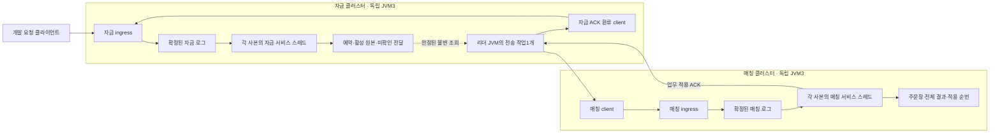

# #168 · 실제 Aeron 예약 주문 전달과 매칭 적용 확인

작성: 2026-11-03 · **상세 명세이며 제품 구현·새 테스트 실행 전**이다. 기준은 통합 브랜치 `feature/phase-2/integration`의 **`8d2572bfc98748f44569f5fecbaa8a7c47e87285`**(PR #173 병합)다. 문서 작업 브랜치는 `docs/aeron-order-bridge/168`이다. 기준 커밋과 이전 구현 HEAD `861763f`의 제품 tree는 같다.

관련: [#168](https://github.com/0Chord/coin-exchange/issues/168) · 상위 [#131](https://github.com/0Chord/coin-exchange/issues/131) · 설계 [#130](https://github.com/0Chord/coin-exchange/issues/130) · 선행 #164~#167 · 후속 [#169](https://github.com/0Chord/coin-exchange/issues/169).

이 파일이 명세 원본이다. README와 기존 #130 읽기 페이지 22절에서 연결하고 원격 이슈에는 핵심과 수용 기준을 반영한다. 별도 설계 문서 PR은 만들지 않는다. 아래의 신규 파일명·설정명은 구현 제안이고, 동작·한도·검증 경계는 구현 계약이다. 테스트 개수·성능·장애 보장으로 읽지 않는다.

## 1. 이번에 실제로 달라질 한 가지

**자금 클러스터에 예약한 주문이 별도 매칭 클러스터에 적용되고, 그 적용 확인을 자금 로그에 반영한 뒤 주문 전달 자료를 정리한다.** 자금과 매칭은 각각 독립 JVM 세 개다. 자금 리더 JVM 안의 별도 전송 작업이 두 클러스터 사이를 잇는다.

지금은 테스트가 `pendingDispatch()` → `ReservedMatchingState.apply()` → `acknowledgeMatchingApplied()`를 직접 호출한다. 이번에는 같은 코어를 실제 Aeron ingress·복제 로그·서비스 callback과 연결한다. 매칭의 결과를 자금에 돌려보내 정산하는 연결은 #169다. #168만으로 매칭·정산이 완주한다고 보고하지 않는다.

설명용으로 수량 scale0·수수료0, 사용자 quote1,000에 BUY6@100을 사용한다. 다음은 **앞으로 검증할 기대값**이다.

| 단계 | 자금 사용 가능 / 예약 | 매칭 상태 | 정리할 수 있는 것 |
| --- | --- | --- | --- |
| 자금이 주문 접수·예약 | 400 / 600 | 아직 없음 | 없음. 승인 원본·전달 의무 보존 |
| 전송 `offer` 성공 | 400 / 600 | 반영 여부 미확인 | 없음 |
| 매칭 로그에서 주문 적용 | 400 / 600 | 대기 주문1·사건1·결과1 | 자금에는 아직 미확인일 수 있음 |
| 적용 ACK를 자금 로그에서 반영 | **400 / 600 그대로** | 위 상태 그대로 | 해당 주문 전달 payload만 회수 |
| #169에서 전체 결과 정산 | 후속 범위 | 정산 확인 후 결과 payload 회수 가능 | 이번에 실행하지 않음 |

무체결 주문의 예약600·활성 원본은 전달 자료를 지워도 남는다. `matchingAppliedThrough=1`과 금융 `executedThrough=0`도 함께 관측한다. 최초 사용자 ACCEPTED 응답과 내부 매칭 적용 확인을 혼동하지 않는다.

## 2. 포함·유지·제외와 실행 제한

- 포함: 명시적 개발용 분리 실행, 역할별 실제 상태/adapter, 자금 리더 JVM의 전송 작업, 승인 원본/적용 ACK wire, 제한 조회·pipeline·재연결, 양쪽 기록을 사용하는 기본 재시작·snapshot 연결, 실제 3+3노드 정상·중복·ACK 유실 회귀와 자원 정리.
- 유지: 기존 INTEGRATED main·HTTP·wire v2/v3·snapshot·복구 identity, 단일 서비스 스레드 상태 소유, 기존 도메인 승인/매칭/정산 계산 규칙, 고정 배치와 정책, 유한 메모리와 같은 업무 identity 재전송.
- 일반 진입점의 FUNDS/MATCHING 차단은 유지한다. **명시적인 `ORDER_DELIVERY_DEV` 실행 모드**(이름 제안)만 한 방향 개발 연결을 허용한다. 이를 테스트 편의 gate로 구현하지 않고, 역방향이 준비되지 않은 실행의 업무 수용 범위를 나타내는 설정으로 둔다. 일반 HTTP 주문을 새 역할로 자동 전환하지 않는다.
- 제외: #169 결과 역전달·정산 ACK·결과 회수, 취소 #133, 다중 마켓 연결 #135, 복합 복원/포화 #134, 리더·과반 장애 전수 #136~138, 담당 이동, TPS·장기 부하, Kafka/RDB/RocksDB 원장 적재, 전체 원장 직접 대조.
- **사용자 결정으로 인증·인가·보안 구현을 전부 제외한다.** 새 Authenticator·CredentialsSupplier·principal 권한 검사·관리자 토큰·ACK MAC/서명·TLS를 추가하지 않는다. 일반 사용자 HTTP 인증도 건드리지 않는다.

## 3. 프로세스·스레드·상태 배치



그림 전체가 하나의 트랜잭션은 아니다. 매칭 적용은 매칭 로그에서, 자금의 전달 회수는 자금 로그에서 각각 확정한다. 네트워크 전송은 리더에서 시작하지만 각 클러스터의 업무 callback은 세 사본에 같은 순서로 반영된다.

- 자금: `TradingRoleAssembly.funds()`의 `BoundedFundingState`를 실제 소유자로 사용한다. 매칭 엔진·주문장을 만들지 않으며 접수 뒤 기존 integrated 내부 `Execution`을 발행하지 않는다.
- 매칭: `TradingRoleAssembly.reservedMatching()`의 `ReservedMatchingState`를 사용한다. 입력 중복 방지·결과 보존이 없는 `matching()` wrapper를 전달 수신 소유자로 대신 쓰지 않는다. 자금 잔고를 복제해 두지 않는다.
- 각 자금 노드는 전송 작업의 생명주기를 가지되 **복원/초기화 완료 후 현재 리더의 활성 세대에서만 송신**한다. 팔로워·재생 중·snapshot 중·종료 중에는 새 송신을 시작하지 않는다. `onStart()` 호출만으로 복원 완료를 판단하지 않는다.
- `onRoleChange`는 로컬 활성 세대를 게시하고 원격 연결을 기다리지 않는다. 전송 작업이 두 `AeronCluster` client의 offer/poll/keepalive/close를 단독 소유한다. 노드 MediaDriver를 재사용하며 전달 전용 JVM·컨테이너·별도 Driver를 추가하지 않는다.
- 리더 상실·재연결 때 로컬 세대와 미완료 조회를 무효화한다. 이미 네트워크에 나간 같은 원본이 겹칠 수 있고, 이를 같은 stream/dispatchSequence의 중복으로 처리한다. 리더 세대를 업무 lineage·ownershipEpoch로 재발급하지 않는다. 전체 장애 승계 보장은 후속 시험이다.

## 4. 최신 코드에서 확인한 사실과 변경 경계

경로는 저장소 상대 경로다. 줄은 위 기준 커밋의 읽기 위치이고 구현 때 다시 맞춘다.

| 현재 파일·심벌 | 확인한 사실 | #168의 책임 |
| --- | --- | --- |
| `domain-trading/.../TradingRoleAssembly.kt:98~135` | funds/reservedMatching 조립은 이미 별도이며 순수 메모리 | 실제 역할 노드에 연결. 새로운 계산 엔진을 구현하지 않음 |
| `domain-trading/.../TradingServiceRole.kt:10` | 기존 단독 역할 시작 차단 | 일반 차단 유지, 개발용 실행 정책은 app 경계에 명시 |
| `domain-trading/.../BoundedFundingState.kt:245~261` | 제한 전달 조회·typed ACK 입구 있음 | 서비스 소유 스레드에서 호출 |
| `domain-trading/.../FundsDispatch.kt:378~484` | 조회는 비소비, ACK는 payload만 회수 | cursor·예산·순번 계약 그대로 사용 |
| `domain-trading/.../ReservedMatchingState.kt:61~177` | 적용·중복·GAP·BUSY와 누적 ACK 있음 | 매칭 committed callback에 연결, 전체 결과는 노드에 보관 |
| `app-api/.../aeron/DevelopmentFundingNode.kt:158~203,425~447` | 현재 Node는 integrated 조립, 세 진입점에서 split 거절 | 별도 역할 bootstrap/adapter를 작게 연결. 단순 guard 해제 금지 |
| `app-api/.../aeron/DevelopmentFundingAdapter.kt:419~441,614~696,971~1012` | 접수 후 내부 실행, 제한 조회 큐, snapshot 중 조회 연기. role callback은 현재 no-op | 기존 통합 동작 유지. 제한 조회·생명주기 패턴만 재사용 |
| `app-api/.../codec/BoundedTradingCodec.kt:450~505`와 `proto/order_admission.proto` | schema87/version3, command20/reply21, 4,096byte | 별도 split schema·역할 명령 추가. 기존 wire를 재해석하지 않음 |
| `app-api/.../aeron/ClusterMessageOrigin.kt:9~41` | INTERNAL은 같은 cluster 서비스의 음수 session ID 검사 | 외부 relay client의 출처 검증으로 재사용하지 않음 |
| `app-api/.../history/FundsRoleSnapshotCodec.kt:55,100`, `MatchingRoleSnapshotCodec.kt:30,87` | 역할별 v2/v1 bytes와 framework 위치 검사 있음 | 실제 onTakeSnapshot/onStart 및 빈 owner 복원과 연결 |
| `app-api/.../aeron/DevelopmentFundingRun.kt:69~83,155~237` | 기존 기록은 identity·실행물/설정 exact match 필요 | split identity에 역할·배치·전송 한도 결속. 기존 integrated bytes 유지 |
| `app-api/src/test/.../DockerFundingReplicationTest.kt`, `test/docker/aeron-funding` | 이미지1회 준비·독립3노드·기록 볼륨·정리 기반 | 명령/이미지/정리 부분 재사용. 기존 harness 전체 추상화 금지 |

신규 제안 파일은 app-api의 `DevelopmentSplitTradingNode`, `FundsClusterAdapter`, `MatchingClusterAdapter`, `FundsOrderDeliveryAgent`, `SplitOrderDeliveryCodec` 및 `split_order_delivery.proto`다. 필요한 작은 설정/역할 snapshot helper는 같은 책임 아래 둔다. 도메인에 Aeron·Spring·네트워크·로컬 스레드·파일 I/O를 넣지 않는다. 한국어 주석을 사용한다.

현재 코드를 직접 읽을 입구: [역할 조립](../domain-trading/src/main/kotlin/com/exchange/core/trading/TradingRoleAssembly.kt), [자금 조회·ACK](../domain-trading/src/main/kotlin/com/exchange/core/trading/BoundedFundingState.kt), [전달 보관](../domain-trading/src/main/kotlin/com/exchange/core/trading/FundsDispatch.kt), [매칭 적용](../domain-trading/src/main/kotlin/com/exchange/core/trading/ReservedMatchingState.kt), [기존 노드](../app-api/src/main/kotlin/com/exchange/core/api/trading/infrastructure/aeron/DevelopmentFundingNode.kt), [기존 adapter](../app-api/src/main/kotlin/com/exchange/core/api/trading/infrastructure/aeron/DevelopmentFundingAdapter.kt), [복구 실행 경계](../app-api/src/main/kotlin/com/exchange/core/api/trading/infrastructure/aeron/DevelopmentFundingRun.kt).

## 5. 기동·고정 배치·복구 identity

1. 자원을 열기 전에 개발 모드·서비스 역할·lineage·전체 topology·자기 declaration·고정 마켓/수수료 context·전체 market ordinal·ownershipEpoch·configurationVersion을 검증한다. 같은 버전 숫자만으로 다른 설정을 허용하지 않는다.
2. 두 독립 member set·서로 다른 cluster 식별자·포트·응답 endpoint와 노드별 Driver/Archive/consensus 디렉터리를 검증한다. 다른 노드 또는 역할과 기록 경로를 공유하지 않는다.
3. 마켓 설정은 현재의 고정 버전 조회/manifest 공급을 재사용한다. 마켓을 코드에 추가하거나 RDB 설정 관리·배치표 공급 기능을 다시 만들지 않는다. 검증용 manifest 파일은 고정 실행물의 설정 자료이며 새로운 운영 설정 저장소를 도입한 것이 아니다.
4. split 실행 identity에는 protocol, role/topology/manifest, artifact/JDK identity, 도메인 한도·wire/relay 한도·연결 설정을 결속한다. 기존 integrated identity의 직렬화는 변경하지 않는다. 다른 실행물·설정을 옛 root에 맞춰 hash만 바꾸고 재생시키지 않는다.
5. 복구와 역할 초기화가 완료된 뒤 연결 정보를 확인하고 리더 작업을 활성화한다. 잘못된 역할/설정·복구 불일치는 통신·기록 경로 생성 전에 가능한 검사를 먼저 수행하고, 이미 연 자원이 있다면 자기 자원만 닫는다.

새 root에서는 개발 bootstrap client가 양쪽 ingress에 고정 구성과 결속한 `InitializeRole` 명령을 보내 각 committed callback에서 initialize를 완료한다. 그전에는 worker·Admit·Apply를 시작하지 않는다. 기존 기록 복구에서는 snapshot/과거 Initialize 로그로 복원하며 새 준비 자금이나 새 초기화 이력을 임의 주입하지 않는다. 개발 snapshot 제어는 RUNNING을 확인하고 요청한다. 초기화 전 직접 snapshot callback이 실행되면 명시 오류로 종료하고 정상 완료 snapshot을 꾸미지 않는다.

개발 모드에서도 자금 승인과 매칭 적용은 실제 서비스 callback을 사용한다. 기본 mode를 split으로 바꾸거나 일반 요청이 이 경로로 흘러들게 하지 않는다. #169 전에는 결과 보관 공간이 결국 차므로 유한 건수의 개발 실행만 허용한다.

## 6. 상태를 읽는 방법과 전송 작업

### 6.1 원본은 자금 상태, 로컬 큐는 한정된 읽기 요청

전송 작업은 `BoundedFundingState`·가변 Map·`Cluster`를 직접 읽거나 호출하지 않는다. 기존 제한 조회 패턴처럼 로컬 read 요청을 서비스 스레드로 넘기고, 서비스가 `pendingDispatch(stream, from, maxEntries, maxBytes)`의 **불변 batch**를 돌려준다. 이 큐·future·로컬 cursor는 복구 원본이 아니다.

`doBackgroundWork`에서는 짧은 순수 읽기와 로컬 응답 완료만 한다. replicated 업무 상태 변경·`Cluster.offer`·파일/DB I/O·원격 기다림을 넣지 않는다. snapshot 재진입 중에는 읽기를 미루고, 복구/종료·활성 세대 변경 시 늦은 결과를 폐기한다. 비어 있는 outbox를 확인하려고 매 poll마다 조회 명령을 복제 로그에 넣지 않는다. 전체 recoveryState를 복사해 보낼 목록을 만들지도 않는다.

로컬 future 완료에 붙인 동기 continuation이 서비스 스레드에서 네트워크 호출을 실행하지 않도록 한다. 완료 값은 worker가 자기 duty cycle에서 읽는다. 이를 위해 공용 thread pool이나 별도 무제한 callback 큐를 추가하지 않는다.

현재 `FundsDispatchRead`의 계약을 보존한다.

- `BATCH`: 비소비 읽기. tail의 정상 빈 batch도 가능하다. 다음 송신 cursor와 durable ACK는 별개다.
- `PRUNED`: source가 이미 로그에 반영한 확인 구간이다. 그 `matchingAppliedThrough` 직후로 다시 읽는다.
- `BATCH_TOO_SMALL`: requiredBytes를 확인한다. startup 한도 안의 단일 원본은 반드시 읽을 수 있어야 하고, 맞지 않으면 설정 오류다. 빈 성공을 무한 반복하지 않는다.
- `INVALID_QUERY/INVALID_STREAM`: 자동 순번 보정 없이 오류로 드러낸다. `Long.MAX_VALUE` 다음 cursor는 없음으로 처리하며 음수/0으로 감지되지 않게 wrap하지 않는다.

### 6.2 한 건 ACK를 기다리는 stop-and-wait를 만들지 않는다

같은 마켓의 조회 원본은 dispatchSequence 순서대로 offer한다. 여러 건을 제한된 in-flight 창에 넣고 두 client의 egress·keepalive를 계속 poll한다. 예를 들어 1·2·3을 보낸 뒤 ACK through3을 묶어 자금에 기록할 수 있다. 자금의 ACK 확정 전에는 조회·송신 진도만 전진한 것이다.

입력N이 BUSY/GAP인데 N+1 이후가 이미 in-flight라면 해당 stream의 새 송신을 멈추고 재시도 세대를 전환한다. 뒤쪽의 이전 세대 응답을 신규 완료로 사용하지 않으며, source 확정 prefix를 낮추지 않고 필요한 원본부터 다시 조회한다. 유효한 누적 ACK는 현재 요청 순번보다 클 수 있다. 이전 worker가 먼저 보낸 입력까지 matching에 적용돼 있을 수 있으므로 `ACK.through == 응답 correlation의 dispatchSequence`를 요구하지 않고 stream/context와 source의 확정 issued 상한을 대조한다.

초기 개발 기본값은 아래로 제안한다. 구현 시 startup 검증과 작은 경계 테스트를 함께 작성하며, 수치를 바꾸면 실행 evidence에 실제 값을 기록한다. 단위 간 차이를 무시하고 상한을 없애지 않는다.

| 자원 | 제안 기본값·의미 |
| --- | --- |
| 로컬 읽기 요청 큐 | 최대16개, worker의 미완료 조회는 한 번에1개 |
| 조회 batch | 최대64건·논리256KiB. read는 기존 도메인 charge 사용 |
| 미확인 송신 창 | 최대64건·실제 encoded frame 합512KiB, 작은 쪽에 먼저 제한 |
| 동시 client session | 각 split 클러스터 최대16개. 수신 재조립 버퍼는 transport 최대 메시지 길이와 이 세션 한도 안에 둠 |
| ACK 환류 | stream별 최대 through를 합쳐 16건 또는2ms 뒤 환류. idle/종료 전 가능한 즉시 flush |
| 단일 연결/요청 시도 | 최대3초 후 재연결/원본 재조회. 업무 실패나 예약 반환으로 바꾸지 않음 |
| 재연결/BUSY 대기 | 한 duty cycle에서 제한된 작업 후 poll. 재연결50ms, BUSY는1~20ms 범위 backoff |
| 종료 | 최대5초 안에 worker·두 client·local futures 종료. 잔여 의무는 source에 남음 |

in-flight는 건수와 bytes를 모두 제한한다. ACK는 stream마다 하나의 누적 경계로 합치며 미확인 ID Map·future·diagnostic 목록을 무기한 추가하지 않는다. 대상 마켓은 설정에서 얻고 ticker를 분기문에 하드코딩하지 않는다. 실제 다중 마켓 통합 시험은 #135로 남긴다.

## 7. wire와 응답의 의미

Protobuf를 유지한다. **신규 split schema88/version1, command kind1/reply kind2**를 사용하고 8byte little-endian `bodyLength/kind/schema/version` 헤더를 둔다. 기존 schema87 v2/v3의 종류·길이·bytes와 decoder 수용 범위는 유지한다. split decoder는 다른 schema/역할 명령을 자동 변환하지 않는다.

최대 frame은 헤더 포함32KiB다. 본문 길이·offset·unknown field/enum·필수 필드·반복 건수·문자열/수치 범위를 제한한 뒤 도메인 값으로 변환한다. 정상 단일 dispatch의 최악 encoded 크기가 이 한도와 transport 최대 크기 안에 들어가는지 시작 전에 확인한다. 실제 transport 가능 길이에서 Aeron session header도 고려한다. 논리 `dispatchCanonicalBytes`를 wire 길이라고 쓰지 않는다.

| 메시지 | 필수 내용·반환 |
| --- | --- |
| `DescribePeer` | correlation, 기대 role/lineage/topology 지문. 응답은 실제 role/lineage·protocol·고정 배치/설정·상한 지문과 상태 |
| `InitializeRole` | 고정 role/manifest/topology 지문. 각 역할의 committed callback에서 초기화하며 같은 구성이면 멱등, 다르면 거절 |
| `ApplyReservedOrder` | correlation + 전체 `FundsOrderDispatch`: 양쪽 lineage·market·방향·ownershipEpoch·configurationVersion, dispatch/admission/marketAdmission 순번, 주문·초기 예약·고정 context |
| `MatchingAppliedReply` | correlation·상대 role/배치 식별·상태. APPLIED/DUPLICATE/PRUNED에 typed `FundsMatchingAppliedAck`, GAP에 expectedSequence. 전체 매칭 결과는 보내지 않음 |
| `RecordMatchingApplied` | correlation + 검증한 fixed peer 정보와 typed ACK. 자금 ingress의 확정 callback에서만 core ACK 호출 |
| `MatchingAckRecorded` | source 적용 위치·현재 matchingAppliedThrough·ACK 상태. 이 응답 유실도 원본/확정 prefix에서 재개 |
| 개발 제어 명령 | 기존 Initialize/Funding/Rotate/Admit 변환을 가능한 재사용. split funds에는 integrated Execution 금지, matching에는 자금 제어 금지 |

correlation은 응답과 in-flight 시도를 연결하는 휘발성 번호다. 업무 중복 방지는 기존 stream identity와 dispatchSequence로 하며 재접속에서 주문 ID·승인 순번을 바꾸지 않는다. 기술 이름·Protobuf field 번호의 배치는 구현자가 조정할 수 있지만 명령 의미와 기존 wire 분리는 유지한다. 원문은 JSON/스냅샷 blob으로 우회하지 않고 typed Protobuf 필드로 표현한다.

Aeron offer의 fragmentation을 사용하고 egress 재조립을 확인한다. 한 frame이 MTU보다 커도 완결 후 한 명령으로만 decode한다. application frame32KiB에 Aeron session header32byte가 추가되며 단편 수는 실제 `maxPayloadLength`로 계산한다. MTU1408·data header32라면 payload1376으로 최대24단편이다. 실제 MTU/term/최대 메시지/세션 수를 실행 기록에 담는다. `tryClaim`의 단편 크기를 전체 메시지 상한으로 가정하지 않는다. 제한 밖·잘린 바이트는 도메인 함수를 호출하지 않고 오류로 드러내며 성공 ACK를 만들지 않는다.

## 8. ACK를 자금 로그에 반영하는 전체 순서

1. worker가 현재 리더 세대의 자금 미확인 batch를 읽는다. 연결 상대의 고정 endpoint·role·lineage·topology/설정 지문을 대조한다.
2. 매칭 ingress에 같은 승인 원본을 offer한다. `offer > 0`은 client가 전송을 수락한 것일 뿐, 주문 적용 증거가 아니다.
3. 매칭 서비스가 확정 callback에서 `ReservedMatchingState.apply(input)`를 호출한다. 주문장·결과·입력 prefix가 함께 정상 반영된 뒤 **작은 typed ACK**만 응답한다. follower의 mocked offer 양수도 외부 전송/정산 증거로 사용하지 않는다.
4. worker가 예상한 연결·correlation·stream/context·순번과 응답 종류를 대조한다. 잘못 연결된 상대·다른 설정·음수/미래 ACK를 source 회수로 전달하지 않는다. 이 검사는 아래 신뢰 모델 안의 구조 검사다.
5. worker가 별도 funds client로 `RecordMatchingApplied`를 source ingress에 제출한다. 로컬 큐에서 `acknowledgeMatchingApplied()`를 실행하지 않는다.
6. 자금 서비스의 확정 callback에서 `acknowledgeMatchingApplied(ack)`를 호출한다. core가 `through <= issued`·context·연속 구간을 검사한 뒤 payload와 dispatch 예산만 회수한다. source의 금융 예약·활성 원본·사용자 receipt는 유지한다.
7. ACK 기록 응답 또는 다음 로컬 조회의 확정 prefix로 source 진행을 확인한다. 이 응답이 유실되면 재조회·동일 ACK 재전송이 가능하다. 작은 과거 ACK가 큰 확정 경계를 낮추지 않는다.

반영 위치는 클러스터별로 다르다. funds의 logPosition과 matching의 logPosition을 숫자로 대소 비교해 업무 완료를 판단하지 않는다. source에 ACK를 기록하기 전 `nextSequence`나 원격 응답만으로 source payload를 먼저 삭제하지 않는다.

### 8.1 이번 실행의 신뢰 모델 — 보안 구현 없음

사용자 요청대로 격리된 개발 네트워크와 그 안에서 시작한 프로세스를 신뢰한다. 고정 endpoint·role·lineage·전체 context/지문 검사는 오배치·다른 설정·순번 오류를 찾지만 **상대 인증이나 ACK 위조 방어를 제공하지 않는다.** 같은 개발망에 악의적 client/server가 있거나 전송망이 위조되는 경우를 막았다고 보고하지 않는다. 기존 Aeron 기본 인증 설정을 강화하지 않는다.

새 역할을 공용망·일반 주문에 열지 않는다. 원격 출처의 보안 보장은 인증 작업에서 별도로 상세화한다. 사용자 결정으로 원래 등록 본문의 ‘실제 출처 검증’ 중 **보안적 진위 확인은 이번 완료 조건에서 제외**하고, 고정 peer/업무 identity 대조와 로그 확정은 유지한다. #130의 고정 배치·중복·ACK 적용 규칙을 폐기한 것은 아니다.

## 9. 재전송·BUSY·오류 후 남는 상태

| 상황 | 다음 행동 | 바꾸지 않는 것 |
| --- | --- | --- |
| BACK_PRESSURED/ADMIN_ACTION/일시 NOT_CONNECTED | 양쪽 poll/keepalive를 진행하며 같은 원본 재시도. 시도 한도 후 재연결 | 승인 identity·예약·source 전달 의무 |
| CLOSED/MAX_POSITION_EXCEEDED | 새 client 연결·peer 확인·source 확정 prefix 재조회 | 새 업무 ID 발급/자동 성공 없음 |
| matching APPLIED/DUPLICATE/유효 PRUNED | 누적 ACK를 source 로그에 제출 | 중복 매칭·재예약 없음. PRUNED를 원문 동일성 확인으로 말하지 않음 |
| matching GAP | expectedSequence부터 source 원본을 재조회 | 누락 건너뛰기·미래 명령 성공 없음 |
| expectedSequence가 source에서 이미 회수된 구간 | 해당 stream 전달 중단·복구 위치 불일치 보고 | 임의 새 주문 생성·순번 점프·예약 반환 없음. 복합 복구 #134 |
| matching BUSY | 앞 미확인 원본 유지·제한 backoff. 다른 제어/ACK 처리는 계속 | 최종 거절/적용 ACK로 변환하지 않음 |
| CONTENT_CONFLICT/INVALID_STREAM/INVALID_INPUT | 해당 stream을 오류로 드러내고 정상 재시도와 구분 | 잘못된 입력을 성공 또는 정상 최종 거절로 보정하지 않음 |
| SEQUENCE_EXHAUSTED | 진행 불가로 드러내고 정상 무한 재시도를 중단 | 성공 ACK·순번 wrap·예약 반환 없음. 원본 유지 |
| 매칭이 영구 용량 초과를 NOT_EXECUTED로 확정 | 입력 적용 ACK는 source에 반영 가능. 결과는 matching에 보관 | 이번에는 예약 반환 없음. 전체 결과의 순차 정산은 #169 |
| 매칭 응답 유실 또는 source ACK 제출 전 종료 | source 미확인 원본으로 재전송 | matching의 기존 적용·결과를 반복하지 않음 |
| source ACK 확정 뒤 응답 유실 | source prefix 재조회 또는 같은 ACK 제출 | 회수한 payload를 되살리지 않음 |
| node/worker 종료·자원 상한 초과 | 자기 연결/자원 종료, 의무는 source 기록에 남음 | 시간 초과만으로 돈을 풀거나 세 노드 전체 종료를 업무 정책으로 추가하지 않음 |

연결의 시도 횟수·시간은 로컬 liveness 제어다. `System.nanoTime()`은 한 JVM의 timeout/backoff에만 쓰고 클러스터 간 업무 순서·만료·영구 거절에 쓰지 않는다. 무한 메모리 대기 큐 대신 source 도메인의 미전달/활성 상한이 신규 접수를 제한한다.

#169 전에는 matching 결과 공간이 차면 BUSY가 유지되는 것이 정상이다. 이를 풀기 위해 `MatchingFundsSettledAck`를 꾸미거나 결과 조회를 소비성 삭제로 바꾸지 않는다. 전송 worker는 서비스 상태를 막지 않으며, 연결이 끊겨도 자금의 다음 접수 판단·조회·snapshot은 처리되어야 한다.

## 10. 실제 기록·snapshot·재시작

양쪽 역할 adapter가 `onTakeSnapshot`/`onStart`를 기존 역할 codec에 연결한다. 자금은 `fundsRecoveryState`/`restoreFundsRecoveryState`, 매칭은 `recoveryState`/`restore`를 사용하고 framework 위치·고정 설정·의미 검증을 유지한다. 초기화 전 snapshot은 정상 자료로 만들지 않으며 snapshot을 적용할 빈 owner를 먼저 준비한다. 다른 클러스터의 snapshot을 읽거나 서로의 logPosition을 같게 맞추지 않는다.

- 자금 snapshot에는 승인/예약·미확인 원본·matchingAppliedThrough와 #167 금융/결과 경계를 담는다. ACK 전 복구면 원본 재전송, ACK 후 복구면 회수 유지와 활성 hold 유지가 기대값이다.
- 매칭 snapshot에는 주문장·활성 원본·입력 prefix·미정산 전체 결과를 담는다. ACK 유실 후 복구한 같은 주문은 재매칭하지 않고 기존 적용 prefix를 ACK한다.
- snapshot 다음에 남은 자기 Archive 로그를 replay해 현재 상태에 도달하고 그 뒤에만 worker를 활성화한다. replay 중 원격 송신·임의 준비 자금·새 순번을 만들지 않는다.
- 실제 시험의 Archive/Consensus/recording-index sync 수준은 모두2로 고정하고 READY 및 보고서에서 실제 값을 대조한다. `LOCAL_QUORUM`과 개별 디스크 강제 반영·전체 디스크 유실 내구성을 동일한 보장으로 표현하지 않는다.
- 재시작은 최초 기동 전에 동결한 같은 실행 이미지/JDK/manifest와 **같은 기록 볼륨·root**를 사용한다. 복구 중 재빌드하거나 identity를 수정하지 않는다. 기존 harness의 archive/cluster 부분 복사만으로 완전한 복구 root라고 말하지 않는다.
- 기본 전체 로그 재시작과 snapshot+tail 재시작을 구분해 evidence를 남긴다. 두 클러스터를 서로 모순된 과거 위치로 복원해도 자동 수리된다는 보장은 #134다.

## 11. 독립 수용 사례 — 앞으로 실행할 검사

아래 G 번호는 테스트 수가 아니다. 코덱/worker 단위와 실제 runtime/6노드 검증에 나누되 핵심 실제 네트워크·로그 경계를 단위 대역으로 대체하지 않는다. 기준 예시는 quote1,000·scale0·수수료0·BUY6@100이고, 다른 금액은 사례 안에 명시한다.

| ID | 준비 → 실행 | 직접 대조할 기대값·금지할 변화 |
| --- | --- | --- |
| G1 | 일반 main/env/direct start에서 FUNDS/MATCHING 요청 | 기존대로 자원 생성 전 거절. 명시 개발 진입만 독립3+3 허용 |
| G2 | 잘못된 role/lineage·마켓/정책·중복 경로·상한 | startup 오류. 기존 기록/sentinel 훼손·부분 기동 성공 없음 |
| G3 | 단일 BUY6@100을 실제 전달 | 자금400/600, matching book1/engine1/result1/applied1. source ACK 확정 후 dispatch0/active1/executed0/resultThrough0 |
| G4 | 입력1 뒤 BUY2@100 추가, 시험 listener가 matching ACK1을 보류한 동안 입력2 전송 | ACK1 미수신 중 입력2의 offer·matching 로그 적용을 직접 관측. 최종 자금200/800, matching book2/engine2/result2·순서1→2. stop-and-wait 구현은 이 검사를 통과하지 못함 |
| G5 | 매칭 적용 뒤 ACK를 시험에서 유실·원본 재전송 | book/engine/result는1 그대로, DUPLICATE·ACK1 재생성. 추가 예약0 |
| G6 | matching ACK 수신 뒤 source 로그 반영 전 worker/노드 종료 | 복구한 source dispatch1에서 재전송, 재매칭0, ACK 확정 후 dispatch0·hold600 |
| G7 | source ACK 확정 뒤 응답 유실·동일 ACK 재전송 | matchingAppliedThrough1·dispatch0·active1·400/600 유지 |
| G8 | ACK1→ACK2 뒤 늦은 ACK1 | 경계2 유지. 잘못된 stream/context·음수·issued 초과 ACK는 무변경·정상 회수 없음 |
| G9 | source에 입력1·2가 있는데 빈 matching에 입력2 선도착 | GAP expected1·ACK 없음·engine0. 원본1→2 재전송 뒤 engine2 |
| G10 | 결과 보관1건 한도에서 두 번째 입력 | BUSY·성공 ACK 없음·source 두 번째 payload/예약 유지. 가짜 정산/결과 삭제 없음 |
| G11 | active cap1, 결과 공간 충분, 두 번째 비체결 주문 | matching NOT_EXECUTED 결과2·적용 ACK2, engine1 유지. source payload 회수 후에도 두 예약 유지, 반환은 #169 |
| G12 | read batch가 첫 원본보다1byte 부족 | requiredBytes 확인·설정 오류/한도 내 재조회. 무한 빈 성공 없음. 조회만으로 payload/hold 무변경 |
| G13 | 같은 업무 identity의 다른 내용·틀린 정책/원본 | CONTENT_CONFLICT/INVALID_INPUT 등 오류. book·자금·prefix를 성공으로 바꾸지 않음 |
| G14 | 다른 honest peer/설정 연결·기대하지 않은 응답/correlation | 고정 배치/응답 대조 실패·source 회수 없음. 악의적 동일 모양 위조 차단을 검증했다고 쓰지 않음 |
| G15 | UTF-8 경계·최대 정상 단일 원본·MTU 초과 frame·잘린/초과 길이·마지막 순번 | 정상은 재조립 뒤1회 적용, 잘못된 bytes는 도메인 효과/성공 ACK0. SEQUENCE_EXHAUSTED/nullable cursor와 마지막 Long 보존, v2/v3 golden bytes 불변 |
| G16 | 연결 단절·연속 backpressure·queue/in-flight 상한 | 양쪽 poll·자금 접수 판단/조회 진행, 메모리 상한 유지. timeout 반환0. 통신 실패만으로 임의 제한하지 않고 기존 미전달·활성·pending·inbox 등 도메인 한도를 유지 |
| G17 | snapshot/역할 상실 중 늦은 local read·reply | stale 세대로 source 진행을 꾸미지 않음. follower/replay 신규 송신0. 이미 전송된 중복은 효과1회 |
| G18 | source ACK 전/후 각각 자기 Archive로 재기동 | 전은 dispatch1 재전송, 후는 dispatch0 유지. 양쪽 모두 hold600·active1·금융 executed0 |
| G19 | matching 입력1을 snapshot에 담고 입력2를 로그 tail에 적용한 뒤 ACK 유실·재시작 | book2/engine2/result2 복원. 입력1·2 재전송은 추가 효과0, 새 입력3만 engine3으로 진행. snapshot 위치 뒤 명령의 실제 tail 재생 근거 포함 |
| G20 | funds snapshot 뒤 ACK 로그 tail을 남기고 재시작 | codec 위치·재생 완료 뒤 source ACK prefix/dispatch/hold 복원. worker는 replay 중 송신하지 않음 |
| G21 | 다른 artifact/JDK/topology/한도 또는 손상 snapshot/root | 복원 거절·새 빈 상태로 자동 재개 없음. 정상 동결 실행물 복구와 대조 |
| G22 | 정상/실패 실행을 끝냄 | 실제6노드·이미지·network·volume 식별, sync2/2/2와 상태/로그 위치 근거, 자기 자원 정리 결과를 기록 |

기본 예시의 서로 다른 클러스터 각 세 사본에서 독립 기대값을 대조한다. “리더 응답 하나가 왔다”를 세 사본 일치로 보고하지 않는다. 입력1을 재전송해도 자금400/600과 matching book1이 유지되는 이유는 생성 코드를 복사한 기대값이 아니라 예약600·무체결1건이라는 업무 규칙이다.

## 12. 검증 수준·자원·보고

코덱/한도·stale 세대·ACK 병합/재시도 단위 검사는 실제 문자열·수치 경계와 기존 코어를 사용한다. 제품 callback에 test gate·테스트 관찰 큐·ACK 유실 옵션을 넣지 않는다. 유실·종료 제어와 사본 캡처는 test 소스의 외부 제어/시험 listener·wrapper에서 수행하고 실제 adapter/worker/클라이언트 경로를 우회하지 않는다. 유실 구간을 증명하지 못하면 그 사례는 미검증으로 남긴다.

실제 통합은 기존 Docker 실행물을 한 번 stage/build해 재사용한다. 한 internal bridge, 자금3·매칭3의 독립 컨테이너/JVM·member set·record volume·Driver를 사용한다. 시험 요청 client/Gradle JVM은 여섯 복제 노드에 포함하지 않는다. 별도 운영 relay 컨테이너는 없다. CPU/memory/heap/디스크 실제 제한을 보고한다.

- 개발 fixture 초기 제안: 노드 heap256MiB·컨테이너768MiB로 작은 유한 데이터를 사용한다. 기동이 불가능하면 측정 근거를 남겨 명시적으로 조정하며 제한을 제거하거나 메모리 문제를 업무 거절로 숨기지 않는다. 성능 권장치가 아니다.
- 기동 전 호스트 여유8GiB 확인, 한 run 기록 예산2GiB·요약 진단물16MiB·회전 로그 상한을 둔다. 단일 기능 통합 실행은8분, 기동/복구 단계는90초 상한을 제안한다. 부하 지속 시험을 추가하지 않는다.
- 실제 재시작에 필요한 볼륨은 시험 도중 유지한다. 끝나면 성공/실패 모두 run-owned 컨테이너·볼륨·네트워크·임시 이미지만 정리한다. 전체 Docker prune·다른 run/사용자 자료 삭제는 금지한다.
- 보고서는 기존 CI가 수집하는 경로 아래 `app-api/build/reports/aeron-funding/order-delivery/<runId>/result.json`(제안)에 base/head와 제품 파일 지문, 고정 실행 이미지/JDK/manifest, 양쪽 설정·한도·실제 pid/주소/볼륨, 역할/리더, 사례별 사본 값·자기 로그/snapshot 위치, 재전송 전후, 미검증·정리 실패를 담는다. bounded 진단 추출물을 완전한 재생 root라고 표현하지 않는다.
- 기존 PR CI의 Build and test에서 새 test를 함께 실행한다. 새 job·별도 부하 stage·CI용 숨은 skip을 만들지 않는다. 필요한 Docker가 없으면 미검증/실패이며 단위 검사만으로6노드 성공 처리하지 않는다.

제안하는 새 테스트 이름은 `SplitOrderDeliveryCodecTest`, `FundsOrderDeliveryAgentTest`, `SplitTradingRoleStartupTest`, `SplitTradingRoleRecoveryTest`, `DockerFundsOrderDeliveryTest`다. 실제 파일/클래스가 아직 있는 것은 아니다. 필수 변경 영향에 맞춰 기존 core·snapshot·startup·HTTP 회귀와 architecture/형식 검사를 실행한다.

```bash
cd "$(git rev-parse --show-toplevel)"
./gradlew :domain-trading:test :domain-matching:test :app-api:test --tests '*SplitOrderDeliveryCodecTest' --tests '*FundsOrderDeliveryAgentTest' --tests '*SplitTradingRoleStartupTest' --tests '*SplitTradingRoleRecoveryTest' --tests '*DockerFundsOrderDeliveryTest' --tests '*FundsRoleSnapshotCodecTest' --tests '*FundsResultSnapshotCodecTest' --tests '*MatchingRoleSnapshotCodecTest' --tests '*TradingRoleStartupTest' --tests '*BoundedHttpTradingClusterTest' :architecture-tests:test :architecture-tests:verifyArchitectureReport ktlintCheck --no-daemon --max-workers=1 --console=plain
```

위는 구현 후 사용할 **예상 명령**이며 이번 명세 작업에서 실행하지 않았다. Java25와 실제 테스트 클래스명/의존 task를 구현 때 확인한다.

## 13. 한 작은 PR의 구현 순서와 완료 조건

하나의 책임은 ‘실제 예약 원본 전달 → 매칭 업무 적용 → source 로그 ACK/회수’다. 이 책임에 필요한 역할 bootstrap·wire·worker·기본 복원만 같은 PR에 둔다.

1. 첫 작은 결과: 승인된 `FundsOrderDispatch`와 typed ACK를 기존 도메인 값 그대로 encode/decode하고 길이·다른 schema·필수 원본 오류를 잡는 사례 G13~15. 신규 wire가 기존 bytes를 바꾸지 않는지 먼저 확인한다.
2. 역할별 실제 owner/adapter와 명시적 개발 시작, lifecycle·snapshot/로그 연결. 통합 시작 차단·기존 실행물 복구 규칙을 먼저 회귀한다.
3. 한정 local read → matching client → funds ACK client의 worker. canonical source 조회·pipeline·세대 변경·ACK 유실을 작은 검사로 검증한다.
4. 같은 동결 이미지의 실제3+3노드 정상 전달·중복/ACK 전후·기본 snapshot+tail 재시작을 실행하고 모든 run 자원을 정리한다. 기존 통합 HTTP 회귀는 경로 유지 검사이며 새 HTTP 연결 시험이 아니다.

완료는 G1~G22의 해당 검사/실제 실행 evidence, 두 역할 각 세 사본의 기대값, source payload 회수 후 hold 유지, 독립 리뷰의 결함 처리, 자원 정리와 미검증 공개로 판단한다. green 테스트 수만으로 무제한 HA·보안·성능·정산 완주를 주장하지 않는다. #169의 후속은 같은 코어 결과를 반대로 전달하고 정산 ACK를 matching 로그에 반영하는 것이다.

## 14. 채택한 설계 결정

| 결정 | 채택 범위와 반영 |
| --- | --- |
| 전달 담당은 자금 리더 JVM 안의 별도 전송 작업 | 서비스 스레드는 원격 응답을 기다리지 않고 source 원본은 자금 클러스터가 보관한다. 팔로워는 새 송신을 하지 않는다. 3·6절 및 G16~17에 반영했다. |
| 인증·인가·보안 구현 제외 | 이번 연결과 함께 보안 범위를 확대하면 복잡해진다는 판단에 따라 내부 자격·세션 권한·서명·TLS와 사용자 HTTP 인증을 구현하지 않는다. 2·8.1절과 G14에 반영했다. 고정 설정/순번 대조를 상대 인증이나 위조 방어로 확대하지 않는다. |

두 결정은 상세 명세 단계에서 합의한 범위이며 구현·리더 장애 시험 완료를 뜻하지 않는다. 이 문서는 공개 검토에 필요한 채택 계약을 유지하고 개인 대화 원문은 포함하지 않는다.

## 15. 확인 상태·공식 근거·남은 한계

**확인:** 최신 원격 통합 HEAD/PR #173 병합, #168·#169·#130·#131 본문과 선행 책임, 현재 실제 코드·테스트·Gradle/Docker 구성, Aeron1.53.3 소스의 callback·client·기본 인증 범위를 읽었다. 서로 다른 읽기 전용 검토자가 runtime/복구, wire/client, 코어·수용 사례를 각각 대조했다. 이는 명세 검토이며 구현 독립 리뷰·새 실행 성공이 아니다.

**새 합의:** 리더 JVM 내 별도 전송 작업, 보안 구현 제외. **구현자가 조정할 기술 제안:** 파일/설정명, 내부 helper·Protobuf field 번호와 상한의 실제 기본값. 변경하면 이 원본과 실제 경계 검사를 함께 갱신한다.

**명세 교차 검토 후 보완:** pipeline은 ACK1을 보류한 동안 입력2가 실제 전송/적용되는지 관측하도록 G4를 강화했다. 매칭 snapshot 뒤 입력2를 tail에 남기는 G19, 기존 활성/pending/inbox 접수 한도 유지, 순번 소진의 비재시도 처리, 초기화 전 snapshot 정책, CI가 실제 수집하는 보고서 경로를 명확히 했다. 동기 future continuation의 서비스 스레드 통신 금지와 누적 ACK의 재연결 의미도 보완했다. 각 검토자는 파일을 읽었고 제품 변경·테스트 실행은 하지 않았다. 수정된 수용/복구 항목의 재확인에서 구현을 막는 미결정은 보고되지 않았다.

- [Aeron1.53.3 ClusteredService](https://github.com/aeron-io/aeron/blob/1.53.3/aeron-cluster/src/main/java/io/aeron/cluster/service/ClusteredService.java): background callback은 짧은 비업무 상태 작업을 위한 경계이며 서비스 상태 변경·Cluster.offer를 여기서 실행하지 않는다. 이 근거로 local read와 ACK ingress 환류를 구분한다.
- [Cluster clients 공식 가이드](https://aeron.io/docs/aeron-cluster/cluster-clients/), [AeronCluster1.53.3](https://github.com/aeron-io/aeron/blob/1.53.3/aeron-cluster/src/main/java/io/aeron/cluster/client/AeronCluster.java): client 소유·poll/keepalive·전송/재조립 동작의 근거다. 전송 수락을 업무 적용으로 바꾸지 않는다.
- [ClientSession1.53.3](https://github.com/aeron-io/aeron/blob/1.53.3/aeron-cluster/src/main/java/io/aeron/cluster/service/ClientSession.java), [DefaultAuthenticatorSupplier1.53.3](https://github.com/aeron-io/aeron/blob/1.53.3/aeron-client/src/main/java/io/aeron/security/DefaultAuthenticatorSupplier.java): follower의 응답 offer와 기본 허용 인증 설정의 범위를 확인했다. 이번 명세가 인증을 구현했다고 표현하지 않는다.

**미검증:** 신규 wire/runtime/worker/6노드·snapshot/replay·ACK 유실·리더 제어·실제 자원/시간 상한. 이번에는 제품 코드·테스트·성능·PR·병합·이슈 종료·보드 상태를 바꾸지 않는다. 명세 문서/읽기 화면과 원격 #168 본문 갱신을 구현 완료로 세지 않는다.
