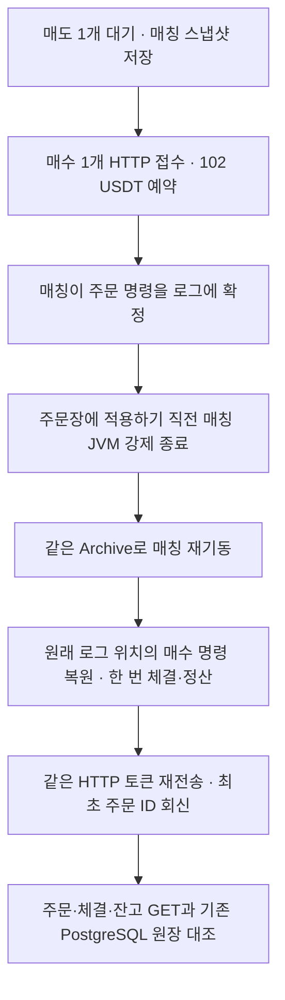

# #67 · 매칭 로그 확정 직후 강제 종료 복구 검증

기준은 `feature/phase-3/integration`의 `603a778`이다. [#220](https://github.com/0Chord/coin-exchange/pull/220)이 검증한 실제 JVM·HTTP·PostgreSQL 구성을 재사용한다. [#67](https://github.com/0Chord/coin-exchange/issues/67)의 선행 #54·#65·#66은 완료됐다. [통합 커밋](https://github.com/0Chord/coin-exchange/commit/603a778180a0d6b667914b88ee860b5015792843)

## 주문이 어떻게 이어져야 하나

매도 1개가 대기 중일 때 매수 1개를 접수한다. 자금 엔진은 돈을 예약하고 주문을 매칭에 전달한다. **매칭 로그의 주문 명령이 확정되고 Archive에 기록된 뒤, 주문장에 적용하기 직전**에 매칭 JVM을 한 번 강제 종료한다. 이때 자금에는 예약과 최초 접수 결과가 남아 있고, 주문장을 바꿔야 생성되는 적용 응답과 체결 결과는 아직 없다.



자금·WAS와 PostgreSQL은 계속 실행한다. 매칭만 같은 멤버·마켓·설정·Archive와 클러스터 기록으로 다시 기동한다. 자금의 기존 전달 작업이 연결을 회복하면 이전 주문을 재전송할 수 있다. 그래서 **복원된 매칭이 새 전송보다 먼저, 강제 종료 직전에 기록된 원래 위치에서 그 주문을 적용했다는 증거**가 필요하다. HTTP 재전송은 기존 거래가 정산·조회에 반영된 뒤 실행해, 사용자의 재호출이 복구를 일으킨 것처럼 보일 가능성을 없앤다.

## 이 지점을 고른 근거

| 기존 검증 | 확인한 경계 |
| --- | --- |
| #187 · 자금 리더 장애 | 예약이 확정된 뒤 주문 전달 전 자금 리더를 종료하고, 새 리더가 최초 응답과 예약을 유지해 전달을 이어갔다. [#54 완료 근거](https://github.com/0Chord/coin-exchange/issues/54) · [#187](https://github.com/0Chord/coin-exchange/pull/187) |
| #186 · 매칭 리더 장애 | 매칭으로 주문을 보내기 전 리더 종료, 체결 후 결과 송신이 보류된 상태의 리더 종료를 각각 검증했다. [#186](https://github.com/0Chord/coin-exchange/pull/186) · [두 중단 지점](https://github.com/0Chord/coin-exchange/blob/603a778180a0d6b667914b88ee860b5015792843/app-api/src/test/kotlin/com/exchange/core/api/trading/infrastructure/aeron/MultiMatchingLeaderFailoverTest.kt#L18-L62) |
| #174·#183 · 역할별 장애와 복구 | 동일 기록 재생, 누락 응답·정산 ACK, 역할별 정상 중단 뒤 재개를 확인했다. [#174](https://github.com/0Chord/coin-exchange/pull/174) · [#183](https://github.com/0Chord/coin-exchange/pull/183) |
| #220 · 정상 종료 | WAS·자금·매칭의 정상 종료 뒤 동일 기록에서 잔량 체결·취소, 동일 토큰 재전송을 실제 HTTP와 원장으로 확인했다. [검증 기록](https://github.com/0Chord/coin-exchange/blob/603a778180a0d6b667914b88ee860b5015792843/engineering/gtc-server-restart-spec-66.md) |

이번 시험은 한 마켓, WAS 1개, 자금·매칭 각 1노드, `sync=2`에서 위 확정 직후 한 지점만 다룬다. 이전 이슈의 SQL 커밋 경계는 현 Aeron 구조의 기록·적용 경계로 읽는다. 매칭 로그 확정 전 중단은 이번 선택 밖에 둔다. 정산 도중 중단은 [#68](https://github.com/0Chord/coin-exchange/issues/68), 취소 반환 도중 중단은 [#69](https://github.com/0Chord/coin-exchange/issues/69), 반복 복구·불일치 차단은 [#70](https://github.com/0Chord/coin-exchange/issues/70)의 범위다. 리더 선출, PostgreSQL 장애, 성능 측정을 이번 사례에 추가하지 않는다.

## 어떻게 그 순간에 끊는가

1. **시험이 대상을 특정한다.** 기존 #220의 초기 지급과 마켓·수수료 설정을 사용한다. 매도 1개가 대기하고 자금이 매칭 결과 1번까지 확인한 뒤 매칭 스냅샷을 저장한다. 다음 전달 순번에서 멈추도록 설정한 뒤 기존 HTTP API로 매수 1개를 보낸다. `202`의 주문 ID·접수 순번을 보관하고, 멈춘 명령의 주문 ID와 대조한다.
2. **매칭의 실제 적용 직전에서 멈춘다.** Aeron은 확정 위치까지 서비스에 메시지를 전달하고, 호출하기 전에 그 메시지의 로그 위치를 설정한다. 기존 실행기의 서비스 래퍼를 시험 프로세스에서만 사용한다. 대상 마켓·매수 주문 ID·전달 순번에 해당하는 단건 또는 배치 주문을 가려내고, 그 프레임의 끝 위치 `P`를 남긴 뒤 실제 주문장 적용 전에 멈춘다. 초기화, 스냅샷, 조회나 다른 명령은 그대로 통과한다. [Aeron 확정 로그 읽기](https://github.com/aeron-io/aeron/blob/1.53.3/aeron-cluster/src/main/java/io/aeron/cluster/service/ClusteredServiceAgent.java#L262-L270) · [Aeron의 위치 설정과 서비스 호출](https://github.com/aeron-io/aeron/blob/1.53.3/aeron-cluster/src/main/java/io/aeron/cluster/service/ClusteredServiceAgent.java#L485-L499) · [기존 시험 관찰 예](https://github.com/0Chord/coin-exchange/blob/603a778180a0d6b667914b88ee860b5015792843/app-api/src/test/kotlin/com/exchange/core/api/trading/infrastructure/aeron/ArchiveReplayCluster.kt#L184-L201)
3. **상위 테스트가 증거를 본 뒤 강제 종료한다.** 현재 매칭 PID에 연결된 동일 기록에서 `스냅샷 위치 < P`, `확정 위치 ≥ P`, `Archive 기록 위치 ≥ P`, `서비스 적용 위치 < P`를 각각 확인한다. 자금의 기존 진행 조회에서 주문 전달 발행은 2번, 정산은 1번까지여야 한다. 이 조건에서만 실제 프로세스를 강제 종료한다. 이전 PID 종료를 확인하고, 정상 종료 절차를 거치지 않았음을 기록한다. 조건을 관찰하지 못하거나 기한을 넘기면 실패다. [기존 확정·적용 위치 조회](https://github.com/0Chord/coin-exchange/blob/603a778180a0d6b667914b88ee860b5015792843/app-api/src/test/kotlin/com/exchange/core/api/trading/infrastructure/aeron/GtcRestartCluster.kt#L309-L332) · [Archive 기록 위치 검사](https://github.com/0Chord/coin-exchange/blob/603a778180a0d6b667914b88ee860b5015792843/app-api/src/main/kotlin/com/exchange/core/api/trading/infrastructure/aeron/SplitArchiveSource.kt#L153-L173) · [자금 진척 조회](https://github.com/0Chord/coin-exchange/blob/603a778180a0d6b667914b88ee860b5015792843/app-api/src/main/kotlin/com/exchange/core/api/trading/infrastructure/aeron/SplitTradingClusterAdapter.kt#L897-L913)
4. **재기동에서는 관찰만 한다.** 기존 스냅샷과 그 뒤 로그를 사용하는 복구 모드로 같은 매칭을 실행한다. 새 PID가 원래 위치 `P`에서 대상 명령을 실제 매칭 서비스에 전달하고 오류 없이 적용했음을 기록한다. 서비스의 정상 상태와 위치를 함께 관찰한다. 같은 주문이 새 위치에서만 처리되면 검증 실패다. 기존 자금↔매칭 전송 작업이 자동으로 정산까지 마치고 WAS의 조회가 해당 순번까지 도달하는지 확인한다. 복구 중 수동 매칭 명령이나 정산 호출을 보내지 않는다. [기존 기록 재사용 검사](https://github.com/0Chord/coin-exchange/blob/603a778180a0d6b667914b88ee860b5015792843/app-api/src/main/kotlin/com/exchange/core/api/trading/infrastructure/aeron/DevelopmentSplitTradingNode.kt#L547-L575) · [실제 주문장 적용 및 결과 생성](https://github.com/0Chord/coin-exchange/blob/603a778180a0d6b667914b88ee860b5015792843/app-api/src/main/kotlin/com/exchange/core/api/trading/infrastructure/aeron/SplitTradingClusterAdapter.kt#L335-L358)
5. **같은 토큰과 본문을 다시 보낸다.** 최초 `202`의 주문 ID·접수 순번·마켓 접수 순번이 돌아와야 한다. 재전송 응답 뒤 실제 자금 진행도와 PostgreSQL 데이터를 확인한다. 엔진이 재전송을 처리한 뒤에도 주문·전달·정산 업무 순번과 분개가 추가되면 안 된다. 물리 로그 위치는 중복 요청 수신 자체가 기록되면서 증가할 수 있다.

시험 설정은 최초 기동·복구에서 동일하게 공급한다. WAS는 기존 Archive 조회를 사용하며 매칭 Media Driver의 주소와 경로를 시험 동안 고정한다. 강제 종료 뒤 Driver·Archive·Consensus·클러스터 서비스의 활동 표식이 만료되면 재기동한다. Archive·클러스터 기록·PostgreSQL에 초기화나 수정 작업을 하지 않는다. 부모 프로세스가 마지막으로 관찰한 위치와 각 PID를 보고서에 남긴다. [WAS Archive 재접속 경로](https://github.com/0Chord/coin-exchange/blob/603a778180a0d6b667914b88ee860b5015792843/app-api/src/main/kotlin/com/exchange/core/api/trading/infrastructure/aeron/SplitArchiveSource.kt#L281-L305)

## 한 사례의 정답

단가 100 USDT, 지정가 GTC, 매도자 메이커 1%, 매수자 테이커 2%다. #220과 같이 매수자 1,000 USDT와 매도자 3 BTC를 준비한다. 매도 1 BTC가 먼저 대기한다. 매수자가 지불하는 금액은 **대금 100 + 수수료 2**, 매도자 수령액은 **100 − 1 = 99**다.

| 확인 시점 | 매수자 USDT 가용 / 예약 | 매도자 BTC 가용 / 예약 | 체결·순번 |
| --- | ---: | ---: | --- |
| 대상 매수 로그 확정 · 강제 종료 직전 | 898 / 102 | 2 / 1 | 매수 주문 1건 접수됨. 매칭 적용·자금 정산은 매도 대기 결과 1번까지. 대상 체결 0건. |
| 복구 후 자동 정산 완료 | **898 / 0** | **2 / 0** | 양쪽 주문 모두 전량 체결. 같은 체결 ID 1건, 결과 순번 2번. 매수자 1 BTC, 매도자 99 USDT. 확정 수수료 매수자 2·매도자 1 USDT. |
| 같은 토큰 재전송 후 | **898 / 0** | **2 / 0** | 최초 주문 ID·접수 순번 유지. 체결 ID·수수료와 자금의 업무 순번 유지. |

- **누락 없음.** 기존 주문 ID로 GET하면 양쪽 주문이 `FILLED / APPLIED`, 잔량 0이어야 한다. 주문장에 두 주문의 잔량이 없어야 하고, 양쪽 `/fills`에 같은 ID의 `COMPLETED` 체결이 정확히 한 건씩 보여야 한다.
- **중복 체결·예약 없음.** PostgreSQL 조회가 대상 체결의 원장 순번까지 도달한 뒤, 마켓과 계보를 한정해 최초 주문 두 건, 매도 1 BTC·매수 102 USDT의 예약 분개 각 한 건, 체결 거래·정산 분개 한 건을 확인한다. 체결 ID·양쪽 주문 ID와 수수료를 대조하고, 차변과 대변의 자산별 금액이 맞아야 한다. 재전송 후 같은 행·분개 ID·금액·건수가 유지돼야 한다.
- **예약금 방치 없음.** 자금 엔진의 결과 순번이 2에 도달하고, 두 주문의 예약 전액을 해당 체결이 소비했음을 원장으로 확인한다. 잔고 GET도 해당 원장 위치의 예약액 0을 보여야 한다. 가용 898만 맞고 예약 102가 남거나, 별도 반환 분개로 잠금만 풀고 체결이 빠지면 실패다.

HTTP `202`는 접수의 증거다. 완료 기준에는 **원래 로그 위치의 복원 증거, 최종 HTTP 상태, 실제 자금 진척, 같은 PostgreSQL의 분개**가 모두 필요하다. 재시도 전에 찍은 조회 결과나, HTTP 성공 응답 한 번만으로 통과시킬 수 없다.

## 구현에 넘길 범위와 실행 기준

합의된 범위는 기존 장애 시험을 재사용하고 강제 종료 지점 한 곳과 동일 토큰 재전송을 검증하는 것이다. **확정 직후·적용 전**은 기존 근거에서 확인한 빈틈을 기준으로 이 명세에서 선택했다. 변경은 시험 한 건과 필요한 시험 지원 코드, 검증 기록을 작은 PR 후보로 잡는다. 기존 #220의 실제 프로세스 실행·HTTP·DB 준비를 재사용하고, 처음부터 새로운 장애 주입 체계를 만들지 않는다.

| 재사용 | 새 시험에서 필요한 부분 |
| --- | --- |
| #220의 별도 JVM·Archive·PostgreSQL 준비 | 최초 매칭에만 적용 직전 멈춤을 설정한다. 복구 매칭은 같은 위치를 관찰하되 실제 적용을 통과시킨다. 기존 프로세스·HTTP 도우미에서 필요한 부분만 재사용한다. |
| 운영 노드가 이미 받는 서비스 래퍼와 기존 시험 런타임 클래스패스 | `src/test`에서 매칭 시험 진입점과 대상 프레임 표식을 준비한다. 실제 노드와 서비스 래퍼는 [런타임 연결](https://github.com/0Chord/coin-exchange/blob/603a778180a0d6b667914b88ee860b5015792843/app-api/src/main/kotlin/com/exchange/core/api/trading/infrastructure/aeron/DevelopmentSplitTradingNode.kt#L419-L429), 시험 클래스패스는 [기존 Gradle 설정](https://github.com/0Chord/coin-exchange/blob/603a778180a0d6b667914b88ee860b5015792843/app-api/build.gradle.kts#L239-L248)을 사용한다. |
| 기존 HTTP·정산·원장 비교 | 강제 종료 증거와 원래 로그 복원 위치를 먼저 검증한다. 이후 체결 1건, 예약 소진, 유지된 최초 접수 결과를 같은 실행에서 확인한다. |

Java 25와 기존 PostgreSQL Testcontainers 환경에서 실행한다. 새 사례는 공통 HTTP·원장 검사를 그대로 쓸 수 있게 기존 [재기동 통합 테스트](../app-api/src/test/kotlin/com/exchange/core/api/trading/infrastructure/aeron/GtcServerRestartTest.kt)에 추가했다. `general` 그룹에서 새 사례 1건과 #220 회귀 2건을 함께 실행한다.

```sh
cd "$(git rev-parse --show-toplevel)"
./gradlew --no-daemon --max-workers=2 -PciTestGroup=general :app-api:test \
  --tests '*GtcServerRestartTest' --tests '*SplitFundsTradingHttpTest' \
  :app-api:ktlintTestSourceSetCheck :architecture-tests:verifyArchitectureReport
```

시험에는 대상 토큰과 주문·전달 순번, 종료 직전 매칭 기록 ID·스냅샷·확정·기록·적용 위치, 종료 결과·기존/신규 PID, 복구 중 원래 위치의 적용 시점, 마지막 HTTP·원장 근거를 남긴다. 대상 프로세스와 시험 데이터만 회수한다. 정상 종료로 대체되거나 중단 지점이 관측되지 않으면 실패다.

복구 관찰은 새 매칭 JVM이 팔로워로 재생할 때 원래 위치를 기록한다. 첫 리더 전환에서 새 입력을 처리하기 전에 기존 전달 조회로 대상 체결 결과가 이미 보관돼 있는지 읽는다. 원래 위치를 지난 사실에 더해, 재생 자체가 체결을 만들었다는 증거다.

같은 토큰 재전송을 확인한 뒤 보조 계정의 매수 예약 한 건을 반영한다. 이 요청의 순번과 분개까지 PostgreSQL에 도착한 뒤 원장·체결·수수료를 다시 대조한다. 재전송 전의 오래된 조회가 중복 반영을 가려 통과하는 경우를 막기 위한 후속 입력이며, 강제 종료 시나리오는 한 건이다.

## 로컬 실행 결과 · 2026-11-26

| 확인 지점 | 최종 실행에서 관찰한 결과 |
| --- | --- |
| 강제 종료 직전 | 대상 전달 순번 2의 로그 위치는 **3008**, 매칭 확정과 Archive 기록 위치는 **3104**, 서비스 적용 위치는 **2304**였다. 스냅샷 위치는 **2400**, 로그 기록 ID는 **0**이었다. |
| 실제 종료·복원 | 매칭 PID **25905**가 종료 코드 **137**로 종료됐다. 새 PID **26038**이 같은 기록 ID **0**의 위치 **3008**을 재생했고, 첫 리더 전환에서 결과 순번 **2**의 체결을 보유했다. 자금·WAS와 기존 PostgreSQL은 유지됐다. |
| 같은 요청 재전송 | HTTP **202**에 최초 주문 ID와 접수 순번 **2**가 돌아왔다. 양쪽 체결 조회의 동일 체결 ID 한 건과 매수자 예약 **102 → 0 USDT**를 확인했다. 원장 순번 **6**에 정산이 한 건 반영됐고, 재전송 뒤 원장 순번 **7**에는 보조 계정의 예약만 추가됐다. |

- Corretto 25와 PostgreSQL 16에서 최종 재기동 시험 3건을 실행했다. 새 강제 종료 사례 1건과 기존 정상 재기동 2건에 실패·오류·건너뜀은 0건이었다. 기존 HTTP 회귀 34건과 아키텍처 검사 388건, 필수 운영 검사 P01~P09, CI 테스트 그룹 배정, 테스트 소스 KtLint도 통과했다.
- 작성 대화를 받지 않은 리뷰어가 기준 소스와 고정 사본을 대조했다. 자식 JVM의 독립 30초 제한을 없애 부모가 종료와 회수를 맡게 했고, Driver·Archive·클러스터의 활동 표식 만료를 확인한 다음 다시 기동한다. 실제 클래스에 맞춰 실행 안내를 고쳤고 최종 단언 뒤 토큰·접수 순번·체결 ID·원장 순번을 남겼다. 테스트 소스 4개가 고정 리뷰 사본 `bc6ad146…`과 일치하며, 재검토의 미해결 지적은 0건이다.
- 재기동 XML은 작업 폴더의 `build/gtc67-evidence/`에 보관했다. 검증은 단일 마켓과 자금·매칭 각 1노드의 해당 중단 지점에 한정된다.
