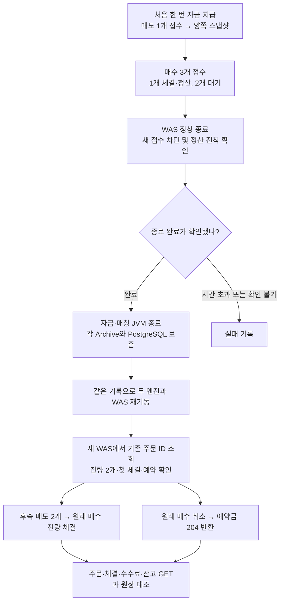

# #66 · 정상 재기동 뒤 지정가 주문 잔량 검증

매수 3개 중 1개가 먼저 체결되면 남은 2개는 주문장에 대기하고 돈은 예약 상태로 남는다. WAS와 두 엔진을 정상 종료한 뒤 다시 올려도 **사용자는 처음 받은 주문 ID로 잔량 2개를 조회하고, 그 주문을 끝까지 체결하거나 취소할 수 있어야 한다.** 조회를 통해 첫 체결과 수수료가 유지되고 이후 체결이나 반환이 한 번만 반영됐는지 확인한다. [#66](https://github.com/0Chord/coin-exchange/issues/66)

- **기준**은 `feature/phase-3/integration`의 `f7c5f4b`다. #47의 WAS 종료 계약, #58의 원장 복구, #59의 복구 접수 보호, #60~#63의 기존 조회를 재사용한다. #49는 수동 시연 준비의 안내와 검증을 맡는다. #66의 초기 자금은 기존 시험 방식으로 넣으므로 사용자가 #49 선행 관계를 제거하기로 결정했다. [통합 커밋](https://github.com/0Chord/coin-exchange/commit/f7c5f4bfc2ab83e662492953e7d1ab0b9a7eb4b9) · [#49 시연 이슈](https://github.com/0Chord/coin-exchange/issues/49)
- **범위**는 한 마켓, WAS 1개·자금 1노드·매칭 1노드의 실제 JVM과 PostgreSQL을 사용하는 검증 PR 한 개다. 기존 Gradle 테스트가 전부 기동하고 회수한다. 정상 종료와 동일 버전 재기동을 대상으로 한다. 강제 종료 복구, 여러 WAS의 접수 차단, 과반·리더 장애, 볼륨 유실, 버전 교체, 성능은 별도 검증이다.

## 사용자 요청에서 종료·복구까지



| 단계 | 책임과 통과 기준 |
| --- | --- |
| 첫 기동과 기준 상태 | 테스트가 기존 초기 자금 명령으로 실제 자금 엔진에 지급하고 `PREPARED`를 확인한다. 첫 매도 1개가 대기한 뒤 두 역할의 스냅샷 기록 위치를 확인한다. 이후 매수 3개를 HTTP로 보내 스냅샷 뒤에 첫 체결이 남게 한다. 매수 주문이 `PARTIALLY_FILLED / APPLIED`, 첫 체결이 `COMPLETED`가 되고 PostgreSQL에 그 분개가 저장된 시점을 기록한다. |
| 종료 | WAS에 `SIGTERM`을 보내고 #47 로그의 `COMPLETED`, 대상 순번까지의 자금 정산 및 기존 WAS PID 종료를 모두 확인한다. 매수 잔량 2개는 정상 대기 주문이므로 예약금은 유지한다. 그 뒤 자금·매칭 JVM에도 종료 신호를 보내고 기존 PID의 컨센서스·서비스·Archive 종료 표식과 두 JVM의 종료를 확인한다. `TIMED_OUT`, `UNCONFIRMED`, 강제 종료는 이 시험의 실패다. |
| 재기동 | 각 노드의 기존 기록 디렉터리·식별자·토폴로지와 같은 PostgreSQL DB를 사용한다. 엔진은 기존 기록 복구 옵션으로 새 PID에서 실행하고 초기 지급 명령은 첫 기동에서만 호출한다. 스냅샷과 그 이후까지의 복원 위치를 확인하고 새 WAS를 올린다. 새 WAS의 조회가 앞서 기록한 위치까지 도달해 아래 값이 모두 유지됐을 때 다음 HTTP 변경 요청을 보낸다. |
| 복원 직후 | 주문 ID와 요청 순서, 첫 체결 ID·단가·수량·실청구 수수료, 잔량·잔고·예약이 종료 직전과 같다. PostgreSQL에서 해당 원장 범위의 분개·행·순번이 그대로이고 개시 지급이 추가되지 않았는지 확인한다. 주문·체결 이력에는 종료 주문이 남고, 복원된 주문장에는 살아 있는 잔량만 보인다. |
| 후속 요청 | 체결과 취소를 서로 독립적인 시험 데이터로 실행한다. `202`는 접수 확인으로 사용한다. 최종 성공은 주문 GET의 `APPLIED`, 체결 GET의 `COMPLETED`, 조회 잔고와 PostgreSQL 원장이 알려진 최종 위치에 도달했을 때 판정한다. |

**조회 모드.** 이 시험은 한 WAS에서 주문·체결·수수료·잔고 GET을 검증하기 위해 처음부터 재기동까지 `archive`를 사용한다. #63 잔고 GET의 저장·반영은 이 모드에서 활성화된다. 이 시험에서 후속 요청을 보내는 조건은 **새 프로세스의 복원 확인과 새 WAS 조회의 반영 완료**다. #59가 제공하는 복구 중 주문·취소 `503`과 대사 후 접수 재개는 `live` 전용 설정의 기존 시험을 근거로 삼는다. 기존 조회 모드와 접수 정책을 유지한다. [#63 설정](https://github.com/0Chord/coin-exchange/blob/f7c5f4bfc2ab83e662492953e7d1ab0b9a7eb4b9/app-api/src/main/kotlin/com/exchange/core/api/config/OrderQueryConfig.kt#L102-L116) · [#59 설정](https://github.com/0Chord/coin-exchange/blob/f7c5f4bfc2ab83e662492953e7d1ab0b9a7eb4b9/app-api/src/main/kotlin/com/exchange/core/api/config/BoundedTradingGatewayConfig.kt#L50-L58) · [#59 기존 HTTP 회귀](https://github.com/0Chord/coin-exchange/blob/f7c5f4bfc2ab83e662492953e7d1ab0b9a7eb4b9/app-api/src/test/kotlin/com/exchange/core/api/trading/infrastructure/aeron/SplitFundsTradingHttpTest.kt#L3237)

## 수용 사례

공통 입력은 매수자 1,000 USDT, 매도자 3 BTC, 보조 매수자 300 USDT, 가격 100의 `LIMIT + GTC`, 메이커 수수료 1%·테이커 수수료 2%다. 매도 1개가 먼저 대기하고 매수 3개가 들어온다. 첫 체결로 매수자는 100과 수수료 2를 낸다. 남은 예약 204는 대금 200과 최대 수수료 예약 4다. 모든 금액의 기대값은 이 입력에서 계산한다. [#44 기존 후속 체결 명세](https://github.com/0Chord/coin-exchange/blob/f7c5f4bfc2ab83e662492953e7d1ab0b9a7eb4b9/engineering/gtc-follow-up-fill-spec.md)

| 상황 | 원래 매수 주문의 GET | 매수 USDT 가용 / 예약 | 매수 BTC / 매도 BTC 가용 | 매도 USDT 가용 | 확정 수수료 USDT |
| --- | --- | ---: | ---: | ---: | --- |
| 종료 직전과 재기동 직후 | `PARTIALLY_FILLED / APPLIED`, 체결 1·잔량 2·취소 0 | 694 / 204 | 1 / 2 | 99 | 매수 2, 전체 3 |
| A. 재기동 후 매도 2개 | `FILLED / APPLIED`, 체결 3·잔량 0·취소 0 | **696 / 0** | 3 / 0 | 295 | 매수 **4**, 전체 **9** |
| B. 재기동 후 매수 잔량 취소 | `CANCELLED / APPLIED`, 체결 1·잔량 0·취소 2 | **898 / 0** | 1 / 2 | 99 | 매수 **2**, 전체 **3** |

- **A의 FIFO와 종료 주문.** 첫 체결 뒤 보조 매수자로 가격 150의 매수 1개를 접수·취소해 반환 완료까지 확인한다. 같은 계정의 매수 1개를 가격 100에 올려 원래 주문보다 뒤에 둔다. 재기동 직후 주문장에는 가격 100에 대기 수량 3개가 있고, 매도 호가는 비어 있으며 취소된 가격 150 호가는 없다. 이후 매도 2개가 **원래 주문**을 전부 채우고 나중 매수는 `RESTING`, 체결 0·잔량 1, 가용 198·예약 102로 유지된다. 첫 체결 ID가 매수·매도 조회 양쪽에 그대로 보이고, 후속 체결은 양쪽에 동일한 새 ID 하나로 보인다. 원래 매수 주문의 두 체결 수수료는 각각 2 USDT다.
- **A에서 #65도 검증한다.** 재기동 직후, 후속 매도를 보내기 전에 이미 전량 체결된 첫 매도와 이미 취소된 가격 150 매수의 **최초 주문 POST**를 각각 같은 토큰·본문으로 재전송한다. 사용자 요청 ACK나 세대 갱신으로 최초 응답을 정리하기 전의 사례다. 최초 `202`의 주문 ID와 접수 순번이 그대로 반환되고, 기존 GET은 각각 `FILLED`와 `CANCELLED`를 유지한다. 재전송으로 신규 접수·예약·체결·수수료·PostgreSQL 분개가 생기지 않는지 재기동 직후에 저장한 값과 대조한다. 가격을 바꾼 토큰의 충돌, ACK 뒤 `RETIRED_UNAVAILABLE`, 세대 갱신 뒤 `FENCED_EPOCH`는 기존 #64 HTTP 시험을 근거로 삼는다. [#65](https://github.com/0Chord/coin-exchange/issues/65) · [#64 기존 시험](https://github.com/0Chord/coin-exchange/blob/f7c5f4bfc2ab83e662492953e7d1ab0b9a7eb4b9/app-api/src/test/kotlin/com/exchange/core/api/trading/infrastructure/aeron/SplitFundsTradingHttpTest.kt#L2315-L2385)
- **B의 한 번 반환.** 주문 ID를 그대로 사용해 취소하고 `202` 응답의 취소 ID를 저장한다. 예약 204가 한 번 풀리는 것을 확인한 뒤 같은 토큰과 본문으로 재전송한다. 최초 취소 ID가 돌아오고 잔고·예약·체결 기록·수수료·분개가 같아야 한다. 정산된 체결은 첫 1개 한 건이고, 추가 체결 분개 없이 취소 반환 분개만 한 번 증가한다. 복원된 주문장의 해당 가격 잔량도 사라진다. 재전송 이후 다른 계정의 정상 매수 예약이 조회에 반영되면, 이전 원장에 그 예약 분개 한 건만 붙었는지 확인한다. 이렇게 재전송 전의 조회 응답이 잠깐 남아 있어도 중복 반환을 놓치지 않는다.
- **순번과 DB 대조.** 재기동 전의 업무 순번과 체결·분개 ID를 보관한다. 복원 직후 기존 주문의 마지막 결과 순번과 분개 범위에 변동이 없고, 새 요청의 적용 및 원장 위치는 기존 위치 이후부터 이어져야 한다. 테스트가 보낸 대기·취소 명령도 결과 순번에 포함되므로 모든 경우를 고정된 단일 순번으로 비교하지 않는다. 해당 계보의 `funds_ledger_batch`에서 지급·예약·체결·반환의 분개 ID와 차변·대변 금액을 대조하고, `settlement_transaction`·`settlement_posting`에서 체결 ID에 연결된 실제 수수료와 중복 여부를 확인한다. 재기동만으로 기존 분개 행이나 금액이 달라지면 실패다.

## 구현에 넘길 검증 단위

| 재사용할 부분 | #66에서 연결할 부분 |
| --- | --- |
| `OrderRecoveryWas`의 별도 WAS JVM 기동과 제품 HTTP 요청 도우미 | 종료 신호를 보낸 뒤 실제 종료와 #47 완료 로그를 확인한다. 기존 `close()`는 5초 후 강제 종료할 수 있으므로 정상 종료 판정은 테스트의 명시적인 대기·단언으로 둔다. #47 대기 시간과 프로세스 회수 시간을 고려한 제한 안에 완료해야 한다. |
| `DevelopmentSplitTradingMainKt`의 실제 자금·매칭 JVM 진입점, 종료 훅, 기동 로그 | 두 역할을 테스트가 기동하고 종료한다. 기존 테스트 설정을 재사용해 역할별 디렉터리와 `FUNDING_RECOVER_EXISTING=true`를 공급하고, 동일한 저장 내구 설정(`sync=2`)과 기존 위치를 확인한다. 실제 PID·스냅샷 위치·복구 이후 위치를 수집한다. 스냅샷 요청 수락 뒤 기록 완료까지 기다린다. |
| 기존 초기 지급 명령, `OrderQueryTestDatabase`, Archive WAS 설정, 잔고·체결·원장 조회 도우미 | 한 시험에서 동일 DB를 끝까지 유지한다. 기존 조회 모드의 제품 HTTP를 사용하고, 스냅샷 시점 이후 복원과 두 후속 사례를 같은 과정으로 검증한다. 잔고 GET은 `asOfLedgerSequence`, 주문장 GET은 `asOfMatchingResultSequence`가 각각 기대 위치에 도달한 `200`으로 확인한다. |

요청은 기존 `/api/trading/v3` 아래의 주문·취소 POST와 주문 상세, 주문의 `/fills`, 사용자별 `/balances/{assetId}`, 마켓별 `/order-book` GET만 사용한다. 주문장 GET은 기존 Archive 호가 설정을 켜서 사용한다.

[기존 WAS 프로세스 도우미](https://github.com/0Chord/coin-exchange/blob/f7c5f4bfc2ab83e662492953e7d1ab0b9a7eb4b9/app-api/src/test/kotlin/com/exchange/core/api/trading/infrastructure/aeron/OrderRecoveryWas.kt#L20-L62) · [실제 엔진 진입점](https://github.com/0Chord/coin-exchange/blob/f7c5f4bfc2ab83e662492953e7d1ab0b9a7eb4b9/app-api/src/main/kotlin/com/exchange/core/api/trading/infrastructure/aeron/DevelopmentSplitTradingMain.kt#L217-L236) · [초기 자금 준비](https://github.com/0Chord/coin-exchange/blob/f7c5f4bfc2ab83e662492953e7d1ab0b9a7eb4b9/app-api/src/test/kotlin/com/exchange/core/api/trading/infrastructure/aeron/SplitFundsTradingHttpTest.kt#L4433-L4445) · [기존 Archive 잔고 시험](https://github.com/0Chord/coin-exchange/blob/f7c5f4bfc2ab83e662492953e7d1ab0b9a7eb4b9/app-api/src/test/kotlin/com/exchange/core/api/trading/infrastructure/aeron/SplitFundsTradingHttpTest.kt#L375-L466)

첫 구현은 정상 종료·복구와 **A의 잔량 체결**을 통과시키고, 같은 기동·복원 도우미에 **B의 취소·중복 요청**을 붙인다. 제품 코드나 API를 바꾸지 않고 테스트 코드와 검증 기록에서 완결시키는 범위다. 첫 시험에서 실제 실행 구성에 결함이 드러나면 실패 위치·로그를 남기고 이 시험의 통과와 구분한다.

새 통합 시험은 `GtcServerRestartTest`다. Java 25와 기존 PostgreSQL Testcontainers 환경에서 대상 시험과 테스트 포맷 검사를 실행한다.

```sh
cd "$(git rev-parse --show-toplevel)"
./gradlew --no-daemon --max-workers=2 -PciTestGroup=general :app-api:test \
  --tests '*GtcServerRestartTest' :app-api:ktlintTestSourceSetCheck
```

완료 근거는 두 사례가 모두 실행된 테스트 보고서와 종료·복원 위치 기록이다. 실패하면 각 프로세스의 종료 상태와 최근 로그, 노드 복원 위치, 마지막 HTTP 상태·본문, PostgreSQL 반영 순번을 함께 남긴다. 기존 #47 종료·#58 원장·#59 접수 보호·#63 잔고 시험은 통합 본문의 근거로 재사용한다. [기존 CI](https://github.com/0Chord/coin-exchange/actions/runs/45746518307)

복원된 주문장과 순번은 #52·#53의 기존 시험을 재사용하고, 실제 HTTP와 서버 교체를 연결하는 결과는 여기서 한 번 검증한다. 미완료 전달·정산·취소를 복원하는 동작은 #54·#56·#57의 기존 회귀를 재사용한다. 확정 경계의 강제 종료와 복구 중 재종료는 #67~#70에서 다룬다.

## 로컬 실행 결과 · 2026-11-26

- Java 25와 PostgreSQL 16에서 최종 `GtcServerRestartTest` 2건을 실행했다. 실패·오류·건너뜀은 0건이었다. 체결 사례는 재기동 전후 잔량 2개와 원장 위치를 대조하고, 같은 토큰으로 이미 체결·취소된 주문을 조회 가능한 상태로 다시 확인했다. 후속 매도는 먼저 들어온 매수 잔량을 채웠다. 취소 사례에서는 잔량 취소와 같은 요청의 재전송을 거쳐 예약금 204를 한 번만 반환했다. 두 사례 모두 기존 WAS의 정산 완료 순번, 엔진 정상 종료 표식, 세 PID 교체, 스냅샷 뒤 확정 위치 복원을 확인했다. [새 시험](../app-api/src/test/kotlin/com/exchange/core/api/trading/infrastructure/aeron/GtcServerRestartTest.kt)
- 기존 `SplitFundsTradingHttpTest` 34건과 아키텍처 테스트 388건이 실패·오류·건너뜀 없이 통과했다. 필수 운영 검사 P01~P09, CI 테스트 그룹의 배정 검사, 테스트 소스 KtLint도 통과했다. 신규 2건의 최종 실행 소스는 독립 재검토 대상의 시험 파일과 해시가 같다.
- 작성 대화를 상속하지 않은 리뷰어가 별도 사본을 검토했다. 종료 로그의 실제 정산 순번과 엔진 종료 표식, 체결 분개의 계정·방향·금액, 재전송 이후 순번까지 반영된 원장, 실패 시 마지막 HTTP 응답과 원장 확인을 보강했다. 최종 사본 `b6bbc94f`에서 남은 지적은 없었다.
