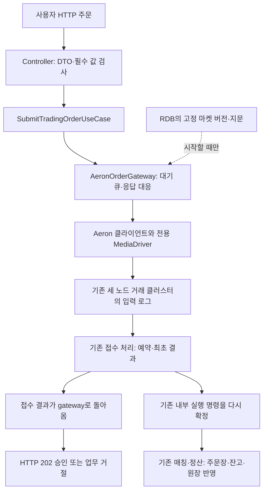

# HTTP로 보낸 주문이 Aeron 엔진에 도착하는 흐름

이번 작업은 **#148 HTTP 접수 연결**이다. #129에서 만든 예약·매칭·정산 코드를 새로 만들지 않고, 실제 HTTP 요청을 그 코드로 연결한다. #142의 성능 측정 도구와 TPS 측정은 다음 작업이다.

작업 폴더: `/Users/0chord/.codex/worktrees/issue148-http-aeron/exchange-core`

브랜치: `feat/http-aeron-admission/148`

기준: 통합 `04d96687bfa283b6e88816941b0e1974dbfd7083` 이후의 로컬 변경.

## 먼저 이것만 보면 된다

- 요청은 `POST /api/trading/markets/BTC-USDT/orders`로 보낸다.
- HTTP 서버와 Aeron 클라이언트는 같은 JVM에 있다. 연결을 매 요청마다 만들지 않는다.
- 거래 노드 세 JVM이 같은 입력을 같은 순서로 처리한다. 돈과 주문장은 각 노드의 기존 메모리 상태에 있다.
- **202는 접수 승인이다.** 접수 뒤 별도 내부 실행 명령으로 매칭·정산이 이어진다. HTTP 응답을 체결 완료로 해석하지 않는다.
- RDB는 시작할 때 마켓 설정 버전·지문을 읽는 데 사용한다. 이 HTTP 주문으로 RDB 잔고를 예약하거나 정산하지 않는다.



여기서 새 연결 부분은 HTTP 입력부터 gateway의 송수신·응답 대응까지다. 클러스터의 접수·자동 실행과 매칭·정산은 이미 있던 기능을 사용한다. Kafka, 조회용 DB 적재, 인증, 취소 전환은 추가하지 않았다.

## 실제 코드 읽는 순서

| 순서 | 코드 | 하는 일 |
| --- | --- | --- |
| 1 | `TradingGatewayApplication` | Aeron 접수 전용 Spring 서버를 연다. 기존 RDB 주문·취소 controller는 스캔하지 않는다. |
| 2 | `TradingGatewayConfig` | 시작할 때 RDB 설정을 읽고 gateway 하나와 use case를 조립한다. 버전·지문 없는 기본 설정으로는 시작하지 않는다. |
| 3 | `SubmitTradingOrderRequest` | JSON 필드를 타입으로 받고 Bean Validation을 적용한다. 원문 바이트를 직접 읽는 controller가 아니다. |
| 4 | `TradingOrderController.submit()` | 요청을 use case에 맡기고 결과 future가 완료되면 HTTP 상태·응답 DTO로 바꾼다. |
| 5 | `AeronOrderGateway.submit()` | 같은 사용자·요청 ID의 진행 중 원본을 비교하고, 마켓 정책을 붙인 Protobuf 명령을 한정된 큐에 넣는다. |
| 6 | `AeronOrderGateway.run()` | 연결을 소유하는 스레드 하나가 전송·응답 읽기·keepalive·시간 제한을 관리한다. HTTP 스레드가 연결을 함께 조작하지 않는다. |
| 7 | `AeronOrderTransport` | 실제 Aeron session과 MediaDriver를 사용해 바이트를 송수신한다. 전송과 접수 승인은 별개다. |
| 8 | `AeronOrderGateway.receive()` | 엔진 응답의 userId·requestId로 대기를 찾고 marketId·orderId도 대조한 뒤 해당 요청만 완료한다. |

관련 파일은 `app-api/src/main/kotlin/com/exchange/core/api/trading/api`, `trading/application`, `trading/infrastructure/aeron`과 `api/config/TradingGatewayConfig.kt`에 있다. 위 경로들은 저장소 루트 기준이다.

## 주문 한 건과 재전송

```json
{
  "requestId": "R1", "orderId": "O1", "userId": "BUYER",
  "side": "BUY", "orderType": "LIMIT", "timeInForce": "GTC",
  "price": 10000, "quantity": 100000000
}
```

BTC 수량 단위가 scale 8이면 `quantity=100000000`은 BTC 1개다. `price`는 기존 quote 정수 저장 단위이며 표시용 소수 금액을 새로 가정하지 않는다.

진행 중 같은 R1·같은 내용을 다시 보내면 같은 결과 대기를 공유한다. R1인데 가격을 바꾸면 `REQUEST_IN_FLIGHT_CONTENT_CONFLICT`로 409를 주고 추가 전송하지 않는다. 최초 처리가 끝난 뒤의 재전송·내용 충돌·새 요청의 주문 중복은 기존 엔진의 최초 결과 규칙이 판단한다. 마켓만 미등록 값으로 바꾼 재전송도 이 규칙을 우선한다. 미등록 마켓의 새 요청은 노드에서 문맥 불일치로 거절한다.

대기열 기본 한도는 1024건, 전송 후 결과 대기는 256건, 접수 결과 기한은 큐에 들어간 시점부터 5초다. 환경 설정으로 조정할 수 있고 시작 로그에 실제 값과 마켓 버전·지문을 남긴다.

| 결과 | 응답 | 돈에 대한 의미 |
| --- | --- | --- |
| 엔진 접수 승인 | 202 `ACCEPTED`, sequence | 예약이 승인됐다. 체결 완료를 뜻하지 않는다. |
| 잘못된 JSON·필수 값·숫자·enum | 400 `INVALID_INPUT` | 입력 단계 거절이다. |
| 원본 충돌·주문 중복 | 409 `REJECTED`, 구분된 reason | 추가 효과 없이 거절한다. |
| 잔고 부족·미지원 조건·마켓 불일치 | 422 `REJECTED` | 기존 업무 규칙의 거절이다. |
| 큐에 넣기 전 용량 초과 | 429 `NOT_SUBMITTED` | 클러스터로 전달하지 않았다. |
| 아직 연결되지 않음·종료 후 새 요청 | 503 `NOT_SUBMITTED` | 이번 요청을 전달하지 않았다. |
| 전달 후 결과 기한 만료 | 504 `OUTCOME_UNKNOWN` | 이미 반영됐을 수 있다. 취소·환불하지 않는다. |
| 전달됐을 수 있는 연결 오류 | 503 `OUTCOME_UNKNOWN` | 같은 식별자로 결과를 다시 확인해야 한다. |

결과를 모르는 요청의 ID를 같은 session에서 다른 원본에 바로 재사용하면, 늦은 승인 응답을 새 원본의 승인으로 착각할 수 있다. 그래서 기존 대기를 미확인으로 끝낸 뒤 **이전 session을 닫고**, 그 다음 대기 슬롯을 회수하고 새 연결을 연다. HTTP 연결이 닫혔다고 엔진 주문을 취소하지 않는다.

## 실제 세 노드 검사: 어떤 돈을 확인하나

[DockerHttpOrderAdmissionTest](../app-api/src/test/kotlin/com/exchange/core/api/trading/infrastructure/aeron/DockerHttpOrderAdmissionTest.kt)는 테스트 JVM이 Docker를 준비한 뒤 실제 제품 gateway JVM 하나와 거래 노드 JVM 세 개를 별도 컨테이너에서 실행한다. PostgreSQL도 실제 Testcontainers 인스턴스다. 제품에 테스트 gate나 완료 조회 HTTP API를 넣지 않으며, 노드 결과 관찰은 기존 test 출력의 도구를 사용한다.

1. **준비:** 같은 RDB 마켓 버전·지문과 fileSyncLevel=2를 확인한다. 구매자 quote 11000, 판매자 BTC 1개를 엔진에 준비한다. 수수료는 0이다.
2. **실행:** SELL 1개 @10000을 HTTP로 접수하고 대기 주문 반영을 기다린다. 다음 BUY 1개 @10000도 HTTP로 보낸다.
3. **확인:** 각 요청은 202를 받고, 세 노드의 실제 결과에는 체결 1건·정산 1건이 있다. 구매자는 quote 1000·BTC 1개, 판매자는 quote 10000·BTC 0, 관련 예약은 0이다. `assertTradeCheckpoint()`가 이 고정 기대값을 직접 대조한다.
4. **재전송·거절:** 같은 승인 요청은 같은 sequence를 반환한다. 요청 원본 충돌·주문 중복·자금 부족·미지원 조건·잘못된 HTTP 입력을 보낸 뒤 경제 상태가 그대로인지 확인한다. 거절 뒤 새 정상 주문도 처리한다.
5. **동시 요청:** 여러 HTTP 요청을 함께 보낸다. 응답 DTO의 식별자만 비교하지 않고 각 요청의 HTTP sequence와 세 노드가 실제 기록한 접수 sequence까지 대조한다.
6. **응답 유실:** HTTP 요청을 쓴 뒤 응답을 읽지 않고 소켓을 닫는다. 노드 반영을 기다린 뒤 같은 ID로 다시 요청해 최초 sequence를 확인한다. 이 검사는 응답 유실 사례이며 네트워크 분할·리더 장애 검사는 아니다.
7. **격리:** 기존 RDB 주문·취소 URL이 실행되지 않고, 실제 RDB의 잔고·예약·원장·기존 매칭 사건 테이블이 전후 동일한지 비교한다. 모든 노드가 같은 로그 위치까지 적용했는지도 확인한다.

## 짧은 경계 검사: 기다리는 요청을 어떻게 보호하나

[AeronOrderGatewayTest](../app-api/src/test/kotlin/com/exchange/core/api/trading/infrastructure/aeron/AeronOrderGatewayTest.kt)는 transport만 대역으로 바꾼다. 실제 gateway 소유 스레드와 실제 시간 제한은 실행한다. 따라서 실제 UDP 성능·복제 보장의 근거로 쓰지 않는다.

| 준비 → 실행 | 실제 확인 |
| --- | --- |
| 전송이 양수 위치 반환 → 엔진 응답을 보류 | future가 미완료다. 이후 응답을 넣어야 승인으로 완료된다. |
| 사용자·요청이 다른 3건 → 응답을 역순으로 넣음 | 해당 요청의 future만 올바른 sequence·거절 결과로 완료된다. |
| 같은 키의 미완료 주문 → 같은 원본과 바뀐 가격 제출 | 같은 원본은 같은 future, 다른 원본은 409 원인이며 전송 건수가 늘지 않는다. |
| 전송 한도 1·큐 한도 1 → 세 주문 제출 | 첫 건만 전송, 둘째 대기, 셋째만 미전달이다. 응답 뒤 둘째가 전송된다. |
| BACK_PRESSURED·ADMIN_ACTION → 재시도 | 최초 명령과 재시도 바이트가 동일하다. 새 요청·원장 ID를 만들지 않는다. |
| 실제 200ms 기한 만료 → 이전 연결 닫기를 잠시 보류 | 결과는 미확인이고, 그 동안 같은 키의 다른 원본은 거절된다. 닫힌 뒤 새 session에서만 제출된다. |
| 최초 결과 뒤 마켓만 미등록 값으로 변경 → 같은 키로 재전송 | 주문 원본은 그대로 노드로 전달하고 노드의 최초 요청 충돌 결과를 보존한다. 새 미등록 요청의 문맥 불일치와 구분한다. |
| 전송 후 연결 terminal 오류 → 새 연결 | 이전 대기는 미확인이다. 이전 응답은 새 대기를 완료시키지 않고 새 응답만 연결된다. |
| 미완료 주문이 있을 때 종료 → 새 주문 제출 | 미완료는 미확인, 새 주문은 미전달이다. |
| 연결 생성이 실패 | 생성자가 원인을 보존한 오류로 시작 실패를 알린다. |

[TradingOrderHttpTest](../app-api/src/test/kotlin/com/exchange/core/api/trading/api/TradingOrderHttpTest.kt)는 실제 HTTP 포트를 사용하지만 gateway는 제어 가능한 대역이다. 9개 검사는 승인 대기와 식별자, 409 원인, 422 원인, 429·503·504 구분, 잘못된 본문의 400과 gateway 미호출, 기존 URL 격리, 기본 Boot 애플리케이션 검색을 각각 확인한다. JSON 검사는 소수·문자열·범위 초과·null·누락·잘못된 enum을 포함한다. 식별자에 숫자·불리언을 넣으면 400이며, 숫자처럼 생긴 정상 문자열은 그대로 보존한다.

[AeronGatewaySettingsTest](../app-api/src/test/kotlin/com/exchange/core/api/trading/infrastructure/aeron/AeronGatewaySettingsTest.kt)의 5개 검사는 필수 설정과 기본값, 누락·공백·상대 경로 거절, 숫자 멤버 ID 중복·주소·포트 거절, 용량·기한 범위 거절, 허용 상한 반영을 확인한다. `0`과 `00`도 같은 멤버 ID로 본다.

기존 [ProductionBoundaryInputsTest](../architecture-tests/src/test/kotlin/com/exchange/architecture/ProductionBoundaryInputsTest.kt)에 4개 구조 사례를 추가했다. 새 HTTP 경로의 공개 원본·결과는 허용하되 controller의 JDBC·Aeron 구현 직접 참조, use case의 JDBC·Aeron 구현 참조, 공개 계약 안에 숨긴 JDBC 참조는 잡는다. 구조 예제의 위반 검출은 제품의 DB 동작 검증과 별개다.

## 실행과 남은 범위

```sh
cd /Users/0chord/.codex/worktrees/issue148-http-aeron/exchange-core
./gradlew :app-api:test --tests '*DockerHttpOrderAdmissionTest' --no-daemon --console=plain
```

직접 gateway를 실행하는 작업은 다음과 같다. 먼저 기존 거래 노드와 RDB 마켓 설정을 준비하고, 아래 환경을 실행 프로세스에 지정한다. 시작 자금 준비는 기존 개발 도구를 사용한다.

| 환경 변수 | 의미 |
| --- | --- |
| `TRADING_GATEWAY_RUN_ROOT` | 아직 존재하지 않는 절대 실행 경로. 이 gateway의 Driver만 보관하며 거래 노드의 Archive 경로를 공유하지 않는다. |
| `TRADING_GATEWAY_INGRESS_ENDPOINTS` | 노드의 `멤버ID=호스트:포트` 목록. gateway가 접근 가능한 주소를 사용한다. |
| `TRADING_GATEWAY_EGRESS_ENDPOINT` | 거래 노드가 gateway에 응답할 수 있는 `호스트:포트`. |
| `FUNDING_MARKET_DB_URL`, `FUNDING_MARKET_DB_USER`, `FUNDING_MARKET_DB_PASSWORD` | 기존 PostgreSQL 마켓 설정 조회 연결. 비밀번호를 명령 인자나 보고서에 출력하지 않는다. |
| `FUNDING_MARKET_CONFIG_VERSION`, `FUNDING_MARKET_CONFIG_SHA256` | 거래 노드와 동일한 고정 버전·원문 SHA-256. |
| `TRADING_GATEWAY_QUEUE_CAPACITY`, `TRADING_GATEWAY_MAX_IN_FLIGHT` | 생략하면 1024·256. |
| `TRADING_GATEWAY_RESULT_TIMEOUT_MS`, `TRADING_GATEWAY_STARTUP_TIMEOUT_MS` | 생략하면 결과 5000ms·최초 연결 10000ms. |

```sh
cd /Users/0chord/.codex/worktrees/issue148-http-aeron/exchange-core
./gradlew :app-api:runTradingGateway --no-daemon --console=plain
```

위 gateway는 계속 사용할 HTTP 접수 입구를 위한 별도 실행 구성이다. `bootRun`의 기존 RDB 실행을 Aeron 실행으로 오해하지 않게 구분한다. 기본 HTTP 포트는 Spring의 `SERVER_PORT`로 조정한다.

앞의 자동 통합 검사에는 Docker가 필요하다. 테스트가 실제 포트·DB·네 컨테이너를 준비하고 이 실행에서 만든 컨테이너를 정리한다. 기록 볼륨은 기존 검증 도구처럼 보존한다. 운영 거래 데이터에 개발용 시작 자금을 넣는 명령을 연결하지 않았다.

집중 검사 25개(HTTP 9·연결 관리 10·설정 5·실제 세 노드 1)와 최종 전체 빌드가 통과했다. 최종 실제 HTTP·세 노드 실행 보고서는 로컬의 `app-api/build/reports/aeron-http/http179299774849384ac250a`에 보관했다. 실행 보고서는 Git에 포함하지 않으며 위 명령으로 새 보고서를 만들 수 있다.

최종 실행:

```sh
cd /Users/0chord/.codex/worktrees/issue148-http-aeron/exchange-core
./gradlew build test :architecture-tests:verifyArchitectureReport --no-daemon --console=plain --continue --stacktrace
```

결과는 성공이며 최신 XML의 **1,486개 사례에서 실패·오류·건너뜀 0**을 확인했다. 이번 최종 실행에서는 app-api 644개를 다시 실행했고, 같은 소스에서 앞서 통과한 나머지 842개는 Gradle 결과를 재사용했다. 구조 검사의 필수 운영 검사 P01~P09 성공도 별도로 확인했다. Kotlin 형식 검사 역시 통과했다. 중간에 디스크 부족으로 Docker가 중단된 실행은 성공으로 세지 않았고, 공간 확보와 Docker 복구 뒤 재검사했다.

별도 컨텍스트의 독립 리뷰에서 실제 반례 두 건을 수정했다. 숫자·boolean 식별자를 문자열로 바꾸는 Jackson 동작은 400으로 차단했고, 미등록 마켓으로 바꾼 재전송도 노드의 최초 요청 충돌 판정을 보존한다. 재리뷰에서 실제 HTTP 및 실제 gateway·노드 어댑터·거래 상태 연결로 해소를 확인했다. 이후 실제 세 노드 검사에서 발견한 관찰 시점 차이는 완료 개수와 로그 위치를 함께 기다리도록 수정했다. 서로 다른 위치의 callbackTimestamp를 비교하지 않으며, 전체 상태 동일성 검사는 유지한다. 기록 재생에서 한 노드의 잔고를 바꾸면 여전히 불일치를 검출하는 것도 독립 확인했다.

검토한 코드·테스트의 고정본은 로컬 검증 기록의 v3 manifest `05c2d9cd2f488005869fc78e005ab4363fdc5be0bca67fcdd60fdd87d05169e1`이다. 이 검토 이후 제품·테스트·빌드 설정은 바꾸지 않았으며 마지막 문서에는 실행 결과와 게시용 설명만 반영했다. 검토 범위에서 확인된 미해결 결함은 없다. 위 결과는 로컬 실행 결과이며 원격 CI와 사람의 리뷰 결과는 PR에서 별도로 확인한다.

검사 기록은 노드·HTTP 요청·실제 DB 전후 대조를 포함한다. 테스트가 보존한 기록 볼륨은 실행 보고서를 확인한 뒤 사용을 마친 것만 별도로 정리한다.

다음은 #142에서 이 실제 HTTP 경로를 통해 접수 응답과 매칭·정산 완료 시간을 따로 측정하는 작업이다. 이번 기능 검사로 최대 TPS나 운영 HA·재해 복구가 입증된 것은 아니다.
