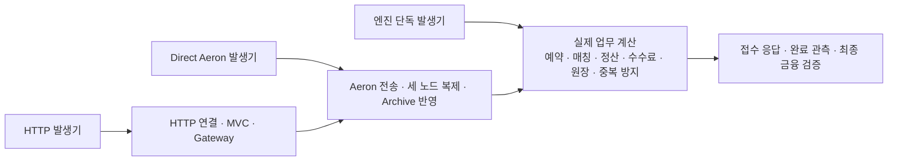

> **2026-10-28 분석:** 선택 runtime과 현재 후보 소스를 구분한 원인·기업 사례·다음 설계는 [거래 클러스터 처리량 분석](trading-capacity-analysis.md)에 정리했다. 아래는 실행별 기록이며, 22k/s를 지속 가능한 엔진 최대값으로 확정하지 않는다.

<!-- current-direct-tail-20261028:start -->
# 최신: TPS를 우선한 직접 클러스터 비교

**매칭·정산 완료 TPS를 우선해 개선했다.** G1·ingress 한도 10에서 복제 로그 전송 창을 192KiB→1MiB로 바꾼 짧은 반복 비교는 완료 **17,898–18,302→22,027–22,862건/s**였다. 이번에는 1MiB를 유지한다. ingress 한도 20은 21,710건/s·완료 p99 896.7ms로 10보다 낫지 않아 되돌렸다. 한 번의 가장 높은 값을 지속 최대 TPS라고 하지 않는다.

공통 조건은 HTTP/Gateway를 제외한 직접 Aeron, 독립 Docker JVM 3개, 노드별 2 CPU·`-Xmx1536m`·컨테이너 2GiB, Archive/Catalog/Consensus sync=2다. BTC/SOL/SUI의 실제 매칭 BUY 12,000건을 예열하고 별도 90,000건을 두 세션으로 속도 제한 없이 전송했다. 같은 Mac의 Docker VM 8 CPU에서 실행했으며 여러 EC2의 성능으로 일반화하지 않는다. JIT 수렴은 증명하지 않았다. 같은 최대 heap 설정에서도 JVM이 보고한 실제 최대 heap은 G1 1536MiB, Parallel 1365.5MiB였다. 발생기는 모두 heap 512MiB·G1이다.

| 실행 | 노드GC / 로그전송창 | 접수 응답 건/s | 세 노드 완료 건/s | 접수 p95 / p99 ms | 세 노드 완료 관측 p95 / p99 ms |
|---|---|---:|---:|---:|---:|
| `cert-t10a` | G1 / 192KiB | 18,947 | 18,302 | 596.6 / 775.8 | 708.0 / 804.2 |
| `cert-t10b` | G1 / 192KiB | 17,934 | 17,898 | 488.5 / 538.6 | 605.5 / 759.1 |
| `cert-t1ma` | G1 / 1MiB | 23,062 | 22,862 | 514.6 / 539.2 | 674.9 / 698.1 |
| `cert-t1mb` | G1 / 1MiB | 22,292 | 22,027 | 526.0 / 554.9 | 669.1 / 729.5 |
| `cert-tpar1` | Parallel / 1MiB | 24,657 | 24,389 | 483.6 / 497.0 | 647.0 / 823.7 |
| `cert-tpar2` | Parallel / 1MiB | 23,967 | 23,717 | 509.7 / 584.0 | 721.8 / 858.1 |
| `cert-trepo1` | Parallel / 1MiB | 22,273 | 22,046 | 758.8 / 782.7 | 858.9 / 884.7 |
| `cert-tctl` | Parallel / 192KiB | 22,693 | 22,561 | 451.8 / 472.0 | 482.1 / 498.3 |

Parallel GC·1MiB의 세 번은 **22,046–24,389건/s**였다. 최초 두 실행의 23.7–24.4k만 보고 일관된 향상이라고 결론 내리지 않는다. 실제 저장소의 GC 옵션으로 실행한 세 번째는 22.0k·완료 p99 884.7ms로 떨어졌다. 192KiB의 Parallel 대조는 22,561건/s·완료 p99 498.3ms였지만 한 번뿐이다. GC 우열과 모든 GC에서의 1MiB 효과는 미확정이다. 기본 GC는 G1을 유지하고 성능 Compose에서만 `PERFORMANCE_NODE_GC=Parallel`로 명시 선택할 수 있게 했다. 이 옵션의 측정 조건은 2 CPU·1536MiB heap이며 기본 768MiB에 같은 수치를 보장하지 않는다.

**유지한 조정:** 한 주기의 외부 입력 한도를 1→10으로 복원하고, 16MiB 로그 term에서 전송 창을 1MiB로 늘렸다. Archive sync=2·과반수 합의·접수와 실행의 두 확정 단계·단일 작성자·금융 검증·원장 이력은 유지했다. 전송 창은 쿼럼을 바꾸는 값이 아니다. 테스트는 실제 Context의 한도·전송 창·16MiB term/segment·sync 값을 검사한다. 테스트 전용 관측 인코더는 송신 스레드마다 버퍼를 재사용하되 각 메시지 배열의 소유권은 분리한다.

표의 8개 실행은 각각 측정 주문 90,000건 전량 승인, 준비·예열 포함 204,000개 식별자의 세 사본 표식 612,000건 대조, 중복 ACK·중복 표식·오류 0건이다. 금융 잔고·수수료·원장 전수 dump는 타이밍 실행에서 하지 않으며 별도 회귀·엔진 단독 금융 검사와 구분한다. 발생기의 미완료 상한 32,768을 채우지 않았고 상한 대기는 0회였다. 이는 해당 상한의 비포화만 증명한다. 수신 측 스케줄링·backpressure·관측 전송도 포함하므로 발생기 제약이 완전히 배제된 엔진 최대값이라고 하지 않는다. TPS 분모는 첫 실제 출발부터 마지막 해당 결과 수신까지다.

**남은 한계:** 5만 TPS는 달성하지 못했다. 500ms 미만의 완료 p99도 반복해서 만족하지 못했다. 이번 변경의 HTTP API 처리량은 다시 측정하지 않았다. 속도 제한 없는 burst의 대기 시간과 5천/s 지정 제공 부하의 지연을 섞지 않는다.

사용자가 앱 정리를 완료했다고 확인한 뒤, 같은 기존 G1/ingress1/192KiB 바이너리를 돌린 두 번은 20,008/17,023건/s·완료 p99 948.6/728.4ms였다. 앱 정리가 성능을 해결했다고 하지 않는다. 5초 추가 예열 대기도 19,495건/s·p99 779.2ms로 개선되지 않았다. 호스트의 압축·swap 읽기가 발생했고 측정 로그 위치로 묶은 NAK·재전송도 확인했다. 다만 개별 p99 전체를 GC·fsync·재전송 중 하나로 확정하지 않는다.

소스 후보를 격리한 결과, 단일 체결 조회 Map·참여자 집합 생략은 할당 9.57–9.59→8.56–8.58KB/건으로 줄었지만 엔진 ABBA에서 79.3–84.4k→75.7–76.2k TPS로 느려져 되돌렸다. 관측 송신 INVOKER 후보도 16,590TPS로 느렸고 독립 리뷰의 종료 배출 경계 지적이 있어 후보 전체를 제거했다. 성능이 확인되지 않은 변경을 할당량만 보고 채택하지 않았다. 원장 1·2자산의 Map 생략은 할당 감소를 확인했지만 그 단독 TPS·p99 향상은 미확정이다.

[실행별조건·수치JSON](/Users/0chord/.codex/visualizations/2026/09/23/01a0ce63-9327-7f32-a7e0-3429380284d8/issue142-performance/capacity-goal/direct-core-20261028/multi/execution-tail-20261028/request-correlation-20261028/tps-selected-comparison.json) · [원자료디렉터리](/Users/0chord/.codex/visualizations/2026/09/23/01a0ce63-9327-7f32-a7e0-3429380284d8/issue142-performance/capacity-goal/direct-core-20261028/multi/execution-tail-20261028/request-correlation-20261028/runs) · [로그위치별재전송범위](/Users/0chord/.codex/visualizations/2026/09/23/01a0ce63-9327-7f32-a7e0-3429380284d8/issue142-performance/capacity-goal/direct-core-20261028/multi/execution-tail-20261028/request-correlation-20261028/clean-log-loss-position-bounds.json)

최종 선택 설정의 검사 결과는 원장 56·거래 201·관련 app-api 99·구조 385, 합계 **741개 실패·오류·skip 0건**이다. 변경 없는 검사는 Gradle이 기존 결과를 재사용했다. 구조 실행 보고·네 모듈 ktlint도 통과했다. 실행 로그와 XML 집계는 `tps-selected-final-regression.log`, `tps-selected-final-regression-results.json`에 남겼다.

종료된 이번 실험의 대용량 JSON/JSONL 88개를 압축하고, 압축 해제 내용의 SHA가 원문과 같은지 확인한 뒤 원본 중복을 제거했다. **6.59GB를 회수**했고 이 정리 직후 여유 공간은 약101GB였다. 요약·JFR·검사 결과는 유지했고 실험 컨테이너가 남지 않았음을 확인했다.

<!-- current-direct-tail-20261028:end -->

<!-- gateway-protocol-20261028:start -->
# 최신 대조: HTTP 잠금 수정과 연결 재사용

Tomcat의 JMX 비활성화 등록 경로와 Gateway의 공통 잠금 방식을 수정했다. 금융 규칙·큐 상한·Archive 동기화는 유지했다. 세 노드·Archive/Catalog/Consensus sync=2·Gateway 2 CPU에서 준비 거래 2,000건 후, k6의 연결 64개를 준비하고 POST 1,000건을 비교했다.

| 연결 64개를 재사용한 같은 유한 부하 | 기존 monitor | ReentrantLock 후보 |
|---|---:|---:|
| HTTP 접수 p95 / p99 | 90 / 120ms | 61 / 77ms |
| 정산 뒤 리더 표식 수신 p95 | 103.42–104.42ms | 58.83–59.83ms |
| 정산 뒤 리더 표식 수신 p99 | 111.66–112.66ms | 61.23–62.23ms |
| 1,000건 구간 응답 처리율 | 1,276건/s | 1,894건/s |

이는 응답 뒤 다음 요청을 보내는 64 VU 폐쇄형의 **짧은 한 쌍**이다. 최대 지속 TPS로 해석하지 않는다. 각 회차의 주문 1,000건·표식 3,000건과 세 노드의 잔고·예약·수수료·원장·승인 순번이 일치했다. 측정 중 재연결·누락·미확인·오류는 0건이었다. 정산 표식에는 실제 정산 뒤의 별도 송수신·관측 대기가 포함된다.

**새 연결 1,000개 부하는 여전히 느리다.** 같은 cold 조건에서 접수 p99는 원본 716ms→Tomcat 수정 553ms→잠금 후보 681ms였다. 후보의 Gateway 잠금 대기 p99는 119.533→3.731ms로 줄었지만, 전체 cold p99는 악화돼 결과를 보존했다. TCP 연결 p99도 63.549→155.075ms로 달라졌으며 이 한 쌍으로 전체 악화의 원인을 확정하지 않는다.

후보의 warm64 조건에서 Gateway를 8 CPU로 높여도 접수 p99만 66ms로 줄었고 정산 표식 p99는 약 98ms, 처리율은 1,664건/s로 악화됐다. 8 CPU 설정은 채택하지 않았다. 2 CPU는 개발 성능 Compose의 CPU 예산이며 Aeron이 요청을 두 개만 처리한다는 뜻이 아니다. HTTP worker는 200개다.

프로토콜 관련 56건·Gateway 관련 46건의 회귀 검사, 구조 검사 385건·구조 보고·ktlint를 통과했다. 별도 컨텍스트 리뷰어가 고정 제품 소스 v8/v9/v10, warm64-v1 도구와 실제 세 warm 실행을 대조했고 검토 범위의 확인된 미해결 결함은 없었다. **HTTP 77ms의 나머지 지연과 최대 지속 TPS는 아직 해결·확정되지 않았다.**

[변경 이유·테스트 계약·실행 수치·한계·전체 원자료 연결](/Users/0chord/.codex/visualizations/2026/09/23/01a0ce63-9327-7f32-a7e0-3429380284d8/issue142-performance/capacity-goal/tail-causal-20261027/residual/gateway-latency-final-comparison.md)

<!-- gateway-protocol-20261028:end -->

<!-- k6-gateway-cpu-20261028:start -->
# k6 HTTP 검사와 Gateway CPU 상한 — 2026-10-28

Gateway의 2 CPU 상한은 테스트 자원 설정이며 Aeron 요구사항이 아니다. native HTTP worker 200개가 CPU 두 개 분량의 실행 시간을 공유한다. 이 제한 아래의 결과를 엔진 최대 TPS로 해석하지 않는다.

세 노드·sync=2의 유효한 k6 실행에서 2 CPU 접수 응답 p95/p99는 729/768.02ms, 8 CPU 실행은 580/594.01ms였다. 각 1,000건이 모두 승인·정산되고 반복 누락은 없었다. 다만 두 실행 사이에 제품의 가상 스레드 실험 제거와 테스트 메타데이터 추가가 있어 CPU만의 효과를 확정한 비교는 아니다. 같은 최종 배포물의 2 CPU 반복은 k6 반복 누락 9회로 제외했다.

8 CPU에서도 같은 p99 요청의 HTTP worker 대기 138.72ms와 processor 등록 호출 경과 375.20ms가 남았다. 실제 NoDescriptorRegistry의 MBean 등록 함수는 빈 함수여서 이 시간을 JMX descriptor 처리 비용으로 설명할 수 없다. 등록의 공유 잠금 대기와 실행 중단을 완전히 분해한 상태가 아니며, 남은 p99 문제가 해결됐다고 보고하지 않는다.

이번 k6 부하는 연결이 차가운 유한 1,000건이다. 서버의 실제 체결·정산은 2,000건 예열했지만 1,000개 동시 연결의 HTTP 객체가 모두 사전 준비된 부하는 아니다. 기존 Java 발생기 결과와 k6 결과를 같은 측정치로 섞지 않는다.

[조건·수치·실패 실험·검증·원자료](/Users/0chord/.codex/visualizations/2026/09/23/01a0ce63-9327-7f32-a7e0-3429380284d8/issue142-performance/capacity-goal/tail-causal-20261027/residual/k6-gateway-cpu-comparison.md)

<!-- k6-gateway-cpu-20261028:end -->

<!-- gateway-causal-fix-20261027:start -->
# Gateway 대기 수정과 예열 후 재측정 — 2026-10-27

**실제 매칭·정산 2,000건과 HTTP 연결을 예열한 뒤 별도 주문 1,000건을 비교했다.** 세 노드·sync2·같은 CPU/메모리 한도를 유지했다. 기준선과 최종 측정 모두 1,000건이 예정 200ms 안에 출발했고 발생기 지연 p99도 5.10/5.41ms로 비슷했다.

| 전체 1,000건 | 수정 전 | 수정 후 |
|---|---:|---:|
| HTTP 접수 응답 TPS | 970.19 | 1,403.86 |
| 접수 응답 p95 / p99 | 885.16 / 901.84ms | 569.51 / 606.55ms |
| 매칭·정산 완료 관측 TPS | 984.44 | 1,413.42 |
| 완료 관측 p95 / p99 | 884.03 / 919.19ms | 573.32 / 600.32ms |
| Gateway 큐 p99 | 393.54ms | 113.00ms |
| 전송 후 응답 소비 p99 | 391.45ms | 162.04ms |

Aeron worker가 HTTP 접수와 공유하던 잠금을 hot path에서 제거했다. HTTP 완료 callback을 제한된 소유 executor로 분리하고 응답 drain 예산을 조정했다. Tomcat 비동기 요청 processor의 반복 생성·등록 경합을 확인해 재사용 한도를 1280으로 맞췄다. 큐·in-flight·HTTP worker 최대·CPU/메모리·금융 계약은 유지했다.

최종 주문 1,000건은 모두 승인·체결·정산됐고 세 사본의 정합성 검사와 선택 회귀 89개·구조 검사 9개를 통과했다. **이 수치는 짧은 유한 부하의 전체 완료 처리율이며, 엔진 최대 TPS가 아니다. 전체 p99는 아직 수백 ms다.** 발생기가 멈췄던 앞선 회귀 실행도 원문에 보존했다.

[원인·실패 후보·조건·원자료·정리 근거](/Users/0chord/.codex/visualizations/2026/09/23/01a0ce63-9327-7f32-a7e0-3429380284d8/issue142-performance/capacity-goal/tail-causal-20261027/gateway-causal-fix-report.md) · [전체 수치](/Users/0chord/.codex/visualizations/2026/09/23/01a0ce63-9327-7f32-a7e0-3429380284d8/issue142-performance/capacity-goal/tail-causal-20261027/cause-warm-comparison.json)

<!-- gateway-causal-fix-20261027:end -->

<!-- full-path-metrics-20261027 -->

# 동일 요청 전체 경로 동시 계측 — 2026-10-27

실행 ID: perf1793096043740ee0c2181. 세 노드, 실제 Archive/Catalog/Consensus sync [2,2,2], Gateway 2 CPU·1GiB, Docker VM 8 CPU·8.32GB. 예열 200건, 본 측정 1,000건을 5,000건/s로 예약 전송했다. JFR은 끄고 모든 구간을 동시에 기록했다.

**유효성:** 1,000건 전량 승인·체결·정산, unknown·오류·계측 누락 0. 세 사본의 금융 상태와 순서 검사를 통과했다. 모든 노드의 접수·실행 콜백 각각 1,000건이 요청 ID·승인 순번·클러스터 로그 위치로 연결됐다. 소스와 실행 배포물의 전후 지문이 동일하다.

**전체 1,000건 처리율:** 접수 응답 1081.060건/s, 리더 매칭·정산 완료 표식 관측 1074.851건/s. 분모는 최초 전송 예정 시각부터 마지막 해당 결과까지다. 유한 부하 한 회의 결과이며 엔진 최대 TPS나 지속 처리량으로 부르지 않는다.

| 측정 경계 | p50 ms | p95 ms | p99 ms |
|---|---:|---:|---:|
| HTTP 요청→접수 결과 | 633.5609 | 754.0197 | 787.0661 |
| HTTP 요청→리더 완료 표식 수신 | 557.6804 | 706.5264 | 744.9409 |
| 클라이언트 시작→본문 publisher 시작 | 0.8795 | 31.5159 | 40.3054 |
| Gateway 접수 잠금 진입 대기 | 0.0005 | 36.6620 | 92.6168 |
| Gateway 큐 등록→송신 대상으로 선택 | 184.1848 | 227.8932 | 270.6861 |
| Gateway 명령 encode | 0.0045 | 0.0486 | 0.2527 |
| Gateway offer 반환 대기 | 0.0003 | 0.0100 | 0.0334 |
| Gateway offer 반환→응답 poll·식별 완료 | 112.1469 | 463.5133 | 498.9667 |
| Gateway future 완료 호출 | 0.0060 | 0.1206 | 5.3295 |
| Tomcat 진입→MVC 진입 | 0.1217 | 7.9191 | 49.4235 |
| MVC 진입→Gateway 큐 등록 | 0.2606 | 81.8143 | 94.3682 |
| 결과 준비→MVC 재디스패치 | 7.4283 | 58.8855 | 66.6704 |
| MVC 재디스패치→처리 완료 | 0.1730 | 7.3590 | 55.6824 |
| 리더 접수 업무 콜백 | 0.0271 | 0.4057 | 3.1503 |
| 리더 접수 콜백 끝→실행 콜백 시작 | 19.4836 | 132.6150 | 140.4787 |
| 리더 매칭·정산 업무 콜백 | 0.0490 | 0.4820 | 2.2077 |
| 리더 매칭 후보 계산 | 0.0023 | 0.0181 | 0.1076 |
| 리더 정산 후보 계산 | 0.0216 | 0.2046 | 1.4805 |
| 리더 상태 반영 | 0.0062 | 0.0385 | 0.1790 |

Gateway 큐 대기와 offer 이후 응답 대기가 수백 ms다. 반면 리더 매칭·정산 콜백의 중앙값은 약 49μs다. 이 실행의 느린 HTTP 결과를 주문 계산 한 번의 비용으로 설명할 수 없다. Gateway 큐 선택 전과 명령 전송 후 응답 소비 전 구간에 지연이 누적된다는 사실을 직접 확인했다.

큐 대기는 최대 in-flight 256 제한 및 worker 실행 지연을 포함한다. offer 이후 응답 대기는 전송·복제·확정·노드 접수·응답 전송·Gateway poll/잠금 획득을 포함한다. **499ms를 네트워크 지연이나 fsync 시간 하나로 단정하지 않는다.** 콜백 시간 역시 CPU 시간 전용 지표가 아니며 스케줄링·GC 중단을 포함한 벽시계 경과다.

리더 Gateway의 측정 1,000건 encode 시간 합은 120.977ms, offer 시간 합은 30.820ms, future 완료 호출 시간 합은 393.153ms다. future 완료는 Spring 콜백을 실행할 수 있으므로 상수 시간의 단순 플래그 변경으로 취급하지 않는다. 이는 요청별 경과의 합이며 CPU 사용량으로 해석하지 않는다.

Archive의 측정 전후 frame(약 1.0초)을 기준으로 세 노드는 각각 320,000 bytes를 기록했다. write+force 누적 경과 증가는 노드 0/1/2에서 587.064/551.203/564.662ms다. 배치 기록 및 스케줄링 시간을 포함하며, 개별 주문 fsync 지연이나 p99가 아니다. 최대 write counter는 실행 시작 이후 누적 최대이므로 측정 전후 최대값을 빼서 지연을 만들지 않았다.

서로 다른 JVM의 nanoTime 원점을 빼지 않았다. 각 구간의 p99는 서로 다른 요청일 수 있어 합산하지 않는다. 요청별 원자료에는 동일 요청의 모든 구간이 함께 남는다. 응답 도착 전에 정산이 끝날 수 있으므로 완료 표식 지연이 HTTP 응답보다 낮아도 오류가 아니다.

## 유지한 구현

Gateway와 노드는 고정된 phase만 Micrometer 태그로 기록한다. 사용자 ID·주문 ID는 metric 태그에 넣지 않는다. 도메인은 실행 단계만 알리고 시계·Micrometer를 참조하지 않는다. 요청별 상세 기록, HTTP 경계와 CnC 수집은 테스트에 둔다. 상세 기록의 한도 초과·누락·수집 오류·위치 식별 실패는 보고서를 ERROR로 만들며, 계측의 일반 예외는 금융 결과나 노드 생존을 바꾸지 않는다.

## 검증

API·계측 집중 테스트 126개와 domain-trading 테스트 194개 통과. 구조 검사에서 새 도메인 인터페이스의 역할 등록 누락을 발견해 순수 도메인 계약으로 등록했고 관련 구조·역할 검사를 통과했다. 독립 코드 리뷰의 지적을 수정한 후 재검토에서 확인된 미해결 결함은 없다.

## 원자료

- [요청별 전체 구간 JSON](/Users/0chord/.codex/visualizations/2026/09/23/01a0ce63-9327-7f32-a7e0-3429380284d8/issue142-performance/capacity-goal/tail-causal-20261027/evidence/all-metrics1/pipeline-stages.json) — 세 노드 단계와 로그 위치 포함
- [요청별 HTTP 결과](/Users/0chord/.codex/visualizations/2026/09/23/01a0ce63-9327-7f32-a7e0-3429380284d8/issue142-performance/capacity-goal/tail-causal-20261027/evidence/all-metrics1/requests.jsonl)
- [요약·금융 검사](/Users/0chord/.codex/visualizations/2026/09/23/01a0ce63-9327-7f32-a7e0-3429380284d8/issue142-performance/capacity-goal/tail-causal-20261027/evidence/all-metrics1/summary.json)
- [실제 컨테이너 설정·정리 결과](/Users/0chord/.codex/visualizations/2026/09/23/01a0ce63-9327-7f32-a7e0-3429380284d8/issue142-performance/capacity-goal/tail-causal-20261027/evidence/all-metrics1/cluster.json)
- [소스·배포물 전후 지문](/Users/0chord/.codex/visualizations/2026/09/23/01a0ce63-9327-7f32-a7e0-3429380284d8/issue142-performance/capacity-goal/tail-causal-20261027/evidence/all-metrics1/fingerprints.json)
- 전체 체크포인트와 실행 로그는 raw/all-metrics1.tar.gz에 크기·SHA-256 검증 후 보존한다.

---

<!-- archive-sync-comparison-20261027:start -->
# 2026-10-27 · Archive 데이터 sync 0·1·2 비교

**sync=0은 1,000 BUY/s에서 꼬리 지연을 줄였지만, 5,000 BUY/s의 짧은 부하에서는 sync=2 대비 TPS 개선이 재현되지 않았다.** Archive 데이터만 바꾸고 catalog·Consensus는 2, 세 노드·HTTP/1.1·자원·금융 로직은 유지했다. 설정·부하별 두 번씩 총 12회, 측정 BUY 18,000건이 모두 접수·체결·정산되고 세 사본 금융 검사를 통과했다. 미발송·오류·미확인 0이었다.

5,000 BUY/s·측정 1,000건에서 정산 cohort TPS 범위는 sync2 **878–1,143**, sync1 **918–1,033**, sync0 **922–1,060**이었다. 접수/정산 p99 범위는 sync2 **770–1,007 / 742–1,016ms**, sync1 **924 / 874–922ms**, sync0 **798–957 / 786–950ms**였다. 유한한 0.2초 예정 부하의 전량 완료 처리율이며 지속 최대 TPS가 아니다.

기본 소스·실행 산출물은 sync2로 복원했다. 원자료6.55GB를0.42GB로 검증 압축해 큰 원본을 정리했고 이번 Docker 자원 잔여0을 확인했다. 새 제품 옵션·계측·커밋·PR은 추가하지 않았다.

[전체 조건·접수/정산 TPS·p95·p99·원수치·복원·정리 근거](/Users/0chord/.codex/visualizations/2026/09/23/01a0ce63-9327-7f32-a7e0-3429380284d8/issue142-performance/capacity-goal/archive-sync-20261027/report.md)

<!-- archive-sync-comparison-20261027:end -->

<!-- gateway-completion-withdrawal-20261027:start -->
# 2026-10-27 · 완료 처리 분리 후보 철회

**성능 개선을 입증하지 못한 완료 큐·별도 스레드 분리를 원복했다.** 원래 Gateway 소스를 SHA로 대조해 복원했고, 이 후보에서 추가한 dispatcher와 전용 테스트만 제거했다. 그 전에 진행한 엔진 최적화·계측·측정 코드와 원문 결과는 보존했다. 아래 완료 처리 분리 절은 철회한 실험의 이력이다. 기능 검사 통과를 성능 개선 근거로 사용하지 않는다.

원복 후 관련 회귀 검사 31개(실패·오류·skip 0)와 main/test 형식 검사를 통과했다. 추가 성능 실험은 시작하지 않았다. 원복 범위와 소스 해시는 [철회 기록](/Users/0chord/.codex/visualizations/2026/09/23/01a0ce63-9327-7f32-a7e0-3429380284d8/issue142-performance/capacity-goal/http-gateway-fix-20261027/completion-withdrawal.json)에 있다.

<!-- gateway-completion-withdrawal-20261027:end -->

<!-- gateway-completion-fix-20261027:start -->
# 2026-10-27 · 완료 처리 분리 수정과 재측정

**Aeron worker에서 HTTP 완료 콜백을 분리했다. 회귀·아키텍처 검사 455개와 별도 컨텍스트 리뷰를 통과했지만, 전체 TPS 개선은 안정적으로 입증하지 못했다.**

최종 변경은 Gateway의 완료 처리 분리·크기가 제한된 완료 큐·관련 테스트다. 금융 계약·세 노드·동기화2를 유지했다. HTTP/2는 burst에서 정산 완료 관측이 빨라졌지만 저부하 접수 응답과 편차 때문에 실험 변경을 전부 원복했다. CPU 실험 설정도 기본값에 반영하지 않았다.

마지막 HTTP/1.1·입력1,000/s·측정2,000건 재확인에서 수정 전 정산 cohort TPS **994.5**, 접수/정산 p99 **62.24/78.74ms**, 수정 후 **832.3**, **672.88/653.02ms**였다. 앞선 좋은 한 쌍만으로 성과를 주장하지 않는다. 최종 코드에서 동일한10ms quota period의 CPU2/CPU8 비교는 정산 **1,078.7/1,357.1 cohort TPS**, 접수 p99 **790.61/639.75ms**였으며 각1회·유한burst이므로 지속 최대치가 아니다.

전량 발송·승인·정산과 세 사본 금융검증을 확인했고 미발송·오류·미확인0이었다. **전체 성능 문제와 최대 TPS 검증은 미완료다.**

[남긴 코드·정상/실패 흐름·테스트 설명·채택하지 않은 실험·모든 전후 결과·원본과 정리 근거](/Users/0chord/.codex/visualizations/2026/09/23/01a0ce63-9327-7f32-a7e0-3429380284d8/issue142-performance/capacity-goal/http-gateway-fix-20261027/report.md)를 정리했다. 커밋·PR 게시·장기 테스트는 하지 않았다.

<!-- gateway-completion-fix-20261027:end -->

<!-- http-bottleneck-audit-20261027:start -->
# 2026-10-27 · HTTP 병목을 현재 코드와 상세 진단으로 확인

**우선 수정할 구조는 Aeron 송수신 worker가 HTTP future 완료와 Tomcat async dispatch까지 동기 실행하는 부분이다.** 현재1,000건 진단에서 완료 호출의 누적 경과641.893ms·p99 17.511ms·최대95.143ms가 관측됐고 실제 해당 worker의 Tomcat dispatch stack을 확인했다. 이는 CPU사용량이나 수정 후 개선폭을 뜻하지 않는다.

- MVC 밖 HTTP duration 잔여 p50 **758.312ms**, p99 **1,339.399ms**. 연결34→999·Tomcat pool32→200. 현재 ListenOverflow/Drop은0이며 이 잔여를 전부 네트워크로 부르지 않는다.
- **938/1,000건에서 정산 완료 표식을 받은 뒤에도 HTTP callback을 기다림.** 같은 client clock 차이 p50 **144.959ms**, p99 **567.691ms**. 잔고 계산 이전의 대기로 설명할 수 없는 응답 경로 적체다.
- Gateway 큐 p50/p99 **9.668/162.636ms**, Aeron offer 후 접수 응답 검증 **79.892/354.520ms**. encode/offer 자체 p99는 **0.624/0.109ms**다.
- Archive force p50 약 **3.4–3.6ms**, p99 약 **37.5–44.1ms**. node별 force 수와 시간을 주문별 fsync 횟수·지연으로 환산하지 않는다.
- 실제 leader product callback p50은 접수 **24.917μs**·실행 **52.708μs**다. 접수 종료→실행 시작 gap p50/p99 **10.973/93.758ms**. 현금 계산보다 경계의 대기가 크다.
- Gateway CPU quota throttling **17/61주기**, GC pause **37.038ms**가 관측됐다. 이것만으로 지연 원인을 하나로 확정하지 않는다.

이 회차는 예열200·측정1,000·5,000건/s의 기존 **프로파일 진단 한 회**다. 전량 승인·정산·세 사본 금융검증 통과, 미발송/오류/미확인0. 상세 추적·JFR가 켜져 있어 기준선 약991/s와 진단 약654/s를 직접 성능 A/B로 비교하지 않는다. 제품 수정·새 측정 도구·장기 테스트는 추가하지 않았다.

[전체 흐름·현재 수치·코드 위치·수정 우선순위·미확정 범위](/Users/0chord/.codex/visualizations/2026/09/23/01a0ce63-9327-7f32-a7e0-3429380284d8/issue142-performance/capacity-goal/http-bottleneck-audit-20261027/analysis.md)에 상세 조사 결과를 기록했다. 새 원본437MB는29.8MB로 압축해 전 파일 해시를 검증한 후 정리했고 이번 컨테이너/볼륨/네트워크/이미지 잔여0을 확인했다.

<!-- http-bottleneck-audit-20261027:end -->

<!-- http-short-recheck-20261027:start -->
# HTTP·세 노드·동기화 2 짧은 재측정

2026-10-27. **현재 코드는 1,000건/s의 2,000건을 전량 접수·정산했다. 5,000건/s 회차는 발생기 상한에 걸려 전체 부하를 보내지 못했다. 최대 TPS를 확인한 결과는 아니다.**

## 전량 관측된 1,000건/s 비교

| 버전 | 측정 구간 | 창 내 TPS | p95 | p99 |
|---|---|---:|---:|---:|
| 최적화 직전 | HTTP 요청 → 접수 응답 | 991.5 | 181.376 ms | 241.442 ms |
| 최적화 직전 | HTTP 요청 → 매칭·정산 완료 관측 | 985.5 | 150.219 ms | 209.710 ms |
| 현재 | HTTP 요청 → 접수 응답 | 984.0 | 45.637 ms | 53.308 ms |
| 현재 | HTTP 요청 → 매칭·정산 완료 관측 | 981.5 | 60.988 ms | 68.549 ms |

각 회차 측정 2,000건·예열 200건, 발송 창 2초. 전후 모두 2,000건을 실제 발송했고 같은 수의 승인 응답·정산 표식을 확인했다. 오류·timeout·전송된 요청의 완료 누락·중복 표식은 0건이다. 후행 응답까지 포함해 마지막 응답/완료까지 나눈 현재 cohort 처리량은 접수 **988.4건/s**, 정산 **990.9건/s**다. 이는 2,000건에 대한 유한 회차 처리율이며 지속 최대치가 아니다.

이번 1회 비교에서는 p95·p99가 낮아졌지만 TPS 향상은 확인하지 못했다. 최적화 직전 발생기 지연 p99는 79.250ms, 현재는 2.013ms였고 리더 노드도 달랐다. 현재 코드의 지연 감소 전부를 엔진 최적화의 인과 효과로 계산하지 않는다. 고정 발송률 1,000/s로 최대 처리량을 추정하지 않는다.

## 5,000건/s 시도: 전체 부하 미발송

| 버전 | 실제 발송 / 예정 | 미발송 | 전송분 승인·정산 | 창 내 접수 / 정산 TPS |
|---|---:|---:|---:|---:|
| 최적화 직전 | 1,040 / 2,000 | 960 | 각 1,040 | 40.0 / 247.5 |
| 현재 | 1,182 / 2,000 | 818 | 각 1,182 | 395.0 / 840.0 |

발송 창은 0.4초다. 미발송은 모두 발생기의 동시 대기 상한 1,024개에 걸린 `GENERATOR_SATURATED`다. `invalidReasons=[]`와 관측기 정상 판정은 전량 발송 성공을 뜻하지 않는다. 전송된 요청은 모두 승인·정산됐지만, 예정한 전체 2,000건의 p95·p99는 확인할 수 없다. 아래 수치는 **관측된 성공 요청만의 조건부 값**이며 두 회차의 실제 발송량이 달라 직접적인 지연 개선/회귀 판정에도 사용하지 않는다.

| 버전 | 접수 p95 / p99 | 정산 완료 관측 p95 / p99 |
|---|---:|---:|
| 최적화 직전 | 816.448 / 833.514 ms | 797.068 / 835.506 ms |
| 현재 | 969.224 / 1060.987 ms | 955.936 / 1068.117 ms |

현재 5k 시도의 정산 cohort 관측 처리율은 1,025.5건/s다. 발생기가 예정 부하를 전부 보내지 못한 회차이므로 이 수치를 엔진 최대 TPS나 5,000건/s 수용 능력으로 표시하지 않는다. 제한을 피하려고 미발송 요청을 성공 분모에서 삭제하지 않았다.

## 측정 조건과 해석

- 한 Docker Desktop VM(8 CPU, 메모리 약 8GB)에서 독립 JVM 세 노드와 별도 HTTP Gateway JVM을 실행했다. 물리 서버 세 대·운영 네트워크 측정은 아니다.
- 노드마다 CPU 상한 2개·메모리 상한 2GB·JVM heap 768MiB, Gateway CPU 상한 2개·메모리 상한 1GB·heap 512MiB. 실제 READY의 Archive·catalog·Consensus `storageLevels=[2,2,2]`를 세 노드 모두 확인했다.
- API는 기존 HTTP → Gateway → Aeron 접수 → 별도 실행 명령 → 매칭·정산 경로다. 측정 BUY 한 건이 준비된 SELL 한 건과 완전체결한다. TPS에는 SELL 준비·예열·복제 로그 명령을 추가로 세지 않는다.
- 접수 지연: 부하 프로그램의 요청 구성/전송 시작부터 HTTP 202 승인 본문 해석까지. 정산 지연: 같은 시작부터 리더의 완료 표식을 수신할 때까지. 서로 다른 JVM 시계를 빼지 않는다. 정산에는 표식 전달·수신 스케줄링 지연이 포함되며 세 노드 모두의 적용 완료 시각을 뜻하지 않는다.
- 창 내 TPS = 예정 2초/0.4초 안에 받은 해당 응답·완료 수 ÷ 그 창 길이. 창 뒤 응답은 p95·p99와 전량/금융 검사에는 남긴다. 접수 cohort TPS는 첫 예정 시각부터 마지막 승인 응답까지, 정산 cohort TPS는 전량 완료 시 마지막 완료까지 계산하며, 미완료 cohort는 관측 종료(drainEnd)까지 포함한다.
- 접수 응답과 완료 표식은 별도 경로로 도착해 완료 표식을 먼저 받을 수도 있다. 두 p99를 빼서 엔진 실행 시간을 구하지 않는다.
- 기존 측정기와 검증을 바꾸지 않고 호출 시 두 발송률만 선택했다. JFR·요청별 상세 추적·추가 메트릭·장기 부하는 추가하지 않았다. 제품 코드 변경도 없다.
- before는 앞선 엔진 단독 비교의 after-v3 바이너리, after는 네 항목 검토 후 채택한 현재 바이너리다. 두 배포의 다른 파일은 동일하고 domain-order·domain-trading JAR만 다르다. before 실행 manifest의 작업 소스 지문은 현재 작업 폴더를 나타내므로 실제 이전 바이너리 출처는 comparison-plan.json의 JAR SHA로 구분한다.

## 정합성·보존·정리

- 총 예정 8,000건 중 **6,222건을 실제 전송해 같은 수의 승인·정산을 확인**했다. 미발송 1,778건을 성공으로 세지 않았다. 전송분의 업무 거절·HTTP 오류·timeout·결과 미확인은 0건이다.
- 네 회차 모두 세 사본의 최종 잔고·예약·수수료·원장·최초 결과·처리 상태를 기존 금융 검사로 대조했다. 1k 전후의 예열 포함 수수료는 각각 66,000, 원장 전표는 각각 6,602개였다. 5k는 실제 승인 수에 맞춘 손계산 기대값으로 검사했다.
- 작성 대화를 상속하지 않은 별도 감사자가 8,000행 원시 기록에서 발송/미발송·창 내 개수·nearest-rank p95/p99를 다시 계산해 요약과 일치함을 확인했다. 제품 변경이나 새 결함 수정을 수행한 리뷰는 아니다.
- 이번 실행의 컨테이너·네트워크·볼륨·이미지 태그는 모두 제거됐고, 실제 label 조회로 잔여 0을 확인했다. 기존의 다른 작업 컨테이너는 건드리지 않았다.
- 이번 원시 실행 기록 2.645GB를 170.0MB로 압축했다. 압축 안의 모든 파일을 끝까지 읽어 크기·SHA-256·전체 목록을 대조한 뒤 이번 원문만 삭제했다. 요약·환경·요청별 표본은 results/에 바로 읽을 수 있게 보존했다.
- 보존 사본과 622개 파일 전부가 같은 과거 중복 원문 1.462GB도 정리했다. before 전체 런타임 중복본은 제거하고 현재 런타임과 이전 domain JAR만 남겼다.

## 근거

- [results-summary.json](/Users/0chord/.codex/visualizations/2026/09/23/01a0ce63-9327-7f32-a7e0-3429380284d8/issue142-performance/capacity-goal/http-short-recheck-20261027/results-summary.json)
- [comparison-plan.json](/Users/0chord/.codex/visualizations/2026/09/23/01a0ce63-9327-7f32-a7e0-3429380284d8/issue142-performance/capacity-goal/http-short-recheck-20261027/comparison-plan.json)
- [execution-records.json](/Users/0chord/.codex/visualizations/2026/09/23/01a0ce63-9327-7f32-a7e0-3429380284d8/issue142-performance/capacity-goal/http-short-recheck-20261027/execution-records.json)
- [archive-cleanup-proof.json](/Users/0chord/.codex/visualizations/2026/09/23/01a0ce63-9327-7f32-a7e0-3429380284d8/issue142-performance/capacity-goal/http-short-recheck-20261027/archive-cleanup-proof.json)
- [prior-duplicate-cleanup.json](/Users/0chord/.codex/visualizations/2026/09/23/01a0ce63-9327-7f32-a7e0-3429380284d8/issue142-performance/capacity-goal/http-short-recheck-20261027/prior-duplicate-cleanup.json)
- [final-resource-check.json](/Users/0chord/.codex/visualizations/2026/09/23/01a0ce63-9327-7f32-a7e0-3429380284d8/issue142-performance/capacity-goal/http-short-recheck-20261027/final-resource-check.json)
- [raw-run-evidence.tar.gz](/Users/0chord/.codex/visualizations/2026/09/23/01a0ce63-9327-7f32-a7e0-3429380284d8/issue142-performance/capacity-goal/http-short-recheck-20261027/raw-run-evidence.tar.gz)

실제 작업 폴더: `/Users/0chord/.codex/worktrees/issue148-http-aeron/exchange-core`. 브랜치: `test/http-trading-performance/142`. 커밋·push·PR 갱신은 하지 않았다.

<!-- http-short-recheck-20261027:end -->

# 거래 처리량 · 엔진과 HTTP 재측정 결과

## 2026-10-27 · 네 항목을 각각 수정·비교한 결과

**예약액 재사용은 제외하고, 단일 체결의 잔고 슬롯·원장 단일 버퍼·동일 가격 대금 재사용을 유지했다.** 채택한 변경 전체를 시작 코드와 다시 비교한 중앙값은 아래와 같다. 이전 채팅의 70,048 TPS를 가져오지 않고, 시작 코드도 같은 비교 구간에서 다시 실행했다.

| 최종 전체 비교 · 각 3회 중앙값 | 시작 코드 재실행 | 최종 코드 | 변화 |
|---|---:|---:|---:|
| 완료 TPS · 건/초 | 62,513 | 73,256 | +17.2% |
| 호출 스레드 CPU · μs/시도 | 10.698 | 9.326 | -12.8% |
| 호출 스레드 할당량 · bytes/시도 | 13,044 | 11,205 | -14.1% |
| 접수+실행 p95 구간 상한 · μs | 21.503 | 18.943 | -11.9% |
| 접수+실행 p99 구간 상한 · μs | 27.135 | 23.551 | -13.2% |

최종 TPS는 73,130~75,357, 시작 코드는 61,128~66,497건/초였다. 이 마지막 세 짝에서는 CPU·할당량·p95·p99가 모두 줄고 TPS가 모두 높았다. 고정 입력의 짧은 비교이며 최대 지속 용량·다른 주문 분포·운영 환경의 향상률을 확정하는 값은 아니다. 단계별 개선율을 더해서 전체 개선율을 만들지 않았다.

### 항목별 결과와 채택 여부

각 수정 직전과 직후를 새 JVM에서 번갈아 실행해 비교했다. 1번은 두 구현을 시험했고, 4번은 결과가 엇갈려 추가 블록까지 포함한 전후 각 6회의 중앙값을 썼다. 다른 행은 전후 각 3회다. 음수 CPU·할당·지연, 양수 TPS가 개선 방향이다.

| 항목 | CPU | 할당량 | TPS | p95 | p99 | 결정 |
|---|---:|---:|---:|---:|---:|---|
| 1. 최초 예약 재사용, 추가 객체 없는 재시도 | +1.0% | -0.2% | -2.2% | -2.4% | +1.9% | 제외 |
| 2. 체결 한 건의 작업용 Map·Set 축소 | -12.4% | -13.6% | +7.1% | -9.3% | -19.0% | 유지 |
| 3. 원장 분개 단일 버퍼 | -2.4% | -0.8% | +2.0% | -10.3% | -10.2% | 유지 |
| 4. 동일 가격 대금 재사용 | -2.9% | +0.1% | +0.8% | 0.0% | 0.0% | CPU 관측만으로 유지, 나머지 개선 미확인 |

**1번:** 처음에는 주문별 작업 객체에 최초 요구액을 저장했다. 계산은 줄었지만 호출 CPU가 세 짝 모두 늘었다. 객체 없는 버전도 뚜렷한 CPU·TPS·p99 개선이 없어 실제 코드는 원래 전체 검증으로 복원했다. 최초 예약 손상과 다음 호출의 새 정책을 확인하는 회귀 두 개는 남겼다. 반복 계산처럼 보인다는 이유만으로 복잡한 재사용 경로를 채택하지 않았다.

**2번:** 체결이 정확히 한 건일 때만 별도 private 경로를 사용한다. 최초 입력의 예약·잔고 중복 검사는 기존 인덱스로 모두 수행하고, 작업용 여러 map/set 대신 최대 네 잔고 슬롯을 첫 변경 순서대로 갱신한다. 같은 사용자가 maker·taker이면 같은 슬롯에 소비·지급을 누적한다. 서로 다른 자산의 hold는 각각 검사하고, 다른 주문의 예약금도 보존한다. 여러 체결은 기존 누적 경로를 그대로 사용한다. 양쪽 경로는 같은 체결·예약·정산 계획 검사를 호출한다.

**3번:** maker 목록·taker 목록·두 목록을 합친 결과를 만드는 대신, 호출마다 만든 ArrayList 하나에 maker 다음 taker 순서로 분개를 추가한다. 금액 0의 분개 제외, 각 계정·자산·방향·금액, LedgerTransaction의 방어 복사·정확한 자산별 균형 검사·불변 목록은 그대로다. 전역 객체 풀이나 공유 작업 버퍼를 추가하지 않았다.

**4번:** BUY의 지정가와 실제 체결가가 같으면, 같은 수량·scale로 이미 계산한 대금을 사용한다. 가격 개선이면 기존 계산을 수행한다. 첫 비교의 TPS는 내려갔지만 두 번째 비교는 방향이 달랐다. 모든 여섯 표본을 합치면 호출 CPU 중앙값은 줄었고, TPS·할당량 차이는 작으며 p95·p99는 같다. 처리량·지연 개선이라고 보고하지 않는다. 두 블록과 실패 없이 완료한 모든 원자료를 유지했다.

### 회귀 검사와 새 사례

코어 5개 모듈·구조 검사·관련 app-api 검사의 집계는 **941개, 실패·오류·skip 0**이다. domain-fee 39개·domain-order 78개·domain-ledger 55개·domain-matching 148개·domain-trading 187개·구조 385개·app-api 선택 검사 49개다. Gradle은 변하지 않은 fee·ledger 테스트를 up-to-date로 재사용했다. app-api 전체나 Docker/Aeron 부하를 실행한 결과는 아니다. 변경한 order·trading 모듈 스타일 검사도 통과했다.

추가한 회귀는 다음 기대값을 실제로 검사한다.

- 최초 예약 금액이 손상되면 거절하고, 같은 주문 ID라도 다음 호출의 정책·요구액을 새로 검사한다. 입력과 이전 결과는 보존된다.
- 단일 BUY·SELL, 부분 체결·가격 개선, 동일 사용자의 양쪽 주문, 다른 예약의 hold, 없는 수취 잔고를 검사한다. 잔고 변경 순서와 불변 결과도 확인한다. 중복·누락·손상 입력과 credit overflow는 계속 거절한다.
- 0.1 base를 같은 가격에 처리해 수수료 나머지 510,000을 남긴 뒤, 다음 0.4 base를 개선 가격·maker 요율로 정산한다. 최종 소비 201·반환 6·수수료 1·나머지 510,000을 검사한다. 별도 사례는 중간 곱이 Long을 넘어도 유효한 quote 대금 2,000,000,000,000,000,000을 정확히 정산하는지 검사한다.

새 테스트는 기존 동작을 보존하는 회귀 검사이며, 최적화 전 실패해야 하는 버그 수정 테스트라고 주장하지 않는다. 기존 기대값·실패 검사는 약화하지 않았다. 작성 대화를 상속하지 않은 독립 리뷰어가 고정한 단계 2 전체와 이후 3·4 변경분을 검토했고, 추가 결함·의미 있는 검증 누락을 발견하지 못했다. 최종 소스 manifest SHA-256은 `8bd5cd68983cbccf8f2a4f267f12a9117de43c9822d8060ae5fb2aba6dccb97b`이며 최종 실행·검토·현재 소스가 같다.

### 측정 범위와 근거

조건은 이전과 같다. **SELL 110,000건 준비·BUY 10,000건 예열·BUY 100,000건 측정, Java 25.0.2·G1·Xms 256MiB·Xmx 2GiB·ActiveProcessorCount 2**다. 각각 독립 JVM에서 실행하며, CPU 설정은 JVM에 보이는 수이지 OS CPU quota가 아니다. 한 매수 주문이 준비된 한 매도 주문과 체결되는 고정 입력이다. 모든 비교 실행은 100,000건 완료·오류 0과 기존 최종 금융 검증을 통과했다.

TPS 분모는 입력 생성·시계·히스토그램·heap 검사도 들어간 기존 측정 루프다. CPU·할당량도 그 호출 스레드의 같은 범위이며, 할당량은 보관 heap 크기가 아니다. p95·p99는 `admit + executePending` 함수 구간의 실행별 히스토그램 상한을 모아 구한 중앙값으로, 모든 표본을 합친 percentile은 아니다. 준비·사후 금융 검증은 측정창 밖에 있다. **HTTP·Protobuf·Aeron·세 노드 합의·디스크 기록은 포함하지 않는다.** 기존 측정 소스나 조건을 바꾸지 않았고 장기 시험·새 측정 플랫폼도 추가하지 않았다.

이번 실제 최종 변경은 운영 코드 3개·테스트 2개이며, 측정·고정 소스·runtime·실패한 시도까지 포함한 새 근거 폴더는 약 11MB다. [모든 단계·제외 사유·최종 원자료](/Users/0chord/.codex/visualizations/2026/09/23/01a0ce63-9327-7f32-a7e0-3429380284d8/issue142-performance/capacity-goal/core-cost-steps-20261027/final-summary.json), [회귀 검사 집계](/Users/0chord/.codex/visualizations/2026/09/23/01a0ce63-9327-7f32-a7e0-3429380284d8/issue142-performance/capacity-goal/core-cost-steps-20261027/final-regression-summary.json), [최종 독립 리뷰](/Users/0chord/.codex/visualizations/2026/09/23/01a0ce63-9327-7f32-a7e0-3429380284d8/issue142-performance/capacity-goal/core-cost-steps-20261027/final-independent-review.md).

<details markdown="1">
<summary>이전 변경별 대조와 단기 비교 기록</summary>

## 2026-10-27 · 변경별 대조 후 최종 수정

**직전 수정본을 다시 실행한 대조군 대비, 최종 수정본은 TPS 중앙값 66,040 → 70,048(+6.1%), p99 구간 상한 33.791 → 27.135μs(-19.7%)였다.** 입력·예열·JVM 설정·기존 측정기·최종 금융 검증을 유지하고 세 버전을 각 3회씩 새 JVM에서 교차 실행했다. 앞선 대조군의 62,699 TPS를 재사용해 개선율을 계산하지 않았다.

| 이번 같은 조건 비교 · 실행별 중앙값 | 최초 코드 | 직전 수정본 | 최종 수정본 |
|---|---:|---:|---:|
| 완료 TPS · 건/초 | 55,720 | 66,040 | 70,048 |
| 접수+실행 p99 구간 상한 · μs | 52.223 | 33.791 | 27.135 |
| 접수+실행 평균 wall time · μs | 17.790 | 14.972 | 14.119 |
| 호출 스레드 CPU · μs/시도 | 12.307 | 11.094 | 9.811 |
| 호출 스레드 할당량 · bytes/시도 | 18,019 | 13,084 | 12,970 |
| GC 누적 시간 · ms | 449 | 443 | 446 |

최종 TPS 범위는 64,991~73,142, 직전 수정본은 46,806~66,729, 최초 코드는 43,354~60,894건/초였다. 최종 수정본의 호출 스레드 CPU는 세 짝 모두 대조군보다 작았고, p99도 세 짝 모두 작았다. TPS는 세 짝 중 두 짝에서 높았다. 단기 표본이므로 통계적으로 확정한 효과나 최대 지속 TPS로 해석하지 않는다. 최초 코드의 과거 중앙값 66,357도 이번에는 그대로 재현되지 않았다.

### 객체가 줄어도 더 느리게 보였던 이유와 확인한 범위

할당 bytes는 생성량이고, TPS와 p99는 GC 정지·JVM 컴파일·스케줄링까지 포함한 시간이다. 생성량이 줄었다고 이 시간이 자동으로 함께 줄지는 않는다. 실제 같은 후보 코드를 반복한 두 실행에서 호출 CPU는 9.405 → 9.753μs였지만 GC 시간은 412 → 737ms, TPS는 73,732 → 58,109로 달라졌다. 그러므로 앞선 세 표본의 -5.5% 전부를 특정 변경의 계산 증가로 단정할 수 없었다.

실제 JVM 컴파일 로그에는 후보 검증의 C2 재컴파일과 `uncommon trap`에 따른 최적화 해제가 남았다. 수동 필드 비교로 펼친 후보 검증은 최초 코드 1,029 → 직전 1,169 bytes의 바이트코드로 커졌다. 최종 코드는 원장 검사를 별도 private 함수로 분리해 주 검증 893 bytes·원장 검사 283 bytes로 만들었다. 검사 항목과 순서는 같다. 이 정적 크기와 로그가 성능 차이 전체의 원인임을 증명하는 것은 아니다. 별도 컴파일 로그를 켠 실행의 TPS는 위 비교에서 제외했다.

### 변경별 대조와 최종 선택

직전 수정본에서 한 부분만 원래 코드로 되돌린 여섯 구성과 두 대조군을 순서를 반대로 바꿔 2회씩 실행했다. 이후 두 검증을 함께 되돌린 조합도 대조했으나, 그 조합은 직전 수정본보다 일관되게 빠르지 않아 최종 코드로 채택하지 않았다.

| 변경 | 대조한 내용과 최종 처리 |
|---|---|
| 수수료 Long 계산 | 대표 분자는 10,000,000/20,000,000으로 overflow·예외 경로를 타지 않는다. 원래 큰 정수 계산으로 돌리면 두 분리 회차 모두 CPU·할당량이 늘었다. 정확한 fallback과 함께 유지했다. |
| 예약액·수수료 재사용 | 동일 수량·나머지 0·반환액 0의 계산을 재사용한다. 되돌린 두 회차의 속도는 크게 달라 단독 악화 원인으로 확정하지 않았다. 검증을 유지한 재사용을 남겼다. |
| 접수 후보 원장 필드 비교 | 이것만 원래 방식으로 돌린 두 회차 모두 CPU가 작고 TPS가 높았다. 다만 다른 검증과 함께 되돌린 조합의 이점은 재현되지 않았다. 최종 코드는 임시 분개를 다시 만들지 않고, 커진 함수에서 원장 검사를 분리했다. |
| 매칭 이벤트 필드 비교 | 되돌렸을 때 CPU·p99 이점이 일관되지 않았다. 실제 적용 전 필드 검사를 유지했다. |
| 결과 사전 검증 등록 | 소스 대조로 중복 마켓 순번 조회와 일반 `register(args)`의 불필요한 포장 경로를 확인해 수정했다. 검증한 첫 순번에서 기준 순번을 얻고, 일반 등록은 전체 검증 후 바로 private commit을 호출한다. 준비 결과 등록의 소유자·오래된 순번·동일 키 검사는 그대로다. |
| 참가자 검증·0/1건 중복 집합 | 이를 원래 코드로 돌리면 CPU·할당량 이점이 없었다. 예약액 검증·현재 hold·과거 원장 ID 검사·반영 중 차단을 유지하면서 중복만 줄인 경로를 남겼다. |

이번 후속 실제 소스 수정은 `OrderAdmissionCandidate.kt`와 `MatchingResultState.kt` 두 파일이다. 관련 **domain-matching 148개·domain-trading 180개·app-api 49개, 합계 377개**를 다시 통과했고 두 모듈 스타일 검사도 통과했다. 새 테스트 기대값을 약화하거나 금융 검사를 줄이지 않았다. 앞선 다른 모듈·구조 검사 결과는 기존 범위의 근거로 남기며 이번에 전체 932개를 다시 실행했다고 보고하지 않는다.

작성 대화를 받지 않은 독립 리뷰어가 고정한 최종 소스 113개 중 변경 두 파일과 연결 경로를 재검토했다. 새 결함·의미 있는 검증 누락을 찾지 못했다. 일반/사전 검증 등록의 재전송·내용 충돌·상태 소유자·오래된 순번·반영 중 차단과 후보 원장 검사 조건이 유지됨을 대조했다.

조건은 기존 그대로 **SELL 110,000건 준비·BUY 10,000건 예열·BUY 100,000건 측정, Java 25.0.2·G1·Xms 256MiB·Xmx 2GiB·ActiveProcessorCount 2**다. 매회 전량 완료·오류 0과 최종 잔고·수수료·원장 균형·중복 처리 방지를 확인했다. HTTP·Aeron·디스크 기록은 포함하지 않는다. 할당량과 CPU의 측정 루프에는 입력 생성·시계·히스토그램·heap 검사도 포함된다. 기존 엔진 측정 소스는 바꾸지 않았고 장기 테스트·새 측정 플랫폼은 추가하지 않았다. 이번 분리·확인용 원자료와 복사한 코드·클래스는 약 5.6MB다.

[변경별 대조·최종 전후 원자료와 계산](/Users/0chord/.codex/visualizations/2026/09/23/01a0ce63-9327-7f32-a7e0-3429380284d8/issue142-performance/capacity-goal/core-cost-fix-20261027/change-isolation/final-summary.json), [이번 회귀 검사 377개](/Users/0chord/.codex/visualizations/2026/09/23/01a0ce63-9327-7f32-a7e0-3429380284d8/issue142-performance/capacity-goal/core-cost-fix-20261027/change-isolation/final-regression-results.json), [고정 최종 소스의 독립 재리뷰](/Users/0chord/.codex/visualizations/2026/09/23/01a0ce63-9327-7f32-a7e0-3429380284d8/issue142-performance/capacity-goal/core-cost-fix-20261027/after-v3-independent-review.md).

<details markdown="1">
<summary>직전 비교 기록 · 할당량은 줄었지만 당시 TPS 개선을 확인하지 못한 결과</summary>

## 2026-10-27 · 엔진 내부 중복 계산과 임시 객체 수정

**호출당 할당량 중앙값은 18,053 → 13,177 bytes로 27.0% 줄었다. 처리량 개선은 확인하지 못했다.** 동일한 기존 엔진 측정기로 변경 전·후 각각 새 JVM에서 3회씩 비교했다. 아래 수치는 HTTP·Aeron·디스크 기록을 포함하지 않는다.

| 같은 입력 · 각 100,000건의 실행별 중앙값 | 변경 전 | 변경 후 |
|---|---:|---:|
| 호출 스레드 할당량 · bytes/시도 | 18,053.26 | 13,176.69 |
| 완료 처리량 · 건/초 | 66,357.23 | 62,698.78 |
| 호출 스레드 CPU · μs/시도 | 10.880 | 11.080 |
| 접수+실행 평균 wall time · μs | 14.927 | 15.780 |
| 접수+실행 p99 구간 상한 · μs | 27.135 | 37.887 |

처리량 중앙값은 5.5% 낮아졌다. 회차별 범위는 변경 전 50,856~67,206, 변경 후 61,382~64,708건/초다. 할당량 감소를 속도 향상으로 해석하지 않는다. GC 누적 시간 중앙값도 399 → 435ms였다. 이 짧은 비교만으로 차이의 원인을 GC나 특정 코드에 귀속할 수 없다. 변경은 할당량을 줄인 결과로 유지하며, TPS·지연 개선은 미확인으로 남긴다.

### 실제 바꾼 곳

- **중복 검증:** `TradingState`에서 호출하던 주문장 검사와 `MatchingEngine.apply`의 같은 검사를 하나로 줄였다. 실제 적용 직전의 오래된 후보·FIFO·수량·순번 검사는 유지한다. 매칭 결과는 한 번 전체 검사한 뒤 상태 객체와 마켓 순번에 묶인 `PreparedRegistration`을 사용해 등록한다. 다른 객체의 결과·오래된 결과·내용 충돌은 계속 거절한다.
- **수수료 재계산:** 원래 수량 그대로인 예약은 계산한 요구액을 다시 사용한다. 수수료 나머지가 0이면 이미 구한 수수료 예약액을 사용한다. 수수료 곱셈·나눗셈은 범위 안에서 `Long`으로 처리하고, 중간 연산이 넘치면 기존 `BigInteger` 계산으로 돌아간다. 반올림·올림·소수 나머지·최종 범위 오류는 유지한다.
- **임시 객체:** 검사용 이벤트와 원장 분개를 새로 만들어 비교하던 부분은 필드를 직접 비교한다. 참가자 잔고 목록과 체결 목록의 중간 컬렉션을 줄였다. 금액 0인 예약 해제의 잔고 복사, 체결 0·1건의 불필요한 중복 검사 집합도 줄였다. 실제 잔고·예약·원장·완료 이력은 계속 보관한다.

이번 요청의 코어 변경은 **기존 운영 소스 8개·테스트 4개**다. 현재 브랜치의 다른 Gateway·측정 코드 변경은 앞선 작업에서 남아 있던 것으로, 이 전후 비교의 수정 범위가 아니다. 새 측정 도구나 장기·클러스터 부하는 추가하지 않았다.

### 정합성을 확인한 방법

코어 5개 모듈 498개, 구조 검사 385개, 연결부의 관련 app-api 테스트 49개로 **932개가 실패·오류·skip 없이 통과**했다. app-api 전체 또는 실제 3노드 부하를 다시 실행했다는 뜻은 아니다. 변경한 세 모듈의 코드 스타일 검사도 통과했다.

수수료는 경계값과 고정 난수 입력에서 기존 큰 정수 계산과 같은 값·나머지·오류가 나는지 대조했다. 매칭 결과는 입력 목록의 사후 수정, 다른 객체의 후보, 같은 마켓의 순번 변경, 재전송·내용 충돌, 반영 중 오류의 차단을 검사했다. 여러 체결의 잔고 누적·주문별 수수료 나머지와 기존 손상 상태 차단 검사도 유지했다.

독립 리뷰 중 **체결 0건의 예약액 숫자 검사가 빠지는 회귀**를 발견했다. 수량 단위는 유효하지만 보존된 마켓 scale이 바뀐 사례로 먼저 실패를 재현한 뒤, 실제 주문장 반영 전에 예약액을 검증하도록 고쳤다. 해당 경우 돈·주문장·완료 이력이 그대로이고 상태가 차단되는지 확인했다. 최종 수정본의 독립 재검토에서 남은 조치 대상 결함은 없었다. 구조 검사는 앞선 전체 수정본에서 실행했고, 마지막 두 파일 수정 후에는 domain-trading 전체와 위 app-api 49개를 다시 통과했다.

### 짧은 비교의 조건과 원자료

각 JVM에서 SELL 110,000건 준비 → BUY 10,000건 예열 → BUY 100,000건 접수·매칭·정산 순서로 실행했다. Java 25.0.2·G1·Xms 256MiB·Xmx 2GiB·ActiveProcessorCount 2 조건이다. 마지막 설정은 JVM에 보이는 CPU 수이며 OS CPU 할당량 제한은 아니다. 측정 중 JFR과 명시적 사후 GC는 사용하지 않았다.

처리량·CPU·할당량의 분모에는 기존 측정 루프의 입력 생성·시계·히스토그램·heap 검사도 들어간다. 개별 wall time은 `admit + executePending`을 감싼 값이다. 할당량은 버려진 임시 객체를 포함한 호출 스레드의 누적 생성량이며 보관 heap 크기가 아니다. 모든 회차에서 100,000건 완료·오류 0과 최종 잔고·수수료·자산별 원장 균형·중복 예약 및 실행 방지를 확인했다. 준비와 사후 금융 검사는 처리량 측정창 밖에 있다. 최대 지속 TPS 측정은 아니다.

원인 구분을 위해 같은 기존 측정기로 수수료 수정만 적용한 경우와 나머지 수정만 적용한 경우도 각각 한 번 비교했다. 수수료만은 62,273건/초·15,806 bytes/시도, 나머지만은 53,291건/초·14,301 bytes/시도였다. 한 회차씩이라 어느 변경이 처리량 차이를 만들었는지 확정하지 않았다.

[전후·분리 비교 8회 원자료와 중앙값](/Users/0chord/.codex/visualizations/2026/09/23/01a0ce63-9327-7f32-a7e0-3429380284d8/issue142-performance/capacity-goal/core-cost-fix-20261027/comparison-summary.json), [회귀 검사 집계](/Users/0chord/.codex/visualizations/2026/09/23/01a0ce63-9327-7f32-a7e0-3429380284d8/issue142-performance/capacity-goal/core-cost-fix-20261027/regression-summary.json), [최종 독립 리뷰와 수정 근거](/Users/0chord/.codex/visualizations/2026/09/23/01a0ce63-9327-7f32-a7e0-3429380284d8/issue142-performance/capacity-goal/core-cost-fix-20261027/independent-review.md), [이번 코어 변경 파일 12개](/Users/0chord/.codex/visualizations/2026/09/23/01a0ce63-9327-7f32-a7e0-3429380284d8/issue142-performance/capacity-goal/core-cost-fix-20261027/final-changed-files.json).

</details>

</details>

## 이전 세 노드 Direct 측정

**실제 세 노드 Direct 3,000 BUY/s·60초에서 예정 180,000건 전량의 전송·승인·정산과 전체 금융 검증을 확인했다.** 노드 heap 1,536MiB 자원 실험이며 sync 2/2/2를 유지했다. 접수 p99는 255.643ms로 여전히 높다. 10k/s·20k/s·최대 지속 용량과 최신 HTTP 성능은 아직 미검증이다.

## 엔진 계산과 전체 경로의 차이

<!-- capacity-goal-v42-summary-start -->
<!-- capacity-goal-v49-summary-start -->
**최신 v49는 예정 전량 검증을 통과했다.** 전송기가 새 요청 하나를 준비·전송한 뒤 다시 응답을 읽도록 고쳤다. 앞선 v43·v46에서 각각 마지막 한 건이 미전송됐으나, 이번에는 180,000건 모두 60초 안에 시작·양수 offer됐고 전부 승인·정산됐다. 같은 노드 heap 1,536MiB·CPU 2·컨테이너 2GiB·SHM 1GiB·sync 2/2/2 조건이다. 한 회차의 성공이며 최대 처리량이나 0.1ms 응답 달성이라는 뜻은 아니다.

| 최신 실제 Direct 3k/s · 60초 | v49 결과 |
|---|---:|
| 예정 / 전송 / 승인 / 정산 | 180,000 / 180,000 / 180,000 / 180,000 |
| 미전송 / 거절 / 미확인 | 0 / 0 / 0 |
| 창 안 ACK / 창 뒤 ACK | 179,989 / 11 |
| ACK RTT 평균 / p50 / p95 / p99 · ms | 19.868168 / 4.924500 / 93.381625 / 255.643167 |
| ACK RTT 최댓값 · ms | 577.542667 |
| 마지막 ACK의 창 끝 대비 · ms | +2.559944 |
| client pending 최고 / 상한 · 종료 잔여 | 2,092 / 4,096 · 0 |
| 세 사본의 금융 검사 / 실행 종료 | 전량 일치 / exit 0 |

[전체 원자료 대조와 조건](/Users/0chord/.codex/visualizations/2026/09/23/01a0ce63-9327-7f32-a7e0-3429380284d8/issue142-performance/capacity-goal/direct-sustained-3k-60s-1536m-v49/summary.json), [180,000행 ACK·시각·pending 재계산](/Users/0chord/.codex/visualizations/2026/09/23/01a0ce63-9327-7f32-a7e0-3429380284d8/issue142-performance/capacity-goal/direct-sustained-3k-60s-1536m-v49/client-raw-verification.json). ACK 지연은 같은 client JVM의 시작→접수 응답이며 정산 지연이 아니다. 부모는 각 노드의 완료 표식 180,000개를 drain 안에 받았지만, 그 도착창은 client 창과 다르므로 JVM 사이의 시각을 빼서 정산 지연을 만들지 않았다.

<details markdown="1">
<summary>이번에 고친 전송기 · 실제 돈 검사 · 회귀 검사와 독립 리뷰</summary>

기존 코드는 밀린 새 요청을 안쪽 while에서 먼저 여러 개 준비했다. pending 상한이 작은 재현에서는 첫 요청을 보내고 ACK로 슬롯을 돌려받기 전에 뒤 요청을 발생기 포화로 버렸다. 새 코드는 outer loop 한 번에 새 요청 한 개를 준비하고 전송한 뒤, 다음 loop에서 응답을 읽는다. 이미 back pressure로 대기 중인 요청의 재전송은 기존 순서대로 처리한다. 실제 ACK가 없을 때의 pending 상한·UNKNOWN·마감은 유지한다. 엔진의 업무 순서나 금융 검사를 바꾼 수정은 아니다.

테스트에서는 세 요청이 밀려 있고 pending 상한 1일 때, ACK가 오는 대역은 세 건 모두 승인하고 ACK가 없는 대조는 첫 건만 전송·나머지 두 건 포화로 남는지 검사했다. 수정 전 실제 25개 테스트 중 이 정상 대조 한 개가 실패했고, 수정 뒤 관련 app-api 71개·구조 검사 385개가 실패·skip 없이 통과했다. 작은 실제 Docker 금융 검사도 포함되지만 180k 시험을 대신하지는 않는다. [수정 전 Red XML](/Users/0chord/.codex/visualizations/2026/09/23/01a0ce63-9327-7f32-a7e0-3429380284d8/issue142-performance/capacity-goal/direct-generator-owner-turn-apply/red-stable-fixture-results.xml), [수정 후 Green 검사 요약](/Users/0chord/.codex/visualizations/2026/09/23/01a0ce63-9327-7f32-a7e0-3429380284d8/issue142-performance/capacity-goal/direct-generator-owner-turn-apply/unit-results/summary.json), [분리된 컨텍스트의 v47→v48 독립 리뷰](/Users/0chord/.codex/visualizations/2026/09/23/01a0ce63-9327-7f32-a7e0-3429380284d8/issue142-performance/capacity-goal/direct-generator-owner-turn-independent-review/owner-turn-review-20261027-57319.md). 이 범위에서 확인된 미해결 결함은 없었으며 모든 미래 입력의 무결함 보장은 아니다.

별도 cold-JVM 대역 진단에서는 기존 마지막 요청의 시작→offer가 215,250ns, 수정 후 1,334ns였다. 기존 루프 경계의 C2 최적화 해제도 기록됐다. 실제 Aeron·금융 처리를 하지 않은 한 쌍의 진단이며, 이 차이 전부가 v46의 미전송 원인이라고 확정하지 않는다. 실제 v49 마지막 요청은 시작→offer 2,833ns·창 끝 228,389ns 전에 시작해 한 번 전송됐다. [대역 진단 비교](/Users/0chord/.codex/visualizations/2026/09/23/01a0ce63-9327-7f32-a7e0-3429380284d8/issue142-performance/capacity-goal/direct-generator-owner-turn-apply/cold-jvm-comparison.json).

최종 금융 검사에서 측정 승인·정산 각각 180,000, 예열 포함 정산 180,200, 수수료 수익 5,406,000, 원장 거래 540,602, 매칭 결과 360,400을 확인했다. BUYER는 USDT 사용 가능 1,000·예약 0, BTC 18,020,000,000,000·예약 0이며 SELLER는 USDT 1,800,198,000·예약 0, BTC 0·예약 0이다. 모두 자산 최소 단위의 정수다. 세 사본은 적용 위치 126,717,632에서 전체 업무 상태가 일치했다. [보존된 금융 판정](/Users/0chord/.codex/visualizations/2026/09/23/01a0ce63-9327-7f32-a7e0-3429380284d8/issue142-performance/capacity-goal/direct-sustained-3k-60s-1536m-v49/financial-result-preserved.json).

source v48에서 heap만 768→1,536MiB로 바꾼 v49를 실행했고, 실행 중 소스·배포물 불변과 종료 뒤 v48 복원을 확인했다. v46과 한 회차씩 비교해 p99는 277.544→255.643ms였지만 평균은 18.552→19.868ms, pending 최고는 1,695→2,092로 증가했다. 결과 표본도 179,999→180,000으로 달라 단순한 지연 개선율이나 최대 용량 향상으로 해석하지 않는다. [실행·복원 기록](/Users/0chord/.codex/visualizations/2026/09/23/01a0ce63-9327-7f32-a7e0-3429380284d8/issue142-performance/capacity-goal/direct-3k-1536m-owner-turn-v49/experiment.json).

원자료 3,911개·13,494,113,339 bytes를 EOF·SHA로 대조했다. 634,105,829-byte 압축본도 파일별 EOF·bytes·SHA를 다시 확인한 뒤 실행 소유의 16MiB 초과 원본만 정리해 13,016,140,743 bytes를 회수했다. 작은 원본은 유지했고 큰 원본은 압축본의 같은 상대 경로로 복원할 수 있다. 독립 장애 영역·재해 복구를 검증한 것은 아니다. [전체 파일 목록](/Users/0chord/.codex/visualizations/2026/09/23/01a0ce63-9327-7f32-a7e0-3429380284d8/issue142-performance/capacity-goal/direct-sustained-3k-60s-1536m-v49/raw-index.jsonl), [압축 보존 기록](/Users/0chord/.codex/visualizations/2026/09/23/01a0ce63-9327-7f32-a7e0-3429380284d8/issue142-performance/capacity-goal/direct-sustained-3k-60s-1536m-v49/compression-preservation.json).

</details>
<!-- capacity-goal-v49-summary-end -->

<!-- capacity-goal-checkpoint-v47-measured-start -->
<details markdown="1">
<summary>사후 금융 검증을 빠르게 한 변경 · 실제 같은 7.24GB 파일 비교</summary>

기존 사본 검사는 모든 행을 검증한 뒤 큰 파일을 구역별로 반복 파싱했다. 변경 후에도 세 파일의 모든 행·행 크기 제한을 먼저 검사하고, 업무 상태 구역의 실제 바이트를 유한한 버퍼로 비교한다. 바이트 표현이 다르면 기존 의미 비교로 돌아간다. 각 읽기에서 파일 끝·원래 크기·SHA를 다시 확인하며, SHA만 같다는 이유로 금융 검사를 대신하지 않는다. 전체 금융 판정은 그대로 유지했다.

v46의 실제 저장 파일 세 개·7,241,434,769 bytes를 복원해 변경 전·후 함수를 각각 새 JVM에서 한 번 실행했다. 두 실행은 원본 bytes·SHA·입력 위치·공통 출력이 같았다. Java 25·G1·Xms 256MiB·Xmx 2GiB·ActiveProcessorCount 2이며 OS CPU quota는 아니다.

| 같은 사본 검사 API 한 번 | 기존 v45 | 수정 v47 |
|---|---:|---:|
| 실제 함수 wall time · 초 | 247.698292 | 77.204245 |
| JVM 전체 스레드 누적 할당 증가 · bytes | 1,010,118,027,168 | 231,305,077,712 |
| Young GC 횟수 / 누적 시간 · ms | 4,682 / 2,708 | 998 / 412 |

이번 한 쌍에서는 시간이 68.83%, 누적 할당이 77.10% 줄었다. 누적 할당은 버려진 임시 객체까지 더한 값이며 보관 heap이나 최대 메모리 사용량이 아니다. 실행 순서와 파일시스템 캐시는 통제하지 않았고 통계적 효과를 확정하는 반복 비교는 아니다. 이 API는 사후 사본 검사이며 주문 처리·TPS·별도 금융 판정을 실행하지 않는다. v49의 실제 180k 전량 금융 검증은 위에 별도로 기록했다. [같은 입력·출력과 실제 JVM 측정](/Users/0chord/.codex/visualizations/2026/09/23/01a0ce63-9327-7f32-a7e0-3429380284d8/issue142-performance/capacity-goal/checkpoint-comparator-v46-probe-v2/paired-comparison.json), [기존 원래 보고서](/Users/0chord/.codex/visualizations/2026/09/23/01a0ce63-9327-7f32-a7e0-3429380284d8/issue142-performance/capacity-goal/checkpoint-comparator-v46-probe-v2/runs/baseline45/report.json), [수정 원래 보고서](/Users/0chord/.codex/visualizations/2026/09/23/01a0ce63-9327-7f32-a7e0-3429380284d8/issue142-performance/capacity-goal/checkpoint-comparator-v46-probe-v2/runs/optimized47/report.json).

관련 app-api 테스트 75개·구조 검사 385개와 작은 실제 Docker 금융 검사가 통과했다. 64KiB 경계를 넘는 뒤쪽 바이트 차이, 중간 EOF·I/O 오류·중단도 대조했다. 세부 반복 입력 수를 JUnit 테스트 개수로 더하지 않았다. 분리된 컨텍스트의 최종 소스 v47 리뷰에서 확인된 미해결 결함은 없었다. 이 구현·테스트는 v48·v49에서도 동일하며 전송기 변경과 독립이다. [실제 검사 결과](/Users/0chord/.codex/visualizations/2026/09/23/01a0ce63-9327-7f32-a7e0-3429380284d8/issue142-performance/capacity-goal/checkpoint-exact-byte-apply/unit-results/summary.json), [최종 독립 리뷰의 소스 SHA 대조](/Users/0chord/.codex/visualizations/2026/09/23/01a0ce63-9327-7f32-a7e0-3429380284d8/issue142-performance/capacity-goal/checkpoint-exact-byte-independent-review/independent-review-checkpoint-byte-v47-binding-20261027.json).

비교 도구는 처음 두 번 메타데이터 준비에서 실패해 함수 호출이 0회였다. Jackson 배열 순회와 복원한 작은 참조 JSON의 공백 차이를 바로잡고 원본 실패 기록을 보존한 뒤, 같은 성공 컴파일·고정 클래스에서 위 두 함수를 실행했다. 금융 원본 파일은 바꾸지 않았다. [메타데이터 수정 기록](/Users/0chord/.codex/visualizations/2026/09/23/01a0ce63-9327-7f32-a7e0-3429380284d8/issue142-performance/capacity-goal/checkpoint-comparator-v46-probe-v2/fixture-wrapper-correction.json), [실제 순차 실행 기록](/Users/0chord/.codex/visualizations/2026/09/23/01a0ce63-9327-7f32-a7e0-3429380284d8/issue142-performance/capacity-goal/checkpoint-comparator-v46-probe-v2/measurement-retry-execution.json).

</details>
<!-- capacity-goal-checkpoint-v47-measured-end -->


**후속 확인 · v42:** 엔진 단독 A2/E2 반복은 같은 CPU 설정 2·6GiB·600,000 BUY에서 진행했다. 원장 계산 변경 후 호출 스레드 할당은 18,248.922 → 17,564.194 bytes/건(3.75% 감소), 업무 시간 p99 버킷 상한은 69.631 → 50.175µs였다. 앞선 장시간 한 쌍에서도 할당 3.24% 감소를 관측했으나, 짧은 여섯 JVM 비교의 범위는 겹쳤다. 정산·수수료·원장·중복 방지 검증은 모두 유지했다. [반복 원자료와 비교](/Users/0chord/.codex/visualizations/2026/09/23/01a0ce63-9327-7f32-a7e0-3429380284d8/issue142-performance/capacity-goal/ledger-exact-balance-sustained-repeat-v42/comparison.json)

| 확인한 경로 | 현재 확인 범위 | 남은 확인 |
|---|---|---|
| 엔진 단독 · 6GiB 자원 실험 | 600,000건 전량 금융 검증 · 창 안 599,999건 | 엄격한 창 조건 미달 · 20k/s |
| 실제 세 노드 Direct · 기본 768MiB / 자원 실험 1,536MiB | 기존 2k/s / 최신 3k/s·60초 전량 정산·세 사본 일치 | 5k·10k·20k/s · 클라이언트→정산 지연 |
| HTTP 전체 · 기존 v30 | 1k/s·60초 전량 정산·세 사본 지연 | 최신 코드·더 높은 부하 재측정 |

**앞선 v46 재측정은 전체 시험이 실패했다.** 앞선 v43과 같은 노드 heap 1,536MiB·CPU 2·컨테이너 2GiB·SHM 1GiB·sync 2/2/2·client pending 4,096에서 전송기 변경을 재측정했다. 예정 180,000건 중 179,999건을 창 안에 전송해 전부 승인·정산했고, 최종 세 사본의 전체 금융 검증과 정상 종료 관찰도 완료됐다. 마지막 1건은 창 끝 전에 시작했지만 offer 0회로 미전송됐다. 전량 성공이나 최대 처리량으로 바꾸지 않는다.

<details markdown="1">
<summary>v46 기록 · 전송된 179,999건의 금융 일치와 마지막 미전송</summary>

실행 `direct17930664933462a9070a3`은 v45에서 노드 heap만 768→1,536MiB로 바꾼 source v46이다. 실제 세 READY의 heap 1,610,612,736 bytes와 동기화 2/2/2, 컨테이너 CPU·메모리 조건, 실행 중 소스·배포물 불변, 종료 뒤 v45 복원을 확인했다. 런타임 카운터 샘플링·요청별 상세 추적·heap 진단은 켜지 않았다. 앞선 v43과 같은 자원 실험이며 기본 768MiB에서의 성능으로 주장하지 않는다. [실험·복원 기록](/Users/0chord/.codex/visualizations/2026/09/23/01a0ce63-9327-7f32-a7e0-3429380284d8/issue142-performance/capacity-goal/direct-3k-1536m-generator-v46/experiment.json)

| 같은 3k/s·60초 계획 | 앞선 v43 | 전송기 변경 후 v46 |
|---|---:|---:|
| 예정 / 실제 전송·승인 | 180,000 / 179,999 | 180,000 / 179,999 |
| 미전송 / 결과 미확인 / 거절 | 1 / 0 / 0 | 1 / 0 / 0 |
| 창 안 ACK / 창 뒤 ACK | 179,968 / 31 | 179,784 / 215 |
| 접수 RTT 평균 · ms | 49.668004 | 18.551916 |
| 접수 RTT p50 / p95 / p99 · ms | 5.363 / 363.137959 / 677.489751 | 4.484750 / 96.582833 / 277.543666 |
| 접수 RTT 최댓값 · ms | 968.673792 | 565.213876 |
| 보고된 client pending 최고 / 상한 | 2,907 / 4,096 | 1,695 / 4,096 |
| 마지막 ACK의 창 끝 대비 · ms | +9.765860 | +15.060654 |
| 최종 전체 금융 검사 | 수집 timeout으로 미확보 | 실제 승인·정산 179,999건 관계 일치 |
| 정상 종료 관찰·정리 오류 | 노드0·2 관찰 미확보 | 세 노드 관찰 확보·오류 없음 |

지연은 승인된 179,999개에 한정된 분포이며, 예정 전체의 성공 분포가 아니다. 같은 자원에서 한 회차씩 비교한 결과이고 GC·스케줄링 편차를 통제한 반복 인과 검증은 아니므로 감소 전부를 코드 효과로 확정하지 않는다. 창 안 양수 offer는 2,999.983333/s, 창 안 승인 ACK는 2,996.4/s다. 부모 완료 표식은 각 노드 179,999개·합계 539,997개였고 별도 drain 안에 도착했다. 부모의 첫 표식 기준 60초 창은 client 창과 다르며, 두 JVM 시계를 빼서 정산 완료 지연을 만들지 않았다. [원자료 행별 지표 대조](/Users/0chord/.codex/visualizations/2026/09/23/01a0ce63-9327-7f32-a7e0-3429380284d8/issue142-performance/capacity-goal/direct-sustained-3k-60s-1536m-v46/client-raw-verification.json)

금융 검사에서는 측정 승인·정산 각각 179,999, 예열 포함 정산 180,199, 수수료 수익 5,405,970, 원장 거래 540,600, 매칭 결과 360,399를 확인했다. BUYER USDT는 사용 가능 11,020·예약 0, BTC 18,019,900,000,000·예약 0이다. SELLER USDT는 1,800,188,010·예약 0, BTC는 사용 가능 0·예약 100,000,000이며 매도 주문 한 건이 남는다. 모두 자산 최소 단위의 정수다. 빠진 한 건을 정산된 것으로 취급하거나 예약을 임의로 해제하지 않았다. 세 사본은 적용 위치 126,702,080에서 전체 업무 상태가 일치했다. [원래 금융 판정과 실패 필드](/Users/0chord/.codex/visualizations/2026/09/23/01a0ce63-9327-7f32-a7e0-3429380284d8/issue142-performance/capacity-goal/direct-sustained-3k-60s-1536m-v46/financial-result-preserved.json)

마지막 `M-179999`는 예정 시각보다 111,321ns 늦고 창 끝보다 222,013ns 앞선 저장된 `startNs`를 가졌지만 `firstOfferNs=null`, `offerAttempts=0`, `NOT_SENT/SUSTAINED_OFFER_WINDOW_ENDED`였다. 직전 네 건의 시작→첫 offer 차이는 3,125/3,166/2,833/2,292ns였다. `startNs`는 loop가 이미 읽은 시각이므로 정확한 encode 진입 시각과 같다고 단정하지 않는다. 마지막 loop 경계의 JVM 최적화 해제, GC·스케줄링·encode·enqueue 중 무엇이 이 공백을 만들었는지는 아직 관측하지 못했다. [고정 마지막 8건 진단 계획](/Users/0chord/.codex/visualizations/2026/09/23/01a0ce63-9327-7f32-a7e0-3429380284d8/issue142-performance/capacity-goal/direct-generator-window-boundary-audit/source46-boundary-jit-plan-20261027T022123Z-c1f71095.md)

큰 상태 수집의 예산은 별도 테스트 설정으로 분리했다. 명시적 Direct sustained 120,000건 초과에만 capture·준비 관찰 600초, 종료 보고 120초, Docker stop 150초·CLI 155초를 사용한다. 주문의 60초 전송창·응답 deadline·60초 drain과 금융 검사는 유지했다. 이는 동기 parse 전체를 강제 취소하는 제한은 아니며 긴 비교는 cooperative 경계를 넘겨 끝날 수 있다. v46에서는 세 최종 파일 수집과 정상 STOPPED 관찰을 확보했지만, 23분 34초의 전체 도구 실행 시간을 60초 업무 지연이나 TPS로 사용하지 않는다. 준비·사후 파일 생성과 반복 비교가 그 대부분이다. 관련 테스트 70개와 구조 검사 385개가 통과했고, 별도 컨텍스트의 v44→v45 8파일 리뷰에서 확인된 결함은 없었다. 실제 작은 Docker 검사는 기본 768MiB·STANDARD·2건이므로 큰 회차 검증과 구분한다. [회귀 실행 감사](/Users/0chord/.codex/visualizations/2026/09/23/01a0ce63-9327-7f32-a7e0-3429380284d8/issue142-performance/capacity-goal/sustained-checkpoint-time-budget-apply/audit/test-evidence-20261027T020444Z-ccaa7cf3.json), [독립 리뷰](/Users/0chord/.codex/visualizations/2026/09/23/01a0ce63-9327-7f32-a7e0-3429380284d8/issue142-performance/capacity-goal/sustained-checkpoint-time-budget-apply/independent-review-v45.json)

원자료 4,521개·15,892,009,909 bytes를 EOF·SHA로 대조했다. Archive·cluster 381개·396,435,648 bytes도 원래 inventory와 일치했다. 전체 원자료를 압축한 744,094,002-byte tar.zst를 다시 읽어 파일별 EOF·bytes·SHA를 확인한 뒤 16MiB를 넘는 실행 소유 원본만 정리해 15,374,333,808 bytes를 회수했다. 작은 원본은 그대로 남고 큰 원본은 압축본의 같은 상대 경로로 복원할 수 있다. 전체 저장소 유실 복구나 독립 장애 영역은 검증하지 않았다. [수집 요약](/Users/0chord/.codex/visualizations/2026/09/23/01a0ce63-9327-7f32-a7e0-3429380284d8/issue142-performance/capacity-goal/direct-sustained-3k-60s-1536m-v46/summary.json), [압축 보존](/Users/0chord/.codex/visualizations/2026/09/23/01a0ce63-9327-7f32-a7e0-3429380284d8/issue142-performance/capacity-goal/direct-sustained-3k-60s-1536m-v46/compression-preservation.json), [전체 파일 목록](/Users/0chord/.codex/visualizations/2026/09/23/01a0ce63-9327-7f32-a7e0-3429380284d8/issue142-performance/capacity-goal/direct-sustained-3k-60s-1536m-v46/raw-index.jsonl)

</details>

**앞선 v43의 3k/s 회차도 실패로 보존했다.** 노드 heap 1,536MiB의 자원 실험에서 예정 180,000건 중 179,999건은 전송·승인됐고 각 노드의 완료 표식도 179,999개였다. 마지막 한 건은 전송기가 창 안에 offer를 시도하지 못했다. 최종 상태 파일 수집도 120초 제한을 넘겨 전체 금융 판정은 없으며, 성공·최대 TPS로 포함하지 않는다.

<details markdown="1">
<summary>3k/s 실패 원자료 · 미전송 1건·파일 수집 timeout·자원과 보존</summary>

실행 `direct1793063377917a0706960`은 v42에서 노드 heap만 768→1,536MiB로 늘린 v43 자원 실험이다. 세 READY와 실제 컨테이너 검사에서 heap 1,610,612,736 bytes, CPU 2·컨테이너 2GiB·sync 2/2/2를 확인했다. 실행 중 소스·배포물 불변과 종료 후 Compose의 v42 복원을 확인했다. [원래 manifest의 세 READY·자원 보완 검증](/Users/0chord/.codex/visualizations/2026/09/23/01a0ce63-9327-7f32-a7e0-3429380284d8/issue142-performance/capacity-goal/direct-sustained-3k-60s-1536m-v43/ready-resources-from-original-manifest.json), [자원 실험과 복원](/Users/0chord/.codex/visualizations/2026/09/23/01a0ce63-9327-7f32-a7e0-3429380284d8/issue142-performance/capacity-goal/direct-3k-1536m-resource-experiment/experiment.json)

실제 시작 180,000건은 창 안이지만 양수 offer·승인 응답은 179,999건이고 미전송은 1건이다. 거절·offer unknown·결과 unknown은 0건이다. 창 안 승인 ACK는 179,968건(2,999.466667/s), 창 뒤 ACK는 31건이다. 마지막 ACK는 창 끝 +9.765860ms, close·표본 구성 뒤 `finishedNs`는 +262.922735ms다. 접수 RTT는 승인된 179,999개에 한정해 평균 49.668004ms·p50 5.363000ms·p95 363.137959ms·p99 677.489751ms·최대 968.673792ms였다. 예정 전체 180,000건의 성공 지연 분포로 바꾸지 않는다. 클라이언트 미완료 최고는 2,907/4,096이며, 한 건의 종료 시각이 없으므로 전체 pending을 재구성했다고 주장하지 않는다. [180,000행 원문 대조](/Users/0chord/.codex/visualizations/2026/09/23/01a0ce63-9327-7f32-a7e0-3429380284d8/issue142-performance/capacity-goal/direct-sustained-3k-60s-1536m-v43/client-raw-verification.json)

마지막 `M-179999`는 예정 시각보다 30,944ns 늦고 창 끝보다 302,390ns 앞서 시작됐으나, `firstOfferNs=null`, `offerAttempts=0`, `NOT_SENT/SUSTAINED_OFFER_WINDOW_ENDED`였다. 이 한 건은 Aeron의 거절이나 엔진의 잔고 부족으로 분류하지 않는다. 전송기에서 인코딩·대기 목록 복사·순회·스케줄링 중 어디서 시간이 소모됐는지는 별도 계측·비교가 필요하다. 부모의 세 노드 완료 표식 539,997개는 별도 drain 안에 도착했고, 두 JVM의 시계를 빼서 정산 지연을 만들지 않았다.

후속 final·financial-final 수집은 각각 120초 제한을 넘겼다. 원래 final 파일 세 개는 남았지만 준비·측정 전량을 포함한 전체 금융 검증 결과는 `null`이다. 이를 잔고·원장 일치 성공으로 해석하지 않는다. 노드0·2 정상 종료 관찰도 확보하지 못해 정리 실패가 기록됐다. 정지 후 검사에 OOM kill은 없었고, 실제 Archive·cluster 381개·396,435,648 bytes의 보존 inventory는 검증됐지만 금융 복구를 검증한 것은 아니다. [실패 원문 전체](/Users/0chord/.codex/visualizations/2026/09/23/01a0ce63-9327-7f32-a7e0-3429380284d8/issue142-performance/capacity-goal/direct-sustained-3k-60s-1536m-v43/all-original-failure-fields.json), [Archive 대조](/Users/0chord/.codex/visualizations/2026/09/23/01a0ce63-9327-7f32-a7e0-3429380284d8/issue142-performance/capacity-goal/direct-sustained-3k-60s-1536m-v43/archive-inventory-links.json)

원본 5,949개·22,771,707,759 bytes를 EOF·SHA로 확인했다. 이후 전체를 1,003,507,750-byte tar.zst로 보존하고, 다시 풀어 5,949개 각각의 EOF·bytes·SHA가 원자료 목록과 같음을 확인했다. 원본의 inode·크기·mtime·ctime 불변까지 대조한 뒤 16MiB를 넘는 실행 소유 파일만 정리해 22,183,009,615 bytes를 회수했다. 작은 원문은 그대로 남고 큰 파일은 압축본의 같은 상대 경로로 복원할 수 있다. [검증한 압축 보존과 파일별 연결](/Users/0chord/.codex/visualizations/2026/09/23/01a0ce63-9327-7f32-a7e0-3429380284d8/issue142-performance/capacity-goal/direct-sustained-3k-60s-1536m-v43/compression-preservation.json) [전체 원자료 목록](/Users/0chord/.codex/visualizations/2026/09/23/01a0ce63-9327-7f32-a7e0-3429380284d8/issue142-performance/capacity-goal/direct-sustained-3k-60s-1536m-v43/raw-index.jsonl), [원자료 전체 검증](/Users/0chord/.codex/visualizations/2026/09/23/01a0ce63-9327-7f32-a7e0-3429380284d8/issue142-performance/capacity-goal/direct-sustained-3k-60s-1536m-v43/full-hash-complete.json)

</details>

<details markdown="1">
<summary>새 변경 상세 · 순번 인덱스·원장 반복 비교·사후 검사와 테스트</summary>

## 후속 변경과 엔진 자원 실험

순번 인덱스는 승인 원본을 그대로 가리키되, 순번마다 두던 맵 항목을 `Long` 구간 키와 1,024칸 참조 목록으로 바꿨다. 같은 입력으로 새 JVM 여섯 개에서 각각 예열 20,000건·측정 20,000건을 실행했다. 변경 전 A와 변경 후 D의 사후 GC 뒤 사용 heap 중앙값은 **186,695,864 → 180,882,656 bytes(3.11% 감소)**였고, 범위도 각각 186,648,144–186,745,792와 180,854,728–180,888,792 bytes였다. 전 회차 금융 검증을 통과했다. 다만 고정 표본 처리는 0.5초 미만이며 TPS 범위 42,500.74–50,961.15와 50,370.80–54,863.09가 겹친다. **확인한 범위는 이 입력의 보관 메모리 효과이며, 지속 처리량이나 속도 향상은 확정하지 않는다.** [여섯 JVM 비교](/Users/0chord/.codex/visualizations/2026/09/23/01a0ce63-9327-7f32-a7e0-3429380284d8/issue142-performance/capacity-goal/admission-sequence-index-engine-ab/summary.json)

다음 표는 첫 장시간 쌍인 v39(원장 항목 공유·순번 인덱스 반영)와 v41(정확한 원장 균형 검증 경로 추가)의 비교다. 둘 다 Java 25.0.2·G1·Xms256MiB/Xmx6,144MiB·`ActiveProcessorCount=2`·heap guard 65%이며 JFR는 꺼져 있었다. 준비 SELL 610,000건과 예열 BUY 10,000건은 측정 600,000건의 분모에서 제외했다. 업무 시간은 한 BUY의 `admit + executePending`으로 예약·매칭·정산·수수료·원장·중복 확인을 포함한다. 처리율 분모는 예정 시각 대기와 창 끝 대기를 포함한 전체 측정 루프다. Aeron·Gateway·HTTP·복제·디스크 경로는 포함하지 않는다. [v39 원보고서](/Users/0chord/.codex/visualizations/2026/09/23/01a0ce63-9327-7f32-a7e0-3429380284d8/issue142-performance/capacity-goal/engine-10k-60s-6144m-sequence/filtered-report.json), [v41 원보고서](/Users/0chord/.codex/visualizations/2026/09/23/01a0ce63-9327-7f32-a7e0-3429380284d8/issue142-performance/capacity-goal/engine-10k-60s-6144m-ledger-fastpath/filtered-report.json)

| 같은 10,000 BUY/s·60초 계획 | v39 | v41 |
|---|---:|---:|
| 실제 시작 / 최종 완료 | 600,000 / 600,000 | 600,000 / 600,000 |
| 창 안 완료 / 창 뒤 완료 | 599,999 / 1 | 599,999 / 1 |
| 실패 시도 / 미실행 | 0 / 0 | 0 / 0 |
| 측정 루프 / 완료 처리율 | 60.000426458s / 9,999.928924/s | 60.000450583s / 9,999.924903/s |
| 업무 시간 평균 / p99 상한 · µs | 24.816694 / 75.775 | 19.490311 / 39.935 |
| 예정 시각→업무 완료 p99 상한 · ms | 234.881023 | 146.800639 |
| 호출 스레드 할당 / 시도 · bytes | 18,312.502787 | 17,718.303440 |
| 호출 스레드 CPU / 시도 · ns | 18,704.015 | 17,278.065 |
| 측정 GC 횟수 / 누적 시간 | 28 / 4,164ms | 25 / 3,439ms |
| 측정 뒤 GC 요청 후 사용 heap · bytes | 2,684,233,288 | 2,684,610,824 |

두 회차 모두 측정 600,000건·예열 포함 610,000건 정산, 원장 거래 1,830,002건·최초 요청 1,220,001건·완료 1,220,000건을 확인했다. 수수료 수익 18,300,000, BUYER USDT 사용 가능 1,000·예약 0/BTC 61,000,000,000,000·예약 0, SELLER USDT 6,093,900,000·예약 0/BTC 0·예약 0이다. 자산 최소 단위의 정수 값이며 자산별 원장 균형, 잔고 부족 거절, 최초 승인·완료 재사용도 검증했다. 전체 상태 snapshot 한 번을 포함한 이 사후 금융 검사는 측정 루프 밖이다. 이는 단일 `TradingState`의 검증이며 세 사본 검증이 아니다. [v39 판정·기존 6GiB 실험 비교](/Users/0chord/.codex/visualizations/2026/09/23/01a0ce63-9327-7f32-a7e0-3429380284d8/issue142-performance/capacity-goal/engine-10k-60s-6144m-sequence/summary.json), [v41 판정·비교](/Users/0chord/.codex/visualizations/2026/09/23/01a0ce63-9327-7f32-a7e0-3429380284d8/issue142-performance/capacity-goal/engine-10k-60s-6144m-ledger-fastpath/summary.json)

동일 자원·입력으로 v42 측정기를 사용한 A2/E2 반복도 실행했다. 두 JVM은 실행 시 원장 jar만 바꿨고, 소스·실행물 불변 확인이 남아 있다. 각각 최종 완료 600,000건·금융 검증 성공·snapshot 1회·오류 0건이며 위와 같은 최종 금융 값이었다. 창 안 599,999건·창 뒤 1건으로 두 회차 모두 엄격한 시간창 판정은 false, 실제 실행 종료 코드는 1이다. [추가 비교](/Users/0chord/.codex/visualizations/2026/09/23/01a0ce63-9327-7f32-a7e0-3429380284d8/issue142-performance/capacity-goal/ledger-exact-balance-sustained-repeat-v42/comparison.json), [A2 실행 기록](/Users/0chord/.codex/visualizations/2026/09/23/01a0ce63-9327-7f32-a7e0-3429380284d8/issue142-performance/capacity-goal/ledger-exact-balance-sustained-repeat-v42/A2/execution.json), [E2 실행 기록](/Users/0chord/.codex/visualizations/2026/09/23/01a0ce63-9327-7f32-a7e0-3429380284d8/issue142-performance/capacity-goal/ledger-exact-balance-sustained-repeat-v42/E2/execution.json)

| 장시간 반복 · 6GiB·CPU 설정 2 | A2 · 변경 전 원장 | E2 · 변경 후 원장 |
|---|---:|---:|
| 측정 루프 / 완료 처리율 | 60.000505084s / 9,999.915820/s | 60.000493833s / 9,999.917695/s |
| 호출 스레드 할당 / 시도 · bytes | 18,248.921560 | 17,564.193800 |
| 호출 스레드 CPU / 시도 · ns | 18,022.736667 | 17,080.211667 |
| 업무 시간 평균 / p99 상한 · µs | 24.050164 / 69.631 | 21.650546 / 50.175 |
| 예정 시각→업무 완료 p99 상한 · ms | 197.132287 | 176.160767 |
| 측정 GC 횟수 / 누적 시간 | 30 / 4,419ms | 29 / 3,970ms |
| 측정 뒤 GC 요청 후 사용 heap · bytes | 2,683,789,408 | 2,684,893,592 |

A2 수집 래퍼는 금융 판정이 있는 `runs[0]` 대신 보고서 루트를 읽어 assertion에 실패했다. 기존 A2 원보고서를 올바른 위치에서 다시 읽어 `financialVerificationPassed=true`·시간창 false를 확인했고, **A2를 다시 시작하지 않았다.** 이 수집기 오류를 별도 금융 실패 회차나 추가 반복 횟수로 세지 않는다. [수집 경로 정정 기록](/Users/0chord/.codex/visualizations/2026/09/23/01a0ce63-9327-7f32-a7e0-3429380284d8/issue142-performance/capacity-goal/ledger-exact-balance-sustained-repeat-v42/A2/collector-correction.json)

원장 변경의 짧은 비교도 별도로 새 JVM 여섯 개·측정 20,000건에서 전부 금융 검증을 통과했다. 할당 중앙값은 A 20,749.3796 → E 20,228.7972 bytes/시도(2.51% 감소)였으나, 범위는 19,925.5292–20,883.1288과 18,928.7108–21,621.4724로 겹친다. TPS·CPU·p99 범위도 겹친다. 장시간 두 쌍에서는 할당 감소를 각각 **3.24%·3.75% 관측**했다. 두 번 같은 방향을 확인했지만, 이 고정 입력의 관측을 일반 입력의 개선율·최대 처리량·속도 보장으로 확대하지 않는다. 업무 p99와 예정 시각 기준 p99는 서로 다른 분포이고, 전자는 버킷 상한이다. 호출 스레드 할당·CPU에는 입력 생성·계측·heap 확인이 포함되며 전체 프로세스·다른 스레드·사후 검사는 제외된다. GC 뒤 heap은 snapshot 전 강하게 참조된 상태에서의 진단값이며 RSS·native 메모리·정확한 최대 heap 사용량이 아니다. 기존 6GiB 실험에서 v39로의 사후 GC heap 23.59% 감소도 원장 항목 공유와 순번 인덱스가 함께 바뀐 결과여서 각각의 기여로 배분하지 않는다. [짧은 원장 비교의 실제 범위](/Users/0chord/.codex/visualizations/2026/09/23/01a0ce63-9327-7f32-a7e0-3429380284d8/issue142-performance/capacity-goal/ledger-exact-balance-engine-ab/summary.json)

v42는 **모든 계획 주문 완료·전체 금융 검증 성공 뒤 시간창만 미충족인 경우** 보고서에 같은 전체 snapshot·주문장을 다시 직렬화하는 작업만 생략한다. 금융 검사에 쓰는 유일한 전체 snapshot은 그대로 만들고 검사하며, 시간창 실패·금융 판정·미확인 수·오류는 그대로 남긴다. 그 밖의 실패에서는 기존 전체 상태 증거를 유지한다. 실제 새 A2/E2 보고서는 각각 **25,029·25,034 bytes**다. 이는 금융 검증 생략으로 줄인 파일이 아니다. [A2 실제 보고서](/Users/0chord/.codex/visualizations/2026/09/23/01a0ce63-9327-7f32-a7e0-3429380284d8/issue142-performance/capacity-goal/ledger-exact-balance-sustained-repeat-v42/A2/engine-capacity-1793063179597.json), [E2 실제 보고서](/Users/0chord/.codex/visualizations/2026/09/23/01a0ce63-9327-7f32-a7e0-3429380284d8/issue142-performance/capacity-goal/ledger-exact-balance-sustained-repeat-v42/E2/engine-capacity-1793063316220.json)

기존 v39/v41의 전체 snapshot을 중복 포함한 원보고서는 각각 21,027,377,463·21,027,377,459 bytes였다. 원문 EOF 확인, 압축 뒤 전체 복원 bytes·SHA·EOF 일치를 검증한 다음 원문을 제거한 기록과 압축 사본을 보존했다. 새 작은 보고서를 이 기존 21GB 원자료의 대체 파일로 취급하지 않는다. 이 문서 보완에서는 큰 파일의 재해시·재압축을 수행하지 않았다. [v39 압축 보존 기록](/Users/0chord/.codex/visualizations/2026/09/23/01a0ce63-9327-7f32-a7e0-3429380284d8/issue142-performance/capacity-goal/engine-10k-60s-6144m-sequence/compression-preservation.json), [v41 압축 보존 기록](/Users/0chord/.codex/visualizations/2026/09/23/01a0ce63-9327-7f32-a7e0-3429380284d8/issue142-performance/capacity-goal/engine-10k-60s-6144m-ledger-fastpath/compression-preservation.json)

## 사후 검사 메모리 변경과 코드 읽기

완료와 매칭 결과를 대조할 때 부모 테스트 JVM이 갖고 있던 사건 proof 원문을 파일에 보관하도록 바꿨다. 메모리에는 `executionId`별 offset·length·원본 SHA와 나머지 검사 인덱스가 남으므로 주문 수에 무관한 상수 메모리라는 뜻은 아니다. 파일에서 **원래 사건 bytes 전부를 다시 읽어 필드별 금융 대조**를 계속한다. SHA는 파일 무결성 검사이고 금융 내용 비교를 대신하지 않는다. 제품의 접수·완료·원장 이력, 체크포인트 내용·노드 업무 경로는 유지한다.

v40의 실제 한 리더·두 팔로워 작은 실행에서 HTTP 준비 뒤 Direct BUY 2건의 승인·정산, 예열 포함 정산 3건·원장 11건·매칭 결과 6건·수수료 90을 확인했고, 같은 세 상태 파일의 새 검사 결과를 기존 전체 트리 검사와 대조했다. 보존 요약은 원본 322개·19,771,914 bytes의 EOF·SHA 확인과 1,707-byte proof 파일을 기록한다. **실제 확인 범위는 이 작은 세 노드 실행이며, 600,000건 부모 검사의 메모리 적합성·장시간 I/O·TPS·p99는 아직 입증하지 않았다.** [실제 작은 실행](/Users/0chord/.codex/visualizations/2026/09/23/01a0ce63-9327-7f32-a7e0-3429380284d8/issue142-performance/capacity-goal/exact-completion-proof-actual-small/summary.json)

고정 v41 소스와 v42 측정기 변경은 다음 순서로 읽으면 변경과 측정 경계를 연결할 수 있다.

| 먼저 읽을 코드 | 확인할 동작 |
|---|---|
| [순번 등록](/Users/0chord/.codex/visualizations/2026/09/23/01a0ce63-9327-7f32-a7e0-3429380284d8/issue142-performance/capacity-goal/source-capacity-v41/domain-trading/src/main/kotlin/com/exchange/core/trading/OrderAdmissionState.kt:263)과 [조회](/Users/0chord/.codex/visualizations/2026/09/23/01a0ce63-9327-7f32-a7e0-3429380284d8/issue142-performance/capacity-goal/source-capacity-v41/domain-trading/src/main/kotlin/com/exchange/core/trading/OrderAdmissionState.kt:305) | `sequence−1`의 Long 구간·칸으로 같은 승인 `Record`를 찾는다. 주문별 원본·최초 요청 결과·원장은 계속 보관하고, 쓰기 중 오류가 나면 기존 차단 상태가 남는다. |
| [원장 균형 검사](/Users/0chord/.codex/visualizations/2026/09/23/01a0ce63-9327-7f32-a7e0-3429380284d8/issue142-performance/capacity-goal/source-capacity-v41/domain-ledger/src/main/kotlin/com/exchange/core/ledger/LedgerTransaction.kt:35) | 입력 방어 복사와 빈 목록 검사를 먼저 한다. 자산별 차변−대변을 Long으로 합산하고 양·음 방향 overflow가 나면 BigInteger로 전환한다. 첫 등장 자산의 오류 순서와 정확한 균형을 검증한 뒤 불변 항목 목록을 공유한다. 거래 ID·사건 ID·종류·시각은 각 거래에 남는다. |
| [엔진 시간창 분기](/Users/0chord/.codex/visualizations/2026/09/23/01a0ce63-9327-7f32-a7e0-3429380284d8/issue142-performance/capacity-goal/source-capacity-v41/app-api/src/test/kotlin/com/exchange/core/api/trading/infrastructure/aeron/TradingEngineCapacity.kt:424)와 [사후 검사](/Users/0chord/.codex/visualizations/2026/09/23/01a0ce63-9327-7f32-a7e0-3429380284d8/issue142-performance/capacity-goal/source-capacity-v41/app-api/src/test/kotlin/com/exchange/core/api/trading/infrastructure/aeron/TradingEngineCapacity.kt:515) | 예정 시각을 실제 시작으로 재설정하지 않는다. 완료 시각이 창 끝보다 엄격히 작은 경우만 창 안으로 센다. 계측 종료 뒤 GC 진단·재전송·부족 거절·유일한 전체 snapshot 검사를 수행한다. |
| [v42 시간창만 미충족인 증거 분기](/Users/0chord/.codex/visualizations/2026/09/23/01a0ce63-9327-7f32-a7e0-3429380284d8/issue142-performance/capacity-goal/source-capacity-v42/app-api/src/test/kotlin/com/exchange/core/api/trading/infrastructure/aeron/TradingEngineCapacity.kt:696) | 준비·예열·전량 완료·금융 성공·오류 없음·미실행 없음·진행 관측 누락 없음이 모두 성립할 때만 보고서의 전체 snapshot·주문장 중복 출력을 생략한다. 다른 실패의 전체 금융 증거와 기존 시간창 판정은 유지한다. |
| [부모 파일 검사 연결](/Users/0chord/.codex/visualizations/2026/09/23/01a0ce63-9327-7f32-a7e0-3429380284d8/issue142-performance/capacity-goal/source-capacity-v41/app-api/src/test/kotlin/com/exchange/core/api/trading/infrastructure/aeron/HttpPerformanceStateFileChecks.kt:19), [proof 저장](/Users/0chord/.codex/visualizations/2026/09/23/01a0ce63-9327-7f32-a7e0-3429380284d8/issue142-performance/capacity-goal/source-capacity-v41/app-api/src/test/kotlin/com/exchange/core/api/trading/infrastructure/aeron/HttpPerformanceCompletionProofStore.kt:46), [사건 대조](/Users/0chord/.codex/visualizations/2026/09/23/01a0ce63-9327-7f32-a7e0-3429380284d8/issue142-performance/capacity-goal/source-capacity-v41/app-api/src/test/kotlin/com/exchange/core/api/trading/infrastructure/aeron/HttpPerformanceStreamingFinancialChecks.kt:198) | 테스트 소스에서 새 파일을 만들고, 완료 proof를 다 쓴 뒤 매칭별 원문을 읽는다. 식별자·길이·원본 SHA·전체 EOF·파일 소유권·flush 오류를 검사하며, 성공 판정 전에 모든 대조를 끝낸다. 파일은 증거로 남기고 close는 열린 핸들만 닫는다. |

보존된 회귀 결과는 순번 인덱스 도메인 178건·관련 API 73건·아키텍처 385건, 원장 도메인 55건·거래 도메인 178건, proof 저장소 관련 62건에서 실패·오류·skip 0건이다. 이 단위·회귀 결과와 위의 실제 실행 범위는 구분한다. [순번 검사](/Users/0chord/.codex/visualizations/2026/09/23/01a0ce63-9327-7f32-a7e0-3429380284d8/issue142-performance/capacity-goal/admission-sequence-index-apply/unit-results/summary.json), [원장 검사](/Users/0chord/.codex/visualizations/2026/09/23/01a0ce63-9327-7f32-a7e0-3429380284d8/issue142-performance/capacity-goal/ledger-exact-balance-apply/domain-ledger-results/summary.json), [proof 검사](/Users/0chord/.codex/visualizations/2026/09/23/01a0ce63-9327-7f32-a7e0-3429380284d8/issue142-performance/capacity-goal/exact-completion-proof-apply/v2-unit-results/summary.json)

v42 측정기 관련 API 113건·아키텍처 385건도 실패·오류·skip 0건이다. 작성 대화를 받지 않은 독립 리뷰어는 변경된 테스트 소스 여섯 파일과 연결된 금융·EOF·SHA·사본 비교·엔진 판정 경로를 읽었고 확인된 결함은 없었다. 리뷰어가 테스트를 직접 실행한 것은 아니며, 실제 대규모 세 노드 부하나 CI 검증을 대신하지 않는다. [v42 회귀 결과](/Users/0chord/.codex/visualizations/2026/09/23/01a0ce63-9327-7f32-a7e0-3429380284d8/issue142-performance/capacity-goal/engine-timing-evidence-apply/unit-results/summary.json), [v42 독립 리뷰](/Users/0chord/.codex/visualizations/2026/09/23/01a0ce63-9327-7f32-a7e0-3429380284d8/issue142-performance/capacity-goal/engine-timing-evidence-apply/independent-review-v42.json)

</details>

<details markdown="1">
<summary>전송기 후속 변경 · 대기 목록 복사 감소와 현재 검증 범위</summary>

v43 실패 뒤 테스트 전송기의 `pending.values.toList()` 두 번과 이미 전송한 대기 요청의 반복 순회를 줄였다. 시작 순서의 pending 목록에서 만료된 앞부분만 처리하고, 별도 미전송 큐는 양수 offer 직후 제거한다. BP는 큐 맨 앞에 남겨 다음 poll에서 같은 바이트로 재시도한다. 요청 deadline·60초 half-open 창·늦은 응답의 미확인 분류·pending 상한·단일 owner·close는 유지했다. 제품의 금융 계산이나 내구성 설정은 바꾸지 않았다.

새 JVM 여섯 개 A1→E1→E2→A2→A3→E3에서 각 2회 예열·5회 비교했다. 실제 codec과 2,000건의 가상 전송·150ms 가상 응답 지연을 사용한 전송기 진단이며 **실제 Aeron TPS나 정산 지연 시험이 아니다.** 호출 스레드의 전체 load 구성·실행·표본 생성 할당 중앙값은 129,078,264 → 17,074,152 bytes(86.77% 감소)였다. 범위도 변경 전 128,679,872–129,888,424, 변경 후 16,834,152–17,074,984 bytes로 분리됐다. 30개 결과의 의미 지문은 같고 모두 2,000건 승인·미전송/미확인 0이었다. 생성 UUID·시각은 지문에서 제외했다. [실제 할당 비교](/Users/0chord/.codex/visualizations/2026/09/23/01a0ce63-9327-7f32-a7e0-3429380284d8/issue142-performance/capacity-goal/direct-generator-allocation-probe/summary.json)

추가한 세 검사는 ① 만료·늦은 ACK 뒤 새 요청 처리와 원문 보존, ② BP 뒤 동일 바이트 재시도와 후속 순서, ③ 창 직전 시작했더라도 offer가 창 끝에 도달하면 미전송·실패 유지다. 기존 코드에서도 모두 통과하는 호환성 검사였고, 변경 뒤 관련 회귀 68개·구조 검사 385개와 형식 검사가 통과했다. 고정한 두 파일의 별도 컨텍스트 독립 리뷰에서 확인된 결함은 없었다. [실행 범위](/Users/0chord/.codex/visualizations/2026/09/23/01a0ce63-9327-7f32-a7e0-3429380284d8/issue142-performance/capacity-goal/direct-generator-queue-apply/unit-results/summary.json), [독립 리뷰](/Users/0chord/.codex/visualizations/2026/09/23/01a0ce63-9327-7f32-a7e0-3429380284d8/issue142-performance/capacity-goal/direct-generator-queue-apply/independent-review.json)

할당 감소는 위 가상 입력에서의 관측이다. v43 실제 지연 중 얼마가 전송기 복사 때문이었는지와 실제 세 노드 3k/s 전량 통과 여부는 재측정해야 한다. 큰 상태 파일의 capture·종료 예산과 전체 사후 대조 비용도 아직 별도 후속 작업이다.

</details>

<!-- capacity-goal-v42-summary-end -->

<!-- capacity-goal-direct-posting-sustained-start -->
**Direct Aeron · v38 실제 2k/s·60초:** HTTP와 Gateway를 우회한 결과다. SELL 120,200건 준비·BUY 200건 예열은 아래 측정 120,000건에 더하지 않았다. [원본 검증과 작은 요약](/Users/0chord/.codex/visualizations/2026/09/23/01a0ce63-9327-7f32-a7e0-3429380284d8/issue142-performance/capacity-goal/direct-sustained-2k-60s-768m-posting/summary.md)을 보존했다.

| 원래 클라이언트 60초 창과 최종 확인 | 결과 |
|---|---:|
| 예정 / 창 안 실제 시작 / 창 안 양수 offer | 120,000 / 120,000 / 120,000 |
| 최종 승인·정산 / 거절·미전송·offer unknown·결과 unknown | 120,000 / 모두 0 |
| 창 안 접수 ACK / 창 뒤 ACK | 119,992 / 8 |
| 마지막 ACK / 결과 `finishedNs` · 창 끝 기준 | +3.749361ms / +150.380236ms · close 포함 |
| ACK RTT 평균 / p50 / p95 / p99 / 최대 · ms | 19.123 / 3.677 / 70.261 / 404.481 / 777.884 |
| 클라이언트 미완료 최고 / 설정 상한 | 1,555 / 4,096 |
| 측정 정산 / 부모가 별도 drain 안에 받은 세 사본 표식 | 120,000 / 각 120,000 |

시작·양수 offer는 전량 창 안이지만 **전량 ACK가 창 안에 도착한 것은 아니다.** 창 안 ACK율은 1,999.866667/s다. 부모의 첫 완료 표식부터 센 별도 도착 창을 클라이언트 부하 창으로 바꾸지 않았고, 두 JVM의 시계를 빼서 정산 지연을 만들지 않았다.

<details markdown="1">
<summary>2k 실측 상세 · 시간 경계·자원·전체 금융·원본과 비교 한계</summary>

실행 `direct17930587522158ff80671`은 실제 한 리더·두 팔로워, 노드 CPU 2·컨테이너 메모리 2GiB·Xms256MiB/Xmx768MiB에서 수행했다. 세 READY의 maxHeapBytes는 각각 805,306,368이고 Archive data/catalog·Consensus sync는 모두 2/2/2다. 클라이언트는 별도 JVM Xmx2GiB·미완료 상한 4,096이다. 노드 heap 진단·상세 추적·JFR·측정 창 CPU/GC/디스크 샘플러는 꺼져 있었다. [실제 READY·자원](/Users/0chord/.codex/visualizations/2026/09/23/01a0ce63-9327-7f32-a7e0-3429380284d8/issue142-performance/capacity-goal/direct-sustained-2k-60s-768m-posting/actual-ready-resources.json)과 [v38 실행 중 소스·배포물 불변 확인](/Users/0chord/.codex/visualizations/2026/09/23/01a0ce63-9327-7f32-a7e0-3429380284d8/issue142-performance/capacity-goal/direct-sustained-2k-60s-768m-posting/runtime-source-gate.json)을 보존했다. 이는 그 회차의 조건이며, 이후 순번 인덱스 후보나 현재 작업 폴더의 성능을 검증한 결과가 아니다.

ACK RTT는 같은 클라이언트 JVM의 실제 요청 시작→접수 응답 수신이다. 승인된 120,000개 표본 전부에서 평균 **19.122773ms**, p50 **3.677083ms**, p95 **70.260666ms**, p99 **404.481375ms**, 최대 **777.884208ms**였다. 분위수는 nearest rank `sorted[ceil(N*p)-1]`다. 예정 시각→실제 시작 지연의 최대는 241.682520ms로 RTT와 구분한다. 미발송·거절·offer unknown·결과 unknown은 각각 0이며, 미완료 최고 1,555는 원문 start→ACK 구간 재구성과 실행 보고서에서 일치했다. Gateway 큐나 엔진 실행 큐 길이라는 뜻은 아니다.

마지막 실제 ACK는 창 끝 **+3.749361ms**다. 반면 결과 객체의 `finishedNs`는 **+150.380236ms**이며 transport close와 표본 목록 생성 뒤의 시각이다. 이를 ACK drain 종료나 정산 지연으로 읽지 않는다. 부모는 별도 drain 안에서 측정 완료 표식 360,000개를 받았지만, 첫 유효 표식 기준 도착 창은 클라이언트 60초 창과 시작점이 다르다. [12만 행 전체에서 다시 계산한 ACK·시간창·미확인·미완료 수](/Users/0chord/.codex/visualizations/2026/09/23/01a0ce63-9327-7f32-a7e0-3429380284d8/issue142-performance/capacity-goal/direct-sustained-2k-60s-768m-posting/client-raw-verification.json)와 [두 종료 시각의 구분](/Users/0chord/.codex/visualizations/2026/09/23/01a0ce63-9327-7f32-a7e0-3429380284d8/issue142-performance/capacity-goal/direct-sustained-2k-60s-768m-posting/window-timing-clarification.json)을 남겼다.

측정 120,000건·예열 포함 120,200건의 정산을 확인하고, 세 사본의 모든 잔고·예약·원장·주문장·최초 결과·매칭 결과를 전체 대조했다. 원장 거래 360,602건·매칭 결과 240,400건·수수료 수익 3,606,000이다. BUYER는 USDT 사용 가능 1,000·예약 0, BTC 12,020,000,000,000·예약 0이며 SELLER는 USDT 1,200,798,000·예약 0, BTC 0·예약 0이다. 자산 최소 단위의 정수 값이다. [보존한 금융 판정](/Users/0chord/.codex/visualizations/2026/09/23/01a0ce63-9327-7f32-a7e0-3429380284d8/issue142-performance/capacity-goal/direct-sustained-2k-60s-768m-posting/financial-result-preserved.json)의 값은 원래 실행 summary와 manifest에서 같으며, 증거 수집 때 큰 체크포인트를 다시 금융 계산한 것은 아니다.

원본 **2,674개·8,914,838,078 bytes(약 8.9GB)**를 파일 끝까지 읽어 SHA-256과 EOF를 확인했다. 클라이언트 원문은 120,000행·169,215,501 bytes로 모든 행의 식별자·예정 시각·RTT 산술·창 소속을 대조했다. 실제 Archive·cluster 원본 261개·270,606,528 bytes도 보존 manifest와 일치한다. [전체 원본의 절대 경로·EOF·SHA 목록](/Users/0chord/.codex/visualizations/2026/09/23/01a0ce63-9327-7f32-a7e0-3429380284d8/issue142-performance/capacity-goal/direct-sustained-2k-60s-768m-posting/raw-index.jsonl)과 [Archive·정리 검증](/Users/0chord/.codex/visualizations/2026/09/23/01a0ce63-9327-7f32-a7e0-3429380284d8/issue142-performance/capacity-goal/direct-sustained-2k-60s-768m-posting/archive-cleanup-verification.json)을 남겼다. 큰 원본은 W에 유지했고 복사·압축·삭제하지 않았다. 정리·observer 오류와 남은 기록 볼륨은 0이며, 통제된 노드 정지에 OOM kill은 없었다. 같은 호스트의 세 사본이므로 독립 장애 영역이나 이 120k Archive의 금융 복구까지 입증한 것은 아니다.

기존 768MiB OOM 회차는 120,000건 중 승인 응답 101,483건만 확인했고 미전송·미확인과 최종 금융 검증 누락이 있었다. 이번에는 전량 전송·ACK·정산·금융 검증을 확보했다는 차이가 있다. **실패 회차의 응답 확인 표본에 한정된 p99와 이번 전량 p99를 동등 표본의 개선율로 비교하지 않는다.** 설정 공유와 원장 공유 각각의 지속 처리량 기여나 일반 입력에서의 효과도 이 한 회차로 분리하지 않는다. 최대 지속 처리량·10k/s·이번 Direct의 정산 지연은 미검증이다. 이 v38 실행에는 이후 순번 인덱스 변경이 포함되지 않는다. 후속 v39/v42 엔진의 보관 메모리·할당 관측은 위에 별도로 구분했다.

</details>
<!-- capacity-goal-direct-posting-sustained-end -->

<details markdown="1">
<summary>기존 HTTP 전체 경로 · 1k/s·60초와 세 사본 지연</summary>

<!-- capacity-goal-http-sustained-start -->
**HTTP 전체 경로 · 실제 60초 회차:** SELL 60,200건 준비·BUY 200건 예열 뒤 측정 BUY 60,000건을 원래 예정 시각에 맞춰 보냈다. 준비·예열은 처리량 분모에 더하지 않았다. [실제 실행의 작은 요약](/Users/0chord/.codex/visualizations/2026/09/23/01a0ce63-9327-7f32-a7e0-3429380284d8/issue142-performance/capacity-goal/http-sustained-1k-60s-v30/compact-summary.json)은 실행 `perf17930527832754ae23b46`의 결과다.

| 원래 60초 창과 최종 확인 | 결과 |
|---|---:|
| 예정 / 창 안 실제 시작 / 최종 승인·정산 | 60,000 / 60,000 / 60,000 |
| 창 안 접수 응답 / 창 뒤 접수 응답 | 59,986 / 14 |
| 창 안 세 사본 정산 완료 관측 / 창 뒤 관측 | 59,967 / 33 |
| 창 안 접수 응답률 / 세 사본 완료 관측률 | 999.767/s / 999.450/s |
| 실제 drain / drain 뒤 미관측 | 29.913ms / 0 |
| 업무 거절·HTTP 오류·미확인·timeout·미발송·발생기 포화 | 모두 0 |
| 원문 누락·계측 오류·중복/미대응 표식·정리/observer 오류 | 모두 0 |

지연은 HTTP 부하와 표식 수신을 함께 수행한 부모 JVM의 시계로 잰다. HTTP 호출 시작은 본문·요청 구성 뒤 `sendAsync` 직전이며, 본문 준비는 예정 시각→실제 시작 지연에 들어간다. 세 사본 완료는 같은 주문의 member 0·1·2 표식을 모두 처음 받은 시각이다. [60,000개 원문 전체에서 산출한 분포](/Users/0chord/.codex/visualizations/2026/09/23/01a0ce63-9327-7f32-a7e0-3429380284d8/issue142-performance/capacity-goal/http-sustained-1k-60s-v30/raw-derived-evidence.json)는 다음과 같다. 단위는 ms다.

| 실제 호출 시작부터의 관측 | 평균 | p50 | p95 | p99 | 최대 |
|---|---:|---:|---:|---:|---:|
| 접수 응답 수신 | 13.479 | 5.422 | 37.993 | 179.258 | 620.879 |
| 리더 정산 완료 표식 수신 | 19.345 | 10.849 | 52.028 | 181.391 | 588.968 |
| 세 사본 정산 완료 표식 모두 수신 | 23.705 | 11.581 | 90.476 | 193.847 | 588.987 |

기존 summary의 `completionLatency`·`settlementLatency`는 리더 관측이다. 세 사본 지연은 원문의 세 member 수신 시각으로 별도 산출했다. 서로 다른 분포의 분위수를 차감해 복제·큐·디스크 비용으로 배정하지 않는다. 실제 시작 지연은 평균 0.612ms·p50/p95/p99 0.177/0.496/12.399ms였다.

클라이언트에서 보이는 미완료 HTTP 최고 548건·세 사본 표식 미완료 최고 556건은 최종 0건으로 줄었다. 이는 발생기에서 시작했으나 응답 또는 모든 표식을 아직 받지 못한 수이며 **Gateway 큐나 엔진 실행 큐의 길이가 아니다.** 전체 실행 약 8분 40.637초에는 클러스터 시작·SELL 준비·예열·60초 부하·전체 금융 검사·원본 보존·정리가 포함된다. 주문 한 건의 요청 지연으로 읽지 않는다.

<details markdown="1">
<summary>이번 HTTP 회차의 자원 설정 · 금융 검증 · 원본 보존</summary>

실제 로컬 Docker의 한 리더·두 팔로워와 별도 Gateway를 사용했다. 노드마다 CPU 2·컨테이너 메모리 2GiB·Xms256MiB/Xmx768MiB, Gateway는 CPU 2·컨테이너 1GiB·설정상 Xms256MiB/Xmx512MiB다. HTTP/1.1·timeout 6초·자동 재시도 없음·발생기 미완료 상한 1,024, 업무 Gateway 큐 1,024·동시 요청 256·결과 timeout 5초, Archive data/catalog·Consensus sync=2/2/2를 유지했다. 상세 추적·프로파일러·측정 창의 CPU/GC/디스크 샘플러는 꺼져 있었다. 이 수는 자원 설정이며 **실제 CPU·RSS·heap 사용량이나 GC/디스크 병목의 실측값이 아니다.** Docker VM은 CPU 8·메모리 8,321,798,144 bytes이고 세 사본은 같은 호스트에 있어 독립 장애 영역 실험도 아니다. [실제 실행 조건](/Users/0chord/.codex/visualizations/2026/09/23/01a0ce63-9327-7f32-a7e0-3429380284d8/issue142-performance/capacity-goal/http-sustained-1k-60s-v30/manifest.json)과 [고정 v30 자원 설정](/Users/0chord/.codex/visualizations/2026/09/23/01a0ce63-9327-7f32-a7e0-3429380284d8/issue142-performance/capacity-goal/source-capacity-v30/app-api/src/test/docker/aeron-funding/http-performance.compose.yml)을 보존했다.

세 사본의 모든 잔고·예약·원장·주문장·매칭 결과·최초 결과를 전체 대조하고 독립 금융 기대식으로 확인했다. 측정 정산 60,000건·예열 포함 60,200건, 원장 거래 180,602건·매칭 결과 120,400건·수수료 수익 1,806,000·최종 적용 위치 41,947,392다. BUYER는 USDT 사용 가능 1,000·예약 0, BTC 6,020,000,000,000·예약 0이며 SELLER는 USDT 601,398,000·예약 0, BTC 0·예약 0이다. 자산별 소수 단위를 반영한 정수 원시 값이다. [최종 금융 판정](/Users/0chord/.codex/visualizations/2026/09/23/01a0ce63-9327-7f32-a7e0-3429380284d8/issue142-performance/capacity-goal/http-sustained-1k-60s-v30/summary.json)과 [사본 checkpoint·정리 상태](/Users/0chord/.codex/visualizations/2026/09/23/01a0ce63-9327-7f32-a7e0-3429380284d8/issue142-performance/capacity-goal/http-sustained-1k-60s-v30/cluster-status.json)를 보존했다.

실행 전후 소스와 배포물 불변을 확인한 **v30 소스**의 회차다. [소스 manifest](/Users/0chord/.codex/visualizations/2026/09/23/01a0ce63-9327-7f32-a7e0-3429380284d8/issue142-performance/capacity-goal/source-capacity-v30-manifest.json)의 SHA-256은 `a81e629f2e21fe615f0de2af49f1a10b8c6f862f580fbd2c518288341da7144c`다. 이번 문서 편집은 그 뒤의 새 코드에 대한 성능 재검증을 뜻하지 않는다.

[전체 원본 파일별 bytes·SHA](/Users/0chord/.codex/visualizations/2026/09/23/01a0ce63-9327-7f32-a7e0-3429380284d8/issue142-performance/capacity-goal/http-sustained-1k-60s-v30/raw-file-sha256.json)는 **1,424개·4,376,543,371 bytes**를 기록한다. HTTP 원문 60,000행은 50,542,557 bytes·SHA-256 `3d16b6dc40cc56a589ddbe3c98fe11953ddad76983bea54df857314e3dfe2dbf`이며 분포 산출 때 전체를 검증했다. 노드 정지 뒤 복사·검증한 실제 Archive·cluster 원본은 141개·144,777,408 bytes다. [기록 보존 manifest](/Users/0chord/.codex/visualizations/2026/09/23/01a0ce63-9327-7f32-a7e0-3429380284d8/issue142-performance/capacity-goal/http-sustained-1k-60s-v30/node-recordings/manifest.json)와 [실행 로그](/Users/0chord/.codex/visualizations/2026/09/23/01a0ce63-9327-7f32-a7e0-3429380284d8/issue142-performance/capacity-goal/http-sustained-1k-60s-v30/execution.log)를 남겼다. 원본 보존과 작은 별도 회차의 Archive 재생 통과는 구분하며, 이 HTTP 60,000건 Archive의 전체 재생이나 금융 복구를 완료했다고 주장하지 않는다.

</details>
<!-- capacity-goal-http-sustained-end -->

</details>

<!-- capacity-goal-context-memory-start -->
**이번에 확인한 개선:** 주문마다 같은 마켓·수수료 설정을 복제해 보관하던 부분을 줄였다. 실제 세 노드에서 같은 BUY 20,000건과 준비·예열을 실행하고 전량 정산·전체 금융 상태를 검증했다. 이 비교는 메모리 진단이며 **새로운 지속 TPS 결과는 아니다.**

<details markdown="1">
<summary>20,000건 실제 비교 · 설정 객체 공유와 금융 검증</summary>

A는 변경 전 v35, B는 설정 공유만 추가한 v36이다. 각 실행은 SELL 20,200건 준비 → BUY 200건 예열 → 준비 후 클래스 자료 → 측정 대상 BUY 20,000건 → 세 사본 전체 금융 검사 → 부하 후 클래스 자료 순서다. 기존 bounded HTTP helper를 사용했으며, 일정한 도착률의 용량 시험으로 해석하지 않는다. 노드당 CPU 2·Xmx768MiB·동기화 2/2/2를 유지했다.

단위는 MiB이며, 부하 후 클래스별 shallow bytes 합계다. 준비 후 합계는 A 73.66–73.69MiB, B 68.68–68.74MiB였다. 정확한 정수 바이트와 각 클래스 수는 아래 원자료에 있다.

| 노드 | A 부하 후 | B 부하 후 | 감소 |
|---|---:|---:|---:|
| node0 | 157.53 | 147.74 | 6.21% |
| node1 | 157.53 | 147.72 | 6.22% |
| node2 | 157.60 | 147.75 | 6.25% |

부하 후 마켓 정의·수수료 정책 snapshot·maker/taker 요율 객체는 **각각 40,402개에서 2개**로 줄었다. 세 종류의 객체 본체 감소는 노드당 정확히 4,524,800 bytes다. 전체 표 합계는 약 10.3MB 줄었지만, 그 차이 전부를 세 객체 본체의 절감으로 계산하지 않는다. 문자열·배열 등 동반 변화와 JVM의 다른 객체도 포함된다. 표는 객체 자체 크기 합계이며 소유자별 retained graph·RSS·off-heap 사용량은 아니다.

코드는 `DevelopmentFundingAdapter.admit`의 신규 요청 경로만 바꿨다. 기존 최초 결과 조회를 먼저 하고, 신규 요청은 전달받은 마켓·수수료의 **전체 값이 등록 설정과 같은지 계속 검사**한다. 같을 때 등록된 불변 객체를 코어에 넘긴다. 요청·주문·원장 ID·시각·전송된 원문과 이전 요청의 정책 값은 바꾸지 않는다. [실제 6줄 변경과 테스트의 고정 소스 차이](/Users/0chord/.codex/visualizations/2026/09/23/01a0ce63-9327-7f32-a7e0-3429380284d8/issue142-performance/capacity-goal/canonical-admission-context-apply/final-source-delta.json)를 남겼다.

새 테스트는 변경 전 같은 값의 객체가 별도 참조로 남는 세 실패를 확인했다. 수정 후 설정 공유·부족 거절·최초 승인/거절 재사용·내용 충돌·12가지 설정 불일치와 기존 경로를 포함한 [73개 회귀 검사](/Users/0chord/.codex/visualizations/2026/09/23/01a0ce63-9327-7f32-a7e0-3429380284d8/issue142-performance/capacity-goal/canonical-admission-context-apply/unit-results/summary.json), 형식 검사가 통과했다. [고정 v36 독립 리뷰](/Users/0chord/.codex/visualizations/2026/09/23/01a0ce63-9327-7f32-a7e0-3429380284d8/issue142-performance/capacity-goal/canonical-admission-context-apply/review-status.json)에서 확인된 추가 결함은 없었다. 단위 검사는 모의 callback도 사용하므로 실제 세 노드 A/B 검증과 구분한다.

A와 B 모두 측정 20,000건·예열 포함 정산 20,200건, 수수료 수익 606,000, 원장 거래 60,602건·매칭 결과 40,400건을 확인했다. BUYER USDT 사용 가능 1,000·예약 0, BTC 2,020,000,000,000·예약 0; SELLER USDT 201,798,000·예약 0, BTC 0·예약 0이다. 자산 최소 단위의 정수 값이다. 잔고·예약뿐 아니라 전체 원장·주문장·최초 결과와 세 사본을 대조했다. [동일 이력 수·금융 값과 전체 클래스 비교](/Users/0chord/.codex/visualizations/2026/09/23/01a0ce63-9327-7f32-a7e0-3429380284d8/issue142-performance/capacity-goal/node-heap-context-ab/summary.md), [A 원자료 보존과 한계](/Users/0chord/.codex/visualizations/2026/09/23/01a0ce63-9327-7f32-a7e0-3429380284d8/issue142-performance/capacity-goal/node-heap-20k-immutable-A/summary.md), [B 실행 종료와 소스 불변 확인](/Users/0chord/.codex/visualizations/2026/09/23/01a0ce63-9327-7f32-a7e0-3429380284d8/issue142-performance/capacity-goal/node-heap-20k-canonical-B/terminal.json), [B 실제 테스트 XML](/Users/0chord/.codex/visualizations/2026/09/23/01a0ce63-9327-7f32-a7e0-3429380284d8/issue142-performance/capacity-goal/node-heap-20k-canonical-B/actual-test.xml)을 보존했다. A 원본 XML은 후속 Gradle 실행으로 교체되어 별도 사본이 없으며, 교체 전 실제 관측값과 실행 로그를 구분해 남겼다.

클래스 표는 테스트 전용 관리 경로에서 강제 GC를 요청해 수집했다. 정상 성능 측정에는 켜지지 않고, 이 실행은 TPS·p99 기준선에 섞지 않는다. 반환된 표·EOF·bytes·SHA를 검증한 것이며, 모든 객체의 포착이나 native/RSS 완전성을 보장하지 않는다. 초기 진단에서 같은 이름의 요청 파일을 더 긴 내용으로 교체했을 때 세 컨테이너가 잘린 단계명을 읽었다. 단계마다 새 요청 파일을 끝까지 쓰고 ready를 별도로 게시하도록 바꿨다. 16개 경계 검사와 두 실제 20,000건 실행에서 양 단계·세 노드의 자료 수집을 확인했다. 기록을 읽거나 진단하는 경로는 금융 함수를 다시 호출하지 않는다.

**이 진단의 채택 범위는 같은 설정 값의 중복 보관 감소다.** 이력·검증을 삭제하지 않았으며, 20k 클래스 비교만으로 설정 공유의 지속 TPS 기여를 분리하지 않는다. 설정·원장 공유를 함께 반영한 v38의 별도 2k/s·60초 전량 결과는 위에 구분했다. 현재 workload에서 BUY 600,000건을 재려면 준비 SELL·예열을 합쳐 노드당 약 1,200,400개 주문 이력과 원장 1,800,602건이 남는다. 이번 약 6% 감소만으로 768MiB의 장기 용량 문제나 10k/s를 해결했다고 판단하지 않는다. 원장 항목 공유는 아래의 별도 C 비교에서 확인했고, 후속 순번 인덱스의 작은 엔진 비교에서는 GC 뒤 heap 감소를 관측했으며, 지속 TPS의 기여를 분리한 결과는 아니다.

</details>
<!-- capacity-goal-context-memory-end -->

<!-- capacity-goal-posting-memory-start -->
<details markdown="1">
<summary>원장 항목 공유 후보 · 실제 세 노드와 엔진 비교</summary>

설정 공유 뒤(B)와 원장 항목 공유까지 추가한 후보(C)를 같은 준비·예열·BUY 20,000건으로 비교했다. C도 전량 정산·전체 금융 검사·세 사본 비교·양 단계 클래스 자료 수집·Archive 보존을 통과했다. 두 실행에서 원장 거래는 60,602건, 승인·최초 요청 기록은 각각 40,400건으로 같다. 원장 항목 객체만 202,004개에서 14개로 줄었다. **논리 원장 항목이나 거래를 지운 것이 아니라, 같은 값의 불변 객체를 여러 거래가 참조한다.** 각 거래를 읽으면 원래 순서와 모든 항목이 그대로 나온다.

| 부하 후 클래스 합계 · MiB | B 설정 공유 | C 원장 공유 추가 |
|---|---:|---:|
| node0 | 147.74 | 124.10 |
| node1 | 147.72 | 124.23 |
| node2 | 147.75 | 124.23 |

원장 후보의 추가 감소는 약 16%, 설정 공유 전 A와 C의 전체 비교는 약 21%다. 객체별 shallow 합계 비교이며 native·RSS·최대 heap 또는 sustained TPS 개선량은 아니다. [실제 C 금융 값·객체 수·전체 원문 지문](/Users/0chord/.codex/visualizations/2026/09/23/01a0ce63-9327-7f32-a7e0-3429380284d8/issue142-performance/capacity-goal/node-heap-20k-posting-C/summary.json)과 [종료·소스 불변 확인](/Users/0chord/.codex/visualizations/2026/09/23/01a0ce63-9327-7f32-a7e0-3429380284d8/issue142-performance/capacity-goal/node-heap-20k-posting-C/terminal.json)을 남겼다. 622개 원본·1,461,979,767 bytes를 EOF·SHA로 확인했고 큰 원본은 복제하지 않고 원래 실행 폴더에 보존했다.

`LedgerTransaction`은 매번 입력 목록을 복사하고 빈 목록·자산별 BigInteger 차변/대변 균형을 전부 검사한다. **검증을 통과한 뒤에만** `LedgerPostingListPool`에서 계정·자산·차변/대변·금액·목록 길이·순서의 전체 값이 같은 목록을 재사용한다. 거래별 ID·원본 사건 ID·종류·시각은 계속 별도의 거래 객체에 남는다. 풀에서 퇴출되어도 이미 만든 거래의 기록은 유지된다.

풀은 클래스 로더 범위에서 동기화하며 최대 256개 목록·합계 4,096개 항목을 보관한다. 계정·자산 문자열이 각각 256 UTF-16칸을 넘으면 캐시만 우회한다. 긴 문자열이나 큰 원장이 업무에서 거절되는 제한을 추가하지 않았다. 계산기는 기존처럼 자체 가변 캐시를 갖지 않는다. 다양한 계정·금액의 입력에서는 재사용률이 낮을 수 있고, 여러 상태가 동시에 원장을 생성할 때의 전역 모니터 성능은 별도 미검증이다.

수정 전 두 목록 공유 assertion의 실패를 확인한 뒤 [도메인·관련 API 회귀 296건](/Users/0chord/.codex/visualizations/2026/09/23/01a0ce63-9327-7f32-a7e0-3429380284d8/issue142-performance/capacity-goal/ledger-posting-sharing-apply/unit-results/summary.json), [아키텍처 385건](/Users/0chord/.codex/visualizations/2026/09/23/01a0ce63-9327-7f32-a7e0-3429380284d8/issue142-performance/capacity-goal/node-heap-20k-posting-C/architecture-summary.json), 실제 C 1건과 형식 검사를 통과했다. 새 11개 테스트는 충돌 해시·모든 필드와 순서·외부 입력 수정·퇴출·보관량·초과 입력·독립 거래 식별·손상 원장·Long을 넘는 합계·동시 같은 값의 공유를 검사한다. 다른 키의 동시 hit/miss/퇴출과 DB 재구성 동시 실행까지 검사한 것은 아니다. [고정 v37 독립 소스 리뷰](/Users/0chord/.codex/visualizations/2026/09/23/01a0ce63-9327-7f32-a7e0-3429380284d8/issue142-performance/capacity-goal/ledger-posting-sharing-apply/independent-review.json)의 확인된 미해결 결함은 없다.

별도로 새 JVM 6개(A→C→C→A→A→C), 같은 Xmx768MiB·CPU 2 설정에서 엔진만 BUY 20,000건 예열·20,000건 측정했다. [짧은 엔진 비교 원문](/Users/0chord/.codex/visualizations/2026/09/23/01a0ce63-9327-7f32-a7e0-3429380284d8/issue142-performance/capacity-goal/ledger-posting-sharing-engine-ab/summary.json)에서 부하 후 GC 진단 heap은 A 약 235.4MB, C 약 186.6–186.7MB로 줄었다. 짧은 처리량 범위는 A 45.3–49.2k/s, C 44.3–50.9k/s이며 CPU·p99도 겹친다. 방어 복사와 검증을 그대로 수행해 요청당 할당은 줄지 않았다. **짧은 처리량을 지속 TPS로 표시하거나, 속도 향상을 입증했다고 판단하지 않는다.** 이후 진단을 끈 같은 세 노드·768MiB·2/2/2의 2k/s·60초 재검증을 v38로 완료했다. 전량 금융 검증과 창 뒤 ACK 8건은 위 실제 결과에 함께 표시했다.

</details>
<!-- capacity-goal-posting-memory-end -->


<details markdown="1">
<summary>디스크·복제·업무 실행 경계 · Aeron 원본 소스 대조</summary>

Aeron 1.53.3의 실제 설정과 해당 버전 원본 소스를 대조했다. 정상 경로는 `Archive block write → force(true) 반환 → RecordingPos counter 갱신 → quorum commit → service callback`이다. 세 노드에서 admission 응답은 리더와 최소 한 팔로워의 admission 기록 반영 뒤에 진행된다. 모든 팔로워의 기록·업무 적용이 끝났다는 뜻은 아니다. `cluster.offer`의 성공은 후속 execution 제출 성공이며, 접수 응답은 execution의 기록·commit·정산 완료를 기다리지 않는다.

기록 block에는 여러 메시지가 들어갈 수 있고, block 전체에 force를 한 번 수행한다. Catalog와 Consensus의 동기화 설정도 매 메시지마다 각각 force를 한 번 추가한다는 뜻이 아니다. 다만 새 execution은 확정 admission callback에서 생성하므로 **리더에서 같은 주문의 admission과 execution은 서로 다른 기록·force 경계**를 지난다. 여러 주문끼리 force를 공유할 수 있어 이를 ‘주문 N건마다 전용 force 2N회’로 계산하지 않는다. 뒤처진 비quorum 팔로워는 이미 생성된 두 메시지를 같은 block에서 기록할 수도 있다.

[원본 Java·애플리케이션 코드의 정확한 위치와 지문](/Users/0chord/.codex/visualizations/2026/09/23/01a0ce63-9327-7f32-a7e0-3429380284d8/issue142-performance/capacity-goal/archive-commit-source-audit/report.md)은 이 순서를 뒷받침한다. 이는 라이브러리 호출·반환 순서의 소스 확인이다. **당시 block당 메시지 수, force 횟수·지연, syscall 수, 물리 저장장치 비용과 p99의 관계는 아직 실측하지 못했다.** 저장한 로그를 나중에 재생하며 생긴 배치를 당시의 기록 배치로 대신하지 않는다.

</details>


<details markdown="1">
<summary>엔진 단독 결과 · 기존 60초 자원 실험과 판단</summary>

<!-- capacity-goal-engine-start -->
엔진 단독은 실제 `TradingState.admit → executePending`를 한 스레드에서 실행한다. 측정 BUY 한 건에 자금 예약·매칭·양쪽 정산·수수료·원장·최초 결과와 중복 방지를 포함한다. SELL 준비와 BUY 예열은 완료 수에 더하지 않으며, 금융 이력을 삭제하거나 초기화하지 않는다.



이 세 경로의 수치는 서로 다른 범위를 잰다. 엔진 계산에는 HTTP·Aeron·디스크가 없고, Direct Aeron은 HTTP와 Gateway를 우회한다. 전체 경로에는 전송·복제·저장 반영과 응답·관측 대기가 추가된다. 각 JVM 안에서 잰 시간만 사용하며 서로 다른 시계의 절대값을 빼지 않는다.

엔진의 60초 고정 예정 부하는 JDK 25·G1·Xms256MiB·ActiveProcessorCount=2, 예열 BUY 10,000건으로 실행했다. 매초 목표를 맞추도록 기다리고, 늦게 시작해도 원래 예정 시각을 뒤로 옮기지 않았다. 표의 완료는 측정 BUY이며 준비·예열은 제외한다.

| 엔진 단독 목표 | Xmx | 측정 완료 / 예정 N | 60초 창 안 / 창 밖 완료 | 판정·근거 |
|---|---:|---:|---:|---|
| 1,000/s × 60초 | 768MiB | 60,000 / 60,000 | 60,000 / 0 | 고정 입력의 한 회차에서 창 조건·금융 검증 통과. [작은 원문](/Users/0chord/.codex/visualizations/2026/09/23/01a0ce63-9327-7f32-a7e0-3429380284d8/issue142-performance/capacity-goal/engine-capacity-1793037765121.json) |
| 2,000/s × 60초 | 768MiB | 27,904 / 120,000 | 60초 전에 중단 | 약 13.952초에 used-heap 보호 한도 도달. [보호 중단 요약](/Users/0chord/.codex/visualizations/2026/09/23/01a0ce63-9327-7f32-a7e0-3429380284d8/issue142-performance/capacity-goal/engine-paced-2k-60s-summary.json) |
| 2,000/s × 60초 | 1,536MiB | 120,000 / 120,000 | 119,999 / 1 | 전량 금융 검증, 엄격한 창 조건은 미충족. [작은 원문](/Users/0chord/.codex/visualizations/2026/09/23/01a0ce63-9327-7f32-a7e0-3429380284d8/issue142-performance/capacity-goal/engine-capacity-1793038353431.json) |
| 10,000/s × 60초 | 6GiB | 600,000 / 600,000 | 599,999 / 1 | 전량 금융 검증, 엄격한 창 조건은 미충족. [6GiB 실험 요약](/Users/0chord/.codex/visualizations/2026/09/23/01a0ce63-9327-7f32-a7e0-3429380284d8/issue142-performance/capacity-goal/engine-10k-6144m-summary.json) |
| 같은 10k/s·60초 재실행 | 6GiB | 596,736 / 600,000 | 59.675초에 보호 중단 | 처리된 전량 금융 검증, 미실행 3,264건. [반복 실행 요약](/Users/0chord/.codex/visualizations/2026/09/23/01a0ce63-9327-7f32-a7e0-3429380284d8/issue142-performance/capacity-goal/engine-repeat-10k-6144m-summary.json) |

**6GiB의 10k/s 결과는 heap을 늘린 자원 실험이다. 같은 768MiB 기준선의 코드 개선이나 최대 지속 TPS로 표시하지 않는다.** 전체 루프는 약 60.000643초, 완료/전체 루프 시간은 약 9,999.893/s였다. 이 평균이 마지막 한 건의 창 밖 완료를 없애지는 않는다. 768MiB의 보호 중단 역시 실제 살아 있는 데이터의 최대 용량이나 OOM을 입증한 결과가 아니다. 2k/s 시험은 측정 전에 SELL 130,000건을 준비해, 1k/s의 SELL 70,000건보다 이력의 출발점도 크다. 이 보호 중단을 순수 계산의 처리량 상한으로 보지 않는다.

앞선 10k/s 실행의 순수 업무 호출 평균은 **0.024044ms**, p99 버킷 상한은 **0.071679ms**였다. 원래 예정 시각부터 업무 완료까지는 대기·시작 지연을 포함해 p99 상한이 **180.355ms**였다. 서로 다른 두 분포의 분위수를 차감해 대기 시간의 정답으로 삼지 않는다. 업무 호출 최댓값도 약 381.493ms여서 모든 요청이 0.1ms 이내라는 뜻은 아니다. 고정 히스토그램의 분위수는 버킷 상한이며 최대 상대 버킷 폭은 3.125%다.

앞선 10k/s 회차의 측정 BUY 600,000건은 모두 정산됐다. 예열까지 포함한 최종 실제 정산은 610,000건, 원장 거래는 1,830,002건, 수수료 수익은 18,300,000이다. 독립 기대 잔고·예약·주문장·매칭·최초 결과, 자산별 원장 균형, 잔고 부족 거절과 중복 접수·재실행을 검사했다. 이력은 최종 검증까지 보존했다. 사용 heap 최고는 약 3.74GiB였고 측정 후 GC 요청에서 카운터 증가를 확인한 뒤 약 3.27GiB였다. GC 시간·이력 보관 비용을 제거한 결과가 아니다.

동일한 6GiB·보호 비율 0.65·입력으로 다시 실행한 회차는 **596,736건 뒤 약 59.675초에 used-heap 보호 한도**로 멈췄다. 로드된 코어 클래스 SHA는 앞선 회차와 같았다. 샘플링한 used heap 4,200,595,456 bytes가 한도 4,187,593,113 bytes를 넘었고, 측정 뒤 GC 카운터 증가를 확인한 값은 3,508,789,712 bytes였다. 이것은 JVM OOM이나 실제 생존 데이터의 최대 용량 증명이 아니다. 처리한 건은 금융 검증을 통과했지만 미실행 3,264건 때문에 60초 목표는 실패다. 이번 회차 호출 평균/p99 상한은 23.340/59.391μs, 예정 시각→완료 p99 상한은 310.378ms로 분포도 함께 보존했다.

이번 실패의 전체 상태 원문은 20,952,865,725 bytes였다. 전체 JSON의 EOF를 파싱하고, 313,302,752-byte zstd 압축본을 **끝까지 복호화해 원본 bytes·SHA-256 일치**를 확인한 뒤 이번 실행의 큰 임시 원문만 정리했다. [파일별 보존 검증](/Users/0chord/.codex/visualizations/2026/09/23/01a0ce63-9327-7f32-a7e0-3429380284d8/issue142-performance/capacity-goal/engine-repeat-10k-6144m-archive-verification.json)에 원본/압축본 경로와 해시가 있다. 작은 요약의 `failureStateEvidence=null`은 원본 손실을 뜻하지 않으며 전체 증거는 압축본에 남아 있다.

<!-- capacity-goal-engine-end -->

</details>

<details markdown="1">
<summary>이전 Direct Aeron 60초 · 1k 전량·768MiB OOM·1,536MiB 미전송 한 건</summary>

<!-- capacity-goal-direct-sustained-start -->
**실제 세 노드 · Direct Aeron 60초:** HTTP와 Gateway를 우회하는 별도 클라이언트에서 1,000 BUY/s를 보냈다. 노드 CPU·heap은 기존 설정, Archive data/catalog·Consensus 동기화는 2/2/2, 클라이언트 미완료 한도는 4,096을 유지했다. SELL 준비 60,200건과 BUY 예열 200건은 아래 TPS에 더하지 않았다.

| 실제 60초 창의 관측 | 결과 |
|---|---:|
| 예정 / 실제 시작 / 전송 수용 | 60,000 / 60,000 / 60,000 |
| 최종 승인 / 거절 / 미전송 / 결과 미확인 | 60,000 / 0 / 0 / 0 |
| 창 안 접수 응답 / 창 뒤 접수 응답 | 59,990 / 10 |
| 창 안 시작·전송 / 창 안 승인 응답 | 1,000.000/s / 999.833/s |
| 승인 응답 RTT p50 / p95 / p99 | 3.757 / 16.482 / 77.227ms |
| 최종 측정 정산 / 세 사본 완료 표식 | 60,000 / 각 60,000 |
| 관측 원문 누락·상한 초과 / 사본 불일치 | 0 / 0 |

창 뒤 응답 10건을 창 안 응답 TPS에 더하지 않았다. 세 사본 표식은 부모 JVM의 첫 유효 완료 표식부터 별도의 60초 도착 창으로 집계한다. 이 창은 클라이언트의 부하 창과 시작점이 달라, 완료 도착률을 같은 창의 정산 TPS나 클라이언트→정산 지연으로 표시하지 않는다. 다른 JVM의 nanoTime을 빼지 않았다.

최종 검사는 금융 이력을 그대로 유지하고 모든 잔고·예약·원장·주문장·최초 결과를 세 사본 전체에서 대조했다. 예열 포함 정산 60,200건, 원장 거래 180,602건, 수수료 수익 1,806,000, 매칭 결과 120,400건, 최종 적용 위치 42,232,672였다. BUYER는 USDT 사용 가능 1,000·예약 0, BTC 6,020,000,000,000·예약 0, SELLER는 USDT 601,398,000·예약 0, BTC 0·예약 0이다. 자산의 소수 단위를 반영한 정수 원시 값이며 완료 수·수수료·원장 수의 독립 기대식과도 일치했다.

[실제 실행 요약](/Users/0chord/.codex/visualizations/2026/09/23/01a0ce63-9327-7f32-a7e0-3429380284d8/issue142-performance/capacity-goal/direct-sustained-1k-60s/summary.json), [실행 조건·소스와 배포물 불변 확인](/Users/0chord/.codex/visualizations/2026/09/23/01a0ce63-9327-7f32-a7e0-3429380284d8/issue142-performance/capacity-goal/direct-sustained-1k-60s/manifest.json), [정리·observer 오류 0건](/Users/0chord/.codex/visualizations/2026/09/23/01a0ce63-9327-7f32-a7e0-3429380284d8/issue142-performance/capacity-goal/direct-sustained-1k-60s/cluster-status.json), [원본 1,147개·4,314,305,511 bytes의 파일별 SHA](/Users/0chord/.codex/visualizations/2026/09/23/01a0ce63-9327-7f32-a7e0-3429380284d8/issue142-performance/capacity-goal/direct-sustained-1k-60s/raw-file-sha256.json)를 보존했다. host 원본 파일은 남겨 두었다. 이 회차는 기존 정리가 노드 볼륨을 제거했으므로 실제 Archive segment 보존의 증거로 사용하지 않는다.

전체 실행은 준비·예열·60초 부하·사후 검증을 포함해 9분 24초였다. 이 전체 시간을 주문 지연이나 TPS의 분모로 사용하지 않는다. 부하 종료 뒤 스레드 표본에서는 부모의 전체 JSON 값 비교와 행별 ACK 대기가 관측됐다. 사후 검증의 시간 개선은 거래 처리량 개선과 분리해 같은 실제 원본 파일로 비교한다. 부하 뒤 한 번 측정한 컨테이너 메모리 약 1.03–1.05GiB는 page cache·native를 포함하며 부하 중 peak나 JVM live heap이 아니다.


**설정·원장 공유 전 2k/s 시험은 실패했다:** 같은 CPU·Xmx768MiB·sync2/2/2에서 예정 120,000건을 보냈으나 세 노드에 Java heap OOM이 발생했다. 실제 창 안 시작 108,827건·전송 수용 106,502건, 승인 응답 101,483건·미전송 13,498건·결과 미확인 5,019건이었다. 승인 응답을 받은 표본만의 RTT p50/p95/p99는 5.011/2,290.987/4,027.000ms다. 누락된 18,517건을 제외한 조건부 분포이며 정상 전체 요청의 지연이나 최대 지속 처리량으로 사용하지 않는다.

최종 세 사본 금융 상태는 수집하지 못했고, 완료 표식도 노드별 94,552·94,544·92,176건으로 달랐다. 서로 다른 미완료 진행과 관측 실패가 섞인 무효 회차이며 이것만으로 돈의 정합성 버그를 단정하지 않는다. 세 JVM 로그에 `OutOfMemoryError: Java heap space`, 종료 코드 1이 남았고 Docker의 OOMKilled는 false였다. 컨테이너 강제 OOM과 JVM heap 고갈을 구분한다. 어떤 보관 객체가 heap의 대부분을 차지했는지는 아직 측정하지 않았다.

실패 뒤 실제 Archive·cluster 241개 파일·249,635,008 bytes를 보존하고 host 사본 전부의 bytes/SHA를 다시 확인했다. 전체 실행 원문은 1,340개 파일·3,876,412,602 bytes이며 삭제하지 않았다. [실패의 작은 요약](/Users/0chord/.codex/visualizations/2026/09/23/01a0ce63-9327-7f32-a7e0-3429380284d8/issue142-performance/capacity-goal/direct-sustained-2k-60s-768m/compact-summary.json), [파일별 SHA](/Users/0chord/.codex/visualizations/2026/09/23/01a0ce63-9327-7f32-a7e0-3429380284d8/issue142-performance/capacity-goal/direct-sustained-2k-60s-768m/raw-file-sha256.json), [실제 기록 보존 manifest](/Users/0chord/.codex/visualizations/2026/09/23/01a0ce63-9327-7f32-a7e0-3429380284d8/issue142-performance/capacity-goal/direct-sustained-2k-60s-768m/node-recordings/manifest.json)를 남겼다. 이 파일 보존은 복구나 세 사본 입력 replay 완료를 뜻하지 않는다.

이번 회차 중 부모 Thread.print와 Docker stats를 한 번 조회했다. 준비가 끝나 부하로 전환된 뒤의 표본이므로 준비 전용·사후 표본으로 잘못 분류하지 않았다. 이 수치는 부하 중 단일 관측이며 peak·평균이 아니다.

**노드 heap만 1,536MiB로 늘린 자원 실험:** 같은 2k/s·60초 입력, CPU 2·컨테이너 한도 2GiB·sync2/2/2·미완료 한도 4,096으로 실행했다. 세 READY에서 실제 maxHeapBytes=1,610,612,736과 JVM 인자를 확인했고, 종료 뒤 Compose 원문 SHA가 기존 Xmx768MiB 설정으로 복원된 것을 검증했다. 제품 업무 코드와 배포물은 실행 중 바뀌지 않았다. 이 회차 중 JFR·스레드 덤프·Docker stats를 수집하지 않았다.

예정 120,000건 중 실제 시작 120,000·전송 수용 119,999·승인 및 정산 119,999건이었다. 거절·결과 미확인은 0건이며 **마지막 M-119999 한 건은 미전송**이다. 원문에 시작 지연 56,237ns, 직렬화된 명령, offer 시도 0회와 `SUSTAINED_OFFER_WINDOW_ENDED`가 남았다. 시작 뒤 인코딩·루프 처리 중 전송 창이 끝난 것으로, 서버가 마지막 주문을 거절하거나 잃은 사례가 아니다. 전량 기준은 미충족이므로 실행 종료 코드 1과 무효 판정을 유지했다. 목표를 맞추려고 마지막 요청을 창 밖에서 보내거나 미전송을 숨기지 않았다.

실제 창 안 승인 응답은 119,994건(1,999.900/s), 창 뒤는 5건이었다. 승인 RTT p50/p95/p99는 3.516/33.889/120.358ms이며 한 건의 미전송에는 승인 지연이 없다. 세 사본은 각각 측정 정산 119,999건·예열 포함 120,199건, 원장 거래 360,600건·매칭 결과 240,399건·수수료 수익 3,605,970·적용 위치 84,472,832로 전체 금융 대조를 통과했다. BUYER는 USDT 11,020/예약 0, BTC 12,019,900,000,000/예약 0이며 SELLER는 USDT 1,200,788,010/예약 0, BTC 사용 가능 0/예약 100,000,000이다. 미전송 한 건에 대응하는 매도 잔량과 양쪽 자금이 보존됐다. 부모 완료 표식은 세 노드 각각 119,999건이며 클라이언트와 다른 시계의 도착 창이므로 같은 창의 정산 지연으로 환산하지 않는다.

정리·관찰 오류는 0건이다. 실제 Archive·cluster 261개 파일을 포함한 전체 원문 2,978개·10,496,741,503 bytes의 파일별 SHA를 보존했다. [자원 실험·금융 결과 요약](/Users/0chord/.codex/visualizations/2026/09/23/01a0ce63-9327-7f32-a7e0-3429380284d8/issue142-performance/capacity-goal/direct-sustained-2k-60s-1536m/compact-summary.json), [미전송 한 건의 전체 기록](/Users/0chord/.codex/visualizations/2026/09/23/01a0ce63-9327-7f32-a7e0-3429380284d8/issue142-performance/capacity-goal/direct-sustained-2k-60s-1536m/exceptional-client-samples.json), [전체 파일별 SHA](/Users/0chord/.codex/visualizations/2026/09/23/01a0ce63-9327-7f32-a7e0-3429380284d8/issue142-performance/capacity-goal/direct-sustained-2k-60s-1536m/raw-file-sha256.json)를 남겼다. **더 큰 heap에서의 이 결과는 768MiB 기준선의 코드 개선이나 최대 지속 TPS 확정이 아니다.**

소스 감사에서는 상세 추적을 꺼도 노드의 승인 식별 payload·완료 membership·송신 Pending/marker 원문 이력이 누적됨을 확인했다. 정상 120k/예열 200 계획을 전량 완료하면 각 이력은 노드마다 240,400항목이다. 반면 일반 callback의 snapshot은 null이며 명시 checkpoint의 두 snapshot 필드는 같은 객체를 참조한다. [관찰 이력의 소유·수명·공유 참조 감사](/Users/0chord/.codex/visualizations/2026/09/23/01a0ce63-9327-7f32-a7e0-3429380284d8/issue142-performance/capacity-goal/node-observer-retention-audit/retention-audit.md)에 기록했다. 이 수는 계획상 항목 수이며 실제 OOM 시점 객체 수나 byte 기여율을 실측한 값은 아니다.

<details markdown="1">
<summary>완료 표식의 heap 보관을 파일로 옮긴 재시험 · 개선 미채택</summary>

같은 CPU 2·Xmx768MiB·sync2/2/2·2,000 BUY/s·60초에서 테스트용 완료 표식의 전체 원문을 run별 JSONL로 보존하고, 메모리에는 유한한 ordinal별 상태와 송신 중 최대 8,192건만 두는 후보를 실제 시험했다. 금융 이력과 엔진 코드는 바꾸거나 초기화하지 않았다. 실제 세 READY에서 `markerStorageMode=JOURNAL`·maxHeapBytes=805,306,368을 확인했다. 상세 추적·JFR·측정 중 Docker stats/스레드 덤프는 사용하지 않았다. 이 방식에는 callback 안의 동기 observer append·상태 잠금과 checkpoint당 원문 두 번 읽기 비용이 추가된다.

결과는 **미채택**이다. 예정 120,000건 중 창 안 시작 110,948·전송 수용 109,297·승인 응답 104,096건, 미전송 10,703·결과 미확인 5,201건이었다. 업무 거절은 0건이다. 승인된 일부 표본의 RTT p50/p95/p99는 4.271/1,157.835/3,908.967ms이며 전량 지연이나 최대 TPS로 사용하지 않는다. 완료 표식은 member 0/1/2에서 101,011/99,872/100,951건을 받았다. 최종 세 사본 금융 상태를 확보하지 못했으므로 실행을 무효로 유지했다. 기존 OOM 회차와 달리 이번에는 측정 중 별도 관측 명령이 없었지만, 단일 실패 회차 간 작은 건수 차이를 개선율로 주장하지 않는다.

실제 보존된 node0·node2의 서비스 mark 원본에 `OutOfMemoryError: Java heap space`가 있다. node0은 `LedgerTransaction`의 목록 복사, node2는 명령 decode 경로에서 할당에 실패했다. **실패한 할당 위치는 어떤 객체가 heap 대부분을 보관하는지에 대한 증거가 아니다.** 다음 진단은 클래스별 실제 객체 수·shallow bytes와 상태 이력 크기를 대조해야 한다.

후보의 동작 검사 81건과 실제 작은 세 컨테이너 통합 1건, 형식 검사가 통과했고 독립 리뷰에서 최종 12파일의 추가 결함은 발견하지 못했다. 작은 통합은 원문·상태·전체 금융 대조·종료·EOF/SHA를 확인한 것이며 장기 성능 성공을 뜻하지 않는다. 실측 효과가 입증되지 않아 후보가 수정한 12파일만 각각의 원래 bytes로 복원했고, 다른 기존 변경과 이번 문서 편집은 보존했다. [적용·테스트·동결 소스와 복원 기록](/Users/0chord/.codex/visualizations/2026/09/23/01a0ce63-9327-7f32-a7e0-3429380284d8/issue142-performance/capacity-goal/node-observer-journal-v2-apply/restoration.json)을 남겼다.

[실패 회차의 작은 요약](/Users/0chord/.codex/visualizations/2026/09/23/01a0ce63-9327-7f32-a7e0-3429380284d8/issue142-performance/capacity-goal/direct-sustained-2k-60s-768m-journal/compact-summary.json), [서비스 mark의 오류 근거](/Users/0chord/.codex/visualizations/2026/09/23/01a0ce63-9327-7f32-a7e0-3429380284d8/issue142-performance/capacity-goal/direct-sustained-2k-60s-768m-journal/service-error-excerpts.json), [전체 1,355개·4,052,586,407 bytes의 파일별 SHA](/Users/0chord/.codex/visualizations/2026/09/23/01a0ce63-9327-7f32-a7e0-3429380284d8/issue142-performance/capacity-goal/direct-sustained-2k-60s-768m-journal/raw-file-sha256.json)를 보존했다. 그중 Archive·cluster는 246파일·254,877,888 bytes다. 정지 뒤 원본 보존은 VERIFIED였지만 종료 증거 실패 네 건이 남아 금융 성공으로 바뀌지 않는다. 이 파일 보존은 해당 실패 기록의 전체 입력 재생·복구 검증을 뜻하지 않는다.

</details>

<!-- capacity-goal-direct-sustained-end -->

</details>

<details markdown="1">
<summary>보존한 Archive 실제 재생 · 입력 바이트와 순서 대조</summary>

작은 실제 실행 files179304902127057b52522에서 보존한 세 노드의 Archive·cluster 원본 21개 파일을 bytes/SHA로 검증하고, 새 작업 폴더에 복사해 다시 검증한 뒤 작업 사본에서만 Archive와 MediaDriver를 실행했다. 엔진이나 자금 처리 함수를 호출하지 않았다. 원본의 SHA는 재생 뒤에도 다시 전부 일치했다.

확인 범위는 stream 100·leadership term 0·위치 [0,3104]의 단일 term 입력 prefix다. 실제 catalog의 start=0, stop=3296과 최종 서비스 적용 위치 3104를 대조했다. 리더 node0의 LOCAL `alias=log`, 팔로워 둘의 REMOTE `alias=log-cm` 기록을 다른 규칙으로 선택했다. 각 사본에서 application 14건·control 7건, 전체 메시지 bytes 2157·마지막 위치 3104를 읽었다. 위치·term·fragment 수·전체 SBE 메시지를 담은 2747-byte spool 세 개를 **끝까지 직접 바이트 비교하고 EOF까지 확인**했다. 해시가 같다는 이유만으로 MATCH로 판정하지 않았다.

[실제 Archive 재생 결과](/Users/0chord/.codex/visualizations/2026/09/23/01a0ce63-9327-7f32-a7e0-3429380284d8/issue142-performance/capacity-goal/saved-archive-small-actual-v2/replay-report.json), [원본 재해시·세 spool 전체 바이트 대조](/Users/0chord/.codex/visualizations/2026/09/23/01a0ce63-9327-7f32-a7e0-3429380284d8/issue142-performance/capacity-goal/saved-archive-small-actual-v2/root-verification.json)를 보존했다. 이 결과는 저장한 논리 입력의 복제 일치이며 **당시의 onBlock 배치·force 시간·commit 시계열·금융 복구·지속 TPS를 증명하지 않는다.** 이번 재생 과정에서 생긴 새 배치를 과거 배치로 해석하지 않는다.

작은 순수 검사와 기존 parser/reader 28건, 실제 opt-in 재생 1건이 통과했다. macOS 임시 경로의 symlink 별칭 때문에 처음 정상 fixture가 거절된 문제는 fixture만 실제 경로로 바꾸고 원본 입력의 symlink 거절은 유지했다. 독립 리뷰에서는 실패 뒤 작업 사본 재해시에 deadline이 없던 결함을 확인했다. 정리 단계에 새 deadline 하나를 공유하고 partial spool의 해시에도 전달해, 예산 초과가 정상 종료로 바뀌지 않게 수정했다. 작은 timeout 주입은 파일 원문이 그대로 남는 것도 검사한다. 라이브러리의 개별 blocking close나 OS I/O 자체를 강제 중단하는 보장은 아니다.

</details>


<details markdown="1">
<summary>미채택 후보 · 매칭 결과 객체 재사용의 실제 A/B</summary>

사전검증 결과를 등록 단계에 재사용하고 현재 이력 검증은 그대로 다시 수행하는 후보를 구현했다. 도메인 회귀 321건·코드 형식 검사를 통과했고, 작성 이력이 없는 독립 검토에서 후보의 오래된 순번·중복·충돌·차단 경계를 대조했다. 이어 같은 JDK 25·G1·CPU 2·Xmx768MiB, 예열 20,000·측정 20,000건으로 기존/후보를 A/B→B/A→A/B 순서의 별도 JVM 여섯 개에서 실행했다. 모두 금융 검증을 통과했고 두 JAR 원본·실제 로드 클래스 SHA를 보존했다.

기존 처리량은 45,610–49,487/s, 후보는 45,908–48,686/s로 겹쳤다. 호출 스레드 할당은 기존 19.869–20.165KB/건, 후보 19.416–19.894KB/건으로 일부 줄었지만 범위가 겹쳤고, CPU·p99도 일괄 개선되지 않았다. 측정 창은 약 0.40–0.44초라 지속 TPS 근거가 아니다. 장기 보유 이력 감소도 입증하지 못했다. **이번 후보는 채택하지 않고 해당 네 파일만 이전 bytes로 복원했다.** 사용자 변경이나 다른 개선은 되돌리지 않았다. [여섯 실행·금융 결과·JAR SHA·미채택 판정](/Users/0chord/.codex/visualizations/2026/09/23/01a0ce63-9327-7f32-a7e0-3429380284d8/issue142-performance/capacity-goal/matching-result-reuse-ab/summary.json)에 불리한 결과도 남겼다.

</details>


<details markdown="1">
<summary>사후 검증 A/B · 모든 행을 검사하면서 행별 대기를 묶음으로 줄임</summary>

실제 60,000건 실행의 최종 원본 세 개(총 2,411,149,131 bytes)를 고정하고, 기존 → 후보 → 후보 → 기존 순서로 독립 JVM 네 번을 실행했다. JDK 25·G1·Xms256MiB/Xmx2GiB와 입력 파일 bytes/SHA가 같다. 각 실행에서 metadata 1회와 9개 section을 파일 끝까지 읽고, 세 사본의 모든 행 경로·전체 값·순서를 비교하고 기존 금융 기대식도 검사했다. 표본이나 checksum 일치만으로 금융 판정을 대신하지 않았다.

| 사후 검증 구현 | 첫 실행 | 역순 실행 | 프로세스 CPU 시간 |
|---|---:|---:|---:|
| 한 행마다 reader ACK | 103.192초 | 99.807초 | 232.134 / 225.895초 |
| 최대 32행마다 reader ACK | 89.100초 | 89.010초 | 214.967 / 215.009초 |

[네 실행의 원본 결과·동일 금융 판정·조건](/Users/0chord/.codex/visualizations/2026/09/23/01a0ce63-9327-7f32-a7e0-3429380284d8/issue142-performance/capacity-goal/checkpoint-ab-v25/summary.json)에 근거해 사후 검증 시간을 약 11–14% 줄이는 변경으로 채택했다. 주문 TPS·응답 지연 개선으로 합산하지 않는다. full JSON 파싱과 값 비교 비용은 그대로 남았고, 이 결과만으로 원래 실행 9분 24초 전부의 원인을 설명하지 않는다.

동작은 reader 세 개가 각각 최대 32개 행을 전달하고, 부모가 모든 행을 두 사본과 비교한 뒤 묶음 ACK를 돌려주는 방식이다. queue는 reader마다 1개이며 최종 부분 묶음은 원본 EOF·bytes·SHA 검사 뒤에만 공개한다. 묶음 ACK 직후 이전 부모 참조와 다음 reader buffer가 잠시 겹칠 수 있어 보수적으로 192개 선택 행까지의 동시 참조를 고려한다. 행 개수의 한도이며 heap bytes 적합성 보장은 아니다. 실제 네 실행의 GC 요청 뒤 heap은 약 10.3–10.4MB였다. 메모리 pool peak는 서로 같은 시각의 값이 아니므로 합산해 live heap이나 RSS라고 표시하지 않는다.

새 작은 테스트는 0/1/31/32/33/65행에서 전체 순서와 경계, ACK 전 다음 묶음 대기, 뒤쪽 값·배열 순서 차이, EOF/SHA·구문 오류, consumer 실패, 취소와 worker 정리를 확인한다. 독립 리뷰에서 종료 대기 중 interrupt를 성공으로 삼는 경계와 테스트 executor 정리 누락을 찾아 수정했다. 원래 실패는 보존하고 모든 worker 종료를 시도하며, 정리 중 interrupt도 실패로 전파한다. 호출 전 interrupt 회귀 테스트와 코드 검토를 수행했으며 실제 join 도중 interrupt 주입은 직접 재현하지 않았다.

</details>


<details markdown="1">
<summary>이전 엔진 A/B와 50k 탐색 · 짧은 창의 수치와 불리한 결과 보존</summary>

다음은 60초 예정 부하 전에 작성한 기록이다. 당시 설명과 수치를 그대로 보존하며, 현재 상태는 위 표를 따른다.

**엔진 단독 계산은 수십 μs였고, 대금 계산의 임시 할당을 줄였다.** 아래 엔진 A/B와 기존 HTTP 구간 측정은 서로 다른 실험이다. 실제 Aeron 직접 부하와 장기 시험은 진행 중이며, 지속 10,000 주문/초나 전체 HTTP 0.1ms는 아직 입증하지 못했다.

<!-- previous-capacity-engine-start -->
실제 `TradingState.admit → executePending`를 한 스레드에서 실행했다. 측정 BUY 한 건은 예약·체결 한 건·양쪽 정산·수수료·원장·최초 결과 기록을 포함한다. SELL 준비와 예열은 처리량에 더하지 않았다. HTTP·Aeron·디스크는 이 측정에서 제외한다.

같은 JDK 25·G1·Xms256m/Xmx768m·ActiveProcessorCount=2에서 **예열 BUY 20,000건, 측정 BUY 20,000건**을 독립 JVM으로 각각 세 번 실행했다. 원본과 개선 JAR를 보존해 A/B → B/A → A/B 순서로 비교했다. 각 행은 회차별 최솟값–최댓값이다.

| 엔진 단독 | 실제 완료/s | 호출 스레드 CPU/건 | 할당/건 | p99 상한 |
|---|---:|---:|---:|---:|
| 기존 대금 계산 | 42,571–47,734 | 15.12–17.68 μs | 28.35–28.55 KB | 26.62–31.74 μs |
| 정수 연산 + 큰 값은 기존 계산 | 45,706–46,763 | 15.91–16.61 μs | 19.88–20.20 KB | 31.23–34.82 μs |

KB는 1,000 bytes다. 처리량은 측정 루프 전체 벽시계 시간으로 계산했고, CPU 시간과 구분했다. 분포에는 실패 시도도 포함하며 고정 버킷의 분위수는 상한이다. 이 여섯 실행은 오류 0건·총 120,000건 완료였고 잔고·예약·수수료·원장·주문장·최초 결과를 검증했다. **각 창이 약 0.42–0.47초이므로 지속 처리량이나 최대 용량으로 해석하지 않는다.** GC 등의 최댓값은 p99보다 크며, 모든 주문이 0.1ms 이내라는 뜻도 아니다.

할당량 감소는 여섯 실행에서 반복됐지만 처리량 범위는 겹친다. 한 쌍에서는 기존 코드가 더 빨랐고 p99도 일괄 개선되지 않았다. 따라서 이 변경을 전체 경로의 속도 개선이나 지속 TPS 향상으로 확정하지 않는다. 앞선 예열 10,000건과 곱 overflow를 예외로 처리한 중간 후보의 결과도 보존했다. 현재 후보는 큰 유효 값에서 불필요한 예외를 만들지 않게 곱셈 전 범위를 확인한다. 비교 양쪽의 예열·입력·이력은 같으며, 예열 변경의 효과를 코드 개선으로 합산하지 않았다.

50,000건 탐색은 41,984건 뒤 샘플링한 used heap 보호 한도에서 중단됐다. 당시 약 525MB였고 측정 후 GC 요청 뒤 약 327MB였다. 이는 측정기의 보호 중단이며, 실제 살아 있는 데이터 한계나 JVM OOM을 입증한 결과가 아니다. 금융 이력을 버리지 않고 보존하므로 긴 시험에는 이력 증가와 최종 검증 메모리도 함께 고려해야 한다.
<!-- previous-capacity-engine-end -->

</details>


<details markdown="1">
<summary>기존 HTTP 측정에서 확인한 대기 · 엔진 단독 수치와 구분</summary>

1,000 BUY/s를 2초 동안 보낸 여섯 A/B 회차의 결과다. 각 회차 200건을 예열하고 2,000건을 측정했다. 아래 범위는 **회차별 p50의 최소–최대**이며, 서로 다른 구간의 분위수를 더하거나 빼지 않았다.

| 직접 잰 구간 | p50 ms | 읽는 방법 |
|---|---:|---|
| Gateway에서 첫 처리까지 큐 대기 | 0.222–0.911 | HTTP 발생기의 미완료 수와 다른 값 |
| 명령 생성·Protobuf 인코딩 | 0.0105–0.0252 | 시간·ID·컨텍스트를 포함해 송신 명령을 준비하는 구간 |
| 첫 offer → 전송 수용 | 0.0007–0.0022 | 엔진 승인이 아니라 송신 수용 |
| 전송 수용 → 유효 접수 결과 검증 | **9.056–23.525** | 전송·복제·디스크 반영·업무·응답·poll이 함께 포함 |
| 리더의 접수 callback | 0.0208–0.0307 | 예약 계산과 callback 내부 처리 |
| 리더의 실행 callback | 0.0502–0.0800 | 매칭·정산과 callback 내부 처리 |

지금 가장 크게 관측된 구간은 **전송 수용 뒤 결과를 기다리는 구간**이다. 이것만으로 9–24ms 전부를 fsync나 Raft에 배정할 수는 없다. 같은 노드의 접수 callback 종료→첫 실행 callback 시작도 p50 6.379–17.847ms였지만, observer·사이 명령·복제 진행·스케줄링을 포함하므로 순수 합의 시간이라고 부르지 않는다.

HTTP 측정기의 잠금 대기는 p50 0.000083–0.000333ms, JSON 해석·응답 분류는 0.002584–0.007958ms였다. 측정기에도 꼬리 지연은 있지만, 이 두 구간이 수십 ms 중앙값의 주원인이라는 증거는 없었다.


</details>

## 적용한 수정과 실험 판단

설정·원장 공유를 반영한 v38 Direct는 같은 768MiB·2/2/2에서 2k/s·60초의 120,000건을 전량 전송·승인·정산하고 전체 금융 검증을 마쳤다. ACK 8건은 창 뒤에 도착했으며, 최대 처리량이나 정산 지연의 검증으로 확대하지 않는다. 순번 인덱스 후보는 아직 성능 결과에 포함하지 않았다. 기존 HTTP 회차는 고정한 v30 코드에서 **전체 예정 cohort의 승인·세 사본 정산 관측·전체 금융 검증**을 함께 확인했다. 원래 60초 창과 고정 drain을 유지하고, 리더 지연과 세 사본 완료 지연을 구분한다. 이전 Direct·짧은 HTTP·엔진 실험과 자원·관측 범위가 달라 이 수치 차이를 특정 코드의 속도 개선으로 배정하지 않는다.

보존한 검사 XML과 실행 로그에서 HTTP 지속 부하 관련 선택 검사 **119건**, Archive reader/parser/replay 단위 검사 **28건**, 작은 실제 Archive 세 사본 재생 **1건**이 실패·오류·skip 0으로 통과한 것을 확인했다. 두 선택 단위 검사 실행의 app-api ktlint도 통과했다. [HTTP 선택 검사](/Users/0chord/.codex/visualizations/2026/09/23/01a0ce63-9327-7f32-a7e0-3429380284d8/issue142-performance/capacity-goal/http-sustained-v2-unit/summary.json)·[그 실행 로그](/Users/0chord/.codex/visualizations/2026/09/23/01a0ce63-9327-7f32-a7e0-3429380284d8/issue142-performance/capacity-goal/http-sustained-v2-unit/execution.log), [Archive 단위 검사](/Users/0chord/.codex/visualizations/2026/09/23/01a0ce63-9327-7f32-a7e0-3429380284d8/issue142-performance/capacity-goal/saved-archive-deadline-unit/summary.json)·[그 실행 로그](/Users/0chord/.codex/visualizations/2026/09/23/01a0ce63-9327-7f32-a7e0-3429380284d8/issue142-performance/capacity-goal/saved-archive-deadline-unit/execution.log), [실제 재생 XML](/Users/0chord/.codex/visualizations/2026/09/23/01a0ce63-9327-7f32-a7e0-3429380284d8/issue142-performance/capacity-goal/saved-archive-small-actual-v2/TEST-com.exchange.core.api.trading.infrastructure.aeron.SavedArchiveThreeCopyReplayTest.xml)을 근거로 한다. 전체 저장소 build나 최대 지속 TPS 판정으로 확대하지 않는다.

<details markdown="1">
<summary>이전 엔진 수정과 Direct/HTTP 짧은 부하 · 당시 판단 보존</summary>

<!-- capacity-goal-change-start -->
제품의 대금 계산 변경은 Long 범위에서 정확한 몫·나머지를 구하고 큰 값은 기존 BigInteger 계산으로 돌아가는 한 곳이다. 할당 감소와 처리량 증가는 구분한다. 아래 이전 A/B의 처리량 범위는 겹치고 p99도 일괄 개선되지 않았다. 자금 예약·매칭·정산·수수료·원장·최초 결과 검증을 줄여 얻은 수치는 없다.

Direct Aeron은 같은 가격 10,000·수량 BTC 1개(8자리 단위 100,000,000)·maker 1,000ppm/taker 2,000ppm 입력으로, 예열 200건 뒤 **rate별 2,000 BUY의 짧은 burst**를 보냈다. 세 노드·기존 동기화와 금융 검증을 유지했다. 발생기의 미완료 요청 상한을 1,024에서 4,096으로 늘린 재실험은 제품 Gateway 한도나 엔진 코드의 개선과 별개다.

| Direct Aeron 예정 BUY/s | 예정 창 | 4,096 budget 승인·정산 | 창 안 offer 수용/s | 창 안 ACK/s | ACK p50 / p99 ms |
|---:|---:|---:|---:|---:|---:|
| 1,000 | 2초 | 2,000 / 2,000 | 992.0 | 911.0 | 3.949 / 253.896 |
| 5,000 | 0.4초 | 2,000 / 2,000 | 4,947.5 | 4,102.5 | 63.832 / 108.375 |
| 10,000 | 0.2초 | 2,000 / 2,000 | 9,995.0 | 6,730.0 | 69.531 / 97.984 |
| 20,000 | 0.1초 | 2,000 / 2,000 | 19,820.0 | 1,280.0 | 161.067 / 237.351 |

네 rate 모두 미발송·결과 미확인 0이며, drain 뒤 세 사본 금융 상태와 2,000건 정산을 확인했다. ACK는 client의 접수 응답이고 완료 지연이나 지속 정산 TPS가 아니다. 20k/s 회차는 예정 창 뒤 약 273.253ms에 client 종료까지 끝났으며, 연결 종료 시간도 포함하므로 마지막 ACK의 꼬리 지연과 같지 않다. 1k/s 회차에서도 발생 지연 p99가 약 73.028ms였으므로 좋은 회차만 골라 균일한 전송이라고 해석하지 않는다. [4,096 budget 요약](/Users/0chord/.codex/visualizations/2026/09/23/01a0ce63-9327-7f32-a7e0-3429380284d8/issue142-performance/capacity-goal/direct-probe-4096-summary.json)

앞선 1,024 budget에서는 1k·5k/s만 2,000건 전량을 보냈다. 10k/s는 1,204건 승인·정산/796건 미발송, 20k/s는 1,672건 승인·정산/328건 미발송이었다. 미발송 원인은 `GENERATOR_SATURATED`였으며 실제 결과 미확인은 0이다. 당시 요약의 `ackRtt.unknownCount`에는 확실한 미발송도 들어 있으므로 실제 결과 미확인 수로 읽지 않는다. 입력이 같아도 **4,096 대 1,024의 발생기 budget이 다르므로 동일 조건 속도 A/B가 아니다.** [1,024 budget 요약](/Users/0chord/.codex/visualizations/2026/09/23/01a0ce63-9327-7f32-a7e0-3429380284d8/issue142-performance/capacity-goal/direct-probe-1024-summary.json)

HTTP 탐색은 발생기 상한 1,024를 유지한 별도 실행이다. 각 rate의 예정 N은 2,000이며 예열은 200건이다.

| HTTP 예정 BUY/s | 시작·승인·정산 | 발생기 포화로 미발송 | HTTP 결과 미확인 | 읽는 방법 |
|---:|---:|---:|---:|---|
| 1,000 | 2,000 | 0 | 0 | 2초 burst 전량, ACK p50/p99 17.181/71.713ms |
| 5,000 | 1,208 | 792 | 0 | 0.4초 예정 cohort 미달 |
| 10,000 | 1,115 | 885 | 0 | 0.2초 예정 cohort 미달 |
| 20,000 | 1,024 | 976 | 0 | 0.1초 예정 cohort 미달 |

보낸 요청은 모두 실제 금융 정산과 대조했지만, 5k/s 이상은 발생기가 전량을 보내지 못했다. 이 결과를 HTTP 시스템의 최대 TPS나 예정 2,000건 성공으로 바꾸지 않는다. 원래 요약의 `invalidReasons`가 비어 있어도 미발송 수를 함께 읽어야 한다. Direct 4,096 budget 결과와 이 HTTP 1,024 budget 결과의 차이를 HTTP 비용만의 차이로 배정하지 않는다. [HTTP burst 요약](/Users/0chord/.codex/visualizations/2026/09/23/01a0ce63-9327-7f32-a7e0-3429380284d8/issue142-performance/capacity-goal/http-capacity-probe-summary.json)
<!-- capacity-goal-change-end -->

</details>

<details markdown="1">
<summary>이전 제품 수정·관측 경로·CPU 실험 판단 보존</summary>

<!-- previous-capacity-change-start -->
- **새 변경은 대금 계산 한 곳이다.** 프로파일의 할당 표본에서 `calculateQuoteAmount`의 BigInteger·배열 생성 경로를 확인했다. 시장 scale 0..18의 단위를 미리 계산하고, 중간 곱이 Long에 들어가면 정확한 몫·나머지를 사용한다. 곱이 넘거나 표 밖 scale이면 기존 BigInteger 계산으로 돌아간다. 나머지 거절·최종 overflow·예외 우선순위와 메시지는 유지한다. 검증을 생략하는 변경은 없다.
- **큰 중간 값도 계속 허용한다.** 예를 들어 `4×10^18 × 5 ÷ 10 = 2×10^18`은 중간 곱만 Long을 넘으므로 기존 경로에서 성공해야 한다. 0 잔량·scale 0..18·정확하지 않은 나눗셈·최종 overflow와 고정 seed 2,000개를 독립 BigInteger 기준과 대조했다. 관련 도메인 검사 427개에 실패·skip은 없었다. 고정 snapshot의 독립 읽기 리뷰에서도 이 변경의 확인된 결함은 없었다.
- **측정 도구도 별도 검사한다.** 준비·예열·측정 중 heap 중단, 실패한 시도의 표본 보존, 시간보다 주문 상한에 먼저 닿은 경우를 구분한다. JFR 진단은 준비·예열 뒤 측정 루프와 카운터 경계 구간을 기록하며 일반 성능 실행과 섞지 않는다. CPU·할당은 호출 스레드의 실제 카운터 차분이다. JFR 표본 가중치가 전체 할당의 정확한 비율이라는 주장은 하지 않는다.

아래 항목은 앞선 HTTP 진단에서 적용하거나 비교한 변경이다.
<!-- previous-capacity-change-end -->

- **제품에는 운영용 익명 지표를 넣었다.** 큐·인코딩·전송·응답·future 완료를 고정된 태그로 집계한다. 사용자·주문 ID는 태그에 넣지 않는다. 일반적인 지표 오류가 거래 결과나 전송 횟수를 바꾸지 않게 했다.
- **요청별 기록과 제어는 테스트에 둔다.** 측정 창에서만 유한한 표본을 모으고 실제 운영 Timer의 횟수·합계와 대조한다. 마지막 future의 완료 호출 기록까지 끝난 뒤 창을 닫는다. 계측 오류가 나도 금융 상태 수집·검사와 자원 종료를 시도하며, 실행은 무효 사유를 남긴다.
- **완료 표식의 Backoff는 비교 옵션으로 남겼다.** 50/s 한 쌍에서 완료 관측 p50은 8.475→6.783ms, 표식 enqueue→offer 수용은 0.557→0.113ms였다. 그러나 1,000/s에서는 매 회 우세하지 않아 기본값을 일괄 변경하지 않았다. 관측 경로의 개선을 돈 계산의 속도 개선으로 표시하지 않는다.
- **Gateway CPU 제한 주기 단축은 채택하지 않았다.** 같은 2 CPU 예산의 100ms/10ms 주기 한 쌍에서 완료 p50은 32.045/42.864ms였다. 10ms 주기가 더 빨랐다는 근거가 없었다.
- **CPU 예산을 늘린 결과도 별도 진단으로 남겼다.** Gateway만 2/8 CPU, 양쪽 JVM은 ActiveProcessorCount=2로 비교했다. 8 CPU에서는 Gateway 제한 대기가 0이었지만 완료 p50은 37.085·18.400·16.509ms였다. 자원을 늘리면 늘 빨라지는 결과도 아니며, 같은 2 CPU 코드 개선으로 주장하지 않는다.

세 노드, Archive data/catalog와 Consensus 동기화 2, 수수료·예약·원장 검사는 계속 유지했다. 전에 적용한 전체 상태 복사 제거·짧은 Gateway 잠금·제품 Backoff·1MiB term·G1·해시 실행기 재사용도 유지했다. 이번 A/B는 이 제품 변경들을 다시 분리 비교한 실험이 아니다.


</details>

## 남은 병목과 다음 측정

**다음 판단에는 같은 자원에서 반복한 고정 창과 부하 단계별 검증이 필요하다.** v38 Direct 2k/s·60초는 전량 전송·최종 금융 검증을 마쳤지만 ACK 8건이 창 뒤에 도착했고, 클라이언트→정산 지연은 측정하지 않았다. 기존 HTTP 1k/s·60초의 전량 cohort는 확인했지만 창 안 세 사본 완료는 59,967건이어서 엄격한 목표는 미충족이다. 원본의 10초별 시작은 각 10,000건이며 세 사본 완료 관측은 9,986 / 10,003 / 10,000 / 10,000 / 10,001 / 9,977건이었다. 구간을 넘겨 도착한 표식이 있으므로 한 구간의 10,000 초과를 더 높은 최대 TPS의 증거로 삼지 않는다. [원문 기반 구간·미완료 수](/Users/0chord/.codex/visualizations/2026/09/23/01a0ce63-9327-7f32-a7e0-3429380284d8/issue142-performance/capacity-goal/http-sustained-1k-60s-v30/raw-derived-evidence.json)를 다음 반복의 기준으로 남겼다.

v38 Direct와 기존 HTTP 실행은 측정 창의 자원 사용량 시계열을 수집하지 않았고, Direct는 Gateway를 우회했다. 따라서 꼬리 지연이나 클라이언트 미완료 수만으로 CPU·GC·디스크·Gateway 큐 중 병목을 확정할 수 없다. 같은 CPU·heap·동기화·금융 이력을 유지해 반복성과 내부 대기를 확인한 뒤 부하를 올려야 한다. 원본 보존을 유지하면서 실제 Archive의 비교 범위를 넓히는 작업도 별도 검증이다. **최대 지속 TPS·Direct/전체 HTTP 10k/s·v38 Direct의 정산 지연·0.1ms·RDB 대비 우위는 미검증**이다. 순번 인덱스 후보는 회귀 검사를 진행 중이며 성능 효과나 채택 결과를 기록하지 않았다.

<details markdown="1">
<summary>이전 HTTP 입구·연결 예열·v13 짧은 부하와 당시 다음 계획</summary>

<!-- capacity-goal-backlog-start -->
**HTTP 입구의 연결 대기열 문제가 실제로 있었다.** 프로파일을 켠 예정 5k/s·측정 N=1,000·예열 200의 v12 실행에서 Gateway Linux namespace의 `ListenOverflows`와 `ListenDrops`가 각각 **0→1,172**로 늘었다. 결과는 997건 승인·정산, 3건 EOF 미확인이었다. 이 카운터는 누적 사건 수이며 요청 1,172건이 사라졌다는 뜻이 아니다. [수정 전 원문 요약](/Users/0chord/.codex/visualizations/2026/09/23/01a0ce63-9327-7f32-a7e0-3429380284d8/issue142-performance/capacity-goal/http-boundary-tcp-v12-summary.json)

Aeron Gateway 프로파일의 Tomcat `accept-count` 기본값을 **100→1,024**로 바꿨다. 환경변수 `TRADING_GATEWAY_HTTP_ACCEPT_COUNT`로 조정할 수 있다. TCP 연결을 받아들일 때의 대기열 설정이며, 업무 Gateway의 큐 1,024건·동시 요청 256건은 그대로다. CPU·heap·HTTP/1.1·세 노드·동기화 2/2/2·금융 로직을 유지했다. 실제 Tomcat getter로 1,024 적용을 확인했지만 OS의 실효 대기열 크기와 같은 값이라고 단정하지 않는다.

| N=1,000 진단 설정 | 승인 / 미확인 | overflow·drop 증가 | 접수 p99 ms |
|---|---:|---:|---:|
| 기존 설정 100 | 997 / 3 | 1,172 / 1,172 | 2,334.944 |
| 설정 1,024 | 1,000 / 0 | 0 / 0 | 1,080.436 |
| 1,024 + 연결 예열 | 1,000 / 0 | 0 / 0 | 1,124.080 |

각 한 회차이고 프로파일 비용이 포함된다. 접수 p50은 위 순서대로 1,205.707 / 808.972 / 875.321ms였다. 두 번째 행에서 세 사본 전체 금융 검증·계측 검사를 통과했고, 예열 포함 1,200건 정산·원장 3,602건·수수료 36,000을 대조했다. 세 번째 행은 동일 `HttpClient`로 이미 승인된 `W-0`을 측정 전에 1,000번 재전송했다. 최초 sequence·전체 자금/거래 상태 불변과 전량 응답을 확인했지만 지연은 더 좋아지지 않았다. **연결 예열을 기본 성능 개선으로 채택하지 않는다.** [입구 수정 결과](/Users/0chord/.codex/visualizations/2026/09/23/01a0ce63-9327-7f32-a7e0-3429380284d8/issue142-performance/capacity-goal/http-backlog-v13-summary.json), [추가 예열 결과](/Users/0chord/.codex/visualizations/2026/09/23/01a0ce63-9327-7f32-a7e0-3429380284d8/issue142-performance/capacity-goal/http-backlog-warm-v13-summary.json)

요청별로 연결한 두 로컬 소요시간도 보존했다. v12는 클라이언트 평균 1,150.374ms·MVC 평균 126.379ms·요청별 차이 평균 1,023.995ms였고, v13은 각각 796.926ms·356.543ms·440.383ms였다. 앞뒤 경계의 차이는 줄었지만 MVC 쪽 대기는 커졌다. 시계 원점을 빼거나 서로 다른 분위수를 차감한 값은 아니며, 전체 감소분을 TCP 대기열 하나에 정확히 배정하지 않는다. v13의 Gateway 큐 p50은 133.452ms, 전송 수용→응답 검증 p50은 59.730ms였다. 이 분위수들을 합쳐 한 요청의 전체 시간으로 삼지 않는다.

**무프로파일 짧은 부하에서는 목표 처리량에 도달하지 못했다.** v13에서 기존과 같은 발생기 상한 1,024·예열 200·측정 BUY 2,000건을 유지해 네 rate를 다시 실행했다. 아래는 실제 시작해 승인·정산된 수와 확실한 미발송이다.

| 예정 BUY/s | 실제 승인·정산 / 예정 N | 발생기 포화 미발송 | HTTP 결과 미확인 | 접수 p50 / p99 ms |
|---:|---:|---:|---:|---:|
| 1,000 | 2,000 / 2,000 | 0 | 0 | 52.504 / 294.033 |
| 5,000 | 1,092 / 2,000 | 908 | 0 | 730.269 / 897.028 |
| 10,000 | 1,030 / 2,000 | 970 | 0 | 589.276 / 780.902 |
| 20,000 | 1,024 / 2,000 | 976 | 0 | 761.441 / 943.480 |

보낸 요청의 잔고·예약·수수료·원장·주문장·최초 결과와 세 사본 일치를 회차마다 확인했다. 5k/s의 실제 시작은 이전 1,208건에서 이번 1,092건으로 줄었으므로 TCP 드롭 제거를 곧바로 처리량 향상으로 바꾸지 않는다. 1k/s조차 예정 창은 2초다. 네 실행의 완료/전체 cohort 시간은 약 982–1,182/s였지만, **짧은 창·발생기 미발송을 포함하므로 최대 지속 TPS가 아니다.** [재측정 원문 요약](/Users/0chord/.codex/visualizations/2026/09/23/01a0ce63-9327-7f32-a7e0-3429380284d8/issue142-performance/capacity-goal/http-capacity-backlog-v13-summary.json)

새 연결 예열 검사 9개·옵션 12개·MVC 경계 10개·TCP 카운터 3개가 포함된 선택 검사 **34개와 ktlint가 통과**했다. 별도로 전체 checkpoint를 행 단위로 쓰는 변경의 신규 9개·기존 파일/시각/collector 검사까지 **32개가 통과**했다. writer는 실제 세 노드 W=1·측정 BUY=2의 smoke에서도 전량 정산·금융 대조를 통과했다. 이는 큰 N의 메모리 적합성 검증이 아니다. marker 누적 한도 분리는 78개 선택 검사와 실제 세 노드 W=1/N=2 실행에서도 통과했다. 순간 송신 대기 8,192건과 실행 계획의 누적 식별자 한도를 분리하며, 전체 송수신 원문과 충돌 검사를 유지한다. 부모 reader/금융 검증의 streaming 이행은 계속 진행 중이다. writer만 바꿔 장기 시험 준비가 끝났다고 보지 않는다.

**다음 작업은 60초 실제 Aeron/HTTP 시험을 가능하게 만드는 것이다.** 순간 대기 큐 8,192건과 실행 전체의 누적 거래 식별자 한도를 분리하고, 금융 이력을 버리지 않은 채 checkpoint를 행 단위로 기록·읽어 사후 검증의 메모리 증폭을 줄인다. 그 뒤 같은 자원에서 지속 부하를 올려야 한다. 현재 최대 지속 TPS와 전체 경로 10k/s는 미검증이다.
<!-- capacity-goal-backlog-end -->

</details>

<details markdown="1">
<summary>이전 v10 진단과 원자료 보존 · 당시 판단 유지</summary>

**60초 전체 Aeron 경로·HTTP 경로와 최대 지속 TPS는 아직 검증하지 못했다.** 엔진 1k/s의 창 완주, 자원을 늘린 2k·10k/s의 전량 금융 검증, 짧은 Direct Aeron 전량 전송은 각각의 범위에서만 확인한 결과다. 같은 자원·계측 조건과 이력 보관을 유지한 장기 전체 경로 시험이 남아 있다.

실제 v10 HTTP 경계 진단은 **예정 5k/s·N=1,000·예열 200·프로파일 ON**으로 한 번 실행했다. 전량을 시작했고 미발송은 0이지만, 실제 응답·승인·정산은 **999건**, EOF 결과 미확인은 **M-723 한 건**이었다. MVC 관측은 같은 999개 ID의 진입·완료를 확인했고 M-723은 MVC 미진입으로 남았다. 요청 ID 연결 오류는 0이며, 이것과 예정 1,000건 전체 관찰 성공은 구분한다. [v10 진단 요약](/Users/0chord/.codex/visualizations/2026/09/23/01a0ce63-9327-7f32-a7e0-3429380284d8/issue142-performance/capacity-goal/http-boundary-v10-summary.json)

**전체 N을 요구하는 Gateway 표본 수·follower 완료·상세 표식 검사는 실패했으므로 capacity의 유효 성공 실행이 아니다.** 최종 부분 금융 상태는 별도로 세 사본에서 검증했다. 실제 측정 정산 999건, 예열 포함 총 정산 1,199건, 원장 거래 3,600건, 수수료 수익 35,970이며 미실행 한 건에 대응하는 잔고·판매자 예약도 보존됐다. 관측하지 못한 한 건을 사후 금융 상태로 지연 성공 표본에 채우지 않았다.

| 같은 999개 ID로 연결한 구간 | 평균 ms | 경계 |
|---|---:|---|
| 클라이언트 HTTP 로컬 소요시간 | 998.0446 | 클라이언트의 원래 시작→결과 관측 |
| 서버 MVC 로컬 소요시간 | 190.6336 | 첫 MVC 진입→async 완료 |
| 요청별 두 로컬 소요시간 차이의 평균 | 807.4110 | 각 ID의 클라이언트 소요시간−MVC 소요시간을 계산한 뒤 평균 |

마지막 행은 JVM의 시계 원점을 빼거나 서로 다른 분위수를 차감한 값이 아니다. MVC 이전의 클라이언트 준비·연결·전송·서버 dispatch와 MVC 완료 뒤의 응답 수신·callback 등의 경계가 함께 남는다. 앞뒤를 분리하지 못하므로 **807.4110ms를 순수 네트워크 시간이나 특정 연결 풀의 대기 시간으로 확정하지 않는다.**

M-723의 예외 원문은 `HTTP/1.1 header parser received no bytes`와 `EOF reached while reading`까지 잘림 없이 보존했다. 이번에는 응답 헤더 파서의 EOF 경로를 확인했지만, 연결을 닫은 peer와 그 원인은 아직 확정하지 못했다. MVC 미진입은 서버 TCP 계층이 요청을 전혀 받지 않았다는 증거도 아니다. [전체 예외 원문](/Users/0chord/.codex/visualizations/2026/09/23/01a0ce63-9327-7f32-a7e0-3429380284d8/issue142-performance/capacity-goal/http-boundary-v10/client-http-failures.json)

실제 Tomcat getter는 관측 시작에 연결 **34개·pool 32 threads**, 종료에 연결 **1개·pool 197 threads**, 설정상 최대 **200 threads**를 보고했다. 두 경계의 active threads는 0이었다. keep-alive timeout 60,000ms·최대 keep-alive 요청 100·acceptCount 100·maxConnections 8,192도 실제 값으로 캡처했다. acceptCount는 설정된 Tomcat backlog이며 OS 실효 backlog는 별도다. 종료 pool이 상한에 가깝다는 사실만으로 측정 도중 활성 스레드·연결·backlog의 역치 포화를 입증하지는 않는다. [connector와 요청별 MVC 원문](/Users/0chord/.codex/visualizations/2026/09/23/01a0ce63-9327-7f32-a7e0-3429380284d8/issue142-performance/capacity-goal/http-boundary-v10/gateway-http-boundaries.json)

제품·CPU·heap·HTTP/1.1·동기화 설정은 유지했고 테스트 전용 관측이 추가됐다. 앞선 v6의 991건/EOF 9건과 이번 v10의 999건/EOF 1건은 단일 진단 회차씩이다. 이 차이를 성능 향상이나 EOF 원인 제거로 판정하지 않는다. **다음 연결 예열 가설 실험은 준비 중이며 결과는 아직 없다.**

이번에 만든 약 4.73GB의 엔진 실패 원자료 두 개는 압축을 모두 풀어 파일별 원본 크기·SHA-256을 대조한 뒤 원본 중복을 제거했다. 약 85.5MB의 압축본과 [전체 복호화 검증 기록](/Users/0chord/.codex/visualizations/2026/09/23/01a0ce63-9327-7f32-a7e0-3429380284d8/issue142-performance/capacity-goal/engine-failure-archive-verification.json)을 남겼다. 사용자 파일과 다른 Docker 볼륨은 제거하지 않았다.

선택한 엔진·Direct·HTTP 옵션·최종 증거·MVC 경계·예외 기록 검사 **91개가 실패·오류·skip 0**으로 통과했고 app-api ktlint도 통과했다. 이는 선택 검사 범위이며 전체 저장소 build를 실행한 결과는 아니다. 별도 컨텍스트의 고정 snapshot 읽기 검토는 엔진·Direct `source-capacity-v9`, HTTP 경계 `source-capacity-v10`에서 각각 확인된 미해결 지적 0건이었다. 검토자는 실제 부하·build·test를 실행하지 않았고 지속 용량이나 성능 목표를 승인한 것도 아니다. 실제 v10 부하의 전체 N 관찰 실패는 이 검토·단위 검사 통과와 별도로 남는다. [검사·독립 읽기 검토 요약](/Users/0chord/.codex/visualizations/2026/09/23/01a0ce63-9327-7f32-a7e0-3429380284d8/issue142-performance/capacity-goal/review-v9-v10-summary.json)


</details>

<details markdown="1">
<summary>이전 v6 과부하 진단과 당시 구현 상태 보존</summary>

아래는 v10 경계 관측을 적용하기 전의 기록이다. 당시 수치와 진행 상태를 보존하며 현재 판단은 위 v10 결과를 따른다.

별도 5k/s HTTP 과부하 진단은 N=1,000·예열 200·프로파일 ON이었다. 1,000건을 모두 시작했지만 승인·정산은 991건, HTTP 결과 미확인은 EOFException 9건이었다. 미발송과 HTTP timeout은 0이다. ACK p50은 1,102.344ms였고 측정은 표본 수·follower 완료·표식 누락 오류를 남겼다. 앞의 N=2,000 발생기 포화와 다른 실패다. Gateway 결과 준비 p50 약 41.6ms와 ACK p50을 차감해 HTTP 앞뒤 구간의 원인을 확정하지 않는다. EOF를 만든 구체적인 연결 지점과 원인은 불명이다. [프로파일 과부하의 작은 요약](/Users/0chord/.codex/worktrees/issue148-http-aeron/exchange-core/app-api/build/reports/http-performance/http-overload-diagnostic-1793037056408/perf1793037056411904d4e86/summary.json)

**HTTP 경계 진단은 구현·검사 중이다.** 요청 ID별 MVC 진입→async 완료의 로컬 시간과 클라이언트 예외 전체 체인, 실제 Tomcat connector 설정을 연결해 다음 판단을 갱신한다. 응답·timeout·자동 재시도·CPU·heap·금융 계산을 함께 바꿔 원인을 가리지 않는다.


</details>

<details markdown="1">
<summary>이번에 바꾼 코드와 테스트를 읽는 순서</summary>

아래 측정·관측 클래스는 모두 테스트 소스다. 제품의 돈 계산 함수를 대신하지 않고 실제 함수를 호출하거나 응답을 관찰한다. 제품의 대금 계산 최적화는 이전 A/B 기록의 `QuoteAmountCalculator` 한 곳이다.

1. [TradingEngineCapacity.kt](/Users/0chord/.codex/visualizations/2026/09/23/01a0ce63-9327-7f32-a7e0-3429380284d8/issue142-performance/capacity-goal/source-capacity-v10/app-api/src/test/kotlin/com/exchange/core/api/trading/infrastructure/aeron/TradingEngineCapacity.kt)의 `runTradingEngineCapacity`는 SELL 준비·BUY 예열을 먼저 끝내고, 같은 상태에서 예정 시각 대기 → `admit` → `executePending` → 결과 카운터를 반복한다. 대기는 업무 호출 분포에서 제외하지만 전체 벽시계와 예정 지연에는 포함한다. 마지막 금융 검증은 시간 측정 밖에서 수행한다.
2. [HttpAeronPerformanceBaseline.kt](/Users/0chord/.codex/visualizations/2026/09/23/01a0ce63-9327-7f32-a7e0-3429380284d8/issue142-performance/capacity-goal/source-capacity-v10/app-api/src/test/kotlin/com/exchange/core/api/trading/infrastructure/aeron/HttpAeronPerformanceBaseline.kt)의 `HttpPerformanceLoad`는 같은 HTTP 클라이언트로 요청을 보내고, 원래 결과 시각을 기록한 뒤 예외 원문을 공유 관측 잠금 밖에서 보존한다. 테스트용 식별 헤더는 업무 주문 값에 들어가지 않는다.
3. [HttpPerformanceHttpBoundaries.kt](/Users/0chord/.codex/visualizations/2026/09/23/01a0ce63-9327-7f32-a7e0-3429380284d8/issue142-performance/capacity-goal/source-capacity-v10/app-api/src/test/kotlin/com/exchange/core/api/trading/infrastructure/aeron/HttpPerformanceHttpBoundaries.kt)는 MVC 첫 진입에서 ID를 확인하고, `CompletableFuture`가 Spring의 `DeferredResult`로 연결될 때 async 완료를 관측한다. 이 시간은 서버 로컬 구간이며 TCP 응답 수신 완료를 뜻하지 않는다.
4. [HttpPerformanceGateway.kt](/Users/0chord/.codex/visualizations/2026/09/23/01a0ce63-9327-7f32-a7e0-3429380284d8/issue142-performance/capacity-goal/source-capacity-v10/app-api/src/test/kotlin/com/exchange/core/api/trading/infrastructure/aeron/HttpPerformanceGateway.kt)의 `consumeHttpPerformanceGatewayWindow`는 실행 ID를 검증한 뒤 원자료를 보존하고, 지표 창 오류는 그대로 전달한다. 호출자는 `finally`에서 HTTP 경계를 회수하므로 지표 오류가 금융 검사와 독립 관측 자료를 지우지 않는다.

| 준비 → 실행 | 실제 확인하는 결과 | 테스트 |
|---|---|---|
| 가짜 같은-JVM 시계를 사용해 호출이 창 끝에 또는 창 뒤에 완료됨 | 창 안 성공으로 세지 않음. 미실행 수·snapshot·원장·주문장을 보존함 | [TradingEngineCapacityTest.kt](/Users/0chord/.codex/visualizations/2026/09/23/01a0ce63-9327-7f32-a7e0-3429380284d8/issue142-performance/capacity-goal/source-capacity-v10/app-api/src/test/kotlin/com/exchange/core/api/trading/infrastructure/aeron/TradingEngineCapacityTest.kt) |
| marker 대기 중 deadline을 지나 interrupt 또는 일반 예외 발생 | 원래 예외를 유지하고 고정 deadline 뒤 표식을 drain 안으로 소급하지 않음. Long wrap도 같은 판정 | [DirectAeronCapacityBaselineTest.kt](/Users/0chord/.codex/visualizations/2026/09/23/01a0ce63-9327-7f32-a7e0-3429380284d8/issue142-performance/capacity-goal/source-capacity-v10/app-api/src/test/kotlin/com/exchange/core/api/trading/infrastructure/aeron/DirectAeronCapacityBaselineTest.kt) |
| 실제 MVC 서버에서 지연 future·즉시 future·잘못된 요청 실행 | 원래 202·202·400과 단일 종료 관측 유지. 이 테스트의 Gateway는 대역이므로 Aeron 금융 검증을 대신하지 않음 | [HttpPerformanceHttpBoundariesTest.kt](/Users/0chord/.codex/visualizations/2026/09/23/01a0ce63-9327-7f32-a7e0-3429380284d8/issue142-performance/capacity-goal/source-capacity-v10/app-api/src/test/kotlin/com/exchange/core/api/trading/infrastructure/aeron/HttpPerformanceHttpBoundariesTest.kt) |
| 동일 헤더 중복 또는 Gateway 지표 ERROR 응답 | 잘못된 헤더를 정상 span으로 만들지 않음. 올바른 실행의 독립 자료는 보존하면서 ERROR를 계속 전달함 | 같은 경계 테스트의 별도 사례 |
| 예외가 크거나 원인이 순환함 | 건별·전체 보관 상한과 잘림을 표시함. 원래 HTTP 결과를 바꾸지 않음 | [HttpPerformanceHttpFailuresTest.kt](/Users/0chord/.codex/visualizations/2026/09/23/01a0ce63-9327-7f32-a7e0-3429380284d8/issue142-performance/capacity-goal/source-capacity-v10/app-api/src/test/kotlin/com/exchange/core/api/trading/infrastructure/aeron/HttpPerformanceHttpFailuresTest.kt) |

</details>

<details markdown="1">
<summary>선택 검사 중 실패한 이전 시도도 보존</summary>

`perf142-capacity-tests11.log`의 JsonNode map 관련 컴파일 오류와 `perf142-capacity-tests12.log`의 join 실행 오류는 명시적 원소 목록 변환으로 수정했다. `perf142-capacity-tests13.log`에는 MVC fixture의 첫 Gateway 호출을 임의의 3초 대기 안에 보지 못한 실패도 남아 있다. 정확한 원인은 입증하지 않았고 유한한 실패 진단을 추가한 뒤 단독 fixture와 최종 선택 검사가 통과했다. 최종 91개 통과로 이전 실패 기록을 삭제하지 않았다. 자세한 범위와 로그 이름은 위 검토 요약에 보존했다.

</details>

장기 전체 경로 시험에서도 세 사본의 잔고·예약·매칭·수수료·원장·최초 결과와 독립 원장 합계·ID 연결 검사를 유지해야 한다. 관측 기록과 최종 상태 전달의 메모리 경계, 실패·interrupt 뒤 cutoff, 진단 자체의 부하를 확인한 뒤 전송률을 높인다. 새 heap·CPU나 저장장치 실험은 기존 자원에서의 코드 개선과 별도로 표시한다.

<details markdown="1">
<summary>이전 병목 판단과 다음 측정 계획 보존</summary>


별도 JFR 진단에서 세 노드의 `FileChannel.force` p50은 2.478–2.728ms였다. Archive가 기록을 강제 반영한 뒤 기록 위치를 전진시키고, 그 위치가 commit의 상한에 참여하는 경로를 Aeron 1.53.3 소스와 대조했다. 한 블록에 여러 명령이 들어갈 수 있으므로 주문마다 force를 두 번 했다고 세거나 세 노드의 시간을 더하지 않는다. [RecordingWriter](https://github.com/aeron-io/aeron/blob/1.53.3/aeron-archive/src/main/java/io/aeron/archive/RecordingWriter.java), [ConsensusModuleAgent](https://github.com/aeron-io/aeron/blob/1.53.3/aeron-cluster/src/main/java/io/aeron/cluster/ConsensusModuleAgent.java)

**현재 전체 경로의 대기는 메모리 계산만으로 설명할 수 없다.** 다음 작업은 같은 로컬 장비·세 노드·sync=2/2/2에서 직접 Aeron과 HTTP 부하를 나누고, 1k→5k→10k→20k/s의 짧은 탐색 뒤 가능한 장기 부하로 늘리는 것이다. 기존 2,000건·관측 보관 상한을 그대로 둔 짧은 탐색은 지속 시험이 아니다. 장기 부하의 관측 보관과 금융 이력 메모리 한계는 아직 해결·검증 중이다. 별도 Linux 저장장치나 동일 조건 RDB와 비교한 결과는 없다. 새 인프라를 만들거나 자원을 바꾼 결과를 기존 조건의 코드 개선으로 표시하지 않는다.


</details>

<details markdown="1">
<summary>A/B 열 회의 실제 수치 · 좋은 회차만 고르지 않음</summary>

A는 완료 관측 경로의 1ms idle, B는 그 경로의 Backoff다. 제품의 idle·마켓·동기화·CPU·heap·입력은 같다. 순서는 A/B → B/A → A/B이며, 50/s control은 각 한 번이다. 두 마지막 행은 상세 추적 비용 비교로, 각각 한 번이므로 차이를 고정 오버헤드로 확정하지 않는다. OFF에서도 실제 운영 미터의 횟수·합계는 유지한다.

| BUY/s | 반복·표식 | 상세 | 접수 p50/p99 ms | 완료 관측 p50/p99 ms | 창 안 정산 관측/s |
|---:|---|---|---:|---:|---:|
| 1,000 | 1·A | ON | 28.413 / 137.618 | 34.895 / 143.120 | 980.0 |
| 1,000 | 1·B | ON | 49.936 / 120.728 | 58.509 / 115.256 | 978.5 |
| 1,000 | 2·B | ON | 16.520 / 144.372 | 21.624 / 195.543 | 983.0 |
| 1,000 | 2·A | ON | 19.492 / 93.106 | 24.218 / 113.550 | 974.5 |
| 1,000 | 3·A | ON | 17.943 / 109.205 | 24.450 / 131.414 | 989.5 |
| 1,000 | 3·B | ON | 17.565 / 81.569 | 20.243 / 98.128 | 991.5 |
| 50 | 1·A | ON | 5.063 / 18.308 | 8.475 / 37.983 | 50.0 |
| 50 | 1·B | ON | 5.273 / 9.224 | 6.783 / 11.982 | 50.0 |
| 1,000 | 비용·B | OFF | 17.475 / 67.675 | 20.535 / 77.265 | 990.0 |
| 1,000 | 비용·B | ON | 19.392 / 98.143 | 23.184 / 126.569 | 990.0 |

1 TPS는 측정 BUY 한 건의 정산 완료 관측이다. 준비 SELL·예열·접수/실행 명령 수를 더하지 않았다. 20,000건 모두 승인·정산됐고 미확인·오류·미발송·발생기 포화는 0건이었다. 각 실행의 소스/배포 지문이 시작과 끝에 일치하고, 세 사본의 실제 잔고·예약·원장·주문장·최초 결과와 위치가 수렴했다.

별도 탐색 실행에는 매우 느린 유효 A 회차(접수 p50 824.405ms, 완료 505.528ms)도 있었다. HTTP와 완료 표식은 독립 경로이므로 이 순서만으로 금융 실행이 뒤집힌 것은 아니다. 좋은 회차만 남기지 않고 원자료를 보존했다. 다른 초기 실행은 발생기 포화로 197건을 보내지 못해 무효다. 시작한 1,803건의 완료가 예정 2,000건의 성공을 뜻하지 않는다. 그 실행에서 계측 검사 예외가 최종 금융 검사를 건너뛰던 문제도 수정했다.

기존 파일 제어에서는 끝 한 글자가 빠진 token으로 만든 ERROR 응답 11개가 별도로 발견됐다. 정식 token의 CLOSED·설정 N(2 또는 2,000)개 표본·실제 Timer 합계는 따로 대조했다. 부분 읽기의 근본 원인은 확정하지 않았다. 이 원자료를 보존하고, 제어 프레임 종료와 해당 run ID를 확인하는 수정·회귀 검사를 추가했다. 이 결함을 금융 결과 오류나 프로파일 실행과 혼동하지 않는다.

</details>

<details markdown="1">
<summary>추가 CPU 실험과 JFR · 기준선과 분리</summary>

Gateway CPU 예산만 바꾼 진단이다. 노드 셋은 각각 2 CPU이고 Gateway 양쪽의 heap·G1·JVM 인식 CPU 수는 같다. `cpu.max` 실제 값은 2 CPU가 `200000 100000`, 8 CPU가 `800000 100000`임을 읽어 검사했다.

| 반복·실행 순서 | Gateway 예산 | 접수 p50 ms | 완료 p50 / p99 ms |
|---|---:|---:|---:|
| 1·첫째 | 2 CPU | 19.712 | 25.883 / 146.972 |
| 1·둘째 | 8 CPU | 26.768 | 37.085 / 141.079 |
| 2·첫째 | 8 CPU | 12.630 | 18.400 / 74.986 |
| 2·둘째 | 2 CPU | 17.628 | 21.635 / 143.170 |
| 3·첫째 | 2 CPU | 15.949 | 21.205 / 154.658 |
| 3·둘째 | 8 CPU | 11.601 | 16.509 / 77.395 |

2 CPU 진단의 측정 전후 표본 사이에는 33개 제한 주기 중 10·14·11개에서 제한 대기가 발생했고, 8 CPU에서는 각 33–34주기 중 0개였다. 이것은 각 `cpu-before/after.json`의 샘플 시각 사이 차분이다. 지연 중 몇 %가 CPU 제한이라는 계산은 하지 않는다. [Docker CPU 제약](https://docs.docker.com/engine/containers/resource_constraints/#cpu), [Linux cgroup CPU](https://docs.kernel.org/admin-guide/cgroup-v2.html#cpu-interface-files)

별도 JFR 회차는 2,000건을 통과했지만 프로파일 시작·종료 등 측정 창 밖도 포함한다. FileForce의 세 노드 표본 수는 450·434·439개, p99는 14.829·12.950·14.453ms였다. 시작 시점의 GC를 실제 측정 주문 지연으로 배정하지 않았다. Gateway 실행 표본이 적어 특정 Spring 프레임의 비율을 CPU 점유율로 주장하지 않는다.

초기 자동 보고서는 프로파일 또는 자원 변경 진단을 일반 개선 코드처럼 표시하는 결함이 있었다. manifest·실제 파일은 보존하고 보고서 표시와 조건별 행을 수정했다. 프로파일 결과를 무프로파일 A/B 수치와 합치지 않았다.

</details>

<details markdown="1">
<summary>실제 코드 흐름과 테스트 읽기</summary>

HTTP 요청이 들어오면 `AeronOrderGateway.submit`이 같은 요청의 Pending/future와 큐 자리를 확보한다. worker가 첫 항목을 골라 잠금 밖에서 Protobuf로 바꾸고 Aeron에 보낸다. 양수 offer는 전송 수용이며, 복제된 접수를 엔진이 승인했다는 뜻이 아니다. 유효 응답을 확인하면 결과 준비 시간을 먼저 닫고 future를 완료한다. 그 완료 호출에서 HTTP 후속 callback이 실행될 수 있어 완료 호출 시간은 따로 잰다.

| 코드 | 이번 책임 |
|---|---|
| `GatewayMetrics` · 제품 | 익명 운영 Timer/Counter/Gauge. 정상적인 계측 예외는 거래에 전파하지 않음 |
| `AeronOrderGateway` · 제품 | 실제 경계의 시각과 상태 갱신. 큐·중복·기한·종료 계약 유지 |
| `HttpPerformanceGateway` · 테스트 | 실제 Timer를 유지한 유한한 표본 수집, 예열 제외·창 배출·파일 제어 |
| `HttpPerformanceMarkers` · 테스트 | 완료 표식의 idle 비교와 송신 JVM 안의 구간 기록 |
| `HttpPerformanceClientStages` · 테스트 | HTTP callback·관측 잠금·해석 완료 시각. 요청별 상세 ID는 테스트 영역에만 보관 |
| `HttpPerformanceFinalEvidence` · 테스트 | 계측 실패 뒤에도 금융 상태 수집·검증·건강 확인을 이어감 |

같은 요청을 두 번 보내도 같은 Pending의 단계는 한 번만 집계하고 재사용 호출 Counter만 늘린다. 취소된 future를 보고 주문이 취소됐다고 간주하지 않는다. 지표 기록이 깨지면 거래는 기존 규칙대로 처리하되 진단은 무효다. Timer 값이 없음을 0ms로 바꾸지 않는다. 상세 기록의 상한·중복·음수 경과·누락도 오류로 남긴다.

새 테스트는 대역 transport·제어 시계·실제 Micrometer registry로 이 계약들을 확인한다. 시간값 10ns 같은 fixture는 성능 근거가 아니다. 실제 HTTP·Aeron·Archive·RDB 설정·금융 정합성은 별도 컨테이너 실행에서 검사했다. 각 테스트의 준비→실행→실제 assertion은 [테스트 해설](/Users/0chord/.codex/visualizations/2026/09/23/01a0ce63-9327-7f32-a7e0-3429380284d8/issue142-performance/stage-diagnosis/test-guide.md)에 있다.

</details>

<details markdown="1">
<summary>검증 상태·실행 방법·원자료</summary>

2026-10-26~27에 실행했다. 합의한 열 회의 20,000건 외에 탐색·프로파일·CPU·최종 도구 재확인을 분리해 보존했다. 유효 25회·46,004건이 금융 검사를 통과했다. 발생기 포화 1회는 별도 무효로 남겼으며 유효 결과에 합치지 않았다.

- 전체 `./gradlew build`가 6분 48초에 통과했다(v5). 이후 **테스트 도구만** 고친 v6의 두 클래스 11개 사례·ktlint가 실패·skip 없이 통과했다. v6의 실제 HTTP A/B 재확인 4,000건도 통과했다. 기존 API 전체 JUnit 개수는 후속 선택 실행이 XML을 교체해 보존하지 못했으므로 전체 테스트 개수를 새로 주장하지 않는다.
- 작성 대화를 상속하지 않은 별도 리뷰어가 최초 변경과 후속 delta를 격리된 snapshot에서 검토했다. 계측 실패가 금융 검사를 생략하던 문제, JFR/CPU 실험의 보고서 표시를 수정했다. 최종 소스 대상은 `fd63811ea8cc06db6e13eff3c53b2274daf62625`다. 검토한 범위에서 확인된 미해결 결함은 0건이었다. 원자료의 잘린 제어 token 11개도 창 변경 전 거절됨과 정식 창의 표본·합계 보존을 별도로 대조했다. JFR 수치와 외부 Aeron 소스 경로는 이 최종 추가 감사에서 재검증하지 않았다.
- 운영 메트릭·돈 계산·기존 최적화는 A/B 측정 코드와 같다. 후속 CPU 실험 옵션·보고서·테스트 제어 프레임의 변경을 구분했다. 측정 중 소스와 배포 파일의 지문은 모든 실행에서 고정됐다. 결과 문서 편집은 측정 뒤에 했다.
- 로컬 구현과 검증까지다. 이번 요청에서 커밋·push·PR 게시·CI·병합·보드 완료를 진행하지 않았다. 여기의 snapshot commit은 독립 검토용 Git 객체이며 작업 브랜치를 이동시키지 않았다.

실제 구현 폴더는 `/Users/0chord/.codex/worktrees/issue148-http-aeron/exchange-core`, 브랜치는 `test/http-trading-performance/142`다. 아래 실행은 Docker와 디스크 공간을 사용하므로 측정 중 다른 빌드·부하를 함께 돌리지 않는다.

```bash
cd /Users/0chord/.codex/worktrees/issue148-http-aeron/exchange-core
./gradlew :app-api:runHttpAeronPerformanceBaseline --args=--stage-diagnostic-smoke
# 합의한 10회: 1,000/s A/B 각3회 + 50/s 각1회 + 상세 OFF/ON 각1회
./gradlew :app-api:runHttpAeronPerformanceBaseline --args=--stage-diagnostic
```

CPU 추가 진단은 별도 `--cpu-period-probe`, `--cpu-budget-comparison` 옵션이다. 기본 성능 실행과 혼합하지 않는다. 재측정 전에 같은 자원·heap·동기화·입력·idle·계측 여부를 확인해야 한다.

- [실행별 원자료 집계](/Users/0chord/.codex/visualizations/2026/09/23/01a0ce63-9327-7f32-a7e0-3429380284d8/issue142-performance/stage-diagnosis/all-stage-analysis.json)
- [전체 실행·무효 사유](/Users/0chord/.codex/visualizations/2026/09/23/01a0ce63-9327-7f32-a7e0-3429380284d8/issue142-performance/stage-diagnosis/run-summary.json)
- [수용 조건 대조](/Users/0chord/.codex/visualizations/2026/09/23/01a0ce63-9327-7f32-a7e0-3429380284d8/issue142-performance/stage-diagnosis/acceptance-verification.md)
- [독립 리뷰 범위와 해소 근거](/Users/0chord/.codex/visualizations/2026/09/23/01a0ce63-9327-7f32-a7e0-3429380284d8/issue142-performance/stage-diagnosis/review-summary.json)
- [빌드·수정 뒤 검사](/Users/0chord/.codex/visualizations/2026/09/23/01a0ce63-9327-7f32-a7e0-3429380284d8/issue142-performance/stage-diagnosis/validation/verification.json)
- [원본 전체 압축·파일별 검증](/Users/0chord/.codex/visualizations/2026/09/23/01a0ce63-9327-7f32-a7e0-3429380284d8/issue142-performance/stage-diagnosis/archive-verification.json)

계측 기능의 구현 완료와 지연 원인의 전부 설명·목표 성능 달성은 다르다. HTTP→복제→접수와 후속 실행 사이에 아직 묶여 있는 대기가 남아 있다.

</details>

<details markdown="1">
<summary>이전 최적화·원인 진단·기준선 전체 기록</summary>

<!-- perf142-optimization-results:start -->
## 개선 결과와 0.1ms 목표

**불필요한 전체 상태 복사·공용 잠금·긴 유휴 대기를 줄였다. 낮은 부하의 HTTP 중앙값은 약 절반으로 줄었지만, HTTP 전체 0.1ms와 최대 지속 TPS는 달성·검증하지 못했다.**

2026-10-26 최종 코드로 프로파일러 없이 50·200·1,000 BUY/s를 각 세 번 실행했다. 회차마다 200건 예열 뒤 2,000건을 측정했다. 세 노드와 Archive data/catalog·Consensus 동기화 `2/2/2`, CPU·메모리 제한, 두 단계의 접수→실행을 유지했다. 아래는 각 세 회의 최소–최대이며 분위수를 평균내지 않았다.

| BUY/s | 접수 p50 ms · 이전 → 개선 | 정산 p50 ms · 이전 → 개선 |
|---:|---|---|
| 50 | 12.354–13.093 → 5.725–6.098 | 18.181–18.838 → 9.417–9.623 |
| 200 | 11.340–11.813 → 5.313–5.417 | 17.291–17.989 → 8.991–9.111 |
| 1,000 | 22.854–33.907 → 16.202–33.117 | 36.142–54.877 → 21.627–36.729 |

**18,000건 모두 접수·체결·정산됐다.** HTTP 오류·미확인·timeout·미발송·발생기 포화·완료 누락은 0건이었다. 모든 회차에서 세 노드의 실제 최초 결과·잔고·예약·주문장·수수료·원장과 적용 위치를 대조했다. 각 노드에서 측정 접수/실행 callback 2,000개씩을 확인했다.

### 메모리 실행 시간과 HTTP 요청 시간

1,000 BUY/s에서 같은 노드의 `System.nanoTime` 차분으로 측정한 **리더 callback p50**은 접수 **0.029–0.032ms**, 매칭·정산 **0.068–0.080ms**였다. 각각 0.1ms 미만이지만 두 callback을 합친 요청 왕복 시간이 아니며, 50/s의 접수/실행 p50은 각각 0.136–0.149ms / 0.235–0.253ms였다. 1,000/s callback p99도 접수 0.948–1.508ms / 실행 1.660–2.526ms로 더 크다. “모든 요청을 0.1ms에 처리한다”는 결과가 아니다. callback은 코어 계산과 응답 제출 등을 포함하고 테스트 observer는 제외한다. 순수 사칙연산만의 수치도 아니다.

**실제 경로:** HTTP → Gateway → 접수 로그 복제·동기화 → 메모리 예약 → 접수 응답. 별도로 후속 실행 로그 복제·동기화 → 메모리 매칭·정산 → 완료 표식 수신이 이어진다.

HTTP 수치는 실제 호출 시작부터 응답 또는 완료 표식 수신까지다. JVM 인메모리 계산 외에도 큐·복제·디스크·네트워크·스케줄링을 포함한다. 프로파일을 켠 별도 진단에서 고부하 Archive FileForce p50은 2.207–2.323ms, p99는 15.035–17.654ms였다. 이벤트 분위수를 더해 HTTP 지연의 구성비를 계산하거나, 요청마다 정확히 두 번 물리 flush한다고 단정하지 않았다.

## 이번에 바꾼 코드와 이유

- **일반 명령의 전체 상태 복사를 제거했다.** 명령마다 누적 잔고·예약·원장·완료 이력을 복사하던 경로를 없애고 이번 결과만 공개한다. 전체 불변 상태는 명시적으로 요청했을 때 서비스 스레드에서 캡처한다. 요청 큐 16개·기한·취소·종료를 검사하며 다른 스레드가 mutable 상태를 직접 읽지 않는다. 이 관찰용 snapshot은 Archive 복구 스냅샷과 다르다.
- **Gateway 공용 잠금을 짧게 했다.** 요청 원본·future·큐 자리를 함께 예약하되 Protobuf 변환과 offer는 소유 worker가 잠금 밖에서 한다. 응답 poll이 밀리지 않도록 회당 전송량은 64개로 제한한다. 큐·in-flight 상한, 같은 원본의 future 공유, 내용 충돌, 최초 기한, 이전 연결 종료 전 키 보존은 유지한다.
- **고정 1ms sleeping idle을 Backoff로 바꿨다.** agent마다 새 전략을 만들고 유한 spin/yield 뒤 1–100µs park를 사용한다. 무한 busy spin이나 실측 지연 상한 보장이 아니다.
- **term·Archive segment를 64KiB에서 1MiB로 늘렸다.** 실제 기록 descriptor와 수신 창 128KiB를 검사한다. 데이터·catalog·Consensus 동기화는 계속 2다. 로그 버퍼 한 개의 세 term 영역은 약 192KiB에서 3MiB로 늘어 메모리를 더 사용한다.
- **Gateway 실행에 G1을 명시했다.** 기존 1GiB 제한에서는 Serial GC가 선택됐다. 개발 실행 task와 컨테이너에 G1을 설정했고, 진단의 네 JVM×두 회에서 실제 G1 설정을 확인했다. 다른 방식으로 배포하면 해당 JVM 실행 옵션도 적용해야 한다.
- **매 주문의 SHA-256 실행기 생성을 줄였다.** 스레드별 실행기를 재사용하되 매 호출 초기화하고 실패한 실행기는 폐기한다. ID 입력 바이트·출력·돈 계산·검증을 유지했다. 입력별 해시 결과를 캐시하지 않는다.

개별 패치의 순수 기여율을 분리한 A/B는 아니다. 최종 수치는 위 변경을 함께 적용한 결과다. 수수료·원장 검사를 생략하거나 sync를 낮추고 재시도로 실패를 숨기는 방식은 사용하지 않았다.

## 처리량·편차·남은 검증

| 예정 BUY/s | 개선 후 정산 완료 관측 p99 ms |
|---:|---|
| 50 | 33.881–51.734 |
| 200 | 20.331–35.367 |
| 1,000 | 103.761–185.164 |

| 예정 BUY/s | 창 안 정산 완료 관측/s | 전체 2,000건 완료까지 관측/s | 측정 창 |
|---:|---:|---:|---|
| 50 | 50.000–50.000 | 50.009–50.015 | 40초 |
| 200 | 199.900–199.900 | 199.908–199.926 | 10초 |
| 1,000 | 940.000–991.500 | 973.743–992.433 | 2초 |

1 TPS는 측정 BUY 한 건의 거래·정산 완료 관측이다. SELL 준비·예열·두 로그 명령을 더해 부풀리지 않았다. 1,000/s는 2초짜리 cohort이며 최대 지속 TPS·장시간 정상 상태 성능은 아직 모른다. 예열 200건은 높은 HTTP 동시성의 모든 컴파일·스레드 생성 비용을 제거한다고 보장하지 않는다.

꼬리 지연의 범위가 겹친다. 최종 1,000/s 정산 p99는 103.761–185.164ms로, 이전 88.285–243.646ms보다 최악 회차는 줄었지만 모든 회차가 더 낫지는 않다. 로컬 Docker 한 컴퓨터의 반복 편차를 반영한 결과이며, 동일 조건 RDB 비교도 하지 않았다.

별도 1MiB+G1 진단 두 회는 각각 2,000건과 세 노드 자금 검사를 통과했다. 기록된 Gateway submit 잠금 대기의 최대값은 변경 전 제품 진단의 273.498ms에서 최신 진단의 5.436ms로 줄었다. Gateway GC pause는 초기 개선안의 64KiB·Serial GC 진단에서 약 269.974ms였고, 1MiB·G1 진단에서는 29.554ms였다. 서로 다른 버전의 한 번씩인 진단이므로 개별 수정의 인과적 효과를 분리하지는 못한다. 최신 진단에는 NAK·flow-control overrun·재전송이 없었고 log/recording/commit/service 위치가 수렴했다. 이 값은 프로파일을 켠 별도 실행의 관측이며 최종 비프로파일 수치와 합치지 않는다.

중간 64KiB·기본 GC 진단에서는 HTTP EOF 두 건으로 1,998건만 엔진에 도달해 실행이 실패했다. 해당 원자료도 보존했다. 최종 아홉 회 성공이 그 EOF의 영구 해결을 증명하지는 않는다. 과거 약 11.5초 팔로워 지연은 끝부분에서 catch-up을 확인했지만 그 시작 원인은 확정하지 못했다. 250ms 카운터 샘플로 순간 queue 지연을 완전히 설명할 수도 없다.

남은 성능 검증은 충분한 예열·더 긴 부하에서 시간에 따른 queue·오류·p99를 확인하고, CPU·디스크·각 단계의 대기를 분리하는 것이다. 현재 정합성 보장을 줄여 0.1ms 수치만 맞추지 않는다.

## 최종 검증과 원자료

회귀 결과는 **1,566개, 실패·skip 0개**다. API 722개·아키텍처 385개는 마지막 전체 build에서 실행했고, 변경한 거래 도메인 173개는 별도 실행했다. 변경 없는 다른 도메인 286개의 기존 통과 결과는 재사용했다. 초기 회귀에서 발견한 서비스 background callback 전달 누락·테스트 future 경합·JDK 25 버퍼 정렬 fixture를 수정했다. 중간 전체 build의 DB 연결 timeout은 별도 재실행과 최종 전체 build에서 통과했다. 마지막 남은 순차 개발 클라이언트 연결 timeout 뒤에는 각 컨테이너 이름을 고유 응답 주소로 쓰게 테스트 실행 코드를 수정했고, 최종 전체 build가 통과했다. 과거 timeout의 단일 원인을 확정한 것은 아니다.

독립 리뷰의 카운터 ID 재사용 경합 지적은 등록·상태 사이의 새 메타데이터 읽기와 재검증으로 수정하고 실제 CountersManager 재사용 회귀로 검사했다. 최종 소스는 작성 대화를 상속하지 않은 별도 리뷰에서 확인된 미해결 결함 0개다. 앱 변경, 해시 변경, 테스트 주소 변경을 각각 검토했으며 최종 snapshot은 `d75983bc1be3cb83ffe668ffc866857ff0b7f355`다. 최종 아홉 manifest의 문서를 제외한 변경 소스 SHA-256이 이 snapshot과 일치했다. 리뷰어가 성능 실행을 대신 수행한 것은 아니다.

- [최종 아홉 회 보고서](/Users/0chord/.codex/visualizations/2026/09/23/01a0ce63-9327-7f32-a7e0-3429380284d8/issue142-performance/optimization/reports/optimized-1793013871513/report.md)
- [초기 시도부터 최종 실행까지 집계](/Users/0chord/.codex/visualizations/2026/09/23/01a0ce63-9327-7f32-a7e0-3429380284d8/issue142-performance/optimization/run-summary.json)
- [최종 소스·자금 검증 기록](/Users/0chord/.codex/visualizations/2026/09/23/01a0ce63-9327-7f32-a7e0-3429380284d8/issue142-performance/optimization/final-verification.json)
- [실행별 GC·디스크·전송 카운터 진단](/Users/0chord/.codex/visualizations/2026/09/23/01a0ce63-9327-7f32-a7e0-3429380284d8/issue142-performance/optimization/variant-analysis/analysis.md)
- [회귀 검사 근거](/Users/0chord/.codex/visualizations/2026/09/23/01a0ce63-9327-7f32-a7e0-3429380284d8/issue142-performance/optimization/validation/final-build-counts.json) · [독립 검토 범위](/Users/0chord/.codex/visualizations/2026/09/23/01a0ce63-9327-7f32-a7e0-3429380284d8/issue142-performance/optimization/review-summary.json)

원자료 5,680개, 13,220,553,344바이트를 867,704,966바이트의 아카이브로 압축했다. 각 파일의 SHA-256을 계산하고 압축을 다시 전부 읽어 대조한 뒤 중복 생성 파일을 정리했다. 작은 보고서·요청별 수치·안전한 JFR·카운터는 별도로 남겼으며 이전 기준선도 보존했다. [압축·전체 파일 검증 기록](/Users/0chord/.codex/visualizations/2026/09/23/01a0ce63-9327-7f32-a7e0-3429380284d8/issue142-performance/optimization/archive-verification.json). 작업 코드는 실제 작업 폴더의 `test/http-trading-performance/142` 브랜치에 있으며 이번 요청에서 PR 게시·push는 하지 않았다.
<!-- perf142-optimization-results:end -->

<!-- perf142-diagnosis:start -->
## 변경 전 진단 · 실측으로 확인한 지연

**아래는 최적화 전 제품의 진단 기록이다.** 당시 매 명령의 전체 상태 복사와 HTTP Gateway의 잠금 경합을 확인했고, 이를 위의 최종 변경에서 수정했다. RDB와 같은 조건으로 비교한 결과는 아니다.

2026-10-26에 제품 코드 `c020ece2`를 그대로 두고, 세 노드·Archive data/catalog/Consensus sync=2에서 50·1,000 BUY/s 진단을 각각 한 번 실행했다. 각 실행의 측정 주문 2,000건, 합계 **4,000건이 접수·체결·정산됐고 세 노드의 돈·예약·원장 검사도 통과**했다. 네 JVM의 JFR와 같은 노드 내부 함수 차분을 함께 수집했다. 프로파일이 없는 앞선 9회 기준선은 그대로 보존했다.

### 계산 시간과 요청 시간은 다르다

낮은 부하 50 BUY/s의 리더에서 직접 측정한 값이다. 표의 분위수는 각각 다른 구간의 분포이므로 더하거나 빼서 나머지 시간을 계산하지 않는다.

| 측정 구간 | 표본 수 | p50 ms | p99 ms |
|---|---:|---:|---:|
| HTTP 요청 시작 → 접수 응답 수신 | 2,000 | 14.073 | 31.439 |
| HTTP 요청 시작 → 매칭·정산 완료 표식 수신 | 2,000 | 20.480 | 39.186 |
| 접수 함수 전체 callback · 상태 복사와 응답 제출 포함 | 2,000 | 0.510 | 1.210 |
| 매칭·정산 함수 전체 callback · 상태 복사 포함 | 2,000 | 0.561 | 1.417 |
| 같은 노드의 접수 callback 종료 → 최초 실행 callback 시작 | 2,000 | 5.922 | 10.213 |
| 테스트 관찰 처리 · 접수와 실행 합계 표본 | 4,000 | 0.0064 | 0.0274 |

callback 사이 5.9ms에는 observer, 다른 명령 처리, 후속 명령 대기와 스레드 스케줄링 등이 포함된다. 내부 실행 제출은 접수 callback 안에서 시작하므로 이 차분을 합의 시간 전체라고 부르지 않는다. 서로 다른 JVM 시계를 빼서 만든 값도 아니다.

## 프로파일에서 확인된 비용

1. **메시지마다 누적된 상태를 복사한다.** `DevelopmentFundingAdapter.onSessionMessage`는 접수와 실행 때마다 `TradingState.snapshot()`을 호출한다. 여기의 snapshot은 Archive에 쓰는 복구용 스냅샷이 아니라 잔고·예약·원장·완료 목록을 복사하는 관찰 값이다. JFR에서 `LinkedHashMap.valuesToArray → ArrayList → immutableList/snapshot → TradingState.snapshot` 경로가 반복됐다. 50/s 노드별 Java 실행 표본 중 이 프레임이 잡힌 수는 **105/241, 127/235, 122/237**이었다. 표본 비율은 CPU 시간 비율이 아니다. 이력 전체를 매번 복사하는 구조라 누적 주문·원장이 커질수록 요청 한 건의 복사 범위도 커진다.

2. **Gateway에서 동시에 들어온 요청들이 같은 잠금을 기다린다.** 1,000/s 진단에서 `AeronOrderGateway.submit`의 monitor 진입 대기 **357건**, 가장 긴 한 번 **273.498ms**가 기록됐다. 여러 스레드의 대기 합 11,475.206ms를 실제 경과 시간이나 주문 한 건 지연으로 읽으면 안 된다. `submit()`은 같은 잠금 안에서 Protobuf 변환을 하고, worker도 그 잠금을 사용한다. 엔진에 도착하기 전 경합이 실제로 존재한다.

3. **디스크 강제 반영 호출에도 시간이 든다.** 50/s 노드별 FileForce의 p50은 **0.603–0.651ms**, p99는 **2.777–3.246ms**였다. 주 경로는 Archive `RecordingWriter.onBlock`이다. 매 주문이 반드시 정확히 두 번 물리 flush된다는 뜻은 아니며 묶음 기록이 있다. JFR FileForce는 mmap force·페이지 폴트·OS writeback 전체를 잡지 않으므로 디스크 비중을 완전히 분해한 것은 아니다.

4. **고부하에서 GC와 CPU 제한도 관측됐다.** 1,000/s에서 가장 긴 GC pause는 gateway **86.225ms**, 노드별 **349.673 / 41.183 / 392.794ms**였다. cgroup에서도 CPU 제한에 걸린 기록이 있었다. 네 JVM·호스트 부하 생성기가 같은 물리 컴퓨터 자원을 공유하며, 모든 노드가 같은 메모리 복사를 반복한다. GC pause와 lock 대기는 겹칠 수 있어 합산하지 않는다. 현재 코드에는 1ms sleeping idle 설정도 있으나 그 설정이 요청마다 정확히 몇 ms를 더했는지는 A/B로 확인하지 않았다.

## 미확정 원인과 다음 수정 순서

**1,000/s에서 한 팔로워의 접수→실행 간격이 약 11.5초로 벌어진 원인은 아직 확정하지 못했다.** 리더 완료 뒤 모든 노드의 완료 표식을 기다리고 큰 사후 검사는 그 뒤로 옮겨도 재현됐다. 기록된 단일 FileForce·GC pause·monitor 대기 중 이를 혼자 설명하는 11초 이벤트는 없었다. Archive 기록 위치·commit position·service position, Aeron 손실·재전송 카운터를 같은 실행에서 추가 대조해야 한다. 이 지연을 단순히 GC나 사후 검사 탓으로 결론내리지 않는다.

우선 수정할 대상은 **① 매 명령의 전체 관찰 snapshot을 응답 경로에서 분리 → ② Gateway 잠금의 변환·송신 구간을 줄임 → ③ 같은 보존·자금 검사 조건으로 프로파일 없이 재측정**이다. 이어 전용 CPU를 고려한 idle 전략과 디스크 배치를 비교한다. 정합성 검사를 지우거나 sync 수준을 낮춰 수치만 개선하지 않는다. 이후 적용·반복 검증한 결과는 문서 첫 부분에 있다.

진단의 1,000/s HTTP p50은 접수 **326.508ms**, 완료 관측 **676.532ms**였다. 이는 JFR 비용과 현재 한 호스트의 실행 변동이 포함된 한 번의 원인 조사 값이다. 앞선 프로파일 없는 p50·TPS를 대체하거나 최대 성능으로 주장하지 않는다. 최대 지속 TPS와 RDB 대비 우위는 여전히 미검증이다.

## 진단 실행·보존·검토 근거

진단 도구의 새 테스트 12개를 포함한 관련 **57개 테스트가 skip·실패 없이 통과**했고, 최종 진단 두 실행도 통과했다. 테스트는 callback/observer 경계, 최초 요청과 실행의 연결, 재전송 시 최초 시각 유지, 체크포인트를 넘는 시각 보존, 버퍼 초과 시 업무 결과 보존을 확인한다. 제어한 시계의 단위 테스트 숫자는 성능 근거에 사용하지 않았다. 추가 follower 완료 대기는 최종 실제 실행에서 검증했다.

작성 대화를 상속하지 않은 별도 리뷰어가 최종 코드 snapshot **`69e57f13106e564f4dc3ce29af8fe072fef17ffe`**를 검토했다. JFR 시작 인자·진단 보고서 표시의 지적을 수정했고 확인된 미해결 코드 결함은 0개였다. 두 실행의 문서를 제외한 측정 소스 SHA-256이 그 snapshot과 일치했다. 이 판단은 위 팔로워 지연 원인이 해결됐다는 의미가 아니다.

- [callback 원시 구간 집계](/Users/0chord/.codex/visualizations/2026/09/23/01a0ce63-9327-7f32-a7e0-3429380284d8/issue142-performance/diagnostics/callback-summary.json)
- [8개 JVM의 JFR 분석](/Users/0chord/.codex/visualizations/2026/09/23/01a0ce63-9327-7f32-a7e0-3429380284d8/issue142-performance/diagnostics/verified/jfr-summary.json)
- [측정 원본·안전한 JFR·명세와 실행 로그](/Users/0chord/.codex/visualizations/2026/09/23/01a0ce63-9327-7f32-a7e0-3429380284d8/issue142-performance/diagnostics/verified/reports)

JFR 초기 환경변수·시스템 속성 기록은 끄고 테스트 자격증명 유출 검사를 통과했다. ThreadSleep 이벤트도 명시적으로 껐으므로 0건을 대기가 없다는 증거로 쓰지 않았다. allocation sample의 첫 큰 weight를 특정 객체의 실제 할당량으로 단정하지 않았다. JFR 분석 단위·맹점은 [JDK 25 jcmd](https://docs.oracle.com/en/java/javase/25/docs/specs/man/jcmd.html)와 [jfr](https://docs.oracle.com/en/java/javase/25/docs/specs/man/jfr.html) 및 실제 JDK 설정·구현을 대조했다.
<!-- perf142-diagnosis:end -->

<!-- perf142-tps-analysis:start -->
## 변경 전 기준선 · 실제 TPS와 당시 판단

**현재는 초당 1,000건을 주입하는 짧은 시험까지 확인했다. 최대 지속 TPS를 찾은 것은 아니다.** 앞선 채팅 요약은 지연만 보여줘 처리량을 빠뜨렸다. 아래는 기존 원시 집계에서 직접 확인한 TPS이며 새 부하 시험의 결과가 아니다.

여기서 정산 1 TPS는 측정 대상 BUY 한 건이 체결·정산된 뒤 그 완료 표식을 관측한 것이다. 준비 SELL과 예열, 접수·실행 로그 개수를 더해 거래 TPS를 부풀리지 않는다.

| 보낸 주문/초 | 측정 창 | 창 안 접수 응답 TPS | 창 안 정산 완료 관측 TPS | 전체 2,000건 완료까지 정산 관측 TPS |
|---:|---:|---:|---:|---:|
| 50 | 40초 | 50.000–50.000 | 49.975–50.000 | 49.998–50.006 |
| 200 | 10초 | 199.800–199.800 | 199.700–199.700 | 199.725–199.746 |
| 1,000 | 2초 | 976.000–991.500 | 949.000–983.500 | 973.512–987.076 |

각 범위는 세 회의 최소–최대다. 초당 1,000건 시험은 2초 동안 2,000건을 보냈으며, 전체 정산 완료 관측까지 2.026–2.054초가 걸렸다. 2초 창 끝에 정산 표식 102/33/43건이 아직 관측되지 않았지만 이후 27.442–55.509ms 배출 동안 모두 확인했다. 이는 거절·유실 건수가 아니며, 종료 후 실제 미완료 주문과 미관측은 모두 0이었다.

**저지연 목표에서는 개선이 필요한 수치다.** 초당 50건에서도 정산 완료 관측 p50이 약 18ms이고, 초당 1,000건에서는 p50 약 36–55ms·p99 약 88–244ms다. 처리량과 한 건의 지연은 다르다. 여러 요청이 동시에 진행되므로 한 요청의 응답 시간 역수로 전체 TPS를 계산하지 않는다.

## 왜 느린가 · 기준선 직후의 코드 점검

위의 추가 진단 이전에 코드를 읽어 정리한 후보들이다. 현재 실측 근거와 미확정 항목은 위 진단을 우선한다. 코드를 다시 읽어 확인한 비용과 아직 확인하지 못한 원인을 나눈다. 다음 항목은 실제 경로에 있지만, CPU·할당·GC·디스크 시간으로 비용을 분해하지 않아 어느 항목이 가장 큰 병목인지는 확정하지 않았다.

1. **메시지마다 전체 상태 목록을 복사한다.** [DevelopmentFundingAdapter.kt:150](/Users/0chord/.codex/worktrees/issue148-http-aeron/exchange-core/app-api/src/main/kotlin/com/exchange/core/api/trading/infrastructure/aeron/DevelopmentFundingAdapter.kt:150)에서 업무 반영 후 `state.snapshot()`을 만들고 접수 응답을 보낸다. 신규 주문은 접수와 실행이라는 두 callback에서 이 경로를 지난다. [TradingState.snapshot](/Users/0chord/.codex/worktrees/issue148-http-aeron/exchange-core/domain-trading/src/main/kotlin/com/exchange/core/trading/TradingState.kt:185)은 누적 요청·예약·완료·원장·매칭 결과 등의 참조 목록을 복사한다. 객체를 모두 깊은 복제하는 것은 아니지만 이력이 늘수록 복사·할당 비용도 커지는 구조다. 이번 기준선에서는 기존 제품 비용을 숨기지 않기 위해 그대로 포함했다.

2. **여러 통신·클러스터 단계가 1ms sleeping idle 설정이다.** [DevelopmentFundingNode.kt:202](/Users/0chord/.codex/worktrees/issue148-http-aeron/exchange-core/app-api/src/main/kotlin/com/exchange/core/api/trading/infrastructure/aeron/DevelopmentFundingNode.kt:202)의 Driver와 Archive·Consensus·Service, gateway가 이런 설정을 쓴다. 유휴 상태의 깨움 지연 후보이며, 모든 주문에 무조건 1ms씩 더해진다는 뜻은 아니다. CPU 사용량과 함께 확인해야 한다.

3. **HTTP 진입부터 접수와 후속 실행의 두 확정 단계까지 모두 포함한다.** gateway 큐·인코딩·전송, 복제 로그, 업무 계산, 결과 표식 전송을 합친 사용자 관점 지연이다. 세 노드와 `fileSyncLevel=2`를 유지했으며, 이 설정만으로 실제 디스크 flush 빈도나 전체 지연 중 디스크 비중을 단정하지 않는다.

주문장 전체를 매번 복사한다는 진단은 현재 매칭 코드와 맞지 않는다. 해당 경로는 필요한 반대편 호가를 순회하며 수량 소진·비교차 가격에서 멈춘다. 확인하지 않은 비용을 원인으로 붙이지 않는다.

**남은 성능 검증:** 이력 크기별 CPU·할당량·GC, gateway 대기와 접수→실행 사이 대기, 로그 저장·idle 깨움 시간을 먼저 분리한다. 이어 같은 보존·정합성 조건에서 더 높은 부하와 충분한 지속시간으로 p99·오류율·미확인율·시간에 따른 대기량을 같이 확인해야 최대 지속 TPS를 판단할 수 있다. 후속 계측은 위의 별도 진단에서 수행했다. 이후 제품 최적화는 위의 별도 결과에 반영했다.

<!-- perf142-tps-analysis:end -->
<!-- perf142-results:start -->
## 측정 결과

로컬 Docker에서 세 거래 노드와 별도 HTTP Gateway를 매번 새로 시작해 아홉 회차를 측정했다. 각 노드의 Archive data/catalog과 Consensus 동기화 실제 값은 모두 2다. 지연은 표식 큐·인코딩·전송·수신 비용을 포함한 관측값이며, 아래 범위는 같은 부하율 세 회의 **최소–최대**다. 분위수를 평균내지 않았다.

| 예정 BUY/s | 접수 p99 ms · 3회 범위 | 정산 완료 관측 p99 ms · 3회 범위 | 창 안 정산 관측/s 범위 | cohort 정산 관측/s 범위 |
|---:|---|---|---:|---:|
| 50 | 21.169–149.834 | 30.263–162.729 | 49.975–50.000 | 49.998–50.006 |
| 200 | 25.104–53.649 | 34.343–76.270 | 199.700–199.700 | 199.725–199.746 |
| 1,000 | 66.089–193.766 | 88.285–243.646 | 949.000–983.500 | 973.512–987.076 |

예정 **18,000건**, 실제 시작 **18,000건**, HTTP 접수 승인 **18,000건**, 정산 완료 관측 **18,000건**이다. 사후 실제 최초 승인/정산은 **18,000/18,000건**이다. 예정 전체의 승인·정산 확인은 **충족**, 아래 오류·미확인·미발송 항목이 모두 0인지 확인한 결과는 **예**다.

| 업무 거절 | HTTP 오류 | HTTP 결과 미확인 | HTTP timeout | HTTP 미종료 | 미발송 | 발생기 포화 | 완료 미관측 |
|---:|---:|---:|---:|---:|---:|---:|---:|
| 0 | 0 | 0 | 0 | 0 | 0 | 0 | 0 |

늦은 완료는 0건, drain 뒤 응답/완료는 0/0건이다. 모든 회차의 `invalidReasons`와 계측 오류 목록은 비어 있고 `completionLatencyValid=true`다.

반복 편차도 결과에 포함한다. p99 최대/최소 배율은 50 BUY/s: 접수 7.08배, 정산 5.38배; 200 BUY/s: 접수 2.14배, 정산 2.22배; 1,000 BUY/s: 접수 2.93배, 정산 2.76배다. 범위가 큰 부하율은 최선 회차 한 개로 대표하지 않는다. 표의 분위수는 관측된 성공 표본 기준이며, censored 표시가 있으면 전체 예정 cohort의 해당 분위수는 확정하지 않는다.

창 안 정산 관측 처리량은 예정 창(50/200/1,000 BUY/s에서 40/10/2초) 안에 수신한 고유 정산 표식 수를 창 길이로 나눈 값이다. cohort 처리량은 처음 예정 시각부터 마지막 완료 관측까지의 분모를 사용한다. 두 값을 실제 엔진 내부 정산 시각이나 최대 TPS로 해석하지 않는다. 짧고 상태가 증가하는 로컬 Docker 기준선이며 장기 운영 용량·여러 물리 서버의 성능을 보장하지 않는다.

## 회차별 수치

| 예정 BUY/s | 반복 | 접수 p50 / p95 / p99 ms | 정산 완료 관측 p50 / p95 / p99 ms | 접수/정산 표본 수 | 창 안 정산 관측/s | cohort 정산 관측/s |
|---:|---:|---|---|---|---:|---:|
| 50 | 1 | 13.093 / 22.326 / 149.834 | 18.838 / 31.608 / 162.729 | 2,000/2,000 | 50.000 | 50.006 |
| 50 | 2 | 12.354 / 15.765 / 21.169 | 18.181 / 22.367 / 34.167 | 2,000/2,000 | 49.975 | 49.998 |
| 50 | 3 | 12.539 / 15.724 / 21.763 | 18.632 / 22.457 / 30.263 | 2,000/2,000 | 50.000 | 50.005 |
| 200 | 1 | 11.662 / 17.015 / 25.104 | 17.712 / 25.668 / 37.426 | 2,000/2,000 | 199.700 | 199.746 |
| 200 | 2 | 11.813 / 23.943 / 53.649 | 17.989 / 34.426 / 76.270 | 2,000/2,000 | 199.700 | 199.744 |
| 200 | 3 | 11.340 / 15.777 / 26.314 | 17.291 / 23.122 / 34.343 | 2,000/2,000 | 199.700 | 199.725 |
| 1,000 | 1 | 33.907 / 152.848 / 193.766 | 54.877 / 202.607 / 243.646 | 2,000/2,000 | 949.000 | 973.565 |
| 1,000 | 2 | 30.032 / 143.395 / 179.478 | 44.778 / 178.285 / 232.128 | 2,000/2,000 | 983.500 | 987.076 |
| 1,000 | 3 | 22.854 / 47.905 / 66.089 | 36.142 / 72.483 / 88.285 | 2,000/2,000 | 978.500 | 973.512 |

## 실행 근거와 검증

원시 보고서 폴더: `/Users/0chord/.codex/worktrees/issue148-http-aeron/exchange-core/app-api/build/reports/http-performance/baseline-1793006250534`. 집계는 [report.md](/Users/0chord/.codex/worktrees/issue148-http-aeron/exchange-core/app-api/build/reports/http-performance/baseline-1793006250534/report.md)와 [matrix.json](/Users/0chord/.codex/worktrees/issue148-http-aeron/exchange-core/app-api/build/reports/http-performance/baseline-1793006250534/matrix.json)에, 실행별 환경·소스 지문은 각 run 디렉터리의 `manifest.json`에 있다. `requests.jsonl`과 체크포인트는 지연 표본을 추정해 채우는 데 사용하지 않았다.

제품 기준 커밋은 `c020ece201c4f19f52ef8b29865763222415934d`이다. 아홉 manifest의 커밋·브랜치·변경 파일 SHA-256 목록은 모두 같으며, 그 공통 소스 지문의 정규 JSON SHA-256은 `8d9d16933ac867f27082f08323dad92467d9c790954b3bf6b93c8a53ad1e8487`다.

- 환경 1 (9회): 부하 JVM `Mac OS X` / `aarch64` / Java `25.0.2`, 가용 CPU `8`. Docker `29.6.2` / `Docker Desktop` / `aarch64`, VM CPU `8`, 메모리 `7.750 GiB`, 저장 드라이버 `overlayfs`.

컨테이너 CPU·메모리·공유 메모리 제한과 JVM 실행 인자는 개별 manifest의 inspection과 READY 설정에서 확인한다. 같은 호스트의 Docker named volume 세 개이며 독립 재해 영역으로 해석하지 않는다. CPU/GC/디스크 원인별 샘플러를 측정 창에 추가하지 않았으므로 특정 병목을 확정하지 않는다.

검증 집계는 **1,534개**다. 이번에 실행한 API **692개**와 아키텍처 **385개**, 변경 없는 도메인 **457개**의 기존 통과 결과 재사용을 구분한다. 성능 측정 관련 **45개 테스트**를 포함하며 총합에 중복해서 더하지 않는다. 독립 리뷰 **`878f8335`**의 현재 신규 결함은 **0개**로 보고됐다.

<!-- perf142-results:end -->

#148은 PR #149로 통합됐고 이슈·보드 완료 정리를 마쳤다. 이번 #142는 처음에는 HTTP 입구의 기준선 측정 도구였고, 이후 사용자의 성능 개선 요청으로 관찰 복사·Gateway·runtime과 ID 해시 실행기 재사용을 수정했다. 주문·자금·매칭 결과의 계약은 유지한다.

작업 폴더: `/Users/0chord/.codex/worktrees/issue148-http-aeron/exchange-core`

브랜치: `test/http-trading-performance/142`

제품 기준 커밋: `c020ece201c4f19f52ef8b29865763222415934d`

계약: [#142 상세 명세](https://github.com/0Chord/coin-exchange/issues/142). 측정 도구의 미커밋 파일 지문과 실제 실행 설정도 각 보고서에 보존한다.

## 무엇을 재는가

당시 관계도 원문을 보존한다. 현재 측정 경계는 문서 상단 관계도를 따른다.

```text
flowchart TD
    L[부하 발생 JVM: 고정 예정 시각] --> H[실제 HTTP 주문 API]
    H --> A[기존 Aeron 접수와 예약]
    A --> R[HTTP 접수 응답]
    R --> L
    A --> E[기존 내부 실행 로그 확정]
    E --> S[기존 매칭과 정산]
    S --> Q[테스트의 작은 완료 큐]
    Q --> P[별도 Aeron 표식 송신 스레드]
    P --> L
```

- **접수 RTT:** HTTP 호출 시작 직전부터 접수 응답 본문을 해석한 직후까지.
- **정산 완료 관측 지연:** 같은 시작 시각부터 실제 실행 뒤 생성한 리더의 완료 표식을 수신·식별한 직후까지. 표식의 큐·전송 비용이 포함된다.
- **예정 시각 기준 지연:** 위 시각과 원래 요청을 출발시키기로 한 시각의 차이. 발생기 자체가 늦게 보낸 시간도 보존한다.

모든 지연 차분은 부하 발생기 JVM 하나의 `System.nanoTime`으로 계산한다. 서버의 시각을 빼서 왕복 시간을 만들지 않는다. HTTP 202와 실제 실행 완료는 다른 관측이다. 완료가 먼저 도착해도 사용자·요청·주문 식별자로 대응한다.

## 기존 처리 비용을 유지한다

세 거래 노드는 각자의 JVM·Archive·볼륨을 사용하며 Archive data/catalog과 Consensus의 동기화 설정은 모두 2다. HTTP Gateway도 별도 JVM이다. 마켓 버전·지문, 실제 한 리더·두 팔로워, 노드 생존·역할 변화와 자원 설정을 확인한다.

제품이 매 콜백에서 수행하는 `state.snapshot()`은 유지한다. 기존 검증기의 매 콜백 전체 상태 변환과 주기적 전체 JSON 출력은 측정에서 사용하지 않는다. 테스트 래퍼는 제품 콜백이 끝난 뒤 작은 식별자·체결/정산 개수만 고정 용량 큐에 넣는다. 별도 스레드가 표식을 전송하고, 전체 잔고·원장 대조는 준비와 drain 뒤에만 수행한다. 관찰 큐나 송신·수신에 누락이 있으면 완료 지연 결과는 무효다.

서비스에 원래 없던 테스트 gate·조회 HTTP API·성능 모드를 추가하지 않는다. 표식 수집과 전체 상태 체크포인트는 `src/test`에만 있다.

## 한 회차의 순서

1. 새 노드 세 개와 Gateway, 마켓 설정 DB를 시작한다. 동기화 2와 설정 지문을 대조한다.
2. SELL 2,200개를 측정 밖에서 접수·실행해 호가에 대기시킨다.
3. BUY 200개로 예열하고 완료를 확인한다. 예열은 JIT 안정화를 보장한다는 뜻이 아니다.
4. BUY 2,000개를 고정 예정 시각으로 보낸다. 앞 요청의 HTTP 응답을 다음 출발 조건으로 삼지 않는다.
5. 마지막 예정 측정 창이 끝난 뒤 최대 60초 drain한다. HTTP timeout이나 결과 미확인도 요청을 취소하지 않는다.
6. 같은 적용 위치에 도달한 세 노드의 실제 최초 결과·잔고·예약·원장·완료·매칭 결과·호가를 대조한다.
7. 전송한 고유 표식과 수신 표식을 대조하고 원시 표본·집계·무효 사유를 저장한다. 이 실행에서 만든 컨테이너와 볼륨만 정리한다.

부하율은 예정 BUY 50·200·1,000건/초, 각각 세 회다. 전체 기본 행렬은 아홉 번의 새 실행이다. 각 측정 창은 40·10·2초여서 장기 운영 용량이나 최대 TPS를 입증하는 시험은 아니다.

## 돈의 독립 정답

가격 10,000, 수량 100,000,000(BTC 1개), maker 1,000ppm·taker 2,000ppm이다. 한 체결은 판매자에게 quote 9,990을 지급하고 구매자의 quote 10,020을 사용하며 수수료 수익은 30이다.

기본 입력의 2,200건이 모두 정산된 최종 기대값은 다음과 같다.

| 항목 | 기대값 |
|---|---:|
| 구매자 quote / BTC | 1,000 / 220,000,000,000 |
| 판매자 quote / BTC | 21,978,000 / 0 |
| 수수료 원장 수익 | 66,000 |
| 승인·예약·완료·매칭 결과 | 각각 4,400 |
| 체결·정산 거래 | 각각 2,200 |
| OPENING / RESERVE / SETTLEMENT | 2 / 4,400 / 2,200 |
| 전체 원장 거래 | 6,602 |
| 잔여 예약·미처리 주문·호가 | 모두 0 |

과부하에서는 HTTP 응답 수로 실제 승인을 추측하지 않는다. 최종 최초 결과의 측정 승인 A와 실제 정산 완료 C를 읽어, 구매자 quote 사용 가능 `(2,000−A)×10,020+1,000`, 예약 `(A−C)×10,020`, 판매자 quote `(200+C)×9,990`, 수수료 `(200+C)×30` 등을 대조한다. 원장도 전표마다 자산별 차변·대변 균형과 사용자 잔고를 별도로 재합산한다. 도메인 계산기를 호출해 정답을 재생성하지 않는다.

## 테스트에서 먼저 확인할 것

| 검사 | 준비·실행·실제 검증 |
|---|---|
| 측정 표본 | 정해진 시각의 HTTP 응답·완료 표식을 순서를 바꿔 넣고, 각 요청에 대응하는 지연·분모를 직접 대조한다. |
| timeout과 drain | HTTP timeout 뒤 완료, cutoff 뒤 응답·표식을 원시 기록에 보존하고 성공 지연 표본에 섞지 않는지 확인한다. |
| 누락·중복 | 같은 표식의 재수신은 TPS를 늘리지 않고, 내용 충돌·원본 충돌·누락·버퍼 초과는 무효 사유가 되는지 확인한다. |
| 업무 control | 독립 메모리 상태에서 상대 없는 완료는 정산 0, 완전체결은 정산 1, 잔고 10,019는 거절, 재전송은 추가 완료 0인지 대조한다. |
| 실제 Aeron 관찰 통신 | 별도 MediaDriver·송수신 스레드로 노드 식별자와 완료 개수를 전달하고 부하 JVM의 수신 시각을 확인한다. |
| 실제 HTTP·세 노드 smoke | 예열 1·측정 2건을 실행해 승인/정산 표본 각 2개, 전체 수수료 90, 정산 3개와 원장 11개를 손계산과 대조한다. |

## 실행 방법

```sh
cd /Users/0chord/.codex/worktrees/issue148-http-aeron/exchange-core
./gradlew :app-api:runHttpAeronPerformanceBaseline --args='--smoke' --no-daemon --console=plain
```

명세 기본 아홉 회차는 다음 명령으로 실행한다. 전체 행렬은 일반 PR CI에서 실행하지 않으며, 짧은 실제 연결 smoke와 측정기 계약 검사는 기존 `test`에 포함한다.

```sh
cd /Users/0chord/.codex/worktrees/issue148-http-aeron/exchange-core
./gradlew :app-api:runHttpAeronPerformanceBaseline --no-daemon --console=plain
```

산출물은 `app-api/build/reports/http-performance/baseline-*/`의 `report.md`, `matrix.json`과 회차별 `manifest.json`, `requests.jsonl`, `summary.json`, 세 노드 체크포인트다. raw 파일과 로그는 Git에 넣지 않는다.

## 결과를 읽는 기준

성공 표본의 p50·p95·p99와 표본 수, 미발송·업무 거절·HTTP 오류·미확인·완료 미관측률을 함께 읽는다. 미발송·거절 요청도 예정 cohort에서 빼지 않는다. 미관측 때문에 전체 p99를 식별할 수 없으면 조건부 성공 p99와 `censored`를 구분한다. 관측하지 않은 표본을 사후 잔고로 채우지 않는다.

측정 창 안 정산 표식 수신량과 처음 예정 시각부터 마지막 완료까지 cohort 처리량은 다른 분모다. 실제 엔진 내부 CPU 처리량이나 여러 물리 서버의 운영 TPS로 표현하지 않는다. CPU/GC/디스크 원인별 계측 없이 특정 병목을 확정하지 않는다.


## 원시 자료 보존과 정리

최종 집계·요청별 표본·환경은 [보존한 보고서](/Users/0chord/.codex/visualizations/2026/09/23/01a0ce63-9327-7f32-a7e0-3429380284d8/issue142-performance/results-2026-10-26/reports)에서 확인한다. 세 노드의 전체 잔고·원장·체결·매칭 결과와 체크포인트 원문은 [raw-baseline.tar.gz](/Users/0chord/.codex/visualizations/2026/09/23/01a0ce63-9327-7f32-a7e0-3429380284d8/issue142-performance/results-2026-10-26/raw-baseline.tar.gz)에 압축 보존했다. 압축 파일은 전체 파일을 읽어 검사했고 SHA-256과 원본 경로는 [archive.json](/Users/0chord/.codex/visualizations/2026/09/23/01a0ce63-9327-7f32-a7e0-3429380284d8/issue142-performance/results-2026-10-26/archive.json)에 남겼다. 측정 당시 변경 파일 16개의 실제 원문도 `harness-at-measurement/`에 보존했다.

최종 아홉 회차는 같은 소스 지문이며 독립 검토 snapshot `878f8335321a9f74e774aac8bc73411af1cf25bf`의 16개 파일과 모두 일치한다. 결과 설명 문서를 이후 갱신한 것과 실제 측정 소스는 구분한다.

준비 판정·큰 기록 전달·보고서 메모리·마지막 표식 시간 경계에서 무효가 된 이전 실행은 최종 수치에 섞지 않았다. 이전 자료는 별도 `discarded-baselines.tar.gz`에 보존하고, 검증 후 큰 임시 원문을 정리했다. 최종 원시 자료를 다시 펼치려면 다음처럼 별도 폴더를 지정한다.

```sh
mkdir -p /tmp/exchange-performance142-evidence
tar -xzf /Users/0chord/.codex/visualizations/2026/09/23/01a0ce63-9327-7f32-a7e0-3429380284d8/issue142-performance/results-2026-10-26/raw-baseline.tar.gz -C /tmp/exchange-performance142-evidence
```

각 회차가 만든 Docker 컨테이너·볼륨·이미지는 종료·정리했다. 중단된 초기 실행의 남은 중지 컨테이너도 실행 ID를 확인한 뒤 정리했으며, 관련 없는 Docker 자원은 변경하지 않았다.

</details>


<details markdown="1">
<summary>진행 중인 capacity 작업의 원자료와 범위</summary>

아래는 엔진 A/B 이후, 이번 장기·직접 전송 시험 전에 작성한 진행 기록이다. 최신 결과와 남은 검증은 상단 세 절을 따른다.

- 엔진 원본·개선 JAR, 전체 소스 snapshot, 실행 명령, 보고서, JFR와 테스트 XML: `/Users/0chord/.codex/visualizations/2026/09/23/01a0ce63-9327-7f32-a7e0-3429380284d8/issue142-performance/capacity-goal/`
- 현재 후보의 주 비교: `quote-guard-ab-results.json`. 앞선 중간 후보는 `quote-ab-w20k-results.json`과 `quote-ab-results.json`에 보존했다. 버전별 JAR·소스와 조건을 구분한다.
- 실제 실행: `cd /Users/0chord/.codex/worktrees/issue148-http-aeron/exchange-core && ./gradlew :app-api:runTradingEngineCapacity --args='--probe --warmup=20000 --orders=20000 --post-gc'`로 실행한다. A/B 재현은 보존한 variant JAR를 classpath 앞에 놓은 원자료의 command를 사용한다.
- 끝낸 검증: 엔진 단독 측정·대금 계산 후보 수정·동일 조건 A/B·관련 도메인 회귀. 중간 후보의 독립 읽기 리뷰를 마쳤고 최신 범위 확인 분기와 연결 도구의 최종 검토는 남아 있다.
- 남은 단계: 새 측정기 오류 경계의 재검증·독립 재리뷰, 실제 직접 Aeron/HTTP 부하와 지속성·큐·자원 검사, 전체 변경의 최종 독립 리뷰. 전체 목표는 완료하지 않았다.

</details>

<details markdown="1">
<summary>이번 HTTP 입구 수정과 테스트를 읽는 순서</summary>

1. [Gateway 프로파일 설정](/Users/0chord/.codex/visualizations/2026/09/23/01a0ce63-9327-7f32-a7e0-3429380284d8/issue142-performance/capacity-goal/source-capacity-v13/app-api/src/main/resources/application-aeron-gateway.yaml): 연결 accept 대기열만 1,024로 바꾸며 주문 큐·동시 처리 한도는 바꾸지 않는다.
2. [TCP 카운터 수집](/Users/0chord/.codex/visualizations/2026/09/23/01a0ce63-9327-7f32-a7e0-3429380284d8/issue142-performance/capacity-goal/source-capacity-v13/app-api/src/test/kotlin/com/exchange/core/api/trading/infrastructure/aeron/HttpPerformanceLinuxTcp.kt): 측정 창 앞뒤에 실제 네이티브 헤더와 값을 연결한다. 누락·음수·중복·범위 초과는 0이 아니라 관측 불가다.
3. [네이티브 파서 테스트](/Users/0chord/.codex/visualizations/2026/09/23/01a0ce63-9327-7f32-a7e0-3429380284d8/issue142-performance/capacity-goal/source-capacity-v13/app-api/src/test/kotlin/com/exchange/core/api/trading/infrastructure/aeron/HttpPerformanceLinuxTcpTest.kt): 헤더 순서가 달라도 같은 값을 읽고, 손상 입력과 읽기 실패를 정상 0으로 바꾸지 않는지 assertion한다.
4. [연결 예열 흐름](/Users/0chord/.codex/visualizations/2026/09/23/01a0ce63-9327-7f32-a7e0-3429380284d8/issue142-performance/capacity-goal/source-capacity-v13/app-api/src/test/kotlin/com/exchange/core/api/trading/infrastructure/aeron/HttpPerformanceConnectionWarmup.kt): 같은 W-0 재전송의 원래 sequence와 세 사본 전체 상태가 변하지 않아야 측정으로 넘어간다. 실패하면 준비 실패로 남기고 측정은 시작하지 않는다.
5. [연결 예열 테스트](/Users/0chord/.codex/visualizations/2026/09/23/01a0ce63-9327-7f32-a7e0-3429380284d8/issue142-performance/capacity-goal/source-capacity-v13/app-api/src/test/kotlin/com/exchange/core/api/trading/infrastructure/aeron/HttpPerformanceConnectionWarmupTest.kt): 정상·제출 실패·EOF·잘못된 응답·제한시간·순번/상태 불일치·잘림·인터럽트의 실제 반환과 raw를 검사한다.

독립 리뷰는 작성 대화를 상속하지 않은 `warmup_independent_review`가 고정 v10→v11, v11→v12, v12→v13 소스와 manifest·관련 JDK/Spring 소스를 읽어 수행했다. 검토 범위의 확인된 미해결 결함은 0이었다. 리뷰어는 테스트/부하를 실행하지 않았으며, 위 실행 근거와 구분한다.

</details>

<details markdown="1">
<summary>체크포인트·누적 마커 변경의 실행·독립 검토 범위</summary>

[78개 선택 검사](/Users/0chord/.codex/visualizations/2026/09/23/01a0ce63-9327-7f32-a7e0-3429380284d8/issue142-performance/capacity-goal/capacity-v15-test-summary.json)는 계획·순간 queue+송신중·기존/새 중복·충돌·실패 원문·누적 8,192 경계·codec 및 실제 두 idle 송수신·collector·callback·checkpoint parity를 확인한다. [실제 세 노드 smoke](/Users/0chord/.codex/visualizations/2026/09/23/01a0ce63-9327-7f32-a7e0-3429380284d8/issue142-performance/capacity-goal/marker-plan-smoke-v15-summary.json)는 같은 W=1/N=2 계획을 runner→Compose→세 노드→송수신기에 전달하고, 노드별 누적 6개 원문과 측정 2건 정산·총 3건 정산·원장 11건·수수료 90을 검증했다. 이 작은 실행은 N=60,000이나 60초의 자원 적합성을 증명하지 않는다.

별도 컨텍스트 `marker_stream_independent_review`가 고정 v13→v15의 11개 대상 소스와 기존 projector/호출 경로를 읽고 확인된 미해결 결함 0을 보고했다. writer capture/행별 schema/null·blocked/atomic publish와 누적 계획/순간 송신 한도/과거 전체 equality/오류 원문/정상 drain을 대조했다. 빌드·테스트·부하는 리뷰어가 실행하지 않았으며 root의 위 실행 근거와 구분한다.

</details>


<details markdown="1">
<summary>60초 시험 준비 · 전체 기록을 보존하는 파일 검증 연결</summary>

<!-- checkpoint-file-flow-v22-start -->
**이 항목은 측정기의 실제 연결 검증이며 60초 성능 결과가 아니다.** 노드가 저장한 원본 체크포인트를 부모가 한꺼번에 JSON 트리로 펼치지 않고, 행별로 읽어 세 사본의 전체 상태를 대조한다. 업무 이력은 삭제·표본 추출하지 않는다.

읽는 흐름은 `서비스 스레드의 불변 capture → 노드 원본 파일 → 작은 파일 참조 → 전체 EOF·bytes·SHA·식별자 확인 → 세 사본 전체 잔고·예약·원장·요청·완료·매칭·주문장 대조`다. count나 hash만으로 금융 내용의 일치를 대신하지 않는다. 한 원본을 여러 번 읽는 비용은 남아 있으며 큰 N에서의 시간·메모리는 아직 측정하지 않았다.

[실제 세 노드 실행·선택 검사 근거](/Users/0chord/.codex/visualizations/2026/09/23/01a0ce63-9327-7f32-a7e0-3429380284d8/issue142-performance/capacity-goal/checkpoint-file-flow-integration-v22-summary.json)에서 W=1/N=2의 승인·정산 각 2건, 예열 포함 정산 3건, 수수료 90, 원장 11건을 확인했다. **같은 세 원본 파일**을 새 검사와 기존 전체 트리 검사에 넣어 반환하는 금융 판정을 모두 대조했다. 관련 47개 검사와 코드 형식 검사는 실패·skip 없이 통과했다. 이 숫자를 장시간 부하 성공으로 확대하지 않는다.

| 먼저 읽을 코드 | 실제 역할과 검사 |
|---|---|
| [실제 연결 테스트](/Users/0chord/.codex/visualizations/2026/09/23/01a0ce63-9327-7f32-a7e0-3429380284d8/issue142-performance/capacity-goal/source-capacity-v22/app-api/src/test/kotlin/com/exchange/core/api/trading/infrastructure/aeron/DockerCheckpointFileFlowTest.kt) | 세 노드 기동 → SELL 3건 → BUY 예열 1건 → 직접 BUY 2건 → 파일 검증. 손계산과 기존 검사기를 함께 대조한다. |
| [파일 수집 흐름](/Users/0chord/.codex/visualizations/2026/09/23/01a0ce63-9327-7f32-a7e0-3429380284d8/issue142-performance/capacity-goal/source-capacity-v22/app-api/src/test/kotlin/com/exchange/core/api/trading/infrastructure/aeron/HttpPerformanceCheckpointFileFlow.kt) | 세 위치가 같아질 때까지 원래 deadline 안에서 재수집한다. collector·송신 오류·역할 변경과 완료 표식 원문 누락을 거절한다. |
| [전체 사본·금융 검사](/Users/0chord/.codex/visualizations/2026/09/23/01a0ce63-9327-7f32-a7e0-3429380284d8/issue142-performance/capacity-goal/source-capacity-v22/app-api/src/test/kotlin/com/exchange/core/api/trading/infrastructure/aeron/HttpPerformanceStateFileChecks.kt) | 모든 금융 행과 행 밖의 구조·값을 비교한다. 작업 스레드 오류나 취소를 성공으로 반환하지 않는다. |
| [실패 경계 테스트](/Users/0chord/.codex/visualizations/2026/09/23/01a0ce63-9327-7f32-a7e0-3429380284d8/issue142-performance/capacity-goal/source-capacity-v22/app-api/src/test/kotlin/com/exchange/core/api/trading/infrastructure/aeron/HttpPerformanceStateFileChecksTest.kt) | 초기 스캔은 통과하지만 행 생성 한도를 넘는 입력으로 worker 실패 전파·종료와 원본 보존을 확인한다. |

독립 정적 리뷰의 v19→v20 기능 경로에서는 확인된 새 결함이 없었다. v21의 새 연결 테스트에서는 종료 보고서를 manifest만으로 덮어쓰는 결함 1건을 지적받았다. 실제 첫 실행에서도 최상위 증거 필드 누락을 확인해 덮어쓰기를 제거하고 보존 assertion을 추가했다. v22 재실행은 **명령 기록 115건·체크포인트 3개·수신 원문 18건**, 관찰 오류 0·정리 오류 0을 확인했다. 고정 v21→v22를 같은 별도 컨텍스트가 재검토해 덮어쓰기 해소와 의미 변경 없는 형식 수정을 확인했고, 범위 안의 미해결 결함은 0이었다. 이 리뷰는 정적 검토이며 위 실제 실행과 구분한다.

이후 원문 JSONL·작은 참조 연결, N=60,000의 실제 Direct/HTTP 1k/s·60초 전량 금융 검증, 설정·원장 항목 공유와 v38 Direct 2k/s·60초의 120,000건 전량 금융 검증을 마쳤다. 최신 결과와 창 뒤 ACK는 문서 첫 부분에 있다. 순번 인덱스 후보는 회귀 검사 중이며 성능 효과는 아직 측정하지 않았다. 전체 경로의 지속 10k/s와 최대 처리량은 여전히 미확인이다.
<!-- checkpoint-file-flow-v22-end -->

</details>


## 2026-10-28 서비스 로그 소비 경로 최적화와 재측정
이번 추가 변경은 제품 코드 5개·테스트 3개 파일이다. 기존 미커밋 변경을 되돌리지 않았다. 세 노드·노드당 2 CPU·sync=2와 BTC/SOL/SUI 입력을 유지했다.
| 구간 | TPS 전 → 후 | p95(ms) 전 → 후 | p99(ms) 전 → 후 |
|---|---:|---:|---:|
| 접수 응답 | 18,887 → 25,736 | 887.9 → 803.2 | 992.5 → 842.9 |
| 리더 매칭·정산 완료 관측 | 13,139 → 18,671 | 3,675.0 → 2,555.9 | 3,755.7 → 2,605.6 |
| 세 사본 완료 관측 | 13,139 → 18,671 | 3,687.6 → 2,562.2 | 3,772.5 → 2,606.5 |

측정은 HTTP를 제외한 직접 Aeron 경로의 9만 건 유한 burst다. TPS는 첫 실제 전송부터 마지막 응답/표식까지의 배출 처리율이고, 요청별 지연은 각 요청의 실제 전송 시작부터 수신까지다. 지속 최대 TPS나 순수 업무 계산 지연으로 해석하지 않는다. SELL 90,198건 준비와 BUY 198건 예열은 제외했으며 JIT 수렴은 증명하지 않았다. baseline·confirm 리더는 모두 node2였다.

채택한 변경:

- 서비스 스레드가 메트릭 capture와 primitive 배열을 재사용한다. 운영 timer·counter는 완료 capture에서 직접 기록하고, 보관하는 상세 관측자에게만 복사한 record를 전달한다. 메트릭 비활성화·샘플링은 하지 않았다.
- 정산 검증을 한 번 수행한 후 소유자별 미사용 준비 토큰으로 반영한다. 준비부터 금융 반영까지 재진입을 막고, 토큰은 한 번 소비한다. 원장 ID 충돌은 기존 RESULT_VALIDATION 실패로 유지하며 매칭 쓰기 전에 거절한다.
- 체결이 0개·1개이면 maker 중복 검사 집합을 만들지 않는다. 여러 체결의 중복 검사와 모든 FIFO·가격·수량·오래된 후보 검증은 유지한다.

같은 2 CPU 예산의 제한 주기 10ms 실험은 완료 18,105 TPS·p99 2,667.9ms로 최종 기본 주기 100ms보다 나빠 채택하지 않았다. 최초 Docker 실행 중 NanoCPUs 설정 변경 시도는 측정 시작 전 실패해 INVALID로 보존했고, 이후 별도 Compose 사본으로 검증했다. 제품·기본 Compose CPU 설정은 변경하지 않았다.

추가 테스트의 읽는 순서:

| 준비·실행 | 실제 확인 | 테스트 |
|---|---|---|
| 현재 잔고와 다른 기준 잔고로 정산 준비 | 거절·snapshot 동일·정상 상태 유지 | OrderAdmissionStateTest: 오래된 정산 기준 잔고 |
| 검증한 준비를 반영하면서 접수·조회·같은 준비로 재진입 | 반영 중 모두 거절, 성공 후 정상 사용, 준비 재사용 거절 | OrderAdmissionStateTest: 자금 검증 뒤 재진입 |
| 반영 callback이 Exception 또는 Error 발생 | 원본 예외 동일·접수/조회/준비 재사용 차단 | OrderAdmissionStateTest: 다른 소유 상태의 반영 실패 |
| 다른 상태의 토큰·block 뒤 토큰 사용 | callback 미호출·잘못된 적용 거절·정상 토큰 성공 | OrderAdmissionStateTest: 다른 소유자의 정산 준비 |
| OPENING 거래 ID와 정산 ID 충돌 | RESULT_VALIDATION에서 원본 실패·APPLY 미진입·실제 값 보존·차단 | TradingStateFailureTest: 원장 ID 충돌 관측 |
| capture를 초기화해 다음 요청 기록 | 이전 record의 요청·시간 배열 불변 | HttpPerformanceCallbackTimingsTest: 재사용한 capture |
| completed capture를 운영 sink에 기록 | timer와 offer 횟수의 고정 기대값 일치 | HttpPerformanceCallbackTimingsTest: 완료 capture 직접 기록 |
| 관측자가 중첩 callback을 실행하고 다음 요청 처리 | 요청 기록 순서·배열 독립·서로 다른 phase 격리 | HttpPerformanceCallbackTimingsTest: 중첩 callback |

검증: domain-matching 148개, domain-trading 199개, 관련 app-api 70개, 구조 385개. 합계 802개 실패·오류·skip 0. 관련 ktlint 통과. 독립 별도 컨텍스트가 고정 snapshot을 검토해 발견한 관측 단계 회귀를 수정하고 재리뷰했다. 검토한 최종 제품·테스트 8개 파일과 전달 소스 SHA가 동일하다.

최종 각 timing cohort는 9만 ACK와 세 사본 완료 식별·순번·로그 위치 관계를 확인했고 오류 0이었다. 전체 원장 분개를 timing 중 다시 덤프해 전수 대조하지는 않았다. 5만 TPS 목표와 수초 tail 제거는 달성하지 못했다. burst 후속 완료 적체와 publication 역압력은 여전히 존재한다.

실행·수치·소스 지문·원시 보존 증거: `/Users/0chord/.codex/visualizations/2026/09/23/01a0ce63-9327-7f32-a7e0-3429380284d8/issue142-performance/capacity-goal/direct-core-20261028/multi/service-consumption-20261028/comparison.json`. 원시 1,230,375,541B → 103,657,646B로 SHA 대조 후 압축했고 실험 소유 컨테이너·볼륨을 제거했다. 커밋·PR 게시·병합은 하지 않았다.

추가 디스크 정리: 사용하지 않는 Docker 빌드 캐시 2.817GB를 제거했다. 실행 중인 실험 컨테이너는 0개이며, 다른 작업의 이미지·중단 컨테이너·볼륨은 삭제하지 않았다. 최종 호스트 여유 공간 표시는 103GiB다.


## 2026-10-28 실행 적체·codec·CPU 배치 재비교

이번 추가 구현은 제품 4개·테스트 4개 파일이다. 실제 작업 폴더는 `/Users/0chord/.codex/worktrees/issue148-http-aeron/exchange-core`, 브랜치는 `test/http-trading-performance/142`다. 이전 미커밋 변경과 분리해 시작 소스·최종8개 소스 지문을 저장했다.

동일한 세 노드·sync=2·노드당 2 CPU·최대 heap 1536MiB·BTC/SOL/SUI·90,000건 무속도제한 burst의 새 비교다. HTTP는 제외했다. SELL 90,198건 준비·BUY 198건 예열은 측정 밖이며 JIT 수렴을 증명하지는 않았다.

| 관측 종료점 | 시작 baseline TPS | 최종 제품+코어분리 TPS | p95 ms 전→후 | p99 ms 전→후 |
|---|---:|---:|---:|---:|
| 접수 응답 | 19,375 | 20,163 | 1,049.2→988.2 | 1,116.6→1,017.1 |
| 리더 매칭·정산 완료 표식 | 13,927 | 19,410 | 3,195.9→1,364.0 | 3,361.6→1,414.1 |
| 세 사본 완료 표식 | 13,927 | 19,410 | 3,195.9→1,364.0 | 3,361.6→1,414.1 |

TPS는 첫 실제 전송 시작부터 마지막 해당 응답/완료 표식까지의 유한 cohort 배출율이다. 요청별 지연은 각 실제 전송 시작→수신이다. 클라이언트에서 아직 시작하지 못한 대기를 숨기지 않도록 burst release→최후 세 사본 완료도 함께 보존했다: baseline6.509초, 최종4.685초. 지속 최대TPS·순수 코어 함수 지연·HTTP/API 성능으로 해석하지 않는다. 각 변형은 짧은1회 비교이며 리더·GC·OS 스케줄링이 달라질 수 있다.

**고친 흐름과 검증:**

- 설치된 Aeron1.53.3의 합의 루프는 내부 실행 최대 20건, 외부 접수 기본 50건을 처리한다. 저장된 실제 로그도 20건 실행 덩어리 사이에 외부 접수가 누적되는 패턴을 보였다. 접수 한 건이 실행 한 건을 추가하므로 ingress batch를 10으로 줄였다. 50→10만 비교하면 완료 p99 3,361.6→1,657.6ms였지만 접수 p99는1,116.6→1,206.3ms로 늘었다. 프로토콜·내구성·금융 적용 순서는 유지했다.
- codec 인스턴스가 검증을 마친 불변 마켓 정의를 최대 16개 기억한다. 마켓·두 자산·scale·가격단위·수량단위6개 값이 모두 같은 경우만 재사용한다. 잘못된 값·다른 정책·legacy 기본값·동시 호출을 검사했다. ASCII는 길이 검사 뒤 반복 UTF-8 encoder를 만들지 않고, 비ASCII/잘못된 surrogate는 기존 엄격한 검증을 유지한다. 경계·초과·잘못된 Unicode 회귀를 확인했다.
- codec 변경에서 세 노드 decode 합계는 감소했으나 전체 완료 p99 1,657.6→1,708.3ms로 전체 지연 개선은 확인되지 않았다. 이 변경을 E2E 개선으로 주장하지 않는다.
- 같은 최종 runtime에 CPU를 추가하지 않고 노드0 = 0,1·노드1 = 2,3·노드2 = 4,5·클라이언트 = 6,7로 코어만 분리한 보조 실험에서 완료 p99 1,708.3→1,414.1ms였다. 비교 전 리더의 CPU 제한 누적은46주기/4.018초였고, 분리 후 세 노드는0·0·2주기/합계7.151ms였다. 이 값은 여러 스레드의 합계이며 개별 요청 대기·GC시간과 같지 않다. 기본 Compose에 고정 코어 번호를 강제하거나 CPU 할당량을 늘리지는 않았다. 재현 coordinator는 증거 폴더의 `DirectPinnedRun.java`다.
- 기존 운영 메트릭의 전후 값을 테스트 제어 스레드에서 저장한다. 새 요청별 제품 hook이나 동기 디스크 I/O를 서비스 callback에 넣지 않았다. 관측 상태/실패 counter가 없거나 비정상이면 유효 증거로 처리하지 않는다. 최초 독립 리뷰에서 발견한 null을 정상으로 보는 오류를 수정하고 재검토했다. 타이밍 A/B는 동일한 고정 test exporter 바이트를 사용했고 외부 coordinator도 정상 gauge/counter를 엄격히 확인했다. 최종 exporter의 오류 판단 강화는 타이밍 창 밖이다.

**채택하지 않은 비교:** ingress20은 완료 p99 1,897.4ms로 악화돼10으로 복원했다. ZGC는 완료2,405TPS/p99 13.829초, G1 초기 heap=max·pause 목표 20ms는15,271TPS/p99 1,697.4ms로 더 나빠 기본 GC 옵션을 유지했다. 짧아진 특정 GC 표시만으로 전체 성능이 좋아졌다고 판단하지 않았다.

**남은 지연을 확인한 별도 부하:** 같은 제품·코어분리·준비 90,198건·예열 198건에서 측정 90,000건을 합산 5,000/s로 18초 동안 보냈다. 예정 전송시각부터 포함한 지연은 아래와 같다.

| 예정 전송시각 → 종료 | p95 ms | p99 ms |
|---|---:|---:|
| 접수 응답 | 61.061 | 137.268 |
| 리더 완료 표식 수신 | 87.469 | 177.244 |
| 세 사본 완료 표식 수신 | 141.104 | 281.994 |

예정 시각→실제 시작 p99도 15.328ms로 별도 기록했다. ACK/전체 완료배출율5,011/4,976TPS는 제공 부하 5,000/s의 결과이며 최대 TPS가 아니다. 이 낮은 부하에서도 긴 tail이 남으므로 ‘burst 적체만의 문제’라고 결론 내리지 않는다. GC·CPU·업무 구간 합계만으로 각 지연 요청을 특정 GC나 fsync에 직접 귀속하지 않는다. **수만 TPS와 낮은 p99를 동시에 충족하지 못했다.**

각 timing 실행은 90,000 ACK와 세 사본 완료의 식별자·순번·로그 위치 관계를 대조했고 오류 0이었다. 전체 원장 분개 전수 dump는 타이밍 중 다시 수행하지 않았으며 금융 계약은 회귀 검사 근거와 구분한다. 최종 검증은 app-api 134개·구조 385개, 합계 519개로 실패·오류·skip 0이었다. 관련 ktlint도 통과했다. 원본 XML과 실행 로그를 보존했다. 별도 컨텍스트의 최종 8개 소스 정적 리뷰는 미해결 결함 0이었으며 성능/테스트 성공을 대신 증명하는 것으로 해석하지 않는다.

근거 폴더: `/Users/0chord/.codex/visualizations/2026/09/23/01a0ce63-9327-7f32-a7e0-3429380284d8/issue142-performance/capacity-goal/direct-core-20261028/multi/execution-tail-20261028`. `comparison.json`, `analysis.md`, `review-manifest-2.json`, `independent-review.md`, `validation-summary.json` 및 실행별원문을 보존했다. 대용량 원문 2,335,858,123B를 SHA 대조 후 187,616,160B로 압축했고 자체 실험 컨테이너·볼륨은 정리했다. 커밋·PR 게시·병합은 하지 않았다.

## 2026-10-28 추가: 요청별 GC 연결과 초 단위 follower 지연 수정

이 절은 이전 198건 예열 비교와 구분한다. 세 노드·sync=2·2 CPU/노드·최대 heap 1536MiB·BTC/SOL/SUI는 유지하고, 실제 체결 BUY 예열을 12,000건으로 늘렸다. 예열 완료와 세 사본의 준비 결과를 대조한 뒤 90,000건을 측정했다. 예열 수만으로 JIT 수렴을 주장하지 않는다. HTTP/Gateway는 제외한 직접 Aeron 경로다.

### 측정 자료의 정정

초기 비교용 실행 폴더를 hard link로 만들면서, 뒤이은 Gradle staging이 과거 폴더의 클래스까지 변경하는 문제가 있었다. `evidence-validity.json`으로 실행 당시 배포 지문을 재구성했다. `warm-compact`와 `warm-ledger`는 실제 같은 바이너리였으므로 원장 계산 변경 때문에 느려졌다는 해석은 철회한다. `warm-after→warm-compact`에는 테스트 수집기뿐 아니라 원장 JAR도 바뀌어 수집기 단독 효과로 해석할 수 없다. 실패한 paced-before에는 정상 결과가 없어 비교에 사용하지 않는다.

아래 `cert-*`는 각각 독립 파일 복사본과 SHA-256 manifest를 사용했다. 실행 전후 지문을 대조하고, 새 빌드가 과거 실행본을 바꾸지 않게 했다. 이 정정은 저장된 수치와 원인 귀속을 구분하기 위한 것이며 서로 다른 바이너리를 같은 조건으로 표현하지 않는다.

### 확인한 지연 경로

- 요청 ID·승인 순번·로그 위치를 클라이언트의 ACK/세 사본 완료와 각 노드 callback 및 테스트 전용 완료 표식 전달 JFR에 연결했다. 노드 간 `nanoTime`을 빼지 않는다. 제품 callback의 종료와 테스트 표식이 실제 전송된 시점을 별도로 보관한다.

- 4MiB term과 192KiB publication window 조합의 한 실행에서는 리더 완료 p99가 493.8ms인데 세 사본 p99는 11,860.5ms였다. 늦은 노드의 flow-control overrun 2,018건, NAK, 실제 Archive catch-up 경로가 함께 확인됐다. 이는 단순한 원장 계산 시간이나 정상 표식 전송 시간으로 설명하지 않는다.

- 로그 term을 16MiB로 늘리고 publication window는 192KiB로 별도 제한했다. 큰 term 전체를 무조건 대기열로 허용하지 않는다. Archive segment도 term 이상인 16MiB로 맞췄다. 데이터·catalog·Consensus sync=2와 접수→실행 두 확정 단계는 유지했다. 새 비교에서 overrun/catch-up은 없었지만 임의의 긴 장애까지 방지했다는 뜻은 아니다.

- JFR 진단 실행 `cert-trace`의 tail 표본 900건은 각 노드의 실행/표식 900건과 중복·식별자 오류 없이 연결됐다. 186건은 업무 callback 또는 접수→실행 사이 구간이 GC와 직접 겹쳤다. node1의 33건은 업무 실행 후 표식 대기가 GC와 겹쳤고, 그 GC 겹침은 161.985ms였다. 표식 offer 자체의 p99는 노드별 8.3~10.6μs였다. 진단 수치를 비계측 성능 표와 섞지 않는다.

- 가장 늦은 M-82607(예정→세 사본 510.4ms)은 노드별 접수→실행 간격이 165.9/102.3/90.9ms였지만 그 구간 및 callback에 GC가 없었다. 표식 대기도 1.44ms 이하였다. 따라서 남은 tail 전체를 GC 탓으로 확정하지 않는다. 합의·내구 기록·스케줄링 사이의 잔여 대기는 이 요청의 정확한 단계별 기록 없이 특정 원인으로 나누지 않았다.

### 비계측 유한 burst 비교

모두 실제 전송 시작→ACK/완료 표식 수신이다. 발생기의 전송 대기와 전체 burst 종료 시간도 원문에 보존한다. 아래 TPS는 90,000건 유한 cohort 배출율이며 지속 최대 TPS나 HTTP API TPS가 아니다.

| 실행 | 완료 배출 TPS | ACK p95/p99 ms | 세 사본 완료 p95/p99 ms |
|---|---:|---:|---:|
| cert-before | 21,812 | 635.7 / 674.3 | 942.1 / 981.9 |
| cert-after | 20,410 | 376.3 / 406.8 | 497.8 / 536.2 |
| cert128-after | 20,096 | 429.9 / 532.8 | 464.3 / 560.5 |
| cert50-after | 19,620 | 396.9 / 432.8 | 453.7 / 482.0 |
| cert50-confirm | 19,560 | 449.3 / 505.6 | 522.9 / 587.5 |
| cert20-after | 18,968 | 448.2 / 500.2 | 496.0 / 554.1 |
| cert-completion | 14,038 | 879.9 / 971.8 | 1042.9 / 1238.5 |

`cert-before`는 이전 4MiB/default-window 제품, `cert-after`는 16MiB/192KiB와 작은 0·1체결 보조 자료구조 생략을 포함한 제품 묶음이다. 각각의 기여를 이 표만으로 분해하지 않는다. 완료 p99 981.9→536.2ms로 줄었지만 배출율은 21,812→20,410TPS로 낮아졌다.

`cert128-after`는 window 128KiB로 줄인 후보로 악화되어 192KiB로 복원했다. `cert50-*`는 GC 목표 50ms로 바꾼 동일 제품인데 482ms가 다음 실행에서 587ms로 늘어 안정적인 500ms 미만을 증명하지 못했다. 20ms 목표도 개선되지 않아 기본 GC 설정을 유지했다. `cert-completion`은 완료 참조 저장 구조만 바꾼 후보이며 엔진 단독과 세 노드에서 느려져 전부 되돌렸다. 메모리 절감만으로 채택하지 않는다.

5,000/s paced 비교도 별도 보존한다. 기본 GC의 새 제품(`cert-paced-default`)은 예정→세 사본 p95/p99=184.0/337.2ms, 이전 제품(`cert-paced-before`)은108.6/206.3ms였다. 새 제품의 낮은 부하 p99 개선은 확인되지 않았다. GC 50ms 후보는79.8/293.1ms로 p95만 개선됐다. 제공 부하가 다른 burst와 하나의 수치로 합치지 않는다.

현재까지 세 사본 완료 p99를 안정적으로 500ms 미만에 고정하지 못했다. 진행 중인 후보를 검증 완료로 취급하거나 낮은 부하의 통과를 최대 부하의 통과로 바꾸지 않는다.

근거: `request-correlation-20261028/certified-comparison.json`, `evidence-validity.json`, 실행별 `*-execution.json`과 `runs/*/control/client-summary.json`, `runs/cert-trace/correlation/`.

### 추가 작은 후보의 판정

원장 참조 목록을 1024개 구간으로 나눈 후보는 엔진 단독에서 뚜렷한 개선이 없었다. 세 노드 burst는 첫 실행13,566TPS/완료 p99 2,011ms, 재실행17,176TPS/630ms였다. 같은 시점의 기존 제품 재대조도18,181TPS/746ms로 흔들렸다. paced5,000/s는완료 p99 411ms였다. 지속적인 개선을 증명하지 못해 원장 저장소는 기존 목록으로 복원했다. 실제 append 후 Exception/Error가 나면 원본이 남아도 후속 입구가 차단되는 추가 회귀 두 건은 보존했다.

중복 검사 전용 두 ID 집합만 LinkedHashSet에서 HashSet으로 바꾼 후보도 별도 측정했다. 금융 검증 순서·원장 기록 순서는 유지하고 원본 snapshot/충돌 회귀와 독립 정적 리뷰를 확인했다. 엔진 단독의 완료 p99 범위는 기존18.4~19.5μs, 후보18.4~20.0μs로 겹쳤고, 상태를 유지한 GC 뒤 heap은약3.4MB 감소했다. 세 노드에서는6,972TPS/완료 p99 2,029ms, paced5,000/s 완료 p99 838ms로 개선을 확인하지 못해 이 후보도 제품 소스에 남기지 않았다. 작은 구조 변경이 E2E 지연 원인이라고 이 관측만으로 단정하지 않는다.

ZGC 후보 실행은 주문 연결 종료와 완료 표식 기한 초과로 INVALID_CLIENT_COHORT였다. 90,000건을 끝내지 못한 부분 결과를 정상 TPS·p99 표에 넣지 않는다. 기본 G1을 유지한다.

**비교 환경에서 실제로 확인된 제약:** 호스트 RAM16GiB, 압축기가 차지하는 물리 메모리약7.65GiB, 스왑 사용약15.5GiB였다. 단순 사용량뿐 아니라 짧은 실행의GO 전후 표본에서도 메모리 압축·해제와 스왑 읽기 증가를 기록했다. 이는 환경 변동을 확인하는 근거이며, 특정 요청의838ms 전체가 스왑 때문이라는 증거는 아니다. `cert-control-repeat-host-paging.jsonl`, `cert-ledger-confirm-host-paging.jsonl`, `cert-id-membership-host-paging.jsonl`, `cert-paced-id-membership-host-paging.jsonl`에1초 간격 OS 원문을 보존했다. 내가 사용한 유휴 Gradle daemon만 종료했으며 사용자 앱이나 다른 서비스를 종료하지 않았다.

수정 전·후 분류가 어려운 상황에서 계속 후보를 쌓는 대신, 검증된 제품 구성으로 복원하고 다음 비교 환경을 사용자에게 확인했다. 실제 원장 append 실패 회귀2건과 요청별 진단 근거는 남긴다. 독립 리뷰r10은ID집합 후보의 동작 보존만 평가했으며 성능 개선을 판정한 것이 아니다.

### 접수 이후 실행 앞의 실제 업무 적체 확인

기존 JFR을 새로 덤프하지 않고 노드별128MiB 제한의 순차 streaming으로 다시 읽었다. M-82607의 admission 종료→execution 시작 사이에 각 노드는 다른 업무 callback1,094개(접수573·실행521)를 같은 확정 순서로 처리했다. callback 수를 서로 다른 주문1,094건이라고 해석하지 않는다.

| 노드 | 대상 요청의 접수→실행 gap | 그 안의 다른 제품 callback 구간 합집합 | 비율 |
|---|---:|---:|---:|
| 0 | 165.921ms | 161.065ms | 97.07% |
| 1 | 102.312ms | 87.249ms | 85.28% |
| 2 | 90.918ms | 90.147ms | 99.15% |

제품 callback 끝은 테스트 observe/marker/JFR commit 이전에 기록했다. 따라서 이 구간 전체를 해당 주문의 fsync나 스케줄러 대기라고 해석한 것은 부정확하다. 다른 주문 업무를 처리하며 차례를 기다린 부분이 확인됐다. 단, callback 구간은CPU시간이 아니므로 그 내부의 실행·대기까지 분리한 것은 아니다. 근거는 `runs/cert-trace/correlation/M-82607-service-gap-work.json`(21.9KB)이며 대형 중간 JSONL을 재생성하지 않았다.

이에 내부 실행 메시지를 먼저 처리하는 합의 duty cycle을 유지하면서 외부 ingress poll 한도를10→1로 줄이는 한 가지 후보를 비교했다. 남은 fragment는 다음 poll로 이어지며 폐기하지 않는다. sync=2·두 확정 단계·금융 계산·전체 이력·입력 수·생성기 pending 한도는 유지했다. 동시 클라이언트 사이 확정 순서는 달라질 수 있으나, 정해진 로그를 세 노드가 같은 순서로 실행하는 계약은 같다.

첫 비계측 burst는18,461TPS, ACK p95/p99=433.1/516.1ms, 세 사본 완료=530.4/598.5ms였다. 같은 변경의 paced5,000/s는 예정→ACK62.2/120.1ms, 예정→세 사본126.3/230.0ms였다. 현재 기준 제품의 paced184.0/337.2ms보다 낮았지만, 초기 기준 제품의206.3ms와도 구분하며, 재현 확인 전 안정적인 개선을 선언하지 않는다. 최대부하 완료 p99 500ms 미만은 아직 충족하지 못했다.

실제 Context 값1과 기존 동작95개 테스트 및app-api ktlint를 통과했다. 별도 컨텍스트r11 정적 리뷰는 새 결함0건이며,fragment assembler와subscription round-robin이 다음 poll을 계속 처리하는 설치Aeron1.53.3 소스도 확인했다. 성능 유지 여부는 정적 리뷰의 결론이 아니라 위 실행 근거로 판단한다.
