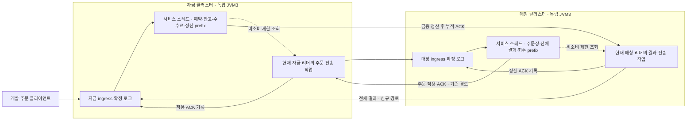

# #169 · Aeron 매칭 결과 전달·자금 정산 확인·결과 자료 회수

작성: **2026-11-04 · 구현 전에 작성한 상세 명세**. 기준은 `feature/phase-2/integration`의 `33e464fef96327bc19100c8a098aae9b7eafd0ff`([PR #174](https://github.com/0Chord/coin-exchange/pull/174) 병합)다. 명세 작성 때 확인한 HEAD `d382841`와 이 통합 커밋의 파일 tree는 동일하다. 이 문서가 #169의 계약 원본이다. 구현·실행·검토 결과는 [구현 검증 기록](matching-result-delivery-review.md)에 별도로 기록한다.

관련: [#169](https://github.com/0Chord/coin-exchange/issues/169) · 상위 [#132](https://github.com/0Chord/coin-exchange/issues/132) · 설계 [#130](https://github.com/0Chord/coin-exchange/issues/130) · 선행 #166·#167·#168 · 후속 취소 #133 / 조합 장애 #134.

## 1. 이번 한 PR의 결과

**별도 매칭 클러스터가 보관한 전체 결과를 실제 자금 클러스터에 전달해 한 번 정산하고, 그 정산 확인을 매칭 로그에 확정한 뒤 결과 전달 자료를 회수한다.** 기존 #168의 주문 전달과 이어서, 독립 자금3노드·매칭3노드 사이 주문→매칭→정산이 처음으로 완주한다.

매칭 결과를 전송하는 담당자는 **매칭 리더 JVM 안의 별도 전송 작업**이다. 자금 리더 안의 주문 전달 작업은 유지한다. 새 전달 전용 JVM·컨테이너·MediaDriver는 만들지 않는다. 금융 계산과 주문장 변경은 각 역할의 서비스 스레드만 수행한다.

- 포함: 전체 결과/정산 ACK의 typed wire, 매칭 서비스 소유 스레드의 비소비 제한 조회, 매칭 리더의 결과 pipeline·재연결·재전송, 자금 committed callback의 정산, 매칭 committed callback의 ACK·결과 회수, 유한 공간에서의 진행, 기존 역할 snapshot과 실제 로그 재시작, 실제 3+3노드의 기본 완주·유실·재연결 검증.
- 유지: 기존 자금 승인·매칭·수수료·분개 계산 규칙, #168 주문/적용 ACK, 상태의 단일 스레드 소유, 고정 담당/lineage/정책, 일반 INTEGRATED·HTTP 경로와 기존 wire/기록 identity. 서로 다른 클러스터의 로그 위치를 같은 번호로 맞추지 않는다.
- 제외: 취소 #133, 서로 모순된 복원 위치·복합 단절/포화 #134, 다중 매칭 클러스터 연결 #135, 리더/과반 장애 전수 #136~138, 마켓 이동, 일반 HTTP 전환·사용자 인증·API 성능, TPS/장기 부하, Kafka·RocksDB·RDB 원장 적재·전체 과거 조회.
- **인증·인가·보안 구현은 제외한다.** #168과 같은 고정 개발망·프로세스 신뢰 전제를 유지한다. role/lineage/설정/순번 대조는 오배치·잘못된 자료를 검출하는 검사이며 발신자 인증·위조 방지 보장이 아니다.

본문의 R1~R28은 **구현 전에 정한 수용 사례**다. 이 명세 자체를 테스트 개수·실행 성공·운영 HA 보장으로 읽지 않는다. 실제 판정과 한계는 [구현 검증 기록](matching-result-delivery-review.md#6-수용-조건과-검증-수준)에 있다.

## 2. 현재와 이후 — 돈이 움직이는 지점

### 2.1 기준 통합에서 확인한 사실

#168은 자금 예약 → 실제 주문 전달 → 매칭 주문장·전체 결과 생성 → 적용 ACK의 자금 로그 반영까지 연결됐다. 주문 전달 payload는 회수하지만 예약은 유지한다. `SplitTradingClusterAdapter`에는 아직 전체 결과를 자금에 적용하거나 정산 ACK를 매칭에 기록하는 명령이 없다.

#167의 `applyMatchingResult()`와 #166의 `readResults()`·`acknowledgeFundsSettled()`는 이미 존재한다. 이번에는 이 코어를 다시 만들지 않고 실제 Aeron 경로에 연결한다.

### 2.2 독립 기대값

설명용 마켓 X/Q, 수량 scale0·수수료0이다. 구매자는 Q1,000, 판매자는 X1을 가진다. 판매 주문 S1(가격100·수량1)이 먼저 대기하고 구매 주문 B1(100×1)이 체결된다.

| 시점 | 자금 상태 | 매칭 상태 | 회수 근거 |
| --- | --- | --- | --- |
| S1 예약·매칭 적용 | 판매자 X 가용0/예약1 | 입력1·무체결 결과1·대기 S1 | 적용 ACK는 주문 전달 자료만 회수 |
| 결과1 자금 적용 | 돈 그대로, S1은 RESTING | 결과1은 아직 보관될 수 있음 | 자금 정산 prefix1 |
| 결과1 정산 ACK 매칭 적용 | S1 예약1 유지 | 결과1 전달 자료0, 대기 S1 원본 유지 | 매칭 로그에 확정한 prefix1 |
| B1 예약·매칭 적용 | 구매자 Q 가용900/예약100 | 입력2·체결1·결과2, 대기 주문0 | 체결은 매칭에서 확정. 아직 자금 정산과 별개 |
| 결과2 자금 적용 | 구매자 Q900/X1, 판매자 Q100/X0, 해당 예약0 | ACK 전에는 결과2 보관 | 자금 로그에서 정산 prefix2·금융 변경 함께 반영 |
| 결과2 ACK 매칭 적용 | 위 돈 그대로 | 결과 전달 자료0·정산 확인2 | 매칭 로그에 정산 ACK 확정 |

무체결 결과1도 처리해야 결과2로 넘어간다. 입력 순번·결과 순번·엔진 사건 순번은 다른 의미다. 이 예의 결과 순번은1,2이고 엔진은 대기 사건1 뒤 체결 사건2다. 최종 거절은 결과 순번을 늘리지만 엔진 사건 순번은 늘리지 않는다.

## 3. 배치와 두 클러스터의 확정 경계

자금 리더는 예약 주문을 보내고, 매칭 리더는 전체 결과를 보낸다. 모든 사본은 자기 클러스터의 확정 입력을 같은 순서로 처리한다. 송신 담당·연결·재시도 cursor는 로컬 자료이며 업무 상태의 복구 원본이 아니다.



그림 전체는 한 트랜잭션이 아니다. **매칭 체결 확정 → 자금 정산 확정 → 매칭의 회수 확인 확정**이 별도로 일어난다. 사이의 단절은 보관된 원본·전체 결과·연속 처리 prefix로 이어간다. 시간 초과를 체결 취소·예약 반환으로 해석하지 않는다.

- 현재 리더가 복원·초기화·자기 tail replay를 마친 활성 세대에서만 새 송신한다. 팔로워·재생·snapshot·종료 중 새 송신을 시작하지 않는다.
- 역할/snapshot/종료 때 결과 조회의 로컬 세대를 무효화한다. 늦은 조회·응답을 새 세대의 확인으로 쓰지 않는다. 같은 결과가 이미 네트워크에 나간 중복은 수신 코어가 처리한다.
- 작업은 destination funds client와 source matching ACK client의 connect/offer/poll/keepalive/close를 한 스레드에서 소유한다. 해당 매칭 노드의 Driver를 재사용하고 겹치는 고정 egress 포트를 만들지 않는다.
- 서비스 스레드에서는 원격 응답 대기·future.join·파일/네트워크 I/O·장시간 callback을 실행하지 않는다. future에는 제한된 불변 조회 결과만 게시하고 작업 스레드가 완료 값을 꺼낸다.

## 4. 현재 코드와 변경 책임

줄 위치는 기준 커밋의 읽기 위치다. 새 이름·파일은 구현 제안이며 내부 이름은 조정할 수 있다.

| 파일·심벌 | 현재 사실 | #169 변경 경계 |
| --- | --- | --- |
| `domain-trading/.../ReservedMatchingState.kt:180` · `readResults` | 비소비 BATCH/PRUNED/BATCH_TOO_SMALL·유한 cursor | 서비스 스레드의 매칭 결과 source로 사용 |
| 같은 파일 `:244` · `acknowledgeFundsSettled` | 정산 prefix와 결과 bytes/count 회수, 대기 주문 유지 | matching ingress committed callback에서 호출 |
| `domain-trading/.../BoundedFundingState.kt:265,272` | 누적 ACK 조회·전체 결과 순차 금융 적용 | funds ingress committed callback에서 기존 계산기와 호출 |
| `domain-trading/.../FundsResultSettlement.kt:127` | DUPLICATE/PRUNED/충돌과 한도형 receipt | 그대로 사용. 영구 원문 인덱스·추가 전체 이력 없음 |
| `app-api/.../aeron/SplitTradingClusterAdapter.kt:134,339,367,440` | Apply/RecordAck만 존재. source/활성 세대가 FUNDS 전용 | 새 결과 명령 분기, MATCHING 제한 조회·세대, 두 역할 snapshot 수명 연결 |
| `app-api/.../aeron/FundsOrderDeliveryAgent.kt` | 주문 전달·누적 적용 ACK·backoff 있음 | 주문 작업 유지. 전송 연결의 좁은 공통 기능만 재사용 |
| `app-api/.../aeron/SplitOrderDeliveryClient.kt:48` | async connect, 실제 publication 검사·조립된 응답, 노드 Driver 재사용 | 결과용 typed client/작업 연결. 기존 주문 응답을 정산 ACK로 재해석 금지 |
| `app-api/.../codec/SplitOrderDeliveryCodec.kt:556` | schema88/version1, 8byte header·32KiB, body 길이16bit | 기존 bytes 유지. 별도 결과 schema/codec 추가 |
| `app-api/.../history/MatchingResultSnapshotCodec.kt:49` | snapshot 외부 설정으로 stream/context 재구성 | 원격 wire로 그대로 사용 금지. 원문 식별·정책을 명시 전송 |
| `app-api/.../aeron/SplitTradingConfiguration.kt:45` | producer/consumer 논리 상한 호환·고정 지문 | 결과 wire/read/in-flight 상한·새 모드 identity 호환까지 검사 |
| `app-api/.../aeron/DevelopmentSplitTradingNode.kt:272` | FUNDS에만 주문 작업 생성 | 새 모드의 MATCHING에만 결과 작업 생명주기 추가 |
| `app-api/src/test/.../DockerFundsOrderDeliveryTest.kt`와 기존 compose/tool | 실제 3+3·독립 기록·snapshot/log 복원·정리 | 기존 기반을 확장해 실제 양방향 금융 검증. 새 공용 테스트 플랫폼 구축 없음 |

제안 파일: `MatchingResultDeliveryAgent`, `MatchingResultSource`, `SplitResultDeliveryCodec`, 결과용 client(기존 연결의 작은 공통 부분은 재사용), `split_result_delivery.proto`. 어댑터 안 owner는 계속 private이며 mutable Map을 작업에 노출하지 않는다. domain에 Spring·Aeron·Protobuf·파일 I/O·네트워크 의존을 추가하지 않는다. 코드 주석은 한국어로 쓴다.

## 5. 실행 모드·식별·상한

### 5.1 명시적 개발 실행

제안 모드 `RESULT_SETTLEMENT_DEV`에서 기존 주문 작업과 새 결과 작업을 함께 활성화한다. 기존 `ORDER_DELIVERY_DEV`는 한 방향 동작과 회귀를 유지한다. 일반 main/direct start의 미준비 FUNDS/MATCHING 차단을 무조건 해제하지 않고 HTTP 라우팅도 바꾸지 않는다.

모드·고정 topology·두 lineage·market/context·ownershipEpoch·configurationVersion·프로토콜/한도·실행물/JDK 지문을 새 실행 identity에 결속한다. 최초 기동 전 잘못된 구성을 거절하고 기록 폴더/Driver/포트를 열지 않는다. 다른 build/기존 한 방향 기록을 새 모드에서 자동 이어 쓰거나 identity 파일을 고쳐 통과시키지 않는다. #168 기록·실행물과 기존 integrated 형식은 보존한다. 새 시험은 새 root로 시작하고 이후 같은 실행 이미지·볼륨·root로 재시작한다.

`DescribePeer`는 목적 역할·실제 lineage·고정 설정/한도 지문·프로토콜·상태를 대조한다. 매칭 작업은 자금 상대와 자기 매칭 ACK 상대를 각각 확인한다. 숫자가 같은 버전만 보고 다른 마켓/정책 자료를 받아들이지 않는다. 이 확인은 인증이 아니다.

### 5.2 논리 보존량과 전송량은 별도다

현재 producer는 기본 단일 결과 논리1MiB·사건1,024까지 허용하고 funds도 이를 받도록 설정된다. 주문의32KiB codec, 조회256KiB·in-flight512KiB를 그대로 결과에 적용하면 이미 확정한 정상 결과가 영구히 막힐 수 있다.

1. 기존 producer/consumer의 논리 bytes/events 호환을 유지한다. 임의로 정상 결과를 잘라 보내거나 wire 크기 때문에 사후 NOT_EXECUTED로 바꾸지 않는다.
2. 결과 frame 상한 제안은 **`2MiB - AeronCluster.SESSION_HEADER_LENGTH(32)`**이다. 새 결과는 native `offer`의 한 논리 메시지로 보내고 Aeron의 단편화를 사용한다. 애플리케이션 chunk inbox·부분 금융 적용은 만들지 않는다.
3. 현재 client publication과 cluster log는 term16MiB다. Aeron1.53.3 로컬 소스에서 maxMessageLength는 term/8이고, client 세션 헤더32byte를 log append에서도 같은 크기로 포함함을 확인했다. ingress subscription의1MiB와 snapshot64KiB는 이 publication의2MiB 메시지 상한과 다른 설정이다. 실제 연결 때 publication 값과 session header를 포함해 다시 검사한다.
4. **논리1MiB라고 frame1MiB라고 단정하지 않는다.** typed protobuf의 태그·varint·UTF-8·반복 목록·중첩·header를 포함한 보수적 상계를 구현해, 설정이 허용하는 모든 정상 결과가 frame/실제 publication/log에 들어감을 증명해야 한다. 상계의 산술 overflow와 미지원 설정은 기동 전에 거절한다. 표준 기본 한도까지 통과해야 하며 예시 한 건 성공만으로 대체하지 않는다.
5. 첫 구현 단위에서 상계·최대 문자열/숫자·많은 maker·실제 encode/큰 메시지 도달을 검사한다. 위 frame으로 기본 한도 전체를 수용할 수 없으면 주문 수용을 열지 않고 상계/표현을 수정한다. 무조건 term/버퍼·메모리를 크게 올리거나 기존 논리 한도를 몰래 줄이지 않는다.

상계 검사의 출발 제안은 `logicalBytes + 256×(1+effects) + 32×effects + 32×events + 1,024`다. 최초 input과 각 effect 원본의 숫자/중첩 초과분, 사건/효과 구조, root/header 여유를 따로 센다. 기본 events1,024·effects1,025·logical1MiB를 대입하면 **1,377,824byte**다. 이것은 현재 생성된 wire의 측정값이나 증명 완료가 아니다. 최종 필드 배치의 각 상수를 descriptor와 최악 수치로 검증하고 논리 bytes와 반복 수의 동시 제약을 유지해야 한다. 최대 dispatch를 단순히1,026개 더해 실제 허용 범위보다 과대 추정하는 방식으로 한도를 임의 축소하지 않는다.

제안 결과 작업 한도는 다음과 같다. 같은 원본 참조가 여러 위치에 있어도 전송용 bytes·완료 future·응답 대기·준비 frame의 총량을 따로 포함해 상한을 검증한다.

| 항목 | 초기 제안·필수 관계 |
| --- | --- |
| 비소비 read | 최대8건·논리2MiB, 적어도 허용 최대 단일 결과1건 수용 |
| 미완료 결과 offer | 최대8건·실제 frame 합4MiB, 적어도 최대 frame1건 수용 |
| 조회 요청 | 작업의 미완료 read1개, 서비스 read 큐 최대4개. 만료/완료 future는 회수 |
| ACK | stream별 최신 누적1개·matching 제출 시도1개, 건수16 또는2ms, 마지막1건도 시간으로 flush |
| connect/응답·재연결·BUSY | #168의3s attempt·50ms reconnect·1~20ms bounded backoff·500ms keepalive 재사용 제안 |
| 종료 | 최대5s 정리. ACK flush는 기한 안에서만 시도하고 실패해도 미확인 의무는 기록에 남음 |

한도는 configuration/identity에 포함한다. polling·ACK 기록을 먼저 진행하고 한 차례의 새 결과 발행·조회 작업량을 제한한다. 단일 큰 결과가 작은 건수 batch와 함께 조회될 수 없으면 한 건 단위로 진행한다. 결과 하나조차 조회 못 하는 설정을 정상 무한 재시도로 숨기지 않는다.

## 6. typed 결과·정산 확인 wire

새 schema89/version1, **12byte Little Endian header**를 제안한다: schema u16, version u16, kind u16, reserved u16(0), bodyLength u32. command/reply kind를 구분하고 실제 frame 길이·허용 상한과 bodyLength가 정확히 같아야 한다. 기존 schema88과 integrated schema87을 바꾸지 않는다. 이름·field 번호는 구현 때 확정하되 예약/중복·미지 enum·필수값 누락을 엄격히 검사한다.

| 명령/응답 | 필수 의미 |
| --- | --- |
| DescribeResultPeer | correlation·실제 role/lineage·mode/protocol/고정 설정/한도 지문·lifecycle |
| ApplyMatchingResult → FUNDS | correlation + 완전한 MatchingResultEnvelope. 매칭 snapshot blob·일부 사건만 보내지 않음 |
| FundsResultApplied | correlation·자금 식별·상태·자금 appliedLogPosition, APPLIED/DUPLICATE/PRUNED에 typed 누적 MatchingFundsSettledAck, GAP에는 expectedSequence |
| QueryFundsSettlementProgress → FUNDS | 재연결/회수 불일치 확인용 stream/context. committed callback에서 비소비 matchingSettlementAck 조회. 매 결과마다 필수 round trip으로 추가하지 않음 |
| RecordFundsSettled → MATCHING | correlation + 검증한 MatchingFundsSettledAck. matching committed callback에서 acknowledgeFundsSettled 호출 |
| FundsSettlementRecorded | correlation·실제 matching role/lineage·고정 설정 지문·matching appliedLogPosition·정확한 stream/context·확정 fundsSettledThrough·resultIssued·상태. 이 확인 또는 확정 source 재조회로 자기 로그 반영을 확인한 뒤 로컬 전송 캐시 회수 |

전체 결과에는 다음 값을 원문대로 보존한다.

- 출발 matching/목적 funds lineage, market, 방향 MATCHING_TO_FUNDS, epoch, configurationVersion, 형식/결과 순번.
- 최초 taker `FundsOrderDispatch` 전체: 자기 stream/승인 순번들·주문·초기 예약의 모든 필드·고정 자산/단위/ordinal/수수료 context.
- outcome/reason, engineSequenceBefore/After, 명시 eventCount와 실제 전체 events, 순서 있는 전체 effects.
- 각 trade/대기 사건의 기존 도메인 필드 전체와 각 effect의 **그 주문의 최초 승인 원본**, before/after 수량, disposition. maker 원본을 taker 원본으로 대체하지 않는다.
- resultId는 기존 고정 규칙으로 유도한다. 파생 ID는 마켓 이름 등을 합쳐256byte를 넘을 수 있으므로 일반 식별 문자열256byte 필드로 중복 전송하지 않는다. correlation·세션 ID·로컬 세대는 업무 ID가 아니다.

외부 설정으로 생략한 stream/context를 조용히 채워 넣는 snapshot decoder를 원격 decoder로 재사용하지 않는다. 순수 필드 변환 helper는 재사용할 수 있지만 전송 원문의 stream·정책·순서 검증은 유지한다. 기존 adapter의 일괄32KiB 선검사보다 먼저 고정 header/schema를 식별해 해당 schema의 크기 상한을 적용한다. body 크기와 repeated 개수를 제한한 뒤 필요한 만큼만 도메인 값으로 변환하고 unbounded 중첩/문자열·미지 사건을 거절한다. 실패 입력에 성공 ACK를 붙이지 않는다.

`appliedAt`은 wire가 임의 지정하는 시간이 아니라 **자금 onSessionMessage의 확정 cluster timestamp**에서 공급한다. 같은 로그를 재생하는 사본은 같은 시각을 사용한다. 재전송이 새 시각을 가져도 최초 receipt/금융 결과를 바꾸지 않는다. 이는 자금 적용 시각이며 매칭 시각이 아니다.

## 7. 정상 처리와 두 ACK의 경쟁

1. 매칭 서비스의 `readResults(stream, from, entries, logicalBytes)`가 한정 불변 목록과 source의 정산 prefix/issued를 반환한다. 조회로 결과·입력·예약을 소비하지 않는다.
2. 현재 매칭 리더 작업이 stream별 순서로 전체 결과를 자금 ingress에 offer한다. 양쪽 peer를 확인하고 조회/준비/in-flight 예산을 확보한 범위에서만 pipeline한다. #168의 주문 ACK를 기다려 결과 전달을 막지 않는다.
3. 자금 확정 callback에서 role/readiness·원문을 검사하고 `applyMatchingResult(result, Instant.ofEpochMilli(timestamp), 기존 settlementCalculator)`를 호출한다. 모든 검증·전체 후보 계산을 마친 뒤 잔고·예약·수수료·정산 prefix·receipt·필요한 주문 전달 확인을 함께 반영한다.
4. 성공 뒤 typed 누적 정산 ACK를 응답한다. 단순 수신/offer/배열 파싱 성공은 이 ACK를 만들 근거가 아니다.
5. 매칭 작업은 응답의 correlation·기대 peer·stream/context·through를 확인하고 누적 정산 ACK를 자기 matching ingress에 제출한다. **through는 현재 source의 resultIssued 이하여야 하며**, 잘못된 누적 ACK를 min으로 잘라 성공 처리하지 않는다. 작업이 가진 과거 read의 issued보다 ACK가 앞선 경우에는 source가 그동안 진행했을 수 있다. 제한된 새 source 조회 또는 matching committed callback의 현재 issued 검사로 판정하고, 오래된 로컬 issued만으로 유효 누적 ACK를 미래 ACK라고 거절하지 않는다.
6. 매칭 확정 callback에서 `acknowledgeFundsSettled()`가 해당 연속 결과 payload/입력 비교 자료의 수명을 끝낸다. `fundsSettledThrough`·settledEngineSequence·결과 count/bytes를 함께 갱신하고 대기 주문 원본·주문장은 남긴다.
7. matching 확정 prefix 재조회 또는 Record 응답으로 자기 로그 반영을 확인한 뒤 로컬 전송 자료를 회수한다. ACK offer 성공·응답 수신 전 중단에도 source 기록에서 재개한다.

성공 응답에는 하한도 있다. `FundsResultApplied`의 ACK.through는 해당 요청 resultSequence 이상이어야 하고, `FundsSettlementRecorded`의 확정 through는 제출한 ACK.through 이상이어야 한다. 둘 다 현재 source 발급 범위 이하여야 하며 요청 correlation·기대 peer/stream/context·활성 세대가 일치해야 한다. 같은 세대라도 늦게 온 다른 요청 응답이나 낮은 through를 이번 요청의 성공으로 수용하지 않는다. 단순히 이전 prefix를 낮추지 않는 것만으로 이 검사를 대신하지 않는다.

자금의 별도 주문 적용 ACK보다 결과가 먼저 도착해도 위3에서 정상 정산할 수 있다. #167 계약대로 그 결과를 매칭 적용 증거로 함께 사용해 주문 전달 자료를 회수한다. 뒤늦은 유효 #168 ACK는 no-op이다. 결과 전달 작업과 주문 전달 작업은 서로의 로컬 응답 순서를 강제하지 않는다.

정상적인 고정 stream의 논리 진행은 `matching.fundsSettledThrough ≤ funds.resultThrough ≤ matching.resultIssued`이고 자금 안에서는 `resultThrough ≤ matchingAppliedThrough ≤ issuedDispatch`다. 이는 각자의 확정 이력을 연결하는 관계이며, 서로 다른 시점에 채집한 관찰 파일 세 개를 같은 순간의 상태로 간주해 비교하지 않는다. 정상 완료 검증에서는 각 사본이 기대 prefix까지 따라온 뒤 금융값·보존 상태를 함께 대조한다.

## 8. 재전송·GAP·회수 경계의 검증

### 8.1 자금 결과 적용 응답

| 응답/상황 | 작업의 동작 | 금지하는 변화 |
| --- | --- | --- |
| APPLIED | 자금 로그에서 나온 유효 누적 ACK를 matching 로그에 전달 | ACK 수신만으로 matching owner 직접 삭제 금지 |
| DUPLICATE | 보존 중 같은 전체 원문. 현재 누적 ACK로 진행 | 재정산·추가 수수료·최초 적용시각 변경 없음 |
| PRUNED + 유효 ACK | 이미 금융 처리했지만 receipt 원문은 회수됨. stream/context와 source 발급 범위 안 ACK면 회수 확인 진행 | 과거 원문 동일성·전체 이력 조회를 증명했다고 말하지 않음 |
| GAP | expectedSequence로 되돌아가 source에 남은 앞 결과부터 재전송 | 미래 결과 skip·무제한 재정렬 Map·예약 선반환 없음 |
| CONTENT_CONFLICT / INVALID_STREAM / INVALID_RESULT | 정상 재시도와 구분해 오류 노출·해당 전송 중단, source 보존 | 성공 ACK·임의 보정·NOT_EXECUTED 변환·자동 반환 없음 |
| NOT_READY / 일시 연결 실패 / BACK_PRESSURED / ADMIN_ACTION | polling·기존 ACK 진행 후 bounded backoff/재연결, 같은 결과 ID 사용 | 금융 실패/최종 거절/결과 삭제로 바꾸지 않음 |
| CLOSED / MAX_POSITION_EXCEEDED | 해당 연결/발행을 닫고 재연결 정책으로 진행 또는 오류 노출, source 보존 | 이미 보냈는지 모르는 결과를 성공/유실로 확정하지 않음 |

음수/미래/잘못된 context의 ACK는 무변경이다. 기존보다 낮은 유효 누적 ACK는 현재 prefix를 낮추지 않는다. Long.MAX_VALUE까지는 허용하되 다음 cursor는 null로 끝내고 overflow/wrap한 새 순번을 발급하지 않는다. timeout·backoff는 JVM 로컬 nanoTime의 차이로만 계산한다.

### 8.2 재연결 시 무엇을 믿는가

재연결한 작업은 source matching의 확정 회수 prefix에서 다시 읽는다. 매칭에 ACK가 미기록이면 결과를 재전송해 자금의 DUPLICATE/PRUNED ACK를 다시 받아 기록한다. 로컬 성공 목록·재시도 파일·마지막으로 본 최대 순번을 복구 원본으로 삼지 않는다.

매칭 `readResults(PRUNED)`와 자금 `FundsResultStatus.PRUNED`는 다르다. 전자는 **매칭 로그에 이미 정산 확인이 기록된 조회 구간**, 후자는 **자금은 정산했지만 비교 receipt 원문이 없는 과거 입력**이다. 상태 문자열만 보고 결과를 생략하지 않는다.

자금이 GAP n을 요구하는데 source matching은 n을 이미 회수한 경우, 연결된 고정 peer의 `QueryFundsSettlementProgress`로 확정 prefix를 대조한다. 자금의 확정 prefix도 n 미만이면 **서로 모순된 복원/배치 상태**다. 해당 전송을 오류로 중단하고 남은 자료·예약을 보존한다. 가짜 정산 ACK·prefix 강제 변경·자동 수리로 계속하지 않는다. 이 모순의 복구 운영 절차는 #134 후속이다.

반대로 자금의 확정 prefix가 이미 n 이상이면 과거 요청에 대한 늦은 GAP일 수 있다. 확인한 누적 ACK와 현재 source 확정 prefix에 따라 제한 재조회·재전송을 이어간다. 늦은 GAP로 더 앞선 유효 ACK를 되돌리거나, 실제로 없는 결과를 요구하는 무한 루프에 들어가지 않는다.

일시 접속 장애는 작업의 연결만 재시도한다. 예상 밖 작업 실패 때 기존 노드 생명주기에 따라 자기 노드는 종료할 수 있으나 세 노드·양쪽 클러스터를 무조건 함께 종료하는 정책을 추가하지 않는다. 금융 반영 도중 예외로 owner가 차단되면 그 상태에서 정상 정산/ACK를 계속 제공하지 않는다.

## 9. 한도 포화 중에도 회수하는 경로

결과 보관 한도가 차면 매칭은 다음 신규 주문에 BUSY를 줄 수 있다. 이때 **기존 결과 송신 → 자금 정산 → 매칭 정산 ACK 반영**은 활성 주문/미확인 결과의 신규 수용 공간을 요구하면 안 된다. polling·ACK flush를 신규 결과/주문 발행보다 먼저 진행하고 세 제어 경로를 각 작업량 상한 안에서 반복한다.

- 활성 예약·미전달 주문·매칭 활성 주문·미확인 결과·자금 receipt·로컬 in-flight를 각각 관측한다. 전부 하나의 큐 길이로 표현하지 않는다.
- 무체결 주문 결과를 정산·회수해도 대기 주문 원본·남은 예약은 유지한다. 메모리 회수 때문에 실제 주문을 지우지 않는다.
- 활성 주문 한도 또는 단일 결과 영구 한도로 매칭이 **실행 전 최종 거절을 확정한 전체 결과**만 순서대로 전달해 자금에서 한 번 반환한다. BUSY·응답 유실·wire 오류를 거절 결과로 만들지 않는다.
- 현재 `FundsResultStatus`에는 BUSY가 없다. 기존 주문 전달의 BUSY 응답을 자금 정산 응답으로 복제하지 않는다. 자금의 비교 receipt는 기존 FIFO 한도에 따라 회수될 수 있다. matching 결과가 아직 남아도 정상이며, 그 결과 재전송에 PRUNED + 정확한 자금 prefix로 응답할 수 있다. 영구 원문 인덱스를 다시 도입하지 않는다.

## 10. snapshot·실제 기록·복구

자금 snapshot-v2·매칭 snapshot-v1은 결과/정산 prefix와 미확인 의무를 이미 담는다. wire 연결만을 이유로 새 도메인 snapshot 형식을 만들지 않는다. 실제 필요한 상태 추가가 발견되면 복원 의미·호환 영향을 먼저 명시하고 변경한다.

- 자금 로그에는 전체 결과 적용 명령과 확정 timestamp가 기록되고 replay는 원래 시각으로 정산한다. matching 로그에는 결과를 만든 주문 입력과 `RecordFundsSettled` 명령이 기록된다. 매칭 결과가 별도의 외부 파일 한 번 쓰기로만 영속화된다고 표현하지 않는다.
- matching ACK 기록 전 복원은 남은 전체 결과를 재전송한다. ACK 기록 후 복원은 payload를 되살리지 않고 prefix를 유지한다. funds 정산 후 응답 유실 복원은 금융 효과를 반복하지 않는다.
- 전체 로그 복원과 snapshot+tail 복원을 각각 검증한다. snapshot 뒤 실제 결과 적용/정산 ACK가 tail에 있음을 각자의 logPosition으로 입증한다. 단순 snapshot codec round-trip으로 실제 Archive replay 성공을 대신하지 않는다.
- 실제 시험은 Archive fileSync/catalog 및 consensus 기록 sync **2/2/2**를 각 노드에서 확인한다. quorum 확정, 개별 force, 전체 디스크 유실 생존을 같은 뜻으로 설명하지 않는다. 전 디스크 유실/외부 백업은 이번 보장이 아니다.
- 처음 만든 동일 실행 이미지·manifest·JDK·고정 설정, 각자 같은 기록 볼륨/root로 재시작한다. 복원 중 재빌드·기록 복사·identity 편집을 하지 않는다. 작업 연결·cursor는 snapshot에 넣지 않는다.

## 11. 수용 사례 — 구현 후 확인할 기대값

각 R은 검증 계약이다. unit/adapter/실제 통합을 구분하며 테스트 숫자를 미리 고정하지 않는다. actual 표시는 계획상 실제 네트워크·각 클러스터 로그를 통해 확인해야 한다는 뜻이다.

| ID | 준비 → 실행 | 직접 대조할 결과·금지 변화 | 수준 |
| --- | --- | --- | --- |
| R1 | 일반 실행/기존 ORDER_DELIVERY_DEV/새 모드, 잘못된 역할·지문·한도 | 기존 경로 유지. 잘못된 새 설정은 자원 생성 전 거절, 새 모드만 결과 작업 활성화 | 시작/회귀 |
| R2 | 최대 UTF-8·정수/선택 필드·반복 사건/효과의 결과 | typed 값 전체 round-trip·충분한 size bound, header/count/enum/방향/stream/context 누락·모순은 무성공 거절 | codec |
| R3 | 결과가32KiB보다 큰 경우와 논리 단일 상한에 근접한 정상 결과, 실제 Aeron publication | 자금 callback까지 완결 결과1개로 도달·정산, 전체 사건/효과 누락0. 최대 frame 허용/초과의 전송·디코드 경계는 별도로 검사. MTU 초과 예시만으로 최대 프레임을 검증했다고 하지 않음 | codec/client+actual |
| R4 | 판매자 X1의 S1@100을 먼저 대기, 전체 결과1 전달 | 판매자 X0/예약1 유지, funds resultThrough1, matching fundsSettledThrough1·result payload0·대기 S1 유지 | actual |
| R5 | R4 뒤 구매자 Q1,000의 B1@100×1 | 구매자 Q900/X1, 판매자 Q100/X0, 관련 hold0·live0, 각 역할 세 사본 prefix2, 매칭 trade1/book0/result0 | actual |
| R6 | S1·S2는 같은 판매자 각1@90/95, 구매3@100·초기Q1,000/X2 | 구매자 Q715/hold100/X2, 판매자 Q185/X0, 구매 잔량1·원본/예약 유지. 결과·정산 순서1→2→3 | 코어 회귀+actual |
| R7 | maker1%/taker2%, 판매1@100·구매1@100 | 구매자 Q898/X1, 판매자 Q99/X0, Q feeRevenue3, hold0. Q 총량898+99+3=1,000 | core/actual |
| R8 | 결과1 자금 정산 응답을 시험에서 유실, 같은 전체 결과 재전송 | DUPLICATE+유효 ACK, 최초 timestamp/금융/수수료 불변, matching 로그 ACK 후 회수 | worker+actual |
| R9 | 자금은 정산했으나 receipt 창 밖이 된 과거 결과 재전송 | PRUNED+정확한 누적 ACK, 재정산0. 다른 stream의 PRUNED 문자열만으로 회수 불가 | core/adapter/worker |
| R10 | 자금 결과 정산을 실제 로그에 확정하고 ACK가 matching 로그에 들어가기 전 보류한 상태로 전체6노드를 종료·같은 기록에서 재시작 | 정산 전후 경계의 실제 로그 복원으로 funds 금융/prefix 유지·matching payload 유지. 같은 결과 DUPLICATE/PRUNED로 ACK 재생성 후 matching 로그에서만 payload0. 추가 정산/수수료0 | actual |
| R11 | matching ACK 로그 확정 뒤 응답 유실·같은 ACK 다시 제출, 별도로 같은 세대의 낮은 through·다른 correlation 응답 주입 | 정상 중복은 prefix·count/bytes 불변. result 요청보다 낮은 자금 ACK·제출 ACK보다 낮은 matching 기록 응답은 완료로 수용하지 않음. 미래/음수/context 불일치 ACK 무변경 | adapter/worker+actual |
| R12 | 결과2를 결과1보다 먼저 funds에 제출, 별도로 뒤늦은 GAP가 앞 ACK 확정 후 도착 | 첫 GAP는 expected1·금융/receipt/전달 무변경,1→2 복구. 늦은 GAP는 현재 확정 progress 대조 후 재개·이미 전진한 prefix 후퇴 없음 | adapter/worker |
| R13 | 명시 주문 적용 ACK보다 전체 결과를 먼저 정산 | 결과로 주문 적용 prefix도 전진·payload 회수, 잔량 예약 유지. 뒤늦은 #168 ACK는 무변경 | actual |
| R14 | active cap1의 기존 대기 주문 때문에 새 BUY1@300 최종 거절 | 새 주문은1,000→가용700/hold300→1,000/hold0, 기존 주문/예약 그대로; 신규 trade/fee0·engine 불변·최초 ACCEPTED 응답 유지 | core+actual |
| R15 | BUSY/timeout/offer backpressure 또는 앞 결과 미처리 | 예약 반환0·원본 보존. 같은 순번으로 재개하며 최종 거절로 바꾸지 않음 | worker+actual |
| R16 | matching 결과1건 한도를 채우고 다음 주문은 BUSY | 신규 공간이 없어도 기존 결과·정산 ACK가 진행해 result bytes/count 회수, 동일 다음 주문이 추가 적용 한 번으로 진행 | actual |
| R17 | matching 정산 ACK endpoint 제출만 막고 funds 정산은 진행 | 원격 funds 효과1회·matching 결과 보존, read/keepalive/다른 제어 응답·snapshot은 계속 진행 | worker+actual |
| R18 | 잘못된 peer/lineage/정책·같은 순번 다른 전체 결과/효과 누락 | 성공 정산 ACK 없음, source 결과·hold 보존, 명확한 오류. 보안 위조 방지 보장으로 확대하지 않음 | codec/adapter/worker |
| R19 | 로컬 세대 변경/팔로워 전환/재생/snapshot 중 늦은 read·응답 | 새 송신 금지·기존 세대 무효화, 업무 순번 재발급0. 변동 가능한 nanoTime 음수·기한 경계도 검사 | worker/adapter |
| R20 | ACK 양쪽 확정 후 전체6노드 종료, snapshot 없이 같은 기록 재시작 | 각자 full-log replay로 R5 금융/prefix 복원, 재전송 재정산0·matching 결과 부활0 | actual |
| R21 | 양 역할 snapshot 후 새 체결·funds 정산을 tail에 남기되 matching 정산 ACK 미기록 상태로 전체6노드 재시작. 이후 ACK를 실제 기록하고 같은 snapshot+새 tail로 다시 재시작 | 첫 복원은 funds 정산 완료·matching 전체 결과 보존, 두 번째는 matching 회수 유지. 각자의 restoredSnapshot/이후 logPosition 입증, 두 번 모두 추가 체결/정산/수수료0 | actual |
| R22 | source matching이 회수한 n보다 funds 복구 prefix가 뒤처짐 | 유효 progress 대조 후 불일치 오류, payload 재생성·가짜 ACK·예약 해제·자동 수리 없음 | worker/adapter |
| R23 | read/준비/in-flight/ACK/미완료 future를 작은 한도로 채움 | 실제·논리 bytes를 각각 준수, 단일 최대 결과는 진행 가능, 회수/ACK가 새 입력에 굶지 않음 | worker |
| R24 | 마지막 Long 순번·낮은 유효 ACK·미래 ACK | MAX 이후 null cursor, wrap0·prefix후퇴0·미래 회수0 | core/codec/worker |
| R25 | 한정 회계 사례의 각 역할 세 사본·미확인 자료/활성 예약 관측 | 외부 기대값에 직접 대조, 합계/로그 위치 일치만으로 금융 정합성을 대신하지 않음 | actual |
| R26 | 성공/실패/중간 timeout·파일 동시 교체 | run 소유 컨테이너/볼륨/이미지/임시물 정리, Linux 다른 UID가 완결 JSON 읽음,16MiB 진단 상한. 다른 자원 삭제0 | harness/CI |
| R27 | 기존 #168·integrated·snapshot golden·금융/매칭 회귀 | 한 방향 ACK/hold 의미·기존 bytes/시작 차단 유지, 새 결과를 기존 Execution 경로로 중복 처리0 | 회귀/구조 |
| R28 | 계산 실패와 금융 실제 반영 도중 예상 밖 실패 | 계산 실패는 금융/prefix/receipt 모두 무변경; 반영 중 실패로 owner 차단되면 정상 ACK 금지·임의 계속 처리 금지 | 기존 코어 회귀+adapter |

R6의Q715는1,000-90-95-예약100이다. 수수료0, 구매 잔량1은 가격100 예약을 유지한다. R7은 수수료가 정수로 정확히 떨어지는 별도 빈 실행에서 검사한다. 소수 수수료 나머지 이월·같은 사용자 양측 주문 등은 기존 #167 회귀도 유지하며, 관찰하지 않은 실제 네트워크 사례를 실행했다고 확대하지 않는다.

## 12. 실제 3+3 검증과 실행 근거

현재 `aeron-order-delivery` compose·frozen runtime·기록/정리 helper를 재사용한다. 제품에 시험 gate·pause 파일·관찰용 전체 상태 endpoint를 추가하지 않고 test wrapper/client listener에서 응답 보류와 상태 캡처를 한다. 기존 wrapper의 `doBackgroundWork` 명시 전달을 유지한다.

- 기본 완주·적용 ACK 역도착·정산 응답 유실·matching ACK 기록 보류·전체 로그와 snapshot tail 재시작을 같은 실제 두 역할 경로에서 확인한다. 한도·다중 체결·수수료는 필요하면 작은 별도 fresh fixture로 나눠 검토 단위를 유지한다.
- 테스트에선 role/cluster별 node3개·독립 JVM/PID/Driver/record root·실제 이미지·member/endpoint·leader·sync 수준·boot/snapshot/log 위치를 기록한다. 서로 다른 역할 logPosition의 동일성을 요구하지 않는다.
- 준비금/기대 잔고·예약·수수료·trade/book·각 prefix·원본/결과 예산을 각 사본에서 독립 상수·수기 산식과 대조한다. 받은 응답의 순서나 코드가 계산한 expected 값을 그대로 정답으로 복사하지 않는다.
- 기존 사전 점검 디스크8GiB·Docker 메모리6GiB, 컨테이너768MiB/heap256MiB, 기록2GiB·진단16MiB, 작업8분·정리45초의 제한을 우선 재사용한다. 새 시나리오가 한 번의 제한을 넘으면 작은 실행으로 나누고 한도를 몰래 해제하지 않는다. 이는 장기 성능 시험이 아니다.
- Linux 읽기 권한0644 원자적 JSON 게시·다른 UID 실측을 유지한다. 보고서 크기 순회에서는 삭제된 임시 파일만 허용하고 권한 오류/그 외 I/O 오류를 무시하지 않는다.
- 실패해도 assert·진단·run 소유 자원 정리가 끝나야 한다. Docker 불가를 skip·mock 성공으로 보고하지 않고 전제 실패로 구분한다. 전체 Docker prune이나 사용자 앱 종료를 하지 않는다.

아래는 **구현 전에 세운 검증 명령 계획**이다. JDK 25가 `JAVA_HOME`과 `PATH`에 설정되어 있어야 한다. 실제 실행 범위·수치와 최종 재현 명령은 [구현 검증 기록](matching-result-delivery-review.md#9-재현할-명령과-로컬-근거)에 있다.

```bash
cd "$(git rev-parse --show-toplevel)"
./gradlew :domain-trading:test --tests '*FundsResult*' --tests '*ReservedMatching*' --no-daemon --max-workers=1

cd "$(git rev-parse --show-toplevel)"
./gradlew :app-api:test --tests '*Split*' --tests '*FundsOrderDeliveryAgentTest' --tests '*MatchingResultDelivery*' --tests '*DockerFundsOrderDeliveryTest' --no-daemon --max-workers=1

cd "$(git rev-parse --show-toplevel)"
./gradlew ktlintCheck :architecture-tests:test :architecture-tests:verifyArchitectureReport --no-daemon --max-workers=1
```

위 명령은 명세 작성 당시의 검증 계획이며 실행 결과를 뜻하지 않는다.

## 13. 작은 구현 순서와 완료 조건

1. **첫 작은 단위:** wire 상계/typed codec과 기동 거절. R2/R3/R23의 크기 상계·최대 문자열/정수·전체 사건/효과 복원을 첫 테스트로 삼는다. 원문 stream/context를 잃는 snapshot bytes 재사용은 하지 않는다.
2. 자금 committed callback에 결과 적용/확인 조회, matching callback에 정산 ACK를 연결한다. 기존 코어의 부수효과 경계·시각을 R4/R12/R13/R18/R28로 확인한다.
3. matching의 유한 read/generation과 리더 작업을 연결한다. R8~R11/R15/R19/R22~R24로 재전송·늦은 응답·진행성을 확인한다.
4. 새 개발 모드에서 실제3+3 통신·금융 전후 값·기본 복원을 확인한다. 기존 #168 회귀와 구조/형식 검사를 유지한다.
5. 별도 컨텍스트의 독립 리뷰와 수용 조건 대조, 미해결 결함 수정 뒤 재확인을 수행한다. 실행 근거·미검증·run 자원 정리를 구현 기록에 남긴다.

완료 조건은 R1~R28의 해당 검사/실제 근거, 자금 세 사본의 금융 기대값과 매칭 세 사본의 주문장·회수 prefix, 재전송 재정산0, 실제 자기 로그의 정산 ACK, 기본 복원, 한도/정리, 독립 리뷰 결함 처리를 설명할 수 있는 것이다. 새 테스트 숫자·설계 문서·green 구조 검사만으로 금융/HA/운영 보안을 완료로 주장하지 않는다.

## 14. 설계 결정과 검증 경계

### D1 · 결과 작업의 배치

결과 전송 작업은 매칭 리더 JVM 안에 둔다. 결과를 소유한 쪽의 로컬 서비스 스레드에서 제한 조회해 보내면 원격 결과 조회 왕복 없이 source 의무와 재시도 책임을 연결할 수 있다. 자금 리더는 주문을 보내고, 매칭 리더는 확정 결과를 자금에 보낸 뒤 정산 확인을 자기 클러스터 로그에 기록한다. 두 계산 스레드는 통신을 기다리지 않으며 별도 JVM을 늘리지 않는다.

§3/7의 대칭 배치, §4의 새 worker/source, R1/R19의 리더·세대 경계에 이 결정을 반영한다. 자금 리더가 매칭 결과를 원격 조회하는 pull 방식은 조회 통신이 추가되므로 채택하지 않았다. 별도 운영 JVM이 필요한 독립 배포 요구가 생기면 재검토한다.

### D2 · 선행 계약 유지

#130: 예약 후 매칭에서 체결 확정·정산은 이어 완료, 마켓별 유한 대기, 매칭의 최종 미실행 거절 후 한 번 반환. #167: 정산한 결과를 매칭 적용 증거로 함께 사용. #168: 전달 담당은 같은 노드의 별도 작업, 인증·인가·보안은 이번 연결에서 제외한다.

### 명세 작성 시점의 상태 구분

- **확인한 사실:** 통합 HEAD/tree 일치, #169/#130 본문, 기준 상태 core/adapter/client/proto·Docker 경로·복원 형식, Aeron1.53.3 소스의 header/term 한도. 상태 코어와 runtime/전송 경계를 읽기 검토로 대조했다. 이 검토 자체는 구현 독립 리뷰·새 실행 성공이 아니다.
- **설계 결정:** D1과 D2.
- **구현 제안:** 새 mode/schema/header/API 이름·작업 한도·내부 파일 분할. 계약을 지키는 범위에서 조정 가능하나 bytes/한도/identity 영향은 기록한다.
- **구현 전 통과 조건:** 모든 허용 결과의 protobuf 상계 증명과 실제 큰 결과 도달은 첫 구현 단위의 통과 조건이다. 통과 전 주문 수용을 활성화하지 않는다. 기존 term으로 불가능하다는 결과가 나오면 관련 전송 설정/표현 범위를 먼저 재검토한다.
- **명세만으로 증명하지 않는 범위:** #169 제품 구현·새 unit/실제 Docker 실행·장애 시험·성능·운영 보안·원장 전체 항목 직접 대조. 원장 분개는 기존 계산/균형 검증을 재사용하지만 bounded state가 전체 과거 분개 목록을 보관한다고 말하지 않는다. 구현 후 확인한 범위는 [구현 검증 기록](matching-result-delivery-review.md)에 있다.

상태 코어·전송 경계·명세의 별도 읽기 검토에서 실제 재시작의 정산/ACK 사이 경계(R10/R21), 성공 응답 through의 요청별 하한(R11), 늦은 GAP의 정상 재개(R12)를 보완했다. 이는 명세 누락 보완이며 제품의 결함 재현·수정 또는 실행 성공 근거와 구분한다.

공식 자료: [Aeron 큰 메시지와 term 상한](https://aeron.io/docs/cookbook-content/aeron-term-length-msg-size/), [단편 메시지 조립](https://aeron.io/docs/cookbook-content/aeron-fragment-assembler/), [Cluster의 결정적 서비스 처리](https://github.com/aeron-io/aeron/wiki/Cluster-Tutorial). 버전별 실제 적용은 저장소가 사용하는1.53.3 소스와 함께 대조한다.
