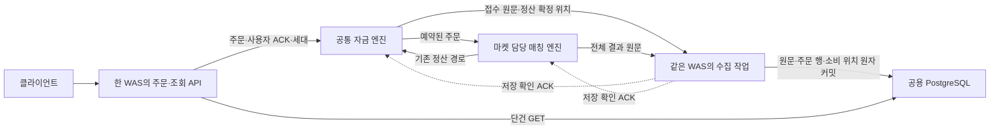

# #60 · 실제 거래 결과를 같은 WAS의 주문 조회에 연결

2026-11-17, `/Users/0chord/Desktop/exchange-core`의 `feat/order-query-feed/60` 변경을 검증한 기록이다. 기준 HEAD는 `73d9168deb0d99de20a15bc9779ad868b067879b`다. A에서 만든 한 WAS·공용 RDB·조회 모델에 B의 확정 원본 보관, 원격 수집, DB 원자 반영, 저장 ACK와 재개를 연결했다. B1/B2는 내부 구현 순서였으며 이번 변경은 B 전체를 대상으로 한다. 아래 수용 조건·필수 검사를 확인했고, 분리된 독립 리뷰에서 확인된 지적을 수정·재검증했다. 로컬 구현 검증을 완료했다. 원격 CI·병합은 이 로컬 결과와 구분한다.

## 현재 사용자 흐름과 소유권



[ExchangeCoreApplication](../app-api/src/main/kotlin/com/exchange/core/ExchangeCoreApplication.kt)은 기본 컴포넌트 탐색을 사용한다. [OrderQueryConfig](../app-api/src/main/kotlin/com/exchange/core/api/config/OrderQueryConfig.kt)가 같은 WAS에 조회 저장소·유즈케이스·수집 작업을 등록한다. 공용 DataSource·JDBC·트랜잭션·Flyway를 재사용하며 별도 조회 서버나 실행 프로필은 없다. 사용자 주문·ACK·세대 요청의 상대는 자금 엔진 하나이고, 매칭 담당에 직접 연결하는 것은 내부 조회 수집이다.

| 근거 | 권위와 순서 | 이번 보존·회수 경계 |
| --- | --- | --- |
| 접수 원문 | 자금 lineage + 실제 전역 `admissionSequence` | 승인한 원 주문·예약·정책·마켓 접수 순번을 별도 조회 보관에 유지한다. 거절·동일 요청 재전송은 새 사실을 만들지 않는다. |
| 전체 매칭 원문 | `MatchingResultStream` + 마켓별 `resultSequence` | maker/taker의 모든 효과와 `CANCELLED`, `CANCEL_REJECTED`, `NOT_EXECUTED`를 그대로 보존한다. 업무 정산 ACK 후에도 조회 ACK 전에는 남는다. |
| 자금 확정 위치 | 같은 결과 stream의 자금 `resultThrough` | 기존 정산 prefix를 읽는다. receipt 원문을 회수해도 위치는 남으며 조회용 정산 이벤트 목록을 추가하지 않는다. |
| DB 처리 위치 | 고정 consumer·소스별 cursor와 DB revision | 전역 접수 위치와 마켓별 매칭·금융 위치를 분리한다. 서로 다른 클러스터의 raw log position이나 DB revision을 비교해 정산 완료를 만들지 않는다. |

접수·매칭 사실은 각 역할의 **유한한 JVM 복제 상태**다. 실제 확정 callback이 금융·주문장 변경과 함께 기록하며, 기존 Archive 입력 재생과 역할 snapshot으로 복원한다. 별도 주문당 fact 파일·외부 저널은 추가하지 않는다. WAS는 입력 로그를 성공 결과로 추정하거나 금융 계산을 다시 실행하지 않는다.

## 원본에서 DB 저장 확인까지

1. [자금 접수](../domain-trading/src/main/kotlin/com/exchange/core/trading/BoundedFundingState.kt)는 새 예약 전에 조회 보관 여유를 검사한다. [매칭 적용](../domain-trading/src/main/kotlin/com/exchange/core/trading/ReservedMatchingState.kt)은 계산된 후보의 실제 크기를 업무·조회 보관 양쪽과 대조한 뒤 주문장을 바꾼다. 검증된 불변 원문을 공유한다.
2. [소스 프로토콜](../app-api/src/main/kotlin/com/exchange/core/api/trading/infrastructure/codec/OrderQuerySourceCodec.kt)은 schema 90의 Describe/Read/누적 ACK를 사용한다. 큰 접수·매칭 원문 응답은 기존 schema 88/89 단일 Apply frame을 재사용한다. Read는 한 번에 원문 하나를 돌려주며 원문을 잘라 보내지 않는다.
3. [같은 WAS의 수집 작업](../app-api/src/main/kotlin/com/exchange/core/api/trading/infrastructure/aeron/OrderQueryFeedWorker.kt)은 전용 스레드에서 bounded 연결·요청을 수행한다. 입력 계약 2·역할·consumer·lineage·topology 지문·마켓 배치·정책을 검증하고 같은 ingress의 여러 마켓은 같은 연결과 Describe를 공유한다. 각 반복에서 접수와 각 마켓 결과·금융 반영을 각각 최대 32건까지 진행한다. 엔진 서비스 스레드에서 네트워크나 DB 완료를 기다리지 않는다.
4. [원자 저장소](../app-api/src/main/kotlin/com/exchange/core/api/trading/infrastructure/persistence/PostgresOrderQueryFeedStore.kt)는 원본 ID/정규 원문 중복부터 판정한다. **원문 영수증, 모든 maker/taker 주문 행, 최초 처리 revision, 소스별 cursor, 전역 covered 접수 위치**를 같은 공용 DB 트랜잭션에 넣는다. 동일 원문은 최초 revision을 반환하고, 같은 ID의 다른 원문은 차단한다. 매칭에 필요한 접수가 없으면 주문을 추정해 만들지 않고 해당 접수부터 가져온다.
5. 자금 watermark는 같은 결과 stream에서만 금융 상태를 전진시킨다. 늦게 도착한 매칭 원문으로 이미 확인한 금융 위치를 되돌리지 않는다. 기존 미정산 결과의 주문은 순번별로 갱신하며 완료된 과거 주문을 매 반복 다시 쓰지 않는다.
6. DB 커밋을 확인한 뒤에만 저장한 cursor를 소스에 ACK한다. 해당 ACK가 소스 복제 callback에서 확정돼야 원문 prefix를 회수한다. 소스 원문을 회수해도 DB의 종료 주문과 전체 매칭 원문은 남는다. 사용자 HTTP ACK로 조회 원본을 회수하지 않는다.

공용 migration [V11](../app-api/src/main/resources/db/migration/V11__create_order_query_source_feed.sql)은 V10을 수정하지 않고 `feed_consumer`, 마켓별 `feed_stream`, canonical payload가 있는 `source_receipt`와 미정산 행 인덱스를 추가한다. 기존 V1~V10 이력과 자료는 유지한다.

## 한도, 복구와 조회 응답

[QueryFactRetention](../domain-trading/src/main/kotlin/com/exchange/core/trading/QueryFactRetention.kt)은 전체·마켓별 건수와 논리 직렬화 bytes를 함께 제한한다. 접수가 포화되면 예약 전에 `RETRYABLE_CAPACITY`, 매칭이 포화되면 주문장·결과 순번을 바꾸기 전에 `BUSY`다. 같은 요청의 최초 응답 재사용, 이미 확정된 체결의 정산·반환, 업무 ACK, 조회 Read·ACK와 정산 위치 조회는 계속 허용한다. 개별 마켓 한도와 전체 한도를 구별하며 전체 예산을 소진했을 때 무제한 독립 처리를 보장하지 않는다.

소비자·capability version·전체/마켓별 한도는 역할 구성 바이트와 topology 지문에 들어간다. 조회 활성 snapshot은 [자금 v4](../app-api/src/main/kotlin/com/exchange/core/api/trading/infrastructure/history/FundsRoleSnapshotCodec.kt), [매칭 v3](../app-api/src/main/kotlin/com/exchange/core/api/trading/infrastructure/history/MatchingRoleSnapshotCodec.kt)이며 issued/retired prefix, 미확인 원문과 bytes를 같은 snapshot 위치에 넣는다. 조회 비활성 구성의 기존 바이트·golden은 유지한다. 원본이 없는 구형 snapshot을 조회 활성 형식으로 읽거나 전체 과거 조회로 승격하지 않는다.

최초 수집에는 처음부터 원본을 보존한 계보·기록 root 또는 별도 이행 증거가 필요하다. WAS 재시작은 기존 DB cursor부터 재검증하고, 역할 재시작은 실제 snapshot과 뒤의 원문·조회 ACK tail을 재생한다. 원본 retired prefix가 DB cursor보다 앞서고 다른 동일 consumer가 DB를 전진시킨 근거도 없다면 BLOCKED다. 원본을 다시 만들거나 DB를 비우지 않는다. 동일 consumer의 다른 WAS가 먼저 커밋·회수한 정상 경합에서는 `PRUNED` 뒤 DB cursor를 다시 읽어 이어 간다.

| 상황 | 저장·재시도와 GET 판단 |
| --- | --- |
| 수집 설정이 없는 WAS, 최초 수집 미완료, 소스 연결 실패·재검증 중 | `INITIALIZING`, `503 QUERY_NOT_READY`. 준비를 확인하지 않고 시각만으로 최신이라고 하지 않는다. |
| 준비된 DB가 확인된 원본 head보다 뒤처짐 | `READY + LAGGING`. 발견된 주문은 200이며, 최소 접수 위치 미반영·지연 중 부재는 `202 QUERY_CATCHING_UP`이다. |
| DB 커밋 응답 유실 | ACK를 보내지 않고 DB의 저장된 cursor·최초 원본 영수증으로 재개한다. 중복 적용은 최초 결과를 재사용한다. |
| Read 또는 확정된 소스 ACK의 응답 유실 | 연결을 다시 검증한다. Read 성공·전송 성공만으로 cursor를 전진시키지 않으며, 이미 확정된 ACK의 회수를 되돌리지 않는다. |
| 소스 identity·정책·원문 충돌, 복구 불가능한 원본 공백 | DB 주문·cursor를 보존한 채 `BLOCKED`, GET503. 단순 재시작으로 정상화하지 않는다. |
| READY 재시작 뒤 수집 설정 누락 | 기존 DB와 종료 주문은 보존한다. 제품 조립 때 로컬 조회를 INITIALIZING으로 두므로 검증 없는 200·404는 내보내지 않는다. |
| 미준비/차단 상태의 DB 쓰기까지 실패 | 같은 WAS는 즉시 로컬 조회를 닫는다. 일시 실패는 재검증 커밋 뒤에만 해제하고, 영구 모순은 같은 이유의 BLOCKED 저장이 성공할 때까지 재시도한다. |
| DB 오류·손상 | GET503. 중간 SQL 실패는 해당 결과의 모든 주문·원문·revision·cursor를 롤백한다. |
| 관찰 기준까지 반영했으며 주문 부재 | `404 ORDER_NOT_FOUND_AS_OF`. `CAUGHT_UP`은 검증한 원본 기준까지의 일치다. |

GET의 판단 순서는 입력400 → DB 오류/모순503 → 미준비503 → 최소 접수 위치 미반영202 → 발견200 → 지연 부재202 → 관찰 기준 부재404다. GET은 금융·조회 행을 변경하지 않는다.

## 실행 구성

현행 WAS의 주문 gateway와 조회 client는 **input contract 2**를 사용한다. 연결할 소스는 기존 manifest·멤버·담당 배치 설정에 `SPLIT_INPUT_CONTRACT_VERSION=2`, `SPLIT_MODE=RESULT_SETTLEMENT_DEV`를 함께 공급한다. 구형 codec 지원이 현재 WAS의 v1 연결 지원을 뜻하지 않으며 기존 기록을 자동 승격하지 않는다.

| 공급 위치 | 설정과 검증 |
| --- | --- |
| 모든 소스 멤버 | `EXCHANGE_ORDER_QUERY_CONSUMER_ID`를 같은 고정 값으로 설정한다. 없으면 조회 보관을 활성화하지 않는다. 소비자와 한도가 다른 멤버·snapshot은 구성 지문이 달라 거절된다. |
| 소스 건수 | 전체 `EXCHANGE_ORDER_QUERY_MAX_ENTRIES` 기본 4,096, 마켓별 `EXCHANGE_ORDER_QUERY_MAX_MARKET_ENTRIES` 기본 2,048. |
| 소스 bytes | 기존 자금·receipt snapshot 상한을 `base`라 할 때 `room=(128MiB-base)/4`, 전체 기본 `min(4MiB, room)`, 마켓 기본 `min(2MiB, 전체 기본)`이다. 실제 dispatch 한도와 input version으로 계산한다. `EXCHANGE_ORDER_QUERY_MAX_BYTES`, `EXCHANGE_ORDER_QUERY_MAX_MARKET_BYTES`의 명시값도 최대 접수/결과 하나와 전체 snapshot 한도를 통과해야 한다. |
| 같은 WAS | `exchange.order-query.consumer-id`를 소스와 같게 지정하면 기본 스캔으로 수집 Bean이 등록된다. `funds-lineage-high/low`, `supported-markets`와 기존 `TRADING_GATEWAY_*`도 공급한다. |
| 매칭 조회 주소 | `exchange.order-query.matching-ingress=BTC-USDT@0=127.0.0.1:20700;ETH-USDT@0=127.0.0.1:21700`처럼 전체 소스 마켓을 지정한다. 같은 담당의 여러 마켓은 같은 ingress를 쓸 수 있다. |
| WAS 재시작 | 주문 gateway의 실행 폴더는 새 프로세스마다 새 경로를 사용한다. DB, consumer, 소스 계보·기록 root는 유지한다. 수집 Driver는 WAS gateway 폴더와 충돌하지 않는 임시 형제 폴더에서 정리한다. |

실행 환경과 CLI 예시는 [README](../README.md#설정과-실행)에 있다. 새 별도 DB·Kafka·Redis·RocksDB, 인증·인가, 취소 HTTP, 체결 상세·수수료 상세 API, 원장 대사, 과거 자동 이행, 전체 저장소 유실 복구와 새 9노드 HA/장기 성능 시험은 추가하지 않았다. 조회 ACK는 신뢰하는 내부 소비자라는 개발 환경 전제다.

## 테스트를 읽는 지도

아래는 테스트 이름만 옮긴 목록이 아니라 준비·호출·실제 assertion을 대조한 요약이다. native HTTP 사례는 실제 PostgreSQL·HTTP·Aeron 역할 노드를, Archive 복구 사례는 실제 Driver/Archive와 snapshot·tail 재생을 사용한다. 지연·응답 유실은 `src/test` wrapper로 해당 경계를 제어하며, 제품에 fixture API를 넣지 않는다. 표의 테스트는 아래 집중 실행 XML에 포함돼 있다.

| 준비와 종류 | 실행 | 실제 확인하는 값·변경 금지 | 근거 |
| --- | --- | --- | --- |
| 조회 미설정 제품 WAS + 실제 DB·자금1/매칭1, 수수료0 | 매도3·매수3, 같은 token 재전송, HTTP epoch/ACK | 구매 대금700/자산3·판매 대금300/자산0·hold0, 접수 순번 재사용, GET503 | [native 첫 사례](../app-api/src/test/kotlin/com/exchange/core/api/trading/infrastructure/aeron/SplitFundsTradingHttpTest.kt) |
| 같은 구성 + 조회 보관·수집 활성, 결과 Apply 전송만 잠시 차단 | 매도3 → 매수1 → 내부 명령으로 잔량2 취소 → 전송 재개 → WAS 재시작 | 매도 `PARTIALLY_FILLED(1/2)`·매수 `FILLED(1/0)`의 PENDING/SETTLEMENT, 취소 `(1/0/2)`의 PENDING/RELEASE, 이후 APPLIED. 구매900/자산1·판매100/자산2·hold0. 원본5행, ACK 접수2/매칭3, 재시작 뒤 같은 revision·잔고·정산 위치 | [native 부분 체결·취소 사례](../app-api/src/test/kotlin/com/exchange/core/api/trading/infrastructure/aeron/SplitFundsTradingHttpTest.kt) |
| 조회 활성 실제 자금·매칭, 수집 WAS 없이 원문 보존 | 첫 원문 뒤 실제 양쪽 snapshot 완료 → 두 번째 원문과 실제 조회 ACK1 tail → 같은 기록 root로 역할 재시작 | 양쪽이 실제 snapshot image를 읽음, issued2/retired1, 원문1 PRUNED·원문2 전체 내용 동일, 잔고·정산2 유지, 원본·복구 노드의 생명주기 | [native Archive 복구 사례](../app-api/src/test/kotlin/com/exchange/core/api/trading/infrastructure/aeron/SplitFundsTradingHttpTest.kt) |
| 실제 수집이 접수 DB 적용 직전에 도달하도록 latch로 제어 | `minAdmissionSequence=1` GET → DB 적용 허용 | 202와 covered0, 원본 ACK0·DB receipt0, 재개 후 RESTING/200·covered1 | [native DB 지연 사례](../app-api/src/test/kotlin/com/exchange/core/api/trading/infrastructure/aeron/SplitFundsTradingHttpTest.kt) |
| 실제 DB 커밋 후 반환만 한 번 잃고 Describe를 잠시 막음 | GET503 확인 → 같은 canonical 원문 재적용 → 재검증 허용 | DB receipt1/cursor1이지만 소스 retired0, 최초 revision·주문 ID 유지, 최종 접수/매칭 receipt 각1과 ACK1 | [native 커밋 응답 유실 사례](../app-api/src/test/kotlin/com/exchange/core/api/trading/infrastructure/aeron/SplitFundsTradingHttpTest.kt) |
| 실제 소스 callback 뒤 Read 또는 조회 ACK 응답을 한 번 버림, 재검증 잠시 실패 | GET503 중 DB·소스 위치 대조 → 연결 허용 | Read 유실은 cursor/retired0·receipt0, 확정 ACK 응답 유실은 cursor/retired1·원문 회수 유지. 복구 후 receipt2와 양쪽 ACK1, 기존 canonical payload·최초 revision 동일 | [native 응답 유실 두 사례](../app-api/src/test/kotlin/com/exchange/core/api/trading/infrastructure/aeron/SplitFundsTradingHttpTest.kt) |
| 같은 소비자·DB를 쓰는 제품 WAS 두 인스턴스로 경합을 제어 | A가 cursor0을 들고 대기 → B가 커밋·ACK1 → A가 실제 PRUNED 응답 수신 | A의 DB cursor 재읽기, 두 GET 정상 복구, BLOCKED 호출 없음, receipt2·READY 유지. 별도 조회 서버 배치 시험은 아니다 | [native 동시 소비 사례](../app-api/src/test/kotlin/com/exchange/core/api/trading/infrastructure/aeron/SplitFundsTradingHttpTest.kt) |
| 실제 자금1·BTC매칭1·ETH매칭1·한 WAS·공용 PG | 매도 BTC/ETH3, 매수 BTC/ETH3, 네 GET, 각 소스 Describe | 전역 접수1~4, 마켓별 결과1~2, 네 FILLED/APPLIED·covered4, 구매400/BTC3/ETH3·판매600/BTC0/ETH0·hold0, 원본8행, 서로 다른 매칭 lineage·각 retired2와 자금 retired4 | [복수 담당 HTTP](../app-api/src/test/kotlin/com/exchange/core/api/trading/infrastructure/aeron/MultiMarketOrderQueryHttpTest.kt) |
| 순수 역할 상태에 작은 건수/bytes·마켓 한도 | 접수·매칭·취소 포화, 재전송·업무 ACK·정산·조회 ACK, 읽기 한도와 손상 복원 | 예약/잔고/inbox·주문장·결과 순번 무변경, 타 마켓 여유 사용, 포화 중 정산1회, 업무 ACK 후 조회 원문 동일, 잘못된 소비자/미래 ACK 거절, 작은 Read의 필요 bytes, 복구 손상 차단 | [QueryRetentionCoreTest](../domain-trading/src/test/kotlin/com/exchange/core/trading/QueryRetentionCoreTest.kt) |
| 실제 PostgreSQL, 순수 역할이 만든 실제 매칭 원문 | maker/taker·취소·먼저 받은 watermark·재개방·동시 원문 재시도, 실제 SQL trigger 오류 | 수량·금융 단조성, canonical 원문과 최초 revision 동일, maker/taker·receipt·cursor·revision 전부 롤백, 원본/계보 충돌과 공백 BLOCKED, 지원 밖 접수도 분류·전역 prefix 유지 | [FeedStore 15개](../app-api/src/test/kotlin/com/exchange/core/api/trading/infrastructure/persistence/PostgresOrderQueryFeedStoreTest.kt) |
| 역할 recovery DTO와 실제 snapshot bytes | 업무 ACK/조회 ACK 전후 roundtrip, input2, 구형·다른 구성, 체크섬을 다시 맞춘 손상 | 조회 원문·issued/retired·bytes 동일, 구형 원본 없는 snapshot과 다른 consumer/한도 거절, prefix/count/frame 손상 거절 | [역할 codec 5개](../app-api/src/test/kotlin/com/exchange/core/api/trading/infrastructure/history/OrderQueryRoleSnapshotCodecTest.kt) |
| source 제어·메타데이터·기존 Apply frame | 두 역할 원문 encode/decode, 최대 frame·UTF8 경계·잘림·schema/수치 손상 | 기존 원문 bytes/정책 유지, 최대 결과를 제어 응답의 작은 상한으로 자르지 않음, 손상 거절 | [소스 codec 9개](../app-api/src/test/kotlin/com/exchange/core/api/trading/infrastructure/codec/OrderQuerySourceCodecTest.kt) |
| QUERY Describe 입력 버전만 1로 주입, 실제 노드·POST는 계약2 | 실제 WAS 기동·원격 Describe, 첫 block 실패도 별도 주입 | 준비 검증 전 BLOCKED/503·ACK0. 첫 DB block 실패는 같은 이유 2회·Describe1회로 재시도. 실제 v1 전체 WAS 기동 성공 시험은 아님 | [native 호환·차단 저장 두 사례](../app-api/src/test/kotlin/com/exchange/core/api/trading/infrastructure/aeron/SplitFundsTradingHttpTest.kt) |
| 실제 PG의 lifecycle UPDATE만 trigger로 실패 | suspend/block 뒤 원문·cursor·rawDBREADY와 GET 판정 대조 | raw DB가 READY여도 QUERY_NOT_READY, 일시 실패는 재검증 커밋 뒤 해제, 영구 충돌은 재시도 뒤 durable BLOCKED | [FeedStore 실패 상태 두 사례](../app-api/src/test/kotlin/com/exchange/core/api/trading/infrastructure/persistence/PostgresOrderQueryFeedStoreTest.kt) |
| READY·종료 주문을 준비한 실제 HTTP 문맥 | consumer 설정 없이 제품 설정을 다시 조립 | 기존/없는 주문 모두503, 모든 DB행·timestamp 보존, 금융 gateway 무호출. 다른 기반 GET 검사는 명시적 검증 fixture를 준비해 기존 기대값 유지 | [HTTP 재시작 사례](../app-api/src/test/kotlin/com/exchange/core/api/trading/api/OrderQueryHttpTest.kt) |
| 기본 v1 예산과 작은 명시 예산의 환경 설정, 실제 역할 조립 | consumer/한도 활성화·변경, 기본 남은 snapshot 공간 계산, 양쪽 역할 초기화 | 전체 snapshot≤128MiB, 최대 결과 수용, 양쪽 progress0, 소비자·모든 한도 지문 변경, 초과 구성 시작 거절 | [역할 시작 19개에 포함](../app-api/src/test/kotlin/com/exchange/core/api/trading/infrastructure/aeron/SplitTradingRoleStartupTest.kt) |
| 조회 모델·유즈케이스 대역, 실제 DB·HTTP, Boot 공용 설정 | 수량·지연·부재·손상·중복·동시 저장·재개방·migration 검사 | 조회 불변식, 400/200/202/404/503 순서, 공용 migration 이력과 기존 자료, 읽기 무변경 | [모델](../app-api/src/test/kotlin/com/exchange/core/api/trading/application/OrderQueryModelTest.kt), [유즈케이스](../app-api/src/test/kotlin/com/exchange/core/api/trading/application/OrderQueryUseCaseTest.kt), [GET](../app-api/src/test/kotlin/com/exchange/core/api/trading/api/OrderQueryHttpTest.kt), [기존 DB](../app-api/src/test/kotlin/com/exchange/core/api/trading/infrastructure/persistence/PostgresOrderQueryStoreTest.kt), [공용 설정](../app-api/src/test/kotlin/com/exchange/core/api/config/OrderQueryConfigurationTest.kt) |

## 최종 실행 근거와 수용 판정

XML은 `/tmp/query60-verification/final`에 모았다. 코어는 전체 실행, 조회는 v3 101개와 마지막 조립 변경에 영향받은 27개의 최신 결과를 중복 없이 합친 102개다. 서로 다른 실행을 한 번에 돌렸다고 표현하지 않는다.

| 검사 | 실제 실행/판정 | 실패 / 오류 / skip |
| --- | --- | --- |
| domain-trading 전체 37 suites | 454개 통과 | 0 / 0 / 0 |
| 조회 관련 11 suites | 102개 통과 | 0 / 0 / 0 |
| architecture 35 suites | 386개 통과 | 0 / 0 / 0 |
| 일반 앱 회귀 | 1,277개 수집, 1,274개 통과 | 0 / 0 / 3 |
| verifyArchitectureReport | P01~P09 실행·성공 | 필수 누락 없음 |
| 전체 ktlintCheck, CI partition 검사, diff 검사 | 통과 | 빈 대상·실패 무시 없음 |

조회 102개는 모델6·유즈케이스7·GET10·기존DB14·FeedStore15·공용설정6·소스codec9·역할snapshot5·역할시작19·native 단일담당10·복수담당1이다. 실제 전송 검사는 작은 역할 구성이며 새 9노드 HA 시험을 뜻하지 않는다. 일반 앱의 기존 skip은 `SavedArchiveThreeCopyReplayTest`의 저장 계획 미공급, `BoundedTradingClusterHaTest`, `RemoteTradingRecoveryTest`의 별도 실행 조건이다. 이를 성공으로 세지 않는다.

실행 로그: `/tmp/query60-full-focused.log`(첫 실행), `/tmp/query60-regression-final.log`(일반 회귀), `/tmp/query60-acceptance-final.log`(v3 전체 수용), `/tmp/query60-startup-gate-final.log`(최종 조립 영향 수용·구조·스타일). 초기 두 로그는 테스트 통과와 별개로 당시 스타일 작업 실패가 있었고 수정했다. 마지막 두 명령은 각각 `BUILD SUCCESSFUL`이다.

재현 명령은 다음과 같다. 아래는 새 실행이며 이미 수행한 검사의 출력 파일을 대신하지 않는다.

```sh
cd /Users/0chord/Desktop/exchange-core
JAVA_HOME=/Users/0chord/Library/Java/JavaVirtualMachines/corretto-25.0.2/Contents/Home ./gradlew --no-daemon --max-workers=1 :domain-trading:test :app-api:test --tests '*OrderQuery*Test' --tests '*SplitFundsTradingHttpTest' --tests '*SplitTradingRoleStartupTest'
JAVA_HOME=/Users/0chord/Library/Java/JavaVirtualMachines/corretto-25.0.2/Contents/Home ./gradlew --no-daemon --max-workers=1 :architecture-tests:test :architecture-tests:verifyArchitectureReport :app-api:verifyCiTestPartition ktlintCheck
```

수용 결과: 실제 접수→부분 체결→잔량 취소→자금 반환을 같은 WAS GET에서 확인했다. 모든 maker/taker 효과·원문·revision·cursor의 원자성, 중복/응답 유실 재개, 두 마켓 담당 배치, 실제 Archive snapshot+사실/ACK tail 복원, 종료 주문 보존, 지연202·미검증/모순503을 확인했다. 기존 `FundsOrderDispatch`/codec의 정체성·정책 검증을 `requireOrigin`에서 대조하고, projection의 수량·상태 조합은 `OrderQueryRecord`, 전진/종료 불변식은 기존 `requireSuccessorOf`와 공용 저장소에서 재사용한다. 조회는 수수료·예약을 재계산하지 않는다.

## 독립 리뷰와 수정 근거

작성 대화를 상속하지 않은 두 에이전트가 고정 사본에서 코어·snapshot·전송과 DB·worker·HTTP를 나눠 검토했다. 구현 참여자의 테스트 작성과 독립 리뷰를 구분했다. 최종 검토 범위는 core의 v3와 DB/조립의 v4를 합친 것이다.

- v3: `/tmp/query60-review-v3-uyne6i4w`, manifest SHA `6beab225db78cf286b93c3524a6b0795187540b73d81835ba926085395472226`.
- v4: `/tmp/query60-review-v4-q2fi3e8z`, manifest SHA `5c12ef28526f09281cf7e2c3871730d4d75d3f37f5b5ea53318c088b567e4f13`. v3 이후 변경은 제품 `OrderQueryConfig`의 시작 gate와 `OrderQueryHttpTest` 두 파일이다. 이후 편집은 이 기록과 README의 결과 갱신뿐이며 제품·테스트는 사본과 동일하다.

| 확인한 결함·경계 | 수정과 재검증 |
| --- | --- |
| 기본 조회 bytes가 전체 funds snapshot 예산 초과 | 실제 dispatch/receipt 예산의 잔여 공간으로 기본값 계산, 소비자만 공급한 기본 구성으로 양쪽 역할 초기화 |
| 업무 ACK 이후 남은 조회 원본이 live 금융 주문과 달라도 복원 가능 | 기존 `requireFundsOriginal` 재사용, input1 pending/부분 체결 정상 복원과 원본 충돌 거절 |
| 두 WAS의 정상 PRUNED 경합을 원본 유실로 오판 | DB cursor 재읽기, 실제 두 WAS·PG·소스 ACK 제어로 BLOCKED 없는 재개 |
| 긴 마켓 이름이 파생 batch ID 상한 초과 | 정규화 revision 기반 내부 ID, 239·240·256자 마켓의 접수·매칭·정산·재개방 |
| query handshake의 source 입력 계약 미구분 | Describe 버전 명시·READY 전 검증. 전체 WAS의 v1 READY 재현이 아니라 query 컴포넌트 경계였음을 정정. codec과 실제 전송 metadata 주입으로 대조 |
| source 모순/미준비의 DB 쓰기 실패 후 READY 잔존 | 같은 WAS 로컬 읽기 차단, 재검증 커밋 후만 해제, 영구 진단의 durable BLOCKED 재시도. PG trigger·실제 worker 실패 경계·HTTP로 대조 |
| consumer 누락 재시작에서 과거 READY를 그대로 노출 | 제품 조립 시 로컬 미검증 상태, 기존/없는 주문503·DB 무변경을 HTTP 및 독립 PG 조립 probe로 확인 |

독립 실행은 3,000회 순수 역할 전이, input1/2 snapshot·codec, 실제 JDBC commit 성공 직후 SQLState08006, 동시 소비자, 3주문 결과의 SQL rollback/재개, worker의 실패 경계 주입, 실제 PG의 local/durable 상태 대조를 포함했다. 경계 주입을 실제 네트워크 장애 실행으로 확대하지 않았다. 확인된 최종 미해결 지적은 0건이며 앞으로의 모든 결함이 없다는 보장은 아니다.

로컬 기술 수용 조건은 충족했다. 사용자 코드 이해 확인·원격 CI·병합은 별도이며 로컬 실행으로 대신하지 않는다. 새 취소 HTTP, 원장 분개 대사, 과거 이력 자동 이행, 보안·성능·새9노드 검증은 구현 범위 밖이다.

## A 단계의 조립 변경과 과거 검증 기록

이 절은 현재 B의 검증 결과가 아닌 이전 이력이다. A는 한 WAS·공용 RDB·기본 탐색을 정리했고, 당시에는 실제 조회 수집 연결이 없어 새 범위 GET503을 확인했다. 현재는 위 B 연결로 갱신됐으며 수집을 설정하지 않은 경우의 503 회귀를 계속 유지한다.

- 단일 WAS·공용 DB·프로필 제거와 자금 gateway 연결은 `1e16328` → `2b9cc71` 순서로 읽는다. 별도 조회 Hikari/Flyway와 `db/order-query/V1`을 공용 V10으로 통합했다. JDBC 초기화 의존 연결을 사용하며 namespace/Flyway 문자열 `DependsOn`은 제거했다.
- 시작 클래스의 수동 등록 목록·탐색 중단을 제거하고 현재 Controller·Configuration은 기본 탐색으로 등록했다. 옛 RDB 주문 실행·통합형 HTTP·Advice는 본문을 유지해 `src/test`의 명시적 시작점으로 옮겼다. `Legacy*TestApplication`은 `@Configuration + @TestComponent`, 보조 구성은 `@TestConfiguration`이다.
- 당시 WAS/조회/전송 74개, 수정 후 실행을 테스트별로 합친 272개, 자동 탐색 관련 여러 실행을 합친 98개의 통과 기록이 있었다. 각각 단일 실행 수나 현재 B 테스트 수로 바꾸지 않는다. 근거는 `/tmp/was-unification-verification-60`, `/tmp/exchange-component-scan-verification-60`이다.
- 당시 구조386개·P01~P09·스타일과 Java 25 BootRun/main의 Aeron 필수 opens를 검증했다. 독립 리뷰 사본은 `/tmp/was-unification-review-60-v2`와 `/tmp/exchange-component-scan-review-60-v2`였다. 해당 작성 대화를 상속하지 않은 리뷰의 미해결0 판정은 그 A 사본 범위의 기록이며 현재 B의 최종 재리뷰를 대신하지 않는다.
