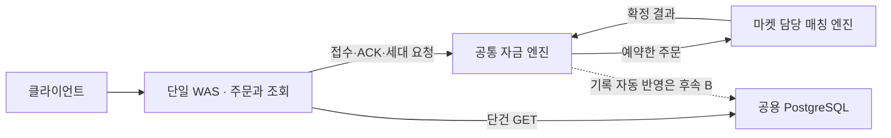

# #60 · 한 WAS의 주문 접수·조회와 공용 RDB

2026-11-17 사용자 요청으로 이전 A 설계의 실행 구성을 단순화했다. 주문·조회 API를 프로필로 나누지 않고 `client → WAS → 자금 엔진 → 매칭 엔진`, `WAS → RDB`로 연결한다. 작업 폴더는 `/Users/0chord/Desktop/exchange-core`, 브랜치는 `feat/order-query-foundation/60`, 이번 변경 기준은 `e09981f810d69a419c9b9ead858f68adfd9b3432`다.

## 현재 흐름과 이전 설정의 변경



| 이전 구성 | 이번 구성과 이유 |
| --- | --- |
| 두 HTTP 시작점, API/설정의 실행 프로필 | [ExchangeCoreApplication](../app-api/src/main/kotlin/com/exchange/core/ExchangeCoreApplication.kt) 하나에서 주문·조회·입력 오류 처리를 함께 조립한다. production의 `@Profile`을 제거한다. |
| 컴포넌트 탐색 중단과 시작 클래스의 수동 등록 목록 | 기본 `@SpringBootApplication` 탐색을 사용한다. 현재 `@Configuration`과 Controller는 자동 등록하고, 구형 설정·Controller·Advice는 `src/test`로 옮긴다. 테스트 구성은 `@TestConfiguration`·`@TestComponent`로 표시해 자동 등록에서 제외한다. |
| HTTP가 통합형 거래 클러스터를 호출 | [split 자금 전송](../app-api/src/main/kotlin/com/exchange/core/api/trading/infrastructure/aeron/SplitFundsGatewayTransport.kt)으로 기존 자금 엔진의 Control 계약에 연결한다. 자금 노드의 기존 전달 작업이 매칭 담당에 보낸다. |
| 별도 조회 Hikari·JDBC·트랜잭션·Flyway·접속 속성 | 표준 `spring.datasource.*`와 Boot 공용 Bean을 사용한다. [조회 설정](../app-api/src/main/kotlin/com/exchange/core/api/config/OrderQueryConfig.kt)에는 조회 범위·저장소·유즈케이스만 남긴다. |
| `db/order-query/V1`과 별도 이력 테이블 | 공용 `db/migration/V10`으로 이동한다. SQL의 조회 스키마·테이블·제약은 유지한다. 물리 DB 분리와 테이블 이름 공간 구분은 별개다. |
| namespace/Flyway 문자열 `DependsOn` | 제거한다. Boot의 JDBC 초기화 의존 연결이 migration 이후 JDBC Bean을 주입하도록 한다. |
| 조회 기본 비활성 route | 같은 WAS에 항상 등록한다. 거래 기록 수집이 없는 새 범위는 INITIALIZING이라 `503 QUERY_NOT_READY`다. 임의 기록·READY 기본값으로 완료를 꾸미지 않는다. |

과거 RDB 주문 실행과 wire2/통합형 wire3 HTTP는 **test 전용 조립**으로 회귀 검증한다. 제품 WAS의 추가 실행 모드가 아니다. `Legacy*TestApplication`과 구형 설정·Controller·Advice는 src/test에만 있다. production의 JPA 자동 설정/저장소는 등록하지 않고, 공용 JDBC/Flyway는 사용한다. `BoundedTradingGatewayConfig` 안의 타입은 import로 표기하고 다른 설정을 수동 import하지 않는다. 원격 보존 확인의 선택 조건과 금융 처리 계약은 유지한다.

## 보존한 판단과 실패 후 상태

- 같은 요청 토큰은 같은 접수 결과를 재사용한다. 자금 접수 응답과 매칭·정산 완료는 분리한다.
- 전송 전 실패는 NOT_SUBMITTED, 전송 수용 후 응답 미확인은 OUTCOME_UNKNOWN이다. 결과를 모른다고 새 요청으로 바꾸거나 자금을 임의 반환하지 않는다.
- 금융 요청 전에 DescribePeer로 자금 역할·lineage를 확인한다. 틀린 상대에게는 업무 명령을 보내지 않는다. 응답의 correlation·lineage·바깥/안쪽 결과가 다르면 정상 완료로 전달하지 않는다.
- 기존 큐·in-flight 한도·기한·back pressure·수신 순서와 다른 응답의 요청 연결을 유지한다. 새 분산 락·인증·보안 프레임워크를 추가하지 않는다.
- 조회 레코드는 양수 가격/수량·LIMIT/GTC·불변 원 정보·단조 수량/위치·종료 후 부활 방지를 검사한다. 매칭 결과 위치와 금융 확인 위치는 같은 stream 안에서 비교한다.
- 3개 중 1개 체결 후 2개 취소는 체결1/대기0/취소2다. 반환 확인 전에는 CANCELLED+PENDING(RELEASE), 확인 후에는 수량 그대로 APPLIED다.
- 저장 묶음은 모든 주문 행·중복 판별 기록·진행 위치를 함께 커밋한다. 같은 묶음 ID/내용은 최초 revision을 반환하고 다른 내용·동시 revision 충돌은 무변경이다. 중간 SQL 오류는 전부 롤백한다.
- GET은 주문과 진행도를 한 SQL snapshot에서 읽는다. 입력400 → DB 오류/모순503 → 미준비503 → 최소 접수 위치 미반영202 → 발견200 → 지연 부재202 → 관찰 기준 부재404 순서다. GET은 거래·조회 행을 변경하지 않는다.

## 테스트를 읽는 지도

| 준비 → 실행 → 실제 검증 | 근거와 한계 |
| --- | --- |
| 실제 PostgreSQL + 제품 WAS + 자금1/매칭1을 초기화 → HTTP로 판매3·구매3 교차 주문 → executedThrough2, 종료된 예약, 구매 대금700/자산3·판매 대금300/자산0·모든hold0 | [실제 HTTP 흐름](../app-api/src/test/kotlin/com/exchange/core/api/trading/infrastructure/aeron/SplitFundsTradingHttpTest.kt). 수수료0을 고정한 연결 검사이며 다중 노드 장애/성능 시험은 아니다. 같은 토큰 재전송·HTTP epoch/ACK도 확인한다. |
| 실제 제품 WAS + PostgreSQL, 전송만 대역 → 프로필 없이 시작 → 주문/조회 Controller와 공용 DataSource/Flyway 각1, JPA·옛 금융 실행 없음, GET503, 옛 HTTP404 | [제품 조립](../app-api/src/test/kotlin/com/exchange/core/ExchangeCoreApplicationTests.kt). 이 테스트 자체는 실제 Aeron 왕복을 대신하지 않는다. |
| 대역 split 연결 → 역순 응답·UTF8 한도·back pressure·잘못된 소유자/봉투·시작 실패 → 각 요청 결과/불확실성 보존·잘못된 상대에게 업무 전송0·연결/Driver 정리 | [전송 경계](../app-api/src/test/kotlin/com/exchange/core/api/trading/infrastructure/aeron/SplitFundsGatewayTransportTest.kt). 실제 네트워크 검증은 위 HTTP 흐름과 구분한다. |
| 실제 DB에 V9와 기존 마켓 자료 준비 → Boot 공용 V10 적용 → V1~V10 이력과 기존 자료 보존, 조회 테이블 생성 | [공용 DB 설정](../app-api/src/test/kotlin/com/exchange/core/api/config/OrderQueryConfigurationTest.kt). 별도 손상 DB의 V10 실패 시 기존 테이블 무변경·시작 실패도 확인한다. |
| 순수 상태/조회 대역, 실제 PostgreSQL 저장, 실제 HTTP+DB+대역 gateway → 수량·중복·동시 저장·실제 SQL 롤백·손상503·조회 지연/부재·재개방/읽기 무변경 대조 | [모델](../app-api/src/test/kotlin/com/exchange/core/api/trading/application/OrderQueryModelTest.kt), [조회 판단](../app-api/src/test/kotlin/com/exchange/core/api/trading/application/OrderQueryUseCaseTest.kt), [DB](../app-api/src/test/kotlin/com/exchange/core/api/trading/infrastructure/persistence/PostgresOrderQueryStoreTest.kt), [HTTP](../app-api/src/test/kotlin/com/exchange/core/api/trading/api/OrderQueryHttpTest.kt). 실제 기록 자동 수집은 검사하지 않는다. |
| 이전 RDB·HTTP 테스트의 준비 구성을 test로 이동 → 기존 assertion 실행 | 금융 계산/원자성·기존 protocol 회귀를 보존한다. 검사 제외·skip으로 바꾸지 않는다. |

## 실행 결과와 남은 확인

2026-11-17 새 WAS/조회/전송 관련 13개 suite의 **74개·실패0·오류0·skip0**을 실행했다. 실제 product WAS+PostgreSQL+자금1/매칭1 왕복도 이 실행에 포함된다. XML은 `/tmp/was-unification-verification-60/was-query-transport`에 보존했다. 과거 e09981f의 53개 통과를 이번 코드의 결과로 쓰지 않는다.

```sh
cd /Users/0chord/Desktop/exchange-core
JAVA_HOME=/Users/0chord/Library/Java/JavaVirtualMachines/corretto-25.0.2/Contents/Home ./gradlew --no-daemon --max-workers=1 :app-api:test --tests '*OrderQuery*Test' --tests '*SplitFundsGatewayTransportTest' --tests '*SplitFundsTradingHttpTest' --tests '*ExchangeCoreApplicationTests' --tests '*BoundedAeronGatewayTest' --tests '*BoundedTradingOrderHttpTest' --tests '*TradingOrderHttpTest' --tests '*RemoteProtectedTradingHttpTest' --tests '*TradingGatewayHttpWorkerPrestartTest'
```

기존 DB·주문 회귀는 최초 210개 중 196개 통과, 업그레이드 범위 오류 1개와 DB 첫 연결 실패에 따른 13개 실패를 확인했다. V6→V7/V7→V8 테스트의 목표 버전을 명시한 뒤 관련 34개를 재검증해 실패0·오류0·skip0을 확인했다. SQL이나 기존 assertion은 완화하지 않았다. 전체 구조 386개·P01~P09·스타일 검사도 통과했다. 독립 리뷰의 직접 실행 JVM 옵션 누락을 수정했고, 실제 BootRun의 JVM 옵션·mainClass·classpath·Java launcher를 가져온 별도 Java 실행에서 Aeron Context 초기화 성공을 확인했다. 최종 독립 재리뷰에서도 기존 지적의 해소와 추가 미해결 결함0을 확인했다. 원격 CI·커밋·게시와 구분한다.

실제 거래→RDB 자동 반영(B)은 아직 없다. 이 연결을 구현하기 전에는 새 범위의 사용자 주문 조회가 준비 완료됐다고 말하지 않는다. 이번에 외부 DB의 migration을 실행하거나 새로운 HA/성능·인증·Kafka·취소 HTTP를 추가하지 않았다.

독립 리뷰에서 발견한 기본 Java 25 실행 옵션 누락은 BootRun에도 Aeron의 필수 opens를 넣고 IntelliJ 직접 실행 VM options를 문서화하여 수정했다. 테스트 JVM에만 있던 옵션이 기본 제품 실행에서도 적용되는지를 별도 실행으로 확인한다. 최종 리뷰 사본은 `/tmp/was-unification-review-60-v2`이며 manifest SHA-256은 `6e9c7a8dd55ccaea5b3ae86c3e2a6096502f858df7fddcf7548e580afc655a97`이다. 작성 대화를 상속하지 않은 `/root/review_single_was_independent`가 전체 변경과 두 지적의 해소를 검토했고 미해결 결함0으로 보고했다. 리뷰어는 원본 XML과 최종 고유 테스트 목록을 직접 대조했으며 JVM 초기화 프로브도 독립 실행했다. 이 판정은 원격 CI·사람의 검토·전체 제품 테스트 모음의 완료를 뜻하지 않는다.

이전 HTTP Docker 회귀 2개도 실패0·오류0·skip0으로 통과했다. 수정한 두 migration 테스트와 해당 DB 첫 연결을 재실행한 결과를 반영해, 수행한 범위의 테스트 이름별 최종 관측을 합치면 **272개·실패0·skip0**이다. 272개를 한 번에 실행했다는 의미는 아니다. 각 실행의 XML과 합산 목록은 `/tmp/was-unification-verification-60`에 보존한다. 실제 클러스터 왕복은 native 자금1/매칭1, 이전 Docker 회귀는 기존 통합형3노드로 범위를 구분한다. 전체 컨테이너는 시험 종료 후 정리됐다.

자동 탐색 복원 전의 WAS 통합은 커밋 `1e16328`(단일 WAS·공용 DB·프로필 제거) → `2b9cc71`(실제 자금 엔진 연결·왕복 테스트) → 문서 순서로 읽는다. 당시 제품 코드·SQL·설정·테스트는 해당 v2 리뷰 사본과 내용이 같았다. 과거 네 커밋은 #60 조회 모델·저장 기반의 작업 이력이다. 이후 자동 탐색 복원은 아래 기록과 최신 커밋을 기준으로 읽는다.

## 자동 탐색 복원과 타입 표기 정리

2026-11-17 추가 요청으로 시작 클래스의 `@ComponentScan(useDefaultFilters = false)`와 수동 `@Import` 목록을 제거했다. 이제 현재 Controller·Configuration은 기본 탐색으로 등록된다. 구형 실행 조립·Controller·Advice 8개는 본문을 보존해 `src/test`로 옮겼다. 현재 gateway 설정에서도 다른 설정의 수동 import를 제거하고 `ClusterLineage`·파일 API·codec 타입을 import로 짧게 표기했다. 금융 판단·전송·복구 보호의 조건은 변경하지 않았다.

- 실제 제품 조립 + PostgreSQL, HTTP 입력/조회 구성, 원격 보존 확인 및 native 자금1/매칭1 왕복의 1차 검증 27개가 통과했다. 제품 조립 테스트는 현재 Controller와 공용 DB가 한 번 등록되고 구형 Controller·Advice·금융 실행은 제외되는지 확인한다.
- 구형 DB·주문·마켓 HTTP 회귀 71개 중 15개가 테스트 시작점 문제로 실패했다. `@TestConfiguration`을 단독 시작점으로 주면 Boot가 현재 제품 시작점까지 추가하는 것이 원인이었다. 네 `Legacy*TestApplication`은 `@Configuration + @TestComponent`로 표시해 명시적 시작점 역할과 자동 탐색 제외를 함께 유지했다. 보조 구성은 `@TestConfiguration`을 사용한다.
- 수정 후 현재 조립·실제 split HTTP·구형 주문 HTTP·잔고 저장·자금 예약·주문 생명주기 68개를 재실행해 실패0·오류0·skip0을 확인했다. 3회 실행의 테스트별 최종 관측을 합치면 98개 통과다. 98개를 한 번에 실행했다는 뜻은 아니다. XML과 테스트별 목록은 `/tmp/exchange-component-scan-verification-60`에 보존한다.
- 전체 구조 386개, 필수 P01~P09 및 스타일 검사를 확인했다. 옛 실행 클래스가 main에서 빠진 만큼 구조 검사의 최소 기대 목록을 현재 주문·조회 진입점으로 바꿨으며, 전체 main 탐색과 규칙은 유지했다.
- 작성 대화를 받지 않은 `/root/review_component_scan_independent`가 실제 Boot bootstrapper와 자동 탐색을 독립 실행했다. 기본/local에서 현재 구성만, remote에서 원격 복구 구성이 추가되며 테스트 클래스 경로의 구형 실행은 제외됨을 확인했다. 최종 v2 사본은 `/tmp/exchange-component-scan-review-60-v2`, manifest SHA-256은 `d2f0bd267b9ff5ad6d366d3bd92fbe20f68995370ef4d7378339c4e426f64d94`다. 검토 범위의 확인된 미해결 결함은 0건이다. 최종 코드는 이 사본과 같고 이 검증 결과 문단만 이후 보완했다.
