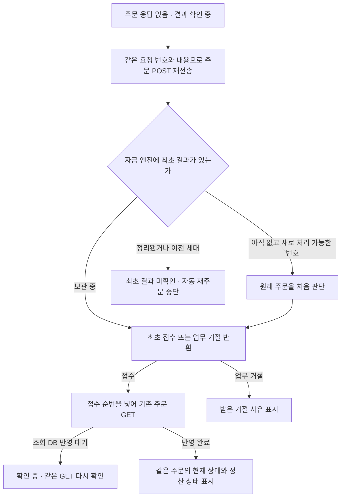

# #64 · 응답을 잃은 주문 다시 찾기

2026-11-18 상세 명세. 기준은 [#190 병합 커밋 `bac6ca3`](https://github.com/0Chord/coin-exchange/commit/bac6ca35c4b1079eac1d4a100194f239d8596fd6)이다. 로컬 `fcf9d7c`와 통합의 Git tree가 같은 것을 확인했다. [#64](https://github.com/0Chord/coin-exchange/issues/64)는 [#42](https://github.com/0Chord/coin-exchange/issues/42)의 주문 복구 흐름이며 선행 #43·#51·#60은 완료됐다.

## 주문 한 건을 따라가기

사용자가 매수 주문을 보냈다. 자금 엔진은 접수하고 돈을 예약했는데, 사용자는 응답을 못 받아 주문 ID를 모른다. 호출자는 **처음과 똑같은 요청 번호와 내용**으로 주문 POST를 다시 보낸다. 자금 엔진이 최초 응답을 찾아 돌려주면, 호출자는 그때 받은 주문 ID로 기존 GET을 호출한다. 조회 DB에 아직 반영되지 않았으면 **확인 중**으로 두고, 반영되면 같은 주문의 상태와 수량을 보여준다. 체결이 먼저 보이고 자금 정산이 뒤따르면 화면에 두 상태를 구분할 수 있다.



**선택 기록.** “같은 요청 재전송으로 최초 결과를 받아 기존 주문을 조회할까, 새 접수 없이 요청 번호만 조회할까?” 기존 POST와 GET을 활용하고, 최초 시도가 도착하지 않았다면 재시도가 첫 접수가 될 수 있는 방식을 제안했다. 사용자 답변은 **“같은 요청 재전송 → 기존 주문 조회 (추천)”**이었다. 별도 선택 이유는 기록되지 않았다. 읽기 전용 대안은 새 자금 엔진 조회 경로가 필요하다. ACK·세대 교체 후에도 조회하려면 별도 영속 기록이 필요하므로 그 보장이 요구될 때 다시 검토한다.

## 이번 PR의 HTTP 계약

| 상황 | 호출자가 할 일 | 서버 결과와 금전 상태 |
| --- | --- | --- |
| 응답 전체 유실 또는 HTTP 504 `OUTCOME_UNKNOWN` | 첫 요청을 보내기 전에 보존한 `userId`, `channel`, `epoch`, `sequence`, 원래 마켓과 주문 내용을 그대로 사용한다. 원래 주문을 계속 진행할 의사가 있을 때 재전송한다. | 504만으로 접수 여부를 알 수 없다. 예약·매칭은 기존 순서대로 진행하며 timeout만으로 취소·반환하지 않는다. |
| 전송 전 큐 만료 | 원래 요청을 다시 보내려면 같은 식별자를 사용한다. | 이 전송 시도는 HTTP 503 `NOT_SUBMITTED`다. 이전 시도까지 미접수였는지는 이 응답만으로 판단할 수 없다. |
| 같은 요청 재전송 | `POST /api/trading/v3/markets/{marketId}/orders`에 원래 `expectedConfigurationVersion`, 주문 방향·종류·유효조건·가격·수량을 함께 보낸다. | 최초 접수나 업무 거절이 보관 중이면 그 결과를 돌려준다. 같은 번호가 유효하고 최초 결과가 없다면 현재 주문 규칙으로 첫 접수 또는 거절을 판단한다. 한 요청의 예약·승인 순번·주문은 최대 한 번 생긴다. |
| 접수 결과 확보 | HTTP 202 `ACCEPTED`의 `orderId`와 `admissionSequence`를 보존한다. `GET /api/trading/v3/markets/{marketId}/orders/{orderId}?minAdmissionSequence={admissionSequence}`로 이어간다. | 쿼리에는 엔진의 **접수 순번**을 넣는다. 사용자가 지정한 요청 `sequence`와는 별개의 값이다. GET의 202 `QUERY_CATCHING_UP`은 DB 반영 대기다. GET 200은 주문 수량과 `financialStatus`를 반환한다. |
| 업무 거절 또는 내용 충돌 | 최초 업무 거절이면 받은 사유로 마무리한다. 같은 번호의 내용이 다르면 원래 주문 원본을 다시 확인한다. | 업무 거절은 HTTP 422 `REJECTED`, 저장된 의도와 다른 내용은 HTTP 409 `REQUEST_CONTENT_CONFLICT`다. 거절 응답은 기록할 수 있다. 잔고·접수 순번은 그대로이고 조회할 새 주문 ID는 없다. |
| 최초 응답이 정리됐거나 세대가 바뀜 | 이미 저장한 주문 ID가 있으면 기존 GET을 사용한다. ID도 없으면 결과 미확인으로 안내하고 자동 재주문을 중단한다. | 같은 세대에서 ACK로 정리한 번호는 HTTP 409 `RETIRED_UNAVAILABLE`, 지난 세대 번호는 HTTP 409 `FENCED_EPOCH`다. 기존 주문·예약을 바꾸지 않는다. |
| 조회 서버 재시작 또는 장애 | 같은 주문 ID와 접수 순번으로 GET을 다시 확인한다. | 원본 재검증 중에는 기존 503, 접수 순번 반영 전에는 기존 202다. 503이나 관찰 시점 기준의 404를 취소·미접수로 확정하지 않는다. |

호출자는 자신이 결과를 확인한 **연속 구간**만 기존 응답 ACK로 정리한다. 아직 응답을 모르는 번호를 넘겨 ACK하거나 해당 채널의 세대를 바꾸면 그 번호의 최초 응답을 다시 얻지 못할 수 있다. 접수가 확인된 주문의 ID와 접수 순번을 보존하면, 그 뒤 응답 ACK가 이루어져도 기존 주문 조회를 계속 쓸 수 있다. 다른 주문은 고유 번호와 기존 자금 한도 안에서 진행할 수 있다.

## 구현 범위와 근거

- **한 PR의 결과**는 실제 WAS에서 응답 유실 → 같은 POST → 기존 GET을 끝까지 확인하고, 호출 순서와 예외를 실행 문서에 남기는 것이다. 현재 POST 본문이 주문 ID·접수 순번을 이미 제공하므로 이를 조회 참조로 쓴다. 먼저 기존 제품 진입점으로 시험하고, 계약과 다른 동작이 드러난 곳만 고친다.
- **상태의 소유자**는 그대로다. 자금 엔진이 최초 판단·예약을 확정하고, 매칭 엔진이 체결을 확정하며, 자금 엔진이 정산한다. 같은 WAS의 DB 조회는 이 결과를 따라간다. 재전송 확인과 GET 반영은 각자 완료 시점이 있다. [접수와 예약](../domain-trading/src/main/kotlin/com/exchange/core/trading/BoundedFundingState.kt#L107) · [재전송·ACK·세대 검사](../domain-trading/src/main/kotlin/com/exchange/core/trading/TradingRequestInbox.kt#L90) · [DB 반영](../app-api/src/main/kotlin/com/exchange/core/api/trading/infrastructure/persistence/PostgresOrderQueryFeedStore.kt#L157)
- **제품 변경의 경계**는 기존 WAS와 기존 HTTP 계약이다. 조회용 접수 원본에는 원래 요청의 채널·세대·순번이 없고, DB는 서버 접수 순번/주문 ID를 기준으로 읽는다. 요청 번호 전용 조회, 영구 응답 보관·이행, 새 테이블·전송 형식·스냅샷, 프론트 구현, 취소 API는 후속 범위다. [POST 응답](../app-api/src/main/kotlin/com/exchange/core/api/trading/api/BoundedTradingOrderController.kt#L25) · [GET 판정](../app-api/src/main/kotlin/com/exchange/core/api/trading/application/OrderQueryUseCase.kt#L28) · [조회 원본 필드](../domain-trading/src/main/kotlin/com/exchange/core/trading/FundsDispatch.kt#L227)

## 수용 사례와 검증 계획

| 사례 | 준비 → 확인할 일 | 합격 기준 |
| --- | --- | --- |
| 1. 접수됐지만 응답 유실 | 조회가 준비되고 매도 주문 1개가 주문장에 올라간 뒤 실제 HTTP POST로 매수 주문을 보낸다. 자금 엔진의 첫 접수 적용을 관찰하고 해당 성공 응답만 호출자에게 닿지 않게 한다. WAS를 종료했다가 같은 PostgreSQL·엔진을 바라보는 새 WAS 프로세스로 시작한다. 첫 POST를 그대로 재전송하고 GET을 호출한다. | 재전송 결과는 최초 주문 ID·접수 순번과 같다. 반영·정산 뒤에는 같은 주문의 GET 200 `FILLED/APPLIED`다. 예약과 주문 생성, 체결, 자금 반영은 각각 한 번이다. |
| 2. 최초 요청이 전송되지 않음 | 실제 HTTP에서 테스트용 전송 지점만 잠시 막아 `503 NOT_SUBMITTED`를 받는다. 그 지점을 열고 같은 토큰과 내용으로 실제 자금 엔진까지 보낸다. | 최초 시도에서 예약·주문은 0건이다. 다음 실제 제출이 최초 결과를 만들고, 이후 재전송은 동일 결과를 가져온다. |
| 3. 거절·충돌·정리 경계 | 최초 잔고 부족, 같은 번호에 다른 가격, ACK 뒤 같은 요청, 세대 교체 뒤 옛 요청을 기존 코어·HTTP 시험과 대조한다. | 최초 거절 유지, 변경된 내용 거절, 두 종류의 정리 경계 구분, 새 예약·주문·반환 없음. 이미 확보한 ID는 ACK 이후에도 GET이 된다. |
| 4. DB 반영 대기 | 먼저 준비를 마친 조회에서 접수 원본의 DB 적용 직전에 멈춘다. 실제 접수 응답의 순번으로 GET을 보내고 적용을 재개한다. | 적용 전 GET 202 `QUERY_CATCHING_UP`, 적용 뒤 같은 주문 반환. 재기동 뒤 원본 검증이 진행 중인 기간의 계약은 503이다. |

사례 1은 수량 스케일 0, 매수자 USDT 1,000, 매도자 BTC 3, 가격 100에 대기 중인 매도 1개, maker·taker 수수료 각각 1%로 고정한다. 매수 접수 뒤 정산 전의 매수자 USDT 사용 가능·예약은 899/101이다. 한 번 체결·정산하면 매수자 USDT 899/0과 BTC 1, 매도자 BTC 2/0과 USDT 99, 수수료 누계 USDT 2다. 매수자의 요청 순번은 1, 서버의 전역 접수 순번은 매도 1·매수 2로 구분한다. 재전송 뒤 전역 접수 순번은 2로 유지되고 GET에는 2를 넘긴다. 테스트용 수수료와 정산 보류는 해당 사례에 적용한다.

**시험 구성.** 기존 HTTP·Aeron·PostgreSQL 시험에서 자금 1노드·매칭 1노드와 테스트 관찰 경계를 재사용한다. 사례 1에서 실제 접수 성공 응답을 버리고 저장된 최초 응답·예약과 대조한다. WAS의 `504 OUTCOME_UNKNOWN`에서 원래 요청 식별자와 빈 주문 ID를 확인한다. 재전송의 주문 ID·접수 순번을 대조하며, 현재 로그 위치는 달라질 수 있다. WAS는 기존 테스트 실행 경로와 제품 메인으로 시작하고, 종료 전후 PID로 새 JVM 재기동을 확인한다. [응답 유실과 재기동](../app-api/src/test/kotlin/com/exchange/core/api/trading/infrastructure/aeron/SplitFundsTradingHttpTest.kt#L321) · [전송 전 기한 만료](../app-api/src/test/kotlin/com/exchange/core/api/trading/infrastructure/aeron/SplitFundsTradingHttpTest.kt#L448) · [최소 접수 순번과 202](../app-api/src/test/kotlin/com/exchange/core/api/trading/infrastructure/aeron/SplitFundsTradingHttpTest.kt#L787) · [테스트 실행 설정](../app-api/build.gradle.kts#L239)

**실행 범위.** Java 25와 기존 PostgreSQL 테스트 환경에서 다음 범위를 실행한다. 실제 재시작·응답 유실 관찰·독립 금액 대조가 빠지거나 필수 시험을 건너뛰면 완료로 기록하지 않는다.

```sh
cd /Users/0chord/Desktop/exchange-core
./gradlew --no-daemon --max-workers=2 --continue \
  :app-api:test --tests '*SplitFundsTradingHttpTest' --tests '*BoundedTradingOrderHttpTest' \
  --tests '*OrderQueryHttpTest' --tests '*SplitFundsGatewayTransportTest' \
  :domain-trading:test --tests '*TradingRequestInboxTest' --tests '*BoundedFundingStateTest' --tests '*BoundedTradingStateTest' \
  :architecture-tests:verifyArchitectureReport :app-api:ktlintCheck
```

## 로컬 구현과 검증 결과

2026-11-18 `test/order-timeout-recovery/64`에서 기존 POST·GET으로 합의한 흐름을 검증했다. 변경은 호출자 안내와 통합 시험에 있다. [호출자 안내](../README.md#api와-조회-기준)

- **접수 후 응답 유실.** 자금 엔진의 실제 성공 응답을 시험에서 버렸다. 호출자는 WAS의 HTTP 504를 받았다. 새 PID의 WAS에서 같은 POST로 최초 주문 ID·접수 순번 2를 되찾았다. GET은 매칭 완료·정산 대기를 표시한 뒤 `FILLED/APPLIED`로 바뀌었다. 예약 101, 정산 후 매수자 USDT 899·BTC 1, 매도자 USDT 99·BTC 2, 수수료 합계 2를 대조했다.
- **전송 전 만료.** 첫 HTTP 시도의 전송을 큐 만료까지 막아 503과 예약·주문·접수 순번 0을 확인했다. 전송을 복구하자 같은 요청이 실제 자금 엔진에서 최초 접수됐고, 재전송 뒤에도 주문 1건과 예약 100을 유지했다.
- **거절과 응답 정리.** 내용 충돌과 보관 정리·세대 교체를 409로 구분했다. 잔고가 부족한 같은 요청은 두 번 모두 422와 `INSUFFICIENT_BALANCE`를 반환했다. 응답 ACK를 마친 뒤에도 이미 확보한 주문 ID로 조회됐다.

독립 리뷰에서 전송 대역의 503과 실제 엔진의 접수가 서로 다른 요청에서 검증된다는 누락을 확인했다. 이를 단일 HTTP 흐름으로 연결한 후보를 다시 검토해 해소를 확인했다. 사례 1의 유실 관찰은 자금 엔진에서 WAS로 돌아오는 성공 응답이며, 호출자와 WAS 사이의 연결 단절 재현과 구분한다.

로컬 결과는 app-api 34개, domain-trading 46개, architecture-tests 386개가 통과했다. 실패·오류·건너뜀이 각각 0개이고 필수 구조 검사 P01~P09를 확인했다. 위 명령으로 동작과 구조를 검사한 뒤, 마지막 테스트 코드의 서식을 정리하고 같은 app-api 34개와 `:app-api:ktlintCheck`를 재실행해 통과했다. 최종 테스트 코드와 WAS 실행 헬퍼는 최초 통합 기준 `bac6ca3`에서 분리한 로컬 사본으로 독립 재검토했고, 확인된 미해결 지적은 없다.
