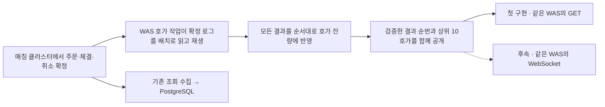

# #211 매칭 Archive 기반 공개 주문장

[이슈 #211](https://github.com/0Chord/coin-exchange/issues/211)

첫 목표는 **같은 WAS에서 한 마켓의 매수·매도 상위 10호가를 조회하고, PostgreSQL이 멈춘 동안에도 확정된 매칭 결과만큼 호가가 바뀌는 것을 확인하는 것**이다. 호가 계산은 매칭 결과를 하나도 빠뜨리지 않고, 사용자가 받는 화면은 최신 전체 화면으로 교체할 수 있다. GET과 이후 WebSocket은 같은 메모리 값을 읽는다.

## 사용자가 보는 흐름



100에 매수 3개와 2개가 대기하면 호가 `100 → 5`를 보여준다. 이후 매도 1개가 체결되면 `100 → 4`, 별도 주문 2개가 취소되면 `100 → 2`다. 호가의 기준은 **매칭이 적용한 주문장**이다. 대금 정산이나 예약 반환은 기존 거래 흐름에서 이어진다.

| 시점 | 호가 계산에 필요한 결과 | 사용자에게 보여주는 현재 값 |
| --- | --- | --- |
| 101번 처리 완료 | 100에 5개가 대기 중 | `100 → 5`, 반영 순번 101 |
| 102번 체결과 103번 취소 확인 | 102번에서 1개, 103번에서 2개 차감 | `100 → 2`, 반영 순번 103. 102번의 화면은 전송 시점에 따라 생략 가능 |
| 102번 확인이 실패하고 103번만 관측 | 102번부터 연속성을 복원해야 함 | 103을 새 호가로 공개할 수 없음. 원본이 끊겼다고 확인되면 GET은 503 |

## 합의와 코드에서 확인한 전제

- **합의.** 공개 호가는 매칭을 원본으로 한다. WAS의 독립 작업이 결과를 순서대로 반영하고, PostgreSQL 저장을 기다리지 않는다. WAS가 나중에 WebSocket 연결을 담당한다. 각 접속자가 받는 것은 전체 호가 화면이므로 중간 화면은 최신 화면으로 교체할 수 있다.
- **기준.** #210이 머지된 통합 커밋 `335c4ff6e5940405bf2122e8f9aae18c61abf389`를 확인했다. [통합 커밋](https://github.com/0Chord/coin-exchange/commit/335c4ff6e5940405bf2122e8f9aae18c61abf389)
- **Archive의 실제 데이터.** 매칭 Archive에는 확정된 **매칭 입력 명령**이 있다. 기존 WAS의 `SplitArchiveProjection`은 조회 전용 매칭 상태에서 명령을 다시 적용해 `MatchingResultEnvelope`를 얻는다. 따라서 독립 호가 작업은 매칭 JVM의 원본 주문장을 읽거나 공개 요청을 보내는 대신, WAS에서 별도로 매칭을 재생한다. WAS의 재생 CPU·메모리와 Archive 재생 I/O가 추가된다. [기존 재생기](https://github.com/0Chord/coin-exchange/blob/335c4ff6e5940405bf2122e8f9aae18c61abf389/app-api/src/main/kotlin/com/exchange/core/api/trading/infrastructure/aeron/SplitArchiveProjection.kt#L57)
- **DB 독립성.** 기존 Archive 조회 작업은 매칭 결과를 DB에 쓰고 다음 읽기로 이어간다. 공개 호가 작업에는 자체 Archive 읽기 위치와 재생 상태를 둔다. PostgreSQL의 주문·원장 저장 트랜잭션과 준비 상태는 호가 작업의 입력이나 대기 조건에 들어가지 않는다. 기존 WAS가 정상 시작한 뒤 DB 중단을 시험한다. [기존 DB 반영 루프](https://github.com/0Chord/coin-exchange/blob/335c4ff6e5940405bf2122e8f9aae18c61abf389/app-api/src/main/kotlin/com/exchange/core/api/trading/infrastructure/aeron/ArchiveOrderQueryFeedWorker.kt#L228)
- **현재 사용할 배치.** 기존 읽기는 로컬 Media Driver·`recording.log`·Aeron IPC를 이용한다. 첫 수용 범위는 기존 Archive 모드의 한 마켓, 매칭 노드 파일을 읽을 수 있는 같은 호스트, 최초부터 연속 로그가 보존된 구성이다. 리더를 다시 찾으려면 매칭 클러스터 전체 멤버 설정을 공급한다. [IPC 접속과 최초 로그 확인](https://github.com/0Chord/coin-exchange/blob/335c4ff6e5940405bf2122e8f9aae18c61abf389/app-api/src/main/kotlin/com/exchange/core/api/trading/infrastructure/aeron/SplitArchiveSource.kt#L301)

## 첫 구현 단위 · 독립 호가 계산과 GET

새 호가 작업은 기존 WAS 안의 전용 실행 환경에서 돌린다. 기존 Archive 모드의 노드 설정과 검증된 읽기·재생기를 재사용한다. 가변 호가 상태와 읽기 위치는 이 작업 하나가 소유한다. 매칭 역할의 Archive만 읽으며 DB 호출, 매칭·자금 ACK, 거래 접수 게이트 호출은 이 작업의 책임에 포함되지 않는다. 매칭·자금 엔진 제품 경로는 기존대로 실행한다.

1. **확정 범위 읽기.** 기존 읽기기는 리더를 확인한 뒤 과반 커밋, 서비스 적용, Archive 기록 위치가 모두 도달한 범위까지만 읽는다. 큰 적체도 기존의 약 4MiB 목표 페이지와 읽기 시간 한도로 나눈다. 한 페이지에 여러 명령·결과가 있을 수 있으며, Archive의 바이트 위치는 재생에, 마켓별 결과 순번은 호가의 적용 여부와 응답 버전에 쓴다. [상한·리더 확인](https://github.com/0Chord/coin-exchange/blob/335c4ff6e5940405bf2122e8f9aae18c61abf389/app-api/src/main/kotlin/com/exchange/core/api/trading/infrastructure/aeron/SplitArchiveSource.kt#L146) · [현재 페이지 한도](https://github.com/0Chord/coin-exchange/blob/335c4ff6e5940405bf2122e8f9aae18c61abf389/app-api/src/main/kotlin/com/exchange/core/api/trading/infrastructure/aeron/SplitArchiveSource.kt#L456)
2. **모든 결과 적용.** 마켓과 확정 스트림의 정체성(자금·매칭 계보, 소유 세대, 설정 버전)을 먼저 대조한다. 다음 `resultSequence`만 적용하고 효과가 없는 결과도 순번은 진행한다. 동일 명령을 로그에서 다시 만나더라도 기존 재생 어댑터는 새로 `APPLIED`된 경우에만 결과를 내므로, 정상 재전송에는 새 수량 효과가 없다. [결과 순번과 효과 규칙](https://github.com/0Chord/coin-exchange/blob/335c4ff6e5940405bf2122e8f9aae18c61abf389/domain-trading/src/main/kotlin/com/exchange/core/trading/MatchingInputValidation.kt#L156) · [재생 결과 발행 지점](https://github.com/0Chord/coin-exchange/blob/335c4ff6e5940405bf2122e8f9aae18c61abf389/app-api/src/main/kotlin/com/exchange/core/api/trading/infrastructure/aeron/SplitTradingClusterAdapter.kt#L390)
3. **호가 합산.** 모든 활성 가격대의 잔량을 관리한다. 신규 주문은 체결 후 주문장에 올라간 잔량만 해당 방향과 지정가에 더한다. 기존 상대 주문은 각 주문의 방향과 지정가에서 실제 줄어든 양을 뺀다. 취소 확정은 원주문의 잔량을 빼고, 최종 거절이나 취소 거절은 순번만 움직인다. 같은 결과에 포함된 모든 증감을 적용한 후에만 화면을 만든다. 정확한 정수 합산을 사용하며 총량이 0인 가격은 제거한다. 총량이 음수가 되면 원본 또는 적용 상태의 불일치로 처리한다. 활성 가격대 수는 실제 주문장 한도로 제한된다. 상위 10개 밖도 관리해야 기존 10위 이내가 사라졌을 때 11위가 올라온다.
4. **메모리 공개.** 읽기기와 재생·합산이 모두 성공한 페이지까지만 공개한다. 매수는 높은 가격부터, 매도는 낮은 가격부터 각각 10개를 복사해 마켓·방향별 목록·적용 순번·조회 상태를 한 불변 값으로 교체한다. 페이지 도중에는 HTTP 요청이 직전의 완성된 값만 읽을 수 있다. GET은 이 값 한 번을 읽어 응답한다.

### 응답 계약 제안

`GET /api/trading/v3/markets/{marketId}/order-book`에서 `marketId`, `asOfMatchingResultSequence`, `bids`, `asks`를 반환한다. 각 호가는 `price`, `quantity`이고 수량은 기존 차트 거래량처럼 정확한 십진 문자열을 사용한다. 응답 경계에서 사용자·주문 식별자는 공개 값에 포함하지 않는다. 고정 상위 10개는 실제 존재하는 가격까지만 반환한다.

| 상황 | 관측 결과 |
| --- | --- |
| 최초 재생을 완료했고 건강한 원본을 확인 | `200 ORDER_BOOK_FOUND`. 빈 주문장은 `bids: []`, `asks: []` |
| 기존 WAS의 마켓 입력 검증에서 거절 | `400` |
| 최초 재생 중, Archive 요건 미충족, 원본 확인 일시 실패 | `503 QUERY_NOT_READY` 또는 `503 QUERY_UNAVAILABLE` |
| 확정 기록 공백, 다른 계보, 반영 순번 역행 또는 잘못된 수량 | `503 QUERY_INCONSISTENT`. 원인을 식별 가능한 로그에 남김 |

### 리더 교체·재시작·최신성

- **정상 리더 교체.** 같은 논리 스트림의 결과 순번은 이어진다. 기존 Archive 읽기기가 새 리더의 겹치는 마지막 프레임을 확인한다. 확인될 때까지 최신 호가로 새 값을 공개할 수 없다. 새 원본이 이전 구간과 다르면 다른 기록을 이어 붙이지 않고 오류로 닫는다. [리더 교체의 프레임 대조](https://github.com/0Chord/coin-exchange/blob/335c4ff6e5940405bf2122e8f9aae18c61abf389/app-api/src/main/kotlin/com/exchange/core/api/trading/infrastructure/aeron/SplitArchiveSource.kt#L165)
- **일시 실패와 부분 적용.** 새 페이지를 적용하기 전 실패는 이전 위치에서 재확인한다. 콜백이 일부 프레임을 적용한 뒤 실패하면 그 작업의 가변 재생·호가 상태를 함께 버리고 새 읽기기에서 다시 만든다. 직전 공개 값은 진단용으로 보존할 수 있다. 근거가 끊겼거나 재생이 진행 중이면 신규 GET은 503이다.
- **WAS 재시작.** 기존 읽기기는 새 인스턴스에서 0부터 읽는다. 초기화 명령부터 현재 리더의 확인된 범위까지 따라잡고 빈 주문장과 복구 중을 구분한다. 최초 로그가 지워졌다면 호가 조회를 닫는다. 이번 단계에서 보장하는 재시작은 전체 로그가 남은 구성이다. 저장 위치만 다음 재시작에 전달하면 그 위치까지의 주문장이 빠지므로 안전한 복원을 위해서는 매칭 재생 상태·호가 상태·검증한 경계를 함께 복원해야 한다. 이는 후속 시작 비용 개선 범위다.
- **최신성 제안.** 마지막 체결 시각과 원본 확인 시각을 구분한다. 거래가 없는 마켓도 확인 반복이 정상이라면 유효하다. 최초 공개는 기존 읽기기의 `caughtUp`과 재생 상태의 준비 판정을 함께 확인한다. 이후 원본을 확인한 위치에 다시 도달하지 못하는 시간이 계속 길어지면 503으로 전환한다. 임시 시험 기준은 마지막 따라잡음 확인에서 1초이며, 이 값은 측정으로 조정할 기본값이다. 성공 200의 순번은 해당 메모리 화면의 확정 범위를 나타낸다.

## WebSocket 후속 단위

같은 WAS에서 마켓 구독과 연결별 전송을 붙인다. 처음 연결하거나 다시 연결하면 현재 전체 호가 화면을 한 번 보내고, 이후에도 전체 화면과 반영 순번을 함께 보낸다. 전송 코루틴은 클라이언트의 네트워크 I/O만 담당한다. 연결별 미전송 화면 한 칸에 최신 값을 넣고, 이미 전송 중인 값 다음에는 그 최신 값을 전송한다. 이에 따라 101 다음에 103이 와도 103 화면에 102의 체결·취소 효과가 들어 있다.

호가 작업이 준비·정합성을 잃으면 구독에 다시 확인이 필요함을 명시하고, 연속성이 복구되면 새 전체 화면으로 시작한다. 접속자별 대기와 연결 종료는 호가 계산과 서로 독립적이다. 복수 WAS의 공용 호가 배포, 여러 마켓, 호스트 간 Archive 원격 전달은 실제 배치·비용 검증이 필요한 후속 과제다.

## 수용 사례와 검증 계획

| 경우 | 검증 기준 |
| --- | --- |
| 신규 대기 → 부분 체결 → 남은 주문 취소 | 실제 HTTP GET에서 100에 `5 → 4 → 2`를 본다. 매칭 적용 확인 뒤 순번과 수량을 대조한다. 반복 취소는 같은 순번·수량을 보존한다. |
| 한 주문이 두 가격대를 체결하고 자기 잔량도 남음 | 기존 가격대들에서 실제 체결분을 각각 뺀다. 신규 상대 주문에는 주문장에 남은 양만 더한다. GET은 직전 또는 완성된 새 화면을 반환한다. |
| 가격 정렬과 11순위 승격 | 양쪽 11개 이상 가격대에서 올바른 정렬과 최대 10개를 확인한다. 상위 가격이 비면 기존 11위가 보인다. |
| 재전송·거절·순번 공백·잘못된 계보 | 정상 중복 명령의 효과는 한 번이다. 새 거절은 수량을 유지하고 순번을 한 번 진행한다. 순번 공백·계보 불일치·부분 반영 실패에서는 잘못된 200 응답이나 순번 건너뜀이 없어야 한다. |
| DB 중단, 매칭 리더 교체, WAS 재시작 | 기존 실제 3+3 통합 하네스에서 정상 WAS를 시작한 후 DB를 정지한다. DB가 멈춘 상태에서 부분 체결과 취소 반영을 관측한다. 다른 매칭 멤버·더 높은 임기로 교체한 뒤 새 결과가 정확히 한 번 반영된다. 전체 Archive 보존 상태로 WAS를 재시작하면 준비 완료 뒤 같은 순번·호가가 복원된다. 재시작 검증에서는 현 WAS의 기존 DB 초기화 조건을 충족시킨다. |
| WebSocket 연결과 역압력 | 후속 단위에서 초기 전체 화면, 순번의 단조 증가, 느린 접속자의 중간 화면 생략, 원본 장애 회복 후 전체 재동기화를 검증한다. 정상 접속자의 수신과 호가 계산에 누락이 없어야 한다. |

**기존 검증 재사용.** 먼저 작은 결정적 호가 계산·오류 시험을 추가한다. HTTP와 장애 검증은 기존 `SplitFundsTradingHttpTest`의 3+3 Archive·DB 중단·리더 교체 구성과 저장소의 테스트 실행 방식을 재사용한다. 비교 기대값은 위 표의 고정 수량에서 가져온다. WAS를 정상 시작한 뒤 DB가 멈춘 동안에도 호가가 갱신되어야 한다. DB가 처음부터 꺼진 상태에서 기존 WAS 전체를 시작하는 경우는 별도 확인 대상이다. [기존 장애 통합 시험](https://github.com/0Chord/coin-exchange/blob/335c4ff6e5940405bf2122e8f9aae18c61abf389/app-api/src/test/kotlin/com/exchange/core/api/trading/infrastructure/aeron/SplitFundsTradingHttpTest.kt#L406)

**성능 검증 제안.** 같은 3+3·`sync=2`·한 마켓에서 기존 구성과 호가 작업·GET을 함께 켠 구성을 번갈아 비교한다. 같은 워크로드·리더 배치·기존 DB 설정을 유지하고, 예열 뒤 30초씩 두 번 측정한다. 첫 부하는 정산 체결 1,000건/s 및 호가 GET 50건/s로 시작한다. 매칭 결과와 체결 건수는 별도로 세고, 기존 기준선이 목표 입력을 소화하지 못하면 실제 처리량과 동일 부하 비교치를 함께 남긴다. 정상 부하는 처리 순번 차이가 계속 벌어지거나 미반영 상태로 끝나면 목표 미달이다.

- 기록값은 접수·정산 TPS와 p95·p99, 매칭 JVM 및 WAS 재생 작업 CPU·할당량, Archive 재생 바이트, 미반영 결과 수와 최종 따라잡는 시간, GET p95·p99다. 호가 작업 활성화 뒤 반복적으로 드러난 거래 회귀는 원인을 확인한다.
- 매칭 적용에서 WAS 공개까지의 시간은 같은 업무 순번에 매칭 적용과 메모리 공개 관측을 연결한다. Archive 프레임의 명령 시각만 비교하면 매칭 적용 시점을 알 수 없다. 첫 시험의 계측 해상도와 관측 간격을 명시한다. WebSocket 도입 이후에는 클라이언트 수신까지 측정한다.
- 재생이 목표 부하를 따라가지 못하거나 공유 디스크·IPC 영향이 크면, 다음 선택은 확정 **결과 자체**를 보관·전달하는 경로에 대한 별도 설계다. 확정 상한, 순번 연속성, 초기 상태 복원 계약을 같은 기준으로 검토한다.

**인계 상태.** 우선 구현할 제안은 한 마켓의 독립 Archive 재생과 실제 GET 한 경로다. 그 결과와 전후 성능으로 WebSocket 연결이 읽을 호가의 정합성과 지연을 검증한다. 잠정값은 GET 경로·상태 코드, 최신성 임계치와 검증 부하다. 현재 기록은 설계와 코드 확인 근거다.

## 구현과 테스트 기록

통합 커밋 `335c4ff6e5940405bf2122e8f9aae18c61abf389`에서 WAS 안의 공개 주문장 작업과 GET을 연결했다. 기존 `exchange.order-query.source=archive` 구성에서 `exchange.order-query.order-book-enabled=true`를 공급하면 별도 호가 작업이 시작된다. 이 설정으로 같은 WAS 구성에서 Archive 읽기 비용을 켜고 끈 조건을 비교한다. 조회를 활성화한 한 마켓은 WAS의 기존 조회 마켓·자금 계보와 일치해야 한다.

- **실제 3+3·sync=2.** 기존 통합 시험에서 실행 중인 PostgreSQL을 멈추고 매칭 리더를 교체했다. 매도 잔량이 새 리더를 따라 줄고, 별도로 넣은 매수 주문의 100 가격대 잔량은 `5 → 4 → 2`로 바뀌었다. 같은 취소를 재전송해도 취소 ID와 호가 위치가 유지됐다. 클러스터와 WAS를 재시작해 동일 Archive를 재생한 뒤에는 결과 순번 13·매수 2가 복원됐고 PostgreSQL에는 반환 분개 한 건이 남았다. [통합 시험](../app-api/src/test/kotlin/com/exchange/core/api/trading/infrastructure/aeron/SplitFundsTradingHttpTest.kt#L406)
- **집계와 오류.** 실제 매칭 결과를 만들어 가격별 수량, 여러 가격대 동시 체결, 11번째 호가 승격, 중복·거절, `Long`을 넘는 정확한 합계와 수량 불일치의 원자적 거절을 대조했다. 초기 확인이 끝난 빈 주문장과 미설정·확인 중인 503을 구분했다. [집계 시험](../app-api/src/test/kotlin/com/exchange/core/api/trading/application/PublicOrderBookTest.kt#L47)
- **독립 리뷰에서 고친 복구.** 일부 적용 실패 전의 공개 위치를 기준으로, 재생한 모든 애플리케이션 입력의 누적 지문과 업무 순번을 대조한다. 짧은 원본이나 마지막 프레임이 같아도 앞선 주문이 바뀐 원본은 503을 유지한다. 정상 원본이 확인되면 같은 순번·수량으로 다시 열린다. 낮아진 리더 임기나 확인한 범위보다 이른 명시적 재생 종료는 일시 연결 오류와 구분한다. 독립 리뷰어가 고정본을 별도 컨텍스트·JVM에서 대조했다. [복구 시험](../app-api/src/test/kotlin/com/exchange/core/api/trading/infrastructure/aeron/SplitTradingClusterAdapterTest.kt#L656)

앱 관련 통합·회귀 65건이 실패·건너뜀 없이 통과했다. 최종 후보 패치 SHA-256은 `3d371d3e60307959f0a21ff66909944765c461d93396bb125fe63b783292edda`이다.

저장소 체크아웃의 루트에서 JDK 25로 실행한다.

```sh
./gradlew --no-daemon --max-workers=2 \
  :app-api:test --tests '*PublicOrderBookTest' --tests '*SplitTradingClusterAdapterTest' \
  --tests '*OrderQueryHttpTest' --tests '*OrderQueryConfigurationTest' \
  --tests '*OrderQueryUseCaseTest' \
  --tests '*SplitFundsTradingHttpTest.PostgreSQL이 멈춘 동안 실제 삼대삼 거래와 리더 교체를 이어가고 Archive에서 복구한다' \
  :app-api:verifyCiTestPartition --console=plain
```

### 3+3·sync=2 성능 비교

같은 Mac에서 자금·매칭 각 3노드, Archive 데이터·카탈로그·Consensus 동기화 2, 단일 마켓, 기존 WAS와 PostgreSQL 16(`fsync=on`, `synchronous_commit=on`)을 사용했다. 한 건이 한 번 체결되는 주문을 직접 Aeron으로 보냈고, 예열은 100건/s로 10초, 본 측정은 1,000건/s로 30초였다. 별도 호가 작업과 GET을 함께 켠 상태를 B, 기존 구성을 A로 표시한다. 회차마다 새 저장 공간을 사용했고 리더는 정상 선거에서 정해졌다. A/B 실행마다 제출한 주문은 30,000건이었다.

| 회차 | 접수/s | 매칭/s | 정산/s | 접수 p95/p99 ms | 정산 p95/p99 ms | 호가 GET p95/p99 ms | 매칭 적용→WAS 호가 p95/p99 ms | 매칭 적용→GET 관측 p95/p99 ms |
| --- | ---: | ---: | ---: | ---: | ---: | ---: | ---: | ---: |
| A1 | 312.50 | 312.23 | 278.37 | 68.24 / 120.26 | 4,562.89 / 4,608.36 | — | — | — |
| B1 | 336.30 | 336.03 | 302.17 | 33.24 / 68.37 | 5,180.45 / 5,253.24 | 2.71 / 7.12 | 201.57 / 267.24 | 211.26 / 280.04 |
| A2 | 376.10 | 375.93 | 342.07 | 33.07 / 44.77 | 3,199.75 / 3,223.66 | — | — | — |
| B2 | 359.87 | 359.33 | 325.73 | 29.38 / 42.77 | 3,466.02 / 3,503.98 | 2.04 / 2.82 | 193.40 / 223.64 | 203.67 / 236.29 |

- 1,000건/s는 전달한 입력률이다. 모든 회차에서 Aeron 전송 배압 0회였고 주문은 대부분 `RETRYABLE_CAPACITY`로 제한됐다. 접수된 주문은 종료 후 전량 정산됐다. 기준선은 278~342 정산/s였고 B와의 처리량 차이는 두 비교에서 방향이 달랐다. 정산 p99는 두 B에서 각각 약 645ms·280ms 높았다. 자연 리더 배치와 회차별 변동이 있는 이 결과로 원인을 호가 기능 하나에 귀속할 수는 없다.
- B의 성공 GET은 각각 1,490건과 1,500건이었다. 실제 매칭 적용 결과 순번과 `100,000 - (순번 - 1)` 잔량을 모든 성공 GET에서 대조했다. 마지막 호가 순번을 관측한 시점은 입력 종료 약 149ms와 125ms 후였다. 초·말 5초의 미반영 결과 평균은 `68.9 → 41.9`, `65.6 → 40.9`이고 최대는 206건·203건이었다.
- 호가 작업 스레드는 회차당 CPU 약 996~1,014ms와 누적 할당량 384~410MB를 사용했다. 측정 구간 매칭 로그 위치 차이는 전체 회차 3.14~3.79MB였다. 이 차이는 로그가 전진한 바이트이며 Archive 전송과 재시도를 합한 총 I/O 측정값과는 범위가 다르다.
- 기존 PostgreSQL Archive 반영은 모든 회차에서 짧은 측정·정리 구간 안에 따라잡기 어려웠다. B는 PostgreSQL의 최종 반영 순번보다 앞서 실제 매칭의 최종 호가 순번까지 확인됐다. 매칭 적용→WAS는 약 1ms 메모리 관측, 매칭 적용→GET은 50회/s HTTP 관측으로 연결했다. GET 응답 시간에는 이 결과가 메모리에 공개되기까지의 지연이 포함되지 않는다.

성능 시험은 기존 3+3 테스트 구성에 임시 부하·관측 입력을 연결해 실행했다. 아래 표와 측정 방법을 검증 기록으로 남긴다.

### 동일 입출력을 확인한 200건/s 비교

추가 비교는 같은 구성과 50건/s 3초 예열 후 주문 200건/s를 10초간 보냈다. 두 회차 모두 같은 PostgreSQL 반영 순번 151에서 시작했다. 2,000건 모두 접수·매칭·정산했고 전송 배압과 용량 제한 응답은 없었다.

| 조건 | 측정 구간 정산/s | 접수 p95/p99 ms | 정산 p95/p99 ms | 호가 GET p95/p99 ms | 매칭 적용→WAS 호가 p95/p99 ms |
| --- | ---: | ---: | ---: | ---: | ---: |
| 호가 끔 | 198.90 | 56.90 / 138.86 | 304.71 / 429.44 | — | — |
| 호가 켬 | 198.10 | 28.74 / 37.59 | 84.62 / 102.14 | 2.97 / 4.65 | 197.03 / 224.14 |

호가 켬에서 GET 500건이 모두 200이고 수량이 일치했다. 마지막 결과는 입력 종료 약 104ms에 관측됐다. 미반영 결과의 첫·마지막 5초 평균은 `25.74 → 26.74`이고 최대 50이었다. 본 측정을 합하면 실제 GET 3,490건 모두 200이다. 두 부하 비교는 같은 호스트 내 한 마켓의 WAS 메모리 공개까지를 측정했다. PostgreSQL의 초기화가 필요한 WAS 전체의 콜드 스타트와 WebSocket 클라이언트 수신은 후속 검증 범위다.

최종 고정본에서 아키텍처 검사 388건, 필수 운영 구조 보고서, 앱·아키텍처 Kotlin 서식과 앱 CI 테스트 분류 검사를 완료했다. 독립 리뷰와 테스트 결과를 최신 패치 해시에 대조했다.

```sh
./gradlew --no-daemon --max-workers=2 \
  :app-api:ktlintCheck :app-api:verifyCiTestPartition \
  :architecture-tests:ktlintCheck :architecture-tests:test :architecture-tests:verifyArchitectureReport --console=plain
```
