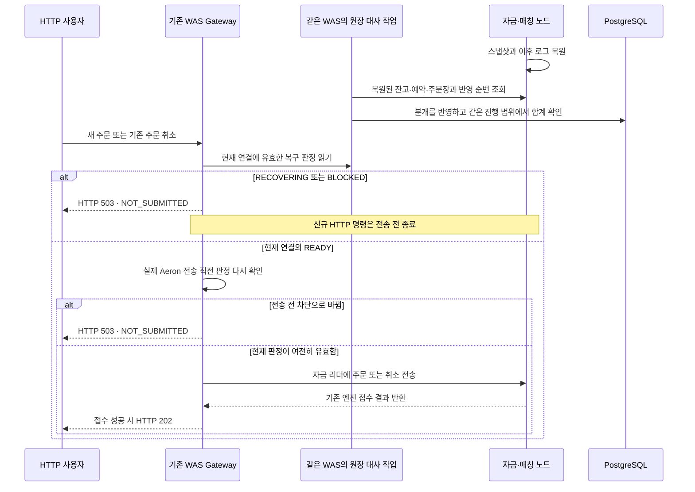

# #59 복구 성공 후 HTTP 주문·취소 재개

## 목표와 기준

#58이 계산한 복구 판정을 기존 WAS의 주문 제출·취소에 연결한다. 지원하는 단일 마켓에서 복구 중이거나 원장 대사가 실패하면 HTTP 요청을 전송 전에 막는다. 같은 자금·매칭 클러스터와 PostgreSQL을 대사해 `READY`가 되면 그 WAS에서 요청을 다시 받는다.

기준은 #198을 포함한 통합 브랜치 `9d26946`과 Aeron 1.53.3이다. GitHub 비교에서 병합 커밋과 PR 헤드 `f48ad59`의 파일 내용이 같음을 확인했다. #58은 완료 처리됐고 PR CI 10개가 통과했다. 이 문서의 HTTP 차단·재개는 #59에서 구현하고 검증할 계약이다. [#59](https://github.com/0Chord/coin-exchange/issues/59) · [#58](https://github.com/0Chord/coin-exchange/issues/58) · [병합 커밋](https://github.com/0Chord/coin-exchange/commit/9d2694657e46624d28c245918ae19ac959150155) · [#198 CI](https://github.com/0Chord/coin-exchange/actions/runs/44441824346)

**합의한 범위.** 복구 중과 대사 불일치 모두 주문과 취소를 차단하고 `READY` 이후에 재개한다. 이번 구현은 #58이 지원하는 복구 원장 활성 단일 마켓과 기존 주문·취소 WAS를 대상으로 한다. 다중 마켓 대사, 전 클라이언트의 분산 차단, 운영 스냅샷 자동화, 자동 데이터 수리, 인증·인가, 별도 서버 구성을 범위 밖으로 둔다. [#58 지원 및 검증 범위](recovery-reconciliation-spec-58.md)

## 주문과 취소의 흐름



| 상황 | 판단과 효과 | 사용자 응답 |
| --- | --- | --- |
| 복구 중 `RECOVERING` | 같은 WAS에서 새 접수 허용을 닫아 둔다. 자금·매칭은 이미 확정된 주문·결과를 이어 처리하고, 수집 작업은 분개 저장과 ACK를 진행한다. | 유효한 주문·취소에 503 `NOT_SUBMITTED`. |
| 대사 실패 `BLOCKED` | 잔고·예약·주문장 불일치, 필수 원장 누락·변조, 소스·DB 읽기 실패의 근거를 내부에 보존한다. 이후 정상 대사가 확인될 때까지 접수를 닫아 둔다. | 유효한 주문·취소에 503 `NOT_SUBMITTED`. |
| 현재 연결의 `READY` | 원장과 복원 상태가 맞고 판정이 현재 자금·매칭 연결에 유효할 때만 전송한다. 엔진이 잔고와 대상 주문을 판단한다. | 기존 응답 계약. 정상 접수는 202, 업무 거절은 기존 상태와 사유를 유지한다. |

503 차단은 기존 전송 전 실패 경로를 사용한다. 내부 `possiblySubmitted`는 `false`고, HTTP 응답은 기존 `status`, `reason`, 요청 토큰 형식을 유지한다. 복구 중이면 `RECOVERY_IN_PROGRESS`, 대사 실패면 `RECOVERY_BLOCKED`를 반환한다. 누락된 판정과 이전 연결의 판정은 확인 중으로 처리한다. 취소 응답은 경로의 주문 ID를 그대로 담으며 새 취소 ID는 발급되지 않는다. 입력 검증은 기존 순서를 사용한다. [HTTP 상태 매핑](../app-api/src/main/kotlin/com/exchange/core/api/trading/api/BoundedTradingOrderController.kt#L110) · [판정과 전송 시도](../app-api/src/main/kotlin/com/exchange/core/api/trading/infrastructure/aeron/HttpOrderRecoveryGate.kt)

## 현재 구현과 연결 지점

| 경계 | #198까지 확인한 동작 | #59 구현 |
| --- | --- | --- |
| 노드 재시작 | 각 역할의 식별자·기록을 확인한 뒤 스냅샷과 확정 로그를 복원한다. Aeron 리더가 전송을 받을 수 있는 시점과 원장 대사 완료 시점은 서로 다르다. | 기존 노드의 기동·복원과 전달 작업을 재사용한다. [기동 검사](../app-api/src/main/kotlin/com/exchange/core/api/trading/infrastructure/aeron/DevelopmentSplitTradingNode.kt#L512) · [미완료 결과 복구 시험](../app-api/src/test/kotlin/com/exchange/core/api/trading/infrastructure/aeron/SplitFundsTradingHttpTest.kt#L1675) |
| 복구 판정 | `OrderQueryFeedWorker`가 `RECOVERING`에서 시작하고 현재 연결에서 분개·잔고·활성 예약·주문 잔량을 대조한다. 새 연결 또는 감지한 리더 임기에 다시 확인한다. | 현재 수집 연결과 자금·매칭 임기에서 나온 `READY`만 접수 근거로 사용한다. 관측한 재연결·임기 변경과 수집 작업 종료·실패를 접수 판단에도 반영한다. [수집기의 복구 판정](../app-api/src/main/kotlin/com/exchange/core/api/trading/infrastructure/aeron/OrderQueryFeedWorker.kt#L52) |
| HTTP 전송 | 주문·취소는 기존 `BoundedAeronGateway`의 대기열을 거친다. 실제 전송에 성공하면 응답 대기 상태로 넘어간다. | 주문 제출과 취소의 큐 등록, 실제 전송 직전에 같은 접수 조건을 확인한다. [큐 등록](../app-api/src/main/kotlin/com/exchange/core/api/trading/infrastructure/aeron/BoundedAeronGateway.kt#L251) · [전송 경계](../app-api/src/main/kotlin/com/exchange/core/api/trading/infrastructure/aeron/BoundedAeronGateway.kt#L372) |

기존 WAS에서 `exchange.order-query.require-recovery-ready=true`를 설정하면 초기 `RECOVERING`부터 접수를 막는다. 기본값은 `false`다. 보호를 켰을 때 `consumer-id`로 활성화하는 기존 수집 작업이 없거나 자금 Gateway의 대상이 단일 마켓이 아니면 구성 오류로 기동을 거절한다. HTTP가 기동한 상태에서 원본의 복구 원장 기능 또는 대상이 맞지 않으면 접수를 닫아 둔다. [보호 설정](../app-api/src/main/kotlin/com/exchange/core/api/config/BoundedTradingGatewayConfig.kt#L38) · [현재 수집 작업 구성](../app-api/src/main/kotlin/com/exchange/core/api/config/OrderQueryConfig.kt#L58)

### 판정이 바뀌는 순간

1. **새 연결은 새 판정을 기다린다.** WAS가 시작하거나 수집 연결을 다시 만들면 이전 `READY`를 사용하지 않는다. 수집기에서 자금·매칭 리더 임기 변경을 관측하거나 종료·읽기 실패를 확인하면 이전 판정을 폐기한다. 주문 송신 세션이 자금의 새 임기를 먼저 알면, 그 임기에서 확인한 대사를 기다린다. 기존 판정으로 새 리더에 제출할 수 있도록 임기 비교를 건너뛰면 실패다. 같은 연결에서 정상 거래가 진행되며 생기는 일시적 분개 반영 지연은 재시작으로 취급하지 않는다. [단계별 판정 갱신](../app-api/src/main/kotlin/com/exchange/core/api/trading/infrastructure/aeron/OrderQueryFeedWorker.kt#L220) · [Aeron의 자금 임기 확인](https://github.com/aeron-io/aeron/blob/1.53.3/aeron-cluster/src/main/java/io/aeron/cluster/ConsensusModuleAgent.java#L828-L842)
2. **차단이 먼저 관측된 요청은 전송 전에 끝낸다.** 판정 변경과 마지막 비차단 Aeron 전송 시도 사이에 WAS 내부 순서를 정한다. 차단이 먼저 적용되면 대기열의 주문·취소도 503으로 완료하고 요청 토큰을 소비하지 않는다. Aeron이 수신할 수 없어 아직 미전송인 재시도는 그때마다 판정을 확인한다. 이전 허용 구간에 들어온 요청을 새 `READY`에서 자동으로 내보내지 않는다. 이 순서 경계에서 DB나 원격 응답을 기다리지 않는다.
3. **이미 전송한 요청은 현재 결과 계약을 따른다.** Aeron `offer`가 먼저 성공한 요청은 실제 응답을 기다린다. 끝내 결과를 모르면 기존 504 `OUTCOME_UNKNOWN`을 사용하며, 같은 토큰과 같은 입력으로 최초 결과를 확인한다. 이 보장의 범위는 WAS가 차단을 확인한 뒤의 전송이다. 아직 관측하지 못한 원격 장애와 이미 전송된 요청의 적용은 Aeron의 기존 복제·확정·중복 처리 경계를 따른다. [#64 결과 미확인](https://github.com/0Chord/coin-exchange/issues/64)

접수 판단은 같은 WAS의 검증된 상태를 읽는다. 주문마다 SQL 조회나 원격 대사를 추가할 필요가 없다. #58의 `READY`는 현재 복구 범위를 통과한 결과이며 이후 DB 전체를 계속 재대사했다는 의미와 구별한다. 이미 확정된 주문·결과의 재생, 내부 정산·반환·조회 기록의 전달과 ACK, HTTP 사용자 ACK·세대 갱신은 기존 경로를 사용한다. 기존 WAS는 자금 상대와 최초 연결이 안 되면 기동에 실패할 수 있으므로, 아래 503의 수용 기준은 HTTP가 기동한 상태에서 확인한다. [현재 대사 실행 조건](../app-api/src/main/kotlin/com/exchange/core/api/trading/infrastructure/aeron/OrderQueryFeedWorker.kt#L410) · [Gateway 최초 연결](../app-api/src/main/kotlin/com/exchange/core/api/trading/infrastructure/aeron/SplitFundsGatewayTransport.kt#L59)

## 첫 구현과 검증

기존 `SplitFundsTradingHttpTest`가 실제 Archive·Aeron·WAS·PostgreSQL을 준비한다. 수수료 0 단일 마켓에서 매수자에게 1,000 USDT, 매도자에게 3 BTC를 지급한다. 매수 3개 × 100을 접수한 뒤 두 역할을 같은 기록으로 재시작한다. 이미 준비된 매수 주문의 취소와 별도 사용자의 새 주문은 각각 유효한 다음 요청 토큰을 사용한다. 같은 사용자의 다음 순번이 미처리라서 요청이 거절되는 경우를 배제한다. [미전달 결과 시험](../app-api/src/test/kotlin/com/exchange/core/api/trading/infrastructure/aeron/SplitFundsTradingHttpTest.kt#L1673) · [지급 준비](../app-api/src/test/kotlin/com/exchange/core/api/trading/infrastructure/aeron/SplitFundsTradingHttpTest.kt#L2591)

| 수용 사례 | 준비와 행동 | 통과 기준 |
| --- | --- | --- |
| 복구 중인 동일 WAS가 주문·취소를 차단 | 기존 시험용 전달 멈춤을 사용해 매칭은 결과 1, 자금은 결과 0인 상태로 둔다. 자금 리더와 WAS가 실제로 연결되고 `RECOVERING`이 확인되면 새 매도 1개 × 101과 기존 매수 3개 취소를 HTTP로 보낸다. | 두 요청 모두 503 `NOT_SUBMITTED`. 각각의 토큰이 자금에 적용되지 않고 신규 접수·취소 기록, 추가 예약·반환 및 해당 주문 전달이 생기지 않는다. 기존 매수 예약은 `700 / 300`, 매도자의 BTC 잔고는 `3 / 0`이다. HTTP 상태만 보고 통과시키지 않는다. |
| 정상 대사 뒤 같은 WAS에서 재개 | 전달 멈춤을 풀어 이전 매칭 결과가 자금에 반영되고 `READY`가 될 때까지 기다린다. 앞서 거절된 두 요청을 같은 토큰과 내용으로 보낸다. 매도 101은 기존 매수 100과 체결되지 않는다. | 각각 HTTP 202. 매도 주문은 1개가 주문장에 남고 매도자의 BTC는 `2 / 1`, 기존 매수는 취소 완료 후 매수자의 USDT가 `1,000 / 0`이다. 같은 토큰으로 재요청해 최초 주문·취소 식별자가 유지되고 예약·반환 분개가 각각 한 번인지 확인한다. 취소 접수와 실제 반환 완료를 따로 기다린다. |
| PostgreSQL 불일치 때 차단 유지 | 기존 분개 변조 시험을 재사용하되 매수 3개의 활성 예약을 유지한다. 저장 ACK까지 확인한 뒤 PostgreSQL 예약 분개의 차변·대변을 각각 300에서 299로 바꾼다. 양쪽 리더에 연결하고 `BLOCKED`를 확인한 뒤 유효한 새 주문과 해당 매수의 취소를 각각 HTTP로 보낸다. | 모두 503 `NOT_SUBMITTED`. 내부 원인은 `LEDGER_MISMATCH`다. 기존 주문장·예약·잔고와 두 토큰의 미적용을 확인한다. 같은 손상 기록으로 WAS를 다시 시작해도 접수는 차단 상태이며, 저장된 분개 값은 그대로 읽힌다. |
| 큐 중 차단과 전송 결과의 경계 | 기존 `BoundedAeronGatewayTest`의 제어 가능한 전송을 사용한다. `READY`에서 큐에 들어간 뒤 실제 `offer` 전에 판정을 닫는다. 이미 `offer`한 경우와 자금 임기가 먼저 바뀐 경우도 분리해 확인한다. | 대기 요청과 미전송 재시도는 Aeron에 넘기지 않고 503. 이전 허용 구간 요청은 재개 때 자동 발송되지 않는다. 이미 전송한 요청은 기존 응답 또는 결과 미확인 504를 따른다. 이전 임기의 `READY`로 새 임기에 전송하지 않는다. |
| 복구 보호가 필요한 구성 점검 | 보호 활성 설정으로 수집 작업이 빠진 경우와 복구 원장 기능이 없는 클러스터에 연결된 경우를 확인한다. 일반 조회·다중 마켓 등 보호를 켜지 않은 기존 설정에서도 주문·취소를 확인한다. | 수집 작업 누락은 명확한 구성 오류다. 원본이 지원하지 않으면 보호된 접수가 503으로 닫혀 있다. 보호 미활성 설정에서는 기존 결과를 반환한다. |

잔고 표기는 `사용 가능 / 예약`이다. 시험은 기존 복구·조회 신호로 판정과 실제 상태를 관찰한다. [정상 복구와 재접수](../app-api/src/test/kotlin/com/exchange/core/api/trading/infrastructure/aeron/SplitFundsTradingHttpTest.kt#L1675) · [원장 불일치](../app-api/src/test/kotlin/com/exchange/core/api/trading/infrastructure/aeron/SplitFundsTradingHttpTest.kt#L1798) · [보호 설정 검사](../app-api/src/test/kotlin/com/exchange/core/api/trading/infrastructure/aeron/SplitFundsTradingHttpTest.kt#L1859) · [Gateway 회귀 시험](../app-api/src/test/kotlin/com/exchange/core/api/trading/infrastructure/aeron/BoundedAeronGatewayTest.kt)

## 구현·검증 기록

- Gateway에 복구 판정을 연결하기 전에는 복구 중과 원장 불일치 시험에서 모두 503 대신 주문 접수 202가 발생했다. 연결 후에는 두 상태에서 주문·취소가 모두 503이고 자금과 주문장 변화가 없었다. 같은 WAS에서 `READY`로 전환한 뒤 같은 토큰으로 202를 받았고, 1 BTC 신규 예약과 300 USDT 잔량 반환이 재전송 뒤에도 각각 한 번만 기록됐다.
- 독립 리뷰에서 같은 임기의 Aeron 수집 연결 단절, 송신 쪽이 새 임기를 관측한 직후 큐 포화, 다음 폴링 전에 송신 불가를 이미 관측한 상태의 큐 포화를 재현했다. 해당 경계에서 승인 폐기 또는 503을 확인했고, 앞서 실제 전송에 성공한 취소의 응답 유실은 504임을 확인했다. 검토한 앱 소스와 시험은 `0f5ba161cff2eba66f4c6eb3f40264ab179e59b9c80ecf99ba6e314327440fe8` 스냅샷의 내용과 같다.
- 최종 로컬 실행에서 앱 시험 63건, 아키텍처 시험 386건, 필수 운영 검사 P01~P09, `ktlintCheck`가 통과했다. 실제 재시작·대사 시험은 단일 마켓의 기존 Archive·Aeron·PostgreSQL 통합 시험을 재사용했다.

최종 검증에 사용한 명령이다.

```sh
cd /Users/0chord/Desktop/exchange-core
./gradlew --no-daemon --max-workers=2 :app-api:test \
  --tests '*SplitFundsTradingHttpTest.복구 중 HTTP*' \
  --tests '*SplitFundsTradingHttpTest.원장 불일치면*' \
  --tests '*SplitFundsTradingHttpTest.복구 보호에는*' \
  --tests '*SplitFundsTradingHttpTest.실제 부분 체결과 잔량 취소*' \
  --tests '*BoundedAeronGatewayTest' \
  --tests '*OrderQuerySourceClientTest' \
  --tests '*SplitFundsGatewayTransportTest' \
  --tests '*BoundedTradingOrderHttpTest' \
  --tests '*RemoteProtectedTradingHttpTest' \
  --tests '*SplitTradingRoleStartupTest' \
  --tests '*OrderQueryConfigurationTest' \
  --tests '*MultiMarketOrderQueryHttpTest' \
  :app-api:ktlintCheck :architecture-tests:test :architecture-tests:verifyArchitectureReport \
  --continue --console=plain
```

## 선행 관계와 #63

- **#58**은 병합과 완료 처리가 끝났다. 원장 보존·대사 계산과 같은 Archive·DB로 재시작한 증거를 재사용한다. [#58](https://github.com/0Chord/coin-exchange/issues/58) · [#198](https://github.com/0Chord/coin-exchange/pull/198)
- **#45·#47**은 GitHub의 열린 선행이다. 첫 PR은 기존 503·504와 기존 재시작 준비로 검증할 수 있다. 전체 #59를 닫을 때 공통 HTTP 거절 계약과 정상 종료 시 처리 완료 대기의 연결 범위를 대조한다. [#45](https://github.com/0Chord/coin-exchange/issues/45) · [#47](https://github.com/0Chord/coin-exchange/issues/47)
- **#48**의 옛 SQL 실행 계획은 Aeron 실행 구성으로 대체 종료됐다. 현재 역할별 노드의 기존 기동 검사를 근거로 사용한다. [#48](https://github.com/0Chord/coin-exchange/issues/48)
- **#63**은 현재 자금 원본의 복구 준비 상태와 잔고 조회 경로가 필요한 위치까지 따라잡았는지를 함께 확인한다. `order_query`의 주문 조회 상태와 자금 복구 판정은 각각의 의미를 유지한다. 잔고 조회의 저장소·응답 계약은 #63에서 정한다. [#63](https://github.com/0Chord/coin-exchange/issues/63)
