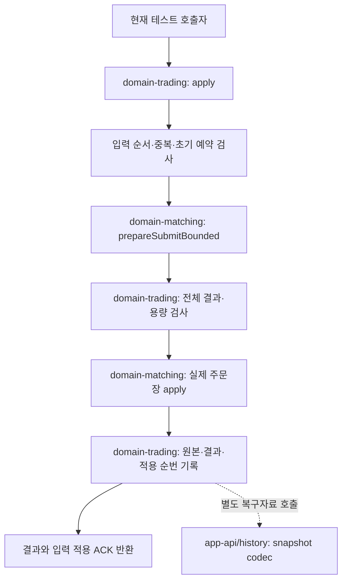

# #166 · 예약 주문의 매칭 적용과 전체 결과 보관

자금이 승인한 주문을 순서대로 한 번 매칭하고, 주문장 변화와 자금에 전달할 전체 결과를 함께 기억한다. 정산 확인이 유실돼도 재매칭하지 않으며, 확인 뒤 완료 자료를 회수해 메모리를 유한하게 유지한다.

- 명세: [#166](https://github.com/0Chord/coin-exchange/issues/166), 상위 [#131](https://github.com/0Chord/coin-exchange/issues/131), 설계 [#130](https://github.com/0Chord/coin-exchange/issues/130).
- 구현 PR: [#172](https://github.com/0Chord/coin-exchange/pull/172).
- 코드·검사 기준: `21680a55f87f6a7bb297c5f988fe6b20b6c3241a`. 통합 기준: `0d36a384c9c770a09ce84bb0bf0f0934287811cb`.
- 기록일: 2026-11-02. 이후 문서 보완을 제품·테스트 변경이나 새로운 테스트 실행과 구분한다.

## 현재 연결 범위와 세 모듈

선행 [#164 / PR #170](https://github.com/0Chord/coin-exchange/pull/170)은 역할·배치 검증과 상태 소유권을 나눴다. [#165 / PR #171](https://github.com/0Chord/coin-exchange/pull/171)은 자금 예약과 매칭으로 보낼 원본·전달 의무를 같은 상태 변경에 남겼다. 이번 #166은 그 승인 원본을 받는 매칭 쪽 상태다.

새 owner는 테스트에서 직접 호출한다. `TradingRoleAssembly.reservedMatching()` 조립과 새 codec을 실제 노드/HTTP 실행에 연결하는 단계는 아직 남아 있다. 기존 INTEGRATED 경로와 FUNDS/MATCHING 단독 기동 차단은 유지한다. 메모리 함수 반환만으로 quorum·Archive 저장·자금 정산 완료를 뜻하지 않는다.

| 모듈·제품 코드 | 책임 |
| --- | --- |
| domain-trading · [ReservedMatchingState](../domain-trading/src/main/kotlin/com/exchange/core/trading/ReservedMatchingState.kt#L14) | 입력 검사, 중복·순서, 전체 결과·활성 원본·진행·용량의 단일 소유자. private MatchingEngine 하나를 동기 호출 |
| domain-trading · [설정과 불변 값](../domain-trading/src/main/kotlin/com/exchange/core/trading/MatchingIntakeValues.kt#L76), [입력·결과 검증](../domain-trading/src/main/kotlin/com/exchange/core/trading/MatchingInputValidation.kt#L20) | 전체 배치·정책·한도 고정, 최초 예약 재계산 대조. 잔고·DB를 조회하지 않음 |
| domain-matching · [제한 매칭 후보](../domain-matching/src/main/kotlin/com/exchange/core/matching/MatchingEngine.kt#L131) | 가격·FIFO로 제한 후보 계산, 유효 후보의 실제 주문장 반영 |
| app-api/history · [MatchingRoleSnapshotCodec](../app-api/src/main/kotlin/com/exchange/core/api/trading/infrastructure/history/MatchingRoleSnapshotCodec.kt#L36) | 매칭 전용 v1 복구 bytes의 쓰기·읽기와 관계 검사. 매 주문 처리의 자동 저장 호출이 아님 |



## 정상 입력을 실제 코드로 따라가기

수량 단위1·수수료0의 예다. S1 SELL1@90을 입력1로, S2 SELL1@95를 입력2로 적용하면 엔진 사건1·2가 생긴다. 새 입력3은 B BUY3@100이다.

1. [apply](../domain-trading/src/main/kotlin/com/exchange/core/trading/ReservedMatchingState.kt#L61)가 owner와 고정 stream을 확인한다. 이미 적용한 입력은 보존 원문 비교 또는 PRUNED로 끝내고, 앞 입력이 빠지면 GAP이다. 다음 신규 입력만 고정 context·파생 ID·순수 예약 계산·source 증가를 검사한다.
2. [제한 매칭 후보](../domain-matching/src/main/kotlin/com/exchange/core/matching/MatchingEngine.kt#L131)가 S1→S2를 읽어 fills와 events를 만든다. 실제 maker 잔량·book·seen ID·엔진 순번은 아직 그대로다. 후보는 Trade90×1(event3), Trade95×1(event4), BUY잔량1 대기(event5)다. 엔진 token·기준 순번과 값 목록을 가진 로컬 후보이며 wire/snapshot 형식이 아니다.
3. [matched / effects](../domain-trading/src/main/kotlin/com/exchange/core/trading/ReservedMatchingState.kt#L618)가 각 maker의 자기 승인 원본과 전후 수량을 붙인다. B는3→1 RESTING, S1/S2는각1→0 TERMINAL이다. 결과는 resultSequence3, engineBefore2/After5, eventCount3이다.
4. 적용 후 활성 수는 현재2−종료maker2+새대기1=1이다. 단일 결과와 현재 누적 보존 예산도 검사한다. 여기까지 실제 상태는 그대로다.
5. [실제 반영 블록](../domain-trading/src/main/kotlin/com/exchange/core/trading/ReservedMatchingState.kt#L155)에서 engine.apply(plan)을 호출한다. 엔진은 발급자·현재 기준·maker/FIFO/index·수량·사건을 검사한 뒤 S1/S2를 차감·제거하고 B잔량1을 넣어 engine5를 기록한다.
6. 같은 블록에서 S1/S2 활성 원본을 제거하고 B 최초 원본을 보관한다. 전체 결과3을 outstanding에 넣고 appliedThrough3·resultIssued3·source·용량을 갱신한다. 종료된 S1/S2의 엔진 seen ID도 해제한다.
7. APPLIED, 전체 결과3, 입력3까지 연속 적용했다는 ACK를 반환한다. 같은 입력3 재전송은 엔진을 다시 호출하지 않는다.

| 상태 | 처리 전 | 처리 후 |
| --- | --- | --- |
| 현재 주문장 | S1매도1, S2매도1 | B매수잔량1 |
| 활성 승인 원본 | S1, S2 | B의 최초 수량3·초기 예약 |
| 미정산 확인 결과 | 결과1·2 | 결과1·2·3 |
| 입력 적용 / 결과 발급 | 2 / 2 | 3 / 3 |
| 엔진 사건 | 2 | 5 |

[여러 체결 테스트](../domain-trading/src/test/kotlin/com/exchange/core/trading/ReservedMatchingStateTest.kt#L163)는 사건3·4·5 전체, B잔량1, 각 주문의 자기 원본, result3과 engine5를 독립 정수 기대값으로 대조한다.

## 먼저 계산하는 이유와 재검증 비용

자금 역할이 나중에 정산하려면 완결된 매칭 결과가 필요하다. 체결부터 한 뒤 결과 보관이 실패하면 이미 바뀐 주문장에 대응하는 전달 근거가 부족해진다. 먼저 결과 크기와 적용 후 활성 상태를 계산하고 보관 가능할 때 실제 반영한다. 세 사건이 필요한 예에서 단일 사건 상한이2이면 S1/S2를 전혀 체결하지 않고 RESULT_TOO_LARGE의 event0 최종 거절을 보관한다. 현재 잔여 공간만 부족하면 BUSY이며 입력3도 소비하지 않는다.

설정 조립 시 가장 큰 합법 원본의 최종 거절 한 건이 단일·마켓·공통 결과 예산에 들어가는지도 확인한다. 불가능한 설정은 조립 단계에서 거절한다. bytes는 결정적인 논리 charge이며 실제 JVM heap이나 wire 크기가 아니다.

두 단계는 같은 JVM의 연속 함수 호출이다. 함수 분리는 구현 선택이지만 계산·보관 가능성 확인은 실제 변경보다 먼저 해야 한다.

적용 직전 MatchingEngine.validate(plan)은 별도 문제다. 기존 범용 API는 후보 생성 뒤 같은 마켓의 다른 submit/cancel을 실행한 다음 오래된 후보를 적용하는 사용도 방어한다. 현재 private 엔진 owner는 후보를 외부로 내주거나 그 사이 다른 업무를 실행하지 않는다. 이 경로의 재검증을 전부 “중간에 다른 체결이 들어오기 때문”이라고 설명하면 맞지 않는다. 기존 API의 적용 경로를 재사용하면서 남아 있는 검증 비용이다.

후보 순회·목록/효과 객체·방어 복사·maker 재검증/Map 조회·실제 반영 순회의 비용은 존재한다. #166 경로의 새 성능 측정은 없으며 이전 엔진 단독/통합 클러스터 TPS를 이 경로의 성능으로 인용하지 않는다. 소유 규칙을 유지하며 중복 검사를 줄이는 내부 경로는 개선 후보이며 이번에 구현·측정한 최적화가 아니다. [#126의 후보 기록](matching-plan-review.md)과 [#128의 통합 공동 반영 기록](trading-state-review.md)은 작성 당시 이력으로 유지한다.

## 단일 스레드와 mutate

단일 서비스 스레드가 apply를 순차 호출해야 한다. owner 내부에 여러 스레드의 동시 호출을 직렬화하는 락은 없다. 정상 호출에서는 A의 계산→검사→반영→결과 기록이 반환한 뒤 B를 처리한다. 이후 Aeron 수신 서비스에 연결할 때도 그 서비스 스레드의 소유 규칙을 유지해야 한다.

mutate는 Kotlin 기본 키워드가 아니라 [mutate](../domain-trading/src/main/kotlin/com/exchange/core/trading/ReservedMatchingState.kt#L705)로 정의한 함수다. 마지막 람다 인자를 괄호 밖에 쓰는 Kotlin 문법으로 호출한다.

```kotlin
private inline fun mutate(block: () -> Unit) {
    try {
        block()
    } catch (failure: Throwable) {
        isBlocked = true
        throw failure
    }
}
```

정상 입력/한도 오류는 쓰기 전에 분류한다. 실제 반영 중 예상 밖 오류가 나면 일부 쓰기가 끝났을 수 있다. mutate는 owner를 차단하고 예외를 전파하며 후속 적용·정상 조회·ACK·snapshot·재초기화를 금지한다. 락·DB 트랜잭션·자동 롤백을 제공하지 않는다. [쓰기 실패 주입 테스트](../domain-trading/src/test/kotlin/com/exchange/core/trading/ReservedMatchingRecoveryTest.kt#L183)는 engine1/book1이 이미 반영된 사실과 이후 정상 접근 차단을 함께 확인한다.

## 입력·결과·확인의 수명

| 상황 | 반환·상태 |
| --- | --- |
| 잘못된 stream / 다음 신규 입력의 승인 모순 | INVALID_STREAM / INVALID_INPUT, 성공 ACK·상태 변화 없음 |
| 보존 중인 같은 입력 | 원문 전체가 같으면 DUPLICATE와 최초 전체 결과, 다르면 CONTENT_CONFLICT |
| 정산 ACK 뒤 회수한 과거 입력 | PRUNED와 적용 prefix. 원문 동등성을 검사했다고 하지 않으며 재매칭하지 않음 |
| 다음 순번보다 미래 입력 | GAP/expectedSequence, 앞 순번을 건너뛰지 않음 |
| 현재 결과 보관 공간 부족 | BUSY·무변경. ACK 후 동일 입력 재시도 가능 |
| 적용 후 활성 한도 / 단일 결과 영구 상한 초과 | NOT_EXECUTED 결과 한 건. event0·주문장 불변, 입력/결과 순번 진행. 거절조차 지금 저장할 공간이 없으면 BUSY |
| 다음 순번 소진 | SEQUENCE_EXHAUSTED·무변경. 마지막 값 자체는 허용. 조회·기존 중복·유효 ACK 가능, MAX 뒤 cursor는 null |
| 결과 조회 | 비소비 전체 결과 batch. PRUNED/정상 빈 tail/잘못된 미래/작은 첫 batch를 구분 |
| 정산 ACK | stream/context를 먼저 검증. 음수·미래·다른 정책은 불변, 올바른 과거·중복만 no-op |

매칭 입력 적용 ACK는 자금 쪽 주문 전달 자료의 회수 근거다. 자금의 결과 정산 ACK는 매칭의 outstanding 결과와 입력 비교 원문을 정리하는 근거다. 사용자 응답 ACK는 이 두 서버 간 의무와 별개다.

정산 ACK 뒤에도 대기 중인 주문의 active 원본은 남는다. 이후 maker가 되면 자기 최초 승인 참조를 결과에 넣는다. 전량 종료하면 활성 원본·종료 seen ID를 정리하고, 종료 사실을 담은 결과는 정산 ACK까지 보관한다. 완료 입력/결과를 무기한 모으는 이력 저장소를 만들지 않는다.

## 전용 snapshot과 복원

매칭 전용 v1은 고정 설정/한도·기대 로그 위치·생명주기·현재 MatchingCheckpoint·활성 원본·stream 진행·미정산 전체 결과·카운터·checksum/footer를 담는다. 금융/통합 owner나 실행 중인 plan token은 저장하지 않는다.

- 길이·행 수·전체 bytes를 할당 전에 제한하고 형식·위치·설정·UTF-8·체크섬·잘림·trailing을 검사한다.
- outbox가 정산 prefix 다음부터 issued까지 연속인지, eventBefore/After가 정산 engine frontier부터 현재 엔진까지 이어지는지 대조한다.
- 정산0이면 settledEngine0이어야 한다. 양수 입력/결과가 있어도 event0 거절뿐이면 engine0·빈 checkpoint가 정상이다.
- active와 현재 book은 일대일이다. 최초 예약 수량3과 현재 book 잔량1을 같은 값으로 요구하지 않는다. 같은 가격의 FIFO는 market admission 순서와 비교한다.
- source는 같은 stream에서 증가하고 admission은 dispatch 이상의 수학적 하한을 만족한다. 다른 마켓의 source100→99 역도착은 전역 watermark로 막지 않는다.
- 현재 book에서 미정산 suffix의 효과를 역으로 구성한 뒤 임시 엔진에서 재계산해 사건·원본·수량을 대조한다. 빈 owner에 검증을 끝낸 상태만 공개한다.
- 마켓별 정산 frontier가 달라 당시 다른 마켓의 정확한 공통 활성 점유는 복원할 수 없다. 로컬 초과 또는 고정 한도상 공통 초과 가능성까지 검사한다. checksum은 작성자 신뢰·이미 회수한 모든 과거의 진실성을 증명하지 않는다.

이는 실제 bytes 왕복·빈 owner 복원·같은 명시 후속열의 비교다. 새 역할의 실제 Archive replay·리더 교체 시험과 구분한다.

## 테스트와 실행 근거

새 @Test 정의47개다. 새 공통 준비는 실제 순수 예약 계산으로 승인 원본을 만들며 금융 잔고·DB·네트워크를 만들지 않는다. 실제 HTTP 3노드 회귀는 별도 기존 테스트다.

| 새 테스트 클래스 | 정의 수 | 실제 확인 |
| --- | ---: | --- |
| [BoundedSubmitPreparationTest](../domain-matching/src/test/kotlin/com/exchange/core/matching/BoundedSubmitPreparationTest.kt#L16) | 7 | 후보 무변경·정확한 한도·부분 체결 방지·기존 후보 보존·MAX/뒤쪽 소진 |
| [ReservedMatchingStateTest](../domain-trading/src/test/kotlin/com/exchange/core/trading/ReservedMatchingStateTest.kt#L26) | 22 | 정상/중복/충돌/GAP/초기 예약·여러 체결·용량·조회·누적 ACK·자료 수명·UTF-8 charge·반복 정리·MAX |
| [ReservedMatchingRecoveryTest](../domain-trading/src/test/kotlin/com/exchange/core/trading/ReservedMatchingRecoveryTest.kt#L13) | 9 | 부분 잔량·관계/원문/FIFO/효과 손상·같은 후속열·중간 쓰기 차단·초기 frontier·동시 소진 |
| [MatchingRoleSnapshotCodecTest](../app-api/src/test/kotlin/com/exchange/core/api/trading/infrastructure/history/MatchingRoleSnapshotCodecTest.kt#L55) | 9 | 실제 bytes·ACK 전후·engine0·설정·형식/길이/집계·체크섬 재계산 손상 |

M1~M33의 상세 기대값은 [이슈 #166](https://github.com/0Chord/coin-exchange/issues/166)에 있다. 새 테스트와 기존 통합 회귀를 대조했다. source format/direction은 현재 타입의 고정 값이며 미래 wire decoder 시험이 아니다.

Java25에서 코드21680a5와 내용이 같은 검증 사본을 대상으로 확인한 결과다.

| 검사 | 테스트 수 | 실패/오류/skip | 실행 구분 |
| --- | ---: | --- | --- |
| domain-matching | 163 | 0/0/0 | 관련 전체 실행 |
| domain-trading | 372 | 0/0/0 | 관련 전체 실행 |
| domain-order / domain-fee | 78 / 39 | 각각0/0/0 | 변경 없는 동일 입력의 UP-TO-DATE 근거 재사용 |
| 선택 app-api7개 클래스 | 27 | 0/0/0 | 새 codec와 기존 자금 snapshot·통합 골든·상태 codec·후속 복원·기동 차단·HTTP |
| architecture-tests | 386 | 0/0/0 | P01~P09 각각 실행·성공, verifyArchitectureReport 통과 |
| 합계 | 1,065 | 0/0/0 | ktlintCheck·diff 공백 검사도 성공 |

최종 관련 검사는 나눠 실행했다. 아래는 같은 범위를 재현하는 명령이다. 전체 app-api suite를 실행했다는 뜻은 아니다. JDK25와 실행 중인 Docker가 필요하다.

```bash
cd "$(git rev-parse --show-toplevel)"
./gradlew :domain-matching:test :domain-trading:test :domain-order:test :domain-fee:test \
  :app-api:test \
  --tests '*MatchingRoleSnapshotCodecTest' \
  --tests '*FundsRoleSnapshotCodecTest' \
  --tests '*BoundedTradingRoleGoldenTest' \
  --tests '*BoundedTradingStateCodecTest' \
  --tests '*BoundedTradingSnapshotContinuationTest' \
  --tests '*TradingRoleStartupTest' \
  --tests '*BoundedHttpTradingClusterTest' \
  :architecture-tests:test :architecture-tests:verifyArchitectureReport ktlintCheck \
  --no-daemon --max-workers=1 --console=plain
```

기존 HTTP v3·LOCAL_QUORUM·독립 Docker JVM3개·sync2/2/2 run `http-bounded-a0a64cf6`이 성공했다. cleanupFailures는 빈 목록이고 기록 볼륨·해당 컨테이너/이미지 정리를 확인했다. 새 분리 서버 시험·성능 측정으로 설명하지 않는다.

PR head `21680a5`에 연결된 [CI run41432152928](https://github.com/0Chord/coin-exchange/actions/runs/41432152928)은 2026-11-02 확인 시 Architecture checks와 Build and test 모두 success였다. 이 문서를 추가한 새 커밋의 CI 상태는 해당 head의 Checks에서 따로 확인한다.

## 독립 리뷰에서 수정한 경계

작성 대화를 상속하지 않은 별도 리뷰어가 기준0d36a38 위의 고정 사본 v1을 전체 검토하고 v2 변경·회귀를 다시 검사했다. v2의12파일 목록 SHA-256은 `0af45c0e8b618fda51f0e047132b31d8c8c4bc09717b8c7caee59d607cd71723`이며 코드21680a5의12파일과 같다.

| 확인한 문제 | 수정·독립 재현 |
| --- | --- |
| event 상한과 Long 소진이 동시에 걸리면 입력을 RESULT_TOO_LARGE 최종 거절로 소비 | 다음 사건 순번을 cap보다 먼저 검사. engineMAX−1·cap1·체결1+잔량1에서 SEQUENCE_EXHAUSTED/result·ACK없음·무변경 확인. MAX 자체 성공도 허용 |
| 정산0인데 engine와settledEngine만100인 자료가 RUNNING으로 복원돼 첫 event101 발급 | settledThrough0→settledEngine0과 source 하한 검사. 객체·재서명 바이트 손상 거절, 거절onlyengine0/다음event1 정상 복원 대조 |
| sealed interface의 기존 구조 분류기 미분류 | sealed class로 표현하고 검사 예외를 추가하지 않음. 구현자가 최종 P01~P09 실행·성공 확인 |

앞 두 결함은 실제 assertion 실패를 고정한 뒤 수정했다. 독립 재리뷰어는 두 도메인 전체와 별도 인접 probe를 실행해 해소를 확인했으며 검토 범위에서 미해결0건이었다. probe는 위47개/1,065개에 합산하지 않는다. 구조·app codec·HTTP는 구현자가 별도로 실행했고 리뷰어가 직접 실행했다고 표시하지 않는다. 테스트 설명·독립 AI 리뷰를 사용자 이해나 GitHub 승인으로 간주하지 않는다.

코어22개 테스트의 첫 컴파일 실패는 행동 TDD Red로 세지 않았다. snapshot의 최초 수기 byte 기대값 오류는 resultId 문자 수를 직접 대조해 교정했다. 최종 기대값을 제품 charge로 생성하지 않았다.

## 후속 연결과 성능 논의

[#167](https://github.com/0Chord/coin-exchange/issues/167)은 전체 결과의 금융 검증·순차 정산·최종 거절 예약 반환이다. [#168](https://github.com/0Chord/coin-exchange/issues/168)·[#169](https://github.com/0Chord/coin-exchange/issues/169)는 실제 역할 runtime·Aeron 전송·원격 출처/ACK·로그 연결이다. 취소는 #133, 연결된 시스템의 복합 장애는 #134다.

최종 자금 예약→마켓 매칭→같은 자금 클러스터 정산 구조에는 주문/결과 전달과 각 단계의 처리·합의·대기가 추가된다. 마켓별 독립 확장·장애 격리와 파이프라인 처리의 이득이 있지만 단일 주문의 경로 비용도 늘어난다. 공통 자금 엔진은 여전히 예약·정산을 감당해야 한다. 통합 경로를 기준으로 남겨 분리 후 접수 응답과 정산 완료의 처리량·지연을 각각 비교할 과제이며, 분리 버전의 성능 수치는 아직 없다.

외부 원장 전체 이력·Kafka/RocksDB·사용자 인증·동적 담당 이전·사용자 ACK 자동화는 이번에 구현하지 않았다. GitHub 명세와 이 문서를 저장소 기록으로 유지하고, 로컬 HTML은 읽기용 보조 화면으로 사용한다. 원시 로그·XML·컨테이너 자료는 재실행/조사 자료이며 Git에 일괄 추가하지 않는다.
