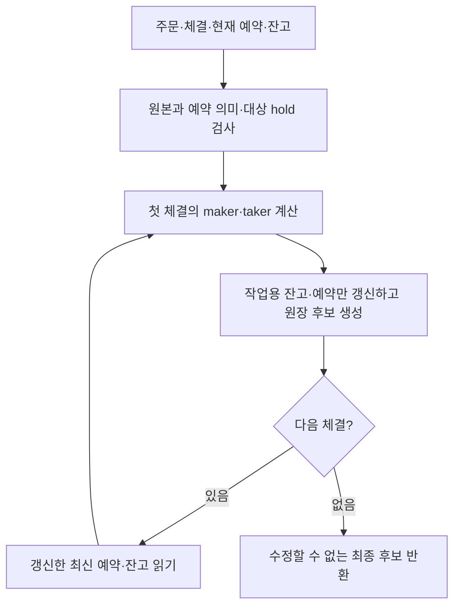

# #127 · 첫 체결의 돈 계산을 다음 체결이 이어받기

**BUY 100×3이 90·95에 1개씩 체결되면 앞 계산을 이어받아 잔고·예약·원장 후보를 만듭니다. 실제 원본은 바꾸지 않습니다.** 아래는 수수료 0·수량 단위 1의 예입니다.

| 시점 | 구매자 USDT 사용 가능 | 구매자 USDT 예약 | 구매자 BTC 사용 가능 |
| --- | ---: | ---: | ---: |
| 전달한 원본 | 700 | 300 | 0 |
| 첫 90 체결의 임시 계산 | 710 | 200 | 1 |
| 둘째 95 체결까지 계산한 후보 | **715** | **100** | **2** |
| 계산 뒤 실제 원본 | **700** | **300** | **0** |

| 먼저 볼 흐름 | 시작 → 결과 |
| --- | --- |
| [1. 앞 계산 이어받기](#flow-continue) | 현재 예약·잔고 + 순서 있는 체결 → 최종 후보 한 묶음 |
| [2. 맞지 않는 입력 거절](#flow-input) | 원본·예약·소유자·예약 총액 검사 → 예외, 입력 보존 |
| [3. 뒤 계산에서 실패](#flow-failure) | 첫 체결은 계산 가능, 둘째 지급 overflow → 부분 후보 반환 없음 |
| [4. 기존 DB 정산 유지](#flow-db) | 기존 한 체결 정산 → 공통 원장 생성 → 기존 저장 순서 |

<details markdown="1" id="flow-continue"><summary>1. 첫 체결 뒤의 잔고와 예약에서 계속 계산한다</summary>

이번 입구는 [OrderSettlementCalculator.calculate](../domain-trading/src/main/kotlin/com/exchange/core/trading/OrderSettlementCalculator.kt#L42)입니다. 호출자가 주문 원본, 마켓, 순서 있는 체결, 현재 예약·잔고를 넘깁니다. 각 체결에는 원장 ID와 시각도 있어 계산 중 새 ID·현재 시간을 만들지 않습니다.

함수는 전달된 목록을 읽고 작업용 map을 만듭니다. map은 주문 예약을 `(마켓, 주문)`, 잔고를 `(사용자, 자산)`으로 찾는 함수 내부의 표입니다. 실제 `OrderAdmissionState`가 소유한 map을 받거나 바꾸지 않습니다.



maker는 먼저 기다리던 상대 주문이고, taker는 이번에 들어온 주문입니다. 각 주문의 접수 당시 수수료 정책과 이번 역할로 기존 단일 체결 계산기를 호출합니다. 잔고는 사용자·자산별로 합치지만 수수료 소수 나머지는 주문별 예약에 남깁니다.

실제 금액 규칙은 기존 [한 체결 계산기](../domain-order/src/main/kotlin/com/exchange/core/order/OrderFillSettlementCalculator.kt#L76)에 있습니다. 잔고의 [예약 소비](../domain-ledger/src/main/kotlin/com/exchange/core/ledger/Balance.kt#L125)·[반환](../domain-ledger/src/main/kotlin/com/exchange/core/ledger/Balance.kt#L82)·[지급](../domain-ledger/src/main/kotlin/com/exchange/core/ledger/Balance.kt#L155)도 원본을 고치는 대신 새 값을 반환합니다. 이번 계산기는 이 값들을 다음 계산의 출발점으로 보관합니다.

다음 짧은 실제 코드에서 `workingReservations`를 읽는 위치가 중요합니다. [같은 함수의 체결 반복문](../domain-trading/src/main/kotlin/com/exchange/core/trading/OrderSettlementCalculator.kt#L115)은 매번 최신 예약을 읽습니다.

```kotlin
val maker = workingReservations.getValue(OrderKey(market.marketId, trade.makerOrderId))
val taker = workingReservations.getValue(OrderKey(market.marketId, trade.takerOrderId))
```

`accumulate`는 먼저 계산한 계획의 hold 소비 → 남은 금액 반환 → 반대 자산 지급을 작업용 잔고에 누적하고 갱신 예약을 넣습니다. [갱신 위치](../domain-trading/src/main/kotlin/com/exchange/core/trading/OrderSettlementCalculator.kt#L101)를 보면 각 변경 때 `workingBalances`의 최신 값에서 시작합니다.

```kotlin
val previous = balanceAt(workingBalances, key)
workingBalances[key] = update(previous)
```

이 때문에 같은 판매자의 주문 두 개는 90+95=185를 받습니다. 같은 사용자가 매수·매도 양쪽인 경우도 앞 소비·지급을 다음 변경이 덮어쓰지 않습니다. 없는 수취 잔고는 0에서 시작하되 입력 목록에 새 잔고를 삽입하지 않습니다.

체결별 결과는 입력 순서대로 저장하고, 최종 후보의 잔고·예약 변경에는 같은 키가 한 번만 나타납니다. 잔고는 실제로 값이 달라진 항목만 담습니다. [후보 목록](../domain-trading/src/main/kotlin/com/exchange/core/trading/OrderSettlementCandidate.kt#L18)은 복사 후 외부 수정을 막습니다. 값인 `Balance`·`OrderReservation`을 재사용하며 전체 엔진을 깊게 복사하지 않습니다.

빈 체결은 변경 0건으로 돌아옵니다. 그 결과를 전량 체결이나 처리 완료라고 기록하지 않습니다. 같은 입력을 반복 계산해도 저장은 발생하지 않으며, 과거 실제 적용과의 중복 효과 차단은 #128에서 연결해야 합니다.

첫 판단: [대표 E1](#test-example)의 715·예약 100과 원본 700·예약 300을 나란히 보세요. 그다음 [C5 수수료 나머지](#test-C5)에서 잔고뿐 아니라 예약의 나머지도 다음 체결로 이어지는지 볼 수 있습니다.

</details>

<details markdown="1" id="balance-vs-fee"><summary>같은 사람의 잔고는 합치는데, 수수료 나머지는 왜 주문별일까?</summary>

**잔고는 “이 사용자가 이 자산을 얼마 가지고 있는가”, 수수료 나머지는 “이 주문의 수수료 계산에서 최소 단위 미만으로 남은 값은 얼마인가”를 나타냅니다.** 서로 답하는 질문이 다릅니다.

수수료 없는 판매 두 건에서 90과 95를 받으면 같은 사용자의 USDT 잔고에는 185가 있어야 합니다. 따라서 잔고의 식별자는 `(사용자, 자산)`입니다. 주문마다 별도 실제 잔고를 만드는 것이 아닙니다.

반면 **현재 프로젝트는 수수료 소수 나머지를 주문 단위로 이어 계산**하도록 정했습니다. 예를 들어 설명용 최소 화폐 단위가 1이고, 요율이 0.5%, 체결 대금이 매번 100이라고 해봅시다. 한 번의 계산상 수수료는 0.5지만 지금 청구할 정수 금액은 0입니다.

| 상황 | 첫 계산 | 다음 계산 | 청구 합계 |
| --- | --- | --- | ---: |
| 같은 주문 A가 두 번 체결 | 0 청구, A에 나머지 0.5 | A의 이전 0.5 + 이번 0.5 → 1 청구 | 1 |
| 별개 주문 A·B가 한 번씩 체결 | 0 청구, A에 나머지 0.5 | 0 청구, B에 나머지 0.5 | 0 |

두 번째 줄에서 사용자 이름이 같다는 이유로 나머지를 합치면, B를 정산하면서 A의 계산값까지 가져와 1을 청구하게 됩니다. 그러면 현재의 **주문별 수수료 계산 계약을 사용자별 합산 계약으로 바꾸는 것**입니다. 또 각 주문에 보존된 요율이나 이번 maker/taker 역할이 다를 수 있어, 자기 주문의 정책과 나머지를 연결해야 계산 근거를 추적할 수 있습니다.

나머지 0.5는 별도 지급금이나 사용 가능한 잔고가 아닙니다. 다음에 **같은 주문**을 계산할 때 쓸 소수 계산값입니다. 주문이 끝나면 현재 구현은 남은 나머지를 기록에 보존하고, 다른 주문으로 옮기거나 추가 금액을 자동 청구하지 않습니다. 이 구분은 프로젝트에서 선택한 규칙이며, 모든 거래소가 반드시 같은 단위로 청구한다는 뜻은 아닙니다.

실제 [C5 테스트](#test-C5)는 같은 원리를 다른 숫자로 확인합니다. BUY 한 주문은 51의 1%인 0.51을 두 체결에 걸쳐 이어 받아 총 1을 청구합니다. 같은 판매자의 SELL 두 주문은 각각 51의 0.5%인 0.255를 자기 예약에 남기고, 지급액 51과 51만 같은 USDT 잔고에 합쳐 102를 만듭니다. **잔고를 합치는 것과 수수료 계산 이력을 합치는 것은 별개입니다.**

</details>

<details markdown="1" id="flow-input"><summary>2. 한 번의 소비가 가능해도 전체 예약이 맞지 않으면 거절한다</summary>

BUY 예약 300인데 실제 USDT hold가 100이면 90을 쓰고 10을 반환할 수는 있습니다. 하지만 성공으로 반환하면 남은 주문 예약 200을 뒷받침할 hold가 0이 됩니다. 따라서 [대상 예약 합과 초기 hold](../domain-trading/src/main/kotlin/com/exchange/core/trading/OrderSettlementCalculator.kt#L64)를 먼저 대조합니다.

검사하는 것은 이번 체결에서 쓰는 고유 예약뿐입니다. 대상 예약 300·hold350이면 나머지 50을 다른 주문의 hold로 보고 보존합니다. 전 사용자의 모든 예약을 읽거나 전체 엔진을 스캔하지 않습니다. [체결 뒤 같은 차이를 보존하는 검사](../domain-trading/src/main/kotlin/com/exchange/core/trading/OrderSettlementCalculator.kt#L107)도 있습니다.

그 밖의 입력 검사는 다음 세 갈래로 읽으면 됩니다.

- [체결 연결과 순서](../domain-trading/src/main/kotlin/com/exchange/core/trading/OrderSettlementCalculator.kt#L156): 같은 마켓·taker·방향, 양수 수량·순번, 연속 순번, 비어 있지 않고 중복되지 않은 원장 ID를 검사합니다. 목록을 정렬하거나 잘못된 체결을 건너뛰지 않습니다.
- [원본 주문 대조](../domain-trading/src/main/kotlin/com/exchange/core/trading/OrderSettlementCalculator.kt#L175): 주문 ID·사용자·방향·지정가·최초 수량을 현재 taker 예약과 연결합니다. 줄어든 현재 잔량을 최초 수량과 혼동하지 않습니다.
- [예약 자체의 의미](../domain-trading/src/main/kotlin/com/exchange/core/trading/OrderSettlementCalculator.kt#L185): 현물·자산·상태와 최초/현재 거래·수수료 예약을 기존 계산기로 대조합니다. 생성자를 통과한 양수 객체라고 정상으로 가정하지 않습니다. 반복문에서는 양쪽 소유자·반대 방향·maker 가격도 확인합니다.

없는 소비 잔고는 충분한 hold가 없으므로 실패합니다. 없는 주문 예약을 0으로 만들어 체결하지 않습니다. 사용자가 새 주문을 낼 때 잔고가 부족한 정상 거절과 달리, 이미 만들어진 체결의 잘못된 입력이므로 예외로 끝납니다.

이 계산기는 전달되지 않은 체결이 원래 매칭 결과에 더 있었는지는 알 수 없습니다. #126의 전체 매칭 후보 및 #51의 완료 결과와의 연결은 #128에 남아 있습니다.

대표 반례는 [C19 예약 300·hold100](#test-C19), [C20 같은 사용자의 두 예약 합](#test-C20), [C18 현재 수수료 예약](#test-C18)입니다.

</details>

<details markdown="1" id="flow-failure"><summary>3. 둘째 지급이 실패해도 첫 체결만 성공 결과로 내보내지 않는다</summary>

둘째 판매자의 USDT 사용 가능 금액이 `Long.MAX_VALUE`라 95를 더할 수 없다고 해보겠습니다. 예약과 hold는 정상이라 첫 체결만 계산하면 구매자 710·예약 200이라는 후보가 나옵니다. 두 체결을 모두 계산하면 둘째 지급에서 정확한 정수 덧셈이 overflow를 발견해 예외를 냅니다.

이때 첫 체결의 잔고를 되돌리는 SQL 롤백을 하는 것이 아닙니다. 처음부터 [작업용 map만 변경](../domain-trading/src/main/kotlin/com/exchange/core/trading/OrderSettlementCalculator.kt#L82)했고, 전체 반복이 끝나야 [후보를 반환](../domain-trading/src/main/kotlin/com/exchange/core/trading/OrderSettlementCalculator.kt#L138)합니다. 예외를 잡아 부분 후보를 돌려주는 경로·callback·외부 저장 호출은 없습니다.

실제 [C21](#test-C21)은 다음을 각각 확인합니다.

1. 첫 체결만 넘기면 710·예약 200·판매자 90으로 성공한다.
2. 같은 입력에 둘째 체결을 포함하면 `ArithmeticException`이다.
3. 전달한 원본은 700·예약 300·원래 예약 그대로다.
4. 전에 반환받은 첫 체결 후보도 변하지 않으며, 같은 계산기로 새 정상 입력을 계산하면 715·예약 100이 된다.

계산기에 차단 상태나 실제 적용 API는 없습니다. 실제 상태를 신뢰할 수 없을 때 차단할 책임, 적용 직전의 최신 상태 검사, 접수 후 자동 실행은 #128·#129에서 맡습니다. 이 후보는 잔고를 예약하거나 잠그는 객체도, 복구용 파일 스냅샷도 아닙니다.

</details>

<details markdown="1" id="flow-db"><summary>4. 원장 만드는 책임만 기존 DB 정산과 함께 쓴다</summary>

[SettlementLedgerTransactions.create](../domain-trading/src/main/kotlin/com/exchange/core/trading/SettlementLedgerTransactions.kt#L18)는 maker 분개 다음 taker 분개를 묶어 기존 `LedgerTransaction`을 만듭니다. 새 후보 계산기와 기존 DB 서비스가 같은 생성기를 사용합니다. 이 함수는 저장하지 않습니다.

- 실제 소비는 사용자 예약 자산의 HOLD 차변입니다.
- 가격 차액·쓰지 않은 수수료 예약 반환은 같은 HOLD 차변과 AVAILABLE 대변입니다. 별도의 취소 RELEASE를 만들지 않습니다.
- 반대 자산 지급은 사용자 AVAILABLE 대변, 실제 수수료만 quote 자산 SYSTEM FEE_REVENUE 대변입니다.0 금액 분개는 만들지 않습니다.
- 원본 사건은 `MATCHING:{market}:{순번}`, 유형은 SETTLEMENT입니다. 새 계산기는 입력 ID·시각을 보존하고 별도 시스템 수익 Balance를 만들지 않습니다.

기존 [TradeSettlementService.settle](../app-api/src/main/kotlin/com/exchange/core/api/order/application/TradeSettlementService.kt#L53)은 예약 row 잠금 조회 → 양쪽 단일 체결 계산 → 공통 원장 생성 → 원장 append → maker 예약·잔고 반영 → taker 예약·잔고 반영 순서입니다. 원래 한 체결의 Spring 트랜잭션과 ID·시각 공급도 유지합니다. 서비스는 여전히 DB 정산 경로이며 새 여러 체결 후보 계산기를 호출하도록 바꾼 것이 아닙니다.

[설정 코드](../app-api/src/main/kotlin/com/exchange/core/api/config/LedgerPersistenceConfig.kt#L119)는 그 기존 서비스에 공통 생성기를 주입합니다. DB에서는 원래처럼 `UUID.randomUUID()`와 `Instant.now()`를 공급합니다. 이 호출들을 결정론적 새 후보 계산기 안으로 옮기지 않았습니다.

아래 새 29개 테스트는 순수 도메인 검사입니다. 기존 DB 경로는 실제 PostgreSQL [기본 정산](../app-api/src/test/kotlin/com/exchange/core/api/order/application/TradeSettlementServiceTest.kt#L163)·[지급 실패 롤백](../app-api/src/test/kotlin/com/exchange/core/api/order/application/TradeSettlementServiceTest.kt#L604)·[분할 체결 수수료](../app-api/src/test/kotlin/com/exchange/core/api/order/application/TradeSettlementServiceTest.kt#L834)를 포함한 11개 실행으로 확인했습니다. 결과는 [실행 확인](#verification)에 구분하며, 순수 테스트 통과를 DB 롤백의 실행 증거로 쓰지 않습니다.

</details>

<details markdown="1"><summary>변경 파일과 실제로 연결된 위치</summary>

제품 실행 코드 6개와 새 테스트 3개를 구분합니다. 새 서버·HTTP API·Aeron 메시지·빌드 설정·DB 테이블은 이번 변경에 없습니다.

| 파일 | 이번 역할 |
| --- | --- |
| [OrderSettlementCalculator](../domain-trading/src/main/kotlin/com/exchange/core/trading/OrderSettlementCalculator.kt#L26) | 입력 검사와 함수 안의 순차 누적, 성공 때 최종 후보 반환 |
| [SettlementExecution](../domain-trading/src/main/kotlin/com/exchange/core/trading/SettlementExecution.kt#L12) | 원본 체결·정책 계산에 필요한 주문 연결·ID·시각 값. 새 통신 DTO가 아님 |
| [OrderSettlementCandidate](../domain-trading/src/main/kotlin/com/exchange/core/trading/OrderSettlementCandidate.kt#L11) | 체결별 계획·원장과 잔고/예약의 전후 값. 목록 방어 복사 |
| [SettlementLedgerTransactions](../domain-trading/src/main/kotlin/com/exchange/core/trading/SettlementLedgerTransactions.kt#L13) | 양쪽 계획의 순수 원장 생성. 새 계산기와 기존 DB 서비스가 공유 |
| [TradeSettlementService](../app-api/src/main/kotlin/com/exchange/core/api/order/application/TradeSettlementService.kt#L108) | 기존 private 원장 생성 대신 공통 생성기를 호출. 저장 순서 유지 |
| [LedgerPersistenceConfig](../app-api/src/main/kotlin/com/exchange/core/api/config/LedgerPersistenceConfig.kt#L119) | 기존 DB 서비스의 공통 생성기 연결 |
| [OrderSettlementExampleTest](../domain-trading/src/test/kotlin/com/exchange/core/trading/OrderSettlementExampleTest.kt#L36) | 손으로 정한 두 체결·잔량·전체 분개 1개 테스트 |
| [OrderSettlementContractTest](../domain-trading/src/test/kotlin/com/exchange/core/trading/OrderSettlementContractTest.kt#L36) | 누적·수수료·키 겹침·입력/실패·불변성 24개 테스트 |
| [SettlementLedgerTransactionsTest](../domain-trading/src/test/kotlin/com/exchange/core/trading/SettlementLedgerTransactionsTest.kt#L32) | 순수 생성기의 필드·분개·균형 오류 4개 테스트 |

계산기의 실제 상태 적용 호출자는 아직 없습니다. 새 테스트가 직접 호출해 후보를 대조합니다. 기존 DB 정산은 공통 원장 생성기를 실제 사용하지만, 그 사실이 Aeron의 매칭·정산 자동 연결을 뜻하지는 않습니다.

읽은 소스 기준은 통합 `e9411d5646b176e06e46f460c7bd66cb18086849`을 기준으로 작성한 `feat/settlement-candidates/127`의 변경입니다(2026-10-25). 설명용 원문 발췌는 `review-v1` 기술 스냅샷과 대조했습니다. 계산기 SHA-256은 `6f66db32220778ef528a3a31b5847b9f17035c7d1d4b8edd2e54b13d6fcd0db0`, 기술 변경 patch SHA-256은 `96e2708587f21aea07c37004354f806ff4b5ca2dded457b78e825b6aba5276e4`입니다. 최종 실행·리뷰 대상은 아래 확인 기록과 함께 맞춥니다.

</details>

<details markdown="1" id="test-example"><summary>대표 E1 · 두 체결 뒤 715·예약 100·BTC2, 원본은 700·예약 300</summary>

메서드: [두 체결은 앞 후보를 이어가 715와 예약100 BTC2를 만들고 원본은 그대로 둔다](../domain-trading/src/test/kotlin/com/exchange/core/trading/OrderSettlementExampleTest.kt#L54)

- **Given — 준비:** 구매자는 BUY100×3에 300을 예약했고 사용 가능 700입니다. 서로 다른 두 판매자가 90·95에 1개씩 팝니다. 수수료 0·수량 scale0, 원장 ID·시각도 명시합니다.
- **When — 실행:** 실제 후보 계산기에 두 체결과 현재 예약·잔고를 한 번 넘깁니다.
- **Then — 확인:** 최종 잔고 여섯 항목은 구매자 715·예약 100·BTC2와 판매자별 90·95 지급, 각 BTC 예약 0입니다. 구매자 잔량 1·예약 100, 두 SELL은 SETTLED, 후보의 이전 예약과 입력 예약·잔고도 대조합니다. 두 원장의 사용자·계정·자산·방향·금액·사건·ID·시각을 손으로 정한 전체 목록과 비교합니다.

핵심 검증문은 [최종 잔고](../domain-trading/src/test/kotlin/com/exchange/core/trading/OrderSettlementExampleTest.kt#L66), [예약과 원본 보존](../domain-trading/src/test/kotlin/com/exchange/core/trading/OrderSettlementExampleTest.kt#L77), [전체 분개](../domain-trading/src/test/kotlin/com/exchange/core/trading/OrderSettlementExampleTest.kt#L89)입니다. 입력 체결 순번 3·4는 원장 사건 연결값이며 새 엔진 순번을 발급하는 검사가 아닙니다.

</details>

<details markdown="1"><summary>모든 새 테스트 29개 · 동작별로 골라 읽기</summary>

테스트 메서드는 Example1개·Contract24개·Ledger4개입니다. 각 메서드 안의 여러 위반 입력은 같은 테스트가 반복 검사하므로 별도 테스트 수로 세지 않습니다. 모두 실제 계산기를 쓰는 순수 도메인 검사이며 mock·DB·HTTP·Aeron은 없습니다. 실행 상태는 [별도 확인 기록](#verification)에 남깁니다.

### 같은 돈·예약을 이어 쓰는 정상 흐름

<details markdown="1" id="test-C1"><summary>C1 · 같은 판매자의 서로 다른 두 주문</summary>

메서드: [같은 판매자의 서로 다른 주문은 지급을 합하고 예약은 각각 끝낸다](../domain-trading/src/test/kotlin/com/exchange/core/trading/OrderSettlementContractTest.kt#L51)

- **Given:** SELL90·95 각 1을 같은 사용자에게 두고 BTC 예약 2로 시작합니다.
- **When:** 두 체결을 한 번 계산합니다.
- **Then:** 판매자 USDT185·BTC 예약 0, 두 SELL 각각 SETTLED, 변경 예약 3개이고 입력은 그대로입니다.90을 95로 덮어쓰는 오류를 구분합니다. [검증문](../domain-trading/src/test/kotlin/com/exchange/core/trading/OrderSettlementContractTest.kt#L56)

</details>

<details markdown="1" id="test-C2"><summary>C2 · 사용자가 매수·매도 양쪽인 경우</summary>

메서드: [같은 사용자가 양쪽이면 지급과 소비가 겹친 잔고를 덮어쓰지 않는다](../domain-trading/src/test/kotlin/com/exchange/core/trading/OrderSettlementContractTest.kt#L65)

- **Given:** 한 사용자가 BUY100×2와 SELL90·95를 소유하고 USDT 사용 가능 800·예약 200, BTC 사용 가능 0·예약 2를 가집니다.
- **When:** 같은 사용자의 두 방향 체결을 계산합니다.
- **Then:** USDT1000·예약 0, BTC2·예약 0, 고유 잔고 변경 2개·예약 모두 SETTLED이며 입력은 그대로입니다. 새 자전거래 금지 정책을 추가하는 테스트는 아닙니다. [검증문](../domain-trading/src/test/kotlin/com/exchange/core/trading/OrderSettlementContractTest.kt#L86)

</details>

<details markdown="1" id="test-C3"><summary>C3 · 대상 밖 예약 50 보존</summary>

메서드: [다른 주문에 묶인 50은 두 체결 뒤에도 남긴다](../domain-trading/src/test/kotlin/com/exchange/core/trading/OrderSettlementContractTest.kt#L94)

- **Given:** 구매자의 전체 USDT hold는 350, 이번 BUY 예약은 300입니다.
- **When:** 두 체결을 계산합니다.
- **Then:** 사용 가능 715·전체 hold150, 이번 BUY 예약 100으로 대상 밖 50이 남습니다. 원본도 보존합니다. [검증문](../domain-trading/src/test/kotlin/com/exchange/core/trading/OrderSettlementContractTest.kt#L99)

</details>

<details markdown="1" id="test-C4"><summary>C4 · 처음 수취하는 자산</summary>

메서드: [처음 받는 자산의 잔고 항목이 없어도 0에서 수취 후보를 만든다](../domain-trading/src/test/kotlin/com/exchange/core/trading/OrderSettlementContractTest.kt#L105)

- **Given:** 구매자의 BTC 잔고 항목을 입력에 넣지 않습니다.
- **When:** 두 체결을 계산합니다.
- **Then:** BTC 변경의 이전 값은 0·예약 0, 다음 값은 2·예약 0입니다. 입력 목록에 새 BTC 잔고는 삽입되지 않습니다. [검증문](../domain-trading/src/test/kotlin/com/exchange/core/trading/OrderSettlementContractTest.kt#L110)

</details>

<details markdown="1" id="test-C5"><summary>C5 ·51 두 건의 주문별 수수료 나머지</summary>

메서드: [수수료 나머지는 BUY의 다음 체결로 넘기고 서로 다른 SELL 주문끼리는 합치지 않는다](../domain-trading/src/test/kotlin/com/exchange/core/trading/OrderSettlementContractTest.kt#L118)

- **Given:** maker 0.5%·taker 1%, BUY51×2의 예약 104·사용 가능 896입니다. 같은 판매자의 서로 다른 SELL 주문 두 개와 체결합니다.
- **When:** 두 체결을 순서대로 계산합니다.
- **Then:** BUY 수수료 0→1·나머지 510000→20000·남은 수수료 예약 2→0, 최종 USDT897·hold0·BTC2입니다. SELL은 각각 수수료 0·나머지 255000, 지급 합 102·원장 수익 1이며 입력은 그대로입니다. [수수료 검증문](../domain-trading/src/test/kotlin/com/exchange/core/trading/OrderSettlementContractTest.kt#L133) · [최종 잔고·수익](../domain-trading/src/test/kotlin/com/exchange/core/trading/OrderSettlementContractTest.kt#L145)

</details>

<details markdown="1" id="test-C6"><summary>C6 · 이전 taker BUY가 이번 maker로 참여</summary>

메서드: [이전에 taker였던 BUY가 maker가 되면 저장된 나머지와 이번 maker 요율을 쓴다](../domain-trading/src/test/kotlin/com/exchange/core/trading/OrderSettlementContractTest.kt#L156)

- **Given:** 기존 BUY 잔량 4·거래 예약 204+수수료 3·나머지 510000, USDT742·hold207입니다. 새 SELL4개가 51에 체결됩니다.
- **When:** BUY를 maker, SELL을 taker로 계산합니다.
- **Then:** BUY 수수료 1·나머지 530000·반환 2·사용 가능 744, SELL 수수료 2·나머지 40000·순지급 202, 원장 수익 3입니다. 원래 입력은 보존합니다. [계획 검증문](../domain-trading/src/test/kotlin/com/exchange/core/trading/OrderSettlementContractTest.kt#L175) · [잔고·수익](../domain-trading/src/test/kotlin/com/exchange/core/trading/OrderSettlementContractTest.kt#L194)

</details>

<details markdown="1" id="test-C7"><summary>C7 · SELL taker의 두 maker 가격 체결</summary>

메서드: [SELL taker는 두 BUY maker 가격의 대금을 더하고 남은 base 예약을 보존한다](../domain-trading/src/test/kotlin/com/exchange/core/trading/OrderSettlementContractTest.kt#L202)

- **Given:** SELL95×3의 BTC 예약 3, BUY105×1·BUY100×1의 USDT 예약 105·100입니다.
- **When:**105와 100에 한 개씩 체결합니다.
- **Then:** SELL은 USDT205·BTC hold1·잔량 1·ACTIVE입니다. BUY들은 BTC1 지급·USDT hold0·SETTLED이고, 사용 가능 895·900과 원본을 보존합니다. [판매자 검증문](../domain-trading/src/test/kotlin/com/exchange/core/trading/OrderSettlementContractTest.kt#L225) · [구매자 검증문](../domain-trading/src/test/kotlin/com/exchange/core/trading/OrderSettlementContractTest.kt#L230)

</details>

### 빈 입력·반복 계산·목록의 불변성

<details markdown="1" id="test-C8"><summary>C8 · 빈 체결 목록</summary>

메서드: [빈 체결은 주문과 마켓만 보존하고 변경과 원장은 만들지 않는다](../domain-trading/src/test/kotlin/com/exchange/core/trading/OrderSettlementContractTest.kt#L240)

- **Given:** 주문·예약·잔고는 두고 체결만 비웁니다.
- **When:** 빈 목록으로 계산합니다.
- **Then:** 주문·마켓은 같고 정산·잔고 변경·예약 변경은 모두 0개이며 입력은 그대로입니다. 실제 처리 완료 기록은 검사하지 않습니다. [검증문](../domain-trading/src/test/kotlin/com/exchange/core/trading/OrderSettlementContractTest.kt#L245)

</details>

<details markdown="1" id="test-C9"><summary>C9 · 같은 입력 반복 계산</summary>

메서드: [같은 입력은 원장 객체의 참조와 무관하게 같은 필드의 후보를 만든다](../domain-trading/src/test/kotlin/com/exchange/core/trading/OrderSettlementContractTest.kt#L254)

- **Given:** 동일한 주문·예약·잔고·원장 ID·시각입니다.
- **When:** 두 번 계산합니다.
- **Then:** 전후 잔고·예약, 체결·양쪽 계획이 같고 원장은 ID·사건·유형·시각·분개 필드를 비교합니다. 입력도 보존합니다. 원장 객체 참조를 비교하거나 실제 중복 저장을 검사하는 것은 아닙니다. [검증문](../domain-trading/src/test/kotlin/com/exchange/core/trading/OrderSettlementContractTest.kt#L260)

</details>

<details markdown="1" id="test-C10"><summary>C10 · 입출력 목록 분리</summary>

메서드: [호출자 목록을 비우거나 결과 목록 수정을 시도해도 계산한 후보는 유지된다](../domain-trading/src/test/kotlin/com/exchange/core/trading/OrderSettlementContractTest.kt#L278)

- **Given:** 변경 가능한 입력 목록으로 정상 후보를 계산합니다.
- **When:** 호출자가 입력 세 목록을 비우고, 반환 목록들과 분개 목록에 수정도 시도합니다.
- **Then:** 체결 2개·예약 변경 3개·구매자 715·hold100은 유지되고 결과 목록 수정은 거절됩니다. [변경 전후 검증문](../domain-trading/src/test/kotlin/com/exchange/core/trading/OrderSettlementContractTest.kt#L289)

</details>

### 잘못 연결된 입력과 의미가 다른 예약

아래의 `assertInvalid`는 단순히 예외 하나만 보는 도우미가 아닙니다. 잘못된 입력 예외 뒤 입력 잔고·예약도 그대로인지 함께 대조합니다. 각 목록의 여러 반례는 하나씩 따로 호출합니다.

<details markdown="1" id="test-C11"><summary>C11 · 중복 예약·잔고 키</summary>

메서드: [중복 예약과 중복 잔고 키는 마지막 값으로 덮어쓰지 않고 거절한다](../domain-trading/src/test/kotlin/com/exchange/core/trading/OrderSettlementContractTest.kt#L307)

- **Given:** 정상 예약 또는 잔고 하나를 같은 키로 다시 넣습니다.
- **When:** 각각 계산합니다.
- **Then:** 두 입력 모두 거절하고 원본을 보존합니다. 마지막 값으로 덮어쓰는 구현을 구분합니다. [호출과 검증](../domain-trading/src/test/kotlin/com/exchange/core/trading/OrderSettlementContractTest.kt#L309) · [공통 assertion](../domain-trading/src/test/kotlin/com/exchange/core/trading/OrderSettlementContractTest.kt#L536)

</details>

<details markdown="1" id="test-C12"><summary>C12 · 다른 taker·마켓·방향 혼입</summary>

메서드: [다른 taker와 마켓과 방향이 섞인 체결은 거절한다](../domain-trading/src/test/kotlin/com/exchange/core/trading/OrderSettlementContractTest.kt#L314)

- **Given:** 둘째 체결의 taker 주문·사용자·마켓·방향을 각각 바꾸고 원본 주문의 마켓도 따로 바꿉니다.
- **When:** 각 잘못된 연결로 계산합니다.
- **Then:** 모두 거절하고 원본을 보존합니다. 첫 체결이 정상이어도 다른 주문의 체결을 같은 묶음으로 받지 않습니다. [반례 목록과 assertion](../domain-trading/src/test/kotlin/com/exchange/core/trading/OrderSettlementContractTest.kt#L316)

</details>

<details markdown="1" id="test-C13"><summary>C13 · 순번 양수·연속·주어진 순서</summary>

메서드: [체결 순번은 양수이며 주어진 순서대로 연속이어야 한다](../domain-trading/src/test/kotlin/com/exchange/core/trading/OrderSettlementContractTest.kt#L330)

- **Given:**0·음수, 역순, 중간 순번 누락, 동일 순번, 같은 체결 반복을 각각 만듭니다.
- **When:** 각 목록을 계산합니다.
- **Then:** 전부 거절하고 입력을 보존합니다. 정렬하거나 불량 항목을 건너뛰어 통과시킬 수 없습니다. [입력·검증문](../domain-trading/src/test/kotlin/com/exchange/core/trading/OrderSettlementContractTest.kt#L332)

</details>

<details markdown="1" id="test-C14"><summary>C14 · 원장 ID</summary>

메서드: [빈 원장 ID와 한 묶음의 중복 원장 ID는 거절한다](../domain-trading/src/test/kotlin/com/exchange/core/trading/OrderSettlementContractTest.kt#L345)

- **Given:** 공백 원장 ID, 서로 다른 순번의 같은 원장 ID를 각각 만듭니다.
- **When:** 각각 계산합니다.
- **Then:** 거절하고 입력을 보존합니다. 과거 실제 반영 ID 충돌은 검사하지 않습니다. [검증문](../domain-trading/src/test/kotlin/com/exchange/core/trading/OrderSettlementContractTest.kt#L347)

</details>

<details markdown="1" id="test-C15"><summary>C15 · 예약 누락·소유자·자산 연결</summary>

메서드: [빠진 예약과 다른 사용자와 자산을 연결한 예약은 거절한다](../domain-trading/src/test/kotlin/com/exchange/core/trading/OrderSettlementContractTest.kt#L354)

- **Given:** 둘째 예약 누락과 사용자·마켓·주문 ID·방향·예약 자산·maker 가격의 잘못된 연결, RELEASED 예약을 각각 만듭니다.
- **When:** 각 입력으로 계산합니다.
- **Then:** 모두 거절하고 입력을 보존합니다. 누락 예약을 0으로 만들거나 다른 사람의 예약을 소비하지 않습니다. [반례·검증문](../domain-trading/src/test/kotlin/com/exchange/core/trading/OrderSettlementContractTest.kt#L356)

</details>

<details markdown="1" id="test-C16"><summary>C16 · 원본 주문과 taker 예약 불일치</summary>

메서드: [원본과 다른 지정가 또는 최초 수량의 taker 예약은 거절한다](../domain-trading/src/test/kotlin/com/exchange/core/trading/OrderSettlementContractTest.kt#L374)

- **Given:** 원본의 지정가·최초 수량·소유자·방향을 바꾸거나 MARKET·IOC로 바꿉니다.
- **When:** 각 원본을 같은 예약과 연결해 계산합니다.
- **Then:** 모두 거절하고 입력을 보존합니다. [검증문](../domain-trading/src/test/kotlin/com/exchange/core/trading/OrderSettlementContractTest.kt#L376)

</details>

<details markdown="1" id="test-C17"><summary>C17 · 생성자를 통과한 예약 의미 오류</summary>

메서드: [생성자를 통과해도 BUY 거래 예약과 SELL 수량 예약의 의미가 다르면 거절한다](../domain-trading/src/test/kotlin/com/exchange/core/trading/OrderSettlementContractTest.kt#L385)

- **Given:** BUY 남은 예약 299(정상 300), SELL 잔량 1에 예약 2, SELL 수수료 예약 1, 선물 정책을 각각 만듭니다.
- **When:** 생성 가능한 객체를 실제 계산기에 넘깁니다.
- **Then:** 모두 거절하고 입력을 보존합니다. 양수·합계만 검사하는 구현을 구분합니다. [검증문](../domain-trading/src/test/kotlin/com/exchange/core/trading/OrderSettlementContractTest.kt#L389)

</details>

<details markdown="1" id="test-C18"><summary>C18 · 현재 수수료 예약의 부족·과다</summary>

메서드: [수수료 예약은 현재 잔량과 나머지에 필요한 금액이어야 한다](../domain-trading/src/test/kotlin/com/exchange/core/trading/OrderSettlementContractTest.kt#L409)

- **Given:** BUY51×2의 필요한 수수료 2 대신 1, 최초 BUY51×5의 정상 수수료 3을 현재 잔량 2에도 3으로 남긴 입력을 각각 만듭니다.
- **When:** 각 현재 예약으로 계산합니다.
- **Then:** 모두 거절하고 입력을 보존합니다. 과다 사례는 최초 예약·원본 수량을 맞춰 현재 의미의 오류가 다른 오류에 가려지지 않게 합니다. [부족 검사](../domain-trading/src/test/kotlin/com/exchange/core/trading/OrderSettlementContractTest.kt#L420) · [과다 검사](../domain-trading/src/test/kotlin/com/exchange/core/trading/OrderSettlementContractTest.kt#L425)

</details>

<details markdown="1" id="test-C19"><summary>C19 · 한 체결을 감당해도 대상 예약보다 작은 hold</summary>

메서드: [한 체결 대금은 감당해도 대상 예약 합보다 hold가 적으면 거절한다](../domain-trading/src/test/kotlin/com/exchange/core/trading/OrderSettlementContractTest.kt#L440)

- **Given:** BUY 예약 300·hold100에 첫 90 체결만 전달합니다. 당장 소비 90+반환 10은 가능한 입력입니다.
- **When:** 한 체결을 계산합니다.
- **Then:** 대상 예약 전체를 뒷받침하지 못하므로 거절하고 원본을 보존합니다. 한 체결 소비량만 검사하는 구현을 구분합니다. [입력·검증문](../domain-trading/src/test/kotlin/com/exchange/core/trading/OrderSettlementContractTest.kt#L441)

</details>

<details markdown="1" id="test-C20"><summary>C20 · 같은 사용자의 두 예약 합</summary>

메서드: [같은 사용자의 두 예약 합이 hold를 넘으면 각각 소비 가능해 보여도 거절한다](../domain-trading/src/test/kotlin/com/exchange/core/trading/OrderSettlementContractTest.kt#L446)

- **Given:** 같은 판매자의 서로 다른 SELL 예약 1 두 개에 BTC 전체 hold1을 둡니다.
- **When:** 두 체결을 계산합니다.
- **Then:** 대상 합 2를 뒷받침하지 못하므로 거절하고 원본을 보존합니다. 같은 키 중복 입력과는 다른 합계 검사입니다. [검증문](../domain-trading/src/test/kotlin/com/exchange/core/trading/OrderSettlementContractTest.kt#L447)

</details>

### 뒤 계산 실패와 정수 금액 경계

<details markdown="1" id="test-C21"><summary>C21 · 첫 체결은 성공 가능하지만 둘째 지급이 overflow</summary>

메서드: [첫 체결만 계산하면 성공하지만 둘째 지급이 넘치면 전체 후보 없이 입력을 보존한다](../domain-trading/src/test/kotlin/com/exchange/core/trading/OrderSettlementContractTest.kt#L452)

- **Given:** 모든 예약·hold는 정상이고 둘째 판매자의 USDT 사용 가능만 `Long.MAX_VALUE`입니다.
- **When:** 먼저 첫 체결만 계산한 뒤 두 체결 모두 계산합니다. 실패 뒤에는 앞 후보와 새 정상 입력의 결과도 다시 읽습니다.
- **Then:** 첫 후보는 710·hold200·판매자 90, 전체 계산은 `ArithmeticException`입니다. 원본 700·hold300·예약 300과 첫 후보를 보존하고, 같은 계산기의 새 정상 계산은 715·hold100입니다. [앞 성공·뒤 실패](../domain-trading/src/test/kotlin/com/exchange/core/trading/OrderSettlementContractTest.kt#L455) · [실패 뒤 검증](../domain-trading/src/test/kotlin/com/exchange/core/trading/OrderSettlementContractTest.kt#L460)

</details>

<details markdown="1" id="test-C22"><summary>C22 · 없는 소비 잔고·수량 초과·0체결</summary>

메서드: [없는 소비 잔고와 체결 수량 초과는 실패하며 입력을 바꾸지 않는다](../domain-trading/src/test/kotlin/com/exchange/core/trading/OrderSettlementContractTest.kt#L468)

- **Given:** 둘째 판매자의 BTC 잔고 누락, 예약 1에 체결 2, 수량 0 체결을 각각 만듭니다.
- **When:** 각 입력을 계산합니다.
- **Then:** 모두 거절하고 원본을 보존합니다. 수취 잔고를 0에서 시작하는 규칙과 소비할 돈이 없는 경우를 구분합니다. [검증문](../domain-trading/src/test/kotlin/com/exchange/core/trading/OrderSettlementContractTest.kt#L470)

</details>

<details markdown="1" id="test-C23"><summary>C23 · 정수로 표현할 수 없는 대금 1.5</summary>

메서드: [소수 대금을 정수로 정확히 표현할 수 없으면 반올림하지 않는다](../domain-trading/src/test/kotlin/com/exchange/core/trading/OrderSettlementContractTest.kt#L476)

- **Given:** scale2, 정상 BUY200×2 예약 4에 SELL150×1을 연결해 실제 체결 대금 1.5를 만듭니다.
- **When:** 그 마켓의 scale로 계산합니다.
- **Then:** `IllegalArgumentException`이며 입력은 그대로입니다.1이나 2로 반올림해 성공시키지 않습니다. [준비](../domain-trading/src/test/kotlin/com/exchange/core/trading/OrderSettlementContractTest.kt#L477) · [검증문](../domain-trading/src/test/kotlin/com/exchange/core/trading/OrderSettlementContractTest.kt#L488)

</details>

<details markdown="1" id="test-C24"><summary>C24 · 거래 대금 자체의 Long overflow</summary>

메서드: [거래 대금이 Long 범위를 넘으면 작은 값으로 감싸지 않는다](../domain-trading/src/test/kotlin/com/exchange/core/trading/OrderSettlementContractTest.kt#L493)

- **Given:** 가격 `Long.MAX_VALUE`·수량 2와 범위 내 양수 예약 객체를 전달합니다.
- **When:** 거래 대금을 포함한 예약 의미를 계산합니다.
- **Then:** `IllegalArgumentException`이고 입력은 그대로입니다. 이 사례는 초기 의미 검사에서 실패할 수 있으므로 둘째 체결까지 진행한 실패로 설명하지 않습니다. [입력](../domain-trading/src/test/kotlin/com/exchange/core/trading/OrderSettlementContractTest.kt#L494) · [검증문](../domain-trading/src/test/kotlin/com/exchange/core/trading/OrderSettlementContractTest.kt#L511)

</details>

### 공통 원장 생성기

<details markdown="1" id="test-L1"><summary>L1 · 가격차와 양쪽 수수료의 정확한 전체 분개</summary>

메서드: [가격차와 양쪽 수수료를 maker 다음 taker 분개에 한 번 기록하고 ID 시각을 보존한다](../domain-trading/src/test/kotlin/com/exchange/core/trading/SettlementLedgerTransactionsTest.kt#L41)

- **Given:** maker 1%·taker 2%, SELL90×2·BUY100×2, BUY 거래 200+수수료 4 예약입니다.
- **When:** 실제 단일 체결 계산으로 양쪽 계획을 만든 뒤 공통 생성기를 호출합니다.
- **Then:** seller BTC HOLD2 차변·USDT179 지급·수익 1, buyer USDT183 소비·21 반환·BTC2 지급·수익 3의 순서와 모든 필드를 대조합니다. ID·사건 7·유형·시각, 입력 예약 204·2 보존도 확인합니다. [메타데이터·전체 분개](../domain-trading/src/test/kotlin/com/exchange/core/trading/SettlementLedgerTransactionsTest.kt#L58)

</details>

<details markdown="1" id="test-L2"><summary>L2 · 수수료·반환 0인 BUY maker / SELL taker</summary>

메서드: [BUY maker와 SELL taker의 수수료와 반환이 0이면 네 양수 항목만 만든다](../domain-trading/src/test/kotlin/com/exchange/core/trading/SettlementLedgerTransactionsTest.kt#L80)

- **Given:** 무료 정책 BUY100×2·SELL90×2가 100에 체결됩니다.
- **When:** 양쪽 계획으로 원장을 두 번 만듭니다.
- **Then:** buyer USDT HOLD200 차변·BTC2 지급, seller BTC HOLD2 차변·USDT200 지급의 네 항목만 있습니다. 반복 원장의 ID·사건·유형·시각·분개도 같습니다. [검증문](../domain-trading/src/test/kotlin/com/exchange/core/trading/SettlementLedgerTransactionsTest.kt#L89)

</details>

<details markdown="1" id="test-L3"><summary>L3 · 차변·대변이 맞지 않는 계획</summary>

메서드: [양쪽 계획의 금액이 균형을 이루지 않으면 원장 생성에 실패한다](../domain-trading/src/test/kotlin/com/exchange/core/trading/SettlementLedgerTransactionsTest.kt#L106)

- **Given:** 정상 무료 90×2 계획에서 판매자 지급만 180에서 179로 바꿉니다.
- **When:** 잘못된 양쪽 계획을 공통 생성기에 넘깁니다.
- **Then:** 자산별 균형이 맞지 않아 `IllegalArgumentException`입니다. 이 검사는 사용자 연결의 모든 의미 오류를 대신하지 않습니다. [검증문](../domain-trading/src/test/kotlin/com/exchange/core/trading/SettlementLedgerTransactionsTest.kt#L112)

</details>

<details markdown="1" id="test-L4"><summary>L4 · 비어 있는 ID·양수가 아닌 사건 순번</summary>

메서드: [원장 ID가 비었거나 사건 순번이 양수가 아니면 생성하지 않는다](../domain-trading/src/test/kotlin/com/exchange/core/trading/SettlementLedgerTransactionsTest.kt#L127)

- **Given:** 정상 양쪽 계획에 빈 문자열·공백 ID,0·-1 순번을 각각 넣습니다.
- **When:** 각 조합으로 생성기를 호출합니다.
- **Then:** 모두 `IllegalArgumentException`입니다. 반복문의 각 위반 입력을 별도 생성 요청으로 대조하며 테스트 메서드 수는 1개입니다. [ID 검사](../domain-trading/src/test/kotlin/com/exchange/core/trading/SettlementLedgerTransactionsTest.kt#L133) · [순번 검사](../domain-trading/src/test/kotlin/com/exchange/core/trading/SettlementLedgerTransactionsTest.kt#L138)

</details>

### 테스트 준비와 공통 검증문을 읽을 때

- [공통 fixture](../domain-trading/src/test/kotlin/com/exchange/core/trading/OrderSettlementContractTest.kt#L515)는 기본 BUY100×3·SELL90/95와 현재 예약·잔고를 직접 준비합니다. 새 후보 계산기의 출력을 정답으로 다시 사용하지 않습니다.
- [assertInvalid](../domain-trading/src/test/kotlin/com/exchange/core/trading/OrderSettlementContractTest.kt#L536)는 `IllegalArgumentException`과 입력 잔고·예약 보존을 함께 검사합니다. [assertInputsUnchanged](../domain-trading/src/test/kotlin/com/exchange/core/trading/OrderSettlementContractTest.kt#L544)는 복사해 둔 입력 세 목록과 값을 대조합니다.
- [assertBalance](../domain-trading/src/test/kotlin/com/exchange/core/trading/OrderSettlementContractTest.kt#L550)는 사용자·자산으로 후보의 최종 잔고를 찾아 손으로 정한 `Balance`와 비교합니다. [feeRevenue](../domain-trading/src/test/kotlin/com/exchange/core/trading/OrderSettlementContractTest.kt#L566)는 결과 분개에서 USDT 수익 대변만 합합니다. 수수료 기대값을 만들어 주는 함수는 아닙니다.
- 계약 테스트의 [reservation helper](../domain-trading/src/test/kotlin/com/exchange/core/trading/OrderSettlementContractTest.kt#L612)는 정해 둔 초기 금액으로 기존 불변 예약을 만듭니다. 소수 대금·overflow 반례는 주어진 scale에서 후보 계산기가 의미를 대조하도록 값 객체를 별도로 준비합니다.
- 원장 검사의 [posting helper](../domain-trading/src/test/kotlin/com/exchange/core/trading/SettlementLedgerTransactionsTest.kt#L180)는 명시한 네 필드를 값 객체로 감쌀 뿐입니다.0 금액 항목 생략과 전체 사용자·계정·방향은 실제 목록 비교로 확인합니다.

</details>

<details markdown="1" id="verification"><summary>실행 확인과 남은 연결</summary>

로컬 `review-v1` 기술 변경에 대해 다음 검사를 실행했습니다. 실패·오류·테스트 skip은 모두 0입니다. Gradle의 `NO-SOURCE`나 설정 검사 task의 `SKIPPED`를 테스트 skip0과 혼동하지 않습니다.

| 검사 | 실행 결과 |
| --- | ---: |
| domain-trading | 129개 통과(새 29개 포함) |
| domain-order / domain-fee / domain-ledger / domain-matching | 53 / 37 / 39 / 134개 통과 |
| architecture-tests | 381개 통과 |
| 실제 PostgreSQL TradeSettlementServiceTest | 11개 통과 |
| 합계 | **784개 통과** |
| ktlintCheck / verifyArchitectureReport | 통과 / P01~P09 실행·통과 |

재현 명령입니다. 아래 절대 경로는 이 브랜치를 받은 본인의 체크아웃 경로로 바꿉니다. 실제 검증 결과는 위 표이며, 명령 예시 자체를 실행 근거로 삼지 않습니다:

```bash
cd /absolute/path/to/exchange-core
./gradlew :domain-trading:test :domain-order:test :domain-fee:test :domain-ledger:test :domain-matching:test \
  ktlintCheck :architecture-tests:test :architecture-tests:verifyArchitectureReport \
  :app-api:test --tests 'com.exchange.core.api.order.application.TradeSettlementServiceTest' --console=plain
```

첫 Red는 아직 새 API가 없어 테스트 소스가 컴파일되지 않은 실패였습니다. 실제 assertion에 도달한 실패라고 기록하지 않습니다. 위 결과는 로컬 실행이며 원격 PR·CI·병합 결과가 아닙니다.

### 명세와 대조한 결과

| 명세의 완료 조건 | 이번 코드·실행에서 확인한 근거 |
| --- | --- |
| 앞 체결의 최신 예약·잔고를 이어 계산 | E1, C1~C4의 독립 기대값과 입력 보존 |
| 부분/전량·SELL taker·수수료·이전 역할 | C5~C7의 잔량, 주문별 나머지, MAKER/TAKER 요율 |
| 예약 감소·반환·수수료·원장 의미 | E1 전체 분개, L1~L4의 정확한 필드·0 분개·균형 |
| 뒤쪽 오류에 부분 성공을 반환하지 않음 | C21의 첫 체결 정상 대조와 둘째 지급 overflow, 원본·이전 후보 보존 |
| 전후 값·메타데이터·목록 불변과 반복 안정성 | E1, C8~C10의 빈 결과·필드 비교·외부 목록 수정 차단 |
| 공유 원장과 기존 DB·도메인·구조 회귀 | 실제 PostgreSQL 정산 11개, 관련 도메인·구조·ktlint 실행 |

### 별도 컨텍스트의 독립 리뷰

작성 대화를 상속하지 않은 리뷰어가 기준 `e9411d5`와 고정한 `review-v1`의 기술 변경 9개를 별도 checkout에서 읽었습니다. patch SHA-256은 `96e2708587f21aea07c37004354f806ff4b5ca2dded457b78e825b6aba5276e4`이며, 검토 종료 후에도 제품·테스트 파일 해시가 그대로인지 대조했습니다. **이번 범위에서 확인된 미해결 결함은 없습니다.**

리뷰어도 도메인 392개·정산 DB 11개·영속화 설정 3개·구조 381개와 ktlint/P01~P09를 실행해 실패·오류·skip 0을 확인했습니다. 이 수치를 위 784개에 더해 서로 다른 테스트 수라고 세지 않습니다. 추가 재현으로 서로 다른 maker 정책의 SELL taker, 이전 부분 체결된 taker와 반복 maker, Long 순번 경계, 판매 수수료 100%의 지급액 0도 손계산 값과 대조했습니다. 가능한 모든 입력이나 후속 엔진 연결에 대한 무결함 보장은 아닙니다.

설명 범위는 새 후보 계산, 잘못된 입력과 계산 실패, 공통 원장 생성, 기존 DB 호출자 이행과 새 29개 테스트입니다. 실제 상태 공동 적용·완료 이력 중복 차단은 #128, Aeron 자동 실행은 #129입니다. 복구 스냅샷·Kafka 전달·성능 보장은 이 구현에 포함하지 않습니다.


</details>
