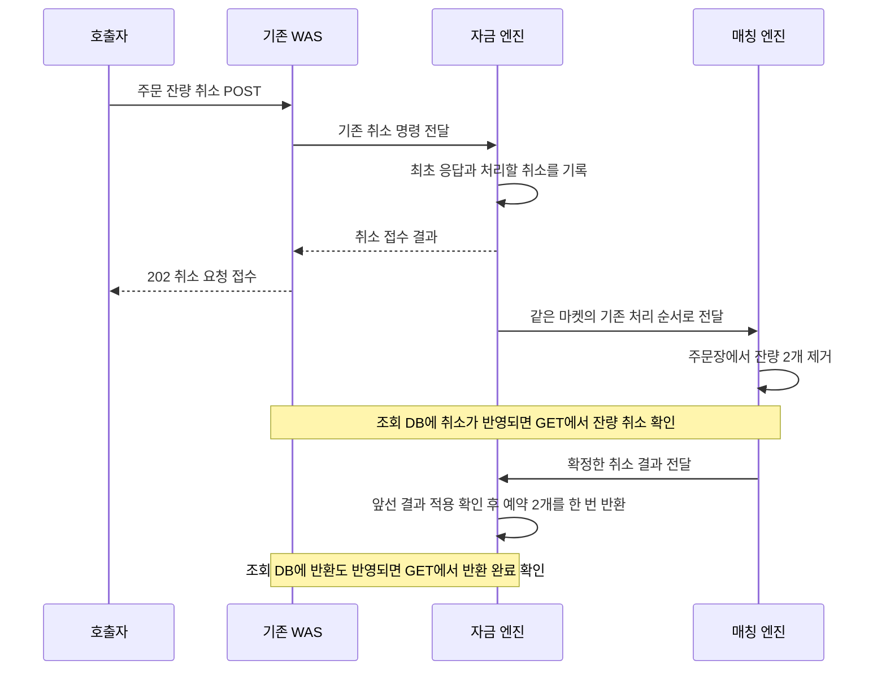

# #192 · WAS에서 주문 잔량 취소하기

## 주문 한 건의 흐름

매도 주문 3개 중 1개는 이미 체결·정산됐고, 나머지 2개는 주문장에 남아 있다. 판매자가 취소를 요청하면 기존 WAS가 자금 엔진으로 전달한다. **접수 응답은 자금 엔진이 취소 요청을 기록했을 때, 잔량 취소는 매칭 엔진이 주문장에서 제거했을 때, 반환 완료는 자금 엔진이 예약을 풀었을 때** 각각 결정된다.



| 시점 | 담당자가 확정한 것 | 판매자의 해당 자산 사용 가능 / 예약 | 호출자에게 보이는 것 |
| --- | --- | --- | --- |
| 취소 접수 | 자금 엔진이 소유자와 요청 번호를 확인하고 취소를 기록 | 0 / 2 | POST `202 ACCEPTED`와 취소 ID. 주문 상태는 기존 부분 체결 상태로 보일 수 있다. |
| 잔량 취소 | 매칭 엔진이 남은 수량 2개를 주문장에서 제거 | 0 / 2 | GET `CANCELLED`, 체결 1·잔량 0·취소 2. 반환 반영 전이면 `PENDING / RELEASE`. |
| 반환 완료 | 자금 엔진이 기존 체결을 유지하고 남은 예약 2개를 해제 | **2 / 0** | 반환 위치까지 조회 DB에 반영되면 GET `CANCELLED / APPLIED`. |

접수 기록이 확정되면 매칭으로 전달할 수 있다. HTTP 응답 전달과 매칭 처리는 각각 진행된다. 기존 WAS의 조회 작업은 매칭·자금의 확정 기록을 가져와 RDB에 반영하고, GET은 그 RDB를 읽는다. 반영이 빠르면 첫 GET부터 `CANCELLED / APPLIED`가 보일 수 있다. `PARTIALLY_FILLED / APPLIED`는 기존 부분 체결의 정산 상태다.

체결과 취소가 겹치면 매칭 엔진에서 실제로 처리된 순서가 결과를 정한다. 취소 전에 전량 체결됐다면 주문은 `FILLED`로 남고 취소로 인한 추가 반환은 0이다. 잔량이 있는 활성 지정가 주문에는 체결된 수량과 관계없이 같은 취소 계약을 적용한다.

## HTTP 계약 제안

경로는 이슈에서 제안한 `POST /api/trading/v3/markets/{marketId}/orders/{orderId}/cancel`로 잡는다. 마켓과 원래 주문 ID는 경로에서 받고, 본문은 `userId`, `channel`, `epoch`, `sequence`, `expectedConfigurationVersion`을 받는다. 주문 ID는 기존 GET 형식을 재사용한다. 취소 수량과 반환액은 엔진이 결정한다. 호출자 신뢰 경계는 기존 개발용 주문 POST와 같다. 자금 엔진은 요청 토큰의 `userId`를 주문 소유자와 대조한다.

같은 사용자·채널·세대에서 주문과 취소는 요청 순번을 공유한다. 예를 들어 주문에 순번 1을 썼다면 취소는 순번 2를 사용한다. 취소 응답을 잃으면 같은 마켓·주문 ID·설정 버전과 같은 취소 토큰을 재전송한다. 최초 응답이 보관 중이면 같은 접수 결과가 돌아온다. 첫 시도가 엔진에 도착하지 않았다면 재전송이 첫 취소 접수가 될 수 있다.

| 상황 | 제안 응답 | 판단과 영향 |
| --- | --- | --- |
| 정상 접수 또는 보관 중인 동일 접수 재전송 | `202 ACCEPTED` | 요청 토큰, 마켓, 대상 `orderId`, 최초 `cancelId`를 반환한다. 동일 재전송은 취소 작업을 추가하지 않는다. |
| 다른 번호로 이미 진행 중인 취소를 요청 | `422 REJECTED`, `reason=CANCEL_PENDING` | 해당 새 요청의 최초 거절을 기록한다. 진행 중인 취소는 하나다. |
| 대상이 비활성·미존재 또는 다른 소유자 | `422 REJECTED`, `reason=NOT_ACTIVE` | 기존 엔진의 같은 거절을 전달한다. 주문장과 예약은 유지된다. |
| 같은 번호에 다른 주문·마켓·설정 버전, 또는 주문 POST가 쓴 번호 | `409 REQUEST_CONTENT_CONFLICT` | 기록된 최초 요청을 유지한다. |
| 정리한 순번·이전 세대·미발급 채널/세대·설정 불일치 | `409`와 기존 코드 | `RETIRED_UNAVAILABLE`, `FENCED_EPOCH`, `UNKNOWN_CHANNEL`, `UNISSUED_EPOCH`, `EXECUTION_CONTEXT_MISMATCH` 등을 구별한다. 응답이 정리된 취소는 기존 주문 GET으로 상태를 확인한다. |
| 잘못된 입력 | `400` | 잘못된 본문·대상 형식과 식별자 한도를 검사한다. 이 요청으로 취소는 접수되지 않는다. |
| WAS 큐 포화 또는 자금 엔진의 처리 한도 도달 | `429 NOT_SUBMITTED` 또는 `429 RETRYABLE_CAPACITY` | WAS의 사유는 `QUEUE_FULL`이다. 두 경우 모두 해당 시도에서는 새 취소가 접수되지 않는다. |
| 전송 전 기한 만료·연결 불가, 또는 엔진의 명시적 미준비·미지원 | `503` | 전송 전 실패는 `NOT_SUBMITTED`, 엔진이 명시한 `NOT_READY`·`UNSUPPORTED_COMMAND`는 해당 코드를 반환한다. `NOT_SUBMITTED`는 이번 전송 시도에 대한 결과다. |
| 전송 후 응답 또는 설정된 내구 확인이 기한 안에 오지 않음 | `504 OUTCOME_UNKNOWN` | 요청 토큰과 대상을 응답에 남긴다. 호출자는 같은 취소를 재전송하고 기존 GET에서 주문을 확인할 수 있다. |

호출자는 받아 보관한 **연속 요청 구간**까지 기존 응답 ACK를 보낸다. 자금 엔진은 자체 연속 처리 경계를 검증하고 해당 구간의 응답을 정리한다. 미완료 취소와 예약은 각자의 완료 조건을 따로 따른다. `GET /api/trading/v3/markets/{marketId}/orders/{orderId}`에 `minAdmissionSequence`를 쓸 때는 원래 주문의 **접수 순번**을 넣는다. 이 값은 주문 접수의 조회 반영을 보장하고, 취소·반환 진행은 조회된 주문 상태와 금융 상태를 함께 확인한다. [응답 유실 계약](order-timeout-recovery-spec.md) · [기존 응답 ACK](../domain-trading/src/main/kotlin/com/exchange/core/trading/TradingRequestInbox.kt#L210)

## 변경 범위와 구현 순서

1. **기존 WAS 진입점과 Gateway를 연결한다.** 같은 WAS의 요청 큐·연결·응답 기한을 사용한다. 기존 Gateway는 현재 주문·ACK·세대 응답만 처리하므로 기존 `Cancel` 명령, 취소 영수증, 명시적 거절 연결을 추가한다. 활성화 대상은 이미 취소를 처리하는 입력 계약 2의 `RESULT_SETTLEMENT_DEV` 자금 클러스터다. [HTTP 진입점](../app-api/src/main/kotlin/com/exchange/core/api/trading/api/BoundedTradingOrderController.kt#L18) · [자금 클러스터 전송](../app-api/src/main/kotlin/com/exchange/core/api/trading/infrastructure/aeron/SplitFundsGatewayTransport.kt#L126)
2. **응답이 원래 대기 요청에 속하는지 확인한다.** 요청 상관 ID, 예상 자금 역할·클러스터 계보, 응답 종류를 대조한다. 취소 영수증이 있으면 바깥 응답 코드와 대상 주문 ID도 일치해야 한다. 정상 취소 응답은 기존 적용 로그 위치를 사용한다. 원격 보호를 쓰는 구성은 현재 내구 확인을 거친 뒤 응답을 완료한다. [응답 완료와 내구 확인](../app-api/src/main/kotlin/com/exchange/core/api/trading/infrastructure/aeron/BoundedAeronGateway.kt#L197)
3. **기존 종단 시험의 취소 입력만 실제 HTTP로 바꾼다.** 기존 매칭·자금 반환과 RDB 반영을 그대로 통과한다. 산출물은 호출 가능한 취소 API와 기존 GET에서 잔량 취소·반환 결과를 확인하는 한 PR이다. [자금 접수](../domain-trading/src/main/kotlin/com/exchange/core/trading/BoundedFundingState.kt#L199) · [매칭 취소](../domain-trading/src/main/kotlin/com/exchange/core/trading/ReservedMatchingState.kt#L213) · [자금 반환](../domain-trading/src/main/kotlin/com/exchange/core/trading/BoundedFundingState.kt#L576) · [조회 상태](../app-api/src/main/kotlin/com/exchange/core/api/trading/application/OrderQueryModel.kt#L62)

엔진의 취소·정산·복구 동작과 조회 DB 계약을 재사용한다. #81의 나머지 HTTP 전환, 인증·인가 개편, 화면, 성능·새 장애 시험은 기존 후속 범위다. [기존 취소 설계 #133](split-order-cancellation-spec.md) · [조회 #60](https://github.com/0Chord/coin-exchange/issues/60) · [실제 HTTP 전환 #81](https://github.com/0Chord/coin-exchange/issues/81)

## 수용 사례와 검증 계획

| 대상 | 실행할 사례 | 합격 기준 |
| --- | --- | --- |
| 실제 HTTP·Aeron·PostgreSQL | 판매자 3개, 구매자 1,000, 단가 100, 수수료 0의 기존 시험에서 1개 체결을 정산한다. 기존 시험 지점에서 반환 결과 전달을 보류하고 취소 POST를 호출한다. | POST `202`. GET은 `CANCELLED / PENDING(RELEASE)`와 체결 1·잔량 0·취소 2. 판매자 자산은 사용 가능 0·예약 2, 판매 대금은 100이다. |
| 동일 요청·한 번 반환 | 보류 상태에서 원래 취소를 재전송하고 새 번호로도 취소를 시도한다. 이후 결과 전달을 재개한다. | 같은 요청은 최초 `cancelId` 유지, 새 번호는 `CANCEL_PENDING`. GET `CANCELLED / APPLIED`, 판매자 사용 가능 2·예약 0·판매 대금 100, 구매자 자산 1·결제 자산 900. 주문 접수는 2건, 매칭 결과는 3건이며 자금 결과 순번은 2에서 3으로 한 번 전진한다. |
| 요청 경계 | 같은 순번에서 대상을 바꾸고, 다른 사용자의 정상 채널 토큰으로 원래 주문을 요청한다. | 각각 `409 REQUEST_CONTENT_CONFLICT`, `422 REJECTED / NOT_ACTIVE`. 기존 취소와 금전 상태가 유지된다. |
| 전송·보호 회귀 | 기존 Gateway 시험에서 취소 영수증·명시적 거절, 다른 종류 응답, 전송 전후 실패와 내구 확인 보류를 확인한다. 기존 주문 POST·GET도 실행한다. | 잘못 짝지어진 응답은 접수 성공으로 처리되지 않는다. `503`·`504` 구분이 유지되고, 내구 확인이 설정된 성공 응답은 같은 확인을 거친다. |

첫 수용 사례는 기존 `SplitFundsTradingHttpTest`의 실제 부분 체결·잔량 취소 시험에 연결한다. 이미 검증하는 최종 잔고, 조회 원본 수, WAS의 Spring 컨텍스트 재기동 결과도 함께 대조한다. 새 API의 실행 결과는 구현 후 이 표에 기록한다. [기존 취소 호출과 상태 확인](../app-api/src/test/kotlin/com/exchange/core/api/trading/infrastructure/aeron/SplitFundsTradingHttpTest.kt#L243) · [최종 수량·조회 원본 대조](../app-api/src/test/kotlin/com/exchange/core/api/trading/infrastructure/aeron/SplitFundsTradingHttpTest.kt#L287)

Java 25와 기존 PostgreSQL Testcontainers 환경의 검증 명령이다.

```sh
cd /Users/0chord/Desktop/exchange-core
./gradlew --no-daemon --max-workers=2 --continue :app-api:test \
  --tests '*SplitFundsTradingHttpTest' --tests '*SplitFundsGatewayTransportTest' \
  --tests '*BoundedAeronGatewayTest' --tests '*BoundedTradingOrderHttpTest' \
  --tests '*OrderQueryHttpTest' --tests '*RemoteProtectedTradingHttpTest' \
  :architecture-tests:verifyArchitectureReport :app-api:ktlintCheck :architecture-tests:ktlintCheck
```

2026-11-18 명세 기준은 통합 커밋 `b50cc4d`다. WAS·취소 엔진 재사용과 한 PR 범위는 사용자 요청을 따랐고, 구현은 위 경로·상태 매핑을 적용했다. [이슈 #192](https://github.com/0Chord/coin-exchange/issues/192) · [통합 기준](https://github.com/0Chord/coin-exchange/commit/b50cc4d2bd8f63404727a01305be8a49db22b7fd)

## 구현과 실행 결과

- **실제 HTTP와 PostgreSQL.** 매도 3개 중 1개를 체결·정산한 뒤 자금으로의 반환 결과 전달을 잠시 막았다. 취소 POST를 두 번 보내 같은 접수와 취소 ID를 받았다. GET이 취소 2개·반환 대기를 표시하는 동안 판매자의 예약은 2, 앞서 정산한 판매 대금은 100이었다. 전달을 재개하자 예약 2개만 한 번 풀렸고 자금 결과 순번은 2에서 3으로 한 번 전진했다. 최종 잔고, 조회 원본 수, WAS 컨텍스트 재기동 후 같은 GET도 대조했다. 엔드포인트 추가 전에는 같은 테스트가 취소 POST의 `404`에서 실패했다. [종단 검증](../app-api/src/test/kotlin/com/exchange/core/api/trading/infrastructure/aeron/SplitFundsTradingHttpTest.kt#L195)
- **실패와 기한.** 같은 번호의 다른 내용, 진행 중에 보낸 다른 번호, 다른 소유자의 취소는 기존 거절 사유를 반환했다. Gateway 대역 시험에서는 주문과 취소 응답의 교차, 응답의 잘못된 취소 대상, 명시적 엔진 거절과 내구 확인 대기를 대조했다. 독립 리뷰가 발견한 세 기한 경계는 수정 전 실패와 수정 후 성공을 각각 확인했다. 기한을 넘긴 응답이나 원격 보호 확인은 `OUTCOME_UNKNOWN`, 전송 직전에 만료된 요청은 `NOT_SUBMITTED`로 처리한다. [응답 처리](../app-api/src/main/kotlin/com/exchange/core/api/trading/infrastructure/aeron/BoundedAeronGateway.kt#L267) · [기한 회귀](../app-api/src/test/kotlin/com/exchange/core/api/trading/infrastructure/aeron/SplitFundsGatewayTransportTest.kt#L230)
- **로컬 검사.** 앱 관련 테스트 48개와 구조 테스트 386개에서 실패·오류·건너뜀은 0개였다. 필수 구조 검사 P01~P09와 두 변경 모듈의 ktlint를 확인했다. 마지막 테스트 서식 정리 후 동일한 실제 HTTP 사례와 앱 ktlint를 다시 통과했다. 구조 검사에는 공개 취소 입력 타입을 기존 공개 데이터 항목으로 등록했다.
- **독립 재검토.** 별도 컨텍스트에서 기준 `b50cc4d`와 고정 소스를 대조했다. 첫 리뷰가 지적한 Gateway 기한 처리와 반환 보류 시점의 판매 대금 확인을 수정했다. 재검토에서 실제 Gateway에 대역 전송을 연결해 지연 응답·늦은 내구 확인·인코딩 중 만료를 다시 검증했다. 재검토 범위에서 확인된 미해결 결함은 없었다. 마지막 테스트 수정은 줄바꿈만 바뀐 것을 별도로 대조했다.
