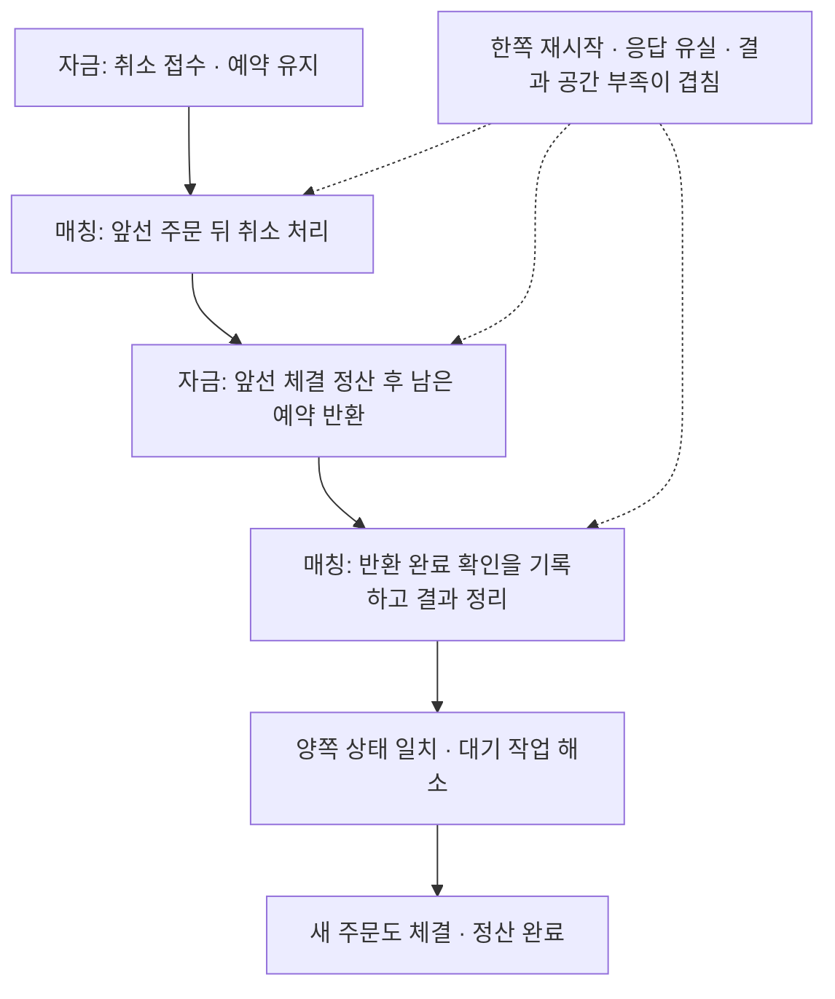

# #134 · 장애가 겹친 뒤에도 취소를 끝내고 다음 주문을 처리하기

**2026-11-13 · 상세 명세 작성 완료. 작성 당시 제품·테스트 구현 및 새 시험은 실행하지 않았다.** 기준은 `feature/phase-2/integration`의 `875e8257adaec4f49b240ec9d9c67a5261784861`([#182](https://github.com/0Chord/coin-exchange/pull/182) 병합)이다. 이 파일을 명세 원본으로 사용하고 이슈에는 핵심과 수용 기준을 연결한다. 별도 설계 PR은 만들지 않는다. 이후 허용된 구현과 실제 실행 상태는 아래 9절에서 구분한다.

**2026-11-14 로컬 검증 기록:** test 소스의 구현·필수 검증·독립 재리뷰를 완료했다. 제품 실행 코드 변경은0이다. 이 기록은 당시의 로컬 검증 결과이며, 원격 PR·CI·병합 상태는 별도로 확인한다. 아래 1~8절은 구현 전에 정한 계약, 9절은 실제 코드·실행 결과다.

## 먼저 볼 업무 흐름

자금과 매칭은 각자 확정한 기록을 가진다. 한쪽이 재시작하거나 응답을 놓쳐도, **이미 처리한 돈은 다시 움직이지 않고 아직 남은 작업은 끝나야 한다.** 이번 결과는 그 뒤 새 주문도 실제 체결·정산되는지 확인하는 것이다.



화살표 전체가 하나의 트랜잭션은 아니다. 각 클러스터가 자기 확정 기록을 복구하고 미확인 작업을 재전송한다. 응답 유실은 취소 실패나 예약 반환의 근거가 아니다.

| 이번에 새로 확인할 상황 | 누가 무엇을 판단하고, 언제 끝났다고 보는가 |
| --- | --- |
| **F01 · 스냅샷 시점이 다른 양쪽을 한 역할씩 재시작** | 각 역할이 자기 스냅샷과 이후 로그를 복원한다. 상대 역할은 계속 실행한다. 보류를 해제하면 리더의 기존 전달 작업이 취소·반환·확인을 끝내고 후속 주문도 처리한다. |
| **F02 · 결과 공간이 찬 동안 취소 대기·응답 유실·재연결/재시작** | 매칭은 결과를 보관할 수 없으면 취소를 BUSY로 미룬다. 자금은 신규 접수 한도에 닿으면 새 주문만 거절한다. 기존 정산과 ACK가 공간을 회수해 원래 취소와 후속 주문이 완료돼야 한다. |

**안전하게 멈춘 채 끝나거나 BUSY만 관측한 시험은 성공이 아니다.** 정상 복구 대상으로 정한 두 사례는 실제 완료와 후속 진행까지 확인한다. ACK한 기록을 잃은 과거 백업을 정상 자료처럼 되돌리는 것은 이번 복구에 포함하지 않는다.

## #133에서 이미 끝난 것

[#133 완료 기록](https://github.com/0Chord/coin-exchange/issues/133)과 [구현·실행 기록 15절](split-order-cancellation-spec.md)을 재사용한다. 기존 테스트를 새 검증처럼 복제하지 않는다.

- 실제 3+3노드의 기본 취소·잔여 한 번 반환, 결과 GAP·중복, ACK 유실·보류.
- 같은 양쪽 스냅샷 이후 tail을 재생해 미완료·반환 완료·자료 회수 뒤를 복원하는 기본 재시작.
- 신규 전용 결과 한 칸 포화의 BUSY→회수, 코어의 취소/응답 한도와 복원, 기본 잘못된 prefix 차단.

이번 차이는 **서로 다른 업무 시점의 스냅샷·역할별 중단**과 **취소 v2·접수/결과 포화·유실·재연결의 결합**이다. 일반 HTTP 취소 API·인증/인가·외부 원장·성능·장기 부하·다중 마켓 배치·리더 전환/과반 장애는 별도 범위다.

<details>
<summary>구현 담당자용 상세 · 작은 PR 범위, 수용 사례, 검증과 한계</summary>

## 1. 한 PR의 경계

- **제품 동작·wire·스냅샷 형식은 유지한다.** 실제 복합 시나리오 2개와 경량 대조/판정 검사를 test 소스에 추가한다.
- 기존 실제 `FundsOrderDeliveryAgent`·`MatchingResultDeliveryAgent`·`SplitTradingClusterAdapter`와 3+3 Docker 실행기를 사용한다. 제어는 test 연결 factory·listener·서비스 wrapper·실행기에 둔다. 제품 gate·관찰 큐·관리 endpoint·범용 장애주입 프레임워크는 추가하지 않는다.
- 새 파일 후보는 `DockerSplitRecoveryTest.kt`(두 실제 사례), `SplitRecoveryConvergenceTest.kt`(중단 없는 실제 소유자/Adapter 대조와 판정 반례)다. 이름·함수 분할은 구현 제안이다. 기존 fixture와 실행기의 필요한 부분만 확장한다.
- 기본 golden·과거 reader·v1 신규 경로·v2 취소 경로와 오류/차단 계약을 낮추지 않는다. 과거 DB 구성의 #59는 의미 참고이며 재구현할 선행이 아니다.
- 새 제품 결함이 드러나면 최소 반례와 영향 범위를 남긴다. 테스트 삭제·기대값 복사·한도/기한 해제로 통과시키지 않는다. 작은 검증 PR을 광범위한 제품 재설계로 확대하지 않는다.

## 2. 현재 코드에서 확인한 사실

아래 링크는 기준 통합의 실제 파일이며, 문서의 계획을 구현 완료로 간주하지 않는다.

| 기존 경계 | 이번에 재사용/보완할 점 |
| --- | --- |
| [DockerSplitCancellationTest.kt](../app-api/src/test/kotlin/com/exchange/core/api/trading/infrastructure/aeron/DockerSplitCancellationTest.kt) | 이미 ACK 보류·GAP·세 차례 전체 재시작을 함께 검사한다. F01/F02의 추가 축을 이 시험의 복제로 대체하지 않는다. |
| [MatchingResultVerificationTool.kt](../app-api/src/test/kotlin/com/exchange/core/api/trading/infrastructure/aeron/MatchingResultVerificationTool.kt)의 `resultVerificationNode`, `resultOrderConnections`, `resultConnections` | 실제 제품 노드/두 Agent를 실행하고 test wrapper에서 응답 폐기와 offer 보류를 한다. 현재 BACK_PRESSURED 보류는 물리 네트워크 단절의 증거가 아니다. |
| [DockerFundsOrderDeliveryTest.kt](../app-api/src/test/kotlin/com/exchange/core/api/trading/infrastructure/aeron/DockerFundsOrderDeliveryTest.kt)의 `restartResults`, `verifyFundsProgressWhileMatchingStopped` | 전자는 6노드 동시 재시작, 후자는 신규 전용 매칭 3노드 중단/복구다. 취소에도 쓸 작은 역할별 helper와 상대 역할의 boot/container 유지 검사를 추가할 필요가 있다. |
| 같은 실행기의 fixture 환경 | 현재 `cap`은 결과1칸, `cancellation`은 wire2라 동시에 선택할 수 없다. 시험 profile을 조립하도록 확장하되 각 실행 시작 전에 고정하고 복구 중 바꾸지 않는다. |
| [BoundedFundingState.kt](../domain-trading/src/main/kotlin/com/exchange/core/trading/BoundedFundingState.kt)의 `admit`, `cancel` | 신규 pending 한도와 취소 의무 한도는 별개다. `RETRYABLE_CAPACITY`는 신규 순번/예약/최초 응답을 추가하지 않는다. |
| [FundsOrderDeliveryAgent.kt](../app-api/src/main/kotlin/com/exchange/core/api/trading/infrastructure/aeron/FundsOrderDeliveryAgent.kt)의 `doWork` / [MatchingResultDeliveryAgent.kt](../app-api/src/main/kotlin/com/exchange/core/api/trading/infrastructure/aeron/MatchingResultDeliveryAgent.kt)의 `doWork` | 신규 전송보다 기존 ACK/진행 확인을 먼저 시도하고 재연결 후 소유자 기록에서 다시 읽는다. 이 실제 경로의 진행을 관찰한다. |

## 3. 공통 입력과 독립 기대값

**시험용 준비금과 기존 수수료 정책의 선택이다. 제품 정책을 바꾸는 결정이 아니다.** 단일 마켓, base/quote 정수 단위, 가격100·수량1의 체결, maker=taker=1%로 정수 수수료를 사용한다. 구매자 quote1,000, 판매자 quote100·base3을 준비한다. 기존 fixture에 이 조합의 준비/수수료를 test 전용으로 제공한다.

| 접수할 입력 순서 | 구매자 quote 사용 가능 / 예약 | 판매자 quote 사용 가능 | base 및 수수료 기대값 |
| --- | --- | --- | --- |
| 1 · 구매자 BUY3@100, 대기 결과 확인 | 697 / 303 | 100 | 판매자 base3, 수수료0 |
| 2 · 판매자 SELL1@100의 체결을 자금까지 반영 | 697 / 202 | 199 | 구매자 base1·판매자 base2, 양쪽 수수료 합2 |
| 3 · 구매자 잔량2 취소와 반환 완료 | **899 / 0** | **199** | 잔여202만 반환, 수수료 합2 유지 |
| 4·5 · 구매자가 얻은 base1을 SELL1@100, 판매자가 BUY1@100해 실제 역체결·정산 | **998 / 0** | **98** | 판매자 base3·구매자 base0, 수수료 합4, 모든 hold/주문장0 |

검산: 최초 quote 총량1,100 = 취소 뒤899+199+2 = 마지막998+98+4. base 총량은 항상3이다. 최초 예약303은 원금300+최대 수수료3, 첫 체결의 구매 비용101·판매 순수익99, 잔량 예약202다. 아직 결과2가 자금에 안 온 동안은 구매자697/303, 판매자 quote100·base hold1, 자금 수수료0을 유지한다.

- 고정 요청: 구매자 요청1=BUY, 2=취소, 4=후속 SELL; 판매자 요청1=SELL, 2=후속 BUY. F02의 신규 포화 probe는 구매자 요청3의 별도 BUY1@1로 하고 재사용하지 않는다.
- 최종 승인 신규4·취소1, 공통 입력5·결과5, 체결2가 기대값이다. probe는 업무 순번·응답 보관·자금 변화를 만들지 않는다. 실제 응답 코드/거절 이유도 확인한다.
- 비교 정답은 이 수기 산식과 **동일 승인 입력을 중단 없이 실제 소유자/Adapter에 적용한 경량 대조 실행**이다. 대조는 native/Archive 시험이 아니며, 실제 3+3 장애 시험의 증거와 구분한다. 제품 계산기 출력으로 expected 금액을 생성하지 않는다.

## 4. F01 · 서로 다른 스냅샷과 순차 역할 복구

1. 입력1의 정산 확인/자료 회수를 끝내고 **자금만 snapshot A**를 만든다. 자금의 입력/결과/ACK prefix1과 자기 snapshot 위치를 기록한다.
2. 결과 전송을 test wrapper에서 보류하고 입력2를 실제 매칭한다. 매칭의 적용 prefix2·전체 결과2 보관, 자금의 결과 prefix1을 확인한다. **매칭만 snapshot B**를 만들고 당시 업무 prefix를 기록한다. 매칭 적용 ACK2는 자금에 확정시켜 원본 전달 슬롯을 회수한다.
3. 매칭3노드만 정상 종료한다. 자금3노드의 container/boot ID가 유지된 채 취소3을 접수하고 예약을 유지하는지 확인한다. 자금의 취소·의무는 A 이후 자기 log tail에 남긴다. 자금 snapshot A를 새 snapshot으로 덮지 않는다.
4. 같은 기록·동결 실행물로 매칭3노드만 복구한다. B 복원과 새 boot, 자금 boot 유지, 원래 취소3의 자동 매칭 적용을 확인한다. 결과2/3 전송은 보류해 경계를 안정시킨다.
5. 이번에는 자금3노드만 정상 종료/복구한다. A+자기 tail에서 취소·최초 응답·예약이 복원되고, 매칭3노드 boot가 유지되는지 확인한다. 상대 로그를 복사하거나 과거 볼륨으로 교체하지 않는다.
6. 자금 정산 응답의 callback 폐기를 켠 채 결과 전송을 해제한다. 결과2→3을 실제 worker가 반영해899/0·199·수수료2가 되지만 매칭은 미확인 결과를 보관해야 한다. 같은 취소 결과의 반복 시도에서도 돈·수수료·최초 반영 시각을 바꾸지 않는다.
7. 응답 보류를 해제해 매칭 정산 ACK가 실제 로그에 확정되고 결과 payload가 회수되는지 확인한다. 입력4·5도 실제 전달·역체결·정산해 최종 표의 상태에 도달한다.

서로 다른 역할의 `logPosition` 숫자 크기를 교차 비교하지 않는다. **각 역할의 snapshot 당시 업무 prefix, 자기 snapshot 위치와 자기 tail 위치, 복원 image 사용·boot 변화**로 A/B의 차이와 복원을 증명한다. 전체 정지 재시작만으로 F01을 통과시킬 수 없다. 정상 종료를 갑작스러운 전원/디스크 손실·리더 장애 검증으로 보고하지 않는다.

## 5. F02 · 한 칸 결과 공간과 접수 포화·ACK 유실·재연결

고정 profile: 입력 계약v2, 자금 전역/마켓 신규 pending 각1, 매칭 전역/마켓 결과 슬롯 각1. 응답/진행·취소 의무·단일 최대 결과와 제어 메시지의 byte 예산은 기존 유효 조건을 만족시킨다. 실제 구성 hash와 한도를 기동 전에 기록하고 재시작 중 유지한다. 응답 Inbox까지 고갈시키는 별도 실험은 추가하지 않는다.

1. 입력1의 결과 정산/확인을 완료한다. 결과 전송을 보류하고 입력2를 매칭한다. 결과2 하나가 매칭 슬롯을 채우고 자금에는 신규 pending1이 남아야 한다.
2. **적용 ACK2를 자금 로그에 확정해 dispatch 슬롯을 회수한 뒤** 취소3을 접수한다. 매칭은 결과2의 공간이 찼으므로 취소3에 BUSY, 주문장 잔량2·engine/결과 prefix2를 유지한다. 이 BUSY를 활성 주문 한도 최종 거절이나 취소 완료로 해석하지 않는다.
3. 신규 probe에 실제 `RETRYABLE_CAPACITY`를 받는다. 금융·최초 응답·승인/입력/취소 발급 순번과 원래 의무가 무변경이고 취소3 하나가 남는지 확인한다.
4. 결과 송신 연결을 **test wrapper가 worker의 poll/offer 소유 스레드 안에서 한 번 실제 close**한다. 외부 시험 스레드는 제어 요청만 남기고 Aeron client를 직접 닫지 않는다. 역할 재시작 전에 기존 연결 ID→새 연결 시도→상대 확인 완료를 관찰한다. 이후 JVM 재시작으로 생긴 새 세션만을 이 재연결의 증거로 세지 않는다. 전송 성공은 정산 성공이 아니며, 실제 세션 close도 물리 네트워크 partition이라고 부르지 않는다.
5. 자금 정산 응답 callback 폐기를 켠 뒤 결과 전송을 해제한다. 자금의 결과2 정산·수수료2와 예약202를 확인한다. ACK를 못 받은 매칭의 결과 슬롯1·취소 BUSY는 유지된다.
6. 매칭3노드만 정상 종료/같은 기록 복구한다. 자금 boot와 이미 반영한 결과2/최초 시각은 유지된다. 실제 결과 Agent가 결과2를 재전송해도 추가 체결·정산·수수료가 없어야 한다.
7. 응답 보류를 해제한다. **기존 결과2의 정산 ACK 확정→슬롯 회수→대기 중이던 취소3 적용→잔여202 반환→결과3 회수**를 실제 두 worker가 진행한다. 수동 `deliver-result`/`replay-ack`가 이 필수 진행을 대신하면 실패다.
8. 입력4·5를 별도 요청으로 접수해 실제 체결·정산한다. 포화 전후 모두 공간 상한을 지키고 최종 상태는 공통 표와 같아야 한다.

## 6. 수용·판정 기준

| 사례 | 성공에 필요한 관측 | 실패로 판정할 예 |
| --- | --- | --- |
| F01 | A/B의 서로 다른 업무 cut, 두 차례 역할별 복구, 상대 boot 유지, 동일 최초 취소 응답, 최종 금액/prefix/후속 체결 | 전체6노드만 재시작, snapshot 증거 없음, 보류 상태를 완료로 셈 |
| F02 | 실제 BUSY·RETRYABLE_CAPACITY·연결 close/재접속, 자금 선반영 뒤 ACK 유실, 매칭만 재시작, 기존 ACK의 회수와 자동 재개 | capacity 응답을 timeout으로 대체, 공간 증가, 수동 클라이언트가 drain 대신 수행 |
| 공통 수렴 | 각 역할3사본이 같은 목표 prefix에 도달한 뒤 독립 금액/활성 상태/원본·결과 예산/최초 응답/안정적 ID를 대조. 중단 없는 경량 대조와 의미 상태가 일치 | 한 사본만 비교, 파일이 없거나 낡았는데 건너뜀, 결과가 QUARANTINED인 채 성공 |
| 판정기의 반례 | 정상 관찰 세트는 통과. 사본1개 누락·이전 boot JSON·마지막 후속 체결 미완료·반환/수수료를 한 번 더 반영한 변조는 각각 실패 | 빈 관찰의 `all`로 성공, 목표 시점에 도달하지 않은 관찰을 최종 상태로 채택 |

- 최종 기준: 신규 승인4·취소 발급1·공통 입력/매칭 적용/자금 결과/양쪽 확인 prefix5, 체결2, hold/주문장/미완료 신규·취소/전달 payload/매칭 결과 payload0. 보관 중인 사용자 응답과 자금 비교 receipt는 기존 정책대로 남아도 된다. 모든 bytes를0으로 강제하지 않는다.
- 금융 반영 후 ACK가 유실된 지점에서 동일 실행의 receipt 최초 반영 시각과 ID를 보존한다. 다른 실행끼리는 wall-clock·PID·boot·log 위치의 일치를 요구하지 않는다.
- 현재 receipt 집계는 유한 보관분이다. 5결과가 모두 남도록 profile을 고정해 체결2를 대조하고, 전체 평생 거래 수로 일반화하지 않는다. 선택한 주문/취소·결과1~5의 대상·수량·사건/효과·고정 ID는 test wrapper에서 최대8개까지만 추가 관찰할 수 있다. 정리된 payload를 검증용 자료로 제품에 재삽입하지 않는다.
- 전체 원장 분개·과거 이력의 통합 대조는 이번에 제공하지 않는다. 현재 잔고·예약·수수료·대상별 활성 상태·결과/의무 경계와 기존 원장 계산/균형 회귀를 구분한다.
- 유효 자기 snapshot+tail에서만 정상 수렴을 기대한다. 필수 원본을 잃은 불일치 lineage/prefix는 기존 차단 계약을 유지하며, 실패를 정상 복구로 세지 않는다. 이 기본 오류 검사를 새 제품 복구 기능으로 다시 구현하지 않는다.

## 7. 구현 순서·실행 계획·자원

1. 경량 대조와 제한 관찰의 정상/반례 판정부터 작성한다. F01/F02의 snapshot·boot·실제 연결·거절 응답을 관찰할 최소 test helper를 추가한다. 아직 존재하지 않는 파일/보고서는 이 문서의 제안이다.
2. F01 한 실제 사례를 완주하고, 그 helper로 F02를 추가한다. 두 사례는 fresh run/기록/동결 image를 각각 쓰고 **동시에 실행하지 않는다.** 전체 기본 #133 시험을 복제하거나 긴 무작위 조합/전수 조합을 돌리지 않는다.
3. 제품 Agent가 자동 재개한다는 증거와 수기/중단 없는 대조를 확인한다. 이후 기존 취소·주문 전달·결과 정산 회귀, 필수 구조 보고서·ktlint를 실행한다. 필수 CI는 기존 설정대로 유지한다.

예상 명령(구현 후, JDK25·Docker 준비 필요; **이번 명세 작업에서는 실행하지 않음**):

```bash
cd /Users/0chord/.codex/worktrees/issue148-http-aeron/exchange-core
./gradlew :app-api:test --tests '*SplitRecoveryConvergenceTest' --no-daemon --max-workers=1
./gradlew :app-api:test --tests '*DockerSplitRecoveryTest' --no-daemon --max-workers=1
./gradlew :app-api:test --tests '*DockerSplitCancellationTest' --tests '*SplitCancellationFlowTest' --tests '*FundsOrderDeliveryAgentTest' --tests '*MatchingResultDeliveryAgentTest' --tests '*DockerMatchingResultDeliveryTest' --no-daemon --max-workers=1
./gradlew :architecture-tests:test :architecture-tests:verifyArchitectureReport ktlintCheck --no-daemon --max-workers=1
```

- 기존 runtime staging/compose를 재사용한다. source HEAD+변경 파일 hash·동결 image ID·manifest/schema/topology·실제3+3 PID/Driver/기록 root와 sync **2/2/2**를 기록한다. source 변경을 현재 HEAD만으로 나타내지 않는다.
- 한 실제 run은 기존 **8분 전체 한도(그 안에 정리45초 확보)**, 기록2GiB·진단16MiB·관찰 파일256KiB 상한을 유지한다. Docker 메모리6GiB·호스트 여유8GiB의 기존 사전 조건을 확인한다. 두 실제 run의 예산을 각각 적용하고 정리 완료 전 다음 run을 시작하지 않는다.
- 연결 timeout/보류/진행 확인은 기한과 관찰 상태로 제어한다. 고정 sleep만으로 “이때 ACK가 유실됐다”를 가정하지 않는다. 새 파일은 원자적 게시·boot/현재 실행 검사를 유지한다.
- 실패/중단에도 자기 run의 컨테이너·볼륨·네트워크·image와 큰 임시 진단물을 정리하고 성공/실패·최대 기록/진단 bytes·정리 결과를 기존 `build/reports/aeron-funding/result-settlement/<runId>/result.json` 형식에 남긴다. 전체 Docker prune·다른 작업 파일/사용자 앱 삭제는 하지 않는다.
- Docker 불가·자원 부족은 전제 실패로 보고한다. skip이나 mock 결과를 실제6노드 성공으로 바꾸지 않는다. 임의 과거 기록 삭제나 오래된 ACK 상태의 백업 복사로 정상 복구를 만들지 않는다.

## 8. 합의·제안·미검증과 인계

| 구분 | 내용 |
| --- | --- |
| 사용자 요청 원문 | “#134 최신 통합 코드 기준으로 상세 명세 진행해봐. #133에서 이미 확인한 기본 복구는 빼고, 복합 장애 검증을 작은 PR 범위로 정리해. 구현은 아직 하지 마.” |
| 이어받은 합의 | 리더 JVM의 별도 전달 작업, 각 소유자의 확정/재전송, 취소 확정 뒤 잔여 반환, 유한 자원·ACK별 회수, 인증/인가 제외. 정책/배치를 다시 선택하지 않는다. |
| 구현 명세 제안 | F01/F02 두 실제 사례, 정수1% 공통 입력과 수기 정답, 경량 무중단 대조, test-only 역할별 재시작·연결 제어·유한 관찰. 세부 fixture/파일 분할은 구현자가 조정할 수 있다. |
| 기술 확인 | 현재 fixture preset과 helper는 이 조합을 바로 지원하지 않는다. 최초 test 확장으로 두 역할별 boot/자기 tail과 실제 close/reconnect·포화 거절을 관찰 가능한지 확인한다. 불가능하면 성공을 주장하지 말고 원인/최소 변경 범위를 기록한다. |
| 범위를 바꾸는 미결정 | 현재 없음. 기존 정책을 바꾸는 사용자 답변을 만들어 기록하지 않는다. 원장 이력·운영 장애·HTTP API의 별도 작업은 이 PR의 차단 조건으로 추가하지 않는다. |
| 명세 작성 당시 허용/미검증 | 당시 요청은 명세·이슈 요약 작성과 정적 대조였다. 후속 요청으로 허용된 구현과 실행은9절에 구분한다. 이 표를 원격 게시·보드 변경의 권한 근거로 사용하지 않는다. |

완료 판정은 구현 후 두 실제 복합 사례와 판정 반례·필수 회귀의 실행 결과, source/설정 고정 및 자원 정리 증거로 한다. 현재 문서의 사례 수·기대값은 계획이며 통과한 시험 수가 아니다.

명세 작성 중 기존 사례와 송수신/복원 경계를 분담해 읽고, 별도 컨텍스트의 검토자가 최신 명세를 실제 코드·기존 테스트와 독립 대조했다. 현재 미해결 수정 필요사항은0건이다. 상대 역할 boot 보존, 실제 연결 close의 소유 스레드/증거, 단일 dispatch 슬롯의 ACK 선행, 수기 금액과 유한 관찰의 한계를 반영했다. 내부 상대 링크7개·문서 형식·공백을 정적으로 확인했다. 이는 구현 리뷰나 제품 실행 성공이 아니며, 실제 두 사례의 완료·8분 예산 준수는 구현 후 검증할 대상이다.

</details>

<details>
<summary>9. 2026-11-14 로컬 구현·검증 기록과 테스트 읽기</summary>

## 변경의 책임

작업 폴더는 `/Users/0chord/.codex/worktrees/issue148-http-aeron/exchange-core`, 브랜치는 `test/split-failure-recovery/134`다. 사용자의 후속 구현 요청으로 명세의 두 사례를 test 소스에서 구현했다. 제품 Kotlin·Protobuf·스냅샷 형식·정책·의존성은 변경하지 않았다. 커밋·PR·CI·이슈/보드 상태 변경과는 별도인 로컬 구현이다.

| 변경 | 역할 |
| --- | --- |
| `DockerSplitRecoveryTest` | F01/F02의 실제 실행 순서, 중간 금액·의무·현재 실행·전체 결과 대조, 마지막 실제 역체결까지 검사 |
| `SplitRecoveryConvergence` / `SplitRecoveryConvergenceTest` | 수기 금액, 실제 소유자의 무중단 대조, 6사본·대상/사건/효과·상한 판정과 변조 반례 |
| 기존 `DockerFundsOrderDeliveryVerification` | 상대 역할을 유지하는 3노드 종료/복구, 검증한 boot 저장·매번 대조, 실제 고정 한도와 실행 소스 hash 기록 |
| 기존 `MatchingResultVerificationTool` | 새 두 fixture의 준비금·1% 수수료, 유한 의미 관찰, worker 소유 스레드의 한 번 연결 종료와 재접속 관찰. 기존 fixture는 유지 |

## 실제 두 사례를 읽는 순서

**F01 — 한쪽을 복구하는 동안 다른 쪽에 남은 취소를 잃지 않는다.** [실제 테스트](../app-api/src/test/kotlin/com/exchange/core/api/trading/infrastructure/aeron/DockerSplitRecoveryTest.kt#L14)

- **준비:** 실제 독립 자금3+매칭3 JVM·Archive sync2. 자금은 결과1 뒤, 매칭은 체결2·미정산 뒤에 각자 snapshot을 만든다. 수수료 포함 구매자 예약은303이다.
- **실행1 / 확인1:** 매칭만 종료한 동안 자금이 취소3을 접수한다. 상대 boot 유지, 예약303·취소 대상·주문장 잔량2와 자기 tail 위치를 확인한다.
- **실행2 / 확인2:** 매칭 B+tail을 복구하고 자금만 A+tail로 복구한다. 상대 역할의 컨테이너/boot는 유지되고 최초 취소 응답·의무가 같아야 한다.
- **실행3 / 확인3:** 정산 응답을 폐기한 채 결과를 보내면 체결 정산 뒤202만 반환돼899/0이 된다. 실제 worker의 중복 응답을 관측하고 금액·최초 시각·전체 결과 ID/사건/효과가 유지되는지 비교한다.
- **실행4 / 확인4:** 응답을 풀어 매칭 결과를 회수하고 두 후속 주문을 실제 역체결한다. 여섯 사본의 의미 상태와 수기998/98/수수료4, 최초 응답·5결과의 ID·대상·사건·효과를 대조한다.

**F02 — 공간이 찼을 때도 기존 ACK가 공간을 돌려주고 취소를 끝낸다.** [실제 테스트](../app-api/src/test/kotlin/com/exchange/core/api/trading/infrastructure/aeron/DockerSplitRecoveryTest.kt#L86)

- **준비:** 실제 pending1·결과1칸·wire2·유효 byte 한도를 기동 자료에서 확인한다. 입력2의 매칭 적용 ACK로 원본 전달 슬롯을 회수하되 정산 결과는 보류한다.
- **실행1 / 확인1:** 취소3의 BUSY·대상/예약 유지와 새 주문의 RETRYABLE_CAPACITY를 실제로 받는다. 새 거절 전후 금융·발급 순번·최초 응답이 같아야 한다.
- **실행2 / 확인2:** 외부 스레드는 제어 요청만 쓰고 실제 worker가 연결을 닫는다. 같은 boot에서 종료한 연결과 새 연결·상대 확인 완료를 관측한다.
- **실행3 / 확인3:** 자금의 체결2 정산 응답을 버리고 매칭3노드만 재시작한다. 자금의 최초 정산과 수수료2는 유지돼야 한다. 이후 worker의 중복 응답과 ACK 환류가 원래 취소3을 완료하고202를 반환한다.
- **실행4 / 확인4:** 수동 결과/ACK 재생으로 처리를 대신하지 않고 후속 역체결까지 끝낸다. 마지막 금액·모든 hold0·주문장0·의무 회수·최초 응답과 전체 결과를 F01과 같은 기준으로 검사한다.

두 사례는 실제 제품 노드·두 전송 Agent·Adapter·Archive를 실행한다. 응답 폐기·보류·연결 close와 상태 캡처는 test wrapper다. 정상 역할 종료/복구와 한 client의 실제 연결 종료를 전원 손실·물리 네트워크 partition·리더 전환 검증으로 확대하지 않는다.

## 경량 13개가 검사하는 것

아래 반례들은 제품 금융 상태를 손상해 운영하는 경로가 아니라 **시험 판정기가 잘못된 관찰을 거절하는지** 검사하는 입력이다. 동일 흐름의 여러 변조는 한 메서드 안의 반복이며 별도 테스트 개수로 부풀리지 않는다.

| 준비 → 실행 | 실제 확인과 근거 |
| --- | --- |
| 실제 두 소유자에 같은5입력을 중단 없이 적용 | 단계별303→202→0, 최종998/98/수수료4·engine5·체결2와 자산 보존. [코어 대조1개](../app-api/src/test/kotlin/com/exchange/core/api/trading/infrastructure/aeron/SplitRecoveryConvergenceTest.kt#L61) |
| 정상6사본 / 취소 전달 전 서로 다른 prefix 관찰 | 두 역할의 의미 값 일치와 자금 입력3·매칭 입력2를 따로 판정. [정상2개](../app-api/src/test/kotlin/com/exchange/core/api/trading/infrastructure/aeron/SplitRecoveryConvergenceTest.kt#L122) |
| 사본 누락·빈 목록·옛 boot / 취소만 완료·후속 주문 대기 | 빈 대상·과거 자료·후속 미완료는 최종 성공이 아님. [반례3개](../app-api/src/test/kotlin/com/exchange/core/api/trading/infrastructure/aeron/SplitRecoveryConvergenceTest.kt#L160) |
| 추가 반환/수수료 / 필수 값 누락·비정수 / 미초기화·차단 | 금액 보존이나 코드 이름만으로 통과시키지 않고 각 위반 거절. [반례3개](../app-api/src/test/kotlin/com/exchange/core/api/trading/infrastructure/aeron/SplitRecoveryConvergenceTest.kt#L189) |
| 진행 중 payload/active bytes의 정확한 상한과 상한+1·Long.MAX_VALUE | 고정 profile의 실제 유효 한도까지는 허용하고 초과는 거절. [상한1개](../app-api/src/test/kotlin/com/exchange/core/api/trading/infrastructure/aeron/SplitRecoveryConvergenceTest.kt#L230) |
| 실제 owner의 응답·결과 의미 / 대상·수량·engine·사건·효과 변조 / 결과·고유ID 누락 | 정상만 허용하고 최초 취소·대상 주문과 고정5입력의 결속을 검사. [의미3개](../app-api/src/test/kotlin/com/exchange/core/api/trading/infrastructure/aeron/SplitRecoveryConvergenceTest.kt#L274) |

이 경량 대조는 실제 소유자를 사용하지만 Aeron/Archive 실행은 아니다. 실제 3+3 실행의 근거와 합쳐서 구분해 읽는다.

## 독립 리뷰와 수정

작성 대화를 상속하지 않은 리뷰어가 base `875e8257`의 고정 snapshot `/tmp/issue134-review-v1` 전체7파일을 읽고 별도 Kotlin/Jackson 반례를 직접 실행했다. v1 manifest SHA-256은 `f3a3241704c85410e262c8bfc88dd0eeed291e2321f60ca22c3cfadcc471ca17`이다. 제품 금융 결함이 아닌 성공 판정의 검증 누락3건을 확인했다.

| v1 지적 | 수정과 실제 판정 위치 |
| --- | --- |
| 수집한 결과 ID·대상·사건/효과를 비교하지 않음 | 취소 대기 대상·예약·주문장, 반영 전후 전체 결과와 최종5입력의 독립 의미를 비교하고 자금3사본의 전체 결과/최초 응답도 대조 |
| 이전 boot 거절이 실제 관찰에 연결되지 않음 | 기동 때 확인한 boot를 저장하고 역할 복구 때 선택 역할만 갱신. 실제 매 관찰에서 runtime·저장된 boot와 대조하고 최종 판정에도 현재 map 전달 |
| 진행 중 bytes는 양수만 검사 | 실제 runtime의 유효한 전역/마켓 한도 최소값을 확인하고 funds1MiB·matching2MiB의 진행 중 상한을 검사. 경계값 정상과 초과 반례 추가 |

수정한 `/tmp/issue134-review-v2` 전체 변경·인접 흐름을 같은 독립 리뷰어가 재검토하고 판정기와 실제 receipt 비교 함수를 별도로 컴파일/실행했다. 정상 대조는 통과, 잘못된 대상·사건·효과·반영 전후 resultId·과거 boot·초과 bytes는 거절했다. v2 manifest SHA-256은 `d944d9d83075e540d1382e4c6dae745c4f8fea276b8fa3cf0093c34f4b8a640d`이며, 현재 검토 범위의 미해결 결함은0건이다. 리뷰어의 작은 반례 실행을 root의 실제 Docker/전체 회귀/구조 실행과 구분한다.

## 최종 실행 근거

최종 검증은 **11분3초에 BUILD SUCCESSFUL**이었다. 새 테스트는 경량13개·실제2개로 총15개이고, 아래 회귀 총계에 포함한다. XML의 실제 tests/failures/errors/skipped를 읽어 모두 실패·오류·skip0을 확인했다.

| 수용 항목 | 실제 근거 | 결과 |
| --- | --- | --- |
| 실제 두 복합 장애 | `DockerSplitRecoveryTest` 2개, 각각 독립 자금3+매칭3 JVM·실제 Archive·sync2/2/2 | F01/F02와 후속 체결·정산 완료 |
| 판정 정상·위반 / 전달·취소·정산 회귀 | 앱 선택8클래스67개. 이 안에 새15개와 기존 실제 Docker8개 포함 | 실패/오류/skip0 |
| 금융·순서·예약·취소 코어 회귀 | `:domain-trading:test --rerun` 444개 | 실패/오류/skip0 |
| 필수 구조·기록 | `:architecture-tests:test --rerun` 386개, `verifyArchitectureReport` P01~P09 | 실패/오류/skip0·필수 기록 확인 |
| 형식·소스 범위 | 전체 `ktlintCheck`, diff 공백과 새 문서 상대 링크 검사 | 통과·main/proto 변경0 |

| 실제 사례 | 실행 ID / 보고서 | 관측값과 정리 |
| --- | --- | --- |
| F01 | `app-api/build/reports/aeron-funding/result-settlement/delivery179466376160061ef9350/result.json` | 실제 시험74.405초·23개 checkpoint·기록 관측 최대25,903,104bytes·최종 진단 디렉터리642,614bytes |
| F02 | `app-api/build/reports/aeron-funding/result-settlement/delivery17946637058617061e304/result.json` | 실제 시험55.717초·22개 checkpoint·기록 관측 최대17,793,024bytes·최종 진단 디렉터리556,658bytes |

두 보고서 모두 `success=true`, `issues=[]`, `recordVolumesDeleted=true`, `runResourcesRemoved=true`다. 마지막 여섯 사본은 구매자998/예약0·판매자98/예약0·수수료4·구매자 base0/판매자 base3·결과 prefix5와 일치한다. 실행별 source hash5개는 독립 검토 v2의 실제 test 코드5파일과 모두 같았다. 이후 변경은 이 실행 기록과 README 안내뿐이다. 각 실행의 시간은 시험 절차 전체 시간이며 거래 성능 수치가 아니다.

최종 실행 명령(JDK25)은 다음과 같다. 앱은 나열한8클래스를 선택했고, 거래 코어와 구조 검사는 필터 없이 다시 실행했다.

```bash
cd /Users/0chord/.codex/worktrees/issue148-http-aeron/exchange-core
JAVA_HOME=/Users/0chord/Library/Java/JavaVirtualMachines/corretto-25.0.2/Contents/Home \
./gradlew :domain-trading:test --rerun :app-api:test \
  --tests '*SplitRecoveryConvergenceTest' --tests '*DockerSplitRecoveryTest' \
  --tests '*SplitCancellationFlowTest' --tests '*DockerSplitCancellationTest' \
  --tests '*FundsOrderDeliveryAgentTest' --tests '*MatchingResultDeliveryAgentTest' \
  --tests '*DockerMatchingResultDeliveryTest' --tests '*DockerFundsOrderDeliveryTest' \
  :architecture-tests:test --rerun :architecture-tests:verifyArchitectureReport ktlintCheck \
  --no-daemon --max-workers=1 --console=plain
```

위 보고서와 XML/HTML은 로컬 생성 파일이며 GitHub 소스에는 포함하지 않는다. 앱은 `app-api/build/reports/tests/test/index.html`, 코어는 `domain-trading/build/reports/tests/test/index.html`, 구조는 `architecture-tests/build/reports/tests/test/index.html`에서 읽는다. 상세 명령 로그는 `/tmp/issue134-final-verification.log`이며 임시 파일이므로 장기 보관 경로로 간주하지 않는다. 실제 run 자원을 모두 정리했고 최종 Docker 실행 컨테이너가 없음을 확인했다. 디스크 여유는 마지막 확인 약75GiB였다. 다른 작업의 자료나 사용자 앱은 정리하지 않았다.

이번 완료는 명세의 두 복합 조합과 관련 회귀에 한정한다. 정상 역할 종료/자기 기록 복원, 실제 client 연결 close·재접속과 test listener의 응답 폐기를 실행했다. 리더/과반 장애·전원 손실·물리 네트워크 분할·임의 과거 백업 되돌림·장기 부하·성능 SLO·HTTP 취소·보안·전체 원장 이력은 이번 실행 근거에 포함하지 않는다. 원격 게시·완료 처리 권한을 추가한 것으로 보지 않는다.

</details>
