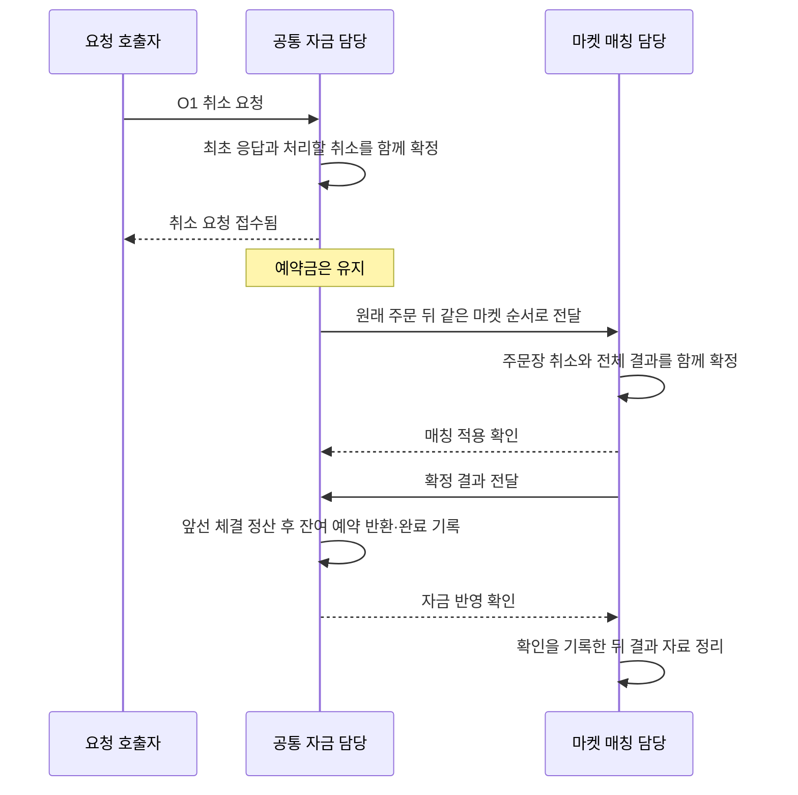

# #133 · 취소를 접수하고 남은 예약을 한 번 반환하기

**이번에 완성할 동작은 “주문 300을 예약하고 100을 체결한 뒤, 남은 200을 취소·반환한다”이다.** 취소 요청을 보냈다는 이유만으로 돈을 풀지 않고, 매칭이 실제로 취소한 잔량과 앞선 체결 정산을 근거로 반환한다.

2026-11-12 상세 명세. 기준 통합은 `0147218feebe093da3ac523daae40fca9395fb6b`(#179 병합)이다. **첫 코어 단위는 `2550154`로 커밋했다.** 이어서 실제 두 클러스터 취소 통신과 기본 복구까지 연결·검증했다. 코어 검증은14절, 현재 연결 단위의 계약·검증은15절에서 구분한다.

## 먼저 한 주문을 따라가기

수수료와 가격 차이가 없는 예시다. 사용자에게 1,000이 있고 주문 O1이 300을 예약했다. 그중 100의 체결은 이미 자금에 반영됐다.

| 시점 | 누가 무엇을 판단하나 | 사용 가능 / 예약 |
| --- | --- | --- |
| 취소 전 | 자금은 앞선 체결 100까지 정산한 상태 | 700 / 200 |
| 취소 접수 | 자금이 대상·중복·용량을 확인하고, 최초 응답과 처리할 취소를 함께 남김 | 700 / 200 |
| 매칭 취소 확정 | 매칭이 원래 주문·체결과 같은 순서로 남은 수량을 제거하고 결과를 보관 | 700 / 200 |
| 잔여 예약 반환 확정 | 자금이 앞선 결과를 모두 반영하고 남은 예약 200을 한 번 반환 | **900 / 0** |

취소는 이미 확정한 체결을 되돌리지 않는다. 사용자에게는 **취소 요청 접수됨 → 잔량 취소 완료·반환 중 → 반환 완료**를 구분할 수 있는 상태를 만든다. 일반 HTTP 취소 API나 화면을 이번에 추가하는 뜻은 아니다.



그림 전체는 하나의 트랜잭션이 아니다. 자금과 매칭은 각자 소유한 상태를 따로 확정하고, 확인되지 않은 작업을 보관해 이어 처리한다. 적용 확인과 전체 결과는 도착 순서가 바뀔 수 있다.

## 구현 단위와 완료 경계

사용자 선택: **“취소·반환 코어 완주와 복원 먼저, 실제 통신은 다음 PR”**.

| 구분 | 완료할 결과 | 열지 않는 경로 |
| --- | --- | --- |
| **1단위: 코어 완주·복원 (`2550154`)** | 실제 자금·매칭 소유자에서 접수 → 취소 적용 → 결과 정산 → 확인·자료 회수를 수행하고, 저장 바이트를 읽은 빈 소유자가 같은 후속 처리를 재현 | 실제 Aeron 취소 ingress, 두 클러스터 취소 송수신, HTTP·화면 |
| **2단위: 실제 연결 (검증 완료)** | 준비된 코어에 기존 리더 전송 작업과 실제 통신을 연결하고, 실제 Archive·기본 재시작과 두 클러스터 상태를 검증 | 인증·인가·운영 담당 이동·성능 시험 등 별도 범위 |

1단위 코어 시험에서 전달 담당 역할은 **테스트 코드가 실제 소유자 API 사이에서 같은 원본·결과·확인을 전달**해 맡는다. 계산 결과를 가짜 성공 응답으로 대체하지 않는다. 이것은 실제 네트워크·클러스터 failover 검증과 구분한다.

기존 신규 전용 실행은 유지한다. 2단위에서는 새 계약을 명시한 양방향 개발 실행에만 취소를 활성화한다. 이전 기록을 자동 승격하거나 신규 전용 상대에 취소를 노출하지 않는다. 실행 가능한 취소인 것처럼 접수한 뒤, 뒤 신규 주문만 먼저 보내거나 취소를 영구 대기시키는 중간 활성화는 허용하지 않는다.

## 이미 준비된 것과 남은 것

- #177: 순수 매칭 엔진의 취소 후보 계산·검증·적용. 다시 구현하지 않는다.
- #178·#179: 최초 취소 응답, 동일 요청 판정, 응답 ACK와 요청 세대, 그 기록의 저장·복원. [완료된 저장·복원 기록](cancel-inbox-snapshot-spec.md)을 재사용한다.
- 이번에 남은 연결: 실제 취소 접수의 생산자, 대상별 진행 중 작업, 공통 입력 순서, 매칭 취소 결과, 순차 잔여 반환, 해당 작업의 저장·복원.
- 이후 실제 연결: 기존 자금·매칭 리더 JVM의 전송 작업 재사용. 신규 전달 서버나 다른 저장소를 추가하는 설계로 확대하지 않는다.

## 취소와 체결이 겹치면

**판단 기준은 매칭의 실제 처리 순서**다. 취소 요청을 누른 시각이나 응답 도착 순서로 체결을 취소하지 않는다.

| 상황 | 처리 결과 |
| --- | --- |
| 원래 주문이 아직 매칭에 안 갔음 | 취소를 접수할 수 있다. 원래 주문 다음 순서에 놓고, 앞 입력이 빠졌으면 취소가 추월하지 않는다 |
| 취소 전에 100이 추가 체결됨 | 그 체결도 정산하고, 실제 남은 예약만 반환한다 |
| 취소 전에 전량 체결되거나 신규가 최종 거절됨 | 매칭은 취소 가능한 잔량이 없다는 결과를 남긴다. 자금은 선행 종료 근거와 정산을 확인한 뒤 추가 반환 0으로 마친다 |
| 매칭에는 대상이 없는데 자금 예약은 남아 있고 종료 근거도 맞지 않음 | 모순된 결과를 거절하며 금융 상태를 바꾸지 않는다. 임의 반환하지 않는다 |
| 취소가 먼저 적용됨 | 제거한 잔량을 이후 주문이 새로 체결할 수 없다 |

‘대상이 없다’는 사실만으로 전량 체결·이전 취소·잘못된 대상을 임의 추정하지 않는다. 아직 끝나지 않은 취소가 참조하는 대상 원본과 종료 근거는 그 취소 작업에 붙여 유지한다. 모든 완료 주문의 영구 메모리 인덱스를 만들지는 않는다.

## 반복 요청과 세 가지 확인

사용자 선택: **같은 대상에 취소가 진행 중이면, 다른 요청 번호가 와도 기존 진행 중 안내만 하고 새 작업은 추가하지 않는다.**

- 같은 요청 번호·내용의 재전송은 최초 응답이다. 최초 접수가 성공했다면 취소 ID·업무 순서를 새로 만들지 않는다.
- 다른 새 요청의 ‘취소 진행 중’ 판단도 그 요청의 최초 응답으로 보관한다. 나중에 그 요청을 재전송했다고 새 취소로 바꾸지 않는다.
- 이전 요청 세대·정리한 순번·내용 충돌·공통 보관 한도는 기존 #178·#179 계약을 유지한다.

| 확인의 의미 | 정리할 수 있는 것 | 이 확인으로 끝나지 않는 것 |
| --- | --- | --- |
| 호출자의 응답 보관 ACK | 최초 응답 상세. 세대·정리 경계는 남김 | 진행 중인 취소·전달 의무·예약 |
| 매칭 업무 적용 확인을 자금에 기록 | 확인한 입력의 전달 원본·전달 예산 | 금융 예약과 취소 완료에 필요한 원본·근거 |
| 자금 정산 확인을 매칭에 기록 | 확인한 전체 결과와 그 보존 예산 | 중복 적용을 막는 확정 경계 |

## 중단돼도 남아야 할 것

| 중단·거절 상황 | 이어갈 방식과 금지할 변화 |
| --- | --- |
| 접수 응답 유실 | 같은 요청으로 확인. 새 취소 작업·입력 순서 발급 금지 |
| 송신 실패·매칭 응답 유실 | 확정한 같은 원본 재전달. 예약은 유지 |
| 매칭 취소 후 적용 확인 유실 | 기존 입력 경계·보관 결과로 중복 판정. 두 번째 주문장 변경 금지 |
| 앞선 결과가 빠지고 취소 결과가 먼저 도착 | 빠진 결과를 먼저 적용. 반환·결과 경계 전진 없음 |
| 반환 후 정산 확인 유실 | 같은 결과는 추가 반환 없이 확인을 다시 제공 |
| 결과 공간 부족 | 주문장·처리 경계를 바꾸기 전에 BUSY. 뒤 입력도 추월 금지 |
| 자금·매칭의 원본/예약/순서가 모순 | 해당 결과를 거절하고 금융 상태 유지. 복원 의미 오류·변경 중 오류는 기존 차단 규칙. timeout 반환 금지 |

새 접수는 이미 받은 작업의 정산·완료·확인 기록에 필요한 공간을 소모할 수 없다. 접수 전에 완료에 필요한 보존 여유까지 보장한다. 새 접수가 제한돼도 기존 결과 정산·ACK·자료 회수는 진행해야 한다. 이 조건은 양쪽 보관 공간이 모두 찼을 때 서로 공간 회수만 기다리는 순환 대기를 막는다.

아래는 구현 담당자를 위한 구체 계약이다. 위 업무 흐름과 분리해 읽는다.

<details>
<summary>구현 담당자용 — 범위·현재 코드·상태·호환성·수용 사례·검증 계획</summary>

## 1. 기준·근거·권한

- 기준: `feature/phase-2/integration`의 `0147218feebe093da3ac523daae40fca9395fb6b`. 문서 브랜치 `docs/split-order-cancellation/133`.
- 목적·선행: [#133](https://github.com/0Chord/coin-exchange/issues/133), [#130 설계](https://github.com/0Chord/coin-exchange/issues/130), #169의 결과 정산·확인, #177·#178·#179 완료분.
- 기존 적용/확인·복원 계약은 [주문 전달](funds-order-delivery-spec.md)과 [결과 전달](matching-result-delivery-spec.md)을 참조한다. 기존 [SQL 취소 명세](cancellation-ledger-spec.md)는 과거 경로의 참고이며 분리 코어에 그대로 복제하지 않는다.
- #176/`feat/split-order-cancellation/133`의 과거 구현은 미채택 보존본이다. 필요한 사실을 대조할 수 있으나, 전체 재적용·정책 채택·테스트 통과 근거로 사용하지 않는다.
- 허용된 작업은 상세 명세와 관련 이슈 본문 갱신이다. 제품·테스트 구현, 새 테스트/벤치마크 실행, 커밋·PR·보드/상태 변경은 이번 요청에 포함하지 않는다.

## 2. 포함·제외와 이행

**첫 PR 포함:** 실제 `BoundedFundingState` 취소 접수와 순차 반환, `ReservedMatchingState` 취소 적용·전체 결과, 공통 입력/결과 모델·유한 자원·불변 복구 값, 두 역할의 실제 codec 저장 바이트, 빈 소유자의 복원·동일 후속열, 기존 신규 주문 회귀. 테스트가 소유자 API를 이어 코어를 완주한다.

**첫 PR 제외:** 두 전송 proto/codec·client·agent의 실제 취소 연결, Aeron 취소 명령 노출, 실제 Archive 취소 재시작·3+3노드 취소 실행, 일반 HTTP/프론트·인증/인가/원격 펜싱, Kafka/RDB/RocksDB 원장 적재, 성능·장기 부하·리더/과반 장애·자동 담당 이동. 통신 없는 코어 결과를 실제 클러스터 검증이라고 보고하지 않는다.

**기술 이행안:** 기존 신규 전용 계약(legacy)과 취소 가능한 새 입력 계약을 구분한다. 새 계약은 입력 종류와 공통 순서가 명시되며 configuration/복구 identity에 결속한다. 첫 PR의 실제 런처·adapter는 legacy만 활성화하고 새 계약 기동은 통신·기록 디렉터리를 열기 전에 미지원으로 거절한다. 도메인/codec 검증은 새 계약으로 수행한다. 기존 공개 메서드·전송 목록이 새 취소를 조용히 필터링해 뒤 신규만 반환해서는 안 된다. 새 runtime·의존성·서버를 추가하지 않고 기존 기동 검증 책임을 사용한다.

이 구분은 사용자가 새 제품 정책을 선택했다는 뜻이 아니라 중간 활성화를 막는 구현 이행안이다. 실제 통신 PR에서는 양쪽이 같은 새 계약을 지원하는지 확인한 뒤 활성화한다.

## 3. 현재 코드에서 반드시 함께 바꿀 전제

| 확인한 현재 사실 | 이번 책임 |
| --- | --- |
| [자금 소유자](../domain-trading/src/main/kotlin/com/exchange/core/trading/BoundedFundingState.kt)는 신규 접수만 제공 | 취소의 최초 응답·원본·전달 의무·진행 중 대상을 한 변경 경계에서 기록 |
| [전달 상태](../domain-trading/src/main/kotlin/com/exchange/core/trading/FundsDispatch.kt)는 `dispatchSequence == marketAdmissionSequence`를 요구 | 신규 승인 번호와 신규/취소 공통 입력 순서를 분리. 대상 원본 수명도 전달 payload와 분리 |
| [매칭 입력 검증](../domain-trading/src/main/kotlin/com/exchange/core/trading/MatchingInputValidation.kt)·[매칭 소유자](../domain-trading/src/main/kotlin/com/exchange/core/trading/ReservedMatchingState.kt)는 submit와 신규 승인 증가를 전제 | 입력 종류별 검증·적용·복원, 취소 결과 보존과 적용 확인을 같은 상태 변경으로 연결 |
| [결과 값](../domain-trading/src/main/kotlin/com/exchange/core/trading/MatchingIntakeValues.kt)은 입력/첫 효과 모두 신규 원본을 전제 | 취소 명령 원본과 대상 주문 원본을 구별. 최종 거절·잔량 없음도 완결된 결과로 표현 |
| 자금 정산은 pending 신규를 매 결과마다 소비하며 `resultSequence == marketAdmissionSequence`를 검사 | 공통 결과 순서로 진행하고, 취소 결과가 신규 pending을 소비하지 않게 함 |
| [결과 보관](../domain-trading/src/main/kotlin/com/exchange/core/trading/FundsResultSettlement.kt)은 비교 원문을 FIFO 회수 | 미완료 취소의 terminal 증거를 이 캐시에만 의존시키지 않음 |
| [순수 매칭 취소](../domain-matching/src/main/kotlin/com/exchange/core/matching/MatchingEngine.kt)의 후보·적용은 이미 존재 | 재사용. 결과 공간 검사 전 주문장을 바꾸거나 취소 계획을 재계산하는 경로를 추가하지 않음 |
| [예약 release](../domain-order/src/main/kotlin/com/exchange/core/order/OrderReservation.kt)는 잔여 금액·잔여 수수료 예약을 0으로 하고 소수 나머지는 보존 | 기존 의미 유지. 소수 나머지를 현금으로 더하거나 취소 수수료로 올림하지 않음 |

## 4. 식별·순서 계약

1. 사용자 요청 token(사용자·채널·요청 세대·순번)은 #178의 중복 판정에만 사용한다. 업무 순서·Raft 리더 세대와 혼용하지 않는다.
2. 신규 전역 승인 번호와 기존 마켓별 신규 승인 번호는 신규에만 발급한다. 취소가 이 번호를 소비하거나 대상 주문의 승인 번호를 바꾸지 않는다.
3. 새 마켓 입력 순서는 신규·취소를 합쳐 한 건마다 증가한다. 각 결과는 해당 입력 하나의 완결된 결과이고, 결과 순서는 같은 마켓의 연속 입력 순서를 따른다. 신규 승인 번호와 결과 번호의 무조건 동치는 제거한다.
4. 예: 신규 승인1/마켓입력1 → 취소/마켓입력2 → 신규 승인2/마켓입력3. 취소 때문에 신규 승인2의 식별자가 3으로 바뀌지 않는다. 기존 신규 승인 합계 검증은 신규끼리, 공통 입력 합계는 신규+취소로 별도 검증한다.
5. 취소 접수 성공 때만 전역 취소 순번을 발급하고, ACK·요청 세대 변경·완료 후에도 되돌리지 않는다. 거절/용량 재시도는 새 취소 업무 번호를 발급하지 않는다. Long 끝은 명시적으로 거절하고 wrap하지 않는다.
6. 취소 ID는 source lineage와 전역 취소 순번에서 결정적으로 유도하고 기존 `CancelReceipt`의 C2/40자 제약을 지킨다. 기술 제안은 128-bit lineage와 64-bit 순번을 unsigned 결합한 값을 38자리 소문자 base36으로 0-padding하고 C2를 붙이는 고정폭 표현이다. 192-bit 전체를 담을 수 있어 임의 해시 절단·재시도별 UUID 발급·과거 전체 ID 인덱스가 필요 없다. 구현은 유일성·최대 경계·재현성 검사를 포함한다.
7. 원본에는 source/destination lineage·마켓·ownership epoch·설정/정책 문맥·공통 입력 순서·종류가 결속된다. 취소 원본은 취소 ID와 대상의 최초 승인 전체를 포함한다. 대상의 현재 잔량·반환액을 클라이언트 입력으로 받지 않는다.

## 5. 자금 접수와 요청 응답

- 기존 lookup을 먼저 수행한다. 같은 기록은 용량이 차도 최초 응답. 내용/종류 충돌·옛/미발급 세대·retired는 기존 거절이다.
- 신규 취소는 마켓·설정·사용자와 대상 원본 일치, 진행 중 취소 유무, 현재 취소 가능 상태, 모든 예산·카운터 상한을 확인한다. 본인 주문 확인은 업무 원본 대조이며 사용자 인증을 새로 도입하지 않는다.
- 정상 접수는 최초 ACCEPTED, 취소 ID, 대상 보호 원본, 미완료 취소, 공통 입력·전달 원본과 예산을 함께 반영한다. 잔고·예약·수수료 수익·주문장에는 변화가 없다.
- 새로운 token이 동일 대상의 진행 중 취소를 가리키면 REJECTED/`CANCEL_PENDING` 취지의 최초 응답만 보관한다. 취소 ID·입력 순서·전달 의무는 추가하지 않는다. 기존 `CancelReceipt.REJECTED`의 금지 필드 조건을 유지한다.
- 진행 중 작업이 없고 자금에서도 대상이 정상 종료/미존재이면 `NOT_ACTIVE` 취지의 최초 거절이다. 임의로 완료 이유를 복원하지 않는다. 마켓/소유자 불일치도 업무 거절로 구분한다. 이유 문자열의 최종 이름은 구현자가 기존 규칙에 맞출 수 있지만 테스트의 의미는 바꾸지 않는다.
- 용량·숫자 고갈·문맥 오류처럼 접수 전 거절한 경우 성공 receipt/작업을 남기지 않는다. 기존 정책상 재시도 가능 용량 거절은 요청 순번·용량을 소비하지 않는다. 변경 시작 전 계산 오류는 무변경, 변경 중 예상 밖 오류는 기존 소유자 차단을 따른다.

## 6. 매칭 취소·결과

- 같은 마켓의 다음 공통 입력만 적용한다. 중복은 최초 결과/누적 확인으로 판정하며, 보관 비교 창 안의 원본 변경은 충돌이다. GAP/BUSY/잘못된 입력은 성공 확인이나 경계 전진을 만들지 않는다.
- 대상 원본·source 순서·문맥을 검증하고, 기존 취소 후보를 읽기 전용으로 만든다. 결과의 최대 크기와 보관 공간을 확인한 뒤 후보를 한 번 적용한다.
- 성공 결과는 취소 명령의 정체성, 대상 승인 원본, 실제 취소 수량·대상 전후 상태, 엔진 전후 경계, 전체 사건을 보존한다. 취소 ID를 주문 ID처럼 사용하거나 취소를 신규 taker로 꾸미지 않는다.
- 이미 앞 입력까지 적용했는데 활성 대상이 없으면 ‘취소할 잔량 없음’으로 확정한다. 원래 주문 미도착 때문에 생긴 GAP을 이 결과로 바꾸지 않는다. 없는 이유를 전량 체결로 추정하지 않는다.
- 주문장·활성 원본/예산·완결 결과·공통 입력/결과 경계가 함께 반영된 뒤 적용 확인을 생성한다. 취소와 그 이후 주문의 체결 순서는 이 경계로 결정한다.
- 취소 결과 공간 부족은 일시 BUSY이며 주문장 변경 전이다. 허용한 최대 취소 결과 하나를 담을 수 없는 설정은 조립 때 거절한다. 중간 일부만 적용하고 나머지를 후속 명령으로 넘기는 계약은 추가하지 않는다.

## 7. 자금의 순차 결과 반영과 반환

- 같은 마켓의 다음 결과와 앞 엔진 경계가 맞아야 한다. 취소 결과는 신규 pending을 소비하지 않고 해당 미완료 취소와 연결한다. 원본·취소 ID·대상·입력 순서·설정·수량·결과 종류를 모두 대조한다.
- 취소 성공이면 선행 정산을 반영한 현재 ACTIVE 예약의 잔량이 매칭이 취소한 잔량과 같아야 한다. 그 예약의 `remainingAmount`만 hold에서 available로 옮기고 예약을 RELEASED로 전환한다. 다른 주문 hold·기지급 대금·기청구 수수료·과거 가격 개선 반환을 바꾸지 않는다.
- 반환 분개는 취소 ID에서 유도한 안정적 거래 ID로 계산·균형 검증한다. 기존 bounded 경로처럼 전체 완료 원장 목록을 영구 보관하지 않는다. 후보 계산의 원장 항목은 테스트에서 독립 기대값으로 검사한다.
- 반환·예약/활성 예산 종료·취소 완료·결과 receipt/경계·필요한 전달 적용 확인을 한 자금 변경으로 반영한다. 결과가 별도 적용 ACK보다 먼저 와도 이 검증된 반영을 적용 증거로 사용한다.
- 잔량 없음 결과는 앞선 체결/최종 거절까지 모두 정산하고, 해당 대상이 이미 정상 종료됐다는 보호 근거와 예약0을 확인해 반환0으로 끝낸다. ACTIVE 예약이 남는데 결과 근거가 맞지 않으면 `INVALID_RESULT`로 거절하고 금융·결과 경계를 변경하지 않는다.
- 런타임에서 변경 전 원본·예약 후보 검증이 실패하는 경우에는 기존 `INVALID_RESULT`/무변경 응답과 owner 비차단을 유지한다. 이를 정상 완료·정상 재시도 성공으로 처리하지 않는다. 직접 복원의 의미 검증 실패 및 실제 변경 중 예상 밖 예외는 기존 owner 차단을 유지한다. 거절·복구 실패·부분 쓰기 가능 오류를 하나의 ‘차단’으로 뭉뚱그리지 않는다.
- 선행 결과가 대상을 종료하면 아직 미완료인 취소에 그 원본·최종 예약 상태·종료시킨 결과/엔진 경계를 보존한다. FIFO 비교 캐시가 퇴역해도 이 근거를 잃지 않는다. 취소 완료 시에만 해당 보호 슬롯을 회수한다.
- 중복/퇴역 결과는 기존 경계로 판단해 금융 효과를 추가하지 않는다. 완료 확인을 되풀이할 수 있으며 정산 시각·최초 응답을 덮어쓰지 않는다.

## 8. 자원·회수·복원

- 미완료 취소는 대상당 한 개다. 전역/마켓별 건수·바이트, 공통 전달 예산, 보호 대상/terminal 근거와 완료 여유를 모두 유한하게 센다. 구현은 신규 주문 슬롯과 취소 슬롯을 혼동하지 않고 논리 charge와 물리 bytes를 구분한다.
- 접수 때 각 취소의 정상 완료에 필요한 최대 보호 기록 공간을 확보한다. 신규 접수 예산은 결과 적용·완료 기록·ACK 회수용 예산을 소비할 수 없다. 수신 비교 원문은 별도 유한 예산과 확정 prefix/FIFO 회수로 처리한다. 정확한 예산 산식·최대 원본/결과 1건 수용·산술 overflow 검사를 포함한다.
- 사용자 응답 ACK/세대 변경은 작업·대상 보호 근거를 삭제하지 않는다. 적용 ACK는 전달 payload만 회수한다. 정산 확인을 매칭에 기록한 뒤 결과 payload를 회수한다. 완료 뒤에도 진행 경계·발급 카운터를 보존하며 상세 이력은 한도 밖으로 무한 누적하지 않는다.
- 모든 복구 값의 목록은 독립 불변 복사다. 역할 snapshot은 공통 순서·신규 승인·취소 발급 카운터, 실제 전달 원본, 미완료 취소와 대상/종료 근거, 결과·retired/적용/정산 경계·자원 합계·금융 상태를 함께 보존한다.
- 빈 소유자 복원은 전체 후보의 ID/순번 유일성, 동일 대상 pending 중복 금지, owner/마켓/원본 일치, 의무와 전달/결과 경계의 관계, 종료 근거·예약·총량·자원 재계산을 확인한 뒤 게시한다. 바이트 해독 오류와 의미 검증 실패의 차단 경계는 기존 계약을 유지한다.
- 교차 검사는 다음 관계를 포함한다. 미완료 취소의 입력은 이미 발급됐지만 자금 결과 반영 경계보다 뒤여야 한다. 그 입력이 매칭 적용 경계보다 뒤면 전달 원본이 있어야 하며, 앞이면 전달 원본만 회수된 상태를 허용한다. 보관 중 ACCEPTED receipt가 자금 결과 경계보다 뒤라면 같은 취소 작업이 있어야 하고, 앞이라면 작업이 정상 완료·회수됐을 수 있다.
- pending 작업의 최초 receipt가 ACK·세대 변경으로 없어지는 것은 허용한다. 다만 해당 정리 경계/세대 변화와 맞아야 하며, 같은 세대의 정리되지 않은 최초 receipt를 임의 누락한 후보는 거절한다. 발급 카운터·요청 세대와 전달·결과 순서를 혼용하지 않는다. 신규/취소 총합 대조는 overflow 없는 정확한 산술로 수행한다.
- ACK 이전 작업은 복원 후 같은 원본으로 재개하고, ACK 뒤 회수한 payload는 되살리지 않는다. ACK한 상태를 잃은 과거 백업을 같은 lineage로 되돌리는 동작은 정상 복구로 약속하지 않는다.

## 9. 저장·실행 호환성 — 1단위 코어 계약

| 대상 | 이번 계약 |
| --- | --- |
| 기존 신규 전용 설정·기록 | 기존 writer 바이트와 reader·golden·금융/순번 의미 유지. fixture 재생성 금지 |
| bounded 금융/inbox | #179의 v2/v3와 응답 ACK/세대 의미 유지. 실제 취소 작업은 역할 상태에 보존하며 inbox만 보고 추론하지 않음 |
| 취소 가능한 자금 역할 | 새 명시적 outer 형식(v3 제안)에 혼합 전달·취소·종료근거·새 경계를 기록 |
| 취소 가능한 매칭 역할 | 새 명시적 역할 형식(v2 제안)에 혼합 입력·결과·보호 원본을 기록 |
| 전체 결과 자료 | 종류·원본·전체 사건/효과가 명시된 새 버전. 기존 신규 v1을 취소 자료로 위장하지 않음 |
| 구형 reader/기존 root | 새 자료 읽기·롤링 변경·과거 root 자동 인계 제공 안 함. 실행물/JDK/설정 identity 검사 완화·덮어쓰기 금지 |
| 실제 wire | 이번 PR은 기존 schema88/89 v1 무변경. 새 계약·kind/버전·최대 frame 검증과 상대 지원 확인은 실제 연결 PR |

새 reader의 구형 bytes 지원은 **해당 legacy 설정으로 기존 자료를 읽는 것**이다. 옛 자료를 새 취소 계약으로 자동 변환/승격한다는 뜻이 아니다. 새 계약의 코어 fixture는 초기화부터 새 설정을 사용한다. 첫 PR에는 실제 새 클러스터 root를 열지 않는다.

기존 역할 codec의 128MiB 및 구성별 보수 상한을 유지하고 새 종류의 최대 표현·보호 근거·카운터 비용까지 산식에 포함한다. 초과 설정을 거절하며 고정 상한을 임의로 올려 맞추지 않는다. 실제 통신 형식으로 snapshot blob을 통째로 전송하는 우회도 후속 설계에 넣지 않는다.

## 10. 독립 수용 사례 — 앞으로 실행할 기대값

아래 번호는 테스트 실행 수가 아니다. 실제 source→matching→funds 코어를 연결하며, 실제 계산값을 복사해 기대값으로 쓰지 않는다.

| ID | 준비·입력 | 독립 기대값·금지할 변화 |
| --- | --- | --- |
| C01 | 수수료0, 1,000 중300 예약→100 체결 정산→취소 | 접수/매칭 적용 뒤700/200, 반환 뒤900/0. 취소한 잔량 후속 체결 없음 |
| C02 | 무체결 주문300 취소 | 최종1,000/0, 반환300 한 번 |
| C03 | 원래 주문 미전달 상태에 취소 접수, 뒤 신규도 추가 | 원래 주문→취소→뒤 신규의 같은 입력 순서. 취소가 앞 입력을 추월하지 않음 |
| C04 | 동일 요청 재전송, 같은 번호의 다른 대상·종류 | 최초 응답 유지 또는 내용 충돌. 취소 ID·입력 순서·예약 중복 생성 없음 |
| C05 | 다른 새 요청으로 같은 대상의 진행 중 취소 반복 | CANCEL_PENDING 취지 최초 거절만 기록. 작업 하나 유지. 완료 뒤 그 요청 재전송도 최초 판단 유지 |
| C06 | 대상/소유자/마켓·설정 오류, 초기화 전·차단 소유자 | 정책 거절/기존 오류 구분. 예약·의무·성공 응답·업무 카운터 임의 변경 없음 |
| C07 | 취소 전 추가100 체결 또는 전량 체결 | 실제 추가 체결까지 순차 정산. 각각 잔여100 또는0만 반환. 전량 체결 이유를 대상 없음만으로 추정하지 않음 |
| C08 | 신규 최종 거절 후 뒤따르는 취소 | 앞 거절 반환을 먼저 적용하고 취소는 추가 반환0. pending/종료근거 회수 정확 |
| C09 | 취소 결과가 앞선 체결 결과보다 먼저 도착 | GAP, 금융/결과 경계 무변경. 앞 결과 후 다시 보내면 정상 완료 |
| C10 | 적용 확인 유실·결과가 확인보다 먼저 도착·뒤늦은 확인 | 실제 적용/정산 한 번. 전달 자료 회수와 예약 수명 분리 |
| C11 | 반환 뒤 확인 유실·같은 결과 반복·퇴역 구간 재전달 | 반환/분개 효과 추가0, 경계 감소 없음. 유효 확인 재제공 |
| C12 | 사용자 ACK/세대 변경으로 receipt 삭제 중 취소 미완료 | 작업·대상·종료근거 유지. 재전송은 기존 retired/epoch 거절, 작업은 정상 완료 가능 |
| C13 | 앞선 정산이 대상을 종료하고 비교 receipt FIFO까지 퇴역 | 보호한 terminal 근거로 후속 취소를 반환0 완료. 전체 완료 주문 인덱스 없이 수행 |
| C14 | 매칭 대상 없음인데 자금 ACTIVE 예약/원본·잔량이 모순 | 런타임 후보는 INVALID_RESULT·금융/결과 경계 무변경·owner 비차단. 복원 의미실패/변경 중 오류의 기존 owner 차단과 구분 |
| C15 | BUY3@1,000, 최대/실제 taker1%, 1개900 체결 후 취소, 초기10,000 | 초기예약3,030. 체결소비909·가격 개선 반환101·잔여예약2,020. 취소반환2,020, 최종가용9,091/예약0·수수료9. 합3030=909+101+2020 |
| C16 | SELL3 예약→1개900 체결, taker1%→잔량취소 | base2만 반환, quote 순지급891·수수료9 유지. 다른 자산/주문 hold 무변경 |
| C17 | 수수료 소수 나머지가 남는 부분 체결 후 취소 | 추가 수수료 올림/나머지 현금환산 없음. remainingAmount/remainingFeeReserveAmount0, 기존 release의 소수 metadata 의미 유지 |
| C18 | 미전달·매칭 적용 후 미정산·선행 종료 후·반환 후 확인 전 각각 저장 | 실제 역할 codec bytes→빈 소유자 복원. 중단 없는 실행과 동일 후속열의 금융·주문장·결과·의무·회수·다음 정상 요청 일치 |
| C19 | checksum/형식/길이 손상 및 정상 checksum의 ID·의무·경계·예산·예약 모순 | 기존 해독/owner 실패 구분. 부분 상태 게시·조용한 취소 누락·identity 완화 없음 |
| C20 | 새 접수 예산·매칭 결과 공간 모두 포화 | 새 접수 제한/BUSY 동안 기존 결과 정산·완료·확인·회수로 진행 가능. 뒤 입력 추월·처리경계 전진 없음 |
| C21 | 기존 golden/legacy/new-only 후속 처리, 잘못된 새 계약 runtime 기동 | 종전 bytes·동작 불변. 새 계약은 기존 runtime에서 통신/기록 폴더 열기 전 거절. 실제 취소 ingress 활성화 없음 |
| C22 | 긴 UTF-8 원본·단일 최대 결과·Long 끝·입력 목록 변경 | 예산/128MiB 산식·최대 한 건 수용·EXHAUSTED·불변 복사 유지. wrap/무한 보존 없음 |

C15의 상대 주문은 체결1개만 제공하고 maker 수수료는0으로 준비해 buyer taker9를 독립 대조한다. C16도 seller가 taker가 되도록 상대 BUY1을 먼저 준비한다. C17의 정확한 fractional 표현은 현재 수수료 단위에 맞춰 설정하되 현금 효과의 기대를 계산 코드에서 복사하지 않는다.

공유 hold 대조도 포함한다. 수수료0, 초기1,000에서 대상300·별도 주문50을 예약하고 대상100을 체결한 뒤 취소하면 최종 가용850·hold50이다. 다른 주문의 예약까지 0으로 만들면 실패다. C20은 응답 receipt 공간까지 찬 상태에서도 사용자 ACK를 기다리지 않고 이미 접수한 취소·결과를 완료할 수 있는지 직접 확인한다.

## 11. 구현 순서와 검증 계획

1. 첫 실패 사례는 C01: 기존 실제 소유자로 신규·부분 체결까지 준비하고, 취소를 접수해 매칭·반환까지 이어갈 수 없다는 현재 공백을 확인한다. #177·#178의 메모리 테스트만 늘리는 것으로 대신하지 않는다.
   최소한의 호출 계약을 준비한 뒤 금액·수량·의무에 대한 의도한 행동 실패를 확인한다. 미정의 심벌의 컴파일 오류를 행동 검증의 실패 근거로 세지 않는다.
2. 새 공통 순서와 취소 원본을 실제 접수·매칭·반환에 연결해 C01~C11을 완주한다. 새 API·타입만 만든 상태를 완료로 세지 않는다.
3. 예산·대상 보호 수명·두 역할의 실제 저장 바이트/복원을 연결해 C12~C22와 기존 신규 회귀를 대조한다. 제품에 시험용 ingress·관찰 큐·기동 gate를 심지 않는다. 새 계약 미지원 기동 검증은 기능의 실제 이행 조건이다.
4. 필수 구조·형식 검사 및 고정 소스의 독립 리뷰를 수행하고 실제 명령/실패·skip·미검증을 구현 기록에 갱신한다. 이번 명세 작성 중에는 이를 실행하지 않았다.

예정 명령(JDK25, 구현 checkout/새 테스트 이름을 실제 변경에 맞춰 명시해야 함):

```bash
cd /Users/0chord/.codex/worktrees/issue148-http-aeron/exchange-core
./gradlew :domain-matching:test :domain-trading:test :app-api:test \
  --tests '*Cancel*' \
  --tests '*BoundedTradingRoleGoldenTest' \
  --tests '*BoundedTradingSnapshotContinuationTest' \
  --tests '*FundsRoleSnapshotCodecTest' \
  --tests '*FundsResultSnapshotCodecTest' \
  --tests '*MatchingRoleSnapshotCodecTest' \
  --tests '*SplitTradingRoleStartupTest' \
  --tests '*SplitTradingClusterAdapterTest' \
  :architecture-tests:test :architecture-tests:verifyArchitectureReport ktlintCheck \
  --no-daemon --max-workers=1 --console=plain
```

`--tests`는 app-api 선택 범위이며 도메인은 전체를 실행할 계획이다. 새 코어 통합·복원 클래스는 선택에 누락되지 않게 명시한다. 기존 actual Archive의 신규 회귀는 필요 시 기존 `BoundedTradingSnapshotPersistenceTest`·`BoundedTradingUninitializedSnapshotTest`를 추가한다. Docker·6노드·성능 실행은 첫 PR 근거에 포함하지 않는다.

## 12. 실제 통신 단위의 계약과 코어 단위 종료 조건

- 다음은 준비된 혼합 원본/결과를 두 peer가 지원하는 명시적 wire 버전으로 운반하는 연결이다. 기존 worker의 단일 마켓 순서·bounded pipeline·재전송·리더 세대 무효화·상대 문맥 대조·두 ACK를 재사용한다. 전송 성공을 업무 완료로 승격하지 않는다.
- 새 wire의 최대 실제 frame/단편화/결과 수신 상한, handshake의 계약 버전, source와matching snapshot+tail 재시작, 앞선 C01·C09·C10·C11의 실제3+3노드 대표 실행을 그 PR에서 검증한다. 제한된 run·타임아웃·디스크/진단물 상한·정리를 명세하며 부하 시험으로 확대하지 않는다.
- 일반 HTTP/API·UI·인증·외부 원장 저장·다중 마켓 배치·복합 장애 #134는 자동 포함하지 않는다. 기본 취소 재시작은 실제 연결 PR에서 끝내고 전부 #134로 미루지 않는다.
- **첫 PR 종료:** C01~C22의 해당 코드/byte/owner/보존/회귀 근거, 실제 코어 정상 완주와 기본 복원, legacy 불변·미지원 runtime 활성화 차단, 필수 검사·독립 리뷰. 아직 실제 두 클러스터 취소가 되거나 #133 전체가 완료됐다고 보고하지 않는다.

## 13. 결정 출처와 현재 상태

| 질문/근거 | 사용자 실제 답·상태 | 반영 |
| --- | --- | --- |
| 앞선 흐름 합의 | 전달 전 취소 허용, 원래 주문 다음 같은 마켓 순서. 취소/반환 상태 구분 | 순서·단계별 완료·C03 |
| 같은 대상의 진행 중 취소에 다른 새 요청 번호가 오면? | “기존 취소 진행 중 안내, 새 작업은 추가하지 않음 (추천)”. 별도 선택 이유는 제출하지 않음 | 대상당 pending1개, CANCEL_PENDING 최초 응답·C05 |
| 코어 완주·복원 먼저인지 실제 두 클러스터 연결까지인지? | “취소·반환 코어 완주와 복원 먼저, 실제 통신은 다음 PR (추천)”. 별도 선택 이유는 제출하지 않음 | 이번/후속 범위·기동 이행·C18/C21 |
| 코어 구현 후 다음 연결 진행 | “커밋하고 다음 구현도 같이 진행해봐” (2026-11-12) | 검증한 코어를2550154로 커밋하고 분리한 전송 브랜치에서2단위 진행. PR·게시·병합은 포함하지 않음 |
| 기존 코드의 구조상 빈칸 | 입력/신규 승인/결과 번호 동치, 신규 pending 소비, terminal 원본 수명, submit-only codec | 이번에 함께 바꿔야 할 기술 계약. 이미 구현된 것으로 기록하지 않음 |

- 명세 작성 시점에 확인한 것: 기준 통합·관련 이슈·실제 소유자/엔진/예약·codec·테스트 위치·기존 명세. 아래 14절의 구현 실행 근거와 별개다.
- 명세 작성 시점에는 제품·테스트를 실행하지 않았다. 이후 구현·새 실행은 14절에 기록하며 이전 #179 결과를 이번 취소 연결의 통과 수로 사용하지 않는다.
- 명세 독립 정적 검토 완료: 작성 대화를 상속하지 않은 별도 검토자가 기준 소스와 고정 문서를 대조했다. 런타임 결과 거절과 owner 차단을 구별하라는 지적 1건을 수정하고 재검토해, 최종 미해결 결함·범위를 막는 빈 결정은 없었다. 최종 계약 검토본 SHA-256은 `6674bf55e95f00df813ac5c4b5bd311fd5a48374e7e036c0320b4587eb4c6847`이다. 당시 검토 후 변경은 이 검토 기록뿐이었다. 이후 구현은14절에 따로 기록하며, 이 정적 검토를 제품 실행·테스트 통과 근거로 사용하지 않는다.
- 기술 제안의 파일/형식 배치는 계약을 보존하는 범위에서 구현자가 조정할 수 있으며, 미결정 제품 정책을 AI 판단으로 채웠다고 기록하지 않는다.


## 14. 구현·검증 기록 — 2026-11-12

작업 폴더는 `/Users/0chord/.codex/worktrees/issue148-http-aeron/exchange-core`, 브랜치는 `feat/cancellation-core/133`, 기준은 위의 #179 병합 SHA다. 이 기록은 로컬 구현·검사이며 커밋·PR·CI·병합 완료 기록이 아니다.

### 실제로 연결한 상태 변경

1. 자금이 최초 취소 응답과 미완료 취소를 함께 기록한다. 예약은 그대로다. 같은 대상의 별도 새 요청은 진행 중으로 기록하며 작업을 추가하지 않는다.
2. 매칭이 신규와 같은 마켓 입력 순서에서 남은 주문을 취소하고 전체 결과를 보존한다. 이미 종료된 대상도 취소 거절 사건을 가진 완결 결과를 만든다.
3. 자금이 앞선 결과까지 순서대로 반영한 뒤 **현재 남은 예약만** 반환한다. 먼저 전량 체결·최종 거절된 주문은 보호한 종료 예약을 확인해 추가 반환 없이 취소를 완료한다.
4. 적용 ACK는 전달 payload, 사용자 ACK는 최초 응답, 정산 ACK는 매칭 결과를 정리한다. 어느 ACK도 미완료 취소나 아직 남은 예약을 지우지 않는다.
5. 자금 v3·매칭 v2 역할 바이트를 빈 소유자가 읽고 같은 후속 처리를 계속한다. 기존 신규 전용 계약의 자금 v1/v2·매칭 v1 읽기와 기존 기록 바이트를 유지한다. 새 계약은 기존 실행 도구가 자원을 열기 전에 거절한다.

`approvalInputs`는 활성 주문의 최초 원본, `FundsCancellationSnapshot`은 미완료 취소와 필요한 종료 근거만 보존한다. 완료 후 이 보호 작업은 제거하며 전체 완료 주문 인덱스를 추가하지 않았다. 전역 취소 순번 하나로 ID 발급이 ACK·복원 뒤 재사용되지 않게 한다. 추가 보존 공간도 별도 예산으로 계산해 128MiB 저장 형식 상한에 포함한다. 이 상한은 직렬화 상한이며 JVM 전체 사용량을 뜻하지 않는다.

### 테스트를 읽는 지도

공통 준비는 실제 예약·수수료·매칭·정산 계산기와 두 코어 소유자다. 테스트 코드가 원본·결과·ACK를 호출 사이에 전달한다. 네트워크나 가짜 성공 응답을 사용하지 않는다. 이름에 여러 C 번호가 있어도 JUnit 실행 수는 메서드 하나로 센다.

| 테스트 위치/사례 | Given — 준비 | When — 실행 | Then — 실제 검증 |
| --- | --- | --- | --- |
| `CancellationCoreFlowTest` C01 | 1,000 중300 예약, 100 체결 | 접수→매칭 취소→자금 반환→재전달 | 접수·매칭 뒤700/200, 최종900/0, 잔량2 제거·후속 체결 없음. 반환200의 HOLD 차변/AVAILABLE 대변과 안정적 취소 분개 ID |
| 같은 파일 C02·C10·C11 | 무체결300 예약 | 적용 ACK 먼저, 결과 정산, ACK·FIFO 회수 후 재전달 | ACK만으로 반환하지 않음, 최초300 한 번 반환, DUPLICATE/PRUNED 뒤 추가 반환0 |
| 같은 파일 C03 | 신규 미전달 상태 | 취소와 뒤 신규 접수, 순서 바꿔 전달 | 신규→취소→신규 공통 순서, 앞 입력 누락은 GAP. 신규 전용 승인 순번은2이며 공통 입력은3 |
| 같은 파일 C04·C05 | 취소 하나 진행 중 | 같은 요청/다른 내용/다른 새 요청 및 완료 뒤 재시도 | 최초 응답·내용 충돌·CANCEL_PENDING을 구별, 취소 ID·작업·순서 추가 없음 |
| 같은 파일 C07·C09·C13 | 취소 앞 추가/전량 체결 결과 | 취소 결과 먼저, 앞 결과 정산·비교 FIFO 회수 후 재시도 | GAP 무변경, 추가 체결분을 먼저 지급. 잔여100 또는0만 반환, 종료 근거는 FIFO와 별도로 보존 |
| 같은 파일 C08 | 매칭 활성 한도1, 기존50 예약 주문 | 신규300 최종 거절→취소 거절 | 앞 거절이300을 먼저 반환, 뒤 취소 추가 반환0. 별도50 hold 유지 |
| 같은 파일 C12 | 취소 미완료 | 사용자 ACK 또는 세대 변경 | 최초 응답은 회수/과거 요청 거절, 업무·예약은 유지해 정상 반환 가능 |
| 같은 파일 공유 hold | 대상300·다른 주문50 중 대상100 체결 | 대상만 취소·반환 | 가용850/hold50, 다른 주문 예약 불변 |
| 같은 파일 C15 | BUY3@1,000, taker1%, 상대900 | 1개 체결 후 취소 | 소비909·가격 개선101·남은2,020 반환, 최종9,091·수수료9 |
| 같은 파일 C16 | SELL3·다른 base hold1, taker1% | 1개900 체결 후 취소 | base2만 반환, quote891·수수료9·다른 hold1 유지 |
| 같은 파일 C17 | 소수 수수료0.51이 남은 주문 | 잔량 취소 | 잔여 예약0, 소수 metadata 유지, 추가 올림·현금 환산 없음 |
| 같은 파일 C20 | 사용자 receipt2·매칭 결과1로 포화 | 취소 재시도, 앞 결과 정산·ACK·회수 | 신규 제한/BUSY 중 경계·주문장 불변, 사용자 ACK 없이 기존 취소 완료 |
| `CancellationCoreValidationTest` C06 2개 | 잘못된 대상/소유자/문맥, 초기화 전·차단 owner | 취소 요청 | 금융·업무 카운터 무변경, 정책 거절·수명주기 오류 구별 |
| 같은 파일 C14 | 실제 정상 취소 결과 | 수량·사용자·원본·취소ID·입력순번·사건·효과·대상 없음 8종 변조 후 정상 재시도 | INVALID_RESULT, 전체 관측 상태·prefix 무변경, owner 비차단. 원래 결과는 APPLIED |
| 같은 파일 C19 5개 | 실제 미완료/전량 종료/완료 취소 복구 상태 | 의무 누락·같은 대상 중복·종료 예약6종·완료 결과의 미발급 번호/세대/채널/요청·완료 응답 ID 재사용 변조 | 복원 거절·빈 owner 차단, 유효 복원은 정상. FIFO 회수·정상 세대 교체·처리 경계 뒤 실제 접수도 대조 |
| 같은 파일 C22 3개 | 음수 lineage·Long 마지막 순번, 변경 가능한 입력 목록, 최대 UTF-8 사용자 | ID 왕복/다른 lineage 검사·입력 목록 삭제·실제 취소 완주 | 고정40자 유일 ID·잘못된 순번 거절, 보존 목록 독립, 256byte 원본·반환 정상 |
| `ReservedMatchingCancellationTest` 8개 | 실제 신규·부분/전량 체결·포화·복구 상태 | 정상 취소, 앞 순번 누락, 원본 변조, 계약 혼용, prefix 원본 변조 | 잔량만 제거·완결 거절 사건·BUSY/GAP 무변경. 원본·신규 승인 순번 중복/경계 초과 복원 거절 |
| `CancellationRoleSnapshotTest` C18 | 미전달/적용 후 미정산/선행 종료/반환 후 ACK 전의4지점 | 실제 양쪽 codec bytes→빈 owner→같은 후속열 | 중단 없는 실행과 금융·주문장·미완료·결과·회수·다음 신규 결과 일치 |
| 같은 파일 형식2개·C19 2개·C22 | 새/기존 계약, 손상 bytes와 정상 checksum의 미완료 원본/완료 미발급 번호 변조, 최대 UTF-8 원본 | writer/reader·빈 owner 복원·초과 구성 생성 | outer 버전 분리, 혼용/손상/모순 거절, 실제 bytes가 산식 이내, 초과128MiB 구성 거절 |
| `SplitTradingRoleStartupTest` 신규 사례 | 취소 가능한 코어 구성과 아직 신규 전용인 전송 | 실제 런처 생성 | 통신·기록 디렉터리를 만들기 전에 명확히 거절 |

테스트 경로는 각각 `domain-trading/src/test/kotlin/com/exchange/core/trading/`, `app-api/src/test/kotlin/com/exchange/core/api/trading/infrastructure/history/`, 기동 검사는 `app-api/src/test/kotlin/com/exchange/core/api/trading/infrastructure/aeron/` 아래다.

### 기존 규칙을 새 경로에 적용한 근거

| 원래 규칙·소스 | 새 경로의 적용 | 검사 |
| --- | --- | --- |
| `MatchingEngine.prepareCancel/apply`는 성공과 거절 모두 사건·엔진 순번1개 소비 | 두 결과 모두 완결 결과와 연속 순번으로 정산 | C07의 전량 체결 뒤 거절 기대를 기존 규칙에 맞게3→4로 수정. 제품 규칙을 테스트에 맞춰 바꾸지 않음 |
| `OrderReservation.release`는 실제 남은 금액만 반환, 수수료 소수는 metadata | 현재 예약을 그대로 release하고 균형 분개·자산 보존 검증 | C01·공유 hold·C15~C17 |
| 최초 예약 생성의 ID·마켓·사용자·가격·수량·정책 결속 | 전달 원본 재검사, 종료 예약의 불변 필드와 완료 result/engine 경계 복원 검사 | C14·C19·최대 UTF-8 사례 |
| 개시 사용자64 code point·주문 원본256 UTF-8 bytes | 기존 규칙을 완화하지 않고 4byte 문자64개로 양쪽 한도 충족 | 두 C22 UTF-8 사례 |
| 기존 snapshot에는 신규 승인과 결과 번호가 동일 | v1은 기존 경계에서 유도, v2만 독립 경계를 명시 저장 | `FundsResultRecoveryTest` 마지막 Long 순번 및 기존 golden 회귀 |

### 실행과 독립 리뷰

행동 Red는 C01의 취소 접수 미연결과 matching의 새 계약 미지원, 역할 codec의 기존 outer 버전·구성 바이트 동등에서 확인했다. 미정의 심벌 컴파일 실패를 Red로 세지 않았다. 이후 전체 회귀에서 기존 v1 마지막 순번 복원 규칙을 고쳤다. 긴 UTF-8 fixture가 개시 사용자 문자 수 제한을 넘은 문제도 제품 계약을 유지한 채 fixture를 수정했다.

- 최종 확인: 거래444·관련 앱110·구조386, 총940개 사례에서 실패/오류/skip0. 필수 P01~P09 보고서와 전체 ktlintCheck 통과. 변경 없는 순수 매칭167개는 Gradle UP-TO-DATE의 성공 결과를 재사용했다. 이를 합한 확인 범위는1,107개이며 전부를 새로 실행했다고 표현하지 않는다. 이번에 추가한 테스트 메서드는38개다.
- 최종 전체 검사는 `:domain-trading:test :app-api:test`의 아래 선택 범위와 `:architecture-tests:test :architecture-tests:verifyArchitectureReport ktlintCheck`를 함께 실행해 성공했다. 마지막 실행은2분24초였다.
- 본 검사는11절 명령에 맞춰 수행했고, 앱 선택에 `*Cancel*`, 기존 `BoundedTradingSnapshotPersistenceTest`·`BoundedTradingUninitializedSnapshotTest`, 양쪽 delivery codec 회귀를 포함했다. C08 추가 후에는 다음 명령으로 거래 전체를 다시 검사했다. Docker·장기 성능 시험은 실행하지 않았다.

```bash
cd /Users/0chord/.codex/worktrees/issue148-http-aeron/exchange-core
./gradlew :domain-trading:ktlintFormat :domain-trading:test :domain-trading:ktlintCheck \
  --no-daemon --max-workers=1 --console=plain
```
- 독립 전체 리뷰: 작성 대화를 상속하지 않은 별도 리뷰어가 기준 SHA와23개 변경 파일을 고정한 v1/v2를 검토했다. v2 manifest SHA-256은 `c82f1ca0e05c5d7b6633465b5eb7b5ef94c05519824cf9209a6961d8e4faee65`이다. 직접 코어 반례2개와 SHA256을 재계산한 실제 bytes 반례1개로 **완료 후 보관 자료의 취소 ID 교차검증 누락**을 확인했다. 정상 동작·회수·호환·기동 경계의 나머지 검토에서 추가 결함은 확인하지 않았다.
- 지적 수정: 완료 결과와 미완료 의무에 같은 발급 상한·ID·요청·마켓 입력 관계를 적용하고, 최초 응답이 같은 업무를 가리키며 다른 취소의 ID를 재사용하지 않는지 대조한다. 인접 검사에서 완료 후 응답 ACK로 최초 응답이 사라지면 미발급 세대·채널·요청도 수용하는 누락을 확인해, 기존 미완료 검사를 공통 검증으로 옮겼다. 정상 이전 세대와 실제 최초 응답이 남은 비연속 요청은 허용한다. 이 임시 복원 검사는 보관 중인 자료만 읽으며 전체 완료 이력 인덱스를 추가하지 않는다. root도 도메인 회귀2개가 수정 전 실패함을 확인했고 수정 후 거래 전체·관련 snapshot 회귀를 통과했다. ID 누락 수정본 v3에서 독립 반례3개가 통과했고, 인접 요청 발급3종도 root 행동 Red를 확인한 뒤 보완했다. 최종 고정본 `/tmp/cancel133-review-20261112-v4`에서 지적 해소와 정상 복원 대조를 재검토했다. manifest SHA-256은 `b98f4aace2d9bdf409444df6bddf7cdb7c56f0d5d7eede2c77e458e8034a157f`이며23파일과 독립 실행 복사의 제품16파일 일치를 확인했다. 독립 재실행29개(정상 코어·매칭19, 역할 bytes5, 독립 반례/정상 대조5)가 실패/skip0으로 통과했고, 검토 범위의 최종 미해결 결함은0건이다. 이후 변경은 이 실행·검토 기록뿐이다.
- 독립 실행 로그: `/tmp/cancel133-independent-v4-20261112-test.log`. 독립 리뷰는 작성 대화·작성자 통과 주장을 판정 근거로 사용하지 않았고, 기존 golden은 root 실행과 리뷰어 정적 대조로 구분했다.
- 새 취소의 실제 Archive snapshot+tail, 두 클러스터 송수신·재시작·장애 승계는 다음 실제 연결 PR의 검증이다. 이번 byte/owner 시험을 그 실행 근거로 확대하지 않는다. 기존 Archive 시험은 신규 전용 경로의 회귀 확인이다.


## 15. 실제 취소 통신·복구 단위 — 2026-11-12

기준은 코어 커밋 `2550154`, 작업 브랜치는 `feat/cancellation-transport/133`, 작업 폴더는14절과 같다. 이 단위는 새 wire를 두 역할의 확정 callback과 기존 전달 작업에 연결한다. 새로운 자금 계산·수수료 알고리즘·별도 전달 JVM을 만들지 않는다.

### 업무 흐름과 완료의 뜻

1. 개발 호출자가 자금 클러스터에 같은 요청 토큰과 대상 주문으로 취소를 보낸다. **자금 로그에서 접수와 미완료 취소가 확정된 뒤** 최초 응답을 돌려준다. 전송 성공이나 접수 응답만으로 예약을 반환하지 않는다.
2. 자금 리더의 기존 주문 전달 작업이 원래 주문·체결 입력 뒤 같은 마켓 순서의 취소 원본을 매칭 클러스터에 보낸다. 팔로워는 계산·복구에 같은 원본을 보유하며 외부 송신은 하지 않는다.
3. 매칭 로그에서 주문장 취소와 전체 결과가 함께 반영된다. 적용 ACK는 자금이 전달 payload를 정리할 근거이며 **돈 반환 완료가 아니다**.
4. 매칭 리더의 기존 결과 전달 작업이 체결·취소의 전체 결과를 자금 클러스터에 보낸다. 앞 체결 결과가 빠지면 취소 결과는 GAP으로 거절되고 예약은 그대로다. 순서가 맞으면 앞 체결을 정산한 현재 잔여 예약만 한 번 반환한다.
5. 자금 반영 ACK를 매칭 로그에 기록해야 매칭 결과 payload를 정리한다. 응답 유실·리더 변경·재시작 때는 원본을 다시 전송하며, 같은 토큰·입력·결과 경계가 금융 효과 중복을 막는다. 적용 ACK와 정산 ACK의 수명은 바꾸지 않는다.

### 이번 연결의 기술 계약

| 경계 | 선택과 유지할 보장 |
| --- | --- |
| 접수·주문 wire | schema88의 명시적 version2. `Cancel(token,intent)` 접수와 최초 취소 응답, NEW/CANCEL 입력 종류·원본·최초 대상 입력 순번을 보존 |
| 전체 결과 wire | schema89의 명시적 version2. MATCHED/NOT_EXECUTED와 CANCELLED/CANCEL_REJECTED, 성공 사건·원본 효과 또는 거절 사건·빈 효과를 함께 보존 |
| 이전 버전 | 기본 profile1의 writer bytes·typed control·상한·reader 의미 유지. enum 번호와 기존 필드 번호를 유지하고 새 필드만 추가. v1/v2 header·원본·ACK·reply 혼용과 v1의 새 필드 위장을 거절 |
| 소유자 변경 | 모든 업무 변경은 기존 `onSessionMessage` 확정 callback에서 수행. 복제 로그 callback 밖의 전송 작업은 소유자 데이터를 임의로 바꾸지 않음 |
| 전달 작업·client | 설정에서 선택한 profile을 codec·endpoint·factory·동기 제어 client·두 전송 작업에 일관되게 전달. 기존 단일 마켓 순서·bounded pipeline·세대 무효화·재연결·조회/ACK 제어 공간 재사용 |
| 상대 확인 | profile과 역할 snapshot 설정·한도·프로토콜 지문을 결속. 기존 peer describe/상대 역할·lineage·지문 대조를 유지. 인증·인가·서명은 이번 범위에 추가하지 않음 |
| 최대 전송 | 주문32,768bytes, 결과2,097,120bytes 상한 유지. 형식별 단일 최대 원본/결과의 실제 byte 상계, 잘림/초과/중복필드·범위 overflow를 검사. 실제 Aeron 최대 frame 전달·단편 조립과+1byte 거절도 검증 |
| 실행 선택 | `SPLIT_INPUT_CONTRACT_VERSION=2`와 `RESULT_SETTLEMENT_DEV`로 명시 선택. 신규 전용 단방향 모드의 취소 계약은 자원 생성 전에 거절 |
| 예산 선택 | `SPLIT_MAX_FUNDS_DISPATCH_BYTES`, `SPLIT_MAX_FUNDS_ACTIVE_BYTES`를 명시해 코어의128MiB 저장 상한을 만족. 누락/빈 값은 기존 기본값을 보존하며 잘못된/초과 구성은 계속 거절 |
| 복구 | 새 계약으로 생성한 자기 기록·같은 실행물/배치/한도만 복구. 양쪽 실제 Archive snapshot+자기 log tail에서 미완료 취소·앞 결과 대기·반환 완료·ACK 회수를 재현. 과거 root 자동 변환이나 롤링 변경은 제공하지 않음 |

### 수용 사례와 검증 범위

| 검사 | Given — 준비 | When — 실행 | Then — 직접 관측 |
| --- | --- | --- | --- |
| 주문/결과 codec | 실제 신규·취소 원본, 성공/거절 결과, 최대 UTF-8/Long 입력 | 왕복·버전 혼용·필수/unknown/overflow/목록 포화·최대와+1byte | 정체성·공통 순서·전체 사건·효과 보존, 부적합 byte 거절, v1 정확한 조회 bytes와 기존 회귀 유지 |
| `SplitCancellationFlowTest` C01 | 실제 Adapter와 프로토콜, 300 예약·100 체결 | 취소 접수→매칭→반환·같은 요청/결과 반복 | 접수/매칭 후700/200, 정산 후900/0·base1·입력3/신규승인2·추가 반환0 |
| 같은 파일 C09 | 결과2의 체결이 아직 미반영 | 결과3의 취소를 먼저 전달한 뒤 올바른 순서로 재전달 | GAP과 금융/업무 상태 무변경. 앞 결과 뒤 정상 반환 |
| 같은 파일 C10/C11 | 두 역할 callback snapshot 뒤 취소·결과 tail | 빈 Adapter 복원→같은 suffix→완료 snapshot·재전달 | 미완료 의무·최초 응답·순차 반환 보존. 정산 ACK 뒤 matching 재전달은 PRUNED |
| 기동·한도 | profile1/2·양방향/단방향·명시 예산 | 구성·기동 설정 생성 | v2는 양방향만 허용, 디렉터리 생성 없이 잘못된 버전·한도 거절, v1 지문 회귀 |
| `DockerSplitCancellationTest` | 실제 자금3+매칭3 JVM·Archive sync2, 1,000과base3 | 주문1 snapshot→체결2/취소3 tail, 결과 순서 뒤바뀜·ACK 유실·중복, snapshot+tail 반복 재시작3회 | 여섯 사본의 현재 잔고·예약·의무·공통 입력/결과·신규 승인·완료/회수 일치, 앞 체결100 뒤200만 반환 |
| 같은 Docker 사례의 native 경계 | 같은 실제 연결·새 wire2 최대 frame | 전체 MAX frame offer→callback, MAX+1 offer | 조립된 완결 메시지 수신·초과 거절·여섯 사본 금융 불변. 일반 취소 frame이 반드시 MTU를 넘는다고 가정하지 않음 |

Docker 사례는 기존8분 전체 기한·정리45초 여유·기록2GiB·진단16MiB 상한과 finally 정리를 재사용한다. 명령/관찰 wrapper와 보류 파일은 test 출력에만 있다. 제품에 시험용 gate·관찰 endpoint를 추가하지 않는다. 실제3+3노드 증거와 수동 callback/bytes 시험은 구분한다.

### 현재 실행 상태

- 최초 행동 Red: 주문 v2 header 부재, v1이 새 원본을 신규처럼 직렬화하던 경우, 취소 전체 결과의 기존 거절을 실제 실행에서 확인했다. 취소 ingress와 그 뒤 추가한 경계 테스트는 별도 Red 실행을 주장하지 않는다.
- callback 시험의 첫 실패는 새 profile의 fixture 예산 부족과 복구 객체의 참조 비교, ACK 회수 뒤의 기대값 오류였다. 제품 상한·계약을 바꾸지 않고 fixture·검증문을 바로잡았다.
- HTTP 취소 API·화면·사용자 인증/인가·Kafka/RDB 원장 전달·성능 시험·복합 장애 #134는 제외한다. 이번 결과를 과반 장애·운영 배포·무기한 부하 보장으로 확대하지 않는다.


### 최종 실행 근거와 인계

- 관련 앱169개(기존 회귀·새 wire/flow·실제 Docker1개)와 구조386개가 실패/오류/skip0으로 통과했다. 필수 P01~P09 보고서와 전체 `ktlintCheck`도 통과했다. 변경 없는 거래 코어444개는 Gradle UP-TO-DATE의 검증된 성공 결과를 재사용했다. 이번 단위에 추가한 테스트 메서드는21개다.
- 필수 구조 검사는 처음에 생성 타입 `SplitCancelRequest`의 Request 접미사를 HTTP DTO로 판정했다. wire 명령의 의미에 맞게 `SplitCancelCommand`로 변경했고 필드 번호·전송 bytes를 유지했다. 규칙·허용 목록·검사 대상을 완화하지 않았다. 최종 생성 실행물로 실제 Docker 시험도 다시 통과했다.
- 최종 Docker 실행은 `delivery17944645782009737f810`, 실제 시험 약94초, 여섯 사본25개 checkpoint, 기록 최대32,387,072bytes·진단 최대185,157bytes다. report의 `success=true`, `issues=[]`, `recordVolumesDeleted=true`, `runResourcesRemoved=true`를 확인했고 실행 소유 컨테이너·볼륨·네트워크·이미지를 정리했다. 마지막 전체 Gradle 실행은4분26초였다.
- 보고서: `app-api/build/reports/aeron-funding/result-settlement/delivery17944645782009737f810/result.json`. 실행 HEAD는 `2550154f62d67b75c22cc532d5ff42d408e85437`이며, 미커밋 전송 변경은 보고서의 파일별 source SHA·동결 image ID와 아래 고정 검토본으로 구분한다.
- 실제6노드 시험은 앞 결과 미수신 중 취소 결과의 GAP, 두 역할 snapshot 뒤 자기 tail 재생, 반환 후 유실 ACK·중복 재전달, 미완료·반환 완료·ACK 회수 뒤의 각 단계에서 총3회 재시작, MAX 실제 frame 수신·MAX+1 거절을 관측했다. 독립 장애 주입에 의한 과반/네트워크 분할·리더 전환은 이번 사례의 실행 주장이 아니다.
- 독립 리뷰어는 작성 대화를 상속하지 않고 기준2550154 대비23파일의 실제 호출·단계·회수·호환·크기·복구 경계를 검토했다. 최종 제품 검토본 `/tmp/cancel133-transport-review-20261112-v2`의 manifest SHA-256은 `434265bb2cefdc650bf664c54485606ddad2ce5bb177764ef59ef113ac9b8481`이다. 별도 복사본에서 기존 선택101개와 독립 반례4개, 총105개가 실패/오류/skip0으로 통과했다. 검토 범위의 확인된 미해결 결함은0건이다.
- 독립 반례는 정상 채널0, 과도한 varint 거절, 전량체결 후 빈 효과 취소 거절·앞 결과 GAP·응답 ACK/세대 변경 후 추가반환0, 사건과effect 수량을 같이 위조한 결과의 무변경 거절을 포함한다. 독립 로그는 `/tmp/cancel133-transport-independent-v2-tests-20261112.log`다. 실제 native/Archive·Docker·구조/형식 실행은 root의 결과와 구분했다. 이후 변경은 이 실행 기록뿐이다.

실행 폴더를 포함한 최종 검증 명령은 다음과 같다. `--tests`는 앱 선택에 적용되며 구조 검사는 전체를 수행했다.

```bash
cd /Users/0chord/.codex/worktrees/issue148-http-aeron/exchange-core
./gradlew :app-api:test \
  --tests '*DockerSplitCancellationTest' \
  --tests '*SplitCancellationFlowTest' \
  --tests '*SplitOrderDeliveryCodecTest' --tests '*SplitResultDeliveryCodecTest' \
  --tests '*SplitTradingRoleStartupTest' --tests '*SplitTradingClusterAdapterTest' \
  --tests '*FundsOrderDeliveryAgentTest' --tests '*MatchingResultDeliveryAgentTest' \
  --tests '*SplitOrderDeliveryClientTest' --tests '*SplitResultDeliveryClientTest' \
  --tests '*SplitTradingArtifactTest' --tests '*CancellationRoleSnapshotTest' \
  --tests '*FundsRoleSnapshotCodecTest' --tests '*FundsResultSnapshotCodecTest' \
  --tests '*MatchingRoleSnapshotCodecTest' --tests '*BoundedTradingRoleGoldenTest' \
  --tests '*BoundedTradingSnapshotContinuationTest' \
  --tests '*BoundedTradingSnapshotPersistenceTest' --tests '*BoundedTradingUninitializedSnapshotTest' \
  :architecture-tests:test :architecture-tests:verifyArchitectureReport ktlintCheck \
  --no-daemon --max-workers=1 --console=plain
```

코어와 실제 전송은 별도 브랜치·커밋으로 분리한다. 이 기록은 로컬 구현·검증 근거이며 원격 PR·CI·병합·티켓/보드 상태를 변경한 기록이 아니다.

</details>
