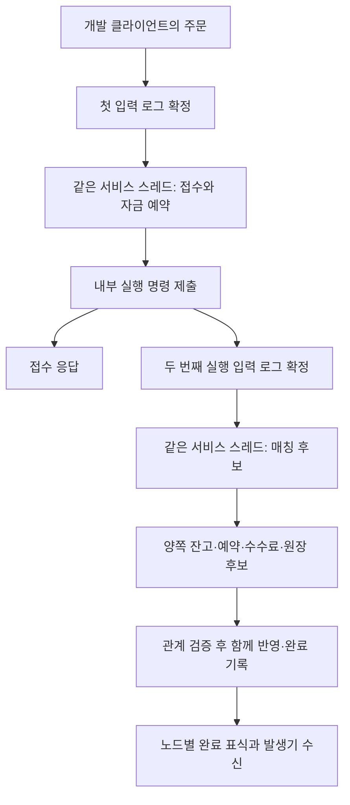
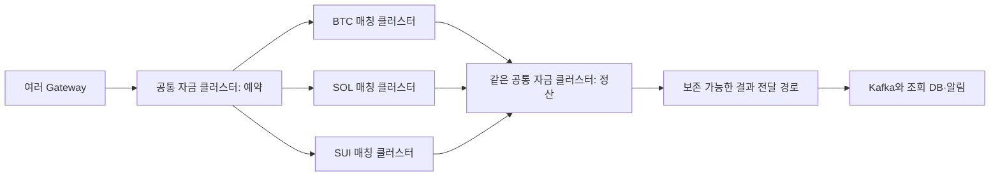

# 거래 클러스터 처리량 분석 — 2026-10-28

**현재 22k/s를 Aeron이나 단일 작성자의 본질적 상한이라고 결론 낼 근거는 없다.** 우리 구현에는 주문마다 반복하는 계산·할당, 오래 보관하는 후보 객체, 같은 서비스 스레드의 접수·실행·응답 업무가 있다. 기존 실행에서는 금융 코어 호출의 경과 시간만 약 20~25μs/주문이었다. 50k/s의 평균 처리 간격은 20μs, 100k/s는 10μs다. 전송 옵션만 바꿔 목표를 달성하겠다는 접근은 부족하다.

다른 거래소도 단일 스레드와 복제 로그를 사용한다. 차이는 그 스레드가 처리하는 일, 데이터 표현, 배치, 자원 격리, 성공 응답의 내구성 조건이다. 따라서 ‘다른 회사는 병렬이고 우리는 직렬이라서’라는 설명은 부정확하다. 반대로 비교 조건이 다르다는 이유로 우리 코드의 비용을 정상이라고 판단할 수도 없다.

이번 작업은 기존 결과·현재 코드·공식 자료를 읽은 분석이다. 새 빌드·부하·성능 측정·구현은 수행하지 않았다. 50k 또는 100k 달성을 주장하지 않는다.

## 1. 지금 숫자는 무엇을 센 것인가

| 항목 | 확인한 조건 |
|---|---|
| 선택된 기존 실행 | `cert-t1ma`, `cert-t1mb`, 고정 runtime `runtime-tps-window1m` |
| 업무 | 준비한 SELL을 대상으로 BTC/SOL/SUI BUY 12,000건 예열 후 90,000건 체결 |
| 경계 | HTTP/Gateway 제외. 첫 전송 출발부터 마지막 결과 수신까지 |
| 사본 | Docker JVM 3개, 같은 Mac의 Docker VM 8 CPU. 각 노드 2 CPU quota·2GiB 제한·Xmx1536MiB |
| 저장 | Archive/Catalog/Consensus sync=2, 로그 전송 창 1MiB, G1 |
| 발생기 | 두 세션, 속도 제한 없는 유한 burst. 세 노드 완료 표식 수신도 같은 발생기에서 처리 |
| 결과 | 세 사본 완료 수신 **22,862 / 22,027건/s**, 완료 관측 p99 **698 / 730ms** |

이는 HTTP TPS도, 발생기 제약을 완전히 배제한 지속 최대 처리량도 아니다. 실제 금융 완료 후의 표식 전송·수신 대기도 포함한다. 과거의 매칭 단독 JMH, 엔진 단독 80k 전후, HTTP 수치는 서로 다른 작업이다.

미완료 상한 대기 0회는 해당 상한이 병목이 아니었다는 근거다. 발생기 전체가 무제한으로 보낼 수 있다는 증명은 아니다. 클라이언트의 낮은 CPU도 Driver·전송 backpressure·수신 스케줄링의 제약까지 배제하지 않는다.

**소스와 측정 대상도 구분해야 한다.** 현재 작업 폴더에는 account 검증 후보와 claim/codec 후보가 함께 있고, staging build에는 baseline 금융 jar와 claim adapter가 들어 있다. 22k의 선택 runtime은 별도로 동결돼 있다. 이 세 대상을 모두 ‘현재 바이너리’라고 부르지 않는다. 금융 계산기는 선택 소스와 현재 소스가 같다.

실제 분석 폴더: `/Users/0chord/.codex/worktrees/issue148-http-aeron/exchange-core`  
브랜치: `test/http-trading-performance/142`  
원자료 루트: `/Users/0chord/.codex/visualizations/2026/09/23/01a0ce63-9327-7f32-a7e0-3429380284d8/issue142-performance/capacity-goal/direct-core-20261028/multi/execution-tail-20261028/request-correlation-20261028`  
주요 근거: `runtime-tps-window1m-manifest.json`, `runs/cert-t1m{a,b}/control/client-summary.json`, 각 노드의 `node*-metrics-{before,after}.json`.

## 2. 우리 코드에서 실제로 드는 비용

현재 흐름은 다음과 같다. 각 사본은 같은 입력 순서를 각자의 메모리에 적용한다.



접수 응답은 내부 실행 명령의 로컬 제출 뒤에 나가며, 두 번째 입력의 확정이나 정산 완료를 뜻하지 않는다. 두 로그 입력이 있다고 주문마다 fsync를 정확히 두 번 하는 것은 아니다. Archive는 여러 메시지가 들어 있는 기록 블록을 쓸 수 있다.

### 2.1 계산과 검증의 반복

신규 BUY가 SELL 하나와 같은 가격으로 전량 체결되는 현재 경로에서 예약 요구량 계산은 접수 1회와 양측 정산 전·후 각각 1회, 총 5회다. 실제 체결 수수료는 양쪽 각각 한 번, 총 2회다. 두 수를 혼동하면 안 된다. 부분 체결은 남은 수량과 수수료 나머지 검산이 추가된다.

`OrderSettlementCalculator.validateReservation`은 정산 전·후 예약을 검사할 때 최초 요구량도 다시 계산한다. 최초 주문·마켓·정책이 불변임을 보장한다면 최초 요구량을 보존해 재사용할 후보가 된다. 다만 현재 잔고, 남은 예약, 이미 소비한 권리, overflow 검사는 상태가 바뀌므로 계속 실행해야 한다.

근거: [예약 검증](/Users/0chord/.codex/worktrees/issue148-http-aeron/exchange-core/domain-trading/src/main/kotlin/com/exchange/core/trading/OrderSettlementCalculator.kt:326), [정산 연결](/Users/0chord/.codex/worktrees/issue148-http-aeron/exchange-core/domain-trading/src/main/kotlin/com/exchange/core/trading/TradingState.kt:170).

### 2.2 임시 객체뿐 아니라 계속 남는 객체

계산에는 참여자 집합·인덱스 Map·Slot·계정 문자열·해시 입력·후보 목록이 필요하다. 완료 뒤에도 `Completion`이 정산 후보 전체를 참조하므로 이전·이후 `Balance`와 `Reservation`, 양측 계획이 살아 있다. 접수 기록, 요청별 최초 결과, 원장 목록과 ID 집합도 증가한다. 이들은 임시 객체 최적화와 별개의 live-set 문제다.

동일 엔진 단독 ABBA의 baseline은 **약 9.6KB/주문 할당, caller CPU 약 8~9μs/주문**이었다. 이 할당률을 그대로 가정하면 노드당 50k에서 약 480MB/s, 100k에서 약 960MB/s다. 이는 규모를 설명하는 외삽이며 세 노드에서 직접 측정한 할당률은 아니다.

원장 posting list 공유는 이미 적용돼 있다. 또한 중복 방지·감사·복구에 필요한 기록을 임의 삭제하면 계약이 바뀐다. 다음 설계는 활성 상태와 완료 결과의 최소 표현, 감사 원본과 조회용 projection, 중복 기록의 보존·복구 경계를 구분해야 한다.

근거: [접수 상태 저장소](/Users/0chord/.codex/worktrees/issue148-http-aeron/exchange-core/domain-trading/src/main/kotlin/com/exchange/core/trading/OrderAdmissionState.kt:45), [완료 기록](/Users/0chord/.codex/worktrees/issue148-http-aeron/exchange-core/domain-trading/src/main/kotlin/com/exchange/core/trading/TradingState.kt:214), [원장 공유](/Users/0chord/.codex/worktrees/issue148-http-aeron/exchange-core/domain-ledger/src/main/kotlin/com/exchange/core/ledger/LedgerTransaction.kt:37).

### 2.3 같은 작성자에 부가 업무도 쌓임

선택 baseline의 주문당 경과 시간은 다음과 같다. 각 행은 각 노드의 측정 구간 누적 시간 차이/90,000이며, 순수 CPU 시간이 아니다. callback은 주문당 두 번이다.

| 실행 | 금융 코어 두 호출 합, 노드 0/1/2 | callback 전체, 노드 0/1/2 |
|---|---|---|
| t1ma | 20.53 / 21.47 / 19.98μs | 33.02 / 25.84 / 23.53μs |
| t1mb | 24.58 / 22.31 / 20.43μs | 29.73 / 26.55 / 31.50μs |

‘금융 코어’는 `admission_apply + execution_total`이다. callback 전체와 그 하위 항목을 더하면 중복 계산이다. 코덱·실행 명령 제출·접수 응답 등의 부가 업무도 작성자의 진행을 사용한다. 세 마켓 등록은 세 개의 작성자를 만들지 않는다.

### 2.4 GC·저장·스케줄링의 대기

기존 진단 JFR에는 서비스·Consensus·Driver 작업과 GC, FileForce가 함께 나타난다. 한 노드의 진단 구간에는 GC pause 14회·합계 약 892ms, FileForce 경과 시간 합계 약 3.44초가 있었다. 두 구간은 겹치고, FileForce 시간에는 스레드 선점도 포함될 수 있다. 이 값을 더하거나 전부 순수 디스크 지연으로 읽으면 잘못이다. 진단 실행의 처리량도 일반 baseline과 직접 비교하지 않는다.

확인할 수 있는 결론은 ‘금융 연산만 실행하는 CPU 루프’와 현재 실행이 다르다는 것이다. 디스크만, 발생기만, 코어만으로 22k 전체를 설명할 근거는 없다. burst가 처리 속도보다 빠르면 쌓인 대기가 p99에 포함된다. 수백 ms의 p99가 곧 한 주문의 계산이 수백 ms 걸린다는 뜻도 아니다.

## 3. 다른 곳은 무엇이 다른가

공개 자료는 대부분 기능·완료 경계·부하 분포·내구성 설정을 전부 공개하지 않는다. 다음은 확인한 사실과 비교 한계다.

| 사례 | 공개한 내용 | 우리와 구분할 점 |
|---|---|---|
| Coinbase INTX 엔지니어 발표 | 한 hot thread, 고정 형식, 사전 할당, off-heap map, 코어 고정·IRQ 분리. six-figure TPS spike와 고객 p99 <1ms를 설명 | 지속 처리량·금융 업무 범위·ACK 전 disk force 조건 미공개. 해당 발표만으로 Aeron 옵션을 대응할 수 없음 |
| LMAX 현재 공식 기술 페이지 | sustained 100k / peak 800k orders/s, 평균 internal exchange <85μs | risk 700k/s는 별도 수치. 2011의 6m/s business logic benchmark와도 다름 |
| Deribit Starbase Risk Bypass | 적격 MMP 주문은 margin을 미리 hold하고 exposure를 제한해 gateway→matching 직행 | 모든 주문에서 전체 리스크·자금 계산을 반복하는 경로가 아님. 현물 공유 잔고와 그대로 같은 계약은 아님 |
| TigerBeetle | 고정 구조·단일 쓰기·배치·WAL durable quorum. 공식 예제 약 454.5k logical tx/s = 약 909k transfers/s | 매칭 포함 수치가 아니며 해당 글의 복제·장비·p99 조건 미공개. 현재 CLI 기본 자동 시험은 1 replica |
| Formance 공식 staging 시험 | 3-node, 노드당 8 cores/4GiB, 50tx/HTTP bulk, 평균 106k tx/s, p99 약 72~74ms | overdraft 허용·bulk별 다른 계정 사용. 우리 공유 잔고 경쟁·예약→매칭→정산과 다른 부하 |

출처: [Coinbase 담당자 발표](https://www.infoq.com/presentations/exchange-systems-cloud/), [LMAX](https://www.lmax.com/technology/), [Deribit 업무 경로](https://docs.deribit.com/starbase/risk-bypass), [TigerBeetle 예제](https://tigerbeetle.com/blog/2026-09-17-performant-use-of-tigerbeetle/), [TigerBeetle CLI 기본값](https://github.com/tigerbeetle/tigerbeetle/blob/0450c32b2c3c3ab6114f3402cc601341cc8192aa/src/tigerbeetle/cli.zig#L138), [Formance 측정 명세](https://github.com/formancehq/ledger/blob/6c120c4ec8aedd900db690717400af28b5603340/docs/sales/benchmarks.md).

Coinbase가 실제 Aeron Cluster를 사용한다는 것은 [Aeron의 Coinbase 사례](https://aeron.io/case-studies/coinbase-cloudnative-crypto-exchange-aeron-cluster/)에 따로 명시돼 있다. 그 자료와 위 발표의 노드·저장 설정을 합쳐 동일한 구현이라고 단정하지 않는다. Binance·Upbit의 내부 자금·체결·disk-force 경계를 공개 근거 없이 추정하지 않는다.

특히 Aeron의 공개 수치도 업무를 확인해야 한다. 공식 benchmark 저장소 commit `6106c71a…`의 기본 Cluster service는 받은 바이트를 되돌려 주는 **Echo**이며, low-latency Archive 설정은 **sync=0**이다. 금융 계산이 없고 우리 sync=2와 다르다. 현재 기본 코드가 과거의 모든 발표 측정 설정을 증명하는 것은 아니다. [Echo 구현](https://github.com/aeron-io/benchmarks/blob/6106c71a97c82bc39ca3e3d89fcb7900543f62c1/benchmarks-aeron/src/main/java/io/aeron/benchmarks/aeron/EchoClusteredService.java), [Archive 설정](https://github.com/aeron-io/benchmarks/blob/6106c71a97c82bc39ca3e3d89fcb7900543f62c1/scripts/aeron/low-latency-archive.properties#L4).

TigerBeetle의 배치는 내구성 생략과 다르다. WAL durable quorum 뒤 commit하고 Linux에서 O_DSYNC를 사용한다. 배치의 의미는 여러 업무가 기록·복제 비용을 함께 지불하는 것이다. 우리 Archive도 이미 블록 단위 기록을 하므로 임의 sleep을 넣는 것과 구분한다. [WAL 설계](https://github.com/tigerbeetle/tigerbeetle/blob/0450c32b2c3c3ab6114f3402cc601341cc8192aa/docs/ARCHITECTURE.md#L34), [Linux 저장 설정](https://github.com/tigerbeetle/tigerbeetle/blob/0450c32b2c3c3ab6114f3402cc601341cc8192aa/src/io/linux.zig#L1450).

## 4. 목표에 맞는 구조와 비용 예산

50k/s는 한 작성자에 주문당 평균 20μs, 100k/s는 10μs를 허용한다. 부하 변동을 위해 70% 사용률을 가정하면 각각 14μs와 7μs다. 이 70%는 예산 제안이며 측정값이나 합의한 SLO가 아니다.

우리의 두 입력 계약을 유지하면 50k 주문/s는 최소 100k 입력/s, 100k 주문/s는 최소 200k 입력/s를 뜻한다. 이것을 fsync 횟수와 같다고 계산하면 안 된다. 여러 체결·정책·준비 입력 등은 별도다.

추천하는 최종 책임 분리는 다음과 같다. **제안이며 이번에 구현하거나 새 합의로 확정하지 않았다.**



예약과 정산 상자는 **같은 자금 상태 소유자**다. 서로 독립적인 잔고 사본을 만들어 쓰는 두 서비스가 아니다. 마켓 간 공유 USDT의 이중 사용을 막는 판단은 이 소유자에게 남는다. 여러 주문은 파이프라인으로 겹쳐 진행할 수 있지만 같은 주문의 예약→매칭→정산 순서는 유지한다.

마켓별 매칭이 병렬이 돼도 공통 자금 처리량이 자동으로 세 배가 되지는 않는다. 대략적인 제한은 `min(자금 엔진의 예약+정산 처리량, 각 마켓 및 합산 매칭 처리량, 전달·저장·수신 처리량)`이다. 현재 매칭 후보 구간만 약 1μs라는 이유로 matching 전체가 그만큼뿐이라고 계산해서도 안 된다.

클러스터를 나누면 추가 명령과 합의가 생긴다. 이점은 책임별 확장·격리이고 비용은 전달 지연과 중간 상태다. request/reservation/result/settlement ID, committed outbox와 재전송, 중복 반영 방지, `매칭 확정·정산 대기` 상태, 완료 공개 시점, 복구·대사 계약을 먼저 정해야 한다. timeout을 미처리로 단정해 돈을 풀면 안 된다. ClusteredService 내부에서 외부 I/O나 비결정적 비동기 계산을 시작하는 방식도 사용하지 않는다.

더 높은 단계의 선택지는 마켓별 자금 사용권을 사전 배분하는 것이다. 매 주문의 전역 자금 경유를 줄일 수 있지만 사용권 총합 보존, 재배분·회수, 유휴 자금 분산이라는 새 계약이 생긴다. Deribit의 사전 margin hold는 참고 사례이며 우리 현물 자금 계약에 바로 적용한 결정은 아니다.

## 5. 먼저 바꿔야 할 것과 확인 순서

| 순서 | 작은 작업 결과 | 완료 판단 |
|---|---|---|
| 1 | 선택 runtime과 후보 소스를 구분하고 하나의 비교 대상을 고정 | source/build/runtime hash와 금융 회귀 근거가 연결됨 |
| 2 | 불변 예약 요구량의 재계산과 계정·식별자 표현 비용을 각각 줄이는 후보 | 현재 상태 검증 유지. 같은 조건의 CPU·할당·TPS가 함께 좋아짐 |
| 3 | 완료 기록이 보관할 최소 상태와 감사·조회 이력의 경계 설계 | 중복 응답·원장 보존·재시작 replay에 필요한 사실을 잃지 않음 |
| 4 | 자금 예약→마켓 매칭→동일 자금 정산의 전달 계약 | 중복·응답 유실·재시작·정산 대기에서도 자금 사용권 보존 |
| 5 | 이 계약에 맞춘 독립 마켓 처리, 필요한 경우 bounded batch | ACK 내구성 유지. 분리·배치 전후의 실제 완료 처리량과 지연을 비교 |

읽기용 이력·인덱스는 authoritative state와 감사 로그 commit 뒤에 만들 수 있다. 하지만 authoritative 잔고·원장 사실·중복 결과를 ‘보고용’이라며 빼면 안 된다. [Formance의 책임 구분](https://github.com/formancehq/ledger/blob/6c120c4ec8aedd900db690717400af28b5603340/docs/technical/architecture/subsystems/indexer/indexer.md#L5)도 이 둘을 구분한다.

이미 실패한 조정은 개선으로 계산하지 않는다. 기존 account ABBA는 할당이 약 9.67→9.22KB로 줄었지만 TPS는 83.7k→74.5k 평균으로 낮아졌다. CPU 개선도 확인되지 않았고 GC 시작 상태가 달랐다. claim의 세 노드 22.3k는 baseline 범위와 겹친다. SHARED_NETWORK, 큰 초기 heap, Archive positive-work sleep도 개선을 입증하지 못했다. 이 후보들을 합친 현재 소스가 더 빠르다고 전제할 수 없다.

다음 실행이 승인될 때는 기존 측정기·JFR·메트릭을 재사용한다. 새 장기 시험이나 관측 플랫폼부터 만들지 않는다. 같은 바이너리·노드 역할·warmup·부하 분포로 짧게 교차 비교하고, 발생기가 목표보다 충분히 빠른지도 별도로 확인한다. 주문 수·체결 수·원장 건수, 접수 응답·금융 완료·세 사본 관측을 분리한다. 성공 완료율, 대기열의 증가 여부, p95/p99, CPU·할당·GC·저장 블록의 업무 수를 같이 본다.

현재 Mac의 Docker VM은 약 7.75GiB다. 자금+세 매칭 클러스터를 각각 3 JVM, 모두 Xmx1.5GiB로 구성하면 최대 heap 설정 합계만 18GiB다. heap 상한이 즉시 예약된 RAM은 아니지만, 현재 자원 설정 그대로 12개를 띄운 결과를 운영 처리량으로 판단해서는 안 된다. 운영에 가까운 Linux·CPU·저장 격리 조건과 로컬 기능 검증을 구분한다.

## 6. 확정한 판단과 남은 한계

- **확인:** 단일 작성자가 22k의 본질적 상한이라는 결론은 현재 근거로 성립하지 않는다. 우리 코어에는 반복 작업과 누적 live set이 있으며 현재 서비스 작성자에 부가 업무도 남는다.
- **확인:** 공개 고성능 숫자는 echo, 전송, 주문 입력, 매칭, 원장 transfer, batch 등 단위가 다르다. sync=2의 우리 전체 금융 완료와 같은 공개 비교 자료는 찾지 못했다.
- **판단:** 금융 코어의 실제 작업·데이터 표현을 줄이고 책임을 분리하는 쪽이 반복적인 전송 옵션 조정보다 우선이다. 이는 변경 방향이며 예상 배수는 미검증이다.
- **미검증:** 현재 환경의 지속 최대 TPS, 발생기의 독립 여유, 50k/100k의 내구성·지연 동시 달성, 원인별 정확한 CPU 비중.
- **미결정:** 분리 후 완료 공개 시점, 자금 사용권 사전 배분 여부, 중복·이력 보존 기간과 복구 계약. 기존 성공 응답·정합성 계약을 임의 완화하지 않는다.

이번에 끝낸 것은 원인 분석과 공개 사례 비교다. 구현·새 측정·성능 목표 달성은 별도 작업이다.


## 7. 후속 구현·짧은 대조 — 2026-10-28

이 절은 위의 읽기 전용 분석 이후 실제로 수정·검증한 결과다. 목표 50k/100k는 아직 미달이며, PR·커밋·병합은 하지 않았다. 비교 근거는 원자료 루트 아래 `goal-optimize-20261028`에 있다.

현재 작업 소스를 `source-before`로 고정하고 새로 빌드한 `runtime-before`를 기준으로 사용했다. 과거 선택 runtime의 22k를 이 기준선에 섞지 않았다. 각 후보는 소스 snapshot과 전체 실행 runtime의 SHA-256 manifest를 보존했다. 엔진은 Java25/G1/2CPU/Xms256MiB/Xmx768MiB, SELL 준비·20k BUY 예열 뒤 50k BUY 접수+실행을 네 개의 새 JVM에서 A-B-B-A 순서로 비교했다. 각 실행의 금융 oracle은 잔고·예약·원장·중복 실행·자금 부족을 확인했다.

아래 CPU·할당·TPS는 각 군 두 실행의 평균이고 p95/p99는 실행별 범위다. 백분위끼리 평균해 합산 분포의 백분위라고 부르지 않는다.

| 후보 | CPU μs/주문 전→후 | 할당 B/주문 전→후 | 엔진 완료 TPS 전→후 | 후보 p95 / p99 μs | 정합성·판정 |
|---|---:|---:|---:|---|---|
| 검증된 불변 원장 복제와 bounded 분개 캐시 | 8.50→8.02 | 9,297→8,276 | 76,790→79,780 | 12.03–12.80 / 16.38–17.41 | 관련 회귀544건·금융 oracle 통과. 세 노드 개선은 미입증이라 기각 |
| SHA-256 입력 버퍼 재사용 | 9.07→9.00 | 9,286→9,117 | 73,303→69,769 | 13.31 / 20.48–40.96 | 회귀262건·oracle 통과. CPU 개선 불명확·TPS/p99 악화로 기각 |
| 계정 원문의 직접 동등 비교 | 8.93→8.32 | 9,219→9,579 | 73,810→85,884 | 11.26–11.52 / 15.36–15.62 | 거래 회귀203건·oracle 통과. 단순한 동일 의미 비교로 채택 |
| Record 완료 위치와 완료순 목록 | 8.33→10.23 | 9,659→9,641 | 85,269→66,956 | 16.13–18.43 / 19.97–22.02 | 도메인205·어댑터45건 통과했으나 성능 후퇴. 내부 손상 차단 P2도 확인해 후보 전체 제거 |

SHA 입력 후보의 첫 시험은 별도 JFR 읽기와 겹칠 가능성을 확인해 판정에서 제외했다. 위 표는 간섭 작업 종료 뒤의 재대조다. 실패한 후보의 파일은 비교 전 snapshot과 해시 대조 후 그 후보가 바꾼 파일만 복원했다. 기존 미커밋 변경 전체를 reset하지 않았다.

**채택한 계정 비교**는 계정 문자열의 길이·여러 구간을 직접 순회하던 helper를 `USER:{user}:{asset}:AVAILABLE/HOLD`의 정확한 문자열 비교로 단순화했다. 사용자·자산·방향·금액·정책·원본 손상 검증은 유지했다. 할당은 증가했으므로 메모리 최적화라고 하지 않는다. 측정 시작 heap과 GC 발생 시점도 달라, TPS 차이 전체를 문자열 비교 CPU 절약으로 환산하지 않는다. 독립 컨텍스트의 고정 snapshot 정적 리뷰에서 확인된 결함은 없었다.

세 노드 비교는 동일한 sync=2·BTC/SOL/SUI·90k BUY·12k 예열·2세션·노드별2CPU/2GiB/G1 조건이다. 리더는 자동 선출되며 실제 역할을 남긴다.

| 실행 | 리더 | 접수 응답 TPS | 접수 p95 / p99 ms | 세 사본 완료 수신 TPS | 완료 수신 p95 / p99 ms |
|---|---:|---:|---:|---:|---:|
| 기준선 base3 | 0 | 19,821 | 679 / 741 | 18,720 | 987 / 1,086 |
| 계정 비교 equals0 | 0 | 20,779 | 660 / 705 | 19,817 | 937 / 1,068 |
| 계정 비교 equals1 | 1 | 24,859 | 521 / 553 | 24,496 | 680 / 752 |
| 기준선 base4 | 2 | 20,231 | 581 / 864 | 19,553 | 999 / 1,090 |

모두 신규 주문90k 승인, 준비·예열 포함612k개의 고유 완료 표식과 ID/승인순번/log position 대조를 통과했다. 세 사본 완료 수신은 금융 완료 뒤의 전송·관측 지연을 포함한다. 이 유한 burst 배출율을 지속 최대 TPS·HTTP TPS·순수 금융 계산 지연으로 읽지 않는다. timing cohort의 전체 금융 dump 대사는 실행하지 않았으며, 도메인 oracle/회귀와 구분한다. 최고24.5k로 50k 달성을 주장하지 않는다. 리더와 GC 시작 상태 차이가 있어 통계적으로 고정된 개선 배수를 주장하지 않는다.

분개 캐시의 세 노드 실행은 기준선14.8k/18.7k, 후보18.8k/14.4k로 겹쳐 개선으로 채택하지 않았다. 단독 할당 감소만으로 유지하지 않는다. 새 완료 위치의 P2는 목록만 손상됐을 때 차단을 우회하거나 다른 원본의 완료를 반환할 수 있는 내부 손상 주입 반례다. 그 경로와 변경한 테스트를 함께 제거하여 기존 완료 Map 계약으로 돌아갔다.

기존 `cert-tpr2` JFR의 서비스 표본1085개에서는 domain-trading454개·matching160개였고 두 영역의 Map 조회·등록·확장 표본은308개였다. Map resize42개 중 완료 등록18개였다. BigInteger 호출은 관측되지 않았다. 표본을 정확한 CPU 시간 비율로 읽거나 예전 프로파일을 현재 실행에 그대로 대입하지 않는다. 최근 네 런에서 리더 reply 90k건은 추가 시도가 없었고, execution offer의 누적 경과도 약61–85ms였다. 이 기록으로 재시도 예산이 주원인이라고 판단하지 않는다.

종료한 실행의 컨테이너·네트워크·볼륨·이미지는 실행 도구가 정리했다. 큰 종료 원자료는 gzip 후 복원 SHA-256을 확인해 원본을 대체했고, 요약·설정·manifest·필요한 증거는 보존했다. 다른 작업의 Docker 자원·사용자 파일은 삭제하지 않았다.

추가로 `OrderBook`의 위치 인덱스 대신 동일 `BookOrder` 참조를 저장하고, 후보 FIFO 원본 대조와 검증 뒤 반영에서만 단일 인덱스 조회를 사용하는 후보도 시험했다. 일반 find·취소의 가격 레벨 재조회는 유지했다. 매칭152·거래203·어댑터45건이 통과했고 독립 정적 리뷰에서 정상 API 회귀는 확인되지 않았다. 그러나 엔진 단독 A-B-B-A의 CPU는8.78→9.18μs, 할당9,643→9,632B, 완료82,319→72,606TPS였다. 후보 p95는13.06–13.82μs, p99는16.90–18.94μs였으며 기준 p95는13.31–13.57μs, p99는16.38–17.41μs였다. 초기 heap 약202→338MB와 GC 단계도 바뀌어, 정적 조회 감소를 실제 성능 향상으로 취급하지 않았다. 후보 네 파일을 복원했고 후퇴한 후보로 세 노드 시험을 추가하지 않았다. 현재 제품 변경은 위의 계정 비교 단순화만 유지한다.


## 8. 추가 후보 구현·기각 — 2026-10-28~29

이번 회차도 HTTP/Gateway를 제외했다. 아래 네 후보를 **각각 따로 구현하고**, 관련 회귀·고정 snapshot의 독립 정적 리뷰·엔진 A-B-B-A를 수행했다. 모두 확인된 정적 결함은 없었지만 **처리량 개선 근거가 부족하거나 후퇴하여 채택하지 않았다.** 후보 파일만 SHA-256으로 대조해 복원했다. 현재 선택 제품 코드는 7절의 계정 원문 비교이며, 목표 50k/100k는 미달이다.

기본 엔진 조건은 기존과 동일한 Java25/G1/2CPU/Xms256MiB/Xmx768MiB, 20k BUY 예열, 50k BUY 접수+실행이다. 숫자는 군별 두 실행 평균이며 지연은 실행별 범위다. 전체 금융 oracle은 각 실행에서 통과했다. 이 측정은 바깥 호출자의 입력 생성·시계·히스토그램·heap 점검도 포함하며 순수 금융 함수의 CPU만 뜻하지 않는다.

| 후보 | CPU μs/주문 전→후 | 할당 B/주문 전→후 | 엔진 완료 TPS 전→후 | 후보 p95 / p99 μs | 검증·판정 |
|---|---:|---:|---:|---|---|
| 예약 요구량 전체 입력을 대조하는 8칸 순수 계산 재사용 | 9.09→8.59 | 9,753→9,564 | 79,325→76,588 | 11.52–12.03 / 15.87–17.41 | 주문82·거래203건 통과. CPU·할당 감소에도 처리량 후퇴로 기각 |
| 예약 검증의 사용자·자산별 계정 이름 8쌍 재사용 | 8.50→8.39 | 9,657→9,276 | 84,797→77,972 | 11.78–12.03 / 15.62–16.13 | 주문78·거래203건 통과. CPU 차이 불명확·처리량 후퇴로 기각 |
| 정산 후보의 목록 복사+래퍼를 JDK 불변 목록으로 교체 | 8.88→8.59 | 9,739→9,538 | 82,193→77,003 | 11.52–13.06 / 15.36–18.43 | 거래204건 통과. 보관 heap 감소만으로 채택하지 않음 |
| 관측 inline 함수의 업무 본문을 한 곳으로 합침 | 8.59→8.82 | 9,560→9,677 | 84,114→82,936 | 13.31–13.82 / 17.41 | 거래204건 통과. CPU·TPS·지연 후퇴로 기각 |

첫 세 후보는 초기 heap과 GC 단계도 달랐다. 기준선의 측정 GC는 주로3회·157–176ms, 후보는4회·217–224ms였으며 초기 heap도 약200MB대와330MB대로 갈렸다. 따라서 차이 전체를 연산 자체의 후퇴로 단정하지 않지만, 할당 감소나 p95 한 값만 보고 처리량 개선이라고 채택하지 않았다. 같은 시험을 무작정 반복하지 않았다.

불변 목록 후보에 한해 **별도 조건의 대조**도 했다. 양쪽을 노드와 같은 Xmx1536MiB로 맞추고 같은 도구에서 100k 주문을 비교했다. 기준82,990/106,803TPS, 후보102,318/112,090TPS였고 CPU 평균7.06→6.58μs, 할당9,337→9,275B였다. 기준 p95 10.24–11.52μs·p99 13.06–14.85μs, 후보 p95 9.73–12.54μs·p99 12.54–16.38μs였다. post-GC 보관 heap은 537.3→517.3MB로 약3.7% 감소했고, 기본 50k 조건에서도 320.8→308.9MB로 감소했다. 그러나 기본 조건의 TPS 후퇴와 실행 편차를 지우거나 이 엔진 단독 수치를 클러스터 100k 달성으로 읽지 않는다.

아래는 불변 목록 후보만 진행한 실제 세 노드·sync2·BTC/SOL/SUI·90k BUY·12k 예열·2세션 비교다. 각 노드 2CPU/2GiB/G1/Xmx1536MiB, 기존 동일 CPU affinity와 발생기 설정을 사용했다. 리더는 자동 선출됐다.

| 순서·버전 | 리더 | 접수 응답 TPS | 접수 p95 / p99 ms | 세 사본 완료 수신 TPS | 완료 수신 p95 / p99 ms |
|---|---:|---:|---:|---:|---:|
| A0 기준 | 2 | 16,054 | 1,470 / 1,497 | 15,153 | 1,898 / 1,984 |
| B1 목록 후보 | 0 | 17,030 | 1,487 / 1,752 | 16,720 | 1,936 / 2,119 |
| B2 목록 후보 | 0 | 25,018 | 519 / 549 | 23,954 | 694 / 727 |
| A3 기준 | 1 | 23,330 | 526 / 569 | 22,964 | 698 / 743 |

모든 실행에서 90k 접수 승인, 준비·예열 포함612k 고유 완료 표식, ID·승인 순번·log position 대조와 실행 runtime 불변성을 확인했다. 오류·누락은 없었다. **timing cohort의 전체 금융 dump 대사는 실행하지 않았다.** 세 사본 완료 수신은 금융 적용 뒤 전송·수신 시간을 포함하며 지속 최대 TPS가 아니다.

앞의 A0/B1은 노드별 측정 GC 누적750–1,610ms, 뒤의 B2/A3는551–732ms였다. 같은 후보 B1/B2도 처리량 차이가 커, 후보의 약6.7% 평균 차이를 인과적 개선 배수로 주장하지 않는다. 발생기 pending 상한은32768이고 각 owner의 상한 대기 반복은0이었으나, backpressure는 owner별 약12.7k–16.6k회 관측됐다. 상한 미도달만으로 발생기 한계를 배제하지 않는다. 실행 후 host의 압축 메모리는 약7.1GB였으며 누적 vm_stat만으로 어느 측정 구간의 압축·스왑 원인까지 확정하지 않는다.

inline 후보의 바이트코드는 executePending 2082→1799바이트, 주요 업무 호출 지점2→1로 줄었다. 이전 두 지점은 서로 다른 분기였으며 업무가 런타임에 두 번 실행됐다는 뜻이 아니다. 코드 크기 감소를 JIT·CPU 개선으로 확대하지 않았다. 추가 회귀는 MATCHING_CANDIDATE/APPLY/COMPLETION 성공 뒤 관측 Error가 발생해도 원본 오류를 전달하고 정상 입구를 차단하는 경계를 검사했다.

네 후보의 독립 리뷰는 각각 작성 대화를 상속하지 않은 fork-none 에이전트가 고정 snapshot을 정적으로 대조했다. 리뷰 통과는 실행 성능이나 전체 목표 달성을 뜻하지 않는다. 소스·실행 jar manifest, 금융 oracle, 회귀 XML, 모든 대조 값과 기각 이유는 근거 루트의 goal-optimize-20261028 아래에 보존했다. source-reservation-memo / source-account-name-reuse / source-immutable-settlement-lists / source-single-action은 모두 미채택 snapshot이다.

이번 세 노드 네 실행의 컨테이너·네트워크·볼륨·이미지는 종료 후 정리했다. 큰 종료 원자료는 gzip 복원 SHA를 확인해 대체하여 총1,166,311,047B를 절감했다. 사용자 파일·다른 작업 자원은 삭제하지 않았다.

다음 개선은 이미 기각한 재사용 캐시나 표현 교체를 반복하지 않고 실제 Map 조회·쓰기와 금융 상태 보관 비용에 근거해야 한다. 기존 marker history의 ArrayList 확장도 서비스 스레드의 실제 복사 비용이지만, 현재 cohort에 대략 한 번의 resize이므로 이를50k 미달의 주원인으로 단정하지 않는다. marker 인코딩·전송은 별도 sender 스레드에서 수행되며, 기존23개의 관측 호출 표본은 도메인 phase observer 표본이지 외부 marker 인코딩 표본이 아니다.

## 9. 조회 인덱스 후보와 초기 heap 진단 — 2026-10-29

정산 입력의 두 조회 전용 LinkedHashMap을 입력 크기로 미리 할당한 HashMap으로 교체했다. 체결·예약·잔고 출력 순서는 기존의 별도 순서 목록을 따르며, 해시 충돌·역순 입력 회귀와 고정 snapshot 독립 정적 리뷰를 통과했다. 거래204건이 통과했지만 기본 엔진 A-B-B-A에서는 CPU8.60→9.12μs, 할당9,596→9,396B, 완료84,135→73,215TPS로 처리량 이득을 입증하지 못했다. 해당 제품·테스트 두 파일만 snapshot 해시 확인 뒤 복원했다.

반복 비교에서 측정 시작 heap이 약208MB와330MB로 갈리는 문제는 기존 엔진 도구에 선택적 `--pre-gc` 진단 하나를 추가해 확인했다. 기본값은 false이며 준비·예열 성공 뒤, JFR과 모든 측정 카운터 시작 전에만 GC를 요청한다. 실제 collection count 증가 여부와 전후 heap을 기록하며, 측정 중 GC는 계속 포함한다. 상태를 삭제하거나 초기화하지 않는다. 별도 PRE_GC_DIAGNOSTIC 실행으로 표시하고 일반 기준선·지속 최대 처리량과 구분한다. 도구 회귀26건과 독립 정적 리뷰를 통과했다.

양쪽에 동일한 새 도구·사전 GC를 사용한 진단 대조에서는 시작 heap이188.14–188.22MB로 맞춰졌다. 기준88,465/77,893TPS, 후보77,096/82,237TPS였으며 CPU 평균8.62→8.57μs, 할당9,707→9,555B였다. p95/p99 범위는 기준11.52–14.08/14.85–17.41μs, 후보12.80–15.10/16.38–18.43μs였다. 시작 live heap을 맞춰도 처리량 개선은 확인되지 않아 후보를 채택하지 않았다. 금융 oracle은 모든 실행에서 통과했다. 사전 GC의 시간은 진단 경계 밖이며, 이를 운영 성능에서 비용이 사라진 것으로 해석하지 않는다.

근거는 기존 goal-optimize-20261028의 engine-lookup-index-abba / engine-pregc-lookup-index-abba, lookup-index-comparison-rejected.json과 source/runtime manifest다. 이 후보로 세 노드 시험을 추가하지 않았다. 목표50k/100k는 여전히 미달이다.

승인 Record와 현재 예약을 하나의 private Entry Map에 합치는 후보도 별도로 구현했다. 최초 Record·순번 인덱스·대기 큐는 유지하고 maker 조회 두 번을 한 번으로 줄였다. 현재 예약만 누락하는 실패 주입, 과거 snapshot 불변성, 접수 순서 검증을 보강했다. 거래204·어댑터/측정기71건이 통과했고 fork-none 고정 snapshot 정적 리뷰에서 결함은 확인되지 않았다. 그러나 엔진 A-B-B-A는 CPU9.044→9.071μs, 할당9,960→9,830B, 완료81,056→81,396TPS였다. 기준 p95/p99는14.34–15.10/17.92μs, 후보는13.06–16.38/15.62–19.97μs로 겹쳤다. post-GC 보관 heap은320.7→316.5MB로 줄었지만 CPU·처리량 개선 근거가 없어 후보의 다섯 파일만 해시 대조 후 복원했다. source-admission-entry/runtime-admission-entry와 engine-admission-entry-abba 및 회귀 XML을 보존했다. 세 노드 시험은 추가하지 않았다.

완료 보관 그래프 감사에서는 Completion이 후보를 깊게 복사하지 않고 현재 상태·원장과 객체를 공유함을 확인했다. 서로 다른 체결 시점의 이전/이후 잔고·예약은 공개 과거 결과와 감사 출력에 쓰인다. 중복 참조를 중복 객체로 계산하거나 과거 상태를 현재 값으로 대체하지 않았다. 전체 과거 후보 제거·외부 이관·지연 재구성은 공개 조회/보존 계약과 CPU 비용이 달라지는 설계라 이번 최적화에 섞지 않는다.

정산 호출 내부에서 최초 요구량을 재사용하는 후보도 별도로 구현했다. 단일 전량 체결의 요구량 계산은 접수 포함5→3회로 줄이고, 갱신 예약의 고정 필드 전체를 이전 예약과 대조한 뒤 현재 금액·잔량·수수료 나머지는 계속 검산했다. 다중 체결의 순서 보존 키 집합은 같은 순서의 요구량 Map으로 바꿨으며 호출 밖 캐시는 만들지 않았다. 동일 maker 연속 체결의 양쪽 수수료 나머지와 갱신 결과 손상 회귀를 포함한 거래205건·독립 정적 리뷰가 통과했다. 그러나 엔진 A-B-B-A에서 CPU8.91→9.39μs, 할당10,021→10,113B, 완료82,200→79,593TPS였다. 기준 p95/p99는12.80–15.10/16.13–18.43μs, 후보는13.57–14.85/17.41–19.97μs였다. 측정 GC도 기준163ms/163ms, 후보161ms/155ms로 처리량 악화를 GC 증가로 설명할 근거가 없었다. 수식 호출 수 감소가 전체 CPU·할당 감소를 뜻하지 않았다. 후보 두 파일만 복원했고 source-local-requirements/runtime-local-requirements, 회귀 XML과 engine-local-requirements-abba를 보존했다. 세 노드 시험은 추가하지 않았다.

## 10. ID 입력 배열 직접 작성 후보 — 2026-10-29

기존 RESERVE/SETTLEMENT v1의 해시 입력을 최종 ByteArray에 직접 작성해 중간 ByteBuffer와 SETTLEMENT 접두사 임시 배열을 제거했다. 입력 버퍼 재사용이나 캐시를 추가하지 않았다. UTF-8 길이 구간·STL1 접두사·양수 Long의 big-endian·SHA-256·hex/Base64url은 동일하다. 64개 다국어/이모지의 192/256바이트 길이와 서로 다른 상·하위32비트 순번을 기존 DataOutputStream 기준 검사에 추가했다. 거래203건이 통과했고 fork-none 독립 정적 리뷰에서 확인된 결함은 없었다.

새 JVM 네 개의 기존 20k 예열·50k 주문·G1/2CPU/Xms256/Xmx768MiB 대조는 아래와 같다. CPU·할당·TPS는 군별 평균, 지연은 후보 두 실행의 범위이며 운영 최대치가 아니다. 모든 실행의 최종 금융 oracle이 통과했다.

| 변경 내용 | CPU μs/주문 전→후 | 할당 B/주문 전→후 | 엔진 완료 TPS 전→후 | 후보 p95 μs | 후보 p99 μs | 정합성 결과 | 판정 |
|---|---:|---:|---:|---:|---:|---|---|
| 조회용 Map 사전 크기·HashMap | 8.60→9.12 | 9,596→9,396 | 84,135→73,215 | 11.78–16.38 | 16.38–19.46 | 회귀·oracle 통과 | 기각·복원 |
| 원본·현재 예약 Entry Map | 9.04→9.07 | 9,960→9,830 | 81,056→81,396 | 13.06–16.38 | 15.62–19.97 | 회귀·oracle 통과 | 개선 미입증·복원 |
| 호출 내부 최초 요구량 재사용 | 8.91→9.39 | 10,021→10,113 | 82,200→79,593 | 13.57–14.85 | 17.41–19.97 | 회귀·oracle 통과 | 기각·복원 |
| ID 입력 배열 직접 작성 | 9.34→8.71 | 10,072→9,812 | 78,655→82,979 | 14.85–15.36 | 17.92–19.46 | 회귀·oracle 통과 | 채택 |

ID 후보의 엔진 근거는 source-direct-id-bytes/runtime-direct-id-bytes와 engine-direct-id-bytes-abba다. 양쪽 전체 실행 runtime의 차이는 domain-trading jar 하나뿐이다. 선택적 pre-GC는 이 일반 대조에서 사용하지 않았다.

첫 세 노드 기준선은 SELL 준비 뒤 node0의 관측 송신 publication이 연결되지 않아 client-ready 기한을 넘겼다. 종료 근거상 node0은102,000건 중 송신0·큐 초과93,803, node1/2는 각각102,000건 전송이었다. 이 실행은 성능 비교에서 제외했다. 원문에 publication 음수 코드와 실제 상대 주소가 없어 정확한 연결 실패 원인은 미확정이다. 같은 원래 실행기의 작은 연결 smoke는 성공했고 DNS도 client와 고유 컨테이너 이름이 동일한 주소를 가리켰다. 고유 endpoint로 바꾸려던 외부 실행기 초안은 생성자 제약에 의해 기동 전에 거절되어 사용하지 않았다. 본 대조는 원래 실행기와 네트워크 설정을 유지한다.

원래 실행기의 세 노드·sync2·BTC/SOL/SUI·90k BUY·12k 예열·2세션·노드별2CPU/2GiB/G1/Xmx1536MiB 교차 대조 결과는 아래와 같다. CPU affinity와 입력은 기존 조건을 유지했다. 시작 리더는1/1/2/0으로 달라 동일 리더의 엄밀한 인과 비교라고 부르지 않는다. 설정의 JSON 원문 필드 순서와 SHA는 실행별로 달랐지만 파싱한 마켓·정책 값은 전부 같음을 대조했다. 초기 설정 조회는 측정 밖이다.

| 실행 | 시작 리더 | 접수 응답 TPS | 접수 p95 / p99 ms | 리더 완료 알림 수신 TPS | 리더 완료 알림 p95 / p99 ms | 세 사본 완료 수신 TPS | 세 사본 p95 / p99 ms |
|---|---:|---:|---:|---:|---:|---:|---:|
| A0 기준 | 1 | 22,581 | 539 / 564 | 21,157 | 705 / 728 | 21,157 | 779 / 827 |
| B1 ID 후보 | 1 | 23,497 | 556 / 595 | 23,204 | 691 / 709 | 22,756 | 711 / 729 |
| B2 ID 후보 | 2 | 26,729 | 469 / 488 | 25,719 | 605 / 642 | 25,021 | 624 / 647 |
| A3 기준 | 0 | 21,523 | 649 / 744 | 21,156 | 855 / 881 | 21,156 | 868 / 885 |

엔진 CPU·할당·처리량과 두 후보 실행의 클러스터 완료 수신 처리량이 모두 개선되어 ID 바이트 작성은 채택한다. 평균 세 사본 수신 처리량은 약21.16k→23.89k였지만 약12.9% 전체를 코드 하나의 고정된 개선 배수로 주장하지 않는다. 기준 측정 GC는 노드별704–782ms, 후보는634–807ms였으며 시작 리더도 달랐다. 같은 리더1의 A0/B1에서도 처리량은 개선됐지만 접수 p99는564→595ms로 나빠졌음을 함께 남긴다. 모든 지연이 일괄 개선됐다고 표현하지 않는다.

모두90k 신규 BUY 승인과 준비·예열 포함612k 고유 완료 표식의 ID·승인순번·log position 대조, 실행 runtime 불변성 검사를 통과했다. 전체 금융 dump 대사는 timing cohort에서 수행하지 않았다. 거래203건, 어댑터/엔진 측정기71건과 각 엔진 실행의 금융 oracle은 별도의 정합성 근거다. 완료 알림은 금융 반영 뒤 전송·수신 시점이며 순수 금융 함수의 시간과 구분한다. 현재 값은 유한 무제한 전송 묶음의 배출율이며 **지속 최대 TPS나 목표50k/100k 달성이 아니다.**

발생기의 pending 상한 대기 반복은 네 실행 모두0이었고 backpressure는 합계24,477–27,371회였다. 상한 미도달만으로 발생기를 배제하지 않는다. 기존 노드 timer의 측정 전후 delta는 실행당 admission_apply/execution_total 각90k건을 확인했다. 리더 execution_total 경과 평균은 기준19.75/21.35μs, 후보17.29/18.46μs였지만 GC·선점을 포함한다. 이를 순수 CPU나 단계별 비용의 정확한 인과 분해로 사용하지 않았다. 다음 후보는 실제 결과 등록의 불변 이벤트 목록 재복사처럼 검증된 동일 데이터를 다시 만드는 경로를 우선 검토하되, 이번 채택 변경과 분리해 대조한다.

근거는 direct-id-bytes-cluster-abba2-summary.json, direct-id-bytes-cluster-comparison.json, direct-id-bytes-cluster-metric-deltas.json과 각 실행의 command/source/runtime manifest다. 종료된 네 실행의 원자료는 gzip 복원 SHA 대조 후 대체해1,162,170,911B를 절감했다. 최초 무효 실행의 종료 원문도 같은 검증 후62,201,172B를 절감했다. 실험 소유 컨테이너·볼륨·이미지는 정리했고 PR·커밋·병합은 하지 않았다.

## 11. 검증된 매칭 목록 공유 후보와 발생기 경계 — 2026-10-29

매칭 후보가 보유한 불변 이벤트 목록을 완료 등록에서 다시 복사하지 않는 typed 내부 경로를 별도로 구현했다. 일반 List 입력의 방어적 복사와 전체 결과 검증은 유지했다. 매칭153·거래203건은 통과했지만, 같은 엔진 A-B-B-A에서 CPU8.827→8.763μs, 할당9,990→9,939B, 완료82,002→82,471TPS로 약0.6% 차이는 실행 편차와 겹쳤다. 기준 p95/p99는13.31–14.34/16.90–20.99μs, 후보는12.29–14.34/15.36–17.92μs였다. 모든 실행의 금융 oracle이 통과했다.

fork-none 고정 snapshot 독립 리뷰에서는 typed 경로가 빈 후보를 기존 command ID로 재등록할 때, 기존 CONTENT_CONFLICT 대신 INVALID_RESULT를 먼저 반환하는 P2 회귀를 확인했다. 코드 경로로 확인한 지적이며 별도 실행 재현이라고 쓰지 않는다. 성능 이득도 입증되지 않아 새 경로 세 제품 파일과 추가 테스트를 모두 제거했고, 선택된 ID 개선 snapshot과 해시가 같음을 확인했다. 따라서 이 후보는 채택하지 않았고 세 노드 시험도 추가하지 않았다. 근거는 source-shared-plan-events, shared-plan-events-regression-summary.json, engine-shared-plan-events-abba-summary.json, shared-plan-events-independent-review.json과 shared-plan-events-comparison-rejected.json이다.

발생기 감사에서는 측정 입력에 고정 초당 전송 제한은 없지만, 각 owner가 ACK poll 뒤 전송 실패 시 무조건 idle(0)을 호출함을 확인했다. 기존 ID 대조의 마지막 양수 offer까지는3.11–3.72초, owner CPU 합계는0.48–0.57초였고 backpressure는24,477–27,371회였다. firstOffer→positiveOffer 시간에는 ACK poll·대기·스케줄링·GC도 들어가므로 전부 코어 대기라고 해석하지 않는다. pending 상한 미도달이나 낮은 평균 CPU만으로 발생기를 배제할 수 없다.

이에 제품 코드는 선택된 ID runtime으로 고정하고, 같은 반복에서 poll이 진행한 일 수를 backpressure/ADMIN_ACTION의 idle에 전달하는 발생기 후보를 분리했다. Agrona는 양수 work이면 대기 대신 backoff를 reset한다. 입력·양수 offer·ACK·완료 ID 대조·timeout·측정 경계는 바꾸지 않았다. runtime 차이는 DirectWarmMeasure와 그 Owner 두 클래스뿐이며 고정 manifest와 fork-none 독립 정적 리뷰로 확인했다. 엔진 단독 측정기는 이 발생기 경로를 실행하지 않으므로 제품 엔진 개선으로 주장하지 않는다. 실제 영향은 별도의 세 노드 교차 대조로 판단한다.

같은90k 주문·12k 예열·세 노드·sync2·BTC/SOL/SUI·2세션·기존 CPU/heap/GC/affinity의 A-B-B-A 결과는 아래와 같다. 기준과 후보 모두 동일한 선택된 ID 제품 코드를 실행한다.

| 실행·발생기 | 시작 리더 | 접수 응답 TPS | 접수 p95 / p99 ms | 세 사본 완료 수신 TPS | 완료 수신 p95 / p99 ms | backpressure 횟수 |
|---|---:|---:|---:|---:|---:|---:|
| A0 기존 | 0 | 22,389 | 570 / 629 | 21,596 | 762 / 792 | 25,578 |
| B1 poll work 반영 | 2 | 21,539 | 694 / 799 | 20,870 | 883 / 981 | 46,888 |
| B2 poll work 반영 | 0 | 24,302 | 514 / 534 | 23,453 | 726 / 795 | 43,737 |
| A3 기존 | 0 | 24,144 | 650 / 700 | 22,862 | 850 / 904 | 25,529 |

기준→후보 평균은 접수23,266→22,921TPS, 세 사본 완료 수신22,229→22,161TPS, 마지막 양수 offer까지의 공급률25,401→25,142건/s였다. owner CPU 합계는0.509→0.520초, backpressure는25,554→45,313회였다. 진행한 ACK를 idle에 반영해도 재시도만 늘고 처리량 개선은 확인하지 못해 **발생기 후보를 선택하지 않는다.** 시작 역할과 GC도 달라 차이 전체를 코드의 인과 효과로 단정하지 않는다. 양수 offer 속도 역시 backpressure를 포함하므로 이 숫자로 발생기 자체의 최대 능력이나 코어 한계를 확정하지 않는다.

네 실행 모두90k 승인, 오류0, 준비·예열 포함612k 고유 완료 표식의 요청/주문 ID·순번·log position·체결/정산 건수 대조와 runtime 불변성을 통과했다. 전체 금융 dump 대사는 timing cohort에서 하지 않았다. 유한 묶음 완료 알림 수신 처리량이며 지속 최대 TPS가 아니다. 종료 원자료는 gzip 복원 SHA 대조 뒤 대체해1,160,836,909B를 절감했다. 근거는 generator-pollwork-cluster-abba-summary.json, generator-pollwork-comparison-rejected.json과 각 실행 manifest·compression 기록이다.

## 12. 입력 헤더 Reader 재사용 후보 — 2026-10-29

Adapter가 kind를 확인하려고 만든 AdmissionMessageReader를 Admission/Execution/Funding codec 내부 경로에 전달해 헤더 해석 두 번을 한 번으로 줄였다. 프레임별 독립 ByteArray 복사·종류·스키마·버전·길이·Protobuf unknown/required/value 검증은 유지한다. 공개 byte decode도 같은 Reader를 생성해 검증한다. 내부 정상 헤더에 잘린 varint 본문08 80을 넣어 노드 중단·malformed0·응답 없음도 기존 통합 테스트에 추가했다.

매칭148·거래203·코덱/어댑터/엔진 도구114건과 app-api ktlintCheck가 통과했다. 최초 묶음 명령은 --tests 옵션이 마지막 task에만 적용되어 app-api 전체 기동 시험까지 시작됐으므로, 해당 실행은 중단(exit130)하고 app-api의 일곱 클래스만 명시해17초에 다시 통과했다. 중단한 전체 실행을 통과 근거로 쓰지 않는다. 최종 source-codec-reader-reuse snapshot의 독립 정적 재리뷰에서는 확인된 결함이 없었다.

runtime의 모든 domain jar, 엔진 도구 class와 외부 발생기는 기준선과 바이트 단위로 같다. Reader 관련 제품 class 여섯 개와 관련 테스트 class만 다르며 source/runtime manifest에 고정했다. 엔진 단독 경로는 codec을 호출하지 않으므로 해당 대조는 동일 금융 코어의 통제 실행이다. 그 수치 차이를 Reader의 속도 향상·후퇴 근거로 쓰지 않고 실제 세 노드 경로에서 별도로 판정한다.

기존20k 예열·50k·G1/2CPU/Xms256/Xmx768MiB 통제 대조는 기준 CPU8.46/9.20μs·할당10,067/9,958B·완료86,113/78,855TPS, 후보9.45/9.81μs·9,953/10,069B·77,859/76,904TPS였다. 네 실행의 금융 oracle은 통과했다. 이 차이는 실행하지 않은 Reader 최적화의 CPU 효과를 나타내지 않는다. 같은 도메인 바이트코드에도 실행 편차가 있음을 보존하며, 이를 후보의 직접 회귀 원인으로 단정하지 않는다.

| 실행·제품 | 시작 리더 | 접수 응답 TPS | 접수 p95 / p99 ms | 리더 완료 수신 TPS | 리더 p95 / p99 ms | 세 사본 완료 수신 TPS | 세 사본 p95 / p99 ms |
|---|---:|---:|---:|---:|---:|---:|---:|
| A0 기준 | 0 | 25,620 | 470 / 479 | 25,286 | 566 / 637 | 25,222 | 622 / 647 |
| B1 Reader 후보 | 2 | 22,324 | 769 / 797 | 21,242 | 883 / 980 | 20,891 | 935 / 1,026 |
| B2 Reader 후보 | 1 | 23,337 | 492 / 518 | 22,371 | 611 / 634 | 22,338 | 679 / 707 |
| A3 기준 | 0 | 23,158 | 545 / 578 | 22,904 | 666 / 699 | 22,727 | 677 / 699 |

세 노드 조건은 앞의 발생기 비교와 같고 발생기는 원래 버전이다. 기준→후보 평균 접수24,389→22,831TPS, 리더 완료 수신24,095→21,807TPS, 세 사본 완료 수신23,974→21,614TPS였다. 노드별 GC delta는 기준605–777ms, 후보610–820ms이며 초기 리더도 다르다. decode 경과 평균도 기준0.85–1.18μs, 후보0.91–2.23μs로 작은 복사 제거의 이득을 확인하지 못했다. phase 시간은 GC·선점을 포함하므로 이를 순수 파싱 CPU의 퇴보라고 확정하지 않는다. 전체 처리량과 지연 개선이 입증되지 않아 **Reader 후보를 채택하지 않고 여섯 제품/테스트 파일을 원래 선택 상태로 복원했다.**

모든 실행은90k 승인, 오류0,612k 고유 완료 표식의 ID·순번·log position·체결/정산 건수 대조와 runtime 불변성을 통과했다. 각 노드의 admission_apply/execution_total은 각각90k, decode는180k delta였다. 전체 금융 dump 대사는 timing cohort에서 수행하지 않았다. 후보 source/runtime·회귀 XML·독립 리뷰·엔진 통제·클러스터 전체 결과는 codec-reader-reuse-*에 보존했다. 종료 원자료는 복원 SHA 확인한 gzip으로 대체해1,159,092,366B를 절감했고 실험 소유 Docker 자원은 종료했다.

## 13. 접수 호출 안의 주문 식별자 검사 재사용 후보 — 2026-10-29

기존 JFR 진단 cert-tpr2에서 validIdentifier가 첫 도메인 프레임인 서비스 표본25개를 확인했다. 현재 소스에서도 요청 있는 admit의 market/order/user 식별자 검사 뒤 calculate에서 같은 불변 원본을 다시 검사한다. 옛 프로파일의25표본 전부를 중복 검사 CPU라고 해석하거나 현재 실행의 정확한 절감량으로 환산하지 않는다.

공개 calculate는 검사를 유지하고 검증 뒤 내부 계산 함수로 연결했다. 요청 있는 admit만 같은 원본을 검사한 뒤 그 내부 계산을 호출한다. 요청 없는 admit은 기존처럼 주문 키 중복 판단 뒤 공개 calculate를 호출한다. 서버 자산·원장 식별자·주문 조건·현재 잔고·예약·수수료·overflow·반영 경계는 그대로다. 캐시·검증 생략 Boolean·새 public 우회 입구·반환 가변 버퍼는 추가하지 않았다. 이 후보는 Reader 후보를 완전히 제거한 뒤 별도로 검증한다.

두 구현을 분리해 시험했다. 첫 구현의 private inline prepare 콜백은 실제 컴파일에서 두 admit 메서드에 복제됐다. 마지막 bytecode offset은 요청 입구269→641, 요청 없는 입구77→447이었다. 이것만으로 JIT 판단이나 할당 증가 원인을 확정하지 않는다. 두 번째 구현은 외부 입력에서 선택할 수 없는 private enum과 일반 private prepare로 계산 분기만 선택해 이 코드 복제를 없앴다. 두 구현 모두 동일한 seven boundary 회귀를 포함해 거래210·어댑터/엔진 도구71건이 통과했다. 새 입력의 식별자 검사, 두 입구의 서로 다른 중복 판단 순서, 재전송 동일 결과, 내용 충돌, 차단, 문맥/원장 오류와 순번 overflow의 우선순위를 검사했다.

아래는 각각 별도의 기존20k 예열·50k 주문·G1/2CPU/Xms256/Xmx768MiB A-B-B-A다. 모든 금융 oracle이 통과했고 별도 캐시나 작업 상태 삭제는 없다.

| 구현 | CPU μs/주문 전→후 | 할당 B/주문 전→후 | 엔진 완료 TPS 전→후 | 후보 p95 / p99 μs | 정합성 결과 | 판정 |
|---|---:|---:|---:|---|---|---|
| inline 계산 콜백 | 9.697→9.686 | 9,767→9,960 | 73,711→76,725 | 14.34–15.87 / 18.43–20.99 | 회귀·oracle 통과 | CPU 차이 불명확·할당 증가, 미채택 |
| private 계산 분기 | 9.060→9.351 | 9,888→9,979 | 80,958→78,696 | 14.08–14.85 / 17.92–18.94 | 회귀·oracle 통과 | CPU·TPS 후퇴, 기각 |

검사 세 번 감소가 전체 CPU·할당 감소를 보장하지 않았다. 두 후보의 제품 두 파일과 추가 테스트는 고정 snapshot 해시를 대조해 제거했다. 유효한 엔진 개선이 없어 이 후보로 세 노드 시험을 추가하지 않았다. 근거는 source/runtime-admission-identifier-reuse, source/runtime-admission-identifier-dispatch, 두 회귀 XML, engine-admission-identifier-*-abba 및 비교/bytecode 기록이다. 이 후보에 관한 독립 정적 검토는 실행 성능의 증명이 아니다.

기존 로그 counter 추가 감사에서는 후반 burst의 leader log publication 한도 여유가64KiB 이하인 표본이14–16개 중12–15개였고, ingress 미소비 범위도192KiB receiver window에 근접했다. 입력·복제 압력을 배제할 수 없지만250ms 비원자 표본을 정확한 GO~종료 대기 시간으로 쓰지 않는다. 기존 window4m 확대는 처리량 개선 미입증·p99 악화로 기각됐고, ingress20도 이미90k 실행에서 완료21,710TPS·p99897ms로 ingress10의22,862TPS·698ms보다 개선되지 않았다. 이들을 새로운 후보로 반복하지 않는다.

Aeron1.53.3의 tracker당 service append20과 ingress fragment10은 별개의 poll 예산이다. leader 주기는 timer → service tracker append → 외부 ingress → leader position 갱신 → service IPC/control enqueue 순서이며, 외부10+내부10을 합쳐20으로 제한하는 구조가 아니다. follower의 내부 입력 생성도 pending service message를 복제 로그와 대조하는 계약에 포함되므로 단순 중복 업무로 제거하지 않는다. 이 감사는 source/작은 기존 JSON만 사용했으며 새로운 부하 시험을 하지 않았다. 목표50k/100k는 여전히 미달이고, 현재 선택된 제품은 ID 입력 배열 직접 작성 상태다.


## 14. 요청 이력 ordinal 인덱스 후보 — 2026-10-29

사용자·요청의 RequestKey와 LinkedHashMap 엔트리를 원본 RequestRecord 목록 하나와 정수 ordinal 인덱스로 교체했다. 원본·정책·최초 Result 객체를 삭제·재구성하지 않고 동일 객체 재전송, 전역 삽입 순서, 불변 snapshot을 유지하는 후보였다. 실제 원본 append 및 인덱스 확장 게시 전후의 Exception/Error에서 후속 입구가 차단되는 회귀도 실행했다. 거래209·어댑터/엔진 도구71건(실패·오류·skip0), domain-trading ktlint를 통과했다. 처음의 빈 줄 규칙 오류는 수정 후 재검사했다.

기존20k예열·50k주문·G1/2CPU/Xms256/Xmx768MiB A-B-B-A에서 모든 금융 oracle은 통과했다. 평균 CPU9.079→8.899μs, 할당9,977→9,652B지만 엔진 완료80,890→75,491TPS로 낮아졌다. p95는 기준13.57–15.10μs/후보11.78–12.29μs, p99는16.38–18.43/15.62–16.90μs였다. 낮은 할당·분위수만으로 처리량 개선이라고 하지 않는다.

별도 fork_turns=none 최종 고정 snapshot 리뷰에서 P2 회귀도 확인됐다. 사용자u, 합성 hash=i*65537가 되도록 구성한7자 ASCII 요청들은 서로 다른 전체 hash여도 spread=i<<16으로 인덱스65,536까지 같은 시작점에 집중된다. 신규 조회·append·재색인이 선형 군집을 반복해 누적제곱 작업을 한다. 기존 JDK25 LinkedHashMap의 이 입력군은 서로 다른 전체 hash를 tree bin에서 비교한다. 이는 전체 hash도 같은 경우에 대한 일반 성능 보장이 아니다. 일반 ID 확장·소수 동일 hash 회귀만으로 이 입력군을 다루지 못했다. 후보를 채택하지 않고 제품2·테스트3파일을 SHA대조해 완전히 제거/복원했다. 세 노드 부하는 하지 않았다. 근거: source/runtime-request-record-index, request-record-index-regression-summary.json, request-record-index-engine-abba-summary.json, request-record-index-final-independent-review.json, request-record-index-decision.json.

## 15. 가격 단위1의 불필요한 나머지 연산 후보 — 2026-10-29

유효한 MarketDefinition.priceTick==1이면 모든 표현 가능한 가격은 단위 검사를 통과하므로 가격의 나머지 연산만 단락 평가로 생략했다. 다른 양수 tick의 나머지, 수량 단위, 가격 오류 우선순위와 문구는 그대로다. 주문78·거래203·어댑터/엔진 도구71건 및 domain-order ktlint가 통과했고, 독립 정적 리뷰는 생성자·copy·Long경계·실제 호출자에서 확인된 결함0건이었다. 두 단위가 함께 잘못된 기존 테스트에 가격 오류가 우선함을 추가 확인했다.

동일 엔진 A-B-B-A의 기준80,027/72,961, 후보80,172/73,747TPS에서 평균76,494→76,960TPS(+0.61%), CPU9.756→9.649μs, 할당9,944→9,907B였다. 기준선 자체가 약8.8% 낮아져 이 작은 차이를 확정적인 개선으로 판단하지 않았다. 모든 금융 oracle은 통과했다. 이 후보도 소스에 남기지 않고 원래 두 파일을 복원했으며, 편차를 쫓는 세 노드 반복은 하지 않았다. 근거: source/runtime-price-tick-one, price-tick-one-regression-summary.json, price-tick-one-engine-abba-summary.json, price-tick-one-decision.json.

## 16. 기존 제품의 JIT 진단 범위 — 2026-10-29

선택된 direct-id 제품에만 PrintCompilation/PrintInlining을 켠 기존20k예열·50k probe 한 회가 종료됐고 금융 oracle이 통과했다. flags가 추가된 진단이므로 비계측 성능 기준선에 넣지 않는다. RequestKey 생성·hashCode 등의 호출은 실제로 inline된 흔적이 있고, 큰 executePending·validateSettlement·원장 생성자 등은 크기 제한으로 일부 caller에 inline되지 않았다. 이 로그만으로 각 함수 CPU 비중이나 해당 함수가 병목인 정도를 환산하지 않는다. 최종 금융 oracle의 큰 검사 함수에서 발생한 getter inline 실패도 업무 hot path의 증거로 바꾸지 않는다. 측정 시작의 JVM uptime 표식이 없어 개별 컴파일 시각이 측정 전/중 어느 쪽인지 확정하지 않는다. 근거: engine-jit-direct-id-diagnostic.log와 해당 execution JSON. 목표50k/100k는 여전히 미달이다.


## 17. 내부 EXECUTE 정규형 직접 해석 후보 — 2026-10-29

기존 Reader의 구간·4096바이트 상한·스키마·버전·kind 검사를 유지하고, 본문이08태그와 최단 양수Long varint1–9바이트인 경우만 직접Long을 읽었다. 다른 본문은 기존 generated parser와 양수·필수·unknown 검증으로 보낸다. 전송 형식·공개 API·두 확정 단계·출처 검증은 바꾸지 않았다. 기존 직접 claim 인코딩 및 이전 Reader 재사용 후보와 별개다.

실제 생성기와 비교한 길이 경계·offset·비최단 값/태그·반복 필드·unknown/wrong type·잘림·0/음수·최대 크기·입력 배열 변경 후 결과 불변 회귀를 추가했다. 첫 검사에서 테스트의 builder 줄바꿈을 수정했다. 다음 실행에서 두 overlong10바이트를 양수로 본 테스트 기대가 잘못됐음을 기존 generated parser에서 확인했다. 설치protobuf4.33.2는08 81+(80*8)+00을-9223372036854775807,08+(FF*9)+00을-1로 읽으므로 두 입력을 삭제하지 않고 거절 메시지/cause 대조로 이동했다. 후보 제품 변경은 없었다. 최종 거래203·코덱/어댑터/엔진 도구100건, app-api ktlint가 통과했고, 별도 fork_turns=none의 최종 고정 snapshot 재검토에서 확인된 미해결 결함0건이었다. 정적 리뷰가 처음 두 입력을 수용 사례로 설명한 오류도 실행 근거에 맞춰 정정했다.

실행 배포물에서 금융 도메인JAR·외부 발생기·관측기는 모두 기존 direct-id와 동일하고 ExecuteAdmissionCodec 본체/companion 두class만 다름을 해시로 고정했다. 기존 엔진 probe는 codec을 호출하지 않으므로20k예열·50k 엔진 A-B-B-A는 동일 금융 코어의 통제 대조이며 코덱 속도 근거가 아니다. 해당 완료82,392/82,705 대81,182/83,722TPS, CPU8.793/8.823 대9.004/8.582μs에서 모두 금융 oracle은 통과했다. 이 차이를 코덱 CPU·할당 절감으로 환산하지 않았다.

다음은 기존 세 노드·sync2(Archive/Catalog/Consensus 각각2)·BTC/SOL/SUI·노드2CPU/2GiB/Xmx1536MiB·직접2세션·12k BUY예열·90k 무제한 유한묶음 조건이다. HTTP/Gateway는 없다. 시작역할·GC가 다르며 순수인과 비교로 확대하지 않는다. 접수와 리더/세사본 완료는 모두 실제 전송 시작부터 해당 알림 수신까지다.

| 실행 | 시작리더 | 접수TPS | 접수 p95/p99 ms | 리더 완료 수신TPS | 리더 p95/p99 ms | 세 사본 완료 수신TPS | 세 사본 p95/p99 ms |
|---|---:|---:|---|---:|---|---:|---|
| A 기준0 | 1 | 23,080 | 660/840 | 22,897 | 941/1017 | 22,897 | 1034/1087 |
| B 후보1 | 2 | 22,930 | 585/601 | 22,187 | 717/746 | 21,934 | 729/768 |
| B 후보2 | 2 | 24,320 | 500/608 | 24,125 | 668/724 | 24,096 | 671/724 |
| A 기준3 | 2 | 28,295 | 469/487 | 27,900 | 568/591 | 27,117 | 633/664 |

기준→후보 평균 접수25,687→23,625, 리더 완료수신25,399→23,156, 세사본 완료수신25,007→23,015TPS였다. 양수offer까지의 공급률도28,956→25,868/s로 다르지만 backpressure를 포함하므로 발생기의 독립 최대 능력이라고 부르지 않는다. pending 상한 미도달만으로 발생기를 배제하지 않는다. 기존 owner의 offer/backpressure/CPU를 결과에 함께 보존했다.

각 노드의 decode180k, admission_apply/execution_total90k delta를 확인했다. decode 경과 평균은 기준0.76–1.36μs(A0), 후보1.01–1.81(B1),0.88–1.02(B2)로 일관된 감소를 증명하지 못했다. 이 경과에는GC·선점이 포함되며 기존 Reader/상위callback과 합산하지 않는다. 노드GC는 A0 639–780ms, B1 587–781ms, B2 631–733ms였다. 기존 제품의 마지막실행이27,117TPS로 앞선22,897보다 높아진 편차도 보존하고, 차이 전체를 새 파서의 CPU 회귀로 확정하지 않는다. 분명한 전체 처리량 개선이 없어 후보 제품과 테스트를 SHA대조해 복원했다.

네 실행 모두90k 승인·오류0, 준비·예열 포함612k 고유완료표식의 요청/주문ID·승인순번·로그위치·체결/정산건수 대조와 runtime 불변성을 통과했다. timing cohort에서 전체 금융dump대사는 하지 않았고 금융 로직 회귀/oracle과 보장 범위를 구분한다. 유한cohort이며 지속최대TPS나50k/100k달성이 아니다. 종료 원자료는 복원SHA 검증gzip으로 대체하고 이번 실험의 컨테이너를 종료했다. 근거: source/runtime-execute-canonical, execute-canonical-regression-summary.json, execute-canonical-independent-final-review.json, execute-canonical-engine-control-summary.json, execute-canonical-cluster-abba-summary.json, execute-canonical-decision.json 및 실행별 compression/manifest.

이번에 확인한 다음 미시도 후보는 AdmissionCommandCodec의 불변 수수료 정책 두 객체(TradingFeePolicySnapshot와MakerTakerFeeRates) 반복 생성이다. FeeRate는 이 호출에서 primitive long이므로 별도 두 객체라고 세지 않는다. 현재 market memo처럼 다섯 값 전체가 같은 검증된 정책만 유한개 재사용할 수 있지만, 탐색비용과 실제 효과는 아직 미검증이다. 최초 요구량·수수료 계산 cache와 구분한다. 이 항목을 이미 개선했다고 보고하지 않는다.


## 18. 불변 수수료 정책 decode 재사용 후보 — 2026-10-29

AdmissionCommandCodec에서 상품·등급·정책버전·maker/taker ppm 다섯 값이 같은 검증 완료 정책을 최대16개만 immutable 목록으로 재사용했다. enum 해석과 기존 생성자·실패 우선순위를 유지하고, 캐시 포화 이후에는 기존 생성 경로를 사용했다. volatile immutable 목록의 동시 게시 손실은 재사용 누락만 만들며 정책 값을 혼합하지 않는다. FeeRate는 inline long이므로 제거 대상으로 세지 않는다. 이전 Adapter 문맥 보관 개선(40,402→2 정책)은 decode 후의 보관 개선이며 이번 일시 생성 후보와 별개다.

반복 identity·다섯 필드 각각 변경·포화·동시 호출·오류 우선순위와 메시지 경계 회귀를 보완했다. 테스트의 Class 제네릭 추론 실패를 정확한 예외 클래스 이름 비교로 수정하고 builder 줄바꿈을 정리한 뒤 거래203·app101건(실패/오류/skip0), app-api ktlint를 통과했다. fork_turns=none 최종 고정 snapshot 독립 리뷰의 미해결 결함은0건이다. 금융 도메인JAR·외부 발생기·관측기는 baseline과 같고 실행 코덱 본체/companion 두class만 다르다.

기존 엔진20k예열·50k A-B-B-A는 codec을 호출하지 않으므로 금융 코어 통제 대조다. 기준80,398/81,632, 후보78,762/69,895TPS, CPU 기준9.003/8.989 대 후보9.277/11.138μs, 할당9,777/9,992 대9,864/9,768B에서 금융 oracle은 모두 통과했다. 이 차이를 미실행 코덱의 CPU·할당 효과라고 해석하지 않는다.

다음은 기존 세 노드·Archive/Catalog/Consensus sync2·BTC/SOL/SUI·노드/클라이언트2CPU/2GiB·102k SELL준비·12k BUY예열·90k BUY유한묶음·직접2세션 조건이다. 시작 역할·GC·스케줄링의 차이는 그대로 기록한다.

| 실행 | 시작리더 | 접수TPS | 접수 p95/p99 ms | 리더 완료 수신TPS | 리더 p95/p99 ms | 세 사본 완료 수신TPS | 세 사본 p95/p99 ms |
|---|---:|---:|---|---:|---|---:|---|
| A 기준0 | 0 | 24,804 | 494/524 | 24,552 | 621/713 | 24,552 | 657/713 |
| B 후보1 | 0 | 23,185 | 541/563 | 22,946 | 722/771 | 22,946 | 736/779 |
| B 후보2 | 2 | 23,654 | 469/497 | 23,320 | 625/682 | 23,148 | 714/753 |
| A 기준3 | 1 | 23,174 | 636/725 | 22,953 | 812/882 | 22,953 | 812/882 |

기준→후보 평균 접수23,989→23,419·리더 완료수신23,752→23,133·세 사본 완료수신23,752→23,047TPS(약-2.97%)다. 같은 시작리더0인 A0/B1에서도 decode 경과 평균1.005→1.656μs, callback17.482→18.520μs로 감소가 입증되지 않았다. 경과는GC·선점을 포함하며 중첩 phase를 합산하지 않는다. 객체 두 개의 생성을 일부 피한다는 구조적 사실을 순할당 절감 측정값이나 전체 처리량 개선으로 대신하지 않았다. 분명한 개선이 없어 후보 두 파일을 SHA대조해 원복했다.

네 실행 모두90k 승인·오류0, 준비·예열 포함612k 고유표식의 요청/주문ID·승인순번·로그위치·체결/정산건수 대조와 runtime 불변성을 통과했다. timing cohort의 전체 금융dump대사는 미실행이며 금융 회귀/엔진 oracle과 구분한다. 유한묶음 완료알림 수신률이고 지속최대TPS나50k/100k달성이 아니다. 종료 원자료는 gzip 복원SHA 검증 후 대체했으며 소유한 실행 컨테이너는 종료했다. 근거: source/runtime-fee-policy-reuse, fee-policy-reuse-regression-summary.json, fee-policy-reuse-independent-final-review.json, fee-policy-reuse-engine-control-summary.json, fee-policy-reuse-cluster-abba-summary.json, fee-policy-reuse-decision.json 및 실행별 compression/manifest.


## 19. 접수 응답의 egress claim 직접 직렬화 후보 — 2026-10-29

리더 AdmissionResult를 임시 payload ByteArray에 인코딩해 UnsafeBuffer로 감싸고 offer로 복사하던 경로 대신, 같은 generated protobuf Message.writeTo로 양수 tryClaim의 출력 공간에 썼다. 공개 encode의 독립 배열 API와 funding 응답은 유지했다. 세션 헤더 뒤 offset, wrapAdjustment를 포함한 heap/direct slice, raw-address 본문 복사 fallback, 실제 MTU 초과의 기존 fragmentation offer fallback, 획득 후 실패의 abort와 commit 뒤 관측 실패의 비-abort를 다뤘다. 인코딩 시간은 REPLY_OFFER에서 잠시 제외해 REPLY_ENCODE에 중복 없이 누적했고, 전송 재시도의 업무 재실행은 없다.

제품3·테스트/대역4파일 후보였다. 테스트 import·builder chain·when/줄바꿈 형식을 정리한 뒤 거래203·app117건(실패/오류/skip0)과 app-api ktlint가 통과했다. 네 backing의 비영점 offset·256바이트 UTF8·독립 golden bytes·밖의 sentinel·기존 ByteBuffer position/limit 불변·잘못된 입력 우선순위·역압력/종단/역할/세션/기한·부분 쓰기 Exception/Error·commit 직후 관측 Error를 확인했다. 실제 작은 MTU 네트워크 시험은 하지 않았고 설치 Aeron1.53.3 길이 예외 소스와 대역으로 fallback을 확인했다. fork_turns=none 고정 소스 전체 및 최종 두 테스트 형식 delta의 독립 정적 리뷰에서 확인된 결함0건이었다. 성능 판단 근거와 분리한다.

기존 금융 코어·발생기·관측기JAR/class는 그대로고, 실행물의 바뀐9class에는 같은 파일에 정의된 타입의 줄번호 변화도 들어 있다. 직접 경로는 응답 배열·배열용 UnsafeBuffer·헤더용 HeapByteBuffer와 payload-to-log 복사를 없애지만 Prepared wrapper·NIO view·CodedOutputStream은 생기거나 남는다. 이를 순할당 감소라고 계산하지 않는다.

기존20k예열·50k engine A-B-B-A는 코덱/egress를 실행하지 않는 금융 코어 통제 대조다. 기준75,677/78,688 대후보76,879/83,190TPS, CPU기준9.790/9.327 대후보9.625/8.615μs, 할당9,946/9,846 대후보10,021/9,999B에서 금융 oracle은 모두 통과했다. 같은 금융 bytecode의 변화량을 응답 변경의 효과라고 하지 않는다.

실제 비교는 기존 세 노드·Archive/Catalog/Consensus sync2·BTC/SOL/SUI·노드/클라이언트2CPU/2GiB·102k SELL준비·12k BUY예열·90k BUY유한묶음·직접2세션이다. HTTP/Gateway는 없고 변경된 제품 응답 경로를 실제로 사용한다.

| 실행 | 시작리더 | 접수TPS | 접수 p95/p99 ms | 리더 완료 수신TPS | 리더 p95/p99 ms | 세 사본 완료 수신TPS | 세 사본 p95/p99 ms |
|---|---:|---:|---|---:|---|---:|---|
| A 기준0 | 0 | 21,182 | 758/777 | 20,979 | 916/937 | 20,320 | 973/1146 |
| B 후보1 | 1 | 20,654 | 561/594 | 20,415 | 731/790 | 20,378 | 775/818 |
| B 후보2 | 1 | 23,042 | 537/641 | 22,640 | 742/766 | 22,431 | 768/818 |
| A 기준3 | 0 | 22,068 | 618/715 | 21,159 | 818/992 | 20,966 | 891/1015 |

평균 접수21,625→21,848·리더 완료수신21,069→21,527·세 사본 완료수신20,643→21,405TPS(+3.69%)였다. p95/p99의 낮아진 관측은 보존하지만 두 후보 사이 편차가 평균 차이보다 크고, 기준은 모두 리더0·후보는 모두 리더1로 CPU affinity 쌍도 다르다. 직렬화 자체의 리더 REPLY_ENCODE 경과는 기준0.382–0.452μs에서 후보0.545–0.575μs로 길어졌고 REPLY_OFFER는 기준3.821–4.658 대후보3.661–4.217μs로 겹친다. GC·선점을 포함한 경과이며 순수 CPU나 배수 개선으로 환산하지 않는다. 전체 처리량 개선이 확정되지 않고 복잡성과 MTU 예외 의존성도 생겨 채택하지 않았다. 후보끼리 수치를 맞추려고 같은 시험을 더 반복하지 않았다. 제품3·기존테스트2파일만 해시 대조해 원복하고 신규 테스트2파일을 제거했다.

| 변경 내용 | CPU/주문·할당 B/주문 | 세 사본 완료 수신TPS | 완료 수신 p95 ms | 완료 수신 p99 ms | 정합성 결과 | 채택 |
|---|---|---:|---|---|---|---|
| 리더 응답을 claim에 직접 쓰기 | 실제 클러스터의 해당 스레드당 값 미계측; 위 엔진 통제 수치와 구분 | 평균20,643→21,405 | 기준891–973 / 후보768–775 | 기준1015–1146 / 후보약818 | 회귀320건·엔진oracle·각90k/612k표식 대조 통과 | 미채택, 개선 미입증 |

네 실행 모두90k 승인·오류0, 준비·예열 포함612k 고유표식의 요청/주문ID·승인순번·로그위치·체결/정산건수·runtime 불변성을 통과했다. 노드별 callback/decode180k와 admission/execution90k delta도 일치한다. timing cohort의 전체 금융dump대사는 하지 않았고 별도 금융 회귀/oracle과 구분한다. 이 결과는 유한묶음의 알림 수신 처리량이며 지속최대TPS·50k/100k 달성이 아니다. 종료 원자료는 복원SHA를 확인한 gzip으로 대체해1,154,265,474B를 절감했고, 이번 컨테이너·네트워크·볼륨·이미지는 종료했다. 호스트 vm_stat 전후는 준비·예열·측정·종료 전체 구간이고 측정 중 압축·스왑의 정확한 기여도로 해석하지 않는다.

같은 기준 제품의 기존 engine JFR profile 한 회도 금융 oracle을 통과했다. 기록은477KiB, ExecutionSample29개로 CPU 비율 확정에 부족하다. 일부 allocation weight는 JFR 시작/GC 부근에서80MB 이상으로 몰려 해당 함수의 실제 주문당 바이트나 절감 순위로 쓰지 않는다. 진단 플래그가 붙은85,535TPS도 일반 기준선에 섞지 않는다.

근거: source-egress-claim-final/runtime-egress-claim, egress-claim-regression-summary.json, egress-claim-independent-final-review.json, egress-claim-engine-control-summary.json, egress-claim-cluster-abba-summary.json, egress-claim-decision.json, 실행별 compression/manifest 및 engine-selected-recheck-profile*. 다음 미시도 후보는 Adapter 내부 입력 배열의 해석 범위 대여다. 기존 Reader 재사용 후보가 유지했던 프레임별 ByteArray 생성만 줄이고, 정확한 length·중첩 fallback·반환 DTO의 독립성을 보존하는 초안이며 아직 실행 검증·성능 채택 전이다.


## 20. 입력 해석 배열 대여 후보 — 2026-10-29

Adapter가4KiB 입력 배열 하나를 소유하고 해석 동안 boolean으로 대여했다. 중첩 decode는 기존 길이의 임시 배열을 만들고 소유한 호출만 finally에서 대여를 반환한다. 원본의 바이트 복사·헤더 두 번 해석·generated parser·unknown/required/UTF8/값 검증은 유지하고 Reader/세 codec에 실제length를 명시한다. decode 반환값은 배열·Reader·parser를 보관하지 않는다. 기존 Reader 재사용 후보는 프레임별 독립 ByteArray를 계속 생성했으므로 별개의 후보다.

제품1·기존테스트1파일만 바꿨다. heap/heap slice/direct slice/raw address의 비영점 입력과 원본 덮어쓰기 후 DTO 고정,4096/4097 및 큰 메시지→짧은 메시지→내부execute 전환, malformed 뒤 회복, getBytes 도중 재진입, 복사·내부/외부 오류의 우선순위·대여 반환을 여섯 회귀로 추가했다. 새 chain/긴 assertion의 형식 오류를 정리한 뒤 거래203·app110건(실패/오류/skip0)과 app-api ktlint가 통과했다. 작성 대화를 상속하지 않은 독립 검토자가 고정 초안 전체 및 최종 테스트 형식 delta를 검토했고 확인된 결함/필수누락은0건이었다. 제품 해시는43f2290a478a115de160212a7fb0a1a411d39f14bbaa9b059293cd8384db0165였다.

금융 도메인JAR·발생기·관측기는 그대로이며 실행물 변경은 Adapter 본체와 줄번호가 바뀐 Command 중첩3class뿐이다. 기존20k예열·50k engine A-B-B-A는 이 Adapter를 호출하지 않는 통제 대조로, 기준83,039/82,998 대후보83,749/81,920TPS, CPU기준8.705/8.610 대후보8.477/8.889μs, 할당9,834/9,780 대9,966/9,858B에서 oracle이 모두 통과했다. 이 값을 배열 재사용 효과로 해석하지 않는다.

다음은 동일한 세 노드·Archive/Catalog/Consensus sync2·BTC/SOL/SUI·2CPU/2GiB 노드/클라이언트·102k SELL준비·12k BUY예열·90k BUY유한묶음·직접2세션이다.

| 실행 | 시작리더 | 접수TPS | 접수 p95/p99 ms | 리더 완료 수신TPS | 리더 p95/p99 ms | 세 사본 완료 수신TPS | 세 사본 p95/p99 ms |
|---|---:|---:|---|---:|---|---:|---|
| A 기준0 | 1 | 26,742 | 465/498 | 26,392 | 573/610 | 26,279 | 655/679 |
| B 후보1 | 2 | 24,995 | 493/539 | 24,764 | 607/669 | 24,331 | 662/696 |
| B 후보2 | 2 | 25,142 | 487/523 | 24,890 | 625/643 | 24,300 | 636/651 |
| A 기준3 | 2 | 23,162 | 523/547 | 22,253 | 670/689 | 22,238 | 701/758 |

평균 접수24,952→25,068·리더 완료수신24,323→24,827·세 사본 완료수신24,258→24,316TPS(+0.24%)다. 기준의26,279→22,238 편차가 차이보다 크고 시작 역할/GC도 달라 후보를 채택하지 않았다. decode 경과 평균은 노드별 기준A0 0.787–1.132μs/후보B1 1.407–1.600/B2 0.785–2.296/A3 1.669–1.969였다. GC·선점을 포함하며 입력 배열 할당 한 곳이 사라진 사실만으로 CPU·순할당·전체 TPS 절감이라고 판단하지 않는다. 후보만 SHA대조해 원복했으며 같은 시험을 더 반복하지 않았다.

| 변경 내용 | CPU/주문·할당 B/주문 | 세 사본 완료 수신TPS | 완료 수신 p95 ms | 완료 수신 p99 ms | 정합성 결과 | 채택 |
|---|---|---:|---|---|---|---|
| decode 입력 배열의 범위 대여 | 실제 Adapter 스레드당 값 미계측; 위 동일 금융 코어 통제 수치와 구분 | 평균24,258→24,316 | 기준655–701 / 후보636–662 | 기준679–758 / 후보651–696 | 회귀313건·엔진oracle·각90k/612k표식 대조 통과 | 미채택, 개선 미입증 |

네 실행 모두90k 승인·오류0, 준비·예열 포함612k 고유표식의 ID·승인순번·로그위치·체결/정산건수·runtime 불변성과 node decode180k/admission90k/execution90k delta를 확인했다. timing cohort 전체 금융dump대사는 미실행이고 별도 금융 회귀/oracle과 구분한다. 유한묶음 수신 처리량이며 지속최대TPS·목표50k/100k 달성은 아니다. 종료 원자료의 gzip 복원SHA를 확인해1,157,519,725B를 절감했고 이번 컨테이너를 종료했다.

근거: source-decode-scratch-final/runtime-decode-scratch, decode-scratch-regression-summary.json, decode-scratch-independent-final-review.json, decode-scratch-engine-control-summary.json, decode-scratch-cluster-abba-summary.json, decode-scratch-decision.json 및 실행별 compression/manifest. 다음 읽기 감사의 미시도 후보는 OrderBook/PriceLevel의 기존 반복 가능한 Sequence live view를 소유 객체당 한 번 생성하는 것이다. maker 결과나 iterator 상태를 캐시하지 않고 기존 Kotlin iterator의 가격/FIFO·fail-fast·변경 관찰을 유지하는 초안이며 아직 구현 검증·성능 비교 전이다.


## 21. 주문장 Sequence view 재사용 후보 — 2026-10-29

OrderBook의 양쪽 가격/FIFO 순회 Sequence와 PriceLevel의 주문 Sequence를 소유 객체에서 한 번 만들고, 반복 순회 시 같은 live factory를 사용하도록 제품 두 파일을 수정했다. 결과·iterator·현재 maker를 캐시하지 않고 새 iterator의 기존 Kotlin 동작을 유지했다. 빈 book 이후 추가·독립 cursor·취소/재삽입·부분/전량 체결·가격 레벨 교체·fail-fast 경계를 기존 테스트에 추가했다.

처음 회귀에서는 기존 반영 실패 관찰기가 새 Sequence 필드를 처리하지 못해 도메인 assertion 이전에 27건 실패했다. 타입을 무시하지 않고 각 요소를 재귀 복사하도록 관찰기를 보완하고, 중첩 가변 값의 과거 snapshot 보존 시험을 추가했다. 최종 매칭153·거래204·앱71, 총428건은 실패·오류·skip 없이 통과했고 matching/trading ktlint도 통과했다. fork-none 최종 고정 소스 독립 정적 리뷰의 결함/필수 누락은0건이다.

원래20k 예열·50k·G1/2CPU/Xms256/Xmx768MiB A-B-B-A의 평균 CPU8.829→8.162μs, 할당9,805→9,570B였지만 완료82,999.8→83,037.9TPS로 처리량은 사실상 같았다. 기준 p95/p99는13.82–16.13/17.41–19.46μs, 후보11.78–12.03/15.87–16.90μs였다. 후보 한 실행은 시작heap336MB·GC4회228ms로 다른 실행204MB·GC3회159–160ms와 달랐다. 단순 GC시간 차감으로 코드 효과를 주장하지 않았다.

이 차이를 구분하려고 기존 --pre-gc를 양쪽에 적용한 진단 교차 대조를 한 번 추가했다. 이것은 일반/운영 기준선을 교체하지 않는다. 진단 A0/B1/B2/A3는85,631/85,024/93,308/89,697TPS로 후보 내부 편차도 크고, CPU8.527→8.250μs·할당9,531→9,604B·완료87,664→89,166TPS의 작은 차이는 일관된 개선을 입증하지 못했다. 모든 일반·진단 실행의 최종 금융 oracle과 완료 cohort 검사는 통과했다.

따라서 이 후보는 채택하지 않고 제품2·테스트3파일을 최종 snapshot SHA 대조 후 선택된 ID 개선 소스로 복원했다. 새 후보로 세 노드 부하를 반복하지 않았다. 근거는 book-sequence-views-* manifest·회귀/XML·독립 리뷰·일반/사전GC ABBA·decision.json이다. 50k/100k 목표는 미달이며 원래 금융 계약이나 측정 조건을 바꾸지 않았다.


## 22. 두 분개·동일 자산의 원장 균형 직접 검증 후보 — 2026-10-29

LedgerTransaction의 방어 복사와 빈 목록 검증 뒤, 같은 자산의 양수 두 분개만 방향 반대·동일 금액인지 직접 비교했다. 일반 ExactAssetBalance 객체/누적 두 번을 거치지 않는 특화이며, 다른 자산·다항목·overflow fallback·첫 자산 오류 순서·pool 전 검증은 유지했다. 정상 RESERVE는 기존에도 BigInteger를 만들지 않으므로 BigInteger 절감이라고 설명하지 않는다. measured BUY당 RESERVE 한 건에 적용되고 six-posting SETTLEMENT는 일반 경로다.

새 시험은 양쪽 방향·1/2/Long.MAX_VALUE-1/Long.MAX_VALUE·같은/다른 자산128조합을 독립 debit/credit BigInteger oracle로 대조하고, 잘못된 두 분개를 pool에 미리 넣어도 생성자가 거절하는지 확인했다. 기존 불변성·동시성·해시충돌·일반 overflow는 유지했다. ledger58·matching148·trading203·app71, 총480건의 실패/오류/skip0, ledger ktlint 통과다. 최초 빈 줄 스타일 실패만 수정하고 재검사했다. 최종 source-ledger-two-posting-balance-final의 fork-none 독립 정적 리뷰는 결함/필수누락0건이다.

같은20k예열·50k·G1/2CPU/Xms256/Xmx768MiB 일반 A-B-B-A는80,405/79,539/79,689/87,073TPS였다. 평균 CPU8.741→8.114μs·할당9,953→9,581B였지만 완료83,739→79,614TPS로 낮아졌다. 기준 시작heap207–210MB·GC3회156–161ms, 후보337–338MB·GC4회219–222ms라 단순 코드의 순수 효과로 단정하지 않았다. 후보 p95/p99는10.75–11.01/14.34–14.59μs, 기준13.31–14.08/16.38–18.43μs다.

이 heap/GC 차이를 구분하려고 기존 --pre-gc 진단을 양쪽에 적용한 별도 A-B-B-A를 한 번 실행했다. 진단은93,067/91,469/80,448/81,880TPS였고 평균 CPU8.057→8.202μs, 할당9,449→9,470B, 완료87,473→85,959TPS로 일반 실행의 CPU 이득을 재현하지 못했다. 운영 조건이나 일반 기준선을 사전GC로 교체하지 않았다. 모든8실행은 금융 oracle·완료 cohort 검사를 통과했다.

처리량 개선이 입증되지 않아 제품1·테스트1파일을 최종 snapshot SHA 확인 후 선택된 ID 개선 상태로 복원했다. 이 후보로 세 노드 부하는 추가하지 않았다. 근거는 ledger-two-posting-*의 회귀 XML·독립 리뷰·일반/진단 ABBA·decision이다. 목표50k/100k는 미달이며 커밋·게시·병합은 하지 않았다.


## 23. 매칭 저장소의 OrderId 포장 키 제거 후보 — 2026-10-29

MatchingEngine.seenOrderIds의 내부 Set, OrderBook.orderIndex, PriceLevel.orders의 키만 검증된 OrderId.value String으로 바꿨다. 공개 OrderId·원본 BookOrder·OrderRef·조회/검증 순서·마켓 격리·가격/FIFO·취소/제거 시점은 그대로다. javap의 OrderId.box-impl 지점은 세 class에서3+5+4→1+0+0으로 줄었지만 이 지점 수를 실제 JIT 후 할당이나 동적 호출 수로 환산하지 않았다.

새 테스트는 별도 문자열 객체의 값동등성·중복/취소/마켓 격리, 동일 hash 주문32개 중 FIFO/취소/레벨 재생성/stale 후보, Unicode 정규화 없는 원문 구별을 확인한다. 기존 private map snapshot은 새 String키를 같은 논리 OrderId로 변환하며 관측을 유지했고, 실제 seen-ID 추가 후 실패 probe는 실제 String 쓰기를 대조한다. matching151·trading203·app71 총425건 실패/오류/skip0과 matching/trading ktlint를 통과했다. 최초 주석 앞 빈 줄 스타일 오류만 수정 후 재검사했다. 최종 고정6파일의 fork-none 독립 정적 리뷰는 결함/필수 누락0이며, 인덱스 손상 분기는 정적 추적으로 확인했고 새 직접 주입 시험을 실행했다는 뜻은 아니다.

기존20k예열·50k·G1/2CPU/Xms256/Xmx768MiB A-B-B-A는76,528/70,350/75,654/92,281TPS였다. 평균 CPU8.735→9.248μs·할당9,821→9,845B·완료84,404→73,002TPS·p95 14.08→14.98μs·p99 17.79→19.46μs로 이득을 확인하지 못했다. 기준 내부 변동과 시작heap207–208MB·GC3회152–167ms, 후보337MB·GC4회213–229ms 차이가 있어 전체 차이를 코드만의 고정 회귀율이라고 주장하지 않는다. 모든 실행은 금융 oracle과 완료 cohort 검사를 통과했다.

CPU/할당도 개선을 입증하지 못해 후보 제품3·테스트3파일을 최종 snapshot SHA 확인 후 복원했다. 유효한 엔진 이득이 없어 사전GC/세 노드 시험을 반복하지 않았다. runtime 차이는 domain-matching jar 하나였고 코어·발생기·관측기 나머지는 동일했다. 근거는 matching-string-keys-* 회귀/XML·source/runtime manifest·javap·독립 리뷰·engine ABBA·decision이다. 50k/100k 미달 상태는 유지하며 커밋·게시·병합은 하지 않았다.


## 24. 서비스 계측 clock의 primitive 호출 — 2026-10-29, 채택

제품 DevelopmentFundingAdapter와 TradingNodeCallbackCapture의 clock을 Kotlin Function0<Long>에서 기존 Agrona NanoClock으로 바꾸고 기본값을 SystemNanoClock.INSTANCE로 직접 연결했다. 기존 capture 재사용·NONE·측정 시작/종료 위치·Exception/Error 처리·거래 적용/응답·타이머 기록은 유지했다. 원래 bytecode의 Function0.invoke()Object→Number.longValue와 기본 clock의 Long.valueOf 경로가 NanoClock.nanoTime()J로 바뀐다. 소스상 정상 callback의 clock 호출은 leader 접수20+실행18, follower 접수16+실행18이지만, 이 횟수를 실제 JIT 후 Long 할당 절감량으로 환산하지 않는다.

시험 collector의 clock도 직접 SAM으로 맞췄고, 기존 상세 추적 비활성 조건을 유지했다. 새 테스트는 signed wrap MAX-2→MIN+2에서도 네 번만 읽으며 decode3ns/callback5ns가 되는지, 시작 Exception 뒤 reset에서 읽기2→6회·정상 음수 시각·이전 실패 record 불변성이 유지되는지 확인한다. 금융203·관련 어댑터/관측/측정기145 총348건 실패/오류/skip0과 app-api ktlint를 통과했다. 고정4파일의 fork-none 독립 정적 리뷰는 결함/필수 누락0이다. 기존 생성자/attach의 ABI 호출자16class도 재컴파일했다. 선택 runtime881class의 이전7종 Methodref가0건이고, 폐기된 clock 참조 class3개를 제거했다. 제품2·시험2파일 외 소스 변경은 없으며 compiled class의 줄 번호/호출 descriptor 변화는 별도 delta manifest에 남겼다.

모든 domain jar와 외부 coordinator/발생기/엔진 측정기 bytecode는 기존 선택 기준선과 같다. 엔진 단독은 변경된 Adapter/capture를 호출하지 않아 clock 성능 판정에 쓰지 않았다. 같은20k예열·50k·G1/2CPU/Xms256/Xmx768MiB 금융 통제 A/B는76,653/90,006TPS, CPU8.379/7.732μs, 할당9,580/9,914B이며 모두 최종 금융 oracle을 통과했다. 같은 금융 코드에서도 생긴 차이이므로 이 수치를 clock의 개선 배수로 주장하지 않는다.

실제 기존 coordinator의90k BUY·12k BUY예열·102k SELL준비·BTC/SOL/SUI·2세션·세 노드2CPU/2GiB/G1/Xmx1536MiB·각 멤버 sync[2,2,2]·기존 CPU affinity·Gateway/JFR/상세추적/사전GC 없음의 A-B-B-A 결과는 아래다. 기준 A0/후보 B1은 leader0, 후보 B2/기준 A3는 leader1로 시작 역할 구성이 각각 같다. 설정 JSON 직렬화 순서/원문 지문은 실행마다 달라질 수 있으나 같은 값으로 생성되는 마켓/정책이며 설정 조회는 측정 밖이다.

| 실행 | 시작 리더 | 접수 응답 TPS | 접수 p95/p99 ms | 리더 완료 알림 수신 TPS | 리더 p95/p99 ms | 세 사본 완료 알림 수신 TPS | 세 사본 p95/p99 ms |
|---|---:|---:|---|---:|---|---:|---|
| a0 기준 | 0 | 21,447 | 484/506 | 21,238 | 638/663 | 21,123 | 646/673 |
| b1 primitive clock | 0 | 25,073 | 408/425 | 24,129 | 531/546 | 24,129 | 586/656 |
| b2 primitive clock | 1 | 24,145 | 488/517 | 23,942 | 607/622 | 23,942 | 615/673 |
| a3 기준 | 1 | 18,361 | 700/796 | 18,191 | 919/1039 | 18,191 | 919/1039 |

평균 접수19,904→24,609TPS, 리더 완료 알림19,715→24,036TPS, 세 사본 완료 알림19,657→24,036TPS다. 같은 시작 역할 쌍의 세 사본 완료 알림 처리량은 각각+14.2%,+31.6%였고 두 후보가 두 기준 실행보다 높았다. 기본 clock의 불필요한 generic 반환 경로 제거를 채택하되 평균22.3% 전부를 코드 하나의 고정 인과 배수로 단정하지 않는다. 노드별 GC delta는 A0 681–802ms/B1 601–718ms/B2 524–753ms/A3 690–919ms이며, 마지막 기준의 편차도 보존했다. 리더 execution_total 경과 평균은 A0 21.23/B1 16.86/B2 17.47/A3 24.48μs지만 GC·선점을 포함하며 부모/자식 phase를 합치거나 CPU라고 해석하지 않는다. 제품 서비스 스레드의 정확한 CPU/할당 절감량은 이번 계측에서 직접 입증하지 않았다.

모두90k 신규 BUY 승인·오류0·612k 고유 표식의 요청/주문ID·승인순번·log position·체결/정산 건수 대조와 실행 runtime 불변성 검사를 통과했다. 노드별 admission_apply/execution_total은 각90k, decode는180k delta다. 전체 금융 dump 대사는 timing cohort에서 하지 않았고 금융 회귀·각 엔진 통제 oracle은 별도의 근거다. 유한 무제한 전송 cohort의 배출율/완료 알림 수신 지연이며 지속 최대 TPS, 순수 금융 함수 지연,50k/100k 달성을 뜻하지 않는다.

발생기 pending 상한 대기 반복은 모두0, backpressure는27,806–29,863회였다. owner CPU 합계는 기준0.585/0.659초, 후보0.499/0.512초였고 양수offer까지의 공급률은 기준23,290/19,709, 후보26,707/25,326건/s다. 이 값은 역압/ACK poll/GC/선점을 포함하므로 낮은 CPU나 상한 미도달만으로 발생기 여유·코어 한계를 확정하지 않았다.

현재 선택 소스는 source-node-primitive-clock, 선택 runtime은 runtime-node-primitive-clock이다. source/runtime manifest, node-primitive-clock-{regression-summary,independent-final-review,linked-callers-check,engine-control-summary,cluster-abba-summary,cluster-comparison,cluster-metric-deltas,generator-evidence,decision}.json에 근거를 남겼다. 종료 원자료는 gzip 복원 SHA 대조 후 대체해1,193,973,360B를 절감했다. 커밋·push·PR·병합은 하지 않았다.50k/100k 목표는 계속 미달이다. 다음 후보는 검증된 새 기준선에서 분리해 평가하며, 이미 기각된 비용 제거를 반복하지 않는다.

## 25. 주문당 중복 등록·중간 문자열·잔고 조회의 순차 실험 — 2026-10-29

새 측정기를 추가하지 않고 제품 코드를 후보별로 한 개씩 바꾸고 기존 엔진 측정기로 A→B→B→A를 실행했다. 각 행은 해당 후보와 같은 시기에 실행한 기준선 2회와 후보 2회의 평균이다. 서로 다른 행의 기준선을 직접 비교하지 않는다.

조건: Java 25.0.2, G1, ActiveProcessorCount=2, Xms256m/Xmx768m, BUY 20,000건 예열 후 50,000건 측정. SELL 70,000건을 사전 준비한 BTC-USDT 단일 전량 체결이다. 접수 예약부터 매칭·정산·완료 기록까지 직접 호출하며 HTTP·Aeron·복제·디스크 기록은 제외한다. CPU/할당 경계에는 입력 생성, 시계, histogram, heap 검사가 포함된다. p95/p99는 실행별 histogram 상한의 평균이며 합친 표본의 백분위가 아니다.

| 후보 | CPU μs/주문 전→후 | 할당 B/주문 전→후 | 완료 orders/s 전→후 | p95 μs 전→후 | p99 μs 전→후 | 판단 |
|---|---:|---:|---:|---:|---:|---|
| 사용 이력의 중복 Set.add 생략 | 9.68→8.72 | 9827→9487 | 74623→74840 | 16.00→12.41 | 20.99→17.66 | 보류·원복 |
| 계정 prefix 중간 문자열 제거 | 9.04→9.53 | 9879→9771 | 80977→78073 | 14.46→15.62 | 18.69→19.20 | 기각·원복 |
| 최초 잔고 Map 조회 재사용 | 8.59→9.67 | 9972→9899 | 84018→76335 | 13.57→16.25 | 16.89→20.48 | 기각·원복 |
| 소비 결과 hold 반환으로 슬롯 재탐색 제거 | 10.69→8.73 | 9833→9746 | 71021→77946 | 15.87→13.57 | 20.22→19.20 | 채택 |

사용 이력을 balances Map에 흡수한 최초 초안은 잔고 키만 유실됐을 때 재지급 방어가 사라져 독립 검토에서 P2로 배제했다. 신규 회귀의 실제 Red를 보존했고, 독립 usedBalances를 유지하는 수정안은 277개 회귀를 통과했다. 다만 완료 TPS 차이가 0.29%로 기준선 변동 안에 있어 성능 변경은 남기지 않았다. 최종 선택한 변경은 제품 파일 1개의 소비 후 hold 재사용뿐이다.

SingleBalanceSlots.consume()가 소비·해제를 모두 계산한 직후 hold를 반환한다. 뒤의 credit은 available만 바꾸므로 그 hold로 기존 불변식을 검사할 수 있다. 기존의 두 번째 slot(key) 순회만 없애며, 수수료·잔고·원장 검증이나 여러 체결 경로를 생략하지 않는다. 자기 체결의 누적과 첫 변경 순서, 지급 overflow의 실패 순서도 유지한다. 선택 후보의 domain-trading 203개 및 app-api 관련 71개 회귀가 실패·오류·건너뜀 없이 통과했고 ktlint도 통과했다. 고정 source 독립 검토에서 제품 결함과 필수 테스트 공백은 0건이다.

### 25.1 세 노드·sync=2 확인

기존 DirectWarmPinnedRun과 runtime을 재사용했다. BTC/SOL/SUI, Docker JVM 세 개, 각 노드 2 CPU·2GiB·Xmx1536m, G1, Archive/Catalog/Consensus=2, 발생기 2세션·미완료 상한 32768, 12,000건 예열 후 90,000건의 유한 무제한 전송이다. HTTP/Gateway는 없다.

| 실행 | 버전/리더 | 접수 응답 orders/s | 리더 완료 수신 orders/s | 세 사본 완료 수신 orders/s | 세 사본 p95/p99 ms |
|---|---|---:|---:|---:|---:|
| a0 | 기준/2 | 19139 | 18915 | 18822 | 873/909 |
| b1 | 수정/2 | 23761 | 23538 | 23441 | 633/671 |
| b2 | 수정/1 | 22862 | 22595 | 21467 | 855/894 |
| a3 | 기준/1 | 21140 | 20913 | 20543 | 712/773 |

같은 리더의 A0/B1과 A3/B2 두 쌍 모두 완료 관측 TPS가 높았다. 평균 접수 응답 20,140→23,312, 리더 완료 수신 19,914→23,067, 세 사본 완료 수신 19,682→22,454 orders/s다. 다만 두 번째 쌍의 세 사본 p99는 773→894ms로 나빠졌다. 작은 슬롯 순회 제거만으로 관측된 14.1% 전체 차이를 고정 배수의 인과 효과라고 단정하지 않는다. JIT·GC·선점도 영향을 줄 수 있으며 꼬리 지연이 일관되게 해결된 결과가 아니다.

네 실행 모두 오류 0, 승인 90,000건, ACK ID와 세 사본 순번·로그 위치 연결 및 실행별 612,000표식을 확인했다. 부하 중 전체 금융 dump는 만들지 않았고 금융 불변식은 별도 회귀와 엔진 상태 oracle로 검증했다. 발생기 pending 상한 대기는 0회였으나 backpressure가 실행별 26,954~30,103회 있어 이를 독립적인 발생기 여유의 증명으로 사용하지 않는다. 이 수치는 지속 가능한 최대 TPS가 아니다. 50k/100k 목표 달성으로 표시하지 않는다.

실행 중인 부하와 빌드는 겹치지 않았다. 종료한 자체 컨테이너·볼륨은 정리했고 네 실행의 큰 원자료는 gzip 후 복원 SHA-256 검증해 약 1.19GB를 절약했다. 다른 작업의 중지 컨테이너는 건드리지 않았다. 선택된 source와 runtime manifest, 회귀 XML, 독립 검토, 교차 비교 요약 및 원자료는 다음 폴더에 보관한다.

[순차 비교 근거](/Users/0chord/.codex/visualizations/2026/09/23/01a0ce63-9327-7f32-a7e0-3429380284d8/issue142-performance/capacity-goal/direct-core-20261028/multi/execution-tail-20261028/request-correlation-20261028/goal-optimize-20261028/single-consumed-hold-decision.json) · [엔진 비교](/Users/0chord/.codex/visualizations/2026/09/23/01a0ce63-9327-7f32-a7e0-3429380284d8/issue142-performance/capacity-goal/direct-core-20261028/multi/execution-tail-20261028/request-correlation-20261028/goal-optimize-20261028/single-consumed-hold-engine-abba-summary.json) · [클러스터 비교](/Users/0chord/.codex/visualizations/2026/09/23/01a0ce63-9327-7f32-a7e0-3429380284d8/issue142-performance/capacity-goal/direct-core-20261028/multi/execution-tail-20261028/request-correlation-20261028/goal-optimize-20261028/single-consumed-hold-cluster-abba-summary.json)


## 26. 세 노드의 남은 비용 확인과 실제 코드 비교 — 2026-10-29

이번에 새로 남긴 제품 수정은 AdmissionMessageReader의 8바이트 헤더 읽기 한 곳이다. ByteBuffer.wrap(...).order(...)로 포장해 네 short를 읽던 부분을, 같은 unsigned little-endian 값을 바이트에서 직접 읽도록 바꿨다. 최초 구간/최대 길이 검사, schema/version → body length → codec별 kind/Protobuf 검증의 순서와 오류 문구를 유지했다. JIT가 기존 포장 객체를 제거했을 가능성이 있으므로 포장 생성 지점 제거를 실제 주문당 할당 절감량으로 환산하지 않는다.

비영점 offset, high-bit kind 0x8000/0xFF00/0xFFFF, high-bit schema/version/body length와 여러 잘못된 값이 겹친 오류 우선순위를 독립 ByteBuffer fixture로 대조했다. 이 계약 테스트는 기존 구현에서도 통과함을 확인했다. 후보를 채택한 뒤의 최종 codec·Adapter·자동 실행·메트릭 회귀 166건은 실패/오류/skip 0이고 app-api ktlint도 통과했다. 작성 대화를 상속하지 않은 고정 source 독립 검토의 확인 결함/필수 공백은 0건이다. 두 staging 배포물의 main/resources 및 domain JAR 245개씩이 선택 runtime과 일치함을 SHA-256으로 확인했다.

### 26.1 같은 조건의 짧은 교차 비교

기존 DirectWarmPinnedRun과 발생기/관측기를 바꾸지 않았다. BTC/SOL/SUI, 독립 Docker JVM 세 개, 노드별 2CPU/2GiB/Xmx1536m, 같은 G1·Aeron1.53.3·노드 Java25.0.4.1, Archive/Catalog/Consensus sync2다. 코디네이터 Java25.0.2와 노드 Java를 구분한다. SELL102k 준비 → BUY12k 예열 및 세 사본 완료 확인 → BUY90k 유한 무제한 전송, 직접 2세션/미완료 상한32768이다. HTTP/Gateway는 제외했다. 각 실행의 측정 묶음은 약4~5초이며, 준비/예열/종료를 합친 실행은 약90초다. 새 측정 플랫폼이나 장기 부하는 추가하지 않았다.

헤더 수정의 A→B→B→A 결과:

| 실행 | 버전/시작 리더 | 접수 TPS | 접수 p95/p99 ms | 리더 완료 수신 TPS | 리더 p95/p99 ms | 세 사본 완료 수신 TPS | 세 사본 p95/p99 ms |
|---|---|---:|---:|---:|---:|---:|---:|
| a0 | 기준/1 | 18,737 | 979/1130 | 18,587 | 1246/1313 | 18,330 | 1254/1410 |
| b1 | 수정/1 | 19,044 | 611/645 | 18,922 | 764/828 | 18,916 | 814/840 |
| b2 | 수정/0 | 21,746 | 608/647 | 21,147 | 763/800 | 21,147 | 763/800 |
| a3 | 기준/2 | 17,920 | 733/850 | 17,831 | 888/915 | 17,418 | 958/969 |

평균 접수18,328→20,395, 리더 완료 수신18,209→20,034, 세 사본 완료 수신17,874→20,032 TPS였다. 세 사본 p95는1,106→789ms, p99는1,190→820ms다. 실행별 percentile의 산술평균이며 합친 표본의 percentile이 아니다. 첫 쌍의 시작 리더만 같고 다른 쌍은 역할이 달랐다. 두 수정 실행이 두 기준 실행보다 높은 처리량/낮은 p99를 보였으나, 관측된 +12.1%를 코드의 고정 인과 효과로 단정하지 않는다. JIT/GC/선점과 환경 편차가 남아 있다.

이후 별도 후보 비교의 기준으로 다시 실행한 같은 선택 바이너리도 세 사본20,195/22,296 TPS, p99 914/701ms였다. 이 값들을 앞의 수정 전 기준에 섞어 개선율을 키우지 않는다. 현재는 여전히 완료 TPS 2만대이며, 높은 p99나 지속 가능한 최대 TPS 문제를 해결한 결과가 아니다. 50k/100k 달성으로 표시하지 않는다.

### 26.2 바꿨다가 되돌린 두 후보

1. 공통 decode helper의 inline/crossinline: 다섯 codec에서 Function0 생성/호출 지점을 없앴고 회귀159건과 독립 검토가 통과했다. 그러나 동일 A-B-B-A의 세 사본 평균20,665→19,915 TPS로 낮아져 되돌렸다. 낮아진 일부 tail 수치만으로 선택하지 않았다.
2. 운영 메트릭에서 0인 전송 시도 Counter.increment(0) 생략: 실제 CumulativeCounter가 0도 DoubleAdder.add로 전달함을 bytecode로 확인하고 두 호출만 조건부로 바꿨다. 등록된 0 counter와 0ns Timer 표본, 콜백/오류 수를 유지하는 회귀를 추가해167건 및 독립 검토가 통과했다. 하지만 아래 교차 비교에서 처리량/꼬리 지연이 좋아지지 않아 제품·테스트 두 파일을 선택된 헤더 기준 소스의 SHA와 대조해 복원했다. 단순한 연산/객체 수 감소만으로 채택하지 않았다.

| 실행 | 버전/시작 리더 | 접수 TPS | 접수 p95/p99 ms | 리더 완료 수신 TPS | 리더 p95/p99 ms | 세 사본 완료 수신 TPS | 세 사본 p95/p99 ms |
|---|---|---:|---:|---:|---:|---:|---:|
| a0 | 기준/1 | 22,500 | 488/522 | 22,328 | 628/661 | 22,296 | 654/701 |
| b1 | 수정/0 | 20,282 | 575/634 | 20,045 | 742/800 | 19,946 | 818/915 |
| b2 | 수정/0 | 21,580 | 617/681 | 21,286 | 843/926 | 21,286 | 872/985 |
| a3 | 기준/1 | 21,063 | 588/693 | 20,195 | 794/892 | 20,195 | 807/914 |

메트릭 후보의 평균 접수21,781→20,931, 세 사본21,246→20,616 TPS, 세 사본 p95 730→845ms/p99 808→950ms다. 이 비교는 기준 시작 리더1과 후보0이 달라 코드가 반드시3%를 악화시킨다는 인과 주장도 하지 않는다. 성능 개선을 입증하지 못했으므로 원복했다. 후보별 다른 시기의 기준선을 직접 비교하지 않는다.

### 26.3 이번에 확인한 큰 대기와 증거의 한계

선택된 헤더 바이너리에 기존의 제한된 JFR 진단을 한 번 적용했다. 세 노드의 기록은 각각 약0.7MB였다. 1ms CPU sampling과 threshold0 IO event 자체의 부담이 있으므로 해당 실행 TPS는 일반 교차 비교의 기준선에 섞지 않았다.

| 노드 | Archive .rec write/force 쌍 | 기록한 bytes | force p50/p95/p99 ms | Young GC 집계 회수/시간 |
|---|---:|---:|---:|---:|
| 0, 리더 | 655 | 28,800,224 | 2.73/9.29/17.48 | 10회/686ms |
| 1 | 460 | 28,800,224 | 2.30/8.53/41.73 | 9회/658ms |
| 2 | 469 | 28,800,224 | 2.49/9.28/41.16 | 9회/719ms |

동일 thread/path의 실제 Java FileWrite → FileForce를 대조했으며 metadata=true다. write 한 번에 이어진 force 한 번 뒤 Archive recording position이 전진한다. Image.blockPoll은 준비된 연속 프레임을 같은 term 안에서 묶으며, 정해진 크기를 채울 때까지 기다리거나 주문마다 force하지 않는다. 이 진단의 force당 평균 write bytes는 약44.0/62.6/61.4KB다. 이것을 물리 장치 flush bytes라고 해석하지 않는다.

leader commit은 quorum과 자신의 Archive append position에 제한되고, follower도 받은 commit과 자기 append position 중 작은 위치까지만 진행한다. 서비스는 확정 위치까지만 읽는다. 따라서 Archive 진행 정체와 앞선 callback 누적이 두 확정 단계의 뒤 주문을 기다리게 할 수 있다. 단일 force의 중앙값만으로 개별 주문 p99를 예측하거나, 세 노드 시간을 더하거나, 주문당 두 확정이라고 force 시간을 두 배 곱하면 안 된다.

force 경과에는 IO·스케줄링·GC가 섞여 있다. 진단에서 GC pause와 겹친 force 구간은 노드별339/470/568ms이며, 이를 빼서 순수 디스크 시간으로 만들 수 없다. 이 증거는 실제 강제 반영 대기와 GC를 확인하지만 특정 force와 각 요청 tail을 직접 연결하거나 디스크가 유일한 원인임을 입증하지는 않는다. sync2 보장과 접수/실행 두 단계, 금융 검증·완료 기록·이력 보존은 약화하지 않았다.

service stack sample 610개 중 TradingNodeMetrics.recordCompleted가 top frame인 표본은95개였다. 이것은 정확한 CPU 비율이 아니며 인라인 코드의 독립 시간도 아니다. 기존 callback Timer는 그 뒤의 메트릭 기록과 테스트 관측 전체를 포함하지 않으므로 wall−callback 차이를 순수 관측기 시간으로 계산하지 않았다. 첫 ObjectAllocationSample의 약821~851MB weight는 기록 전 할당 구간까지 포함해 그 객체/함수의 실제 할당량이 아니다. 주문당 byte나 최적화 순위로 사용하지 않았다.

이전 inline 비교의 측정 전후 cgroup delta도 다시 대조했다. 준비/예열의 누적 throttle 수치를 측정 구간의 원인으로 쓰지 않았다. 실제 delta는 대부분0, 일부 노드만239/300μs여서 CPU quota 고갈을 이번 병목의 주원인으로 확정할 근거는 없었다. 실행 큐 경합까지 배제한 것은 아니다.

### 26.4 정합성·정리·재현 근거

세 후보의 일반 비교12회는 모두 실행별90k 승인·오류0·612k 고유표식·ACK ID와 세 사본의 순번/로그 위치 연결·runtime 불변성을 통과했다. 이 부하에서 전체 금융 dump 대사는 하지 않았으며 금융 불변식 회귀와 구분한다. 발생기 pending 상한 대기는 모두0이었지만 역압이 남아 있어 발생기의 독립적인 여유나 코어의 절대 최대치를 증명하는 수치로 사용하지 않는다.

종료한 자체 컨테이너/볼륨을 정리하고, 큰 원자료는 gzip 후 복원 SHA-256을 대조한 뒤 원문을 대체했다. 일반 비교12회와 별도 진단1회의 원자료 약4.19GB를 약0.34GB로 줄여 약3.85GB를 절약했다. 종료 시 디스크 여유는 약77GiB이고 현재 부하/Gradle 실행은 없다. 다른 작업의 중지 컨테이너는 유지했다. 커밋·push·PR·병합은 하지 않았다.

근거 폴더: /Users/0chord/.codex/visualizations/2026/09/23/01a0ce63-9327-7f32-a7e0-3429380284d8/issue142-performance/capacity-goal/direct-core-20261028/multi/execution-tail-20261028/request-correlation-20261028/goal-optimize-20261028

주요 파일: ushort-header-{cluster-abba-summary,decision,independent-final-review}.json, zero-counter-{cluster-abba-summary,decision,independent-final-review}.json, inline-decode-values-decision.json, selected-header-final-{regression-summary,stage-integrity}.json, remaining-cost-{io-profile-summary,profile-interpretation,archive-progress-audit}.json, tail-turn-cleanup-summary.json. 최종 선택 source/runtime은 selected-current-baseline.json에 고정했다.


## 27. 요청별 GC·force·로그 위치 연결 진단 — 2026-10-29

이번에 확인한 긴 구간은 GC 정지나 해당 로그 블록의 force 한 번만으로 설명되지 않는다. 특정 요청의 로그가 이미 기록된 뒤에도 접수/실행 callback이 늦게 시작했고, 그동안 같은 서비스 스레드에서 앞선 다른 callback들이 처리되고 있었다. 이를 전체 지연의 단일 원인 또는 GC·디스크의 영향이 없다는 주장으로 확대하지 않는다. 다른 노드의 quorum 진전과 로컬 서비스 처리 순서를 완전히 분리한 것은 아니다.

### 27.1 실행 조건과 정확히 연결한 범위

금융 코드·off-heap 저장 방식·sync 설정은 바꾸지 않았다. 선택된 runtime-ushort-header의 원래 1,023개 파일 해시는 그대로다. 세 노드 각각 G1·2CPU/2GiB/Xmx1536m, Archive/Catalog/Consensus=[2,2,2], BTC/SOL/SUI다. 기존 요청 JFR과 클라이언트를 재사용했다. SELL102k 준비·BUY12k 예열을 마친 뒤 90k BUY를 보냈고, 실제 전송 시작부터 세 사본 완료 수신까지 묶음은 약5.70초였다. 입력 목표는100k/s인 진단이며 지속 최대 TPS 시험이 아니다.

기본 FileForce에는 파일 경로와 시각만 있고 논리 로그 위치가 없다. 외부 테스트 agent가 기존 RecordingWriter.onBlock의 시작/끝과 읽기 전용 recordingId·segmentBasePosition+segmentOffset·length를 JFR로 남겼다. 원래 인자·상태·force 호출·예외는 변경하지 않았다. 논리 범위 S<P≤E로 callback의 끝 위치 P를 블록에 연결하고, 같은 노드 recording/thread에 포함되는 FileForce를 연결했다. padding의 실제 write bytes와 논리 length가 다르므로 byte 합계로 위치를 추측하지 않았다. GC·callback·블록·force의 교집합은 같은 노드 JFR 안에서 계산했으며 서로 다른 JVM nanoTime을 직접 빼지 않았다.

최종 진단의 각 노드에서 접수90k+실행90k callback, 완료 전송90k가 수집됐다. 블록은 노드0/1/2 각각704/797/635개이고 성공·forceWrites=true·forceMetadata=true다. 모든540k callback 위치를 유일한 블록에 연결했고, 같은 thread의 nested recording-file force가 각각704/797/635개였다. 미귀속 recording-file force·누락·중복·잘못된 순서·JFR DataLoss는0건이다. 실제 callback은 필요한 블록 종료보다 먼저 시작하지 않았다. 전체90k ACK와612k 고유 완료 표식 연결도 오류0이며 runtime 불변성을 확인했다. 전체 금융 dump 대사는 하지 않았고 금융 코드 불변성과 기존 회귀를 구분한다.

요청/marker JFR 및 agent는 자체 할당·시간 교란을 추가한다. 이번 관측의 처리량/percentile을 비계측 기준 성능으로 해석하지 않는다. 같은 노드에서 어떤 일이 진행됐는지 확인하는 진단이다.

### 27.2 가장 느린1%의 관측

선정 기준은 실제 client startNs→세 사본 완료 수신이다. 예약된 dueNs 기준을 섞지 않았다. 상위900건의 실제 지연은1,053~1,107ms다. 아래는 이900건에서 실행별 평균이 아닌 요청별 분포의 중앙값이다.

| 같은 노드에서 측정한 구간 | 노드0 follower | 노드1 leader | 노드2 follower |
|---|---:|---:|---:|
| 접수 로그 블록 종료→접수 callback 시작 | 60.83ms | 257.32ms | 41.03ms |
| 접수 callback 종료→실행 callback 시작 | 149.08ms | 258.20ms | 243.86ms |
| 위 접수→실행 사이 필요한 prefix force 교집합, GC 제외 | 54.89ms | 3.82ms | 52.56ms |
| 실행 로그 블록 종료→실행 callback 시작 | 68.50ms | 251.37ms | 154.13ms |

900건 모두 세 노드의 접수 블록 종료→접수 시작, 접수 callback, 접수→실행 gap, 실행 callback, 완료 전송 event에서 GC pause와 직접 겹친 시간이0이었다. 이는 관측한 노드 구간에 한정한다. 그 이전에 발생한 GC가 backlog를 만들었을 가능성, 입력이 로그에 들어오기 전의 구간, 클라이언트 GC는 배제하지 않는다.

완료 표식의 node-local 전송 queue 중앙값은 노드별 약1.18/1.31/0.63ms였고 p99는3.10/4.99/1.86ms다. 상위 요청의 해당 구간에서 GC 교집합도0이다. 이 관측에서는 이 짧은 marker queue만으로1초 수준 지연을 설명할 수 없다.

### 27.3 대표 요청 M-83889의 실제 순서

요청의 접수 순번은197528, 접수 로그 끝 위치68286080, 실행 로그 끝 위치69329984다. node1은 리더였다.

| 연결한 사건/구간 | 실제 관측 |
|---|---:|
| 클라이언트 실제 시작→전송 수락 | 128.08ms |
| 전송 수락→접수 응답 수신 | 724.23ms |
| 접수 응답 수신→세 사본 완료 수신 | 254.42ms |
| 실제 시작→세 사본 완료 수신 합계 | 1,106.73ms |
| 리더의 접수 로그 포함 블록 force 호출 | 4.95ms |
| 해당 접수 블록 종료→접수 callback 시작 | 248.50ms |
| 위248.50ms 구간의 다른 callback 처리 event 교집합 | 235.18ms / 5,547개 |
| 리더의 실행 로그 포함 블록 force 호출 | 3.31ms |
| 해당 실행 블록 종료→실행 callback 시작 | 247.89ms |
| 접수 callback 종료→실행 시작257.20ms 사이의 다른 callback 처리 event 교집합 | 245.31ms / 5,938개 |
| 위 접수 전 대기·callback·접수→실행·완료 전송 구간의 노드 GC 교집합 | 0ms |

처리 event의 경과시간은 순수 CPU 시간이 아니며 선점·callback 내부 대기가 섞일 수 있다. 다른 callback 처리와 Archive는 서로 다른 스레드에서 겹칠 수 있으므로235/245ms와 force 시간을 합산하지 않는다. 또한 로그 파일 기록 완료와 quorum commit 완료는 다른 사건이다. 이 관측은 ‘이미 로컬 기록된 명령이 곧바로 현재 요청의 callback으로 처리되지 않았고, 그동안 서비스 스레드는 다른 명령을 처리했다’는 사실을 확인한다. 로컬 기록 후 전체 대기를 디스크 호출 시간으로 분류하지 않는다.

전체1,106.73ms를 완전히 원인별 분할한 것은 아니다. 전송 수락→로그 기록까지의 입력/복제 적체, 이후 quorum 진전과 서비스 소비 순서는 이번 계측만으로 각각 독립 시간으로 분리하지 않았다. 클라이언트 JFR에도 측정 anchor 사이 GC가5회 있었다. 기존 클라이언트 anchor는 nanoTime을 읽고 commit하는 한 점이므로 엄격한 오차 경계가 없어 특정 요청의 정확한 클라이언트 GC 기여량으로 귀속하지 않았다. 노드 관측에서 GC 교집합0이라는 이유로 전체 JVM/발생기의 GC 영향을0이라고 결론내리지 않는다.

### 27.4 검증과 실패 시도 처리

첫 시도는 측정 전에 jcmd가 JAVA_TOOL_OPTIONS의 agent 옵션을 상속해 tool classpath가 부족한 문제로 실패했다. jcmd 프로세스에서만 해당 옵션을 제거했다. 두 번째 시도는 금융/수신 cohort가 정상이어도 블록 event가0개인 것을 strict 검사로 찾아 상관분석 INVALID로 남겼다. profile에 없는 custom setting은 + 접두사가 필요했고, 블록 event를 실제 recording 중 활성화하는 기본 설정으로 고쳤다. 세 번째 진단만 위치 연결 결과에 사용했다. 실패나 불완전 수집을 성공 실험에 섞지 않았다.

모조 writer의 정확한 segment 경계·다음 segment 첫 block·논리 padding·기존 예외 객체·잘못된 signature 비계측을 확인했다. 활성 event5개·명시적 비활성0개 및 표준 profile에서 별도 enable 없이 event1개를 확인했다. interval union 중복, GC/force 교집합, S<P≤E 경계, missing block, 음수 marker clock slack의 INVALID를 synthetic 사례로 검사했다. 작성 대화를 상속하지 않은 별도 검토자가 agent·실행기·추출기·분석기를 고정 source로 읽었고 필수 지적은 모두 반영했다. 최종 확인된 미해결 결함은0건이며 리뷰어는 부하/결과 JSON을 실행 검증하지 않았다.

분석의 callback/block 순서는 tolerance 없이 검증한다. GC와force의 겹침은 중복 제거하고, 마지막 .rec force와 rollover directory force를 구분한다. 음수 marker phase slack으로 임의의 GC 경계를 만들지 않는다. no-GC 분류는 추가된 접수 전 관측 구간도 포함하고 제외 범위를 명시한다.

금융/제품 구현은 수정하지 않았다. 커밋·push·PR·병합도 하지 않았다. 자체 실행 자원은 종료했고 큰 원문은 gzip 후 복원 SHA-256 대조로 대체한다. 재분석 시 필요한 원문은 cleanup-compression.json의 경로/해시대로 복원한다.

근거 폴더: /Users/0chord/.codex/visualizations/2026/09/23/01a0ce63-9327-7f32-a7e0-3429380284d8/issue142-performance/capacity-goal/direct-core-20261028/multi/execution-tail-20261028/request-correlation-20261028/goal-optimize-20261028/request-causality-20261029

최종 결과: run-3/correlation/request-causality-summary.json, request-causality-representatives.json, request-causality-tail900.jsonl, request-causality-unattributed-forces.json. 실행/무효 근거: execution*.json, run-2/correlation/request-causality-summary.json. 고정 검토/실행 소스: review-final, review-analysis-v5, independent-final-review.json. 재현성: runtime-enabled-manifest.json, agent/verification-final.json, cleanup-compression.json.


## 28. 입력·복제·quorum·서비스 대기 분리와 지표 기록 경로 수정 (2026-10-29)

### 확인한 경계와 남은 원인

고정된 기존 제품 런타임에서 외부 진단 agent만으로 LogPublisher의 양수 append 위치, Archive의 논리 블록 범위, 팔로워의 기록 위치 보고, commit counter의 실제 전진 범위, 업무 callback을 연결했다. 90,000개 요청의 접수·실행 callback은 노드마다180,000개, 전체540,000개이며, 리더의 append·ACK 연결180,000개도 전수 검사했다. 중복·누락·다른 요청/순번·다른 recording·실패·DataLoss를 성공으로 허용하지 않았다. 이 실행은 역할/임기가 고정됐고, 기본 heartbeat timeout10초에 대해 선택한 ACK 나이를9초 미만으로 제한했다. 실제 최댓값은13.922ms였다.

아래는 계측 실행의 실제 클라이언트 RTT 상위900건(1%)에 대한 **리더2의 구간별 중앙값**이다. commit의 원자적 순간을 꾸며내지 않고, 명령 위치를 전진시킨 메서드 진입/종료가 제공하는 범위를 썼다. 서로 다른 구간의 중앙값을 더해 한 주문의 총 지연으로 해석하면 안 된다.

| 구간 | 접수 명령 | 후속 실행 명령 |
| --- | ---: | ---: |
| 리더 append → 리더 로컬 Archive 블록 기록 종료 | 약18.068ms | 약13.891ms |
| 로컬 기록 종료 → 첫 유효 팔로워 기록 보고 도착 | 약205.646~205.647ms | 약357.008ms |
| 로컬 기록·첫 보고가 준비된 뒤 commit 위치 전진 | 약0.019~0.024ms | 약0.026~0.053ms |
| commit 위치 전진 → 업무 callback 시작 | 약305.496~305.500ms | 약103.370~103.377ms |

즉 이 실행에서 quorum 계산 자체가 수백ms를 소비한 것은 아니다. 팔로워가 해당 기록 위치를 보고하기까지의 대기와, 이미 확정된 앞선 명령을 서비스가 순서대로 처리하는 대기가 따로 있었다. 팔로워 보고 대기는 수신·디스크 기록·보고 전송·리더 poll 일정을 포함하며, 순수 네트워크 시간으로 분리됐다는 뜻은 아니다. Archive onBlock 종료는 recording counter 공개와도 구분한다.

클라이언트 양수 offer → 리더 append는 공통 Docker VM 시계를 가정한 조건부 추정 중앙값 약2.53초였다. 클라이언트 anchor는 begin/read/end로 감쌌지만, 그 폭으로 다른 JVM까지의 절대 시계 오차를 보장하지 않는다. 따라서 이 입력 구간을 μs 단위로 확정했다고 하지 않는다. 이 진단은 목표100,000/s를 주입한 과부하이며, 발생기 스케줄 지연도 실제 요청 시작 지연과 구분했다.

계측 실행에는 팔로워 NAK32/41건, 리더 재전송40회·8,888,448바이트가 있었다. 계측을 끈 기준선 A0에서도 재전송7,432,096바이트가 관측됐다. 복제 경로의 누락/재전송은 실제 존재한다. 이 근거만으로 누락 원인이 OS 소켓 overflow인지, 스케줄링인지, 모든 대기가 GC인지 하나로 확정하지 않았다. 진단 중 각 노드 GC 정지 합계는 약1.4~1.85초였고 force와 겹칠 수 있으므로 서로 더하거나 빼서 순수 디스크 시간을 만들지 않는다. JFR과 agent가 추가한 비용이 있어 진단 실행의 TPS를 개선 비교 수치로 쓰지 않는다.

### 실제 제품 수정

서비스 단일 writer는 원래 callback마다 Micrometer Timer/Counter 기록까지 수행했다. 고정 구간 metric의 기록을4,096개 사전 할당 primitive 슬롯으로 넘기고, 별도 worker가 기존 Meter에 기록하도록 바꿨다. 금융 상태·원장·주문 ID를 worker에 넘기지 않고, 자금 판단·매칭·두 단계 확정·Archive sync2는 그대로다. 총 metric CPU가 사라진 것은 아니며, 업무 single writer의 직렬 경로에서 분리한 변경이다.

- duration 값·0ns·없는 phase·callback/offer count를 보존한다. 배열을 복사하므로 다음 callback의 재사용에 영향받지 않는다.
- 큐가 가득 차면 앞서 수락한 지표를 먼저 drain한 뒤 기존 동기 기록으로 되돌아간다. 이전 정상 지표보다 뒤의 오류가 먼저 적용돼 이전 표본을 생략하지 않게 했다. 이 경로의 대기는5초로 제한하며 timeout은 recorder의 degraded/실패와 adapter 실패에 남긴다.
- 닫기는 새 발행을 막고 마지막 수락 prefix를 재확인하여 drain/join한 뒤 registry를 닫는다. worker Error는 다음 요청을 기다리지 않고 노드 소유자에 즉시 통지하며 동일 Error를 보존한다.
- 일반 지표 조회도 수락한 prefix 기록을 기다리고, 테스트 exporter는 이 조회 경계를 매번 사용한다.
- TimeWindowMax/시간 창 분포의 기준은 worker가 실제로 Meter.record한 시각이다. 관측 큐 지연만큼 만료 경계가 달라질 수 있으며 원래 callback wall-clock expiry와 완전 동치라고 하지 않는다.

### 같은 조건의 짧은 ABBA 비교

세 독립 JVM 컨테이너·각2CPU/2GiB·G1/Xmx1536m·Archive/catalog/consensus sync=[2,2,2]·BTC/SOL/SUI·동일 수수료·SELL102,000건 준비·BUY12,000건 warmup·측정 BUY90,000건·두 owner·동일32768 pending 상한이다. HTTP Gateway를 제외한 Direct Aeron 경로이며, 완료 값은 **세 노드 완료 표식을 클라이언트가 수신한 시각**까지다.

| 실행 | 구현 | 리더 | 접수 TPS | 세 노드 완료 TPS | 접수 p95 / p99(ms) | 완료 p95 / p99(ms) |
| --- | --- | ---: | ---: | ---: | ---: | ---: |
| A0 | 기존 동기 metric | 2 | 17,061 | 16,791 | 829.9 / 895.3 | 1,134.5 / 1,324.8 |
| B1 | metric worker | 0 | 18,688 | 18,469 | 642.0 / 711.5 | 875.3 / 926.7 |
| B2 | metric worker | 2 | 23,746 | 23,157 | 483.8 / 523.6 | 695.2 / 709.0 |
| A3 | 기존 동기 metric | 0 | 20,207 | 19,559 | 542.7 / 574.0 | 770.9 / 873.0 |

각 구현2회의 실행별 값 산술평균은 접수18,634→21,217TPS(+13.9%), 완료18,175→20,813TPS(+14.5%), 접수p95/p99686.3/734.7→562.9/617.6ms, 완료p95/p99952.7/1,098.9→785.2/817.9ms였다. percentile을 합쳐 다시 계산한 값이나 신뢰구간이 아니다. 리더0의 B1은 A3보다 나빴고 실행 편차가 크다. 따라서 이 차이를 코드만의 확정적 개선율이나 모든 환경의 보장으로 제시하지 않는다. 수정은 관측된 평균 개선을 근거로 현재 후보로 유지하되 재현 불확실성을 남긴다.

모든 실행의90,000개 접수와612,000개 고유 완료 표식(준비/warm 포함)을 검증했다. 각 노드의 측정 callback180,000·접수90,000·실행90,000개, telemetry 실패0을 확인했다. 두 B 실행의 queue fallback도 전 노드0이었다. 금융 domain JAR은 기존 runtime과 SHA-256이 같았다. 이 값은 유한90k cohort의 drain TPS이며 지속 가능한 최대 TPS·API E2E 성능·50k 달성을 증명하지 않는다.

### 검증·보존 범위

관련 회귀59건(AutomaticOrderExecution19, DevelopmentFundingAdapter26, 기존 metric exporter4, 새 handoff10)이 실패·skip 없이 통과했고 app-api ktlintCheck도 통과했다. 새 검사는 정상0ns/배열 재사용, full 정상·시계·counter 오류, timeout의 degraded 표시, 종료64회 교차, 원래 Error 통지를 대조한다. timing cohort에서 별도 전체 잔고 snapshot oracle을 실행한 것은 아니며 금융 정합성 회귀와 실행 표식 검증을 구분한다.

작성 대화를 상속하지 않은 독립 리뷰에서 최종 제품4파일과 진단 분석기의 확인된 미해결 결함0을 확인했다. 실행 결과의 검증은 root가 수행했고 리뷰어가 직접 성능 실험을 실행한 것으로 표시하지 않는다.

종료한 이번 진단 raw JSONL은 압축 후 재해제 SHA-256을 대조하고 원본만 정리해609,461,946바이트를 회수했다. 실행별 컨테이너·볼륨·네트워크는 소유 coordinator가 닫았으며 다른 작업의 컨테이너/전역 캐시는 정리하지 않았다. 결과·실행 명령·런타임 해시는 `pipeline-stages-20261029/`에 보존한다.

**남은 범위:** 복제 재전송과 노드 GC/스케줄링, 앞선 금융 명령 처리 비용은 남아 있다. 이번에 off-heap 전환·sync 완화·quorum 우회·승인 조기 응답·기록 생략·고객 자금 계약 변경을 하지 않았다. 수만~수십만 TPS나 μs p99 문제가 해결됐다고 결론 내리지 않는다.

추가 정리: 네 비교 실행의 raw JSONL과 종료 snapshot JSON도 같은 재해제 SHA 검증 뒤 압축했다. 이번 단계 총 회수량은 1914744795바이트이며, 마지막 여유 공간은 약76.5GiB였다.


## 29. 현재 구조 처리량 재기록 — 2026-10-29

제품 코드를 유지한 신규 BUY90k 포화 시험 두 회의 세 노드 완료 관측은15,063–20,202건/초였다. 같은 클러스터의 rolling SELL/BUY 연속 시험은23.293초·신규324,000주문 뒤 익명 메모리 안전 기준으로 종료했다. 전체 주문13,910건/초, 같은 시간의 체결 BUY6,955건/초이며 단위와 작업 부하가 다르다. OOM은 없었고10분 지속·절대 최대 TPS·HTTP 성능은 입증하지 않았다. 구간 TPS·지연·메모리와 이력서 표현은 [현재 아키텍처 처리량 기록](trading-throughput-record-20261029.md)에 정리했다.


## 30. Archive sync0·5분 목표 지속 시험 — 2026-10-29

기본 sync2 소스·선택 런타임을 유지하고 시험 복사본만 Archive0/catalog2/Consensus2로 실행했다. 세 노드 실제READY[0,2,2]를 확인했고16.937초·신규SELL150k+BUY150k 뒤 익명 메모리 안전 기준으로 종료했다. 전체 주문17,712건/초·같은 시간의 체결 BUY8,856건/초, BUY 접수p95/p99271.9/400.3ms·세 노드 완료 관측699.6/859.5ms다. 검증 오류0·OOM0이며5분 목표는 미달이다. 이전sync2와 각1회이고 리더/건수/시간도 달라 확정 개선율로 주장하지 않는다. [상세 기록](trading-throughput-sync0-20261029.md)에 근거를 보존했다.


## 관찰 원문 보관의 첫 단계 수정 — 2026-10-29

실제 성능 노드의 두 관찰 경로만 수정했다. 제품의 잔고·원장·최초 요청 결과·완료 후보는 변경하지 않았다. 이전 17,712 TPS/16.937초 등은 수정 전 기록이며 이번 변경의 성능 수치로 재사용하지 않는다.

- Collector: Accepted 원문은 bounded writer queue로 전달한다. 완료와 파일 쓰기 확인이 모두 끝나면 callback tail/idle에서 원문 참조를 해제한다. 과거 요청은 파일의 UTF-16 전체 원문과 CRC32를 확인하고 네 필드 전체를 비교한다. 정상 신규 callback은 파일 쓰기를 하지 않으며, 오래된 원문의 재조회는 동기 파일 읽기를 할 수 있다.
- Sender: 기존 송신 스레드가 완료·실패 표식을 파일에 기록한 뒤 Pending을 해제한다. 순간 큐와 초과 증거 큐는 각각 8192건 상한이다. 파일 출력 시 원문은 64건 단위로 읽으며, 이전 checkpoint의 cutoff와 상태를 유지한다.
- 기본 단위 검사용 메모리 모드는 유지하고 실제 HttpPerformanceNode에는 파일 모드를 연결했다. Collector 원문 파일 기본 상한은 512MiB, sender 표식 파일은 256MiB다. 기록은 run별 경로에 남고 기존 실행 디렉터리를 재사용하지 않는다.
- 전체 원문이 Heap에 계속 남는 경로는 제거했지만, collector의 primitive 순번/offset/완료 인덱스와 sender의 8B/identity 인덱스는 실행 계획 건수에 비례한다. 전체 메모리가 일정해졌다는 주장은 하지 않는다. 저장 지연·큐 초과·파일 손상·최종 force/close 실패는 보고서를 무효화한다.

회귀 검증: 관련 12개 클래스 127개, 실패·오류·skip 0. 신규 회귀 22개는 작은 batch 반복 뒤 원문 보관 컬렉션이 0으로 돌아오는지, 오래된 원문·희소 Long·필드 충돌·파일 손상·한도·종료 오류를 검사한다. 기존 로컬 Aeron 송수신 검사도 포함했고 app-api ktlintCheck가 통과했다. 신규 부하·Docker·장시간 성능 시험은 실행하지 않았다.

독립 검토: 작성 대화를 상속하지 않은 별도 컨텍스트가 고정 r1/r2를 검토했다. r1의 마지막 파일 종료 오류 전파 누락을 실제 Red로 재현하고 수정했다. r2 정적 재검토의 미해결 결함은 0이다. 테스트 결과와 정적 검토는 서로 다른 근거다. 최종 7개 테스트 소스가 검토 snapshot과 일치하고 주요 업무 소스 4개 SHA는 변경 전과 일치한다.

근거: `/Users/0chord/.codex/visualizations/2026/09/23/01a0ce63-9327-7f32-a7e0-3429380284d8/issue142-performance/observer-retention-20261029/verification-summary.json`, `regression-r3.log`, `final-regression-xml/`, `independent-review.md`, `full-review-r2/manifest.json`.

남은 문제: 업무 완료 기록이 최초 접수 후보와 전체 정산 후보를 보관하는 경로는 그대로다. 장기 이력 저장·과거 결과 재사용·재시작 복구 계약을 유지하면서 줄여야 하며, 현재 이 단계에서 삭제하거나 TTL을 적용하지 않았다. 수신 발생기의 전체 이력 보관도 이번 두 노드 관찰 경로 변경 범위에 포함하지 않았다. 현재 5분 지속 성공·메모리 절감 바이트·TPS 개선은 미측정이다.

## 31. 과거 잔고 보관 축소와 세 노드 재측정 — 2026-10-29

후속으로 접수·완료 이력의 과거 잔고 표현을 줄이고 관찰 원문을 묶어서 쓰도록 수정했다. 회귀·구조 검사 676개와 독립 검토를 마쳤다. 엔진 단독 3회 중앙값의 GC 후 Heap은 320.8→311.8MB, 임시 할당은 9,707→10,202B/BUY다. 같은 세 노드·sync2·BTC/SOL/SUI의 유한 240k 주문 비교에서 전체 완료는 12,027→17,900TPS, BUY 세 노드 완료 관측 p99는 1,155→587ms였다. 각 1회이며 리더가 달라 코드만의 확정 개선율이나 최대·지속 TPS로 주장하지 않는다. 이력은 여전히 건수에 비례한다. 조건·실패 시도·원본 검증·남은 범위는 [주문 이력 보관 비용 수정과 재측정](trading-retention-20261029.md)에 기록했다.


2026-10-29 후속 기록: [완료 이력의 디스크 이관·보관 한도 및 재측정](trading-history-retention-20261029.md)에서 기능 검증과 성능 회귀를 구분한다. 이전 측정의 조건·결과는 그대로 보존한다.


## 첨부 Aeron 진단 분석의 사실 대조 — 2026-10-30

사용자가 제공한 Gemini 분석을 공식 문서·Aeron1.53.3 소스·실제 선택 코드에 대조했다. 이 단계에서는 새 부하 시험·설정 변경·기능 구현을 시작하지 않았다. 두 서브 에이전트가 각각 pinned 카운터/현재 설정과 공개 레퍼런스 원문을 확인했고 root가 주요 원문을 다시 읽었다.

| 첨부 주장 | 판정과 근거 |
|---|---|
| 우리는 자금3+매칭3의 두 Raft 그룹이다 | 현재 코드와 다르다. 실제는 하나의 세 노드 거래 클러스터다. 접수와 내부 Execute를 두 메시지로 합의하지만 다른 클러스터 사이 호출은 아니다. Kafka도 없다. |
| Hydra가 risk+matching을 clustered engine에 함께 배치 | 공식 예시는 확인된다. 업계 유일 표준·항상 단일 ClusteredService·반드시 한 번 합의라는 구현 계약으로 일반화하지 않는다. |
| Open Exchange 800k/148k | 실제 원저자 수치다. offer 수락량이며 완료 ACK/정산 TPS와 다르다. tmpfs Archive·Linux·i7-13700K·32GB·독립 Driver/코어 배치 조건이다. |
| 4.4k→120k의 원인은 두 클러스터의 직렬 연결 | 원문은 느린 session의 inline egress 대기와 필요 없는 balance event fan-out을 원인으로 지목한다. 분리 자체가 원인이라는 근거가 아니다. |
| 120k는 검증된 지속 완료량 | 릴리스에는120k라 적혀 있으나 직접 연결 PR21은120k에서 generator window-bound/backlog를 명시하고80k가 방어 가능한 값이라 적는다. 확정120k 완료TPS로 재인용하지 않는다. |
| Stream100/101/102 | log/ingress/egress 기본값은 맞다. override 가능하며 channel·session·member와 함께 대응시킨다. |
| Counter35/92가 backpressure 고정 번호 | 공식 client 문서 예제 화면의 동적 counter instance 번호다. 다른 실행의 고정 type ID처럼 사용하면 틀린 counter를 읽는다. 실제 snd-bpe type은13이다. |
| container max cycle=callback 한 건의 시간 | 틀리다. DutyCycleTracker는 반복 작업 시작 간격을 잰다. poll batch·idle·GC·선점 등을 포함할 수 있으며 원인 특정 지표가 아니다. |
| NAK가 증가하면 반드시 SO_RCVBUF 부족 | gap/재전송 징후일 뿐이다. OS drop·재정렬·네트워크·송수신 스케줄링을 더 대조해야 한다. |
| max.sessions 기본10 | 맞다. 하지만 우리 Gateway/직접 client는 요청마다 연결하지 않고 고정 연결에 correlation과 in-flight를 pipeline한다. |
| 로컬에서는 무조건SHARED, 성능은 무조건DEDICATED | 코어 예산에 따른 선택이다. SHARED+Backoff는 현재 실제 설정이다. spare core 없이 BusySpin만 켜는 처방도, 개발 설정 결과를 최적 구성의 상한으로 보는 결론도 부적절하다. |
| Archive/cluster도 tmpfs로 옮기면 해결 | 디스크 비용 격리용 비교로는 가능하지만 영속성 조건이 달라진다. sync2를 써도 tmpfs를 물리 디스크 내구성으로 부르면 안 된다. Driver만 tmpfs로 옮기는 경우와도 구분한다. |

현재 코드에서 직접 확인한 점검 대상:

- DevelopmentFundingAdapter.sendReply는 금융 서비스 callback 안에서 최대100회/100ms 예산으로 session.offer를 재시도한다. submitBoundedExecution도 최대1000회/1초 예산의 내부 제출 루프다. 실제로 그 예산 전체를 소비한다는 뜻은 아니지만, 기다리는 동안 다음 금융 callback으로 돌아가지 못한다. session별 egress pressure·재시도 소요와 함께 대조할 필요가 있다. 내부 Cluster.offer는 공식 IPC 재입력 패턴이므로 다른 클러스터 client 호출과 혼동하거나 follower 제출을 임의 제거하지 않는다.
- node Driver는 runRoot/driver, Archive와cluster는같은runRoot하위에 있다. Docker에서는 /records volume이므로 shm_size1g만으로 Driver가 /dev/shm에 있다고 볼 수 없다. Driver의 휘발 버퍼 경로와 Archive의 영속 기록 경로를 분리해 평가할 가치가 있다. 아직 이 변경의 효과를 측정하지 않았다.
- node socket/send/receive window는192KiB다. 기존 코드에는 Docker 실제 상한212,992B에 맞췄다는 근거가 있다. 공식2~4MB 권고와 차이가 있으나 현재 원인의 확정은 아니다. 커널 상한과 실제 socket 적용값을 함께 바꾸고 확인해야 하며, window확대의 기존 기각 실험도 무시하지 않는다.
- 최근 HA 전후 비교는 BUY1000건 예열+5000건 측정, in-flight256의 짧은 cohort다. ACK256건마다 control 응답도 기다린다. 이 결과만으로 정상상태·발생기 비제한·최대 지속TPS를 입증하지 않는다. 제한된 발생기의 결과를 엔진 상한으로 받아들이게 설명해서는 안 된다.
- 기존 진단에는 실제NAK/재전송, 팔로워 기록 보고 대기와 commit 뒤 서비스 소비 대기가 따로 관측돼 있다. 원인을 완전히 분리하지 않은 채 하드웨어·GC·디스크 중 하나로 단정하지 않는다.

공식 및 원저자 근거:

- [Adaptive 통합 clustered engine 예시](https://weareadaptive.com/trading-resources/blog/building-fault-tolerant-low-latency-exchanges/)
- [Open Exchange baseline와 metric semantics](https://github.com/openexch/match/blob/main/docs/perf/2026-07-02-performance-baseline.md)
- [assets 릴리스](https://github.com/openexch/assets/releases/tag/v0.5.0-beta), [직접 측정PR21](https://github.com/openexch/assets/pull/21)
- [matching committed RTT 후속PR161](https://github.com/openexch/match/pull/161):50k offered에서p50약308μs/p99약615μs. HTTP·자금hold 제외이며80만 부하의지연이 아니다. 우리 수백ms를 Aeron의 당연한 한계로 설명할 근거는 없다.
- [공식 Best Practices](https://github.com/aeron-io/aeron/wiki/Best-Practices-Guide), [공식 Cluster Clients](https://aeron.io/docs/aeron-cluster/cluster-clients/)
- [1.53.3 DutyCycleTracker](https://github.com/aeron-io/aeron/blob/1.53.3/aeron-driver/src/main/java/io/aeron/driver/DutyCycleTracker.java), [공식 Cluster 내부offer 계약](https://github.com/aeron-io/aeron/blob/1.53.3/aeron-cluster/src/main/java/io/aeron/cluster/service/Cluster.java), [카운터 정의](https://github.com/aeron-io/aeron/blob/1.53.3/aeron-client/src/main/java/io/aeron/AeronCounters.java)

2026-10-30 구현 재개: Proto 재생성·컴파일·구조 385건, 핵심 도메인 검사, H02/H03 실제 장애 시험과 H04 codec 연속성 검사를 실행했다. 아래 제안은 당시 기록이며 승인 뒤의 구현·비교 근거는 마지막 실행 절에 별도로 남긴다.

## 첨부 대조 뒤의 개선 순서 — 제안, 미구현

사용자 요청은 분석 자료를 바탕으로 실제 개선할 지점과 순서를 확인하는 것이다. 이번 단계에서는 제품 코드 수정·빌드·부하 시험·티켓 발급을 하지 않았다. 아래는 제안이며 사용자의 구현 승인이나 실행 성공으로 기록하지 않는다.

유지할 기존 합의는 세 노드, Archive/catalog/Consensus sync2, 접수와 실행의 두 단계 확정, 같은 token의 최초 결과 재사용, 금융 불변식과 장애 뒤 복구다. Kafka·클러스터 분리·off-heap 전환을 선행 작업으로 추가하지 않는다.

### 실행 재개 전 기준선

직전 구조 수정 후 새 Proto 생성·컴파일과 추가 H02/H03/H04 시험은 아직 실행하지 않았다. 먼저 이 초안의 필수 검사를 끝내 실행물을 고정한다. 이전 성공한 HA/DR 결과를 최신 미빌드 소스 전체의 통과로 대신하지 않는다. 발생기 변경 효과와 제품 최적화 효과도 별도로 비교한다.

### 1. 기존 메트릭에 빠진 bounded 경로 연결

`DevelopmentFundingAdapter.onBoundedMessage`에는 decode·응답 encode/전송과 `submitBoundedExecution`의 시도 횟수·결과/시간을 기존 wire2와 같은 phase/capture에 연결하지 않은 부분이 있다. ADMISSION_APPLY와 EXECUTION_TOTAL만으로 나머지 비용이 0이라고 판정하면 안 된다.

새 계측 framework 없이 기존 DECODE, EXECUTION_ENCODE/OFFER, REPLY_ENCODE/OFFER와 attempt/result 카운터를 재사용한다. 양수 offer, BACK_PRESSURED, ADMIN_ACTION, 기한·종단 오류, 중복 receipt에서 Execute를 다시 제출하지 않는 경우를 검사한다. telemetry 불량·dropped sample·timingErrors도 함께 표시한다. 요청 원자료를 전수 JSONL로 추가하지 않는다.

내부 Execute는 로컬 IPC 기본 stream105, 클라이언트 응답은 egress102, 복제 로그는100이다. 각 channel/session의 위치와 카운터를 대응시키며, 서로 다른 JVM의 nanoTime을 직접 빼지 않는다.

### 2. 같은 발생기의 ACK 대기와 관찰 누적 정리

현재 maxInFlight는 접수 응답을 못 받은 수다. 정산 미완료량이나 엔진 포화를 뜻하지 않는다. accepted, executed, 관측 완료를 따로 센다.

- receipt ACK 하나만 진행 중으로 두고, 추가로 확인된 연속 prefix를 합쳐 기존 poll loop에서 전송하는 후보를 검토한다. 현재처럼 ACK 응답을 기다리는 동안 신규 주문 송신까지 중단하지 않는다. 응답 구멍·미래 순번을 ACK하지 않으며 서버가 확인한 floor만 전진시킨다.
- marker collector는 같은 스레드 구조에서 멤버 도착 mask와 완료 count를 한 번만 갱신한다. drain의 반복 전수 조회를 없애고, latency를 측정 배열에 반영한 marker는 회수한다. 접수 응답보다 먼저 도착하는 marker와 순서가 바뀐 실행도 유한 공간에서 처리한다. 누락·중복·다른 ID/위치/노드 검사를 제거하지 않는다.
- 먼저 기존 5,000건에서 ACK 변경만 비교한다. 이후 정상상태 용량은 별도 workload로 분리한다. 예열 20~30초와 측정 10~15초는 실행 전 고정할 제안값이다. 시간만 지났다고 JIT 수렴을 주장하지 않는다.
- 최근 기본 active 한도는 8,192이고 preload는 6,000건이다. 요청 수만 늘리는 대신 BTC/SOL/SUI에 큰 SELL maker를 한 건씩 두고 BUY가 부분 체결하는 시나리오를 사용할 수 있다. 기존 maker 전량 체결과 업무가 다르므로 새 bounded 경로의 같은 시나리오 전후 비교에만 사용한다. 수량·자금 overflow와 마지막 잔량·예약·수수료를 검증한다.
- 합계6,000·wire index6,000·marker sequence12,100이라는 도구의 제한도 함께 다룬다. 과거 프로토콜의 32,768창을 그대로 넣지 않는다. 새 request window는 채널당4,096이며 pending/active 한도도 별도다.
- 창은 256→512→1,024처럼 유한 단계로 확인한다. 더 큰 창에서 완료율은 늘지 않고 backlog/p99만 오르면 확대를 중단한다. 접수 미응답과 금융 미완료량에는 각각 유한 상한을 둔다. transport 역압, capacity refusal, 정상 금융 거절을 구분한다.

이 작업은 엔진을 빠르게 만들었다는 주장이 아니라 발생기가 엔진 상한을 가리고 있는지 확인하기 위한 최소 수정이다.

### 3. 제품 후보는 실제 기여가 큰 항목부터 하나씩

| 후보 | 최소 변경 | 유지할 경계·채택 조건 |
|---|---|---|
| 재시도 idle 상태 | 재시도 시작 시 `cluster.idleStrategy().reset()`을 한 번 호출하는 후보 | 매 반복 reset이나 무한 busy-spin은 금지. BP가 거의 없으면 효과도 거의 없으므로 큰 개선으로 취급하지 않는다. |
| 느린 client 응답 | reply_offer 대기가 callback의 큰 비중일 때만 응답 재시도 예산 축소를 평가 | 결과 미확인과 같은 token 재확인을 유지한다. unknown·재전송·응답 실패가 늘어 TPS/p99만 좋아진 후보는 기각한다. 응답 QoS 조정은 적용 전에 허용 범위를 구체화한다. |
| Driver 저장 경로 | 새 개발 실행에서 Driver만 `/dev/shm/노드별고유경로`로 분리 | Archive와 cluster는 기존 영속 volume에 둔다. sync2·quorum은 그대로다. shm 용량·수명을 확인하고 Driver 신규/Archive 기존 상태로 재기동을 검증한다. |
| 복제·네트워크 | NAK/재전송·sender/receiver/Archive 위치와 스레드 대기를 대조한 뒤 커널 상한·실제 소켓 버퍼·수신 창을 평가 | publication window와 receiver window를 구분한다. 과거 pub-wnd4m·ingress20 기각 실험을 반복하지 않는다. 요청한 설정값을 실제 적용값으로 간주하지 않는다. |
| 금융 CPU·할당 | 새 bounded execute의 수수료 Map 세 개, maker/taker 임시 목록, 반복 key/index 중 실제 비용이 큰 부분만 축소 | 현재 SPOT quote 수수료 규칙을 확인한 뒤 최소 누계를 검토한다. BigInteger·actualFee와 원장 CREDIT 대조·다중 체결·자산 보존·0/overflow·복원 검증을 유지한다. 이전 기각 cache 후보를 다시 개선으로 소개하지 않는다. |

`doBackgroundWork`로 전송 루프를 옮기는 처방은 제외한다. Aeron1.53.3은 여기서 Cluster.offer와 ClientSession.offer를 호출하면 오류를 낸다. 별도 thread가 해당 객체를 공유하는 방식도 header/role/순서의 소유권을 깨뜨릴 수 있다. 내부 Execute는 모든 사본의 같은 순서 제출과 PendingServiceMessageTracker 계약을 유지한다. 이를 비동기 queue로 옮기는 일은 별도 복구·재생 설계이며 작은 최적화로 끼워 넣지 않는다. [공식 callback 계약](https://github.com/aeron-io/aeron/blob/1.53.3/aeron-cluster/src/main/java/io/aeron/cluster/service/ClusteredService.java), [실제 호출 검사](https://github.com/aeron-io/aeron/blob/1.53.3/aeron-cluster/src/main/java/io/aeron/cluster/service/ClusteredServiceAgent.java)

### 비교와 완료 기준

같은 시나리오·예열·부하·프로토콜·heap·CPU·수수료·마켓·sync2에서 한 항목만 바꾸고 짧게 교차 비교한다. 접수 receipt, leader 실행, 세 사본 실행 관측의 TPS와 p95/p99를 나누고 측정 창 전체와 drain을 보고한다. 미확인 응답·거절·관찰 누락을 분모에서 숨기지 않는다.

금융 값·hold·수수료·순번·복구 결과가 일치해야 한다. 발생기가 실제로 더 보낼 수 있다는 근거와 적체가 증가하지 않는 구간을 확인하기 전에는 최대 지속 TPS라고 부르지 않는다. 별도 p99 SLO가 없으면 관측 처리량과 지연으로 표시한다. 목표50k는 유지하되 달성을 미리 확정하지 않는다. 원격 보호 gate를 포함한 수치와 LOCAL_QUORUM 수치는 분리한다.

다음 첫 변경의 권장은 누락된 기존 메트릭 연결과 같은 발생기의 ACK/관찰 대기 최소 수정이다. 새 기준선을 고정한 뒤 실제 기여가 큰 제품 후보 하나를 선택한다.


## 2026-10-30 승인 뒤 구현·비교

코드 위치는 `/Users/0chord/.codex/worktrees/issue148-http-aeron/exchange-core`, 브랜치는 `test/http-trading-performance/142`다. 원격 PR/push는 하지 않았다.

구현한 내용:

- wire3도 기존 DECODE/FUNDING_APPLY/EXECUTION_ENCODE·OFFER/REPLY_ENCODE·OFFER 시간·시도 계측을 사용한다. 역압·ADMIN_ACTION 뒤 같은 명령 재시도, 중복 접수 시 Execute 미제출, 팔로워의 외부 미응답, 실패 때 예약 보존을 회귀 검사했다.
- 테스트 발생기는 확인된 연속 receipt prefix만 ACK한다. ACK 한 건을 기다리는 동안 다음 prefix를 합치고, 접수 미응답과 세 노드 실행 미완료에 각각 유한 credit을 둔다. 같은 실행물에서 `--ack-mode sync|async`로 대조한다. marker는 멤버 mask·완료 큐를 사용하고 소비 뒤 회수한다. 다른 ID/position, 누락·cap은 측정 실패다.
- `FUNDING_DRIVER_ROOT=/dev/shm` 선택 시 노드별 Driver만 휘발 경로에 놓는다. Archive/cluster는 영속 root, sync=[2,2,2]다. 기본 경로와 복구 identity는 유지한다. 디렉터리 중첩·직접 심링크·파일은 거절한다.
- SPOT quote 수수료는 임시 Map 세 개와 체결별 maker/taker 목록 없이 BigInteger 두 합계로 actualFee와 원장 CREDIT을 대조한다. 중복 원장 ID·비음수·누계 bit 한도와 검증 후 반영 경계는 그대로다.
- 시간제 `partial-maker`는 큰 SELL 세 건을 BTC/SOL/SUI에 두고 BUY가 계속 부분 체결한다. 기존 full-maker 6,000건 준비와 다른 업무다. 예열 20~30초·측정 10~15초·명시적 총 표본 cap, checked 자금·수량, 실제 체결 수 기준 잔고/fee/잔량 hold/ACK floor를 검증한다. 표본 한도 도달은 성공 결과로 쓰지 않는다.

### 고정한 실행물과 비교 조건

`build/ha-improvement-20261030/metrics-harness-baseline`의 707파일 manifest SHA는 `c232ca395850c1c3db845223b2157c405da021da75b95ae78f0098eb0b6978df`다. fee 후보 source manifest SHA는 `402948452f978a9b7536e086303f5a3bfdc97efeb91d0c8f58ab459bd3877e81`이다. baseline 전체 실행물을 보존하고 fee 후보에는 domain-trading JAR 하나만 교체했다. 새 test 클래스를 옛 Settings 생성자에 덮어쓰는 비교는 하지 않았다.

아래는 동일 유한 full-maker 시나리오: SELL 6,000건 준비, BUY 예열 1,000건·측정 5,000건, BTC/SOL/SUI·동일 수수료, 각 노드 2CPU/2GiB·heap1GiB, 클라이언트 2CPU/2GiB, 접수 창256·완료 창1,024, 세 노드 sync2, LOCAL_QUORUM. HTTP·원격 보호 gate와 최대 지속 TPS를 뜻하지 않는다. 모든 비교는 금융 값과 세 사본 상태 SHA·관찰 누락을 검사하고 해당 Docker 프로젝트/volume/image를 종료 뒤 회수했다.

ACK/Driver 각 세 실행의 중앙값:

| 설정 | 접수 TPS | 세 사본 완료 관측 TPS | 완료 p95 / p99 |
|---|---:|---:|---:|
| sync ACK·기존 Driver 경로 | 4,388 | 4,312 | 195.45 / 206.42ms |
| async ACK·기존 Driver 경로 | 6,338 | 5,875 | 150.96 / 156.46ms |
| async ACK·Driver shm | 6,998 | 6,668 | 214.24 / 223.41ms |

shm의 처리량 중앙값은 높지만 tail은 이 비교에서 좋아지지 않았다. 실행별 변동도 크므로 기본값을 강제 변경하거나 일률적인 지연 개선으로 소개하지 않는다. 이것은 발생기·배치 경로 비교이며 엔진 금융 계산 최적화와 구분한다. 근거: `engineering/results/ha-improvement-20261030/ack-driver-comparison.json`.

수수료 후보는 그 뒤 같은 async ACK·Driver shm 조건에서 before/after/after/before/before/after 순으로 비교했다:

| 항목 | 변경 전 중앙값 | 변경 후 중앙값 |
|---|---:|---:|
| 엔진 단독 TPS | 37,610 | 37,974 |
| 엔진 단독 CPU/주문 | 26.08μs | 25.71μs |
| 엔진 단독 할당/주문 | 13,943B | 13,001B |
| 엔진 단독 p95 / p99 | 40.50 / 86.71μs | 36.92 / 81.33μs |
| 세 노드 접수 TPS | 7,256 | 7,947 |
| 세 노드 접수 p95 / p99 | 62.66 / 76.30ms | 49.73 / 64.91ms |
| leader 완료 관측 TPS | 7,139 | 7,676 |
| leader 완료 p95 / p99 | 106.11 / 118.93ms | 81.58 / 94.29ms |
| 세 사본 완료 관측 TPS | 7,027 | 7,466 |
| 세 사본 완료 p95 / p99 | 146.75 / 150.74ms | 127.14 / 135.30ms |

엔진 CPU/TPS 차이는 작다. 할당 감소를 확인했고 금융 검증·복구 형식은 유지했다. 수만 TPS 달성이나 임의 부하에서 같은 개선률을 보장하는 결과는 아니다. 각 실행과 고정 조건은 `fee-engine-comparison.json`, `fee-three-node-comparison.json`에 남긴다.

### 조건부 후보의 판단

기존 메트릭을 연결한 9회에서 전송 실패를 숨기지 않았고 operational meters는 valid였다. 내부 제출 시도는 약 12,000건당 12,011회이며, ingress 발생기 역압은 0회다. reply_offer 누계도 전체 callback의 일부다. 이 근거로 재시도 횟수·시간을 줄이거나 idle을 매번 reset하지 않았다. 응답 미확인율을 늘리는 QoS 변경, 전송을 doBackgroundWork/별도 스레드로 옮기는 변경도 하지 않았다. NAK·소켓 overflow가 병목이라는 근거 없이 OS 전역 설정을 바꾸지 않았다.

### 장애·회귀 확인

- 구조 검사385건, domain-matching153건, domain-trading265건 통과. 새 수수료 다중 마켓/무체결/재전송/복원 사례 포함.
- `ha-fault-468b4d28`: 실제 3 JVM에서 H03 genesis 로그만으로 전체 재시작, 리더 종료·동일 요청, 원래 volume 팔로워 복귀, H01 확정 접수/Execute 미전송, H05 불완전 Snapshot, H02 실행 확정/공개 접수 응답 전 종료, Snapshot+tail 전체 재시작·maker 후속 체결·H06 잘못된 lineage root READY 거절까지 9개 결과 true.
- `remote-811c0cf0`: 별도 네 번째 ClusterBackup/Archive에 대한 공개 성공 gate, 원래 세 프로세스·root 전부 제거, 단일 promotion authority, 네 번째 기록만으로 Snapshot+tail 금융 상태, 중복 예약 방지·maker 후속 체결까지 6개 true.
- 최종 H09 포함 `ha-fault-05b05453`는 새 세 JVM이 매번 이전 Driver 파일을 삭제한 새 경로로 시작하면서 기존 Archive·cluster의 identity와 금융 상태를 복구했다. 10개 검사 true와 boot별 경로 근거를 별도 보존했다. 최신 partial 도구도 다시 컴파일하고 사용했다.
- 최초 고정본과 별도 fee 고정본, 최종 snapshot-7(709파일, manifest SHA `52d245565d1b9ea23cc2ac0d5cbc72ac01df9758d27d6d1ce72536e180191bbf`)을 작성 대화 상속이 없는 독립 리뷰로 대조했다. 시간제 TPS 분모와 Docker volume 디스크 guard 지적2건을 수정하고 재검토해 최종 확인된 미해결 결함은 없다. 읽기 검토는 실제 실행을 대신하지 않는다.

물리적으로 다른 AZ/기기의 디스크를 모두 잃는 재해 실증, 교차 사본 상태 불일치 자동 탐지 및 Gateway 영구 fencing, 실운영 Snapshot 주기·retention/운영 배포는 이 로컬 검증의 보장으로 확대하지 않는다.


### 최종 시간제 전후 비교

동일 partial-maker·세 노드 sync2·BTC/SOL/SUI·LOCAL_QUORUM·Driver shm·접수 창256·금융 미완료 창1,024에서 예열20초 뒤 측정10초를 실행했다. 총 BUY cap200만 건은 안전 상한이며 실제 건수로 잔고·fee·3개 maker의 잔량 hold를 검증한다. 같은 새 도구/제품을 고정하고 domain-trading 수수료 집계 JAR 하나만 교체했다. before→after→after→before→before→after 순서의 각3회 중앙값이다.

| 경계 | 변경 전 TPS | 변경 후 TPS | 변경 전 p95 / p99 | 변경 후 p95 / p99 |
|---|---:|---:|---:|---:|
| 접수 receipt | 30,988 | 35,147 | 13.84 / 21.21ms | 11.71 / 16.37ms |
| leader 매칭·정산 완료 관측 | 30,973 | 35,136 | 24.52 / 34.58ms | 20.82 / 28.46ms |
| 세 사본 매칭·정산 완료 관측 | 30,960 | 35,133 | 29.69 / 46.61ms | 25.08 / 39.25ms |
| 최종 ACK 포함 cohort | 30,960 | 35,132 | 별도 단계별 latency 사용 | 별도 단계별 latency 사용 |

시간제 TPS는 실제 phase 시작부터 송신 창 전체와 해당 경계의 마지막 관측까지를 포함한다. 최종 ACK까지의 전체 cohort TPS도 별도로 보고한다. 첫 요청부터 마지막 응답까지의 짧은 span은 RawSpan 보조 필드로만 남겼다. 고정10초 중 ACK 대기로 송신을 쉬었어도 그 시간을 빼 TPS를 높이지 않는다.

6회 모두 돈·예약·수수료·노드별 state SHA·정확한 Inbox floor가 일치했다. 각 노드 current live maker3건, pending/미퇴역 receipt0건이다. 기존 운영 metric의 drop/degraded/failure0, metrics.valid=true를 확인했다. 원본과 압축 요약은 `engineering/results/ha-improvement-20261030/duration-comparison.json`이다.

디스크 guard는 실행 중2초마다 해당 고유 Docker project의 세 `/records/<runId>` 실제 할당량 합계와 host 여유를 읽는다. 2GiB cap 전에256MiB 여유를 둔1.75GiB에서 중단하고, host8GiB 미만도 중단한다. client·컨테이너·volume 회수 실패는 성공으로 바꾸지 않는다. 이6회의 기록 peak는 약663MiB, host 여유 최저는 약80.63GiB였다. du/exec 검사 중 경과 합계도 run별로 공개한다. polling/headroom은 파일시스템 hard quota가 아니며 관측 작업이 처리량에 영향을 줄 수 있다. 그 시간을 성능 분모에서 빼지 않았다.

이 수치는 큰 maker의 부분 체결·같은 Mac Docker에 대한 짧은 관측값이다. 여러 maker를 소진하는 이전 유한 cohort, 엔진 단독, HTTP, 원격 보호 gate 성능과 구분한다. 50k TPS 달성·절대 최대 용량·장기 자원 안정성을 증명하지 않는다.

### 최종 검사와 정리

앱 전체1,373건에서 발견한 실패13건은 업무 값 대신 객체 참조를 비교한10건, 기존300만 상한과 다른 오래된 테스트1건, 다른 테스트의 heap 사용량에 영향받은 작은 fixture2건이었다. 정산 후보 전체 필드·원장·시각을 값으로 비교하고 작은 fixture에만 이미 존재하던 heap 입력을 주입했다. 금융 계산/실제 CLI의 heap 차단은 바꾸지 않았다. 영향83건과 TempDir 변경16건 재검사 모두 통과했다. 원본 전체 실행과 클래스별 수정 재검사의 범위·결과는 `full-app-initial.json`·`affected-app-retest.json`에 구분해 남겼다. 전체 실행의 opt-in skip2건 중 remote는 별도6개 실제 장애 검사로 실행했고 SavedArchiveThreeCopyReplay는 이번에 미실행이다.

Python guard6건은 live 예산 실패·timeout에서 client kill/reap과 cleanup 계속 시도를 확인한다. 실제 recording 읽기가 금융 상태를 바꾸지 않는 기존 시험, 메모리 부족 차단의 synthetic 시퀀스, 실제 GC 카운터 검사는 유지했다. 변경4모듈 형식 검사와 최종 실제 구조9건도 통과했다.

수정한 native 시험2개는 이제 JUnit TempDir 하위에서 실행한다. 이번 전체/재검사에서 남은 닫힌 임시 root32개 약2.1GiB를 확인 후 회수했고 이름·할당량을 `owned-temp-cleanup.json`에 기록했다. 다른 프로젝트/작업 폴더·전체 Docker cache를 삭제하지 않았다.


### 유한 창 확대 확인

제품을 더 바꾸지 않고 새 partial-maker 조건에서 접수 창만512·1,024로 각 한 번 확인했다. 금융 미완료 창은1,024, 예열20초·측정10초·cap200만·나머지 설정은 같다.

| 접수 창 | 접수 TPS | 세 사본 완료 관측 TPS | 완료 p95 / p99 |
|---|---:|---:|---:|
| 256, 변경 후3회 중앙값 | 35,147 | 35,133 | 25.08 / 39.25ms |
| 512, 단일 실행 | 40,458 | 40,424 | 38.05 / 52.83ms |
| 1,024, 단일 실행 | 38,906 | 38,868 | 45.26 / 61.60ms |

1,024에서 처리량은512보다 줄고 tail은 더 늘어 확대를 중단했다. 512의 단일 실행40,424를 통계적으로 확인된 엔진 최대 지속 TPS라고 하지 않는다. 기본 창256을 임의로 올리지 않고 사용자가 throughput/latency를 비교할 근거로 남겼다. 추가 두 실행도 금융·사본·ACK floor·cleanup을 검증했다. `window-screen.json`에 원자료가 있다.

### 재현 명령과 검증 범위

실행 폴더·브랜치는 위에 명시한 worktree다. 다음은 최종 새 코드의 단일 시간제 관측 명령이며, 변경 전후 비교는 보관한 두 실행물의 domain-trading JAR를 구분해야 한다.

```bash
cd /Users/0chord/.codex/worktrees/issue148-http-aeron/exchange-core
./gradlew :app-api:stageFundingVerificationRuntime --no-daemon --max-workers=1 \
  -Pkotlin.compiler.execution.strategy=in-process \
  '-Dorg.gradle.jvmargs=-Xmx3g -XX:MaxMetaspaceSize=768m -XX:ActiveProcessorCount=3'
python3 app-api/src/test/scripts/ha-trading-probe.py \
  --project "$PWD/app-api" --distribution "$PWD/app-api/build/aeron-verification" \
  --mode bounded --workload partial-maker --max-samples 2000000 \
  --warmup-seconds 20 --measure-seconds 10 --in-flight 256 \
  --execution-in-flight 1024 --ack-mode async --driver-root /dev/shm
```

엔진 단독 비교는 fresh JVM/G1/Xms256m/Xmx1g/ActiveProcessorCount3에서 같은1000예열+5000측정을 사용했다. 이전 legacy→bounded 표의 ActiveProcessorCount2와 숫자를 섞지 않는다. 실제3노드와remote장애는 각각 `RUN_HA_TRADING_FAULT_TESTS=true` / `RUN_REMOTE_TRADING_RECOVERY_TESTS=true`로 해당 테스트를 실행했다. Python 디스크 guard 검사는 `python3 -m unittest discover -s app-api/src/test/scripts -p 'test_ha_trading_probe.py' -v`다.

`validation-matrix.json`은 최초 앱 전체 실행과 수정 클래스/임시폴더 영향 재실행을 클래스별로 합친 근거다. 최종 클래스 행렬1,375건 중 실패0·skip2이며, 이것을 ‘최종 전체 suite를 처음부터 두 번 실행했다’고 표현하지 않는다. skip은 실행 통과로 세지 않는다. 별도 remote 실제 실행·구조/도메인·Python 결과는 각각 보존한다. 최종 고정 코드709파일은 독립 리뷰 대상과 같고, 그 뒤에는 위 실행 결과 문서만 갱신했다.

최종 독립 결과 검증자도 원본 summary/control 상태와 압축 JSON을 대조해 위 중앙값·금융 값·실행물 차이·정리 결과를 확인했다. 앱 classes407개·test classes806개는 전후 동일하고 runtime JAR123개 중 domain-trading 하나만 달랐다. 검증 범위와 미검증은 `independent-verification.json`에 기록한다. 코드 수정 없이 문서·근거만 갱신했으며 PR/push는 수행하지 않았다.
