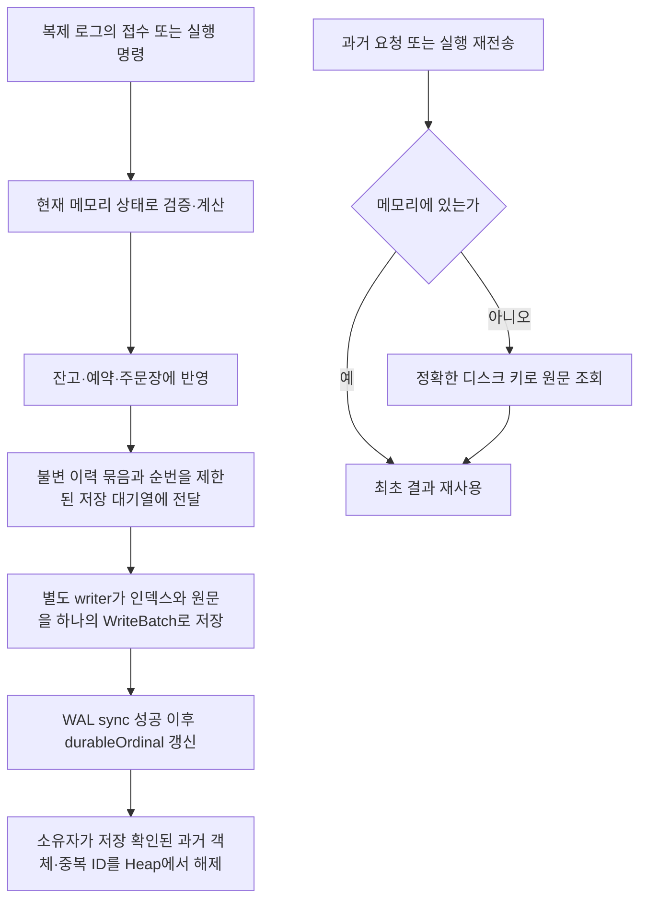

# 완료 거래 이력의 메모리 누적 수정 — 2026-10-29

## 최종 판정

완료 이력의 메모리 참조를 저장 확인 뒤 해제하고, 과거 응답·원장·중복 ID를 보존하는 구현과 관련 회귀 검증은 끝냈다. 하지만 **성능 개선은 달성하지 못했다.** 최종 코드의 같은 sync=2 짧은 비교는 기존 10,805 TPS에서 1,055 TPS로 낮아졌다. 약 90% 처리량 회귀가 있는 현재 변경을 고성능 개선 완료로 취급하지 않는다.

최종 커밋의 세 노드·Archive sync=0 실행은 실제 300초를 채웠고, 측정 창 안에서 SELL 162,000건과 BUY 162,000건이 세 사본 모두 완료됐다. 전체 완료 처리량은 **1,080 TPS**다. 이 결과는 HTTP API나 최대 지속 가능 TPS가 아니라 아래에 명시한 유한 부하에서의 관측값이다. WAL sync를 유지하는 별도 업무 이력 저장소의 비용도 포함한다.

## 변경 목적과 경계

현재 잔고·미체결 주문은 메모리에 남기고, 이미 끝난 주문의 최초 접수 결과·완료 결과·원장·중복 ID를 노드별 로컬 RocksDB 이력으로 옮긴다. 같은 요청과 실행을 다시 보내도 최초 값을 정확하게 반환한다. 임의 TTL이나 원장 삭제를 하지 않으며, ID의 동일성을 해시만으로 판정하지 않는다.

이번 대상은 완료 건수에 비례하던 업무 객체와 측정기 객체의 누적이다. 활성 주문·사용자·자산 수 자체를 무제한으로 받는 기능이나, Archive 로그의 장기 보관 정책·재시작 복구·스냅샷·재해 복구를 완성한 것은 아니다. Archive replay로 현재 잔고·주문장을 재구성하는 실행 경로도 이번 범위에서 구현하지 않았다.

## 처리 흐름



`TradingState`와 `OrderAdmissionState`가 저장 확인과 이력 해제 책임을 가진다. 계산기들은 저장 기술을 알지 않는다. `TradingHistoryStore`는 도메인 계약이며 실제 RocksDB 의존성은 `app-api`의 `trading.infrastructure.history`에만 있다. 구조 검사도 이 구체적인 책임만 등록하고 계산기의 외부 I/O 금지는 유지한다.

이력 묶음의 순번은 승인 순번과 별개다. 자금 부족 거절도 최초 결과를 보존하므로 이력 순번을 사용한다. writer의 저장 완료 시점은 노드마다 달라도 금융 계산 결과는 달라지지 않는다. 해제 전후 모두 같은 불변 원문을 반환하기 때문이다. 저장 또는 조회가 실패하면 없는 요청으로 취급하지 않고 기존 소유자의 처리를 차단한다.

메모리에서 해제하는 조건은 단순한 주문 완료가 아니라 **해당 완료를 포함한 이력의 저장 확인**이다. 미체결 maker의 현재 예약과 정산에 필요한 원래 접수 객체는 계속 보관한다. maker가 최종 체결된 이력까지 저장돼야 그 참조도 해제한다.

## 저장과 조회 계약

- 요청 키는 사용자 ID와 요청 ID, 주문 키는 마켓 ID와 주문 ID다. 문자열 길이와 UTF-16 내용을 보존해 구분자나 해시 충돌로 다른 ID를 섞지 않는다.
- 최초 승인·거절, 접수 순번, 당시 마켓·수수료 정책, 나노초 시각, 주문별 예약, 수수료 나머지, 원장·완료 결과를 직렬화한다. 지금 잔고나 현재 정책으로 다시 계산하지 않는다.
- 저장 원문은 버전·종류·길이·CRC32C를 검사한다. 데이터 손상을 정상적인 조회 실패로 바꾸지 않는다.
- 원문과 각 ID 인덱스는 같은 RocksDB WriteBatch에 쓰고 WAL sync 성공 뒤에만 저장 확인 순번을 올린다.
- 새 실행은 새 이력 폴더만 연다. 이 DB만 열어 잔고·주문장 복구를 완료했다고 취급하지 않는다.
- 전체 snapshot 조회는 기존의 모든 이력을 돌려주므로 O(누적 건수)의 조회·임시 메모리가 필요하다. 지속 부하 중에는 이를 반복하지 않고 고정 크기 보관량 지표를 사용한다.

## 자원 제한

업무 이력 staging은 최대 1,024묶음이며 저장 대기열은 1,024묶음·64MiB 중 먼저 찬 한도에서 배출을 기다린다. 지연 또는 저장 실패를 무시하며 무한히 쌓지 않는다. 블록 캐시는 32MiB, 쓰기 버퍼 관리 한도는 8MiB, 열린 테이블 파일은 64개다. 이 숫자는 전체 프로세스 RSS 상한을 뜻하지 않는다. JVM의 현재 상태, native overhead, OS 파일 캐시와 Aeron 버퍼는 별개다.

업무 이력은 노드당 누적 논리 쓰기 예산 8GiB도 검사한다. 이를 초과하면 이력을 삭제하며 계속하는 대신 저장 오류로 차단한다. 이 예산은 인덱스와 값의 논리 쓰기 누적량이며, 압축·WAL·compaction을 포함한 실제 DB 디렉터리 크기 상한과 다르다. 따라서 무기한 가동과 무제한 이력 보관을 해결한 것은 아니다.

측정기의 완료 ID 위치·완료 여부도 디스크 인덱스로 옮겼다. 메모리에는 최근 1,024개 위치와 한정된 미완료 원문만 남긴다. 발생기는 현재 묶음만 보관하고 지난 요청별 결과는 파일에 기록한다. percentile은 원문을 버리지 않고 제한된 크기의 외부 정렬로 정확히 계산한다. 측정용 인덱스는 금융 원장이 아니며, 오류는 보고서를 무효로 만들되 성공한 업무 콜백으로 전파하지 않는다.

새 키의 불필요한 디스크 조회는 고정 8MiB 부재 필터로 줄인다. 이 저장소는 빈 세대에서 시작하고 모든 append 키를 같은 잠금 아래 필터에 먼저 등록한다. 필터가 없다고 판단한 키만 조회를 생략하며, 존재할 가능성이 있으면 정확한 키로 조회한다. 비트 포화나 해시 충돌은 추가 조회만 발생시키므로 과거 요청을 새 요청으로 판정하지 않는다. 오래된 실행에서는 필터의 효과가 줄어들 수 있다.

정산 중에는 최근 주문→승인 순번 인덱스를 최대 16,384개·8MiB로 재사용한다. 한도를 넘으면 오래된 인덱스를 캐시에서만 제거하고 DB 원문은 유지한다. 따라서 활성 주문 수를 넘는 오래된 조회도 원래 DB 키로 해결한다.

Archive의 sync=0 비교에서도 업무 이력 DB의 WAL sync는 유지한다. 두 저장소의 설정을 같은 의미로 섞지 않는다. API 접수 응답이 이력 DB의 저장 확인까지 기다린다는 계약을 새로 추가한 것도 아니다.

## 회귀 및 독립 검토

첫 구현 커밋은 `ea74b8b98b60993fccacc1faa931f466ac94181d`다. 초기 전체 관련 회귀와 이후 수정 대상 재실행을 합친 고유 검사 수는 도메인 거래 216개, 매칭 150개, 관련 API 118개, 구조 385개로 869개다. 실패·오류·skip은 0이며 네 모듈의 형식 검사도 통과했다. 이는 API 전체 테스트 수나 한 번의 전체 실행을 뜻하지 않는다. 최신 추가 수정의 실행 근거는 아래에 별도로 남긴다.

주요 검사는 다음을 확인한다.

1. 여러 maker/taker 주문을 처리하고 저장을 확인하면 종료된 요청·접수·예약·원장·완료·ID 참조가 해제된다. 그 뒤 옛 요청·완료를 조회해도 처음 값과 현재 잔고가 보존된다.
2. 자금 부족으로 거절한 뒤 자금을 추가해도 같은 요청은 최초 거절을 반환한다. 내용 변경은 충돌로 거절한다.
3. 활성 maker는 보관하며 마지막 체결 이력이 저장되기 전에는 해제하지 않는다.
4. 저장 실패·조회 실패·비정상 저장 확인·정지한 writer는 정상 처리로 숨기지 않는다.
5. 관찰 인덱스를 실제로 손상시킨 뒤 decorated Aeron callback을 실행해도 금융 완료는 유지되고 관찰 오류가 기록된다.
6. 종료 스레드가 중단돼도 writer가 멈춘 뒤 native 자원을 해제하고 interrupt 상태를 복원한다.

작성 대화를 받지 않은 리뷰어가 고정 소스 34개를 읽고 실제 RocksDB와 메모리 상태에 혼합 주문 400개를 대조했다. 부분·다중 체결과 과거 결과·잔고·예약·원장이 일치했다. 관찰 오류 전파와 중단된 종료의 native 자원 누수 두 결함을 독립 재현해 수정했으며 r2에서 해소를 확인했다. 성능 실행 자체는 이 리뷰어가 수행하지 않았다.

## 실제 실행에서 확인한 추가 문제

첫 세 노드 AFTER는 warmup 중 엄격한 RocksDB 캐시에서 쓰기가 거절돼 무효다. 이 실행을 TPS 표에 포함하지 않는다. 실패 시점의 한 노드는 이력 순번 27,412까지 저장을 확인한 상태였다. 작은 기능 검사와 실제 누적·flush 경계 검증을 구분한다.

32MiB 캐시를 자동 분할하면 64개 shard에 각각 약 512KiB가 배정된다. 전체 캐시에 여유가 있어도 특정 shard의 pinned 항목과 메타데이터가 한도를 넘으면 삽입이 실패할 수 있다. 실제 로그는 LRU shard의 용량 초과를 보여 주지만 실패한 항목이 index/filter/data 중 무엇인지는 특정하지 않았다. 캐시를 늘리거나 상한을 없애지 않고 단일 shard의 strict 32MiB로 변경했다. 관찰용 4MiB 캐시에도 같은 분할 방식을 적용했다. [RocksDB 10.1.3의 shard 용량 계산](https://raw.githubusercontent.com/facebook/rocksdb/v10.1.3/cache/sharded_cache.cc), [LRU 삽입 실패 경계](https://raw.githubusercontent.com/facebook/rocksdb/v10.1.3/cache/lru_cache.cc).

후속 검사는 기본 설정에서 16,384개 요청과 실제 memtable flush 8회를 실행하고 과거·최근 원문, cache/pinned 사용량 상한, background 오류 0을 확인한다. 이 수정과 관련된 API 검사 53개가 통과했다. 별도 standalone 비교에서는 이전 설정도 해당 seed에서 통과했으므로, 이를 이전 오류의 재현이라고 주장하지 않는다.

## 이력 저장 비용의 추가 수정

캐시 수정 뒤 r2는 외부 300초 제한으로 종료돼 최종 cohort 대조와 percentile이 없는 무효 실행이다. 동일 warmup 24,000 접수·24,000 실행의 node0 계측에서 callback 합계는 2.246→11.372초, admission_apply는 0.497→4.759초, completion은 0.026→2.897초였다. 매칭 후보와 실제 반영 시간은 거의 같아 추가 비용은 이력 조회·직렬화·저장 경로에 집중됐다.

- 1ms 묶음 수집을 `wait(1)` 한 번으로 끝내면 append의 알림이 즉시 깨워 작은 묶음을 sync할 수 있었다. 절대 deadline까지 남은 시간만 반복 대기하도록 수정했다.
- UTF-16 문자열을 바이트마다 쓰던 경로를 Writer별 1KiB 묶음 쓰기로 바꿨다. 기존 방식으로 만든 전체 프레임과 일치함을 독립 기대값으로 검사했다.
- 추가 15초 JFR에서 업무 service의 native get 표본 86개가 이력 조회로 확인됐다. 실제 정산 callback의 스레드 기록에서도 예약의 승인 순번 조회 중 writer의 ACK가 같은 monitor에서 대기했다. 부재 필터와 제한된 정확 인덱스 캐시는 이 경로를 줄인다.
- 프레임은 헤더 공간을 먼저 둔 단일 bounded buffer에 기록하고, 완성 결과만 한 번 복사한다. 키도 길이를 계산한 배열에 기록해 바이트별 동기화와 반복 확장을 줄인다.
- 저장 확인 전 이력 해제 금지, WAL sync, 정확한 ID 조회 계약은 유지했다.

## 대기열 전체 저장 장벽 제거

코드 커밋 `7659b53`은 staging이 찼을 때 `awaitDurable(가장 오래된 ordinal)`을 호출한다. 기존에는 전체 append의 마지막 ordinal을 기다려 일부 공간이 생겨도 재개하지 못했다. 변경 후 실제 durable prefix를 다시 읽어 그 범위만 해제하며, 뒤쪽 쓰기는 계속 진행할 수 있다. 명시적인 `flushHistory()`, 전체 이력 scan, close의 전체 저장 계약은 유지한다.

`TradingHistoryRetentionTest`는 한도 3에서 세 묶음을 쌓고 다음 처리를 실행한다. 1번만 저장됐을 때 2·3·4번은 보관하고 진행하는지, full flush를 호출하지 않았는지 검사한다. 이후 명시 flush는 4번까지 저장·해제함을 확인한다. 반환 ACK가 target 미달·미래 순번이거나 실제 저장 prefix가 진전하지 않아 슬롯이 비지 않으면 추가 전이 없이 차단하는 반례도 포함한다. ACK 반환 뒤 writer가 더 진행해 조회 시점의 순번이 커지는 것은 정상이다. 실제 RocksDB 검사는 target 이상 내구성과 전체 flush·실패 전파를 확인하지만, OS 스케줄링 아래 반드시 뒷부분 저장 전 먼저 반환한다고 시간으로 보장하지 않는다.

`regression-prefix-barrier.log`의 관련 회귀·형식·구조 검사는 `BUILD SUCCESSFUL in 1m 59s`로 종료했다. 별도 컨텍스트 리뷰어가 고정된 8개 소스의 전체 차이와 추가 장벽 수정을 검토했고 확인된 미해결 결함은 없었다. 마지막 KDoc 차이는 이후 순번이 이미 저장된 경우도 반환 가능함을 설명하는 주석뿐이다.

최신 수정 대상의 실행 명령은 다음과 같다. 이는 위 869개 고유 검사의 전체 합집합을 한 번에 실행한 명령은 아니다.

```bash
cd /Users/0chord/.codex/worktrees/issue148-http-aeron/exchange-core
JAVA_HOME=/Users/0chord/.sdkman/candidates/java/25.0.2-amzn ./gradlew \
  :domain-trading:test :app-api:test --tests '*history.*' \
  :domain-trading:ktlintCheck :app-api:ktlintCheck :architecture-tests:test \
  :app-api:stageFundingVerificationRuntime --max-workers=2
```

## 재측정 근거

동일 조건의 비교는 성능 개선이 아니라 **회귀**를 보여 줬다. 새 이력 저장 전 120,000 SELL + 120,000 BUY 완료에는 22.211초, 최종 코드 r6에는 227.496초가 걸렸다. 기준 커밋은 `bcd0e5c8755e30f5aa926c603a1c297d4ec9c612`, 최종 코드는 `7659b5398114ec9183415990b96cbb88fa0ecc1b`다.

| sync=2 짧은 비교 | 기존 메모리 이력 | 최종 디스크 이력 r6 |
|---|---:|---:|
| 전체 주문 접수·세 노드 완료 TPS | 10,805.45 | 1,054.97 |
| BUY 완료 TPS | 5,402.73 | 527.48 |
| BUY 접수 응답 p95 / p99 | 447 / 892ms | 3,914 / 8,130ms |
| BUY 세 노드 완료 관측 p95 / p99 | 1,061 / 1,299ms | 8,706 / 11,423ms |
| 노드별 anon 최고 MiB | 1,055 / 1,075 / 1,112 | 586 / 536 / 888 |
| 파일 캐시 포함 전체 메모리 최고 MiB | 1,446 / 1,425 / 1,461 | 1,701 / 1,684 / 2,000 |

두 실행은 모두 주문 수 상한에서 종료한 부분 실행이며 5분 결과가 아니다. 접수와 후속 실행 callback을 별도 주문으로 세지 않는다. 관측 기준은 클라이언트의 동일한 단조 시계이며 HTTP Gateway는 포함하지 않는다. warmup 12,000 SELL + 12,000 BUY 뒤 측정했고, 측정 창에는 생성·증거 기록·구간 drain도 포함한다. 전체 264,000개 명령과 세 노드의 792,000개 표식 대조를 통과했으며 오류·중복·overflow·OOM은 없었다. 금융 상태 전수 snapshot은 측정 창에서 실행하지 않았다.

세 노드 각각 2CPU·2GiB, 클라이언트 2CPU·2GiB 제한으로 같은 Docker VM에서 실행했다. 노드 Xmx는 1,536MiB, 클라이언트는 1,024MiB다. 마켓은 BTC/SOL/SUI이며 6,000 SELL과 6,000 BUY를 번갈아 가능한 속도로 전송했다. 노드별 CPU affinity와 자원 설정은 같지만 기준 리더는 node0, 최종 비교 리더는 node1이어서 동일 리더의 반복 통제 실험은 아니다. 최대 부하나 warmup 수렴을 입증한 실행도 아니다.

최종 짧은 실행의 업무 staging 최고는 노드별 1,024 / 1,023 / 1,024묶음으로 상한 1,024 이내였다. 메모리 객체 누적을 디스크 이력으로 바꿨지만 OS 파일 캐시를 포함한 전체 메모리 사용과 처리량까지 좋아진 것은 아니다.

r5 계측상 leader의 실행 전체 66.536초 중 내부 계산·반영 phase 합계는 11.712초이며 나머지 54.824초는 phase 앞의 이력 조회·capacity 준비 구간에 포함된다. 소스에서 capacity 한 칸을 확보하려고 최신 이력까지 전부 flush하는 경로를 확인했다. 이것이 모든 회귀의 단독 원인이라는 직접 측정은 없으며, 해당 barrier를 제거한 최종 비교에서도 처리량은 회복되지 않았다.

근거 폴더는 `/Users/0chord/.codex/visualizations/2026/09/23/01a0ce63-9327-7f32-a7e0-3429380284d8/issue142-performance/business-retention-20261029/bounded-history-20261029/`다. 기준 런타임, 변경 런타임, 명령, 원문, 회귀 XML, 고정 리뷰 사본을 구분해 보관한다.


### 최종 코드와 추가 비교

최종 코드 커밋은 `7659b53`이다. 부분 저장 대기로 바꾼 r6의 sync=2 짧은 실행은 227.496초, 전체 완료 1,054.97 TPS였다. 접수 p95/p99는 3,913.66/8,130.22ms, 세 노드 완료 관측은 8,705.97/11,423.42ms다. r5 대비 접수 p95는 낮지만 처리량은 낮았으므로 이 변경을 측정된 처리량 개선이라고 표현하지 않는다.

추가로 `targetGroupBytes`만 256KiB에서 1MiB로 비교한 r7은 1,104.13 TPS, 완료 p99는 14,385.63ms였다. 뚜렷한 처리량 회복이 없고 완료 꼬리 지연은 나빠져 해당 설정을 채택하지 않고 256KiB로 복원했다. 최대 그룹 256개, pending 1,024개·64MiB와 WAL sync는 모든 실행에서 유지했다. r7을 최종 코드의 결과로 사용하지 않는다.

이 workload에서 매도·매수 한 쌍은 접수·실행 4개 이력 묶음, 13개 전체 값 프레임, 29개 put을 만든다. 같은 접수·예약·원장 값이 요청·완료 원문 안에도 포함된다. 이 보존 비용은 기존 메모리 전용 결과와 다른 추가 작업이다. 기존 계측은 이력 경로에서 증가한 시간을 보여 주지만 실제 업무 WAL 그룹 횟수와 force 시간을 따로 수집하지 않았으므로 직렬화·쓰기·compaction·저장 대기의 기여도를 확정하지 않는다. 코드의 일부 대기를 제거하거나 그룹만 키워도 이 비용 전체가 사라지지 않았다.

r5의 선행 sync=0 실행은 실제 300초를 채웠고, 그 안에 BUY 156,000개와 SELL 156,000개를 세 노드가 완료했다(전체 1,040 TPS). 창 이후 6.270초의 drain을 별도 기록했으며 마지막 SELL 6,000개는 창 이후 완료돼 완료 TPS 분자에서 제외했다. 이 결과는 부분 저장 장벽 수정 전 근거다. r6의 중간 지속 실행은 그룹 크기 비교에 앞서 의도적으로 중지했으며 성능 결과에 포함하지 않는다.

## 최종 코드의 5분 지속 실행

`after-final-sustained-sync0`은 `7659b53`의 고정 런타임으로 실행했고, 위 최종 sync=2 비교와 런타임 지문이 같다. Archive만 sync=0이며 catalog·consensus 저장 수준은 2, 업무 이력 WAL sync는 유지했다. 300초 측정 창이 끝난 뒤 이미 전송한 요청의 응답과 완료를 2.118초 더 확인했다.

| 측정 항목 | 최종 결과 |
|---|---:|
| 측정 창 안에 세 노드 모두 완료한 주문 | SELL 162,000 + BUY 162,000 |
| 전체 완료 TPS | 1,080 |
| BUY 접수·완료 TPS | 각각 540 |
| BUY 접수 응답 p95 / p99 | 5,138.49 / 9,385.91ms |
| BUY 세 노드 완료 관측 p95 / p99 | 12,070.61 / 13,439.44ms |
| 업무 staging 최고, node0 / 1 / 2 | 1,024 / 1,024 / 1,023 |
| 노드 anon 최고 MiB, node0 / 1 / 2 | 988 / 947 / 564 |
| 파일 캐시 포함 전체 메모리 최고 MiB | 2,047 / 2,047 / 1,682 |
| 실행 중 호스트 디스크 증가 최고 | 3.987GiB |
| 노드 기록 합계 최고 | 3.740GiB |

마지막 SELL 6,000건은 창 뒤에 완료됐으므로 완료 TPS에서 제외한다. 전체 창내 전송은 330,000건이지만 이를 완료·접수 TPS로 대신 쓰지 않는다. 전체 SELL+BUY의 창내 ACK 수는 요약에 정확히 분리돼 있지 않아 전체 접수 TPS를 단정하지 않는다. 표의 지연은 측정 BUY 162,000건만의 동일 클라이언트 시계 차이다. SELL 완료에는 미체결 대기 주문의 정상 실행 완료도 포함되므로 전체 주문 완료 TPS와 BUY 체결 흐름의 TPS를 구분한다.

warmup과 마지막 drain을 포함한 354,000개 요청의 정확한 ID·승인 순번·로그 위치와 1,062,000개 완료 표식 대조가 통과했다. 오류·중복 응답·중복 표식·overflow·OOM은 없었다. 별도 감사자는 요약·단계 기록·노드 지표·자원 기록의 일관성을 확인했으며, 큰 원문을 독립 재실행하거나 금융 상태 전수 snapshot을 대조한 것은 아니다. 실제 자금 정합성의 추가 근거는 앞의 회귀와 독립 혼합 주문 대조다.

node0·node1은 전체 메모리 2GiB 제한에 거의 도달했다. `memory.events max`가 각각 146·416 증가했고 페이지 회수도 발생했다. OOM이 없고 staging이 한도를 지켰다는 사실은 전체 메모리 여유나 장기 평탄성을 뜻하지 않는다. 실제 파일 캐시 회수 압력이 있던 유효한 300초 실행으로 기록한다. 또한 Archive sync=0에서도 처리량이 회복되지 않았으므로 Archive force만 제거하면 해결된다고 해석하지 않는다.

감사 근거는 `final-short-audit-code7659b53.json`, `final-sustained-audit-code7659b53.json`, 실행 명령·시간·커밋은 `after-final-sustained-execution.json`에 있다. 최종 코드의 로컬 실행 배포본도 다시 준비했고 `final-stage-runtime.log`의 빌드는 성공했다. 실험한 1MiB 그룹 설정은 최종 소스나 배포본에 남기지 않았다.

## 남은 성능 문제

이력 저장 전에는 없던 직렬화·정확 인덱스 조회·WAL 쓰기·저장 배압과 전체 메모리 압력이 추가됐다. 이 경로를 줄이는 변경을 적용했지만 최종 결과에서 회귀는 해소되지 않았다. 따라서 **보관 기능의 검증 완료와 처리량 개선 완료를 구분한다.** 현재 결과를 5만 TPS 달성, 최대 TPS 측정 완료, 무기한 안정 가동 또는 운영 투입 준비로 표현하지 않는다.

추가 작업의 핵심은 완료 이력의 동일 값 반복 저장과 서비스 스레드에서의 저장 대기를 줄이는 것이다. 재계산·TTL 삭제로 과거 결과 계약을 바꾸거나, WAL 동기화를 몰래 끄는 해결은 채택하지 않았다. 이번 기록으로 직렬화·DB 쓰기·force·파일 캐시 회수 각각의 기여율까지 확정한 것은 아니다.

## 디스크 정리와 보관 위치

이전 큰 측정 파일 208개와 이번 원문 44개를 단일 스레드 zstd로 압축했다. 각 파일은 원본 SHA-256과 압축 해제 결과의 SHA-256이 일치한 뒤에만 원본을 지웠다. 요약·소스·고정 런타임·회귀 결과는 유지하며, `.json.zst`·`.jsonl.zst`·`.bin.zst`로 원문을 복원할 수 있다. 요약에 기록된 원래 경로의 큰 파일은 같은 경로에 `.zst`가 붙은 파일을 사용한다.

원본 파일 크기 합계 기준으로 이전 정리 26.99GiB와 이번 정리 4.12GiB, 합계 **31.11GiB를 축소**했다. 이는 APFS의 실제 물리 여유 공간 증가와 동일하다는 주장이 아니다. 최종 확인한 호스트 여유 공간은 약 **89GiB**다. 이번 실행의 컨테이너는 종료·제거됐고 다른 작업의 컨테이너나 공용 Docker 캐시는 일괄 삭제하지 않았다.

파일별 원문·압축 크기와 해시는 `old-evidence-compression.jsonl`, `new-evidence-compression.jsonl`, 합계는 `final-cleanup-summary.json`에 있다. 최종 실행의 원문 파일은 결과 감사가 끝난 뒤 압축했다.

로컬 작업 폴더는 `/Users/0chord/.codex/worktrees/issue148-http-aeron/exchange-core`, 브랜치는 `test/http-trading-performance/142`다. 이 변경은 로컬 커밋으로 보관하며 이번 요청에서 PR 게시·push·병합은 진행하지 않았다.
