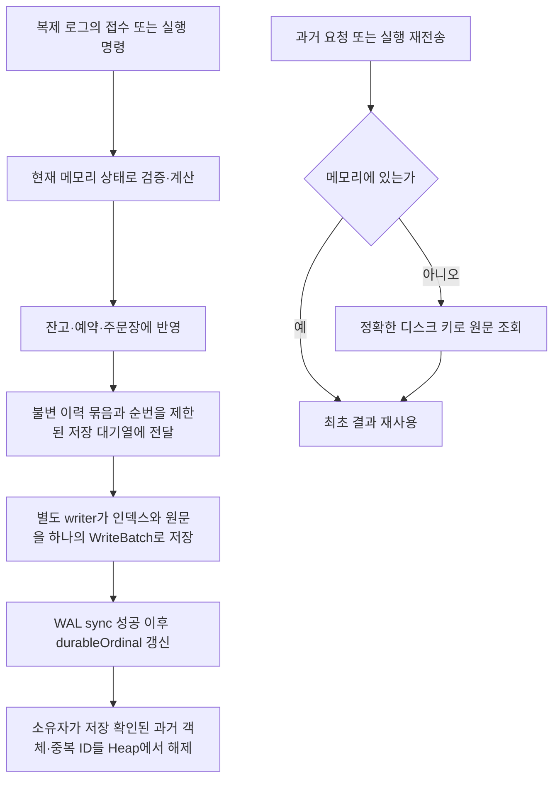
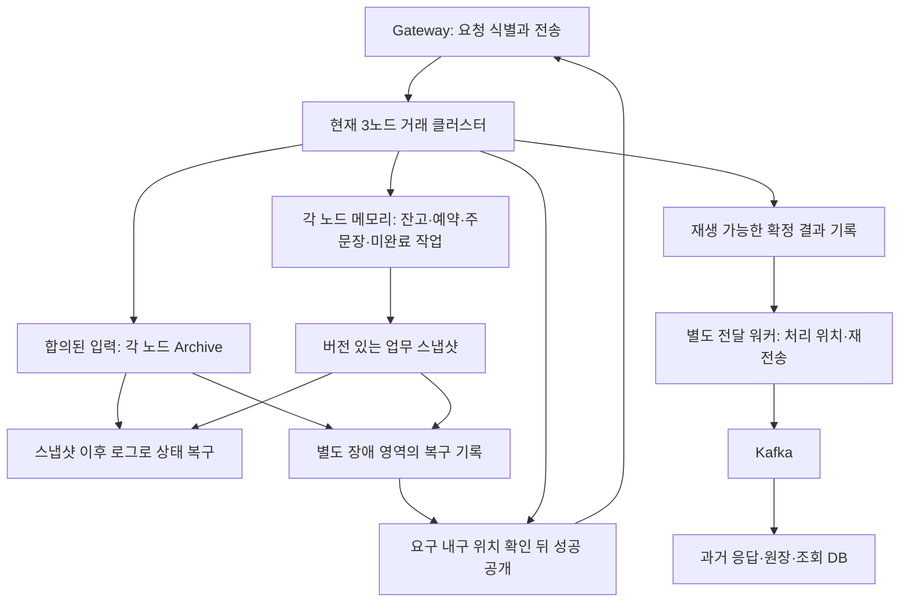

# 완료 거래 이력의 메모리 누적 수정 — 2026-10-29

## 최종 판정

완료 이력의 메모리 참조를 저장 확인 뒤 해제하고, 과거 응답·원장·중복 ID를 보존한다. 첫 저장 구현은 같은 sync=2 짧은 비교에서 기존 메모리 이력의 10,805 TPS를 1,055 TPS로 낮췄다. 이 회귀를 해결하려고 같은 접수 원본의 중복 저장을 제거했다. 새 60,000주문 비교에서는 **1,596 → 3,383 TPS**, 세 노드 완료 관측 p99는 **5.47 → 2.24초**로 개선됐다. 아직 기존 처리량 회복이나 고성능 목표 달성을 뜻하지 않는다. 두 비교는 주문 수가 다르므로 1,055와 3,383을 직접 개선율로 계산하지 않는다.

중복 저장 수정 전 `7659b53`의 세 노드·Archive sync=0 실행은 실제 300초를 채웠고, 측정 창 안에서 SELL 162,000건과 BUY 162,000건이 세 사본 모두 완료됐다. 전체 완료 처리량은 **1,080 TPS**다. 새 수정은 짧은 sync=2 비교까지만 실행했다. 이 결과들은 HTTP API나 최대 지속 가능 TPS가 아니라 아래에 명시한 유한 부하에서의 관측값이다. WAL sync를 유지하는 별도 업무 이력 저장소의 비용도 포함한다.

## 변경 목적과 경계

현재 잔고·미체결 주문은 메모리에 남기고, 이미 끝난 주문의 최초 접수 결과·완료 결과·원장·중복 ID를 노드별 로컬 RocksDB 이력으로 옮긴다. 같은 요청과 실행을 다시 보내도 최초 값을 정확하게 반환한다. 임의 TTL이나 원장 삭제를 하지 않으며, ID의 동일성을 해시만으로 판정하지 않는다.

이번 대상은 완료 건수에 비례하던 업무 객체와 측정기 객체의 누적이다. 활성 주문·사용자·자산 수 자체를 무제한으로 받는 기능이나, Archive 로그의 장기 보관 정책·재시작 복구·스냅샷·재해 복구를 완성한 것은 아니다. Archive replay로 현재 잔고·주문장을 재구성하는 실행 경로도 이번 범위에서 구현하지 않았다.

## 처리 흐름



`TradingState`와 `OrderAdmissionState`가 저장 확인과 이력 해제 책임을 가진다. 계산기들은 저장 기술을 알지 않는다. `TradingHistoryStore`는 도메인 계약이며 실제 RocksDB 의존성은 `app-api`의 `trading.infrastructure.history`에만 있다. 구조 검사도 이 구체적인 책임만 등록하고 계산기의 외부 I/O 금지는 유지한다.

이력 묶음의 순번은 승인 순번과 별개다. 자금 부족 거절도 최초 결과를 보존하므로 이력 순번을 사용한다. writer의 저장 완료 시점은 노드마다 달라도 금융 계산 결과는 달라지지 않는다. 해제 전후 모두 같은 불변 원문을 반환하기 때문이다. 저장 또는 조회가 실패하면 없는 요청으로 취급하지 않고 기존 소유자의 처리를 차단한다.

메모리에서 해제하는 조건은 단순한 주문 완료가 아니라 **해당 완료를 포함한 이력의 저장 확인**이다. 미체결 maker의 현재 예약과 정산에 필요한 원래 접수 객체는 계속 보관한다. maker가 최종 체결된 이력까지 저장돼야 그 참조도 해제한다.

## 저장과 조회 계약

- 요청 키는 사용자 ID와 요청 ID, 주문 키는 마켓 ID와 주문 ID다. 문자열 길이와 UTF-16 내용을 보존해 구분자나 해시 충돌로 다른 ID를 섞지 않는다.
- 최초 승인·거절, 접수 순번, 당시 마켓·수수료 정책, 나노초 시각, 주문별 예약, 수수료 나머지, 원장·완료 결과를 직렬화한다. 지금 잔고나 현재 정책으로 다시 계산하지 않는다.
- 저장 원문은 버전·종류·길이·CRC32C를 검사한다. 데이터 손상을 정상적인 조회 실패로 바꾸지 않는다.
- 원문과 각 ID 인덱스는 같은 RocksDB WriteBatch에 쓰고 WAL sync 성공 뒤에만 저장 확인 순번을 올린다.
- 새 실행은 새 이력 폴더만 연다. 이 DB만 열어 잔고·주문장 복구를 완료했다고 취급하지 않는다.
- 전체 snapshot 조회는 기존의 모든 이력을 돌려주므로 O(누적 건수)의 조회·임시 메모리가 필요하다. 지속 부하 중에는 이를 반복하지 않고 고정 크기 보관량 지표를 사용한다.

## 자원 제한

업무 이력 staging은 최대 1,024묶음이며 저장 대기열은 1,024묶음·64MiB 중 먼저 찬 한도에서 배출을 기다린다. 지연 또는 저장 실패를 무시하며 무한히 쌓지 않는다. 블록 캐시는 32MiB, 쓰기 버퍼 관리 한도는 8MiB, 열린 테이블 파일은 64개다. 이 숫자는 전체 프로세스 RSS 상한을 뜻하지 않는다. JVM의 현재 상태, native overhead, OS 파일 캐시와 Aeron 버퍼는 별개다.

업무 이력은 노드당 누적 논리 쓰기 예산 8GiB도 검사한다. 이를 초과하면 이력을 삭제하며 계속하는 대신 저장 오류로 차단한다. 이 예산은 인덱스와 값의 논리 쓰기 누적량이며, 압축·WAL·compaction을 포함한 실제 DB 디렉터리 크기 상한과 다르다. 따라서 무기한 가동과 무제한 이력 보관을 해결한 것은 아니다.

측정기의 완료 ID 위치·완료 여부도 디스크 인덱스로 옮겼다. 메모리에는 최근 1,024개 위치와 한정된 미완료 원문만 남긴다. 발생기는 현재 묶음만 보관하고 지난 요청별 결과는 파일에 기록한다. percentile은 원문을 버리지 않고 제한된 크기의 외부 정렬로 정확히 계산한다. 측정용 인덱스는 금융 원장이 아니며, 오류는 보고서를 무효로 만들되 성공한 업무 콜백으로 전파하지 않는다.

새 키의 불필요한 디스크 조회는 고정 8MiB 부재 필터로 줄인다. 이 저장소는 빈 세대에서 시작하고 모든 append 키를 같은 잠금 아래 필터에 먼저 등록한다. 필터가 없다고 판단한 키만 조회를 생략하며, 존재할 가능성이 있으면 정확한 키로 조회한다. 비트 포화나 해시 충돌은 추가 조회만 발생시키므로 과거 요청을 새 요청으로 판정하지 않는다. 오래된 실행에서는 필터의 효과가 줄어들 수 있다.

정산 중에는 최근 주문→승인 순번 인덱스를 최대 16,384개·8MiB로 재사용한다. 한도를 넘으면 오래된 인덱스를 캐시에서만 제거하고 DB 원문은 유지한다. 따라서 활성 주문 수를 넘는 오래된 조회도 원래 DB 키로 해결한다.

Archive의 sync=0 비교에서도 업무 이력 DB의 WAL sync는 유지한다. 두 저장소의 설정을 같은 의미로 섞지 않는다. API 접수 응답이 이력 DB의 저장 확인까지 기다린다는 계약을 새로 추가한 것도 아니다.

## 회귀 및 독립 검토

첫 구현 커밋은 `ea74b8b98b60993fccacc1faa931f466ac94181d`다. 초기 전체 관련 회귀와 이후 수정 대상 재실행을 합친 고유 검사 수는 도메인 거래 216개, 매칭 150개, 관련 API 118개, 구조 385개로 869개다. 실패·오류·skip은 0이며 네 모듈의 형식 검사도 통과했다. 이는 API 전체 테스트 수나 한 번의 전체 실행을 뜻하지 않는다. 최신 추가 수정의 실행 근거는 아래에 별도로 남긴다.

주요 검사는 다음을 확인한다.

1. 여러 maker/taker 주문을 처리하고 저장을 확인하면 종료된 요청·접수·예약·원장·완료·ID 참조가 해제된다. 그 뒤 옛 요청·완료를 조회해도 처음 값과 현재 잔고가 보존된다.
2. 자금 부족으로 거절한 뒤 자금을 추가해도 같은 요청은 최초 거절을 반환한다. 내용 변경은 충돌로 거절한다.
3. 활성 maker는 보관하며 마지막 체결 이력이 저장되기 전에는 해제하지 않는다.
4. 저장 실패·조회 실패·비정상 저장 확인·정지한 writer는 정상 처리로 숨기지 않는다.
5. 관찰 인덱스를 실제로 손상시킨 뒤 decorated Aeron callback을 실행해도 금융 완료는 유지되고 관찰 오류가 기록된다.
6. 종료 스레드가 중단돼도 writer가 멈춘 뒤 native 자원을 해제하고 interrupt 상태를 복원한다.

작성 대화를 받지 않은 리뷰어가 고정 소스 34개를 읽고 실제 RocksDB와 메모리 상태에 혼합 주문 400개를 대조했다. 부분·다중 체결과 과거 결과·잔고·예약·원장이 일치했다. 관찰 오류 전파와 중단된 종료의 native 자원 누수 두 결함을 독립 재현해 수정했으며 r2에서 해소를 확인했다. 성능 실행 자체는 이 리뷰어가 수행하지 않았다.

## 실제 실행에서 확인한 추가 문제

첫 세 노드 AFTER는 warmup 중 엄격한 RocksDB 캐시에서 쓰기가 거절돼 무효다. 이 실행을 TPS 표에 포함하지 않는다. 실패 시점의 한 노드는 이력 순번 27,412까지 저장을 확인한 상태였다. 작은 기능 검사와 실제 누적·flush 경계 검증을 구분한다.

32MiB 캐시를 자동 분할하면 64개 shard에 각각 약 512KiB가 배정된다. 전체 캐시에 여유가 있어도 특정 shard의 pinned 항목과 메타데이터가 한도를 넘으면 삽입이 실패할 수 있다. 실제 로그는 LRU shard의 용량 초과를 보여 주지만 실패한 항목이 index/filter/data 중 무엇인지는 특정하지 않았다. 캐시를 늘리거나 상한을 없애지 않고 단일 shard의 strict 32MiB로 변경했다. 관찰용 4MiB 캐시에도 같은 분할 방식을 적용했다. [RocksDB 10.1.3의 shard 용량 계산](https://raw.githubusercontent.com/facebook/rocksdb/v10.1.3/cache/sharded_cache.cc), [LRU 삽입 실패 경계](https://raw.githubusercontent.com/facebook/rocksdb/v10.1.3/cache/lru_cache.cc).

후속 검사는 기본 설정에서 16,384개 요청과 실제 memtable flush 8회를 실행하고 과거·최근 원문, cache/pinned 사용량 상한, background 오류 0을 확인한다. 이 수정과 관련된 API 검사 53개가 통과했다. 별도 standalone 비교에서는 이전 설정도 해당 seed에서 통과했으므로, 이를 이전 오류의 재현이라고 주장하지 않는다.

## 이력 저장 비용의 추가 수정

캐시 수정 뒤 r2는 외부 300초 제한으로 종료돼 최종 cohort 대조와 percentile이 없는 무효 실행이다. 동일 warmup 24,000 접수·24,000 실행의 node0 계측에서 callback 합계는 2.246→11.372초, admission_apply는 0.497→4.759초, completion은 0.026→2.897초였다. 매칭 후보와 실제 반영 시간은 거의 같아 추가 비용은 이력 조회·직렬화·저장 경로에 집중됐다.

- 1ms 묶음 수집을 `wait(1)` 한 번으로 끝내면 append의 알림이 즉시 깨워 작은 묶음을 sync할 수 있었다. 절대 deadline까지 남은 시간만 반복 대기하도록 수정했다.
- UTF-16 문자열을 바이트마다 쓰던 경로를 Writer별 1KiB 묶음 쓰기로 바꿨다. 기존 방식으로 만든 전체 프레임과 일치함을 독립 기대값으로 검사했다.
- 추가 15초 JFR에서 업무 service의 native get 표본 86개가 이력 조회로 확인됐다. 실제 정산 callback의 스레드 기록에서도 예약의 승인 순번 조회 중 writer의 ACK가 같은 monitor에서 대기했다. 부재 필터와 제한된 정확 인덱스 캐시는 이 경로를 줄인다.
- 프레임은 헤더 공간을 먼저 둔 단일 bounded buffer에 기록하고, 완성 결과만 한 번 복사한다. 키도 길이를 계산한 배열에 기록해 바이트별 동기화와 반복 확장을 줄인다.
- 저장 확인 전 이력 해제 금지, WAL sync, 정확한 ID 조회 계약은 유지했다.

## 대기열 전체 저장 장벽 제거

코드 커밋 `7659b53`은 staging이 찼을 때 `awaitDurable(가장 오래된 ordinal)`을 호출한다. 기존에는 전체 append의 마지막 ordinal을 기다려 일부 공간이 생겨도 재개하지 못했다. 변경 후 실제 durable prefix를 다시 읽어 그 범위만 해제하며, 뒤쪽 쓰기는 계속 진행할 수 있다. 명시적인 `flushHistory()`, 전체 이력 scan, close의 전체 저장 계약은 유지한다.

`TradingHistoryRetentionTest`는 한도 3에서 세 묶음을 쌓고 다음 처리를 실행한다. 1번만 저장됐을 때 2·3·4번은 보관하고 진행하는지, full flush를 호출하지 않았는지 검사한다. 이후 명시 flush는 4번까지 저장·해제함을 확인한다. 반환 ACK가 target 미달·미래 순번이거나 실제 저장 prefix가 진전하지 않아 슬롯이 비지 않으면 추가 전이 없이 차단하는 반례도 포함한다. ACK 반환 뒤 writer가 더 진행해 조회 시점의 순번이 커지는 것은 정상이다. 실제 RocksDB 검사는 target 이상 내구성과 전체 flush·실패 전파를 확인하지만, OS 스케줄링 아래 반드시 뒷부분 저장 전 먼저 반환한다고 시간으로 보장하지 않는다.

`regression-prefix-barrier.log`의 관련 회귀·형식·구조 검사는 `BUILD SUCCESSFUL in 1m 59s`로 종료했다. 별도 컨텍스트 리뷰어가 고정된 8개 소스의 전체 차이와 추가 장벽 수정을 검토했고 확인된 미해결 결함은 없었다. 마지막 KDoc 차이는 이후 순번이 이미 저장된 경우도 반환 가능함을 설명하는 주석뿐이다.

최신 수정 대상의 실행 명령은 다음과 같다. 이는 위 869개 고유 검사의 전체 합집합을 한 번에 실행한 명령은 아니다.

```bash
cd /Users/0chord/.codex/worktrees/issue148-http-aeron/exchange-core
JAVA_HOME=/Users/0chord/.sdkman/candidates/java/25.0.2-amzn ./gradlew \
  :domain-trading:test :app-api:test --tests '*history.*' \
  :domain-trading:ktlintCheck :app-api:ktlintCheck :architecture-tests:test \
  :app-api:stageFundingVerificationRuntime --max-workers=2
```

## 재측정 근거

동일 조건의 비교는 성능 개선이 아니라 **회귀**를 보여 줬다. 새 이력 저장 전 120,000 SELL + 120,000 BUY 완료에는 22.211초, 최종 코드 r6에는 227.496초가 걸렸다. 기준 커밋은 `bcd0e5c8755e30f5aa926c603a1c297d4ec9c612`, 최종 코드는 `7659b5398114ec9183415990b96cbb88fa0ecc1b`다.

| sync=2 짧은 비교 | 기존 메모리 이력 | 최종 디스크 이력 r6 |
|---|---:|---:|
| 전체 주문 접수·세 노드 완료 TPS | 10,805.45 | 1,054.97 |
| BUY 완료 TPS | 5,402.73 | 527.48 |
| BUY 접수 응답 p95 / p99 | 447 / 892ms | 3,914 / 8,130ms |
| BUY 세 노드 완료 관측 p95 / p99 | 1,061 / 1,299ms | 8,706 / 11,423ms |
| 노드별 anon 최고 MiB | 1,055 / 1,075 / 1,112 | 586 / 536 / 888 |
| 파일 캐시 포함 전체 메모리 최고 MiB | 1,446 / 1,425 / 1,461 | 1,701 / 1,684 / 2,000 |

두 실행은 모두 주문 수 상한에서 종료한 부분 실행이며 5분 결과가 아니다. 접수와 후속 실행 callback을 별도 주문으로 세지 않는다. 관측 기준은 클라이언트의 동일한 단조 시계이며 HTTP Gateway는 포함하지 않는다. warmup 12,000 SELL + 12,000 BUY 뒤 측정했고, 측정 창에는 생성·증거 기록·구간 drain도 포함한다. 전체 264,000개 명령과 세 노드의 792,000개 표식 대조를 통과했으며 오류·중복·overflow·OOM은 없었다. 금융 상태 전수 snapshot은 측정 창에서 실행하지 않았다.

세 노드 각각 2CPU·2GiB, 클라이언트 2CPU·2GiB 제한으로 같은 Docker VM에서 실행했다. 노드 Xmx는 1,536MiB, 클라이언트는 1,024MiB다. 마켓은 BTC/SOL/SUI이며 6,000 SELL과 6,000 BUY를 번갈아 가능한 속도로 전송했다. 노드별 CPU affinity와 자원 설정은 같지만 기준 리더는 node0, 최종 비교 리더는 node1이어서 동일 리더의 반복 통제 실험은 아니다. 최대 부하나 warmup 수렴을 입증한 실행도 아니다.

최종 짧은 실행의 업무 staging 최고는 노드별 1,024 / 1,023 / 1,024묶음으로 상한 1,024 이내였다. 메모리 객체 누적을 디스크 이력으로 바꿨지만 OS 파일 캐시를 포함한 전체 메모리 사용과 처리량까지 좋아진 것은 아니다.

r5 계측상 leader의 실행 전체 66.536초 중 내부 계산·반영 phase 합계는 11.712초이며 나머지 54.824초는 phase 앞의 이력 조회·capacity 준비 구간에 포함된다. 소스에서 capacity 한 칸을 확보하려고 최신 이력까지 전부 flush하는 경로를 확인했다. 이것이 모든 회귀의 단독 원인이라는 직접 측정은 없으며, 해당 barrier를 제거한 최종 비교에서도 처리량은 회복되지 않았다.

근거 폴더는 `/Users/0chord/.codex/visualizations/2026/09/23/01a0ce63-9327-7f32-a7e0-3429380284d8/issue142-performance/business-retention-20261029/bounded-history-20261029/`다. 기준 런타임, 변경 런타임, 명령, 원문, 회귀 XML, 고정 리뷰 사본을 구분해 보관한다.


### 최종 코드와 추가 비교

최종 코드 커밋은 `7659b53`이다. 부분 저장 대기로 바꾼 r6의 sync=2 짧은 실행은 227.496초, 전체 완료 1,054.97 TPS였다. 접수 p95/p99는 3,913.66/8,130.22ms, 세 노드 완료 관측은 8,705.97/11,423.42ms다. r5 대비 접수 p95는 낮지만 처리량은 낮았으므로 이 변경을 측정된 처리량 개선이라고 표현하지 않는다.

추가로 `targetGroupBytes`만 256KiB에서 1MiB로 비교한 r7은 1,104.13 TPS, 완료 p99는 14,385.63ms였다. 뚜렷한 처리량 회복이 없고 완료 꼬리 지연은 나빠져 해당 설정을 채택하지 않고 256KiB로 복원했다. 최대 그룹 256개, pending 1,024개·64MiB와 WAL sync는 모든 실행에서 유지했다. r7을 최종 코드의 결과로 사용하지 않는다.

이 workload에서 매도·매수 한 쌍은 접수·실행 4개 이력 묶음, 13개 전체 값 프레임, 29개 put을 만든다. 같은 접수·예약·원장 값이 요청·완료 원문 안에도 포함된다. 이 보존 비용은 기존 메모리 전용 결과와 다른 추가 작업이다. 기존 계측은 이력 경로에서 증가한 시간을 보여 주지만 실제 업무 WAL 그룹 횟수와 force 시간을 따로 수집하지 않았으므로 직렬화·쓰기·compaction·저장 대기의 기여도를 확정하지 않는다. 코드의 일부 대기를 제거하거나 그룹만 키워도 이 비용 전체가 사라지지 않았다.

r5의 선행 sync=0 실행은 실제 300초를 채웠고, 그 안에 BUY 156,000개와 SELL 156,000개를 세 노드가 완료했다(전체 1,040 TPS). 창 이후 6.270초의 drain을 별도 기록했으며 마지막 SELL 6,000개는 창 이후 완료돼 완료 TPS 분자에서 제외했다. 이 결과는 부분 저장 장벽 수정 전 근거다. r6의 중간 지속 실행은 그룹 크기 비교에 앞서 의도적으로 중지했으며 성능 결과에 포함하지 않는다.

## 최종 코드의 5분 지속 실행

`after-final-sustained-sync0`은 `7659b53`의 고정 런타임으로 실행했고, 위 최종 sync=2 비교와 런타임 지문이 같다. Archive만 sync=0이며 catalog·consensus 저장 수준은 2, 업무 이력 WAL sync는 유지했다. 300초 측정 창이 끝난 뒤 이미 전송한 요청의 응답과 완료를 2.118초 더 확인했다.

| 측정 항목 | 최종 결과 |
|---|---:|
| 측정 창 안에 세 노드 모두 완료한 주문 | SELL 162,000 + BUY 162,000 |
| 전체 완료 TPS | 1,080 |
| BUY 접수·완료 TPS | 각각 540 |
| BUY 접수 응답 p95 / p99 | 5,138.49 / 9,385.91ms |
| BUY 세 노드 완료 관측 p95 / p99 | 12,070.61 / 13,439.44ms |
| 업무 staging 최고, node0 / 1 / 2 | 1,024 / 1,024 / 1,023 |
| 노드 anon 최고 MiB, node0 / 1 / 2 | 988 / 947 / 564 |
| 파일 캐시 포함 전체 메모리 최고 MiB | 2,047 / 2,047 / 1,682 |
| 실행 중 호스트 디스크 증가 최고 | 3.987GiB |
| 노드 기록 합계 최고 | 3.740GiB |

마지막 SELL 6,000건은 창 뒤에 완료됐으므로 완료 TPS에서 제외한다. 전체 창내 전송은 330,000건이지만 이를 완료·접수 TPS로 대신 쓰지 않는다. 전체 SELL+BUY의 창내 ACK 수는 요약에 정확히 분리돼 있지 않아 전체 접수 TPS를 단정하지 않는다. 표의 지연은 측정 BUY 162,000건만의 동일 클라이언트 시계 차이다. SELL 완료에는 미체결 대기 주문의 정상 실행 완료도 포함되므로 전체 주문 완료 TPS와 BUY 체결 흐름의 TPS를 구분한다.

warmup과 마지막 drain을 포함한 354,000개 요청의 정확한 ID·승인 순번·로그 위치와 1,062,000개 완료 표식 대조가 통과했다. 오류·중복 응답·중복 표식·overflow·OOM은 없었다. 별도 감사자는 요약·단계 기록·노드 지표·자원 기록의 일관성을 확인했으며, 큰 원문을 독립 재실행하거나 금융 상태 전수 snapshot을 대조한 것은 아니다. 실제 자금 정합성의 추가 근거는 앞의 회귀와 독립 혼합 주문 대조다.

node0·node1은 전체 메모리 2GiB 제한에 거의 도달했다. `memory.events max`가 각각 146·416 증가했고 페이지 회수도 발생했다. OOM이 없고 staging이 한도를 지켰다는 사실은 전체 메모리 여유나 장기 평탄성을 뜻하지 않는다. 실제 파일 캐시 회수 압력이 있던 유효한 300초 실행으로 기록한다. 또한 Archive sync=0에서도 처리량이 회복되지 않았으므로 Archive force만 제거하면 해결된다고 해석하지 않는다.

감사 근거는 `final-short-audit-code7659b53.json`, `final-sustained-audit-code7659b53.json`, 실행 명령·시간·커밋은 `after-final-sustained-execution.json`에 있다. 최종 코드의 로컬 실행 배포본도 다시 준비했고 `final-stage-runtime.log`의 빌드는 성공했다. 실험한 1MiB 그룹 설정은 최종 소스나 배포본에 남기지 않았다.

## 접수 원본 중복 저장 제거와 짧은 재비교

### 수정 내용과 보존 계약

승인 요청 원문·접수 원문·완료 원문에 같은 접수 객체를 세 번 직렬화하던 경로를 줄였다. 접수 원문은 한 번 보관하고, 승인 요청과 완료 이력은 승인 순번으로 그 원문을 참조한다. 완료의 매칭·정산 결과, 원장, 중복 ID 인덱스는 그대로 보관한다. 현재 잔고나 현재 정책으로 과거 결과를 재계산하지 않는다.

- 기존 전체 프레임도 계속 읽으며, 독립적인 완료 묶음처럼 원본 일치를 확인할 수 없는 값은 기존 전체 프레임으로 저장한다.
- 참조할 접수 순번은 양수이며 저장된 원본의 순번과 같아야 한다. 같은 순번의 원본 내용을 바꾸는 쓰기는 반영 전에 거절한다. 동일한 원문을 다시 쓰는 경우는 허용한다.
- CRC·길이·원본 누락·순번 불일치는 조회 실패를 숨기지 않고 저장소 오류로 전파한다.
- 최근 원본의 객체 동일성은 최대 16,384개의 약한 참조로 기억한다. 캐시가 없거나 GC로 해제돼도 정확한 저장 원문을 대조한다. 캐시는 과거 객체 전체를 강하게 붙잡지 않는다.
- 한 WriteBatch 안의 저장 확인 순번은 마지막 값만 쓴다. 원문과 인덱스의 원자적 쓰기, WAL sync 성공 이후의 저장 확인, staging 상한 1,024는 유지한다.

변경은 저장소·코덱과 두 테스트 파일이다. 관련 history 검사 26개, domain-trading 216개, 구조 검사 385개가 실패·오류·skip 없이 통과했다. 형식 검사와 실행 배포본 준비도 성공했다(`regression-r3.log`, 1분 30초; 변경 없는 작업은 Gradle 재사용 포함). 작성 대화 없는 별도 컨텍스트의 리뷰어가 최종 4파일과 실제 호출 계약을 검토했으며 확인된 미해결 결함은 0건이었다. 테스트는 기존 전체 프레임과 참조 프레임의 복원 값 일치, 저장 전후 조회, 원본 손상·누락·변경 차단과 캐시 해제 뒤 동작을 포함한다.

### 같은 조건의 결과

`normalization-20261029/before-sync2`와 `after-sync2`를 비교했다. 양쪽 모두 같은 node1 리더, 세 노드의 저장 수준 `[2,2,2]`, BTC/SOL/SUI, 2CPU·2GiB 제한, 같은 CPU 배치, 같은 발생기·라이브러리다. 12,000 SELL + 12,000 BUY warmup 뒤 6,000 SELL → 6,000 BUY를 가능한 속도로 반복해 측정 주문 60,000개를 처리했다. 클러스터를 중간에 초기화하지 않았다. 코드 차이 SHA-256은 `b7e4b9c063d921f30a66c163772e0d96005a046f4524c076a91e1e1be9a47766`이다.

| 동일 60,000주문 비교 | 수정 전 | 중복 저장 제거 후 |
|---|---:|---:|
| 측정 소요 시간 | 37.598초 | 17.738초 |
| SELL+BUY 전체 완료 TPS | 1,595.83 | 3,382.51 |
| BUY 접수·세 노드 완료 TPS | 797.92 | 1,691.25 |
| BUY 접수 응답 p95 / p99 | 1,157.18 / 1,393.09ms | 932.63 / 1,063.60ms |
| BUY 세 노드 완료 관측 p95 / p99 | 4,375.91 / 5,468.21ms | 2,125.36 / 2,243.61ms |
| BUY 리더 완료 관측 p99 | 1,967.50ms | 2,139.08ms |

전체 완료 처리량은 약 2.12배이며 세 노드 완료 p99는 약 59% 낮아졌다. 반면 **리더 완료 p99는 약 9% 높아져 모든 지표가 개선된 것은 아니다.** 서로 다른 JVM 시계를 빼지 않고 같은 클라이언트의 전송·응답·완료 표식 수신 시각을 사용한다. 수천 개를 한꺼번에 넣은 대기 시간과 관측 전송 시간이 포함된 값이며 매칭 함수 한 번의 실행 시간과 다르다.

warmup 포함 84,000개 요청과 252,000개 완료 표식의 ID·승인 순번·로그 위치 대조가 양쪽 모두 통과했다. 미전송·오류·중복 응답·중복 표식·관찰 오류는 0이었다. 양쪽 모두 메모리 제한 도달·OOM·페이지 회수 지표가 0이므로 이번 초기 회귀를 메모리 압박만으로 설명할 수 없다. 금융 상태 전수 snapshot은 성능 측정 중 실행하지 않았으며 정합성 근거는 별도 회귀 검사와 구분한다.

측정 구간의 callback 누적 시간은 node0/1/2 각각 29.58/16.60/21.99초에서 11.30/8.26/7.77초로 줄었다. 수정 후에도 `admission_apply`와 `execution_total`에서 하위 계산 phase를 뺀 나머지의 합은 각 callback 시간의 75.2%/57.1%/66.0%다. 실행 초반에는 이력 조회와 저장 공간 확보가 있지만 이 차감 값 전체를 순수 디스크 대기나 force 시간이라고 단정하지 않는다. young GC 시간은 797/970/691ms에서 572/570/606ms로 줄었고 old GC는 없었다. 전체 메모리 최고는 1,050/1,060/1,017MiB에서 881/934/863MiB였다. 짧은 실행의 감소가 장기 메모리 평탄성을 증명하지는 않는다. 별도 감사 결과는 `comparison-audit.json`에 있다.

이 실행은 주문 수 상한에서 종료한 짧은 비교다. HTTP Gateway, 5분 지속 안정성, 최대 수용량, warmup 수렴을 입증하지 않는다. SELL 완료에는 주문장에 대기하는 정상 실행 완료도 포함한다. 측정 창에는 생성·증거 기록·단계별 drain이 들어 있으므로 전체 TPS를 순수 매칭 TPS로 표현하지 않는다. 원문과 명령은 `normalization-20261029/`, 요약은 `paired-result.json`에 남겼다.

감사 후 이번 전후 실행의 큰 원문 10개를 해시 검증한 zstd 파일로 보관해 논리 파일 크기 약 275MiB를 줄였다(`compression.json`). 해당 실행의 컨테이너·볼륨은 제거됐고, 확인 시 호스트 여유 공간은 약 92GiB다. 다른 실행의 자원이나 공용 이미지는 일괄 삭제하지 않았다.

## 남은 성능 문제

이력 저장 전에는 없던 직렬화·정확 인덱스 조회·WAL 쓰기·저장 배압이 추가됐다. 중복 저장을 제거해 같은 조건의 처리량은 개선됐지만 이전 성능까지 회복됐다고 볼 근거는 없다. 따라서 **보관 기능의 검증과 전체 성능 목표 달성을 구분한다.** 현재 결과를 5만 TPS 달성, 최대 TPS 측정 완료, 무기한 안정 가동 또는 운영 투입 준비로 표현하지 않는다.

추가 작업의 핵심은 완료 이력의 동일 값 반복 저장과 서비스 스레드에서의 저장 대기를 줄이는 것이다. 재계산·TTL 삭제로 과거 결과 계약을 바꾸거나, WAL 동기화를 몰래 끄는 해결은 채택하지 않았다. 이번 기록으로 직렬화·DB 쓰기·force·파일 캐시 회수 각각의 기여율까지 확정한 것은 아니다.

## 디스크 정리와 보관 위치

이전 큰 측정 파일 208개와 이번 원문 44개를 단일 스레드 zstd로 압축했다. 각 파일은 원본 SHA-256과 압축 해제 결과의 SHA-256이 일치한 뒤에만 원본을 지웠다. 요약·소스·고정 런타임·회귀 결과는 유지하며, `.json.zst`·`.jsonl.zst`·`.bin.zst`로 원문을 복원할 수 있다. 요약에 기록된 원래 경로의 큰 파일은 같은 경로에 `.zst`가 붙은 파일을 사용한다.

원본 파일 크기 합계 기준으로 이전 정리 26.99GiB와 이번 정리 4.12GiB, 합계 **31.11GiB를 축소**했다. 이는 APFS의 실제 물리 여유 공간 증가와 동일하다는 주장이 아니다. 최종 확인한 호스트 여유 공간은 약 **89GiB**다. 이번 실행의 컨테이너는 종료·제거됐고 다른 작업의 컨테이너나 공용 Docker 캐시는 일괄 삭제하지 않았다.

파일별 원문·압축 크기와 해시는 `old-evidence-compression.jsonl`, `new-evidence-compression.jsonl`, 합계는 `final-cleanup-summary.json`에 있다. 최종 실행의 원문 파일은 결과 감사가 끝난 뒤 압축했다.

로컬 작업 폴더는 `/Users/0chord/.codex/worktrees/issue148-http-aeron/exchange-core`, 브랜치는 `test/http-trading-performance/142`다. 이 변경은 로컬 커밋으로 보관하며 이번 요청에서 PR 게시·push·병합은 진행하지 않았다.

## 공식 자료 조사에 따른 구조 수정 제안 — 2026-10-30

사용자는 웹 조사로 성능·고가용성·정합성을 함께 지킬 방법을 요청했다. 이 절은 **조사 결과와 제안**이며 구현 완료나 새 계약 합의가 아니다. 이번 조사에서는 코드 변경·빌드·부하 실행을 하지 않았다. 앞의 측정 결과를 새 결과로 대체하지 않는다.

### 현재 코드에서 확인한 문제

`OrderAdmissionState.prepareHistoryCapacity()`는 1,024개 staging이 차면 `historyStore.awaitDurable(target)`을 호출한다. `RocksDbTradingHistoryStore.append()`는 writer에 넘기기 전에 호출 스레드에서 직렬화하고, 저장소 pending 한도에서도 대기할 수 있다. 과거 ID·응답 조회도 같은 업무 처리 경로에 연결돼 있다. RocksDB writer는 묶음으로 쓰지만 `WriteOptions.setSync(true)`로 WAL 영속 완료를 기다린다. 매 주문마다 정확히 한 번 force한다는 의미는 아니다.

따라서 정상 거래의 진행이 조회 이력 저장 속도에 의존한다. 이는 [Aeron의 업무 코드 지침](https://aeron.io/docs/aeron-cluster/efficient-business-logic/)에서 DB 쓰기 때문에 클러스터 업무 처리를 붙잡지 말라고 권고하는 부분과 맞지 않는다. RocksDB 제품 자체의 처리량 한계나 성능 회귀 전부의 단독 원인이라는 뜻은 아니다. 현재 계측의 차감 구간을 RocksDB force 시간이라고 바꾸어 부르지도 않는다.

`DevelopmentFundingAdapter`는 snapshot 저장과 snapshot을 이용한 시작을 명시적으로 거절한다. 현재 history DB도 실행마다 새로 생성한다. **이력 보관이 추가됐지만 거래 상태 재시작 복구가 구현된 것은 아니다.** 저장소를 제거하면 누적 문제가 돌아오고, 저장 전에 이력을 버리면 중복·최초 응답 계약이 깨진다.

### 공개 사례에서 확인한 사실

| 출처 | 확인한 내용 | 우리에게 적용할 때의 한계 |
|---|---|---|
| [Aeron Databases](https://aeron.io/docs/aeron-cluster/databases/) | 중요 출력은 Archive 기록과 DB의 처리 완료 위치로 누락 구간을 재생하는 구성을 제시한다. | 비동기 큐만 추가해서 유실 방지가 완성되는 것은 아니다. |
| [Coinbase INTX, AWS re:Invent 2023 발표](https://d1.awsstatic.com/events/Summits/reinvent2023/FSI309_Coinbase-Building-an-ultra-low-latency-crypto-exchange-on-AWS.pdf) | PDF 22–24쪽은 자금·리스크 OMS와 매칭을 별도 복제 그룹으로 구성하며 Aeron 기반 Raft와 내부 p99 왕복 1ms 미만을 설명한다. 20쪽의 용량은 100k messages/s다. | 우리 HTTP→정산 완료 100k 주문/s와 같은 수치가 아니다. 부하 구성·force 설정·정확한 ACK 경계는 공개 자료만으로 확인되지 않는다. |
| [AWS의 Coinbase INTX 사례](https://aws.amazon.com/solutions/case-studies/coinbase-cryptocurrency-exchange-case-study/) | z1d, 로컬 NVMe, cluster placement group을 사용한다. Aurora는 근실시간·과거 거래 조회에 사용한다. | 한 Mac의 Docker 세 개와 CPU·디스크·네트워크 조건이 다르다. 하드웨어만 바꾸면 목표를 달성한다는 근거도 아니다. |
| [Coinbase의 2026년 5월 장애 보고서](https://www.coinbase.com/blog/a-postmortem-of-our-may-7-2026-outage) | Coinbase Exchange의 5노드 Raft 중 한 건물 장애로 3대가 내려가 quorum을 잃었다. 당시 자동 cross-zone failover가 없었다. | 2023 INTX와 다른 제품·시점이다. 복제본 수만으로 장애영역 전체의 HA가 완성되지 않음을 보여준다. |

Binance가 같은 Aeron 구조를 쓴다는 사실은 이번 자료로 확인하지 않았다. 해당 주장을 설계 근거로 사용하지 않는다.

### 권장 책임과 흐름



이 그림은 목표 구조다. 원격 저장과 출력 재생이 이미 연결됐다는 뜻은 아니다. Archive 입력 로그는 JVM 객체 전체나 결과 인덱스를 자동 저장하지 않는다. snapshot에는 잔고·활성 예약·주문장·미완료 실행·ID 생성 상태·중복 방지 상태·적용 정책과 버전 등 결과를 결정하는 정보를 넣는다. 결과는 같은 입력과 정책으로 재현할 수 있어야 하며, 코드·스키마 변경 뒤 replay 호환성도 관리한다. snapshot 없이 전체 로그로 복원하는 방법도 가능하지만, 시작 상태와 전체 입력이 필요하고 복구 시간이 길어진다. [Aeron Cluster Tutorial](https://github.com/aeron-io/aeron/wiki/Cluster-Tutorial)

결과 전달은 안정적인 event ID, 확정 입력 위치와의 연결, 재전송 위치, 소비 측 중복 방지를 갖춘다. state 반영 뒤 출력 전 장애와 리더 교체에서도 누락된 결과를 다시 만들거나 읽어 보낼 수 있어야 한다. 조회 DB 저장을 보통의 접수 승인 조건에 넣지는 않는다. 다만 후속 저장이 무기한 멈추면 보관 공간은 유한하므로, 안전한 한도에 도달하기 전에 신규 입력을 제한한다.

오래된 로그의 삭제는 복구 가능한 snapshot, 이력 출력의 보존, 전달 재개 위치, 원격 복사 완료를 함께 확인한 범위에서만 한다. 서로 다른 스트림의 숫자 위치를 직접 비교하지 않고, 해당 입력·결과 위치의 대응을 관리한다. 현재 snapshot이 있다는 이유만으로 과거 원장 감사 기록을 삭제하지 않는다.

### 메모리를 줄여도 과거 요청을 다시 실행하면 안 된다

현재 계약은 임의 요청 ID의 최초 승인·거절 결과를 계속 돌려주는 것이다. 제한된 최근 캐시만으로는 처음 받은 ID와 이미 처리하고 잊은 ID를 구별할 수 없다. Archive는 기록 위치부터 재생하는 저장소이므로 임의 ID의 빠른 조회에는 별도 정확 인덱스가 필요하다. 입력만 남겼다면 과거 결과를 얻기 위해 상태도 재실행해야 한다. [Archive recordings API](https://aeron.io/docs/aeron-archive/working-with-recordings/)

**기존 계약을 유지할 이행안:** 과거 조회를 별도 처리기로 보내더라도 인덱스가 어느 확정 위치까지 완전한지 증명해야 한다. 그 이후 ID는 엔진이 정확히 기억한다. 조회 결과·기준 위치를 복제 입력으로 받고, 적용할 때 그 이후 처리한 요청과 다시 대조한다. 기준 위치가 오래돼 검증할 수 없거나 저장소가 실패하면 새 주문으로 실행하지 않는다. 같은 ID의 동시 요청이 조회를 각각 통과해도 최종 순서에서 한 번만 적용한다. 이 경로는 추가 설계·검증 대상이며 현재 구현으로 보장됐다고 주장하지 않는다.

**장기 프로토콜 제안:** 세션 세대와 증가 순번, 미응답 요청의 제한된 구간을 사용하면 모든 과거 ID 객체를 메모리에 들고 있지 않고 재실행을 막는 설계가 가능하다. Raft 박사논문은 동시 요청의 sequence/result 집합과 가장 작은 미수신 sequence를 이용한 응답 보존을 설명한다. 단순 최고 순번으로 중간 미처리 요청을 처리했다고 간주하면 안 된다. [Raft client interaction 원문](https://raw.githubusercontent.com/ongardie/dissertation/master/clients/clients.tex)

이 제안은 기존 임의 ID API를 자동으로 대체하지 않는다. 옛 응답을 캐시에서 내리더라도 영구 이력에서 최초 결과를 조회하고, 오래된 요청을 재실행하지 않는 규칙은 유지한다. 주문 ID·원장 ID의 유일성도 별도로 보존해야 한다. 새로운 ID 계약의 합의 전에는 정확 인덱스 조회를 지우거나 TTL로 중복 방지를 끝내지 않는다.

### 고가용성과 전체 디스크 유실을 구분한다

- 운영 노드는 서로 다른 호스트에 둔다. 현재 한 Mac의 컨테이너 세 개는 프로세스 분리 검증이며 호스트·전원·저장장치 장애를 분리하지 못한다.
- `fileSyncLevel=2`는 해당 파일의 데이터·메타데이터 영속성이다. 디스크 자체 소실의 보호 수단은 아니다. 기록과 catalog의 sync 설정을 함께 확인한다. [Aeron Archive durability](https://github.com/aeron-io/aeron/wiki/Aeron-Archive#recording-durability)
- 일반 ClusterBackup은 live commit을 뒤따르므로 지연할 수 있다. 그것만 붙여서 모든 primary 디스크 유실 시 성공 응답 유실 0이라고 표현하지 않는다. [Cluster Backup](https://aeron.io/docs/aeron-cluster/cluster-backup/)
- 기존 합의인 **전체 primary 저장소 유실에도 성공 기록 유실 0**을 유지하려면, 별도 장애 영역에 복구 가능한 snapshot·연속 로그·메타데이터가 영속 저장됐음을 성공 공개 조건에 넣어야 한다. 이는 자료에서 도출한 설계 권고이며 기본 ClusterBackup의 자동 보장이 아니다. 예약 성공은 접수 위치, 실행 완료는 실행 위치까지 각각 확인한다. 외부 체결 통지 등도 이 내구성 기준보다 앞서 확정 공개하지 않는다.
- 원격 저장 완료 대기는 업무 스레드를 막지 않고 배치·파이프라인으로 처리할 수 있지만 원격 RTT와 저장 지연 자체는 남는다. 원격 기록이 불가능할 때 같은 보장을 유지하려면 확정 응답을 제한해야 한다. 복구 때는 기존 클러스터가 동시에 쓰지 못하게 차단하고 새 소유자를 승격한다.

### 실제 수정 순서와 완료 조건

| 순서 | 작은 변경의 결과 | 확인할 조건 |
|---|---|---|
| 1 | 현재 상태의 재시작 복구 기반 | 같은 입력에서 잔고·예약·주문장·최초 결과·미완료 실행·원장이 복원됨. 설정도 현재 DB 값으로 임의 교체하지 않음. |
| 2 | 확정 결과의 재생과 별도 이력 인덱스 | 출력 전 장애, 워커 재시작, 중복 전송에서도 결과 누락·중복 반영이 없음. 기존 ID 계약과 cold lookup의 기준 위치를 검증함. |
| 3 | 거래 콜백에서 로컬 이력 직렬화·조회·저장 대기 분리 | 동등한 중복·원장 보존 근거를 갖춘 뒤 전환. 이력 작업자를 멈춰도 보관 여유 내에서는 거래가 진행되고, 한도에서는 유실 없이 입력을 제한함. |
| 4 | 독립 장애영역과 원격 내구성 응답 조건 | 리더 장애, 전체 프로세스 종료·재시작, primary 디스크 유실, 원격 단절을 구분해 검증. 과반수 상실 시 동시에 두 리더가 거래하지 않음. |
| 5 | 같은 조건의 짧은 성능 대조와 후속 분리 판단 | 접수·정산 완료·세 사본 관측을 분리. 입력률보다 완료율이 낮아 큐가 계속 늘면 지속 TPS로 채택하지 않음. |

자금·마켓 매칭 클러스터 분리는 기존 후속 방향으로 유지한다. 먼저 현재 콜백의 저장 의존을 해결해야 하며, 분리만으로 그 비용이 사라지지는 않는다. 분리 시 자금 예약·정산은 동일한 자금 소유자가 맡고, 마켓은 예약된 사용권만 사용한다. 전달·중복·정산 대기·취소·복구 계약이 필요하다.

50k 완료 주문/s를 하나의 업무 스레드가 처리하려면 접수·실행을 합친 평균 업무량 예산은 주문당 20μs 이하다. 이는 네트워크 왕복 p99가 20μs라는 뜻은 아니다. 여러 요청의 복제·저장은 겹쳐 진행할 수 있고, 입력 메시지 수와 force 횟수도 다르다. 현재 코드·하드웨어·원격 내구성 조건에서 목표 달성 여부는 미검증이다. 이번 조사는 낮아진 sync 값이나 이력 삭제로 목표를 달성했다고 표현하지 않는다.


## Archive 복구와 이중 WAL 제거 — 2026-10-30 구현

위 조사 뒤 사용자가 진행을 승인했다. 이번 구현은 **재시작 복구 기반과, 그 근거를 갖춘 sync2 노드의 이중 WAL 제거**까지다. 직렬화·임의 과거 ID 조회를 전부 업무 callback 밖으로 옮긴 것은 아니며, 원격 재해 복구나 50k 완료 TPS를 달성했다고 표시하지 않는다.

### 실제 변경과 복구 순서

1. 새 실행은 기존처럼 빈 루트만 허용한다. `FUNDING_RECOVER_EXISTING=true`인 경우만 기존 Archive·recording.log·실행 정체성 파일을 확인하고 복구한다. 같은 루트의 동시 기동은 파일 잠금으로 거절한다.
2. 마켓·수수료·스키마·시각 단위·클러스터 설정을 고정한다. 로컬 재시작 identity에는 멤버와 바인딩도 포함한다. 다른 멤버의 snapshot payload를 사용할 수 있도록 snapshot identity는 별도의 클러스터 공통 값으로 만든다.
3. **매번 새로운 RocksDB 세대**를 만든다. 장애 직전 DB가 snapshot보다 앞선 값을 가질 수 있으므로 기존 DB를 그대로 열지 않는다.
4. Snapshot이 있으면 잔고, 사용한 자금 키, 활성 주문의 최초 접수·완료 결과, 현재 예약과 수수료 나머지, 대기 순서, 마켓별 이벤트 순번, 주문장 FIFO를 복원한다. 과거 요청·원장·정확 ID 인덱스도 snapshot에 포함하되 한 행씩 읽고 써서 전체 이력을 객체 목록으로 만들지 않는다.
5. 버전·정체성·행 순서·ID 인덱스 양방향 참조·원문 CRC·전체 checksum·잔고/예약 관계를 검사한다. Snapshot 이후 확정 로그만 재생한다. Snapshot이 없으면 처음부터 재생한다.
6. replay 중 과거 고객 응답은 보내지 않는다. 접수 callback이 만들던 내부 실행 명령은 Aeron의 결정론적 pending-service-message 처리에 따라 다시 만든다. 이 부분을 임의로 생략하면 접수만 확정된 주문이 남을 수 있다.

이는 애플리케이션의 실제 복구 기능이다. Aeron이 JVM 객체를 자동 저장해 준다는 뜻이 아니다. Snapshot 전용 대기 중에도 Aeron heartbeat는 처리하지만, 상태 관찰은 snapshot의 독점 이력 접근이 끝날 때까지 미룬다.

### RocksDB WAL을 없애도 되는 범위

`RocksDbTradingHistoryStore.create()`는 기존 WAL+sync 계약을 유지한다. **`DevelopmentFundingNode`의 Archive fileSyncLevel=2에서만** 내부 `createRebuildableIndex()`를 선택한다. 여기서는 RocksDB를 로그로 다시 만들 수 있는 조회 인덱스로 취급하고 `sync=false, disableWAL=true`를 적용한다. Archive·catalog·cluster 기록의 sync 설정은 계속 `[2,2,2]`다. Archive sync0/1 노드는 기존 strict RocksDB 경로를 유지한다.

Aeron 1.53.3 소스에서 다음 순서를 확인했고 독립 리뷰에서도 대조했다.

- `RecordingWriter.onBlock()`은 force(true) 완료 후 위치를 전진시키고, `RecordingSession.record()`는 그 뒤 `RecordingPos`를 공개한다.
- Leader의 commit 위치는 quorum과 로컬 RecordingPos 이하이며 follower도 로컬 RecordingPos를 넘어서 적용하지 않는다.
- 서비스 callback은 commit 위치까지만 실행한다. 따라서 이 callback의 이력은 이미 보존된 입력으로 재구성할 수 있다.
- Snapshot callback 반환만으로 저장 완료를 ACK하지 않는다. Archive 기록 위치가 snapshot publication의 끝까지 도달한 뒤 ACK하고, 완료된 snapshot 세트만 recording.log에 기록한다.

`durableOrdinal`은 이 모드에서 **인덱스에 원자적으로 반영됐고 권위 있는 로그/스냅샷으로 복구 가능한 연속 범위**다. RocksDB 자체가 디스크에 강제 저장됐다는 뜻이 아니다. 이 근거 없이 임의 저장소에서 WAL을 끄는 방법으로 일반화하지 않는다. Archive 입력·snapshot 삭제 기능도 추가하지 않았다.

### 테스트가 확인하는 것

| 준비·실행 | 실제 확인 |
|---|---|
| 일부만 체결된 maker, 남은 대기 주문, 잔고 부족 거절을 저장하고 복원 | 잔고·예약·수수료 나머지·FIFO·순번·원장 및 최초 응답 원문이 동일함. 후속 부분 체결도 이어짐. |
| snapshot을 만든 뒤 원래 DB를 더 진행시킴 | 새 DB에 snapshot 시점만 복원되고 나중 상태가 섞이지 않음. |
| 실제 UDP/Aeron 노드를 닫고 같은 기록으로 다시 실행 | 전체 Archive replay, snapshot+suffix replay, 마지막 snapshot 이후 업무 로그가 없는 경우를 각각 확인함. |
| 접수 확정 뒤 실행 제출 직전에 실제 서비스 오류 주입 | 복구 후 대기 실행이 생성되고 한 번 완료됨. 같은 요청으로 예약이 중복되지 않음. |
| snapshot 출력 backpressure 중 상태 관찰 요청 | idle의 background 재진입이 관찰을 미루고, 저장 후 정상 조회됨. |
| 다른 정책, 손상·누락·중복 snapshot 행, 잘못된 원문·checksum | 정상 상태로 복원하거나 새 요청으로 실행하지 않고 거절·차단함. |
| sync0/1/2 실제 노드와 native WriteOptions 확인 | sync2만 파생 인덱스를 쓰며 0/1의 WAL 강제 저장 설정은 유지됨. |

도메인 374개(거래 221·매칭 153), 해당 app-api 회귀 95개, 아키텍처 385개, 총 **854개 검사 통과, 실패·skip 0**. 변경 모듈 ktlint도 통과했다. Gradle 중간 실패는 snapshot 테스트의 객체 참조 비교와 예상한 손상 저장소 종료 오류 처리, 마지막으로 줄바꿈 규칙이었고 각각 수정 후 관련 검사를 완료했다. 객체 값은 원문 직렬화 전체를 비교하도록 바꿨으며 검증 범위를 줄이지 않았다.

실제 실행 폴더는 `/Users/0chord/.codex/worktrees/issue148-http-aeron/exchange-core`, 브랜치는 `test/http-trading-performance/142`다. 작성 대화를 상속하지 않은 독립 리뷰어가 `/tmp/exchange-recovery-review-20261030-r1`, `r2` 고정 source manifest를 검토했다. 발견한 snapshot 관찰 재진입·멤버 identity·snapshot-only 복구 관찰의 세 결함은 수정하고 재리뷰했다. r2 이후 코드 변경은 저장소 포트 KDoc 보완과 테스트 줄바꿈뿐이다.

### 짧은 비교 측정

기존 `DirectStreamingRun`을 그대로 사용했다. HTTP/Gateway를 제외한 세 컨테이너, 각 2 CPU/2 GiB, 노드 Xmx 1536 MiB, CPU affinity, BTC/SOL/SUI, 실제 저장 수준 `[2,2,2]`가 전후 동일하다. 준비 12,000 SELL + 12,000 BUY 후 같은 클러스터에서 6,000 SELL·6,000 BUY 단위로 총 측정 주문 60,000건을 처리했다. BUY 표본의 접수/완료 지연을 별도로 측정한다. 300초는 최대 시간이며 **실제 측정은 아래의 유한 건수 처리 시간**이다. 5분 지속 성능이나 최대 지속 TPS로 부르지 않는다.

| 관측 | 변경 전 | 변경 후 |
|---|---:|---:|
| 측정 60,000 주문 전체 구간 | 21.704초 | 16.942초 |
| 전체 주문 완료율: SELL+BUY / 전체 구간 | 2,764 TPS | 3,541 TPS |
| BUY 접수 응답 cohort 완료율 | 1,523 TPS | 1,982 TPS |
| BUY 세 사본 완료 관측 cohort 완료율 | 1,480 TPS | 1,909 TPS |
| BUY 접수 p95 / p99 | 2,532 / 3,072 ms | 1,434 / 1,723 ms |
| BUY leader 완료 관측 p95 / p99 | 3,358 / 3,511 ms | 2,867 / 2,944 ms |
| BUY 세 사본 완료 관측 p95 / p99 | 3,580 / 3,683 ms | 3,366 / 3,510 ms |

전후 각각 준비 포함 84,000개 명령과 252,000개 노드별 완료 표식을 대조했고 누락·중복·오류는 0이다. 이 timing cohort의 marker 검증이 전체 재무 불변식 검사를 대신하지는 않는다. 별도 회귀 테스트가 자금·예약·원장·복구를 검증한다.

**해석 제한:** 전 실행의 리더는 member1, 후 실행은 member2였다. 따라서 이 한 쌍의 처리율 상승 약 28%를 코드만의 인과 효과로 확정하지 않는다. 같은 Mac에서 프로세스/디스크를 공유한다. 직접 발생기와 단계별 drain·관측 비용도 전체 구간에 포함된다. p99는 burst 대기까지 포함한 요청 왕복/완료 관측 값이며 단일 코어 계산 시간이나 외부 API 지연이 아니다. 기존 8만 engine-only TPS와 직접 비교하지 않는다. 이번 수치를 50k 목표 달성 또는 최대 TPS로 표시하지 않는다.

별도의 성능 근거 리뷰어가 전후 원본 84,000행을 재계산해 ID 집합·순번·log position·마커의 노드별 일치와 p95/p99를 확인했다. DirectStreaming 실행 클래스와 외부 라이브러리 바이트는 동일하며, 업무 runtime은 변경된 코드다. 마켓 JSON의 원문 hash는 키 출력 순서 때문에 다르지만 해석한 설정 값은 동일하다. 발생기의 pending 제한 대기는 0회였으나 이것만으로 발생기 병목이 없음을 증명하지 않는다. 동일 구간의 체결 건수는 BUY 30,000건이므로 체결 처리율은 각각 1,382·1,771건/s다. 주문 수와 체결 수를 섞지 않는다.

실행 기록 `cluster-started.json`에 남은 “No CPU/GC/disk sampler in the measured window” 설명은 오래된 문구다. 실제로는 두 실행 모두 자원·디스크 보호 관측이 활성화되어 resource 표본이 13회·11회 남았다. 원본 기록을 사후 수정하지 않고 이 해석 오류를 여기에 명시한다. 워밍업을 수행했지만 JIT/GC 수렴을 별도로 입증한 것은 아니다.

### 남은 비용과 경계

- `append()`의 직렬화와 exact cold 조회, bounded staging이 찼을 때 대기는 아직 callback 경로에 있다. WAL 제거만으로 이를 제거한 것은 아니다. 다음 단위는 결과 전달의 재생 위치와 정확한 ID 조회 범위를 갖춘 비동기 인덱스다. worker로 encode를 단순 이동하면 기존 append 시점 검증·read-your-writes 계약이 달라질 수 있어 그대로 적용하지 않았다.
- Snapshot은 자기완결성을 위해 과거 이력도 포함한다. 메모리 사용은 행별로 제한하지만 snapshot 크기와 복원 시간은 누적 이력에 비례한다. 8 GiB 누적 쓰기 제한과 노드 시작 시간 제한도 유지한다. 이 구현을 무제한 보관·대규모 복구 완료라고 하지 않는다.
- 실제 SIGKILL/전원 장애, 세 노드 동시 재시작, 멤버 간 snapshot 전송, Archive 저장 오류, 대량 이력 RTO는 별도 검증이 남았다. 현재 실제 재시작 회귀는 단일 멤버로 저장/재생 경로를 확인하고, 성능 cohort는 세 노드다.
- 모든 primary 디스크 유실 시 성공 기록 유실 0은 아직 구현하지 않았다. 별도 장애영역의 복구 기록과 내구 위치 확인 후 응답 공개 조건이 필요하다. 로컬 sync2나 현재 snapshot을 그 보장으로 바꾸어 설명하지 않는다.

근거 디렉터리: `/Users/0chord/.codex/visualizations/2026/09/23/01a0ce63-9327-7f32-a7e0-3429380284d8/issue142-performance/business-retention-20261029/bounded-history-20261029/recovery-index-20261030`의 `paired-result.json`, 실행 명령 JSON, `regression-xml/`, 전후 `control/client-summary.json`, node metrics 및 압축 원본 자료. 실행 전용 컨테이너·이미지·볼륨은 실행기 종료에서 정리하며, 원본은 SHA-256 확인 후 압축 보관한다.


## 2026-10-30: 중복 이력 조회와 native 저장 대기 개선

이번 단위는 기준 커밋 `86cdc52d4bc33c97aad02d5a84b7bc5515581da9` 위에서 실제 호출 비용을 줄이고, 같은 기존 측정기로 짧게 비교했다. **최종 선택은 r7의 제품 코드다. 세 노드 50,000 orders/s 목표는 미달이다.** 아래 수치는 HTTP/Gateway를 포함하지 않는다. 새 Goal 생성은 기존 미완료 Goal 때문에 도구에서 거절됐으며 목표를 달성한 것으로 종료하지 않았다. PR/push는 하지 않는다.

### 최종 코드에서 바뀐 것

| 변경 | 줄인 작업과 유지한 경계 |
|---|---|
| 최초 요청 조회 한 번 | 어댑터의 `hasRequest()` 다음 `admit()`가 같은 이력을 다시 읽던 경로를 `admitWithContextCheck()` 소유 호출 하나로 묶었다. 최초 결과가 현재 마켓·수수료 검증보다 우선하며, 문맥 거절은 이력을 만들지 않는다. 재진입은 차단한다. |
| 검증한 live 결과 재사용 | `PreparedTradingHistoryBatch`는 store identity에 묶인 불변 목록과 예약별 실제 승인 순번을 전달한다. 새 승인 조회 생략은 검증된 최대 순번보다 큰 경우만 허용한다. raw append 혼합은 생략을 끄며 snapshot import는 cold 최대 순번을 복원한다. |
| 작은 반복 작업 제거 | key hash와 encoded row 바이트 합계를 한 번 계산한다. queue에 남은 바이트와 쓰기 진행 중 pending 바이트를 구분한다. 완료 전 후속 pending 값을 지우지 않는다. |
| native write buffer 8→16 MiB | strict shared cache 설정은 32 MiB 그대로이며 그 안의 memtable 허용량을 조정했다. `writeBufferBytes <= cacheBytes/2` 검사를 유지한다. pending64 MiB·1024 batches·open files64·background jobs2·8 GiB 누적 쓰기 제한도 그대로다. 전체 native RSS를 32 MiB로 제한했다는 뜻은 아니다. |

**최종 직렬화는 여전히 업무 호출 안에서 끝난 뒤 enqueue한다.** pending에는 원본 객체 그래프 대신 완성된 byte frame을 보관하고, 기존 writer가 묶어서 원자적으로 인덱스에 기록한다. encode를 worker로 옮겼던 후보는 tail/처리량 악화로 제외했다. 과거 최초 승인·거절 결과, 원장·주문·source ID는 지우지 않는다. WAL을 끄는 범위도 이전 구현처럼 권위 있는 sync2 Archive를 가진 파생 인덱스에만 한정한다.

### 엔진 단독: 조회·검증 경로의 효과

기존 `TradingEngineCapacity`에 선택적인 `--history=rebuildable`을 연결했다. 기본 `off`는 그대로다. 매번 새 disposable RocksDB를 만들며, 이 시험에는 Archive가 없다. 따라서 아래는 영속성·HA 측정이 아니다. Java25.0.2/G1/Xms256m/Xmx768m/ActiveProcessorCount2, 준비 SELL20k·예열 BUY10k·측정 BUY10k를 새 JVM으로 ABBA 실행했다. ActiveProcessorCount는 JVM 인식값이며 OS CPU quota나 고정 배치를 뜻하지 않는다. 모든 엔진 표는 `--pre-gc --post-gc`를 사용한 `PRE_GC_DIAGNOSTIC`이다. 준비·예열 뒤 명시적 GC를 요청하고 나서 측정했으며, 자연 상태의 장기 GC 동작이나 지속 성능을 뜻하지 않는다.

| 실행 | 완료 TPS | caller CPU μs/주문 | caller 할당 B/주문 | p95 상한 μs | p99 상한 μs |
|---|---:|---:|---:|---:|---:|
| 기준5 | 7,606 | 78.41 | 46,566 | 184.319 | 262.143 |
| r6-1: 조회·owner proof | 7,651 | 35.19 | 47,576 | 53.247 | 155.647 |
| r6-2 | 7,409 | 33.82 | 47,582 | 57.343 | 172.031 |
| 기준6 | 7,502 | 86.36 | 46,888 | 196.607 | 327.679 |

호출자 CPU와 tail은 줄었지만 TPS 증가는 확인되지 않았다. 이 시점의 저장 처리 정체가 남아 있어 조회 최적화만으로 처리량 목표를 달성하지 못했다. CPU·할당량은 caller thread만 포함하고 writer/다른 스레드/native 할당은 제외한다. 최종 flush·재무 검증·정리는 timed loop 밖이다.

### 실제로 확인한 native 비용과 버퍼 조정

같은 native 진단 harness를 앞에 둔 ABBA 비교다. r6/r7의 제품 class 차이는 `TradingHistoryStorageLimits` 기본 생성자의 write-buffer 상수 하나이며, 다른 Capacity class 차이는 공통 overlay가 덮는다. 각 runtime의 manifest와 실제 파일 hash를 독립 감사에서 대조했다.

| 실행 | 완료 TPS | caller CPU μs/주문 | caller 할당 B/주문 | p95 상한 μs | p99 상한 μs |
|---|---:|---:|---:|---:|---:|
| r6-native2: buffer8 | 7,416 | 31.83 | 47,423 | 51.199 | 151.551 |
| r7-1: buffer16 | 23,570 | 37.81 | 47,716 | 61.439 | 155.647 |
| r7-2: buffer16 | 22,663 | 42.61 | 48,341 | 77.823 | 143.359 |
| r6-native3: buffer8 | 7,357 | 32.39 | 47,494 | 56.319 | 167.935 |

유한 10k cohort 평균 처리량은 약3.13배다. **p95와 caller CPU·할당량까지 개선됐다는 결과는 아니다.** 측정창은0.42~1.36초이며 지속 최대 TPS로 쓸 수 없다.

최종 flush 뒤 native 통계를 읽었다. 저장소 전체 수명의 setup·warmup·measurement·재무검증·flush 누적이며 측정창 전용 통계가 아니다.

| native 누적 | buffer8 두 실행 | buffer16 두 실행 |
|---|---:|---:|
| compaction CPU | 4.26 / 4.30초 | 3.56 / 3.57초 |
| compaction 횟수 | 53 / 52 | 27 / 27 |
| write amplification | 3.6~3.7 | 3.1 |
| L0 지연 횟수 | 8 / 8 | 0 / 0 |
| DB 누적 stall | 0.872 / 0.869초 | 0 / 0초 |
| WBM 제한 stop | 31 / 35 | 11 / 8 |

DB stall이0이어도 WBM stop은 남았다. 이 누적 시간을 측정창에서 빼거나 처리량 증가의 정확한 기여율로 환산하지 않는다. 단일 설정 변경에서 처리량 상승이 재현됐고 작은 memtable·반복 compaction 비용도 실제 존재한다는 범위의 근거다. [공식 WriteBufferManager 설명](https://github.com/facebook/rocksdb/wiki/write-buffer-manager), [Write Stalls 설명](https://github.com/facebook/rocksdb/wiki/Write-Stalls)

### 더 큰 유한 cohort와 제외한 후보

30k 비교는 준비 SELL40k·예열 BUY10k·측정 BUY30k로 동일하다. 실행 순서는 r7→r8→r6, 조건당1회다. orders만 바꿔도 harness의 준비 SELL 수와 시작 이력 크기가 달라지므로 10k 결과와 동일 초기상태의 창 길이 비교라고 표현하지 않는다.

| 실행 | 완료 TPS | caller CPU μs/주문 | caller 할당 B/주문 | p95 상한 μs | p99 상한 μs | 재무 검증 |
|---|---:|---:|---:|---:|---:|---|
| r6: buffer8 | 4,246 | 21.01 | 46,394 | 32.255 | 118.783 | 통과 |
| r7: buffer16, 최종 선택 | 12,929 | 28.85 | 46,778 | 60.415 | 163.839 | 통과 |
| r8: 문자열 직접 쓰기 후보 | 12,588 | 23.67 | 38,496 | 40.959 | 135.167 | 통과 |

30k에서도 버퍼 조정은 약3.05배지만 p95/p99 개선은 아니다. r7의 native 누적 DB stall1.051초·WBM stop28회·compaction CPU8.97초가 남는다. 인덱스 누적량이 늘어나는 동안 저장 작업을 따라가는 문제를 해결했다고 표시하지 않는다.

| 후보 | 실제 관측과 판정 |
|---|---|
| r1~r3: worker에서 frame 생성, pending 원본 보관 | r3 caller 할당46.5k→19.2kB/주문이지만 p99약0.295→3.2ms. CPU를 worker로 옮긴 것은 총비용 제거가 아니다. 제외. |
| r4: retained graph 예산과 encoded grouping 분리 | 엔진 tail은 회복했으나 세 노드 전체3,598 orders/s. fresh baseline4,165와 리더도 달라 개선 근거가 부족하다. 제외. |
| r5: 원본과 eager bytes를 함께 보관 | 세 노드4,137 orders/s로 fresh baseline4,165보다 좋지 않고 이중 보관 비용을 남긴다. 제외. |
| r8: frame마다1KiB 문자열 scratch/중간 복사 제거 | 10k ABBA 평균 TPS+8.73%, callerCPU−24.30%, 할당−17.94%지만 p99일관 개선 없음. 30k TPS−2.64%, 세 노드 TPS−9.93%·완료p99+20.06%. 최종 제품 코드에서 제외하고 경계 테스트는 유지. |
| r9: L0 compaction trigger4→8 | 같은30k ABBA TPS13,030→11,525→11,558→8,927. 마지막 control 하락이 커 처리량 개선을 확정할 수 없고 p99상한139→172→176→197μs. 일관된 개선 근거가 없어 제외. |

r9는 메모리/동시성/정확 ID 계약을 바꾸지 않고 반복 compaction을 줄이려던 단일 설정 시험이다. L0 파일이 더 쌓이면 cold 조회와 쓰기 대기가 나빠질 수 있어 검증 없는 기본값 변경으로 남기지 않았다. [공식 Leveled Compaction 설명](https://github.com/facebook/rocksdb/wiki/Leveled-Compaction)

### 세 노드·sync2·BTC/SOL/SUI

기존 동일 `DirectStreamingRun`과 관측기를 사용했다. 노드마다2CPU quota/2GiB·Xmx1536MiB, 클라이언트2CPU quota/Xmx1GiB, Java25.0.4.1/G1, 같은 Mac의 Docker VM이다. 세 노드의 Archive/Catalog/Consensus는 모두`[2,2,2]`다. 예열12k SELL+12k BUY 이후 동일 클러스터에서 측정60k SELL+BUY를 처리한다. 300초는 상한일 뿐, 실제로는5개 배치 뒤 건수 제한으로 끝났다.

| 관측 | r6 buffer8 | r7 buffer16 최종 선택 | r8 제외 후보 |
|---|---:|---:|---:|
| 실제 전체 측정 구간 | 16.984초 | 10.069초 | 11.179초 |
| 전체 SELL+BUY 완료율 | 3,533 orders/s | 5,959 orders/s | 5,367 orders/s |
| BUY 접수 응답 cohort 완료율 | 1,992/s | 3,497/s | 3,177/s |
| BUY 세 사본 완료 수신 cohort 완료율 | 1,894/s | 3,347/s | 2,956/s |
| BUY 접수 p95 / p99 | 1,298 /1,996ms | 593 /692ms | 611 /894ms |
| BUY 세 사본 완료 수신 p95 / p99 | 2,668 /2,810ms | 1,084 /1,110ms | 1,224 /1,332ms |
| 리더 | node2 | node1 | node1 |

조건당1회이며 r6→r7 리더도 달라 **약69% 처리량 증가를 코드만의 인과 효과로 확정하지 않는다.** r7→r8은 같은 리더에서도 더 나빴으므로 유리한 엔진 수치만 보고 채택하지 않았다. BUY cohort 분모에는 첫 BUY부터 마지막 해당 수신까지 중간 SELL 단계도 포함된다. 같은 전체 구간의 체결율은 전체 orders/s의 절반이며 두 단위를 섞지 않는다.

세 실행 각각 준비 포함84,000개 명령·252,000개 노드별 완료 표식을 원자료와 전수 대조했다. ID집합·순번·로그위치·노드 role·trade/settlement 수 일치, 누락·중복·오류0이다. 이 marker 대조가 전체 재무 불변식 검사를 대신하지는 않는다. 별도 회귀와 엔진 단독 검증이 이를 확인한다.

**기존 설명 정정:** orchestrator의 CPU affinity 문구와 달리 저장된 client inspection의 `CpusetCpus`는 빈 문자열이다. 2CPU quota는 확인했지만 전용 코어 고정 배치는 입증하지 못했다. 앞 절의 affinity 표현도 동일하게 정정한다. sampler 비활성 문구도 오래된 설명이며 실제 메모리·디스크 보호와250ms Aeron counters 수집이 켜져 있다. 원본을 사후 수정하지 않았다.

관측기는 서비스 스레드에서 Accepted 위치와 완료 bit를 기록하는 동기 RocksDB put을 각각1회 한다. WAL/force는 없으며 동기 호출 자체를 디스크 force로 해석하지 않는다. callback 전후 ack drain 일부는 productCallbackNs와 observerNs 양쪽 밖이므로 둘을 합쳐 전체 서비스 점유라고 하지 않는다. 발생기의 pending 제한 wait0도 발생기 병목 부재나 엔진 최대치의 증거가 아니다. 측정 도구를 추가하거나 이 관측기를 변경하지 않았다.

### 회귀·독립 검토와 남은 범위

- 최종 확인은 도메인228개·아키텍처385개·앱 관련108개, 합계721개이며 실패·오류·skip0이다. 변경 모듈 ktlint도 통과했다. 거래 도메인은 소스가 같아 Gradle이 기존 통과 결과를 재사용했고 아키텍처·앱은 재실행했다. 앱 범위는 실제 Archive 재시작 복구·snapshot·cold exact 최초 결과·쓰기 실패 차단을 포함한다.
- 최종 빌드의 `classes/`와 `lib/` 모든 파일은 세 노드에서 측정한 r7 runtime과 실제 SHA256가 동일하다. 제외한 r8/r9 제품 코드가 남지 않았음을 확인했다. `final-production-runtime-equivalence.json`과 최종 회귀 XML을 함께 보관한다.
- 도메인 테스트는 비싼 maker순번1, 싼 maker순번2, taker순번3을 준비하고 정산 저장 순서의 승인 순번이`[2,3,1]`인지 확인한다. 외부 store proof·alias 변경은 공개 전에 거절한다. 실제 RocksDB cache0 테스트는20쌍 정산 후 잔고와 cold 최초 결과 frame을 대조한다.
- 조회1회, 최초 결과 우선, 문맥 거절의 기록 미생성, 재진입·예외 뒤 상태, cold 읽기 실패 차단을 검사한다. pending byte조회/flush 후 복원·잘못된 sequence·과대 frame·CRC·NUL·surrogate·반환 배열 독립성도 확인한다.
- 작성 대화를 상속하지 않은 독립 리뷰어가 r6 전체·r8·r9 고정 source manifest를 확인했다. 해결할 확정 결함은 발견하지 못했다. 리뷰 자체는 테스트·성능·RSS 검증을 대신하지 않는다.
- 아직 문자열 인코딩·임의 cold ID 조회·bounded queue가 찼을 때 대기가 callback 안에 있다. 과거 기록을 삭제하거나 저장 승인을 느슨하게 만들어 수치를 높이지 않는다.
- 현재 이력 writer의 누적 compaction/WBM stop과 관측기의 부가 쓰기 비용이 남아 있다. 단순히 GC 또는 디스크 force만의 문제라고 확정하지 않는다. 다음 단위는 권위 있는 확정 위치와 정확 ID조회·재생 계약을 유지하며 callback의 이력 작업을 분리하는 설계다. 이번 코드가 그 전환까지 끝냈다는 뜻은 아니다.
- 실제 최종 목표인50k/100k 지속 처리량, 원격 장애영역 내구성, 전체 저장소 소실 시 성공기록 유실0은 계속 미검증이다. 유한 cohort 수치로 Goal을 완료 표시하지 않는다.

근거는 `bounded-history-20261029/history-worker-20261030`의 `selected-result.json`, `independent-performance-evidence-audit-r6-r8.json`, 실행 명령·runtime manifest·회귀 XML·압축 원자료다. 이 실행에서 만든 큰 원본48개1,063,338,944B는 SHA256 복원 확인 후123,521,906B로 압축했다. 앞선16개351MB→41MB 압축과 별도다. 사용자 파일과 다른 작업 자원은 삭제하지 않았다.
