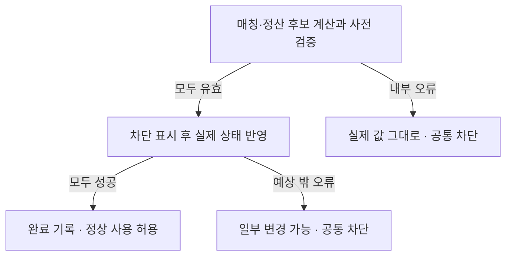

# #128 · 계산한 거래를 실제 주문장과 돈에 반영하기

**이번에 연결한 것:** 접수한 주문 한 건을 골라, 매칭과 모든 정산을 먼저 계산·검사하고 실제 주문장·잔고·예약·원장을 바꾼다. 모두 끝나면 완료를 기록하며, 같은 실행을 다시 불러도 돈을 두 번 움직이지 않는다.

BUY100×3에 300을 예약한 뒤 90·95에 1개씩 사면, 사용 가능 금액은 **700→715**, 예약은 **300→100**, 받은 BTC는 **0→2**가 된다. 주문장에는 BUY1개가 남는다. 수수료0·수량 단위1인 예다.

| 이번 동작 | 실행 후 확인할 사실 |
| --- | --- |
| 상대 없는 SELL | 돈·예약은 그대로, 주문장 진입과 완료 한 번 |
| 두 번 체결한 BUY | 실제715·예약100·BTC2, SELL 지급185, 주문장 잔량1 |
| 같은 승인 순번 재실행 | 최초 완료 반환, 추가 체결·원장·순번 없음 |
| 계산 중 내부 오류 | 실제 업무 값 유지, 공통 상태 차단 |
| 실제 반영 중 오류 | 일부 변경 가능, 공통 상태 차단 |

**이번 변경은 코어 모듈의 직접 실행이다.** 테스트가 `TradingState`를 직접 호출한다. 기존 Aeron 어댑터나 HTTP에서 자동 실행하는 연결은 #129이며 이번에 바꾸지 않았다. 단일 실행자 호출을 전제로 하며 이 테스트가 다중 JVM·영구 저장·재시작 복구를 증명하지 않는다.

기준은 통합 `a2cd442f76667cf2628ded7b4880653620689b73`, 작업 브랜치는 `feat/trading-state/128`이다. Aeron 자동 실행은 #129에서 연결한다.

<details markdown="1">
<summary>1. 어디서 시작해서 무엇이 바뀌나</summary>

```text
공통 상태에서 자금 준비 → 주문 접수·예약 → 승인 순번을 받아 명시적 실행
 → 완료 기록이 있으면 최초 결과 반환
 → 없으면 같은 마켓의 앞 대기 주문인지 확인
 → 매칭 후보와 모든 정산 후보 계산
 → 원본·현재 값·원장 ID·전체 결과를 사전 대조
 → 실제 주문장 → 실제 자금·예약·원장 → 매칭 결과 → 대기 제거 → 완료 기록
 → 정상 사용 허용
```

`TradingState`가 빈 내부 접수 상태·매칭 엔진·결과 상태를 직접 만든다. 외부에서 가진 가변 엔진이나 별도 잔고를 주입하지 않는다. 실제 잔고 map은 기존 접수 상태 하나다. 실행 중에는 체결에 참여하는 주문·사용자·자산만 읽고, 전체 snapshot은 명시적 조회에서만 복사한다.

진입점은 [executePending](../domain-trading/src/main/kotlin/com/exchange/core/trading/TradingState.kt#L108)다. 외부에서는 승인 순번·처리 시각만 준다. 주문 원본·정책·현재 예약을 다시 입력받지 않는다. 없는 순번과 같은 마켓의 앞 대기 건너뛰기는 값 변경 없이 입력 오류로 끝난다. 유효한 승인 주문의 내부 계산 오류부터는 차단한다.

[모든 공개 입구](../domain-trading/src/main/kotlin/com/exchange/core/trading/TradingState.kt#L70)는 같은 차단 판정을 사용한다. 내부 가변 객체를 getter나 callback으로 노출하지 않고, 정상 조회는 불변 값 목록만 반환한다. 원장 ID는 실제 마켓·체결 사건 순번의 고정 바이트를 해시해 만든다. 목록 index·현재 시간·난수를 ID로 쓰지 않는다.

</details>

<details open markdown="1">
<summary>2. 계산 중 오류와 실제 반영 중 오류는 코드에서 어디서 나뉘나</summary>



[후보 계산](../domain-trading/src/main/kotlin/com/exchange/core/trading/TradingState.kt#L135)부터 [전체 결과 사전 검증](../domain-trading/src/main/kotlin/com/exchange/core/trading/TradingState.kt#L148)까지는 실제 업무 값에 쓰지 않는다. 둘째 판매자에게 지급할 때 overflow가 나면 첫 계산이 성공했어도 실제 잔고·예약·주문장은 실행 직전 그대로다. 다만 유효한 승인 주문의 계산을 신뢰할 수 없어 공통 상태를 차단한다. 접수 때 묶은 300은 남으며 자동 반환하지 않는다.

[실제 쓰기 시작](../domain-trading/src/main/kotlin/com/exchange/core/trading/TradingState.kt#L158) 뒤에는 주문장부터 실제 값이 바뀐다. 예를 들어 주문장이 바뀐 뒤 잔고 쓰기에서 예외가 나면 주문장 변경이 남아 있을 수 있다. [오류 처리](../domain-trading/src/main/kotlin/com/exchange/core/trading/TradingState.kt#L175)는 차단을 유지하고 원래 오류를 전달한다. 정상 잔고 조회·새 접수·다른 마켓·과거 성공 재전송도 막는다. 원상복구나 재개 API는 이번에 없다.

전체 성공 때만 [마지막 완료 기록](../domain-trading/src/main/kotlin/com/exchange/core/trading/TradingState.kt#L172) 뒤 차단을 해제한다. `finally`에서 무조건 해제하지 않는다. **함께 반영은 실패 시 메모리를 SQL처럼 되돌린다는 뜻이 아니다.** 검증을 먼저 끝내고 완료 전 상태를 정상 사용으로 공개하지 않는 보장이다.

<details markdown="1">
<summary>실제 executePending 원문 보기</summary>

```kotlin
    fun executePending(
        admissionSequence: Long,
        occurredAt: Instant,
    ): Completion {
        checkUsable()
        completions[admissionSequence]?.let { return it }
        require(admissionSequence > 0) { "승인 순번은 양수여야 합니다" }
        val record = requireNotNull(admission.accepted(admissionSequence)) { "승인된 주문이 없습니다" }
        val first = admission.firstPending(record.candidate.order.marketId)
        if (first != null) require(first.sequence == admissionSequence) { "같은 마켓의 앞선 대기 주문부터 처리해야 합니다" }

        // 대상 선택 오류와 달리, 승인된 주문의 내부 계산·관계 오류는 공통 상태를 불신하게 한다.
        try {
            check(first === record) { "승인 원본과 처리 대기가 연결되지 않습니다" }
            val original = record.candidate
            val order = original.order
            val command =
                SubmitOrderCommand(
                    order.marketId,
                    order.orderId,
                    order.userId,
                    order.side,
                    order.orderType,
                    order.timeInForce,
                    order.price,
                    order.quantity,
                )
            val plan = engine.prepareSubmit(command)
            val reservations = validateParticipants(record, plan)
            val balances = participantBalances(reservations, original.market)
            val executions = plan.events.filterIsInstance<TradeExecuted>().map { it.toSettlement(occurredAt) }
            val settlement = settlementCalculator.calculate(order, original.market, executions, reservations, balances)
            validateJointResult(record, plan, settlement, executions)
            admission.validateSettlement(settlement)
            engine.validate(plan)
            val executionId = "EXECUTE:v1:$admissionSequence"
            check(resultState.find(order.marketId, executionId) == null) { "전체 완료 없이 매칭 결과만 존재합니다" }
            check(engine.lastEngineSequence(order.marketId) == resultState.lastEngineSequence(order.marketId)) {
                "주문장과 결과 이력의 이전 순번이 다릅니다"
            }
            resultState.validateRegistration(
                executionId,
                command,
                plan.events.size,
                plan.firstEngineSequence,
                plan.lastEngineSequence,
                plan.events,
            )

            // 여기부터 실제 값이 바뀐다. 완료 기록까지 끝나기 전에 정상 사용을 허용하지 않는다.
            isBlocked = true
            engine.apply(plan)
            admission.applySettlement(settlement)
            val matchingResult =
                resultState.register(
                    executionId,
                    command,
                    plan.events.size,
                    plan.firstEngineSequence,
                    plan.lastEngineSequence,
                    plan.events,
                )
            admission.completePending(record)
            val completion = Completion(record, executionId, occurredAt, matchingResult, settlement)
            completions[admissionSequence] = completion
            isBlocked = false
            return completion
        } catch (failure: Throwable) {
            isBlocked = true
            admission.block()
            throw failure
        }
    }

```

원문 [108행부터](../domain-trading/src/main/kotlin/com/exchange/core/trading/TradingState.kt#L108), SHA-256 `7d93900d57f76240dfa78dbc469b7bb2347ff6a17a96d605fce41bf22a0722a4`. 위 내용은 작성 시점 사본이며 자동 갱신하지 않는다.

</details>

</details>

<details markdown="1">
<summary>3. 최초 접수 결과와 현재 돈을 왜 나눠 기억하나</summary>

최초 접수 응답은 당시 사실인 USDT700·예약300이다. 체결 후 현재 값715·예약100으로 그 응답을 덮어쓰지 않는다. 현재 예약은 [currentReservations](../domain-trading/src/main/kotlin/com/exchange/core/trading/OrderAdmissionState.kt#L47)에 따로 저장하고, 최초 승인 기록은 계속 유지한다. 처리했다고 원본을 지우면 같은 주문을 새 주문으로 받거나 개발 자금을 다시 지급하는 문제가 생길 수 있다.

접수 후 처리 대기는 주문장 대기와 다르다. 상대 없는 SELL도 최초 매칭 처리는 완료돼 접수 대기에서 빠지고 주문장에는 남는다. 이후 maker로 체결되면 현재 예약이 바뀌지만 최초 접수 응답·최초 처리 완료 결과는 과거 사실로 남는다.

완료 재호출은 [완료 먼저 조회](../domain-trading/src/main/kotlin/com/exchange/core/trading/TradingState.kt#L113)에서 최초 객체를 반환한다. 새로운 시각을 넘겨도 최초 원장 시각·ID가 바뀌지 않는다. 단, 차단 검사가 완료 조회보다 먼저다. 마지막 완료 쓰기 직후 오류가 나 일부 완료가 남았어도 이를 성공으로 반환하지 않는다.

</details>

<details markdown="1">
<summary>4. 정상·재실행·수수료 테스트 15개 자세히 보기</summary>

## 공통으로 읽을 준비 흐름

`state()`는 실제 접수 계산기·매칭·정산 계산기·수수료·원장 도메인을 연결한 새 거래 상태를 만든다. mock이나 내부 잔고·예약·주문장 직접 주입을 사용하지 않는다. 테스트는 `fund()`로 개발 자금을 준비하고, `admit()`로 접수한 다음 `executePending()`을 직접 호출한다. HTTP·Aeron·DB·다중 JVM·동시 실행을 검증하는 테스트는 아니다.

| 같은 흐름에서 바꾸는 매개값 | 기본값·동작 | 실제 준비 근거 |
| --- | --- | --- |
| 마켓 | BTC-USDT, 수량 scale 0. 다른 마켓 사례만 SUI-USDT를 전달 | [fixture:30][X30] |
| 사용자 | 구매자 B·판매자 S. 자전거래는 양쪽 B, 수수료 후속 SELL은 S2 | [fixture:33][X33] |
| 정책 | 현물·NORMAL·버전 1, maker/taker 모두 0. 수수료 사례에서만 요율 변경 | [fixture:36][X36] |
| 주문 | ID·사용자·방향·가격·수량을 전달. LIMIT·GTC는 공통 | [fixture:52][X52] |
| 준비 | 실제 `OpeningBalance`를 `prepareDevelopmentBalance`에 전달 | [fixture:70][X70] |
| 접수 | 기본 요청 ID는 `request-주문ID`, 실제 `admit`의 승인 결과를 요구 | [fixture:79][X79] |
| 시각 | 고정 `2026-10-25T00:00:00.123456789Z`에 정해진 초를 더함 | [fixture:35][X35] |
| 기대 잔고 | `balance()`는 숫자를 담는 값 객체만 생성. 계산기를 다시 호출해 정답을 만들지 않음 | [fixture:90][X90] |

여러 테스트가 쓰는 `twoMakerExample()`은 B에게 USDT 1,000·S에게 BTC 2를 준비한다. S1 SELL90×1, S2 SELL95×1을 각각 접수·실행해 주문장에 놓은 뒤, B1 BUY100×3을 접수까지만 한다. 이때 승인 순번은 1·2·3, 매칭 사건 순번은 1·2, B의 잔고는 700/hold300이다. 준비 자체가 실제 공통 상태의 정상 입구를 거친다는 근거는 [T:555][T555]에 있다.

금액 기대값은 명세의 손계산이다. 90+95=185, 지정가 대비 반환은 10+5=15라서 BUY 실행 뒤 B는 USDT715/hold100·BTC2다. 고정 SETTLEMENT ID 두 개도 명세의 사건 3·4 대조값을 그대로 사용한다.

## 1. 상대 없는 SELL도 최초 실행을 완료한다

상대 주문이 없어도 접수 대기에서 빠지고 주문장과 완료 이력에 한 번 기록돼야 한다. 대기에 계속 남으면 같은 주문의 최초 실행을 반복할 수 있다.

- **Given:** S에게 BTC2를 준비하고 SELL90×1을 접수한다. 접수 후 잔고·예약·원장을 보관한다.
- **When 1:** 승인 순번 1을 고정 시각+1초에 실행한다.
- **Then 1:** 접수 기록과 동일한 참조, `EXECUTE:v1:1`, 최초 실행 시각을 반환한다. 실제 잔고는 BTC1/hold1이고 접수 직후와 같으며 예약도 같다. 처리 대기는 비고 완료·매칭 결과는 각각 정확히 그 한 건이다. 사건은 순번 1의 `OrderEnteredBook` 한 개이고 SETTLEMENT는 0개다. 주문장에는 S1의 최초·현재 수량 1이 남고 엔진 순번은 1이다. [T:53][T53]
- **When 2:** 같은 승인 순번을 시각+99초로 다시 실행한다.
- **Then 2:** 최초 완료 객체와 같은 참조를 반환하며 전체 공개 snapshot·주문장·엔진 순번 1이 유지된다. [T:79][T79]

## 2. 90·95의 두 체결을 잔고와 주문장에 함께 반영한다

금액만 맞고 주문장이나 현재 예약이 옛값인 상황을 막는 대표 사례다.

- **Given:** 공통 두 maker 준비를 사용한다. B는 승인 3을 받았고 실행 직전 USDT700/hold300, S는 BTC0/hold2다.
- **When:** B1 BUY100×3을 시각+3초에 실행한다. [T:92][T92]
- **Then:** 실제 잔고 집합은 B USDT715/hold100·BTC2, S USDT185·BTC0이다. 매칭 사건 전체는 체결 90×1(순번3), 체결95×1(순번4), BUY 잔량1 진입(순번5)과 정확히 같다. 원래 LIMIT·GTC·가격100·수량3이 매칭 명령에 연결된다. [T:95][T95]
- **Then:** 현재 예약은 정확히 S1·S2·B1의 3개다. B1은 잔량1·금액100·ACTIVE이고 두 SELL은 정확히 2개이며 모두 잔량0·금액0·SETTLED다. 주문장에는 B1만 최초수량3·현재수량1로 남는다. 전체 대기는 비고 완료·결과는 각 3개다. [T:146][T146]
- **Then:** 공통 원장 종류 순서는 OPENING2→RESERVE3→SETTLEMENT2다. 기존 원장 객체를 그대로 참조하고 RELEASE 거래를 별도로 만들지 않는다. 사건3·4 고정 ID는 정산 실행 입력·정산 거래·실제 공통 원장 모두와 일치한다. 양쪽 지급·hold 소비·가격 개선 반환 분개와 최초 실행 시각도 비교한다. [T:176][T176], [T:189][T189], [T:201][T201]

## 3. 체결 뒤 접수 재전송은 최초 응답과 현재 값을 섞지 않는다

다시 보낸 접수 응답이 현재 잔고나 예약을 옛값으로 덮어쓰는 일을 막는다.

- **Given:** 두 maker 예시의 BUY까지 실행해 현재 B가715/hold100인 상태다.
- **When:** `request-B1`과 같은 원본을 보내되 정책 버전을999, 원장 ID와 시각을 새 값으로 바꿔 `admit`을 다시 호출한다. [T:229][T229]
- **Then:** 최초 승인 응답과 같은 참조를 돌려준다. 최초 후보는 여전히700/hold300·예약300·수량3·승인3이고 요청 존재도 유지된다. 공개 snapshot은 변하지 않으며 현재 잔고715/hold100·현재 예약100을 직접 다시 확인한다. [T:239][T239]

## 4. 완료 재실행은 같은 결과를 돌려주고 효과를 더하지 않는다

실행을 다시 호출해 두 번 지급하거나 사건 순번을 더 쓰는 일을 막는다.

- **Given:** 두 maker 준비 뒤 BUY를+3초에 실행하고 snapshot과 주문장을 보관한다.
- **When:** 같은 승인3을+99초로 다시 실행한다. [T:266][T266]
- **Then:** 최초 완료와 같은 참조·`EXECUTE:v1:3`·최초 시각을 반환한다. 두 정산 원장의 시각도+3초 그대로다. 전체 공개 snapshot·주문장·마지막 사건 순번5가 유지된다. [T:268][T268]

## 5. 완료 주문의 ID를 새 접수에 재사용할 수 없다

완료했다고 최초 승인 이력을 지워 같은 주문을 새 주문처럼 받는 일을 막는다.

- **Given:** 두 maker 예시의 B1 실행이 완료된 상태다.
- **When:** B1을 새 요청 ID로 접수하고, 이어 요청 ID가 없는 오버로드로도 접수한다. [T:284][T284]
- **Then:** 두 호출 모두 `DUPLICATE_ORDER`를 반환한다. 요청 목록만 최신 목록으로 교체한 이전 snapshot과 이후 snapshot 전체가 같다. 따라서 돈·예약·대기·원장·완료·순번·준비는 그대로다. 요청은 정확히 1개 늘고 기존 요청 목록도 보존한다. 마지막 요청의 ID는 `new-request`, 주문 원본은 B1, 결과는 방금 반환한 거절 객체와 같은 참조다. `hasRequest(B, new-request)`도 true이고 차단되지 않는다. 요청 ID 없는 두 번째 호출은 추가 요청 기록을 만들지 않는다. [T:288][T288]

## 6. 다른 마켓도 최신 공통 USDT를 사용한다

마켓마다 잔고 복사본을 써서 한 사용자의 자금을 중복 예약하는 일을 막는다.

- **Given:** BTC 예시를 실행해 B가USDT715/hold100이고 BTC BUY 잔량1을 갖고 있다.
- **When:** 같은 B의 SUI-USDT BUY715×1을 접수·실행한다. 별도 USDT 지급은 하지 않는다. [T:308][T308]
- **Then:** 새 승인4는 이전 잔고715/hold100을 읽는다. 실제 공통 잔고는0/hold815이며 BTC 예약100·SUI 예약715를 각각 보존한다. 두 마켓의 주문장 잔량은 각1이고 새 정산은 없다. 엔진 순번은 BTC5·SUI1로 분리된다. [T:311][T311]

## 7. 전량 체결해도 과거 완료·준비 이력은 남는다

체결된 주문을 주문장에 다시 넣거나 잔고가0이 됐다는 이유로 개발 자금을 재지급하는 일을 막는다.

- **Given:** B에게USDT1000·S에게BTC1을 준비한다. S의SELL90×1을 주문장에 놓고 B의BUY100×1을 접수한다.
- **When 1:** B의 주문을 실행한다. [T:347][T347]
- **Then 1:** 결과 사건은 순번2의90×1 체결 한 개뿐이다. B는USDT910·BTC1, S는USDT90·BTC0이다. 예약은 정확히 두 주문의2개이며 모두SETTLED·금액0·수량0이고 주문장·대기는 빈다. 사건 순번은2다. [T:350][T350], [T:370][T370]
- **When 2:** 과거 maker의 실행을 다시 조회하고, 최초 준비를 반복하고, 새 준비ID로 S의BTC를 다시 지급하려 한다.
- **Then 2:** maker의 최초 승인 기록 참조가 유지된다. 같은 준비는 `alreadyPrepared=true`인 최초 결과를 반환하며 새 준비는 `OpeningBalanceConflictException`이다. snapshot은 전량 체결 직후 그대로이고 차단되지 않는다. [T:380][T380]

## 8. 같은 사용자의 양쪽 체결도 공유 잔고를 덮어쓰지 않는다

한 사용자가 maker와 taker 양쪽에 등장할 때 한쪽 자금 변경을 잃는 일을 막는다. 기존 허용 정책 안의 자전거래 사례다.

- **Given:** B에게USDT1000·BTC2를 준비한다. B 자신의SELL90×1·SELL95×1을 실행해 놓고 BUY100×2를 접수한다. 실행 직전 USDT800/hold200·BTC0/hold2를 직접 검사한다. [T:390][T390]
- **When:** 같은 B의BUY를 실행한다. [T:399][T399]
- **Then:** 실제 잔고 집합은USDT1000/hold0·BTC2/hold0이고 정산은2개다. 주문장은 비고 예약은 정확히S1·S2·B1의3개로 남으며 모두SETTLED·금액0·수량0이다. [T:401][T401]

## 9. 잘못된 실행 대상은 상태를 바꾸거나 차단하지 않는다

입력 순번 오류를 내부 상태 불신과 혼동하지 않고, 앞 주문을 건너뛰어 같은 마켓의 접수 순서를 깨지 않게 한다.

- **Given:** S의SELL 두 개를 승인1·2로 접수만 한 상태다. 주문장은 비었고 엔진 순번은0이다.
- **When 1:** 아래 순번을 차례로 실행하려 한다. 각 시도 사이에 정상 실행은 하지 않는다.
- **Then 1:** 매번 `IllegalArgumentException`이고 공개 snapshot·빈 주문장·엔진0이 그대로이며 차단되지 않는다. [T:426][T426]
- **When 2:** 승인1 다음 승인2를 정상 실행한다.
- **Then 2:** 대기는 비고 완료 순서는1·2이며 엔진 순번은2다. [T:433][T433]

| 같은 거절 흐름의 입력 | 뜻 | 공통 검증문 |
| --- | --- | --- |
| 0 | 승인 순번은 양수여야 함 | [T:427][T427] |
| -1 | 음수 순번 | [T:427][T427] |
| 999 | 등록하지 않은 순번 | [T:427][T427] |
| 2 | 같은 마켓의 앞 대기1을 건너뜀 | [T:427][T427] |

## 10. 다른 마켓은 호출한 순서로 실행할 수 있다

전체 승인 순서를 마켓 간 실행 순서로 강제하지 않으면서 마켓 내부 순서는 유지한다.

- **Given:** BTC의승인1, SUI의승인2, BTC의승인3을 접수한다. 양쪽 자산은 정상 준비로 지급한다.
- **When 1:** SUI승인2를 먼저 실행한다.
- **Then 1:** BTC승인1·3이 대기하고 BTC엔진0·SUI엔진1이다. [T:451][T451]
- **When 2:** BTC승인3을 먼저 시도한 뒤 승인1→3으로 실행한다.
- **Then 2:** 건너뛰기는 `IllegalArgumentException`이고 차단되지 않는다. 최종 전체 완료의 순서는 실제 호출대로2·1·3이다. 이 테스트는 이 순서와 지정 순번을 관측한다. 입력 오류 때의 전체 값 보존은 앞 9번에서 별도로 검사한다. [T:456][T456]

## 11. 자금 부족 거절은 승인이나 실행 대기를 만들지 않는다

정상적인 자금 부족이 승인 순번을 소비하거나 다음 주문을 막는 일을 방지한다.

- **Given:** B에게USDT100만 준비한다.
- **When 1:** BUY100×2를 요청ID 없이 접수하고, 없는 승인1 실행도 시도한다.
- **Then 1:** `INSUFFICIENT_BALANCE` 거절이고 마지막 승인0·대기0이며 실행은 `IllegalArgumentException`이다. [T:468][T468]
- **When 2:** BUY100×1을 요청ID 없이 접수·실행한다.
- **Then 2:** 첫 승인순번1을 받고 완료는1개이며 차단되지 않는다. 두 입구 중 요청ID 없는 정상 접수도 직접 실행하는 사례다. [T:475][T475]

## 12. 조회 목록을 수정해 소유 상태를 바꿀 수 없다

호출자에게 돌려준 목록으로 내부 상태를 지우거나 과거 조회 결과가 뒤의 실행에 따라 변하는 일을 막는다.

- **Given:** S1의미체결 완료가1개 있고 B1은접수 대기 중이다. 현재 snapshot과 주문장 목록을 보관한다.
- **When 1:** 아래 목록을 각각 가변 목록으로 다뤄 `clear()`를 시도한다.
- **Then 1:** 각각 `UnsupportedOperationException`이다. [T:496][T496]
- **When 2:** B1을 정상 실행해 S1을 채운다.
- **Then 2:** 과거 snapshot은B1대기1·완료1·결과1·예약2·원장4를 유지하고, 과거 주문장 수량1·S의BTC1/hold1도 유지한다. 최신 snapshot의완료는2개이고 최신 주문장은 빈다. [T:508][T508]

| 같은 외부 변경 거절 흐름의 대상 | 실제 검증문 |
| --- | --- |
| snapshot 잔고·예약·대기·완료·원장·매칭 결과 목록 | [T:496][T496] |
| 주문장 조회 목록 | [T:502][T502] |
| 완료 결과의 매칭 사건 목록 | [T:503][T503] |
| 기존 원장과 최초 RESERVE의 분개 목록 | [T:504][T504] |
| 완료 결과의 정산 목록 | [T:506][T506] |

## 13. 저장한 수수료 나머지가 다음 체결로 이어진다

한 주문이 처음에는 taker, 나중에는 maker가 됐을 때 이전 체결의 소수 수수료를 잃거나 새 정책으로 바꾸는 일을 막는다. 현재 예약을 중간에 직접 만들어 넣지 않고 실제 두 실행을 잇는다.

- **Given:** maker 0.5%·taker 1% 정책으로 S1의 SELL51×1을 놓는다. B는 USDT1000에서 BUY51×5를 접수해 742/hold258이고 수수료 예약은 3이다. S2에게 후속 SELL용 BTC4도 준비한다. [F:34][F34]
- **When 1:** B의 BUY를 실행해 1개를 taker로 채운다.
- **Then 1:** B의 현재 예약은 ACTIVE·잔량4·금액207·수수료 예약3·나머지510000이다. 실제 잔고는 USDT742/hold207·BTC1, 수수료0·hold 소비51·반환0이며 주문장 잔량4다. [F:44][F44], [F:48][F48]
- **When 2:** 정책 버전2의 S2 SELL51×4를 접수·실행해 B의 BUY를 maker로 채운다.
- **Then 2:** B는 최초 정책을 유지하고 SETTLED·예약0·나머지530000, 실제 USDT744/hold0·BTC5다. B의 maker 수수료1·소비205·반환2, S2의 taker 수수료2·나머지40000·지급202가 정산과 현재 예약에 연결된다. 실제 원장 수수료 수익 분개는 1과 2의 두 개이고 주문장·대기는 비며 사건 순번은 4다. [F:61][F61], [F:66][F66], [F:80][F80]
- **When 3:** B의 첫 실행을 다시 호출한다.
- **Then 3:** 첫 완료 객체를 그대로 반환하고 현재 snapshot은 변하지 않는다. 최초 완료 속 예약은 여전히 잔량4·금액207·나머지510000이며 최초 접수 예약은 258·나머지0이다. 현재 예약과 과거 결과를 서로 덮어쓰지 않는다. [F:96][F96]

| 같은 주문 생애에서의 관측 시점 | 실제 USDT available/hold | BUY 현재 수량·예약·수수료 나머지 | 실제 검증문 |
| --- | --- | --- | --- |
| 접수 직후 | 742/258 | 5·258·0 | [F:41][F41] |
| taker로 1개 체결 | 742/207 | 4·207·510000 | [F:48][F48] |
| maker로 4개 체결 | 744/0 | 0·0·530000 | [F:66][F66] |
| 첫 실행 재호출 | 위 최신값 그대로 | 현재는 완료값, 첫 결과는 과거207·510000 | [F:96][F96] |

## 14. 양쪽 주문은 각자 접수 때의 정책을 쓴다

현재 taker 정책을 양쪽에 적용하거나 maker/taker 요율을 뒤집는 일을 막는다.

- **Given:** B의 BUY100×100은 maker 1%·taker 2%의 버전1로 접수·미체결 실행한다. S의 SELL100×100은 maker 3%·taker 4%의 버전2로 접수한다. B는 USDT20000·S는 BTC100을 정상 준비했다. [F:108][F108]
- **When:** S의 SELL을 실행해 B의 BUY를 채운다. [F:116][F116]
- **Then:** 대금10000에 B의 maker 수수료100, S의 taker 수수료400을 적용한다. B에 미사용 수수료 예약100을 반환하고 S는 9600을 받는다. 실제 잔고 집합은 B USDT9900·BTC100, S BTC0·USDT9600이며 두 현재 예약의 정책도 각자 최초 정책과 일치한다. [F:119][F119]

| 동일 정산의 역할 매개값 | 접수 정책 maker/taker | 실제 적용 수수료 | 검증 근거 |
| --- | --- | --- | --- |
| B의 BUY maker | 1% / 2%, 버전1 | 100 | [F:119][F119], [F:127][F127] |
| S의 SELL taker | 3% / 4%, 버전2 | 400 | [F:120][F120], [F:135][F135] |

## 15. 처음 수취한 자산도 잔고가 0이 됐다고 재지급할 수 없다

직접 개발 자금을 준비한 자산뿐 아니라 체결로 처음 받은 자산의 사용 이력도 보존한다.

- **Given:** B에게 USDT1000만, S에게 BTC1을 준비한다. S의 SELL90×1을 놓고 B가 BUY100×1로 채운다.
- **When 1:** B가 BTC1을 처음 수취한다.
- **Then 1:** 실제 B의 BTC 잔고1을 확인하고, B의 BTC에 대한 최초 개발 지급 이력이 없음을 별도로 확인한다. [T:530][T530]
- **When 2:** S가 받은 USDT90으로 BUY90×1을 놓고, B가 SELL90×1을 실행해 가진 BTC를 모두 판다. [T:532][T532]
- **Then 2:** B의 실제 BTC는0, USDT는1000이다. [T:539][T539]
- **When 3:** 새 준비 ID로 B에게 BTC1을 지급하려 한다.
- **Then 3:** `OpeningBalanceConflictException`이고 snapshot 전체는 그대로이며 주문장은 비고 차단되지 않는다. 이미 사용한 자산을 새 개발 자금으로 다시 준비할 수 없다. [T:541][T541]

정상·재실행·수수료 테스트 15개와 내부 반복을 설명했다. 계산 실패·실제 반영 실패·ID 충돌은 다음 절에서 따로 확인한다.

[T42]: ../domain-trading/src/test/kotlin/com/exchange/core/trading/TradingStateTest.kt#L42
[T53]: ../domain-trading/src/test/kotlin/com/exchange/core/trading/TradingStateTest.kt#L53
[T79]: ../domain-trading/src/test/kotlin/com/exchange/core/trading/TradingStateTest.kt#L79
[T86]: ../domain-trading/src/test/kotlin/com/exchange/core/trading/TradingStateTest.kt#L86
[T92]: ../domain-trading/src/test/kotlin/com/exchange/core/trading/TradingStateTest.kt#L92
[T95]: ../domain-trading/src/test/kotlin/com/exchange/core/trading/TradingStateTest.kt#L95
[T146]: ../domain-trading/src/test/kotlin/com/exchange/core/trading/TradingStateTest.kt#L146
[T176]: ../domain-trading/src/test/kotlin/com/exchange/core/trading/TradingStateTest.kt#L176
[T189]: ../domain-trading/src/test/kotlin/com/exchange/core/trading/TradingStateTest.kt#L189
[T201]: ../domain-trading/src/test/kotlin/com/exchange/core/trading/TradingStateTest.kt#L201
[T223]: ../domain-trading/src/test/kotlin/com/exchange/core/trading/TradingStateTest.kt#L223
[T229]: ../domain-trading/src/test/kotlin/com/exchange/core/trading/TradingStateTest.kt#L229
[T239]: ../domain-trading/src/test/kotlin/com/exchange/core/trading/TradingStateTest.kt#L239
[T258]: ../domain-trading/src/test/kotlin/com/exchange/core/trading/TradingStateTest.kt#L258
[T266]: ../domain-trading/src/test/kotlin/com/exchange/core/trading/TradingStateTest.kt#L266
[T268]: ../domain-trading/src/test/kotlin/com/exchange/core/trading/TradingStateTest.kt#L268
[T278]: ../domain-trading/src/test/kotlin/com/exchange/core/trading/TradingStateTest.kt#L278
[T284]: ../domain-trading/src/test/kotlin/com/exchange/core/trading/TradingStateTest.kt#L284
[T288]: ../domain-trading/src/test/kotlin/com/exchange/core/trading/TradingStateTest.kt#L288
[T302]: ../domain-trading/src/test/kotlin/com/exchange/core/trading/TradingStateTest.kt#L302
[T308]: ../domain-trading/src/test/kotlin/com/exchange/core/trading/TradingStateTest.kt#L308
[T311]: ../domain-trading/src/test/kotlin/com/exchange/core/trading/TradingStateTest.kt#L311
[T338]: ../domain-trading/src/test/kotlin/com/exchange/core/trading/TradingStateTest.kt#L338
[T347]: ../domain-trading/src/test/kotlin/com/exchange/core/trading/TradingStateTest.kt#L347
[T350]: ../domain-trading/src/test/kotlin/com/exchange/core/trading/TradingStateTest.kt#L350
[T370]: ../domain-trading/src/test/kotlin/com/exchange/core/trading/TradingStateTest.kt#L370
[T380]: ../domain-trading/src/test/kotlin/com/exchange/core/trading/TradingStateTest.kt#L380
[T388]: ../domain-trading/src/test/kotlin/com/exchange/core/trading/TradingStateTest.kt#L388
[T390]: ../domain-trading/src/test/kotlin/com/exchange/core/trading/TradingStateTest.kt#L390
[T399]: ../domain-trading/src/test/kotlin/com/exchange/core/trading/TradingStateTest.kt#L399
[T401]: ../domain-trading/src/test/kotlin/com/exchange/core/trading/TradingStateTest.kt#L401
[T419]: ../domain-trading/src/test/kotlin/com/exchange/core/trading/TradingStateTest.kt#L419
[T426]: ../domain-trading/src/test/kotlin/com/exchange/core/trading/TradingStateTest.kt#L426
[T427]: ../domain-trading/src/test/kotlin/com/exchange/core/trading/TradingStateTest.kt#L427
[T433]: ../domain-trading/src/test/kotlin/com/exchange/core/trading/TradingStateTest.kt#L433
[T442]: ../domain-trading/src/test/kotlin/com/exchange/core/trading/TradingStateTest.kt#L442
[T451]: ../domain-trading/src/test/kotlin/com/exchange/core/trading/TradingStateTest.kt#L451
[T456]: ../domain-trading/src/test/kotlin/com/exchange/core/trading/TradingStateTest.kt#L456
[T464]: ../domain-trading/src/test/kotlin/com/exchange/core/trading/TradingStateTest.kt#L464
[T468]: ../domain-trading/src/test/kotlin/com/exchange/core/trading/TradingStateTest.kt#L468
[T475]: ../domain-trading/src/test/kotlin/com/exchange/core/trading/TradingStateTest.kt#L475
[T486]: ../domain-trading/src/test/kotlin/com/exchange/core/trading/TradingStateTest.kt#L486
[T496]: ../domain-trading/src/test/kotlin/com/exchange/core/trading/TradingStateTest.kt#L496
[T502]: ../domain-trading/src/test/kotlin/com/exchange/core/trading/TradingStateTest.kt#L502
[T503]: ../domain-trading/src/test/kotlin/com/exchange/core/trading/TradingStateTest.kt#L503
[T504]: ../domain-trading/src/test/kotlin/com/exchange/core/trading/TradingStateTest.kt#L504
[T506]: ../domain-trading/src/test/kotlin/com/exchange/core/trading/TradingStateTest.kt#L506
[T508]: ../domain-trading/src/test/kotlin/com/exchange/core/trading/TradingStateTest.kt#L508
[T555]: ../domain-trading/src/test/kotlin/com/exchange/core/trading/TradingStateTest.kt#L555
[T522]: ../domain-trading/src/test/kotlin/com/exchange/core/trading/TradingStateTest.kt#L522
[T530]: ../domain-trading/src/test/kotlin/com/exchange/core/trading/TradingStateTest.kt#L530
[T532]: ../domain-trading/src/test/kotlin/com/exchange/core/trading/TradingStateTest.kt#L532
[T539]: ../domain-trading/src/test/kotlin/com/exchange/core/trading/TradingStateTest.kt#L539
[T541]: ../domain-trading/src/test/kotlin/com/exchange/core/trading/TradingStateTest.kt#L541
[F31]: ../domain-trading/src/test/kotlin/com/exchange/core/trading/TradingStateFeeTest.kt#L31
[F34]: ../domain-trading/src/test/kotlin/com/exchange/core/trading/TradingStateFeeTest.kt#L34
[F41]: ../domain-trading/src/test/kotlin/com/exchange/core/trading/TradingStateFeeTest.kt#L41
[F44]: ../domain-trading/src/test/kotlin/com/exchange/core/trading/TradingStateFeeTest.kt#L44
[F48]: ../domain-trading/src/test/kotlin/com/exchange/core/trading/TradingStateFeeTest.kt#L48
[F61]: ../domain-trading/src/test/kotlin/com/exchange/core/trading/TradingStateFeeTest.kt#L61
[F66]: ../domain-trading/src/test/kotlin/com/exchange/core/trading/TradingStateFeeTest.kt#L66
[F80]: ../domain-trading/src/test/kotlin/com/exchange/core/trading/TradingStateFeeTest.kt#L80
[F96]: ../domain-trading/src/test/kotlin/com/exchange/core/trading/TradingStateFeeTest.kt#L96
[F106]: ../domain-trading/src/test/kotlin/com/exchange/core/trading/TradingStateFeeTest.kt#L106
[F108]: ../domain-trading/src/test/kotlin/com/exchange/core/trading/TradingStateFeeTest.kt#L108
[F116]: ../domain-trading/src/test/kotlin/com/exchange/core/trading/TradingStateFeeTest.kt#L116
[F119]: ../domain-trading/src/test/kotlin/com/exchange/core/trading/TradingStateFeeTest.kt#L119
[F120]: ../domain-trading/src/test/kotlin/com/exchange/core/trading/TradingStateFeeTest.kt#L120
[F127]: ../domain-trading/src/test/kotlin/com/exchange/core/trading/TradingStateFeeTest.kt#L127
[F135]: ../domain-trading/src/test/kotlin/com/exchange/core/trading/TradingStateFeeTest.kt#L135
[X30]: ../domain-trading/src/test/kotlin/com/exchange/core/trading/TradingStateFixtures.kt#L30
[X33]: ../domain-trading/src/test/kotlin/com/exchange/core/trading/TradingStateFixtures.kt#L33
[X35]: ../domain-trading/src/test/kotlin/com/exchange/core/trading/TradingStateFixtures.kt#L35
[X36]: ../domain-trading/src/test/kotlin/com/exchange/core/trading/TradingStateFixtures.kt#L36
[X52]: ../domain-trading/src/test/kotlin/com/exchange/core/trading/TradingStateFixtures.kt#L52
[X70]: ../domain-trading/src/test/kotlin/com/exchange/core/trading/TradingStateFixtures.kt#L70
[X79]: ../domain-trading/src/test/kotlin/com/exchange/core/trading/TradingStateFixtures.kt#L79
[X90]: ../domain-trading/src/test/kotlin/com/exchange/core/trading/TradingStateFixtures.kt#L90


</details>

<details markdown="1">
<summary>5. 계산 실패·손상 입력·실제 쓰기 실패 20개 자세히 보기</summary>

## 읽을 지도

| 동작 | 테스트 정의 | 종류 | 설명 상태 |
| --- | ---: | --- | --- |
| 실행 대상 입력 오류 | 1 | 공개 흐름·입력 거절 | 설명 완료 |
| 계산 실패·예약/원본 손상·결과 손상 | 9 | 공개 정상 준비 뒤 내부 손상 또는 실제 overflow | 설명 완료 |
| 원장 거래/사건 ID 충돌 | 4 | 정상 ID 구성 또는 이력 손상 | 설명 완료 |
| 첫·중간·마지막 실제 쓰기 뒤 실패 | 6 | 테스트 소스에서 map/set을 감싼 실패 제어 | 설명 완료 |
| 차단 뒤 재전송·입력·조회 | 위 7개 테스트의 공통 후속 확인 | 공개 입구 26종 반복 | 설명 완료 |

20개는 테스트 함수 수다. 현재 예약 손상 6종, 최초 원본 손상 6종, 체결 0건 손상 4종, 잘못된 순번 입력 5종은 각 함수 내부에서 새 상태 또는 같은 미변경 상태로 반복한다. 26개 차단 호출은 계산 overflow 한 번과 실제 쓰기 실패 6번에 이어 검사한다. 이 내부 반복을 JUnit의 별도 테스트 개수로 합산하지 않는다.

## 공통 준비와 관측

기본 준비는 구매자 B에게 USDT 1,000, 판매자 S1/S2에게 BTC를 각각 1 지급한다. S1 SELL90×1, S2 SELL95×1을 각각 접수하고 명시적으로 실행한다. 두 maker는 처리 완료됐고 주문장에는 남아 있으며 엔진 순번은 2다. 이어 B BUY100×3을 접수해서 B의 USDT는 사용 가능 700·예약 300이 된다. 이 준비는 모두 공개 `fund/admit/executePending` 호출로 수행한다. [준비 코드](../domain-trading/src/test/kotlin/com/exchange/core/trading/TradingStateFailureTest.kt#L420)

오류 뒤에는 정상 조회가 차단된다. 따라서 과거에 받아 둔 snapshot을 비교하는 대신 `actualValues`가 private 실제 소유 필드를 깊게 복사한다. 잔고·현재 예약뿐 아니라 주문장의 실제 가변 잔량, 순번, 승인/요청/준비 원본, 처리 대기, 원장, 사용 ID, 매칭 결과, 완료 기록까지 값으로 보존한다. 계산 실패의 전후 비교에서 차단 플래그와 상태 없는 계산기는 제외한다. `isBlocked`는 별도로 확인한다. [관측 진입](../domain-trading/src/test/kotlin/com/exchange/core/trading/TradingStateFailureTestSupport.kt#L25), [값 복사 범위](../domain-trading/src/test/kotlin/com/exchange/core/trading/TradingStateFailureTestSupport.kt#L102)

손상 반례의 공통 Then은 세 가지다. 실행이 `IllegalArgumentException` 또는 `IllegalStateException`으로 실패하고, 오류 직전 실제 업무 값의 깊은 복사와 오류 뒤 실제 업무 값이 같으며, 공통 차단이 true다. 단순히 어떤 예외든 발생하면 통과하는 검사는 아니다. 이 사례들은 오류 메시지 문자열을 고정하지 않는다. [실행과 실제 검증문](../domain-trading/src/test/kotlin/com/exchange/core/trading/TradingStateFailureTest.kt#L394)

## 실행 대상 오류는 정상 사용을 막지 않는다

승인되지 않은 순번이나 같은 마켓의 뒷 주문을 잘못 실행해도 정상 상태를 계속 사용할 수 있어야 한다.

- **Given:** B에게 1,000을 준비하고 BUY 두 건을 순서대로 접수한다.
- **When:** 0, -1, Long.MIN_VALUE, 미등록 999, 두 번째 승인 순번을 차례로 실행한다.
- **Then:** 각 호출은 입력 오류로 실패한다. 실제 내부 값은 같은 상태이고 차단은 false다. 이후 첫 승인 주문의 실행은 성공한다.
- **실제 검증문:** 오류·실제값·차단은 [59행](../domain-trading/src/test/kotlin/com/exchange/core/trading/TradingStateFailureTest.kt#L59), 이후 정상 성공은 [64행](../domain-trading/src/test/kotlin/com/exchange/core/trading/TradingStateFailureTest.kt#L64)이다.

## 계산이나 내부 연결을 신뢰할 수 없으면 실제 쓰기 전에 멈춘다

| 테스트/상황 | Given — 준비 | When — 실행 | Then — 실제 확인·위치 |
| --- | --- | --- | --- |
| 둘째 판매자에게 지급할 때 금액 범위를 넘는다 | 기본 준비에 S2의 USDT Long.MAX_VALUE를 정상 지급한다. B 700/300, BTC 수취 잔고 없음, 두 maker, 순번2를 먼저 확인한다. | B를 실행한다. 첫 90 지급은 계산 가능하지만 둘째 95 지급은 overflow한다. | ArithmeticException, 실제 내부 값 전체 동일, 공통 차단 true. 이어 공개 입구 차단도 확인한다. [78행](../domain-trading/src/test/kotlin/com/exchange/core/trading/TradingStateFailureTest.kt#L78) |
| maker의 주문장과 현재 예약 잔량이 다르다 | SELL90×2를 놓고 BUY100×1을 정상 실행해 실제 주문장 잔량1을 만든다. 다음 BUY를 접수한 뒤 예약 잔량만2로 손상한다. | 다음 BUY를 실행한다. | 공통 손상 Then으로 오류·실제값 보존·차단을 확인한다. 실제 주문장 잔량1 준비 assertion은 [95행](../domain-trading/src/test/kotlin/com/exchange/core/trading/TradingStateFailureTest.kt#L95), 실행 검증은 [98행](../domain-trading/src/test/kotlin/com/exchange/core/trading/TradingStateFailureTest.kt#L98)이다. |
| maker 현재 예약의 원본 연결이 다르다 | 매번 새 기본 상태에서 예약의 최초 수량, 소유자, 지정가, 마켓, 자산, 정책 버전 중 하나만 손상한다. | 각각 B를 실행한다. | 6종 모두 공통 손상 Then. 손상 목록은 [103행](../domain-trading/src/test/kotlin/com/exchange/core/trading/TradingStateFailureTest.kt#L103), 실제 호출은 [116행](../domain-trading/src/test/kotlin/com/exchange/core/trading/TradingStateFailureTest.kt#L116)이다. |
| maker 최초 승인 원본 자체가 달라졌다 | 매번 새 기본 상태에서 최초 후보의 주문 수량, 사용자, 지정가, 마켓 scale, 마켓 base 자산, 정책 snapshot 중 하나를 손상한다. 현재 예약과 주문장 값을 함께 바꾸지 않는다. | 각각 B를 실행한다. | 6종 모두 공통 손상 Then. 숫자 합계만 맞는 상태가 최초 원본 연결 검사를 우회하면 이 테스트가 실패한다. [손상 목록](../domain-trading/src/test/kotlin/com/exchange/core/trading/TradingStateFailureTest.kt#L122), [실제 검증 호출](../domain-trading/src/test/kotlin/com/exchange/core/trading/TradingStateFailureTest.kt#L135) |
| 아직 한 번도 실행하지 않은 taker 예약이 줄었다 | 기본 상태의 B 현재 예약을 잔량2·금액200으로 바꾼다. 최초 승인 원본3·300은 유지한다. | B를 실행한다. | 최초 처리 전 예약이 원본과 같아야 하므로 공통 손상 Then을 확인한다. [146행](../domain-trading/src/test/kotlin/com/exchange/core/trading/TradingStateFailureTest.kt#L146) |
| 상대 주문이 없어도 잘못된 예약을 통과시키지 않는다 | 매번 빈 주문장에 B BUY100×1을 접수한다. 예약 소유자 변경, 지정가 변경, 예약 누락, 실제 hold를99로 변경 중 한 손상을 만든다. | 체결0건인 B를 실행한다. | 4종 모두 공통 손상 Then. 빈 정산 후보라는 이유로 검사가 생략되면 실패한다. [손상 목록](../domain-trading/src/test/kotlin/com/exchange/core/trading/TradingStateFailureTest.kt#L151), [실제 검증 호출](../domain-trading/src/test/kotlin/com/exchange/core/trading/TradingStateFailureTest.kt#L170) |
| 주문장과 결과 이력의 이전 순번이 다르다 | 기본 상태의 엔진 순번2는 유지하고 결과 이력의 순번을1로 손상한다. | B를 실행한다. | 공통 손상 Then. 결과 등록 전에 모순을 발견해야 실제 주문장 쓰기가 없다. [179행](../domain-trading/src/test/kotlin/com/exchange/core/trading/TradingStateFailureTest.kt#L179) |
| 매칭 결과만으로 전체 완료라고 재사용하지 않는다 | 기본 B까지 정상 실행해서 매칭 결과3건을 만든 뒤 B의 전체 완료 기록만 제거한다. | B 승인 순번을 다시 실행한다. | 매칭 결과3건 존재 assertion 뒤 공통 손상 Then. 매칭 결과 존재를 전체 거래 완료로 취급하면 실패한다. [187행](../domain-trading/src/test/kotlin/com/exchange/core/trading/TradingStateFailureTest.kt#L187) |
| 새 사건을 만들 엔진 순번이 남지 않았다 | 기본 상태의 엔진/결과 마지막 순번을 둘 다 Long.MAX_VALUE로 손상한다. | B를 실행한다. | ArithmeticException, 오류 직전 실제 내부 값 전체 동일, 공통 차단 true. [199행](../domain-trading/src/test/kotlin/com/exchange/core/trading/TradingStateFailureTest.kt#L199) |

기본 fixture에서 B의 첫 체결 사건은 실제 엔진 순번3이다. 고정 SETTLEMENT 거래 ID는 명세의 독립 해시 대조값을 사용한다. 운영 ID 함수를 호출해 정답을 다시 생성하지 않는다.

## 원장 ID는 거래 종류가 달라도 한 이력에서 검사한다

| 테스트/상황 | Given — 준비 | When — 실행 | Then — 실제 확인·위치 |
| --- | --- | --- | --- |
| 과거 OPENING ID를 새 정산에서 쓰려 한다 | B의 정상 최초 지급 거래 ID를 사건3의 고정 SETTLEMENT ID로 정한다. 나머지 기본 준비도 공개 흐름으로 완료한다. | B를 실행한다. | 공통 손상 Then으로 첫 쓰기 전 충돌·보존·차단을 확인한다. [206행](../domain-trading/src/test/kotlin/com/exchange/core/trading/TradingStateFailureTest.kt#L206) |
| 과거 RESERVE ID를 새 정산에서 쓰려 한다 | S1의 정상 접수 거래 ID를 같은 고정 SETTLEMENT ID로 정한다. | B를 실행한다. | 공통 손상 Then. prefix가 다를 것이라는 가정을 하지 않는지 확인한다. [213행](../domain-trading/src/test/kotlin/com/exchange/core/trading/TradingStateFailureTest.kt#L213) |
| 실제 체결 사건 ID가 이미 사용됐다 | 기본 준비 뒤 사용 사건 ID 집합에 `MATCHING:BTC-USDT:3`을 손상 반례로 넣는다. 이는 정상 지급/접수로 만들었다고 설명하지 않는다. | B를 실행한다. | 공통 손상 Then. 거래 ID뿐 아니라 실제 체결 사건 ID도 검사한다. [220행](../domain-trading/src/test/kotlin/com/exchange/core/trading/TradingStateFailureTest.kt#L220) |
| 확정 정산 ID를 새 지급과 접수에서 재사용한다 | B를 정상 실행해 사건3의 SETTLEMENT를 확정한다. 새 사용자는 아직 사용 이력이 없다. | 먼저 새 사용자 OPENING에 같은 ID를 사용한다. 실패 뒤 다른 정상 ID로 지급하고, 새 RESERVE에 같은 정산 ID를 사용한다. | 두 호출 모두 IllegalStateException이며 각 호출 전 실제 값이 보존된다. 차단은 false이고 실패한 새 접수의 요청 이력도 없다. 지급 충돌 assertion은 [234행](../domain-trading/src/test/kotlin/com/exchange/core/trading/TradingStateFailureTest.kt#L234), 접수 충돌과 미변경·차단·요청 부재는 [242행](../domain-trading/src/test/kotlin/com/exchange/core/trading/TradingStateFailureTest.kt#L242)이다. |

## 실제 쓰기를 끝낸 뒤 오류가 나면 일부 변경을 보존한 채 차단한다

여섯 함수는 같은 흐름을 실패 위치3종 × 오류 종류2종으로 각각 실행한다. 오류는 `IllegalStateException`과 `AssertionError`다. 테스트용 map/set은 실제 내부 자료에 `put/add`를 먼저 수행하고, 쓰기 표지를 남긴 뒤, 준비한 동일 오류 객체를 던진다. 제품에는 실패 주입 API가 없다. [put 뒤 실패](../domain-trading/src/test/kotlin/com/exchange/core/trading/TradingStateFailureTestSupport.kt#L66), [add 뒤 실패](../domain-trading/src/test/kotlin/com/exchange/core/trading/TradingStateFailureTestSupport.kt#L89)

**Given:** 기본 두 maker와 아직 처리 대기인 B를 준비한다. 정상 거절 요청도 하나 기록한다. 기존 마켓의 실제 주문장과 seen-ID set이 이미 있으므로 첫 seen-ID 쓰기 사례에서는 빈 마켓 생성 쓰기가 앞서지 않는다.

**When 1:** 지정한 실제 쓰기 직후 오류가 발생하도록 감싸고 B를 실행한다.

**Then 1:** 호출자가 받은 오류가 준비한 오류와 **같은 객체**인지 확인한다. 쓰기를 마쳤다는 표지는 정확히1회여야 한다. 실제 내부 상태도 오류 전과 달라야 한다. 이를 계산 실패처럼 전체 원상복구라고 설명하지 않는다. [동일 오류/표지](../domain-trading/src/test/kotlin/com/exchange/core/trading/TradingStateFailureTest.kt#L300), [실제 값 변경·차단](../domain-trading/src/test/kotlin/com/exchange/core/trading/TradingStateFailureTest.kt#L325)

| 테스트 정의 | 실패 위치 | Then 1의 별도 실제 관측 |
| --- | --- | --- |
| [첫 add 뒤 Exception](../domain-trading/src/test/kotlin/com/exchange/core/trading/TradingStateFailureTest.kt#L258) | 실제 seen-ID add 직후 | B 주문 ID가 표지와 같고 실제 seen set에 있다. 엔진 마지막 순번은 아직2다. [305행](../domain-trading/src/test/kotlin/com/exchange/core/trading/TradingStateFailureTest.kt#L305) |
| [첫 add 뒤 Error](../domain-trading/src/test/kotlin/com/exchange/core/trading/TradingStateFailureTest.kt#L262) | 위와 같음 | 위와 같음 |
| [중간 put 뒤 Exception](../domain-trading/src/test/kotlin/com/exchange/core/trading/TradingStateFailureTest.kt#L266) | 실제 잔고 put 직후 | 표지의 key가 실제 잔고 map에 있고 그 잔고 값은 이전과 다르다. 주문장 적용이 앞서 끝나 엔진 순번은5다. [311행](../domain-trading/src/test/kotlin/com/exchange/core/trading/TradingStateFailureTest.kt#L311) |
| [중간 put 뒤 Error](../domain-trading/src/test/kotlin/com/exchange/core/trading/TradingStateFailureTest.kt#L270) | 위와 같음 | 위와 같음 |
| [마지막 put 뒤 Exception](../domain-trading/src/test/kotlin/com/exchange/core/trading/TradingStateFailureTest.kt#L274) | 전체 완료 map put 직후 | B 승인 순번의 완료 항목이 실제 map에 있다. 실제 잔고에 B USDT715/100과 BTC2가 존재한다. [318행](../domain-trading/src/test/kotlin/com/exchange/core/trading/TradingStateFailureTest.kt#L318) |
| [마지막 put 뒤 Error](../domain-trading/src/test/kotlin/com/exchange/core/trading/TradingStateFailureTest.kt#L278) | 위와 같음 | 위와 같음 |

**When 2:** 실패 뒤 정상 성공 요청 재전송, 실패한 요청 재전송, 최초 거절 재전송, 내용 충돌, 잘못된 요청/주문 ID, 다른 마켓 접수, 요청 ID 없는 접수, 과거 준비/새 준비/잘못된 준비 ID, 과거 완료 실행/실패 실행/비양수·미등록 실행, 요청 유무4종, 전체 snapshot, 양쪽 마켓의 대기·주문장·순번을 호출한다. 26개 호출 목록은 [338행](../domain-trading/src/test/kotlin/com/exchange/core/trading/TradingStateFailureTest.kt#L338)에 있다.

**Then 2:** 26개가 모두 IllegalStateException으로 거절되고 차단이 계속 true다. 이 반복 전후의 실제 업무 값도 같아 더 진행된 쓰기가 없다. 마지막 완료 put 사례에서는 완료 항목이 실제로 존재해도 guard를 우회해 반환하지 못한다. [각 호출의 실제 검증문](../domain-trading/src/test/kotlin/com/exchange/core/trading/TradingStateFailureTest.kt#L387)

## 실행 범위

실패 테스트 20개는 모두 통과했다. 최초 주문 원본이 손상돼도 실행되던 반례를 확인한 뒤, 기존 후보 검증을 maker와 taker 양쪽에 재사용해 수정했다. 테스트는 실제 쓰기 전 값 보존과 쓰기 뒤 부분 변경 가능성을 별도로 관측한다.

이 절은 HTTP·Aeron·다중 JVM·재시작 복구를 검사하지 않는다. 전체 실행 수와 재실행 명령은 8절에 정리한다.


</details>

<details markdown="1">
<summary>6. 매칭 사전 검증과 원장 ID 테스트 10개 보기</summary>

| 준비 → 실행 | 실제 확인 | 위치 |
| --- | --- | --- |
| 결과 순번2까지 등록 → 3~5 후보 사전 검사 | 기존 기록·순번 불변, 나중에 정상 등록 가능 | [MatchingRegistrationValidationTest](../domain-matching/src/test/kotlin/com/exchange/core/matching/MatchingRegistrationValidationTest.kt#L17) |
| 과거 동일 후보·다른 내용 | 최초 객체 재사용, 다른 내용 충돌 | [같은 테스트](../domain-matching/src/test/kotlin/com/exchange/core/matching/MatchingRegistrationValidationTest.kt#L40) |
| 개수·누락·순서·마켓·taker·수량·다음 순번·빈 ID·중복 제출 변형 | 모든 사전 거절이 쓰기를 하지 않음 | [같은 테스트](../domain-matching/src/test/kotlin/com/exchange/core/matching/MatchingRegistrationValidationTest.kt#L53) |
| 취소 성공·거절 후보 검사 | 기록하지 않음, 잘못된 이벤트 거절 | [같은 테스트](../domain-matching/src/test/kotlin/com/exchange/core/matching/MatchingRegistrationValidationTest.kt#L80) |
| 차단 플래그를 reflection으로 직접 설정 → 과거 후보·순번 조회 | 차단 오류 | [같은 테스트](../domain-matching/src/test/kotlin/com/exchange/core/matching/MatchingRegistrationValidationTest.kt#L94) |
| 주문장 가격/FIFO 구성 → 불변 조회 → 후속 체결 | 정확한 순서·수량, 목록 수정 거절, 과거 조회값 보존 | [MatchingReadViewTest](../domain-matching/src/test/kotlin/com/exchange/core/matching/MatchingReadViewTest.kt#L19) |
| 부분 체결 후보의 maker 값 조회 → 적용 | 기존 maker7필드와 목록 불변, 체결 전 잔량 보존 | [같은 테스트](../domain-matching/src/test/kotlin/com/exchange/core/matching/MatchingReadViewTest.kt#L49) |
| BTC 사건3·4, SUI 사건3 | 명세 고정57자 ID·반복 동일 | [SettlementTransactionIdTest](../domain-trading/src/test/kotlin/com/exchange/core/trading/SettlementTransactionIdTest.kt#L11) |
| UTF8·콜론 원문, Long.MAX_VALUE | 별도 표준 계산한 고정 ID·인접 순번 구분 | [같은 테스트](../domain-trading/src/test/kotlin/com/exchange/core/trading/SettlementTransactionIdTest.kt#L27) |
| 순번0·-1·Long.MIN_VALUE | ID 생성 거절 | [같은 테스트](../domain-trading/src/test/kotlin/com/exchange/core/trading/SettlementTransactionIdTest.kt#L38) |

</details>

<details markdown="1">
<summary>7. 변경 파일은 어떤 역할인가</summary>

| 구분 | 파일·책임 |
| --- | --- |
| 제품 실행 | TradingState: 공통 소유·실행·완료·차단. OrderAdmissionState: 같은 잔고와 현재 예약·대기·원장에 참여 |
| 기존 판단 재사용 | OrderAdmissionCandidate: 최초 연결 검사 재사용. OrderSettlementCalculator: 현재 예약 검증을 같은 모듈에서 재사용 |
| 매칭 제품 코드 | MatchingResultState: 쓰기 전 전체 검증 분리. MatchingEngine: 불변 읽기. SubmitOrderPlan/MakerFill: 불변 기준값 공개. RestingOrderSnapshot: 가변 BookOrder 대신 조회값 |
| 빌드·구조 검사 | domain-trading Gradle의 matching 직접 의존. ModuleDependencyDirection의 허용 방향 한 쌍과 독립 기대 쌍 테스트 |
| 새 테스트·지원 | TradingStateTest/FeeTest/FailureTest·Fixtures/FailureTestSupport·SettlementTransactionIdTest. MatchingRegistrationValidationTest/ReadViewTest |
| 문서 | 이 구현 읽기. 개발 도구·별도 서버·제품 gate·테스트 관찰 큐는 추가하지 않음 |

trading→matching만 추가했으며 matching→trading/ledger/fee 역의존과 app-api의 가변 매칭 엔진 직접 접근은 허용하지 않는다. 테스트의 reflection 관찰·실패 주입은 test 소스에만 있다.

</details>

<details markdown="1">
<summary>8. 실행 방법과 검증 결과</summary>

2026-10-25에 실행한 로컬 검사 **832개**, 새 테스트 **45개**가 실패·오류·건너뜀 없이 통과했다. 전체 ktlint와 필수 구조 P01~P09도 통과했다.

| 검사 범위 | 실행 수 | 실패 / 오류 / 건너뜀 |
| --- | ---: | --- |
| domain-trading | 167 | 0 / 0 / 0 |
| domain-matching | 141 | 0 / 0 / 0 |
| domain-order | 53 | 0 / 0 / 0 |
| domain-fee | 37 | 0 / 0 / 0 |
| domain-ledger | 39 | 0 / 0 / 0 |
| architecture-tests | 381 | 0 / 0 / 0 |
| app-api | 14 | 0 / 0 / 0 |

현재 변경의 첫 테스트는 API 미구현으로 컴파일 실패했으므로 행동 Red라고 부르지 않는다. 이후 maker 최초 주문 원본이 잘못돼도 실행되는 테스트 실패를 확인했고, 기존 후보 연결 검증을 재사용해 수정했다. 중복 주문의 새 요청은 거절 이력1개가 남는 기존 계약에 맞춰 기대값을 보완했다.

아래 `/path/to/exchange-core`는 이 브랜치를 체크아웃한 실제 경로로 바꾼다.

```bash
cd /path/to/exchange-core
./gradlew :domain-trading:test :domain-matching:test :domain-order:test :domain-fee:test :domain-ledger:test ktlintCheck :architecture-tests:test :architecture-tests:verifyArchitectureReport --console=plain
./gradlew :app-api:test --tests 'com.exchange.core.api.order.application.TradeSettlementServiceTest' --tests 'com.exchange.core.api.config.LedgerPersistenceConfigurationTest' --console=plain
```

공통 상태 테스트는 실제 순수 도메인 객체를 사용한다. 지정 app-api 14건 중 TradeSettlementServiceTest 11건은 실제 PostgreSQL 정산 회귀이고, LedgerPersistenceConfigurationTest 3건은 JDBC 호출 없이 Bean 구성 조건을 확인한다. 새 코어가 DB에 적재됐다는 검증이 아니다. 전체 app-api 테스트와 원격 CI의 결과는 이 로컬 검사 집계에 포함하지 않는다.

**독립 검토:** 작성 대화를 상속하지 않은 별도 리뷰어가 같은 제품·테스트·빌드 소스의 고정 복사본에서 코어·구조·지정 DB 회귀를 직접 실행했다. 테스트 준비 방식에 대한 문서 표현 한 건을 바로잡고 재검토했으며, 검토 범위에서 확인된 미해결 결함은 없다. 2026-10-26 게시 준비에서는 문서의 경로·실행 결과 링크만 정리했고 제품·테스트·빌드 내용은 바꾸지 않았다.

</details>
