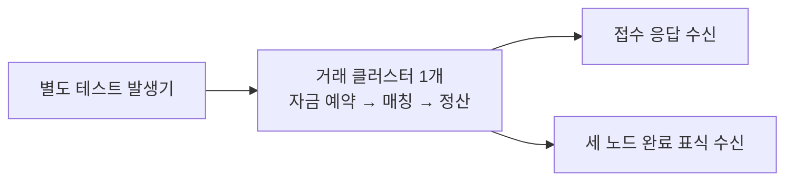

# 현재 거래 아키텍처 처리량 기록 — 2026-10-29

현재 구현을 변경하지 않고 측정했다. 짧은 신규 매수 9만 건 시험의 세 노드 완료 관측은 **15,063–20,202건/초**였다. 같은 클러스터에 매도·매수 주문을 계속 추가한 시험은 **23.293초에 자원 보호 기준으로 중단**했다. **10분 지속 처리량과 엔진의 절대 최대 TPS는 확보하지 못했다.**

## 실행 환경과 처리 범위

- 하나의 Aeron 거래 클러스터, 독립 Docker/JVM 3개. 각 노드 2 CPU·2GiB, G1, Xms256MiB·Xmx1536MiB, Java 25.
- Docker VM 전체 8 CPU·약 7.75GiB. 동일 Mac의 CPU·메모리·저장 장치를 공유한다. 독립 EC2 세 대의 결과가 아니다.
- Archive fileSyncLevel=2, catalogFileSyncLevel=2, Consensus fileSyncLevel=2. 세 노드 실제 READY 설정을 확인했다.
- BTC-USDT·SOL-USDT·SUI-USDT, 수수료 maker 1,000ppm·taker 2,000ppm. 각 실행의 세 노드는 같은 RDB 설정 버전·지문을 사용했다.
- **Direct Aeron 경로이며 HTTP/Gateway는 제외했다.** 자금 예약·세 마켓 매칭·정산은 현재 하나의 업무 스레드에서 처리한다.
- 각 실행 전 12,000건의 BUY를 예열했다. 예열 수렴을 별도로 입증한 것은 아니다.
- 실행 제품은 고정된 선택 런타임이다. 기존 런타임 파일 1,038개의 SHA-256을 유지했다. 연속 시험에만 외부 테스트 클래스 3개를 추가했다.

접수 지연은 클라이언트가 요청 전송을 시작한 때부터 접수 응답을 받은 때까지다. 완료 지연은 같은 시작 시각부터 세 노드의 마지막 완료 표식을 받은 때까지다. 완료 표식 전송·수신 스케줄링도 포함하며 순수 계산 시간이나 HTTP 지연을 뜻하지 않는다.

## 짧은 포화 시험: 신규 BUY 90,000건씩 두 번

각 실행은 SELL 102,000건을 준비하고 BUY 12,000건을 예열한 뒤, 측정 BUY 90,000건을 전송률 제한 없이 보냈다. BUY 하나는 준비된 SELL 하나와 체결된다. 마켓별 측정 BUY는 각각 30,000건이다. 두 전송 소유자·총 pending 상한 32,768을 사용했고 상한 대기 횟수는 두 실행 모두 0이었다. Aeron back pressure 재시도는 발생했다. 이 사실만으로 저장·네트워크·서비스 중 어느 하나를 절대 상한이라고 단정하지 않는다.

| 실행 | 완료 관측 구간 | 접수 응답 TPS | 세 노드 완료 관측 TPS |
|---|---:|---:|---:|
| 1 | 4.455초 | 21,099 | 20,202 |
| 2 | 5.975초 | 15,659 | 15,063 |

| 지연 | 실행 1 | 실행 2 |
|---|---:|---:|
| 접수 p95 | 489.3ms | 756.9ms |
| 접수 p99 | 511.9ms | 791.0ms |
| 완료 관측 p95 | 716.8ms | 1035.2ms |
| 완료 관측 p99 | 736.5ms | 1103.6ms |

두 실행 모두 리더는 노드 0이었지만 결과에 편차가 있었다. 최고값 하나를 지속 가능한 최대 처리량으로 쓰지 않는다. 준비된 SELL의 접수 비용은 위 BUY 측정 구간에 포함되지 않는다.

## 같은 클러스터 연속 부하: 목표 600초, 실제 23.293초

초기 SELL 12,000건·BUY 12,000건 예열 후 새 SELL 6,000건 → 새 BUY 6,000건을 반복했다. ID는 계속 증가했고 엔진 상태·금융 이력·테스트 관측 이력을 초기화하지 않았다. 각 묶음은 ACK와 세 노드 완료를 확인한 뒤 다음 묶음으로 진행했다.

전송률 제한은 없지만 묶음당 한쪽 주문은 6,000건, 전송 소유자별 최대 3,000건이다. 따라서 이 결과에도 발생기의 작업 방식이 포함된다. 클라이언트 JVM의 힙 상한은 1GiB였고 이번 중단 이유는 클라이언트 힙 제한이 아니었다.

- 실제 측정 시간: **23.293초**, `durationAchieved=false`.
- 신규 SELL **162,000건** + 신규 BUY **162,000건** = **324,000건**, 27개 묶음 쌍.
- 매도 준비·입력 생성·묶음 사이 대기까지 포함한 전체 주문 완료 관측: **13,910건/초**.
- 같은 전체 시간에 완료된 BUY/체결 수: **6,955건/초**. 앞의 주문 TPS와 같은 단위로 섞지 않는다.
- BUY 접수 p95/p99: **360.5/505.3ms**.
- BUY 세 노드 완료 관측 p95/p99: **812.3/1280.7ms**.

| 실제 구간 | 전체 주문 완료 TPS | 체결 BUY 완료/초 | BUY 완료 관측 p99 |
|---|---:|---:|---:|
| 0–5.000초 | 21,276 | 10,476 | 383.8ms |
| 5–10.000초 | 15,803 | 7,524 | 453.3ms |
| 10–15.000초 | 12,696 | 6,575 | 595.0ms |
| 15–20.000초 | 10,540 | 5,425 | 1,097.4ms |
| 20–23.293초 | 6,809 | 3,644 | 1,353.3ms |

마지막 구간은 5초가 아닌 실제 3.293초로 나눴다. 첫 5초 21,276건/초에서 15–20초 10,540건/초로 하락하는 현상을 관측했다. 단순히 두 지점의 차이를 GC·디스크·금융 이력 중 하나의 기여도로 확정한 것은 아니다.

### 중단 이유와 메모리 해석

조정 프로그램의 상대 시각 약 20.605초에 노드 1의 익명 메모리가 1,353,252,864B로 안전 기준 1.25GiB를 넘었다. 새 묶음 추가 중단을 요청하고 진행 중 묶음의 응답·완료를 확인한 뒤 종료했다. 중단 이유는 `NODE_ANON_MEMORY_GUARD`다.

익명 메모리는 현재 사용 중인 Java 힙과 같지 않다. 커밋된 힙·네이티브 메모리가 포함된다. 파일 캐시는 별도로 기록했다. 측정 뒤 힙 사용량은 노드별 약 927–952MB로 최대 힙 1.5GiB보다 작았고, 세 노드 모두 OOM/OOMKilled는 없었다. **힙이 고갈됐거나 162,000건이 제품의 최대 용량이라고 해석하면 안 된다.**

측정 전 힙 사용량은 약 152–164MB였고 측정 뒤 약 927–952MB였다. 이 값은 GC 직후 생존 객체 크기가 아니다. 누적 상태에는 금융 기록과 테스트의 정확한 완료·관측 이력이 함께 들어 있다. 측정 구간의 노드별 GC 누적 시간 증가는 약 3.2–4.1초였다. 이를 단일 GC 정지 시간이나 전체 지연의 기여율로 해석하지 않는다.

## 검증한 것과 이번에 측정하지 않은 것

- 각 요청의 고유 ID, 승인 순번, 세 노드의 동일 로그 위치, 기대 체결·정산 건수와 표식 개수를 원문에서 전수 대조했다.
- 준비·예열을 포함해 세 실행 합계 **756,000개 승인 주문·2,268,000개 노드 완료 표식**을 확인했고 검증 오류는 0건이었다.
- 실제 sync 설정, 실행별 세 노드 설정 일치, 런타임 불변성, 세 노드 정상 종료·OOMKilled=false를 확인했다.
- 이번 시간 측정에서 전체 잔고·원장 스냅샷 대사와 장애 복구 시험을 실행한 것은 아니다.
- 절대 최대 TPS, HTTP API TPS, 독립 서버 성능, 10분 지속 고부하 성공은 주장하지 않는다.

## 이력서에 사용할 수 있는 표현

> Aeron Cluster 3노드에서 BTC·SOL·SUI의 공유 자금 예약·매칭·정산 경로를 구현하고 검증했습니다. 로컬 Direct Aeron 포화 시험에서 신규 매수 9만 건을 두 차례 처리하며 완료 관측 1.5만–2.0만 건/초를 확인했습니다. 연속 부하에서는 처리량·지연·메모리 변화를 함께 기록해 장시간 처리의 후속 개선 과제를 정리했습니다.

## 재현 근거

- [측정 요약 JSON](/Users/0chord/.codex/visualizations/2026/09/23/01a0ce63-9327-7f32-a7e0-3429380284d8/issue142-performance/capacity-goal/direct-core-20261028/multi/execution-tail-20261028/request-correlation-20261028/goal-optimize-20261028/current-throughput-record-20261029/measurement-summary.json)
- [실행·종료 검증](/Users/0chord/.codex/visualizations/2026/09/23/01a0ce63-9327-7f32-a7e0-3429380284d8/issue142-performance/capacity-goal/direct-core-20261028/multi/execution-tail-20261028/request-correlation-20261028/goal-optimize-20261028/current-throughput-record-20261029/validation-summary.json)
- [5초 구간별 CSV](/Users/0chord/.codex/visualizations/2026/09/23/01a0ce63-9327-7f32-a7e0-3429380284d8/issue142-performance/capacity-goal/direct-core-20261028/multi/execution-tail-20261028/request-correlation-20261028/goal-optimize-20261028/current-throughput-record-20261029/streaming-01-intervals.csv)
- [연속 시험 실행 명령·런타임 근거](/Users/0chord/.codex/visualizations/2026/09/23/01a0ce63-9327-7f32-a7e0-3429380284d8/issue142-performance/capacity-goal/direct-core-20261028/multi/execution-tail-20261028/request-correlation-20261028/goal-optimize-20261028/current-throughput-record-20261029/streaming-01-execution.json)
- [독립 정확성 검토 범위](/Users/0chord/.codex/visualizations/2026/09/23/01a0ce63-9327-7f32-a7e0-3429380284d8/issue142-performance/capacity-goal/direct-core-20261028/multi/execution-tail-20261028/request-correlation-20261028/goal-optimize-20261028/current-throughput-record-20261029/independent-accuracy-review.json)
- [후처리 분석 코드](/Users/0chord/.codex/visualizations/2026/09/23/01a0ce63-9327-7f32-a7e0-3429380284d8/issue142-performance/capacity-goal/direct-core-20261028/multi/execution-tail-20261028/request-correlation-20261028/goal-optimize-20261028/current-throughput-record-20261029/analyze_records.py)

원문은 종료 뒤 압축·복원 SHA-256 검증을 거쳐 보관한다. 이번 실행의 컨테이너·볼륨·이미지만 실행 도구가 정리했다. 상세 정리 결과는 근거 폴더의 cleanup-final.json에 기록한다. 제품 코드 변경·커밋·push·PR 생성은 하지 않았다.

정리 수치: 검증 후 원문 압축으로 1,113,806,602B, 선택 런타임의 중복 복사 제거로 98,715,723B의 논리 용량을 줄였다. 선택 원본 런타임과 새 테스트 클래스 overlay·재구성 정보를 보존했다. 최종 호스트 여유 공간은 약 76.2GiB다. 이 절감량이 전체 호스트 사용량의 순감소와 같다는 뜻은 아니다.

## 추가 실험: Archive sync0

5분 목표의 별도 실험은16.937초·신규300,000주문 뒤 동일 익명 메모리 안전 기준으로 종료했다. 전체 주문17,712건/초·같은 시간의 체결 BUY8,856건/초를 관측했다. 세 노드 실제 설정은[0,2,2]이며5분 지속 성공은 아니다. [sync0 상세 기록](trading-throughput-sync0-20261029.md)을 참고한다.
