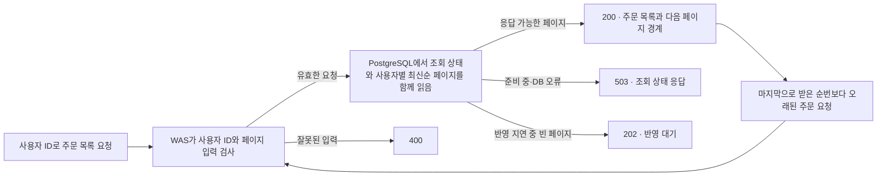

# #213 사용자별 주문 목록 조회

개발 환경에서 사용자 ID를 넣으면 기존 WAS가 해당 사용자의 주문을 최신 접수순으로 보여준다. 주문 ID를 모르는 상태에서도 미체결·부분 체결·체결 완료·취소 주문을 찾아 단건 조회로 이어갈 수 있다. 기존 PostgreSQL 주문 기록을 읽는 GET과 검증을 PR 하나에 담는다. [이슈 #213](https://github.com/0Chord/coin-exchange/issues/213)

## 사용자가 보는 흐름



예를 들어 A의 주문 순번이 `19, 17, 15, 13`, B의 순번이 `18`이라고 하자. A가 두 건씩 조회하면 첫 응답은 `19, 17`과 다음 페이지 경계 `17`이다. 그 사이 A의 20번이 접수돼도 `17` 다음 페이지는 `15, 13`이다. 첫 페이지를 다시 열면 20번을 볼 수 있다. 주문 상태는 페이지마다 그때 DB에 저장된 값을 읽는다.

**사용자 합의.** 지금은 단순한 개발용 조회를 만들고 인증·인가는 추후 상세 설계한다. 이 범위에서 요청의 사용자 ID는 조회 조건이다. 외부에 ‘내 주문’으로 제공하는 조건은 후속 설계에서 정한다.

## 현재 코드와 연결

2026-11-25 통합 브랜치 `6e6cfaa6`를 기준으로 확인했다. 현재 HTTP 주문 조회에는 주문 ID가 필요하다. 저장된 주문 본문에는 `userId`, 상태와 수량이 있으며, 한 자금 계보에서 접수 순번은 마켓을 가로질러 유일하다. 기존 조회 준비 상태와 주문 행을 같은 SQL 시점에서 보는 읽기 방식을 활용할 수 있다. [단건 조회](https://github.com/0Chord/coin-exchange/blob/6e6cfaa6f8461434798cb9a1ed48d1b6419d7e33/app-api/src/main/kotlin/com/exchange/core/api/trading/api/OrderQueryController.kt#L33) · [주문 저장 구조](https://github.com/0Chord/coin-exchange/blob/6e6cfaa6f8461434798cb9a1ed48d1b6419d7e33/app-api/src/main/resources/db/migration/V10__create_order_query.sql#L13) · [저장된 주문 필드](https://github.com/0Chord/coin-exchange/blob/6e6cfaa6f8461434798cb9a1ed48d1b6419d7e33/app-api/src/main/kotlin/com/exchange/core/api/trading/infrastructure/persistence/PostgresOrderQueryStore.kt#L402)

## API 계약

`GET /api/trading/v3/orders?userId=A&limit=2&beforeAdmissionSequence=17`

사용자 ID는 쿼리 파라미터로 받는다. 독립 리뷰에서 기존 주문이 허용하는 `team/alice`를 경로에 넣으면 Tomcat이 요청을 거절함을 재현했다. 쿼리의 `userId=team%2Falice`로 같은 ID를 전달할 수 있다. `userId=team%2Calice`는 쉼표가 포함된 단일 ID로 처리하고, `userId=team&userId=alice`처럼 같은 파라미터를 반복하면 `400`이다.

- 기존 사용자 ID 입력 규칙을 적용한다. `limit` 기본값은 50이고 범위는 1~100이다. 첫 요청은 `beforeAdmissionSequence`를 생략한다. 지정할 때는 양의 정수이며, 해당 순번보다 작은 주문만 반환한다. ID가 빠졌거나 비었을 때, 순번·건수 형식이 잘못됐을 때, 같은 입력 항목을 반복했을 때는 `400`이다.
- 현재 WAS 조회 범위에 속한 마켓들의 주문을 같은 목록에서 읽는다. 각 항목은 주문 ID·마켓·매수/매도·가격·상태·금융 반영 상태·주문 수량·체결 수량·잔량·접수 순번을 기존 단건 값대로 반환한다. 매칭 대기의 잔량은 `null`을 유지한다. 취소 주문은 `CANCELLED`이며, 예약 반환 진행 여부는 금융 반영 상태로 확인한다.
- 성공 응답은 `ORDER_LIST_FOUND`, `orders`, `nextBeforeAdmissionSequence`, `coveredAdmissionSequence`, `freshness`를 담는다. 페이지 크기보다 한 건 더 확인해 뒤에 주문이 있을 때만 마지막으로 **반환한 주문의 순번**을 다음 경계로 준다. 마지막 페이지에는 다음 경계가 `null`이다.

| 확인한 조회 상태 | HTTP 응답 |
|---|---|
| 준비됐고 주문 있음 | `200`과 목록. 반영이 밀린 경우 `freshness=LAGGING`과 확인된 반영 순번을 함께 제공 |
| 준비됐고 따라잡았으며 해당 페이지에 주문 없음 | `200`과 `orders: []` |
| 준비됐고 반영이 밀려 있으며 해당 페이지에 주문 없음 | `202 QUERY_CATCHING_UP`과 확인된 반영 순번. 빈 목록 확정은 보류 |
| DB 또는 WAS의 원본 확인이 아직 준비되지 않았거나 차단 상태 | `503 QUERY_NOT_READY` |
| 연결 획득·쿼리 실패 | `503 QUERY_UNAVAILABLE` |
| 읽은 주문과 조회 범위·반영 순번 등 저장 상태가 불일치 | `503 QUERY_INCONSISTENT` |

`202`와 `503`에는 주문 목록과 다음 페이지 경계를 제공하지 않는다. 지연 여부의 기준은 이 WAS의 주문 조회 진행 상태다. [기존 단건 조회 판단](https://github.com/0Chord/coin-exchange/blob/6e6cfaa6f8461434798cb9a1ed48d1b6419d7e33/app-api/src/main/kotlin/com/exchange/core/api/trading/application/OrderQueryUseCase.kt#L138)

## 구현 경계와 순서

1. 기존 주문 조회 컨트롤러에서 입력을 확인한 뒤 기존 서비스의 `@Transactional(readOnly = true)` 메서드를 호출한다. DB 연결을 열기 전에 잘못된 입력을 `400`으로 처리하는 기존 방식을 따른다.
2. 기존 저장소에서 조회 진행 행과 사용자별 페이지를 **하나의 SQL 스냅샷**으로 읽는다. 페이지가 비어도 진행 상태는 유지한다. 현재 자금 계보와 사용자 ID로 필터링하고, 읽은 행이 지원 마켓과 확인된 접수 범위에 있는지 검증한다. WAS가 가진 원본 재확인 상태도 기존 단건처럼 적용한다. 요청 전체는 읽기 연산이다. [기존 단건 SQL](https://github.com/0Chord/coin-exchange/blob/6e6cfaa6f8461434798cb9a1ed48d1b6419d7e33/app-api/src/main/kotlin/com/exchange/core/api/trading/infrastructure/persistence/PostgresOrderQueryStore.kt#L209) · [PostgreSQL 읽기 시점](https://www.postgresql.org/docs/16/transaction-iso.html#XACT-READ-COMMITTED)
3. Flyway V19에서 `(namespace, (record_payload ->> 'userId'), admission_sequence DESC)` B-tree 인덱스 하나를 추가한다. 기존 주문 본문에서 사용자 ID를 읽으므로 이전 주문에도 적용된다. 이 경로에 필요한 제품 변경은 기존 HTTP·서비스·저장소의 목록 조회와 이 인덱스다. PostgreSQL이 목록을 찾는 비용과 인덱스를 유지하는 쓰기 비용을 검증 기록에서 구분한다. [PostgreSQL 표현식 인덱스](https://www.postgresql.org/docs/16/indexes-expressional.html) · [정렬과 LIMIT](https://www.postgresql.org/docs/16/indexes-ordering.html)

## 수용 사례와 검증

| 사례 | 기대값 |
|---|---|
| A의 주문 `19, 17, 15, 13`과 사용자 `team/alice`의 `18`을 섞어 저장 | A의 첫 페이지는 정확히 `19, 17`, 다음은 `15, 13`, 마지막 경계는 `null`. 미체결·부분 체결·완료·취소의 수량과 상태를 기존 단건 응답과 대조. 다른 자금 계보의 같은 사용자 ID 주문도 제외. `team/alice`로 조회하면 18번만 반환 |
| 첫 페이지를 읽은 뒤 A의 20번을 반영하고 15번 상태를 갱신 | `17` 다음에는 `15, 13`이 한 번씩 나오고, 15번 상태는 갱신된 값. 첫 페이지 재조회에는 20번 포함 |
| 주문 없음·반영 지연 | 따라잡은 빈 목록은 `200/[]`. 같은 빈 조회를 지연 중에 하면 `202`. 지연 중 이미 읽을 수 있는 페이지에는 `200`과 `LAGGING` 표시 |
| 초기화·원본 차단·DB 오류·저장 상태 불일치 | 모두 `503`. 기존 오류 코드와 주문 목록 미노출 확인. 읽은 주문이 반영 순번을 앞서면 `QUERY_INCONSISTENT`. 잘못된 `limit`과 경계 순번은 DB 실패 중에도 `400` |
| 이전 데이터와 읽기 전용 | 인덱스 추가 전 저장된 주문도 조회된다. 반복 GET 전후 주문 행과 조회 진행 행이 같다. 주문이 충분히 쌓인 테스트 DB에서 `EXPLAIN`으로 네임스페이스·사용자·접수 순번 인덱스의 사용을 확인 |

첫 검증은 기존 `OrderQueryHttpTest`의 실제 WAS·PostgreSQL 구성에 사용자 격리와 2페이지 사례를 추가한다. 기존 테스트의 수량 fixture, 조회 재확인, DB 실패 구성을 재사용한다. 새 클러스터 장애 시험은 이번 조회 계약의 수용 기준에 포함하지 않는다. [기존 HTTP 테스트 구성](https://github.com/0Chord/coin-exchange/blob/6e6cfaa6f8461434798cb9a1ed48d1b6419d7e33/app-api/src/test/kotlin/com/exchange/core/api/trading/api/OrderQueryHttpTest.kt#L66) · [기존 DB 오류 시험](https://github.com/0Chord/coin-exchange/blob/6e6cfaa6f8461434798cb9a1ed48d1b6419d7e33/app-api/src/test/kotlin/com/exchange/core/api/trading/api/OrderQueryHttpTest.kt#L278)

## 구현과 실행 기록

검사 대상은 구현 커밋 `123f3524997ba3291632ae3330861664ba788c7e`의 소스·테스트와 일치한다. 조회는 컨트롤러의 입력 검사, 기존 서비스의 읽기 전용 트랜잭션, 저장소의 한 SQL 순서로 진행한다. 저장소는 기존 주문 역직렬화와 계보·마켓·상태·수량 검증을 재사용한다. HTTP 검증에서 반영 순번보다 앞선 행과 음수 체결 수량을 각각 넣어 `503 QUERY_INCONSISTENT`가 되는지 검사한다.

독립 리뷰가 재현한 경로 인코딩 문제는 사용자 ID를 쿼리로 이동해 수정했다. 한 항목을 반복한 요청은 서비스 호출 전에 `400`으로 처리하고, 실제 쉼표와 슬래시가 있는 단일 ID는 HTTP 통합 테스트에서 각각 조회한다. 새 읽기 경로는 입력 의미 검증을 기존 서비스에 두고 공개 목록 결과만 HTTP 구조 검사의 허용 데이터에 등록했다.

### PostgreSQL 실행 계획

PostgreSQL 16.15에서 인덱스가 없는 상태로 두 자금 계보·두 마켓·사용자 500명의 주문 30만 건을 먼저 저장했다. 그 DB에 V19와 동일한 인덱스를 적용하고 통계를 갱신한 뒤, 같은 SQL과 20건 페이지로 비교했다. 비교 사용자에게는 한 계보 내 주문 14,569건이 있었다.

| 읽기 위치 | 인덱스에서 나온 행 | 접근한 공유 버퍼 | 관측한 서버 실행 시간 |
|---|---:|---:|---:|
| 첫 페이지 | 21 | 19 | 0.129ms |
| 깊은 커서 페이지 | 21 | 19 | 0.111ms |
| 같은 인덱스로 1,000건을 건너뛴 비교 | 1,021 | 683 | — |

첫 페이지와 깊은 페이지 모두 계보·사용자·접수 순번 세 값이 인덱스 탐색에 사용됐다. 이전 데이터의 실제 반환 순번을 독립 기대값과 대조했고, 빈 페이지도 조회 진행 정보를 유지했다. 관측치는 PostgreSQL 서버 안의 단일 조회다.

별도 PostgreSQL 16.13 시험에서 복제한 V10 데이터에 같은 1만 건 쓰기를 수행했다. 인덱스 추가 후 삽입의 WAL은 5.25MB에서 6.60MB, 상태 갱신의 WAL은 9.09MB에서 11.05MB로 늘었다. 이 값은 인덱스 유지에 따른 실험 데이터의 쓰기 비용이며, 거래 엔진의 처리량은 별도 측정 대상이다.

### 회귀 검사

저장소 루트에서 JDK 25로 실행한 명령이다.

```sh
./gradlew --no-daemon --max-workers=2 :app-api:test \
  --tests '*OrderQueryHttpTest' --tests '*OrderQueryUseCaseTest' --tests '*PostgresOrderQueryFeedStoreTest' \
  :app-api:ktlintCheck :app-api:verifyCiTestPartition \
  :architecture-tests:ktlintCheck :architecture-tests:test :architecture-tests:verifyArchitectureReport --continue --console=plain
```

최종 앱 검사 64건이 실패·건너뜀 없이 통과했다. 구성은 실제 HTTP·PostgreSQL 조회 22건, 서비스 7건, 다중 마켓 HTTP 1건, PostgreSQL 저장·반영 34건이다. 새 목록 테스트는 서로 다른 사용자와 자금 계보를 같은 DB에 준비하고, 첫 페이지 후 더 최신 주문을 넣은 뒤에도 기존 커서로 정확히 이어지는지 검증한다. 원본 미확인·지연·저장 데이터 불일치·DB 연결 실패는 각각 응답으로 구분했다.

같은 최종 변경에서 아키텍처 검사 388건이 실패·건너뜀 없이 통과했다. 필수 운영 구조 P01~P09, 앱 테스트 분할 검사, 앱·아키텍처 Kotlin 서식 검사도 통과했다.

기준 `6e6cfaa6`과 코드·테스트 패치 SHA-256 `9980e24bc4119032afadfca207581aa379d6b1b3cbcc00540284ce13a9c473e3`를 고정해 별도 컨텍스트와 복제본에서 독립 검토를 받았다. 경로 인코딩과 반복 파라미터의 두 결함을 수정했고, 마지막 검토에서 추가 결함은 확인되지 않았다.
